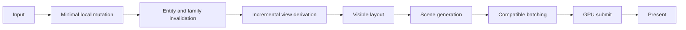

# Rendering, performance and visual architecture

Status: **Accepted** technical architecture direction and migration ordering, ratified in [ADR-0007](../decisions/ADR-0007-RENDERING-PERFORMANCE-VISUAL-ARCHITECTURE.md); **Observed** source, Release shell and temporary native/decoder measurements; **Proposed** exact visual tokens, calibrated SLOs and unresolved implementation choices; **Deferred** production media, complete viewers, native DPI/accessibility and device-loss certification. Research/ratification: 2026-10-08. GPUI pin remains Zed `395def7a067b32ed598fcb3f048969ada9b54942` (`gpui 0.2.2`; [ADR-0001](../decisions/ADR-0001-GPUI.md)). This is a technical companion only. [COS_DESKTOP_PRODUCT_UX_ARCHITECTURE.md](COS_DESKTOP_PRODUCT_UX_ARCHITECTURE.md) remains the sole product/UX canon. Runtime/COS Domain remains authoritative for Task, Artifact identity, Evaluation, Evidence, GraphRevision, outcome and command meaning. Accepted target design is not implemented behavior or permission to implement.

## 1. Scope and evidence vocabulary

Use the repository status vocabulary precisely:

- **Observed** means directly inspected source or recorded workstation evidence, not an inference about production performance.
- **Accepted** means a policy decided for subsequent work, including this ratification, not proof of implementation.
- **Proposed** means a candidate design or calibration hypothesis that still needs validation.
- **Deferred** means outside this bootstrap/architecture task's implementation scope.

Measured observations belong to the linked evidence report; current baseline values are not target attainment. Ownership, bounded work, scoped identity, virtualization, representation separation and the A→B strategy are Accepted target policies. All exact visual values and numeric SLOs below remain Proposed unless explicitly ratified by later repeated end-to-end evidence. This document does not authorize implementation.

The ten coupled goals are rendering efficiency, input responsiveness, CPU/GPU efficiency, bounded memory, collection scalability, visual fidelity, typography, meaningful motion, high-DPI precision, and design consistency. Optimizing one by degrading another is not success: a low GPU counter with blurry text, a sharp image with blocked input, or smooth animation with permanent idle work fails the design. Artifact-first hierarchy and truthful independent status axes remain canonical.

## 2. Observed baseline and boundaries

The bootstrap is a native GPUI shell with fixture and disconnected startup paths. The root `Shell` asynchronously loads `AppCore` and constructs `Workbench`; `Workbench::new` builds a `WorkbenchText` projection once from the currently available snapshot. The current `Render` body clones display strings and the artifacts/evaluation/graph vectors into per-render locals, then constructs static text surfaces. Candidate data is copied from snapshot references/labels, but the current candidate element IDs are enumeration indices (`("candidate", index)`), not stable entity identity; future list keys, selection and async work must use scoped protocol identities instead. The shell currently has no live projection-to-text update loop: no implemented Task Rail, candidate virtualization, history, Evaluation/Evidence viewer, diagnostics stream, or graph renderer; media is synthetic text and playback/decoding is unavailable. These observations are grounded in [`desktop-gpui/src/lib.rs`](../../crates/desktop-gpui/src/lib.rs) and [`ui-model/src/lib.rs`](../../crates/ui-model/src/lib.rs), and summarized in the [Bootstrap report](../development/BOOTSTRAP_REPORT.md).

The repository's accepted separation is the constraint on every proposal below: GPUI widgets/rendering/focus and GPU texture/resource lifetime remain in `desktop-gpui` (plus binary composition where needed); `ui-model` and `app-core` remain GPUI-free; UI-originated Runtime operations pass through app-core; client/protocol are not presentation or GPU layers. The future `media` boundary, if introduced for a real responsibility, provides bounded retrieval/decode/cache of non-GPUI data, not canonical artifact identity or GPU resources. Desktop cannot derive canonical status, winner, formal selection, graph revision, plan, artifact identity or stop completion. See [dependency rules](DEPENDENCY_RULES.md), [process model](PROCESS_MODEL.md), and [ADR-0006](../decisions/ADR-0006-MEDIA-BOUNDARY.md).

## 3. Accepted target frame and data pipeline

The following is the accepted target ownership/dataflow model, not a claim that GPUI itself provides the full pipeline or that the current shell implements these stages. GPUI-specific APIs and end-to-end performance remain phase exit checks.

“Incremental” is an application ownership/cache policy, not an additional universal virtual-DOM layer. GPUI's actual layout/paint reuse and backend whole-target rendering must be measured; avoid unnecessary work without promising partial pixel redraw.

| Stage | Owner and thread | Allocation / cache policy | Invalidation, cancellation and synchronization |
|---|---|---|---|
| Input and intent | GPUI window/UI thread; app-core receives explicit intent | Small event/intent values; avoid allocating a new whole view model for pointer motion or focus changes | Stable focus/selection identity; coalesce only replaceable presentation intents. Commands retain protocol receipt/reconciliation semantics; never drop or silently retry canonical commands. |
| Observation ingestion | `cos-client` background executor, through app-core | Bounded protocol staging; immutable validated snapshot/delta DTOs. Reuse immutable payloads where the concrete representation supports sharing; avoid cloning large media or collection payloads. | Preserve epoch/scope/cursor ordering, detect gaps and resync according to the protocol. Never collapse canonical intermediate events unless the contract explicitly permits a snapshot replacement; a latest-state UI view does not license discarding event semantics. |
| State publication | app-core owns session and publishes immutable, revisioned, typed projection DTOs/change sets to presentation consumers | Share `Arc`-like immutable snapshots or equivalent only when justified by actual type/ownership; small change-set allocations bounded by changed rows. No second Domain model. | Atomically publish a consistent snapshot/change set and scoped revision. Subscribers can cheaply detect unchanged projection families. UI subscription goes through app-core, never directly from GPUI to cos-client. Window/session generation prevents stale result publication. |
| View derivation | `ui-model` or app-core GPUI-free adapter on a bounded background executor | Derive display strings, row summaries, search indexes and graph-layout inputs off UI thread; cache by stable identity + source revision + relevant display parameters. Share text/labels where feasible. | Invalidate by projection family/revision and affected stable identity, not by every unrelated update. Cancel obsolete derivations on selection/session/revision change. Results carry revision and generation; reject stale completion. |
| Layout | GPUI UI thread for visible window/layout only | Allocate nodes proportional to viewport + overscan, not all records. Cache stable measurement/layout inputs where GPUI API permits and correctness is maintained. Bound variable-height measurement work. | Window size, DPI, text scale, font availability, content revision, expanded state and visibility are explicit layout invalidators. Preserve scroll anchor and focus identity across relayout. |
| Scene construction | GPUI UI thread; native GPUI element/view tree | Reuse stable entity/local state; build only visible virtualized rows and essential chrome. Custom elements only for measured image/graph needs, not as a universal abstraction. | Fine-grained entity-local invalidation is proposed. Notify only the entity/subtree whose displayed data changed where supported; do not assume this is a general retained-mode diff guarantee. |
| Batch and submit | GPUI/platform rendering boundary; resource creation and GPU upload at desktop-gpui/binary boundary | Batch compatible geometry and draw data; avoid per-item GPU submissions and per-frame texture uploads. Keep GPU resources keyed to device generation and representation. | Respect GPUI's rendering/resource APIs and thread affinity; synchronize uploads and lifetime through supported mechanisms. Do not block UI waiting on decode, layout or GPU readback. |
| Present | Platform/backend | Backend handles submission/presentation; expose measurements only where the API supports them. | GPUI does **not** promise dirty-rectangle GPU presentation or a generic retained-view diff that guarantees unchanged pixels are never repainted. Do not design budgets or claim power savings on either assumption. Measure frame, submit and available present timing separately. |

### 3.1 Invalidation and update pressure

Proposed subscription granularity: family/entity-scoped presentation change sets for Task summaries, candidate metadata, evaluation/evidence, history, graph, diagnostics and media availability, using only revisions actually supplied by the protocol. Families are not assumed independently publishable: one canonical transaction may change several together. A Task status update should not force thumbnail decode or graph layout; a viewed-candidate change should not rebuild every Task row. When the protocol delivers a broader atomic snapshot, app-core can derive change sets by comparing stable identity/source revision/content off-thread; charge that comparison to R2 rather than hiding an O(total entities) scan. Publish the complete consistent snapshot and its change set together; local cache generations are not new canonical revisions.

Use a bounded queue with back-pressure and explicit coalescing classes:

1. **Canonical observation / command semantics:** preserve ordering, gap detection, receipts, and required intermediate semantics. If overwhelmed, stop intake or resynchronize through protocol rules rather than silently dropping events.
2. **Replaceable derived presentation work:** keep at most a bounded number of queued jobs per key and supersede obsolete revisions. Do not let a stale result overwrite a newer view.
3. **Interactive transient state:** coalesce pointer/resize/scroll samples to the latest useful state per frame, while preserving discrete activation, keyboard, accessibility and command events.
4. **Media/graph jobs:** bounded priority queue; cancel work made irrelevant by viewport, selection or source revision changes. Results are cacheable only under complete keys.

Queues and caches need explicit memory bounds, cancellation token/generation, queue wait and work-time counters, and recovery behavior for saturation. Recovery should prioritize visible content and interactive input, cancel nonvisible derived jobs, retain the last valid display where safe, and surface unavailable/loading states rather than blocking. Never make unavailable canonical truth look like success.

### 3.2 Pinned Windows backend constraints

At the accepted GPUI pin, the Windows backend builds Direct3D 11 scene pipelines and submits/presents frames through DXGI; its source also uses DWM-based frame waiting. The Windows `draw_surfaces` implementation is currently a no-op, so the presence of a GPUI surface API does **not** establish that a D3D11 video surface can be presented. This is a concrete blocker to assuming the Media Foundation/D3D11 minimal-copy path in §7: first prove an integration route at the pin or make an explicitly reviewed pin decision. Source: [pinned Windows DirectX renderer](https://github.com/zed-industries/zed/blob/395def7a067b32ed598fcb3f048969ada9b54942/crates/gpui_windows/src/directx_renderer.rs#L349-L418) and [surface drawing path](https://github.com/zed-industries/zed/blob/395def7a067b32ed598fcb3f048969ada9b54942/crates/gpui_windows/src/directx_renderer.rs#L810-L815). `Present(0)` alone is not a display-pacing or latency guarantee; separate request, DWM/compositor wait, submission and present measurements.

An upstream source comparison captured 2026-10-08 reports 284 commits from accepted pin `395def7a067b32ed598fcb3f048969ada9b54942` to then-observed `46b11cc550d5bb0585fa912dfaa1218cf52e5025`. Among changes are a stale-atlas-reference guard (the upstream change's DirectX arm was explicitly not compiled there) and element-ID hash caching. The latter's author-reported frame benchmark was macOS, not Windows or COS; it is a candidate workload for an A/B, **not** COS evidence. No update is approved by this finding; preserve ADR-0001's keep-pin policy pending targeted evidence. See immutable [pin](https://github.com/zed-industries/zed/commit/395def7a067b32ed598fcb3f048969ada9b54942), [observed upstream head](https://github.com/zed-industries/zed/commit/46b11cc550d5bb0585fa912dfaa1218cf52e5025), and [revision comparison](https://github.com/zed-industries/zed/compare/395def7a067b32ed598fcb3f048969ada9b54942...46b11cc550d5bb0585fa912dfaa1218cf52e5025). This source survey is not a Windows COS benchmark or full upstream compatibility review.

**Source recheck, 2026-10-08:** Windows at the pin drives `WM_PAINT` from a per-vsync `RedrawWindow` loop ([platform](https://github.com/zed-industries/zed/blob/395def7a067b32ed598fcb3f048969ada9b54942/crates/gpui_windows/src/platform.rs#L381-L431)); [event dispatch/draw coordination](https://github.com/zed-industries/zed/blob/395def7a067b32ed598fcb3f048969ada9b54942/crates/gpui_windows/src/events.rs#L1329-L1372) and the [GPUI request-frame closure](https://github.com/zed-industries/zed/blob/395def7a067b32ed598fcb3f048969ada9b54942/crates/gpui/src/window.rs#L1708-L1838) are distinct from the eventual Present. Windows does not override the trait's demand-waker/schedule-frame defaults. Demand-driven **painting** therefore does not establish demand-driven **wakeup** or absence of idle CPU work. R0 must attribute message processing, deferred drawing, frame request/delivery and Present under native input/update pressure (§11.1), without diagnosing starvation from source alone. After-pin [frame-request diagnostics](https://github.com/zed-industries/zed/commit/cd4fc8de4ca8548cca2567352b87bcaaec13328f) explicitly leave wait/redraw behavior unchanged; they are not a demonstrated scheduling fix.

**Upstream status, checked 2026-10-08:** [issue #61469](https://github.com/zed-industries/zed/issues/61469) remains open: its author reports sustained-input paint/Present starvation in another GPUI application, with external PresentMon evidence. [#61632](https://github.com/zed-industries/zed/pull/61632) and [#63489](https://github.com/zed-industries/zed/pull/63489) are closed proposals, rejected by the maintainer as not the right fix; neither is an approved solution. The accepted pin still contains the dirty-key-dispatch `draw(...).clear(...)` path ([source](https://github.com/zed-industries/zed/blob/395def7a067b32ed598fcb3f048969ada9b54942/crates/gpui/src/window.rs#L5810-L5813)) separately from [presentation](https://github.com/zed-industries/zed/blob/395def7a067b32ed598fcb3f048969ada9b54942/crates/gpui/src/window.rs#L3443-L3458) and invalidation-based frame delivery. This establishes relevant source mechanisms, **not** a reproduced COS stall or verified fix. R0 includes posted/entity-update pressure as well as native input; do not adopt the issue's watchdog or proposed fairness policy without attribution and complete input/idle evidence.

## 4. Identity, immutable state and shared work

Use immutable revisioned DTOs and change sets across app-core/presentation boundaries. A DTO is a read-only protocol projection, not a locally reconstructed Domain object. Use stable, fully scoped IDs for list keys, selection, cache keys and asynchronous results (including task/run/iteration/candidate or the protocol's applicable scope); enumeration position is not identity. Persist user-local viewed/compare/focus/scroll state only against those identities. When an identity disappears, show an explicit unavailable state; do not silently choose a replacement, change formal selection, or infer best candidate.

The `SnapshotHandle` alias is `Arc<ProjectionState>`: the accessor's `Arc::clone` is only a shared-handle clone. At the mutation site, `Arc::make_mut` performs a full `ProjectionState::clone` whenever any consumer still holds a handle; because the state derives `Clone` over its `BTreeMap`s, retaining snapshot handles across deltas can make the next mutation O(state size). This is a conditional copy-on-write cost, not cloning on every read/handoff and not evidence of a layer-merge requirement. Consumers should drop handles promptly after deriving their view or deliberately scope retained revisions; instrument retention and copy-on-write frequency/cost before changing the boundary ([client snapshot](../../crates/cos-client/src/client.rs#L381-L384), [mutation site](../../crates/cos-client/src/client.rs#L1315-L1318), [ProjectionState](../../crates/cos-client/src/projection.rs#L113-L138)).

Keep a near-zero-cost boundary for rendering simple enums, borrowed slices, immutable shared handles and small typed IDs. Do not introduce a universal render framework, cross-layer widget abstractions, or a generic renderer crate. The ordinary shell should use GPUI's own elements/entities. A custom image/graph element is a narrow exception when profiling and API constraints justify it. GPU handles remain in desktop-gpui; decoded CPU-side media values may cross the future media boundary under explicit representation and lifetime contracts.

Shared resource/cache identity should prevent duplicate work: compare panes requesting the same artifact representation, dimensions, color transform and decode generation should share one decode/upload entry and handle where safe, not independently decode the same key. Different dimensions, source revision, transform or video timebase/PTS are different keys. Shared ownership must not imply equal display geometry, equal synchronization or equal canonical meaning. Define compare synchronization explicitly: selection pair and per-pane fit/zoom may differ; if synchronized playback is later supported, both panes refer to the same decoded presentation timestamp (PTS) policy, with any source timebase conversion stated and measured. Never synchronize by assuming frame number equivalence.

### 4.1 Proposed linked image transform

Resource reuse is separate from linked zoom/pan. If the canon's synchronized-compare interaction is selected, use one local interaction record, not one pane's post-clamp transform copied into the other:

- **Relative framing candidate:** orient each source first, use shared normalized image anchor `(u, v)` and multiplier `z` relative to each pane's contain-fit scale. In physical pixels, pane `i` has `fit_i = min(view_width_i / image_width_i, view_height_i / image_height_i)` and display scale `fit_i × z`. The initiating pane maps cursor/pan movement back to normalized coordinates; both panes map the same anchor through their own dimensions.
- **Physical 1:1 candidate:** use a common physical-display-pixels/source-pixel scale, with 1 at 1:1. Convert physical geometry to each window's DIP only at the boundary; a DPI change must not silently alter source sampling. Relative fit and physical 1:1 are explicitly different modes, not mixed in one numeric zoom value.
- Clamp each pane's display against its bounds independently, retaining the shared ideal anchor. Never feed a pane's clamped anchor back into the link and cause the other pane to drift. Letterbox smaller/unequal-aspect sources and disclose unavailable/clipped regions; no automatic feature registration, crop correction or semantic alignment.
- Independent mode retains each pane's own transform. Link/unlink preserves current viewed pair and local focus, and neither changes formal selection. Exact toggle/default/product behavior remains a UX proposal under the canon.

R5 must test unequal dimensions/orientations/aspect ratios/pane sizes, different DPI, cursor-anchored zoom, edge clamping and repeated link/unlink; resource sharing must not accidentally couple independent transforms.

### 4.2 Projection and derived-view feasibility (R2)

Virtualization bounds mounted elements, not automatically ingestion, snapshot copying, queries or display derivation. In addition to the conditional COW in §4, `candidates_for_task()` and `iterations_for_task()` scan their respective maps ([queries](../../crates/cos-client/src/projection.rs#L159-L177)); these helpers are not the current shell's render path. `Workbench::new` currently derives all candidate/evaluation/graph text once ([derivation](../../crates/ui-model/src/lib.rs#L80-L165)), while each shell render clones display collections and formats labels ([render](../../crates/desktop-gpui/src/lib.rs#L88-L131)). Source-visible costs are candidates, not established dominant bottlenecks; there is no current live projection-to-text loop to benchmark as if implemented.

Use the §10 workload sizes and identical valid transactions to compare the current `Arc<ProjectionState>`/`BTreeMap`/derivation baseline with the smallest relevant candidates: family-scoped immutable ownership, shared immutable values, selective replacement, a task-owned-entity secondary index, revision-keyed display caches and allocation-reduced text ownership. Persistent collections are an optional comparison only if simpler changes cannot meet the measured gate; none is an initial requirement. Vary one change at a time, then measure any justified combination. Include one modified/inserted/removed entity, a source-supplied family revision change where available, burst transactions, and a current snapshot held across a mutation versus promptly dropped. If the protocol has no family revision, mark that case unsupported and use its actual entity/transaction revisions; do not manufacture one.

Separate validation/mutation, snapshot publication, family comparison/index maintenance, display derivation and UI render work. Record retained-current-handle COW frequency, bytes cloned (with accounting method), allocation count/bytes, collection traversals, mutation/publication/derived-view/update-to-visible latency, memory high-water and stale-result cancellation. An old snapshot detached by an earlier COW does not force another copy merely because it remains alive.

**Correctness precedes representation work:** `cos-client` has one aggregate validation owner shared by snapshots and the effective final state of each complete delta transaction ([DC-MP-COR1](DESKTOP_DESIGN_CONTRACTS.md#dc-mp-cor1)). Evaluate legal same-transaction rewires against the final state, not intermediate mutations. Publish once only after validation; rejection leaves the last valid snapshot, cursor, epoch and duplicate-history state unchanged. MP-COR2 changes membership work inside that owner, never the accepted/rejected contract. The minimal candidate is a transaction-local deterministic node-key set; no persistent collection, general index service or dependency is selected. Staged copies and indexes allocate: an admission/allocation failure must not expose partial state, and Rust process-abort OOM cannot be advertised as recoverable. Measure actual snapshot/delta endpoints and retained-handle costs before selecting a further representation change.

R2 evidence must plot/report changed-entity count against traversed/cloned/derived entities, allocations/bytes and UI work at each total size, including unchanged visible families and unrelated updates. Select the simplest design meeting ratified §10 tail/resource gates with bounded queues and no stale publication; do not promise unconditional O(1) updates. Index/cache costs, retained revisions and cold misses count. No duplicated Domain store, dropped required protocol event, independently exposed partial family transaction or locally generated canonical revision is allowed. Roll back to bounded atomic projection publication through app-core if ordering, correctness or measured benefit fails.

## 5. Accepted virtualization policy and accessibility gates

Virtualize every potentially long surface. The logical collection may remain complete as immutable data, but UI elements, text shaping and row-specific derived presentation should be limited to visible items plus bounded overscan. Search/filter/indexing and sorting work run off-thread and return revisioned results; the UI does not materialize all rows to display a viewport.

| Surface | Proposed visible-window behavior | Identity, variable height and accessibility considerations |
|---|---|---|
| Task Rail | Visible tasks + overscan; async filtering/search; preserve selected task on updates | Stable Task identity; variable-height title/summary; keyboard navigation across virtual rows must move viewport and retain active-descendant semantics. |
| Candidates | Visible candidates + overscan; thumbnail placeholders; metadata/decode only for visible and near-visible rows | Stable scoped candidate/artifact references, not row index; variable label/metadata heights; retain viewed/compare focus when insertion/removal occurs. |
| Loop/history | Visible event/history window; older pages on demand, not all history nodes | Runtime history identity/revision; chronological order from authoritative projection; accessible loading and end-of-history states. |
| Evaluation | Visible evaluation/axis groups + overscan; defer expanded detail | Stable evaluation/axis IDs; long labels and values can wrap; disclosure state and keyboard focus survive row virtualization. |
| Evidence | Visible evidence summaries; fetch/derive details only when opened/near-visible | Evidence references remain Runtime-provided; preserve expanded/focused identity; never make truncation imply absence. |
| Diagnostics | Bounded visible ring-buffer window and explicit retention; not an unbounded log widget | Stable diagnostic sequence IDs, redact sensitive values; announce updates accessibly without live-announcement spam. |
| Graph | Viewport-cull nodes/edges; detailed labels only near zoom threshold; see graph section below | Runtime-supplied graph identities/revision; focus/selection is by stable node ID; provide non-canvas accessible structure or inspection list so graph is not canvas-only. |
| Search/results | Visible result window + overscan; background index/query; cancel stale query generations | Stable result IDs, keyboard focus retention and announced result count; query changes can supersede older searches, not discrete actions. |

Virtualization must account for variable row heights rather than assume fixed geometry. Preserve a visible stable-item scroll anchor across inserts and relayout; if the anchor disappears, move only to a documented nearest-position fallback without changing selection. Keyboard focus must not vanish when a focused row leaves the rendered window: pin/retain its accessible representation, move focus deliberately, or provide a stable list-level active descendant according to verified GPUI/platform support. Screen-reader names/roles, high contrast, keyboard-only operation and IME text input require native validation; the table is a design requirement, not evidence of current accessibility completeness.

## 6. Accepted artifact representations; conditional implementation path

Representation separation, bounded asynchronous retrieval/decode, and GPU ownership at the GPUI boundary are Accepted. Exact tile/upload APIs and codec/color support remain Proposed implementation choices. A row thumbnail, fit-to-pane preview and full-resolution tiled view are distinct representations:

- **Thumbnail:** small decoded preview for visible candidate rows; cache key includes artifact identity/revision, requested dimensions, orientation and decode/color policy.
- **Preview:** bounded-resolution view for quick selection/compare readiness; can be promoted or replaced by full detail without blocking input.
- **Full view / tiles:** pyramid or tiled decode for large dimensions; request visible tiles plus limited overscan at the current zoom, cancel obsolete tiles after pan/zoom/source change. Do not decode or upload an entire huge image just to show a small viewport.

Zoom/pan must support true 1:1 in **physical pixels**, with logical-coordinate conversion explicit under per-monitor DPI scaling. Device-pixel ratio, image orientation and fit/crop mode belong in display transform, not canonical artifact identity. Use mip levels for smooth downscale; for upscaling do not imply added source detail. Maintain stable pan anchor through resize/DPI changes where possible.

Memory arithmetic is a planning guard, not an observed benchmark: a tightly packed 8-bit RGBA image is width × height × 4 bytes before row alignment, decode intermediates, staging, mipmaps or duplicate GPU/CPU copies. At 8,192² this is 268,435,456 bytes (256 MiB); at 16,384² it is 1,073,741,824 bytes (1 GiB). A full mip pyramid adds approximately one third over the base level (exact allocation/alignment is backend-specific); additional copies can multiply the footprint. Establish explicit byte budgets for encoded bytes, decoded CPU surfaces, staging, GPU residency, tiles, and concurrent decoders; reject/stream/downsample oversized requests rather than allowing unbounded allocation.

Bound decode concurrency, upload bytes per scheduling interval, in-flight tile count, cache entry/byte limits and eviction. Prioritize visible/focused representation, then near-visible prefetch; cancel distant work. Eviction removes cache ownership but cannot invalidate a live frame's resource; defer release until GPU use is safe under GPUI/backend lifetime rules. Tag resources with device generation. On device loss, invalidate only GPU objects, retain safe CPU/encoded cache under bounds, recreate resources lazily and report recoverable unavailable state. Proposed color handling: convert a recognized embedded ICC profile into an explicitly selected display/output color space; for absent profiles, use a documented sRGB assumption and label it untagged; malformed or unsupported profiles must be reported as unknown/unmanaged rather than silently claiming color fidelity. Validate transforms and cache keys against profile identity. Wide-gamut/HDR presentation is **Deferred** until display capability, profile conversion, pipeline and golden evidence exist.

Progressive loading means bounded thumbnail → preview → visible-detail promotion, not a promise that every source format supports random-access tiles. Classify codecs before choosing a path: tile/pyramid-capable sources permit direct region requests; sequential codecs may require scanline decoding/downsample or a bounded background conversion to a temporary tile store. Charge decoder scratch, encoded bytes and conversion output to explicit limits. A format requiring an unbounded full-frame intermediate cannot silently exceed the budget; expose a bounded supported preview or explicit unavailable representation. Test corrupted metadata, extreme dimensions and cancellation between scanlines/tiles without trusting filenames or embedded profiles.

Follow-up decoder measurements establish that generating a small thumbnail by fully decoding these originals is not cheap: an ordinary 16K non-interlaced PNG decode/downscale worker exceeds one second in the tested GDI+ path (p50 614 ms full / 1,104 ms to 320², §10.6 of the evidence report), and FFmpeg 8.0 on this machine **rejects the exact 16,384² PNG decode** (`Picture size 16384x16384 is invalid`, exit 69) while the timing harness routed those inputs to the GDI+ worker. This is not proof that every codec rejects 16K, but it is proof that at least one common decoder does. Require a format-specific admission plan before original decode: account for full-frame scratch/copies, use existing bounded derivatives or a verified streaming/conversion path, and never presume that displaying a 320-pixel preview avoids full decode. The generic GPUI image element is a capability probe, not the large-artifact policy.

### 6.1 Image feasibility gates (R4)

R4 must pass **Decode → Upload → Eviction** for each supported representation/codec/device path before it can be called implementation complete. Logical cache bytes alone do not bound decoder scratch, retained upload payload or renderer atlas residency. These are future experiments, not observed capabilities or a diagnosed COS leak.

Input provenance and admission have one behavioral owner: [media input classification](DESKTOP_DESIGN_CONTRACTS.md#media-input-admission-and-integrity). A locally generated or fixture input may undergo bounded decode without an independent expected digest; a computed digest identifies bytes but does not establish independently verified integrity or Runtime authorization. External media retains descriptor authorization and independently supplied integrity requirements. Keep encoded/output/scratch limits, cancellation and unsupported/quarantine behavior on all paths. MP-IMG1 owns local keys/input feasibility, MP-IMG2 decode admission, MP-SEC3 untrusted-input hardening, MP-IMG6 authorized acquisition and MP-RT6 authorization interaction; rendering does not define a second admission policy.

| Gate | Experiment and required evidence | Admission / exit / rollback |
|---|---|---|
| Decode | Declare supported codec/library/version, dimensions/bit depth/orientation/profile, maximum accepted dimensions, region/partial capability, sequential decode behavior, intermediate/color-conversion scratch and cancellation granularity. Exercise ordinary, oversized and corrupt inputs, cancellation under interaction, and preview fallback. Measure peak concurrent encoded/output/scratch/conversion bytes, not final pixels alone. | Preflight checked dimensions and conservative peak bytes before decode. A full-decode codec is admissible only when all concurrent allocations fit the applicable §10 budgets. Otherwise choose verified bounded conversion (including temporary-store byte limit/lifetime) or an explicitly supported preview/unavailable state. Never silently try an oversized full decode as fallback. |
| Upload | Inspect the accepted pin's public image-creation/paint/removal APIs and actual allocation/upload path. Probe whole-unit versus supported partial update, row pitch/alignment, staging and retained CPU payload lifetime, GPU synchronization, cancellation, stale source/device generation and safe same-key compare reuse. Test the concrete unit/cap examples in §10 at each refresh mode. | Publish only complete current-generation resources. Each unit and its scratch/copies must fit the smallest active allowance or use a proven bounded chunk API; API presence inside the backend does not make partial upload a public feature. No indefinitely deferred oversized job, blocking UI wait or unsupported texture reuse. |
| Eviction | Repeat `load → present → switch → evict → load different image` with a fixed manifest mixing dimensions, formats and source identities, plus same-key panes, shared-resource release, window close and device loss. Record decoded cache, staging, retained upload payload, GPUI image cache, renderer atlas allocations/resource lifetime, device generation/resource count, GPU dedicated/shared use and process private/working-set peaks before/after declared retention. | Residency must plateau within the ratified bounds; retained bytes after eviction must have an explained owner/lifetime, and repeated switching must not grow unboundedly. Cache removal cannot free a resource referenced by an in-flight/live frame. Demonstrate safe device recovery or explicit unavailable mode; otherwise disable the failing representation and retain only a proven bounded path. |

GPU process counters are attribution-limited and may include driver/compositor/shared allocations; reconcile application accounting with observable resource/OS counters rather than claim exact atlas bytes from a process-memory delta. If a required lifetime/capacity endpoint cannot be observed, record the gap and keep the affected completion gate open.

**Upstream applicability, checked 2026-10-08:** [discussion #56737](https://github.com/zed-industries/zed/discussions/56737) is an author-reported Windows gpui 0.2.2 CPU image-byte retention concern, with a fork comparison and no replies; its package version is not this repository's git identity or a COS reproduction. [Issue #27414](https://github.com/zed-industries/zed/issues/27414) is closed and its author withdrew the investigated leak claim. Separately, the pin's public image removal immediately removes atlas keys ([`Window::drop_image`](https://github.com/zed-industries/zed/blob/395def7a067b32ed598fcb3f048969ada9b54942/crates/gpui/src/window.rs#L4997-L5005)); [retaining image-cache ownership](https://github.com/zed-industries/zed/blob/395def7a067b32ed598fcb3f048969ada9b54942/crates/gpui/src/elements/image_cache.rs) and [DirectX atlas insert/remove](https://github.com/zed-industries/zed/blob/395def7a067b32ed598fcb3f048969ada9b54942/crates/gpui_windows/src/directx_atlas.rs) do not provide an application byte cap. The after-pin [#64623 safety guard](https://github.com/zed-industries/zed/commit/96e95edac45b0e0696179b8139aa521cf48db392) addresses stale removed-image references, not proof of bounded residency, and its DirectX arm was not compiled there. R4 must test drop-while-cached/in-flight, retained CPU payload and atlas release together; none of these reports proves a local leak or an eviction-complete implementation.

If the generic GPUI image path fails a reproduced requirement, compare only the necessary alternatives: a narrower GPU resource owner, bounded tile-image pool, declared preview-only support, or a separately reviewed selected GPUI patch/update. A tile pool can use complete bounded tile images; partial texture updates are not mandatory if that path meets the gates. Preview-only is a capability limitation, not a fidelity-equivalent performance win or completion of full-detail requirements. No automatic independent renderer/fork, unsafe exception, dependency or pin change. Any alternative owner stays at the GPUI boundary and must prove the same sharing, lifetime and device-loss contracts.

### 6.2 Fixed versus adaptive upload experiment (R4/R5/R8)

Start with the §10 fixed process-wide allowance and hard cache/staging/in-flight caps. R4 compares it with a bounded adaptive candidate using recent frame work, upload queue wait, visible tile demand, estimated transfer cost, observable GPU memory pressure/allocation failure, active windows/panes, refresh rate and process-wide in-flight bytes. The isolated experiment is not an initial production requirement for a complex scheduler or a claim fixed budgets are fastest. If fixed already meets the gates, it remains the default; adaptive adoption still requires a measured useful benefit beyond noise.

Both variants share the same hard caps, workload/quality and device-generation rules. Adaptation cannot enlarge memory caps, grant each window a fresh allowance, or retain unlimited decoded/staging bytes. Use fair progress for visible panes/windows, a declared finite queue-age policy, bounded carryover, cancellation of obsolete work and admission that guarantees no starvation. Control parameters and any smoothing/hysteresis must be declared in the manifest and justified by noise/stability evidence, not hidden tuning.

Compare first-visible-tile and preview-ready latency, p95 frame interval and frame-miss rate, CPU/GPU work, upload queue wait, GPU high-water, per-pane/window starvation and low-memory/recovery behavior. Record OS/API memory-budget availability; if unavailable, use declared observable allocation/pressure proxies or the fixed conservative budget, never fabricated headroom. On unreliable signals, oscillation, allocation failure, unfairness or regression, revert to the fixed safe allowance and cancel/defer nonvisible work within bounds. Adopt adaptive only for independently repeated same-machine benefit beyond noise without worsening frame pacing, resource peaks, correctness or quality; otherwise keep fixed. R5 rechecks same-key reuse and synchronized pan/zoom fairness; R8 rechecks plateau/release and device recovery.

## 7. Proposed video interop boundary (conditional)

Production video is **Deferred** and interop is conditional on measured product need, a supported GPUI/Windows presentation route, and explicit architecture/security review. Candidate Windows components for an investigation include Media Foundation decoding and D3D11 surfaces with NV12/P010 formats; these are candidates only, not verified compatibility, implemented capability, or an approved dependency/API path. A capability probe must establish hardware decode, output format, sharing/synchronization support, color metadata and fallback behavior on supported devices. Fallback must be explicit and observable (e.g. supported software decode or unavailable with a clear capability reason), never a pretend successful still frame or silent fixture substitution.

Define seek, frame-step and playback clock semantics before implementation. Seek results are asynchronous and generation-tagged; cancel obsolete seeks. Frame step selects adjacent decoded presentation timestamps under a declared direction/stream policy. A shared clock and a shared decoded PTS record should drive compare panes when synchronization is requested; keep source timebases, discontinuities and missing frames explicit. Compare panes may share decoded surfaces/resources if source key, format, PTS, color transform and lifetime match; pane-specific scaling/crop should not cause duplicate decode. Whether D3D11 resources can be imported by the pinned GPUI path with minimal-copy synchronization is **unresolved**. Do not promise zero-copy; measure copy/upload count, synchronization stalls, latency and resource lifetime on actual drivers. Device loss, decoder reset and format changes must invalidate by device/decoder generation and recover without stale-frame overwrite.

Use a bounded frame ring (initial candidate: current frame plus at most two ready frames per unique stream, bytes charged to cache/in-flight limits), a monotonic playback clock and PTS scheduling; never use UI animation ticks as the media clock. Drop superseded decoded presentation frames under an explicit playback policy, not canonical Runtime observations. Measure decoder output, copies, import/upload, queue age and displayed PTS separately. Same-stream compare can share decode; two distinct streams inherently require two source decodes. Shared cache ownership and synchronized transforms must eliminate accidental duplication, not claim that two distinct 8K artifacts cost the same as one. Audio, 3D and documents retain future modality-specific timing/color/resource contracts without empty abstraction crates.

Audio playback/scrubbing, 3D, and document/PDF renderers are **Deferred**. Do not add a universal media framework or claim those modalities as part of this image/video proposal.

## 8. Accepted graph presentation strategy

Graph truth and `GraphRevision` remain Runtime-owned. Desktop renders the authoritative graph projection and must not construct a replacement topology, infer edges, or turn layout into domain meaning. A graph view may compute only presentation geometry from a specific received revision. Proposed work: background layout with cancellation and revision/generation tagging; viewport culling and spatial index; level-of-detail (hide or simplify labels/edges when distant); cached geometry keyed by graph revision, layout algorithm/version, viewport-independent layout inputs and style; batch compatible line/node geometry at the GPUI boundary. Keep visible selection/inspection responsive while a new layout is pending, and label which revision is displayed. For very large graphs, progressively reveal visible geometry; never block UI on full layout. Explore inspection-first alternatives (search, selected-node neighborhood, accessible node/edge list) before maximizing canvas complexity. No authoritative `GraphRevision` or target scale is implemented in bootstrap.

### 8.1 Graph attribution and staged choice (R6)

The evidence report's same-pin full-versus-culled graph present intervals demonstrate culling effectiveness, **not** attainment of the §10 continuous-frame targets. GPU execution time alone does not locate CPU path-generation cost. First separate graph layout, spatial query, path/geometry generation, GPUI layout/paint, CPU submission, GPU execution and Present interval; also measure memory/VRAM, geometry rebuild count and resource reuse count.

Compare cumulative stages on the same canonical graph, camera trace and inspection behavior; stop at the simplest passing stage:

| Stage | Candidate experiment |
|---|---|
| A | Baseline full path generation. |
| B | Viewport culling, with query/visibility overhead charged. |
| C | Cached geometry and spatial index keyed by stable Runtime graph revision, layout inputs/version and style; measure rebuilds after real invalidators. |
| D | Compatible batched geometry and per-LOD representation, reducing distant label/detail paint without removing accessible inspection or keyboard reachability. |
| E | Viewport-transform-centered redraw and geometry reuse across pan/zoom; establish what the pin can reuse and charge any path cloning, transform or retessellation. |
| F | Narrow custom element/rendering path only if earlier stages cannot meet ratified gates or a supported capability gap is demonstrated. |

The pin exposes safe public [`canvas`](https://github.com/zed-industries/zed/blob/395def7a067b32ed598fcb3f048969ada9b54942/crates/gpui/src/elements/canvas.rs), [`Element`](https://github.com/zed-industries/zed/blob/395def7a067b32ed598fcb3f048969ada9b54942/crates/gpui/src/element.rs), [`PathBuilder`](https://github.com/zed-industries/zed/blob/395def7a067b32ed598fcb3f048969ada9b54942/crates/gpui/src/path_builder.rs) and [`Window` paint APIs](https://github.com/zed-industries/zed/blob/395def7a067b32ed598fcb3f048969ada9b54942/crates/gpui/src/window.rs). Inspect their signatures/lifetimes and prototype through supported APIs before considering native interop. A per-frame canvas closure is not proof of cross-frame retained GPU geometry; cache presentation geometry in its appropriate entity owner and measure reuse/copy/rebuild cost.

Option B is **not** an obligation to implement an independent DirectX renderer. Own-code `unsafe_code = "forbid"` remains in force. If a required low-level D3D11 operation needs unsafe, a changed safety boundary, dependency architecture, synchronization/resource-lifetime proof and device-loss review are separate decisions, explicitly deferred rather than introduced into current crates. GPU handles stay out of ui-model/app-core/cos-client. Runtime topology/revision and accessible inspection/keyboard navigation remain intact at every stage.

Choose by performance **and** resource efficiency, accessibility, implementation complexity and maintenance cost. A stage fails if faster paint comes from lost information, fidelity or interaction; LOD must retain an equivalent full inspection route. Roll back unsupported retention/custom geometry to the last passing bounded GPUI stage or inspection view, without inventing graph state.

## 9. Accepted visual constraints; proposed token values

These are technical visual candidates, not additions or replacements to the product/UX canon. Any information hierarchy, terminology, workflow, surface, or interaction change requires canon authority and separate UX review.

### 9.1 Typography and shaping

Proposed Windows default: Segoe UI Variable when available, otherwise Segoe UI; native Japanese fallback candidates Yu Gothic UI then Meiryo, with optional installed Noto CJK rather than mandatory bundling. Code/diagnostic monospace: Cascadia Mono when available, otherwise Consolas. Resolve glyph fallback through the verified native shaping/font APIs, not ad hoc per-character widget splitting. The current shell requests the system family Yu Gothic UI; it does not embed that font. A fixed embedded Yu Gothic UI is not recommended: redistribution requires license clearance and one face does not establish balanced mixed-script metrics. Validate clean Windows font availability, Japanese/Latin punctuation, CJK line breaks, glyph coverage, baseline and numeric alignment before accepting the stack; no fonts are added by this task.

Define tested tokens for size, weight, line height, kerning/letter spacing, baseline, tabular numerals for aligned numeric values, and wrapping. Validate font hinting/antialiasing across fractional DPI and display scales; do not assume metrics remain equal across fallback fonts. Prefer native text shaping/rendering supported by GPUI/Windows. Avoid truncating critical canonical values without an accessible full-value route.

Proposed starting typography tokens (DIP sizes; weights are CSS-like numeric weights to map to available font faces, not a promise that a variable axis is present):

| Token | Size | Weight | Line height | Candidate use |
|---|---:|---:|---:|---|
| `type-xs` | 12 | 400/500 | 16 | Dense metadata and supporting labels; never hide critical status solely at this size. |
| `type-sm` | 13 | 400/500 | 18 | Secondary labels, diagnostics and compact list metadata. |
| `type-body` | 14 | 400 | 20 | Default body and standard list rows. |
| `type-body-strong` | 14 | 600 | 20 | Emphasis without changing semantic status. |
| `type-control` | 16 | 400/500 | 24 | Primary controls and comfortable interactive labels. |
| `type-title` | 20 | 600 | 28 | Surface/section title candidate. |
| `type-display` | 24 | 600 | 32 | Major title candidate only where canon hierarchy allows. |

For Japanese fallback runs, begin with 1.5× font-size line height (18/20/21/24/30/36 DIP for the listed sizes rounded to whole DIP) as a **Proposed** calibration value; ensure mixed-script baselines and adjacent Latin lines do not clip or jitter. Keep tabular numerals for aligned numeric columns where available; record font fallback and line-break behavior in golden tests.

### 9.2 Geometry, DPI and scaling

Proposed 4-DIP spacing scale: 4, 8, 12, 16, 20, 24, 32, 40, 48 DIP; allow exceptions only for measured content/interaction fit. Candidate geometry defaults: 32-DIP dense / 40-DIP comfortable row, 40-DIP title bar, 240-DIP task rail, 320-DIP inspector, 72-DIP thumbnail (96-DIP high-resolution preview), and 24-DIP minimum icon/control target inside a larger accessible hit region. These are flexible initial tokens, not fixed canon dimensions; text scale, minimum hit targets, localization and window width may increase them. Use a 1-physical-pixel divider (`1 / scale_factor` DIP) rather than a 1-DIP line at fractional DPI, subject to verified pixel snapping. Keep density and text scale independent. Validate Windows DPI at 100%, 125%, 150%, 175%, and 200%, including moving a live window between monitors, fractional scaling, resize, popups/menus, pointer hit testing and physical-pixel image zoom. Recompute layout and invalidate font/image raster caches on relevant monitor/DPI/text-scale changes without losing focus, selection or scroll anchor.

Proposed geometry tokens also include radii 0/4/8 DIP, 1-physical-pixel structural separators and a 2-DIP focus outline; do not shrink focus indicators to the structural hairline. Snap borders and icon stroke positions at paint-time in physical pixels, not each text glyph's advance. Align icons optically to adjacent cap-height/baseline; a 16/20-DIP icon may sit in a 24/32-DIP hit target. Retain fractional layout/text metrics until rasterization to avoid cumulative CJK/numeric drift.

### 9.3 Color and surface treatment

Use this **Proposed semantic palette** as a starting review artifact, not accepted product colors. The limited sRGB calculation below is **Observed arithmetic**, not native visual validation or a full contrast audit. All disabled/focused/error/selection/high-contrast states, alpha effects and display output still need review. Initial criteria: 4.5:1 normal text, 3:1 large text and essential non-text focus/boundary indicators. Preserve semantic labels/icons/patterns so color is never the only cue.

| Token | Proposed sRGB hex | Meaning / constraints |
|---|---|---|
| `surface-canvas` | `#111318` | Main neutral background. |
| `surface-panel` | `#191C22` | Default panel. |
| `surface-raised` | `#22262E` | Raised panel; use sparingly. |
| `border-subtle` | `#3A414B` | Structural divider; verify non-text contrast where required. |
| `text-primary` | `#F4F6F8` | Primary content. |
| `text-secondary` | `#C2C9D2` | Secondary content; check all surfaces. |
| `text-muted` | `#A3ABB6` | De-emphasized but still readable content; do not use for essential status. |
| `accent-action` | `#9CCBFF` | Interactive accent/action. |
| `focus-ring` | `#FFD166` | Keyboard focus; pair with shape/outline and test contrast against adjacent surfaces. |
| `selection-fill` | `#263D54` | Local viewed/compare selection only; never signifies formal selection or best. |
| `evaluation` | `#76D7E4` | Evaluation-related decoration only; actual evaluation truth/values remain Runtime projections. |
| `formal-outcome` | `#D5B4FF` | Distinct visual token/label for Runtime-provided formal outcome, never inferred from evaluation or local selection. |
| `status-positive` | `#83D6A4` | Status accent plus explicit text/icon. |
| `status-warning` | `#F2C66D` | Status accent plus explicit text/icon. |
| `status-negative` | `#FF9292` | Status accent plus explicit text/icon. |
| `surface-overlay` | `#22262E` | Opaque popup/modal base; no default backdrop blur. |
| `border-focus` | `#FFD166` | Alias within the semantic token system to focus color, not a separate per-widget value. |

No per-widget magic RGB; derive states from tokens, and check disabled, selected, focused, error, stale and high-contrast states independently. Do not encode rank, outcome or accessibility meaning in hue alone.

Relative-luminance calculation (2026-10-08) over canvas/panel/raised/selection backgrounds `#111318 / #191C22 / #22262E / #263D54`, opaque sRGB:

| Foreground token | Minimum calculated contrast |
|---|---:|
| `text-primary` | 10.32:1 |
| `text-secondary` | 6.70:1 |
| `text-muted` | 4.82:1 |
| `focus-ring` | 7.76:1 |
| `accent-action` | 6.60:1 |

Only these pairs were calculated. Subtle separators are decorative unless essential; essential boundaries need a separately verified stronger token. Do not lower text contrast by applying untested opacity.

Depth is a finite, proposed cost policy:

| Layer | Treatment | Rendering constraint |
|---|---|---|
| Canvas/panel | Opaque surface, separator where needed | No full-window offscreen effect merely for decoration. |
| Raised inspector/control | Border first; radius 4/8 DIP where useful | Cache simple geometry where supported; do not nest unnecessary opacity groups. |
| Popup/modal | Opaque raised surface, one bounded shadow candidate (0/4-DIP offset, 12-DIP blur extent) | Measure target/pass count and GPU time; remove shadow if it exceeds popup budget. |
| Backdrop | Static dim only where canonical modal interaction needs it | No acrylic/live blur/translucent video backdrop by default. |

This is not an assertion that GPUI caches any effect or that a 12-DIP shadow is free. Tern's settled palette cost is evidence to measure depth, not a causal proof blur was responsible.

### 9.4 Motion and icons

Proposed semantic timing tokens:

| Token / event | Duration | Easing / rule |
|---|---:|---|
| `motion-none` / reduced-motion | 0 ms | No transition; must preserve final-state clarity. |
| Hover/focus affordance | 80 ms | Ease-out; do not delay focus visibility. |
| Local viewed/selection emphasis | 120 ms | Ease-out; selection identity changes immediately, visual interpolation is decorative only. |
| Disclosure/popover appearance | 160 ms | Ease-out; content/focus state remains immediate and accessible. |
| Background/data refresh | 0 ms | No animation that suggests canonical state transition or keeps idle GPU work alive. |
| Runtime Task state appearance | 0 ms by default | Show authoritative status immediately; optional 120-ms one-shot emphasis only after UX validation, never interpolate status truth. |
| Compare transition | 0 ms geometry by default; optional 120-ms opacity | Preserve 1:1/zoom anchor and pane independence; do not upload/decode again to crossfade. |
| Artifact loading | Static placeholder; optional 120-ms final reveal | No perpetual spinner/shimmer; readiness and error are explicit. |
| Formal outcome appearance | 160 ms one-shot ease-out candidate | Only after authoritative projection; never delay label/accessibility announcement or imply local selection is formal. |

Honor Windows reduced-motion. No looping, idle or perpetual shimmer animation. These durations/easing are **Proposed** and require frame-cost, usability and accessibility review. Use one coherent SVG vector icon family candidate (Lucide SVG is a candidate only; verify its license/version and do not copy assets into this task); compare direct vector rendering and a raster atlas keyed by scale/size against signed-distance-field (SDF) atlases. Raster atlases suit a bounded set of small fixed-size/color icons; SDF can reduce scale-specific raster variants for monochrome/vector-like glyphs but may blur fine details or multicolor artwork and can add shader/edge-quality complexity. Choose only by visual and GPU measurement at target sizes/scales. Atlas invalidation includes DPI, color scheme, icon version and device generation; avoid repeated per-frame rasterization. Do not mix arbitrary icon families or use icon shape alone to communicate status.

## 10. Proposed performance budget and calibration plan

**Every numeric target in this section remains a Proposed calibration hypothesis, not an achieved performance claim.** Follow-up evidence now includes a locked Release COS build, 30 fresh-process warm-cache window starts, independent native present capture and temporary same-pin GPUI workloads/decoder probes. These are stronger than cached Debug evidence, but do not certify input-to-photon, controlled 60/120 Hz, fractional DPI, media interop or production surfaces. Machine: Ryzen 7 3700X/16 logical CPUs, RTX 2080 SUPER/8 GB, Windows 26300, driver 610.88, 3440×1440 approximately 99 Hz and 100% scale; background contention/power/thermal state remain uncontrolled. Use [evidence §10](../development/TERN_BINARY_RENDERING_ANALYSIS.md#10-follow-up-measurements-and-ratification), not synthetic results as production SLO attainment.

| Metric / workload | Proposed initial hypothesis to calibrate (not a gate until R0 evidence and approval) |
|---|---|
| First window/useful shell | Warm-cache fresh-process window p95 ≤1,500 ms is the measured-baseline candidate: current Release observation is p95 1,336 ms at n=30, with one 2,608 ms maximum (single outlier). Treat 2,608 ms as an observed maximum, not a p99 estimate, and require ≥100 runs before basing any gate on a tail beyond p95. The prior 500-ms window /750-ms useful-shell values are stretch investigations, not justified gates. Useful-shell and useful-observation milestones, true cold-cache startup and Tern-equivalent startup remain separately defined/measured before ratification. |
| Main-thread frame work | UI-thread input/layout/scene work ≤2.5 ms p95 / ≤4 ms p99 at 120 Hz; ≤5 ms p95 / ≤8 ms p99 at 60 Hz. This leaves time for platform/GPU work and is not a total frame guarantee. |
| Typical UI work / latency | Initial p50 hypotheses: UI work ≤1.5 ms at 120 Hz / ≤3 ms at 60 Hz; ordinary input-to-visible ≤20 ms. Tail goals above remain more important than median. Measure endpoint definitions before ratification. |
| GPU scene/submit | GPU scene/draw work ≤4 ms p95 at 120 Hz / ≤8 ms p95 at 60 Hz; report separately from submit, DWM/compositor wait and present. Do not infer dirty-rect present. |
| Input-to-visible | Input timestamp to available present timestamp ≤50 ms p95 / ≤100 ms p99 for ordinary selection, keyboard focus, popup and scroll; include p50 and dropped-frame rate. End-to-end present timing may be unavailable; report the measured endpoints instead. |
| Resize/scroll/popup | p95 ≤50 ms interaction-to-visible for scroll/popup and ≤100 ms for continuous resize; p99 and dropped frames reported per scenario, with ≥30 repeats per scenario. Candidate regression gate after calibration: no >10% p95 regression against same-machine baseline unless a reviewed quality trade-off is accepted. |
| Idle CPU/GPU | No updates/animation for 60 s after 30 s settling: ≤1% of one logical CPU average and ≤2% p95 over measured intervals; GPU utilization at measurement floor or ≤1% average if tool resolution permits. Report process CPU/GPU and system baseline; never call a measurement-floor value zero. |
| Memory/VRAM | Proposed upper bounds: ≤512 MiB decoded CPU media cache, ≤512 MiB image/graph GPU residency, ≤64 MiB upload staging, ≤1 GiB combined desktop-attributable GPU dedicated/shared high-water on reference profile; also report process private/working set and OS/GPU background usage. These ceilings require R0 feasibility and must not force unsafe pressure on lower-memory devices. |
| Idle shell memory | Initial pre-media hypotheses: working set ≤128 MiB, private bytes ≤192 MiB, GPU dedicated ≤64 MiB for ordinary shell/text. With media, initial process-private high-water ≤1 GiB including decode scratch and transient copies; report shared GPU/committed separately. Measured so far: Debug fixture 73.5 MiB working set / 85.7 MiB private; locked Release fixture 59.1 / 85.2 MiB with 17.3 MiB GPU dedicated (§10.3 of the evidence report) — inside the hypotheses but not a guarantee. A generic whole-image probe of a single 16,384² source already reached 3,160 MiB private / 1,043 MiB dedicated (§10.5), so media budgets require the tiled/admission plan above, not a bigger blanket ceiling. |
| Dual 8K compare | Test two distinct 8K UHD and two 8192² inputs, then identical-key panes. Input p95 ≤50 ms hypothesis, ≤512 MiB combined GPU image/graph residency; tiles/previews must share this bound. Identical key: one decode/upload; different artifacts: no superlinear orchestration/duplicate staging, but two sources' intrinsic bytes/work remain. |
| Lists | Task Rail and candidate collections: 100 / 1,000 / 10,000 items; p95 scroll/selection response ≤50 ms, p95 visible-window update ≤100 ms; report row counts mounted, variable-height distribution, search latency, memory and focus/anchor behavior. |
| Graph | 10,000 / 50,000 edges with declared node count/distribution; p95 visible interaction ≤50 ms while background layout may continue. Report first useful viewport separately from full layout; initial full-layout hypothesis ≤2 s at 10k and ≤5 s at 50k, with cancellation and stale-revision results discarded. |
| Image | Measure 8K UHD (7,680×4,320) and 8,192×8,192 square separately, plus 16,384×16,384 stress input; p95 visible thumbnail ≤150 ms warm / ≤500 ms cold, preview ≤500 ms warm, first visible tile ≤250 ms after pan/zoom. Decode/upload latency and all CPU/GPU peaks reported; full 16K image must not require one full-resolution GPU texture. |
| Video | 4K (3,840×2,160) candidate playback at stated frame rate/codec/bit depth including NV12/P010 candidates; p95 start ≤1 s, seek ≤250 ms, frame-step ≤100 ms and compare PTS skew ≤1 frame are hypotheses. Report dropped frames, fallback, copies, CPU/GPU/VRAM and codec/device generation; no capability promised by these numbers. |
| Multi-display | Include 8K UHD (7,680×4,320) and dual-8K displays where hardware supports them; report resolution/refresh/DPI, composition path, framebuffer/cache footprint and interaction latency. These are test workloads, not a guarantee of simultaneous 8K video. |
| 60/120 Hz | Frame intervals are 16.67/8.33 ms. Proposed frame-miss rate ≤1% per 60 s continuous-interaction scenario; report actual presented frames, dropped/missed eligibility/denominators and percentile frame-time distribution. With no pending visible update, demand-driven idle has no continuous-frame denominator: frame-miss rate is NOT_APPLICABLE, replacing the earlier idle-rate hypothesis. For a visible update requested from idle, measure request-to-Present/displayed latency using the declared endpoint and applicable interaction hypothesis, not an artificial idle repaint cadence. |

Proposed bounded scheduling/cache defaults for R3–R7 prototype feasibility testing: at most 2 concurrent thumbnail/preview decode jobs and 1 full/tile decode job per process; at most 16 queued visible/near-visible image requests (new viewport supersedes obsolete queue entries); at most 1 active graph-layout job per graph plus 1 latest pending revision; at most 2 background search/index jobs per window; no unbounded queues. Start with 256 MiB CPU decoded-image cache (including thumbnails/previews), 512 MiB total image/graph GPU cache, 64 MiB upload staging, and 64 MiB combined in-flight decoded/upload payload. Proposed upload cap is 4 MiB per frame at 60 Hz and 2 MiB at 120 Hz, with visible items first; reject/cancel/defer work on cap rather than blocking UI. These are tunable hypotheses, not supported-platform guarantees; calibrate pressure, latency and low-memory fallback before accepting them.

Admission must guarantee forward progress: an individual upload unit, including row pitch/alignment, fits the smallest active byte cap, or a supported partial-row/region upload consumes bounded chunks and publishes the resource only when complete. For example, 1024² RGBA8 is 4 MiB and cannot be an indivisible job under the 120-Hz 2-MiB cap; 512² RGBA8 is 1 MiB before padding. Prototype the actual GPUI upload API rather than assume it can expose partial updates. All panes/windows share one process-wide scheduling allowance (4 MiB/16.67-ms or 2 MiB/8.33-ms epoch, not a fresh allowance per window). Use fair visible-content priority, bounded carryover and queue age; never defer an oversized unit forever or let one compare pane starve another.

Image arithmetic: tightly packed 8-bit RGBA requires width × height × 4 bytes before row alignment, intermediates or copies. 8,192×8,192 = 268,435,456 bytes = 256 MiB; 16,384×16,384 = 1 GiB. 8K UHD 7,680×4,320 = 132,710,400 bytes ≈126.6 MiB. Distinguish 8K UHD from an 8,192-square test. A full mip pyramid adds approximately one third to base pixel storage (backend-dependent); therefore 16K requires tiled/streamed presentation under the proposed 512 MiB GPU image cache. Bounds include transient decode, staging and in-flight copies, not just steady cache entries.

Calibration protocol: record hardware/OS/driver/GPUI pin/build/profile/display/refresh/DPI/power mode; use fixed fixture/data generator with disclosed distribution and no sensitive content; warm/cold state, cache state, workload steps, duration and repetitions; include median/p50/p95/p99 and variance, outliers and counter definitions. Run at least 30 repeats for startup/interactions and at least 5 independent 60-second runs for idle/stress scenarios. Separate startup milestones (process, window, first frame, useful shell, useful observation), CPU derive/layout/scene, GPU execution, decode, upload, command submission, DWM/compositor wait and present/vsync where observable. For each phase, collect duration, queue wait, allocation/bytes, cache hit/miss and cancellation/late-result counts. Establish baseline before setting regression gates; repeat on representative hardware and investigate noise/measurement-floor before selecting targets. Tern traces, where captured later, are evidence with their own workload/method and must never become COS thresholds.

### 10.1 Reproducible benchmark contract (R0)

This contract is design for a future separately authorized R0 workflow, **not** an implemented benchmark tool. Temporary probes/raw files in the evidence report remain historical observations with their declared limitations; neither their availability nor third-party replay is assumed.

Each durable workload definition must specify scenario ID/version, implemented surface, fixture generator revision/seed and distribution, stable non-sensitive source identity/hash, ordered actions and cadence, viewport/window arrangement, warmup, start/stop endpoints, duration/repeats, expected functional/visual state, and a recovery/close sequence. A driver must record achieved input/update cadence as well as requested cadence; a missed producer schedule is not a faster renderer. Controlled clock/seed/fixtures make actions repeatable, not native OS/GPU scheduling deterministic.

| Scenario family | Deterministic definition to retain |
|---|---|
| Startup / idle | Fresh process, declared fixture/disconnected mode; process/window/first-frame/useful-shell/useful-observation endpoints separately. Idle includes settled foreground, background and popup-open/closed states; record external wake causes. |
| Rapid navigation / popup | Fixed identity sequence and keyboard/focus/activation actions; defined open/interact/close/restore path and mixed-script content. |
| Continuous scroll / large-list update | Fixed scroll trace, viewport/overscan/variable-height distribution and update transaction stream; expected anchor, selection, focus and AX coverage. |
| Projection / derivation | 100 / 1,000 / 10,000 entities, 100,000 when practical with any limit recorded; declared family/task distribution and payload/text sizes. One modified/inserted/removed entity, actual source family revision where supported, burst sizes/cadence and retained-current versus promptly dropped snapshot. |
| Graph pan/zoom | §10 graph sizes plus node/edge/spatial distribution and immutable fixture revision; fixed camera/LOD trace, graph update/cancel points and inspection path. Apply identical actions to §8.1 stages. |
| Image switching / decode-upload under interaction | §10 image sizes and unit/cap examples; declared formats/orientations/profiles/compressibility and unique/same-key identities; switch/evict loop, fixed pan/zoom/input trace and cache state. Compare fixed/adaptive under identical demand. |
| Multi-window / pressure | Declared number/size/DPI/refresh of supported panes/windows, same/different-source requests and foreground transitions; controlled queue/device/memory-pressure steps and release/recovery endpoint. Unsupported windows/devices stay NOT_IMPLEMENTED or NOT_MEASURED. |
| Native Present stress | Continuous keyboard input, held-key/key-repeat, continuous pointer movement, scrolling, popup interaction and entity-update bursts, individually and keyboard+projection / scroll+projection combinations; controlled posted/foreground-task saturation with declared traffic/cadence and bounded queue/cancel/restoration policy; foreground/background transitions and applicable multi-window cases. Projection-update candidates approximately 10 / 30 / 60 Hz are stress workloads, **not** production polling rates or protocol delivery guarantees. |

For every absent surface, retain the definition but report `NOT_IMPLEMENTED / NOT_MEASURED`; a temporary same-pin mechanism probe has a separate scenario ID and cannot fill the missing product result.

**Workload manifest:** versioned JSON object with required fields below; unavailable metadata is explicit `{status, reason}`, not an invented value. No credentials, private paths/content or proprietary assets.

| Group | Required fields |
|---|---|
| Identity | `manifest_version`, `scenario_id`, `scenario_version`, `benchmark_revision`, definition/schema/driver hashes, repository SHA and dirty-state/content hash, GPUI revision, build profile/features/flags, executable SHA-256, Rust compiler/Cargo/target. |
| Machine / display | OS edition/build, CPU/model/logical count, RAM, GPU/adapter, driver, each display's resolution/refresh/DPI, window geometry/visibility/occlusion state, power profile, background contention and thermal/frequency controls or explicit uncontrolled state. |
| Data / run | Generator version/revision/seed, fixture distribution/parameters, fixture/source hashes and representation policy, workload steps/cadence/bursts/duration/repeats, run/pair ID and variant/order, warmup, cache reset/preload actions, warm/cold definition, sample units/counts, tool/version/config, endpoint availability and clock/correlation method. |

Warm is not synonymous with fresh process: distinguish OS file cache, encoded/decoded/derived caches and GPU resources. Cold means the declared reset actually happened; if OS cache reset/reboot is unavailable or unauthorized, mark true cold NOT_MEASURED and state the narrower condition. R0 retains exact invocation/environment/fixture-generation and reset instructions, not only command shapes, together with the benchmark driver revision/hash when implemented; no privileged reset is assumed.

Use fixed seeds and stable source hashes, explicit warmup, independent repeated runs and same-machine paired A/B with balanced or recorded randomized order. Hold non-treatment variables constant; revision experiments change only the declared revision/build artifacts and record all consequential toolchain/dependency differences. Compare to a versioned regression baseline. Estimate noise from repeated baseline-vs-baseline and instrumentation-on/off runs; record spread/confidence method, clock resolution, counter floor and run-level versus within-run frame samples. Do not treat correlated frames as independent runs or mix workloads/cache states/hardware into one percentile. The existing §10 repeat counts are initial plans, not statistical proof of p99: report valid estimators and uncertainty, otherwise null percentile + reason, with minimum/maximum and counts intact.

Retain versioned workload definitions, execution instructions, result contract (§11.2), non-sensitive summaries and the relevant benchmark/fixture/schema/driver hashes in reviewed repository documentation when R0 is implemented. Retain a bounded sanitized sample ledger sufficient to reproduce reported aggregates, or an authorized external artifact reference with checksum, format/tool metadata, access/retention policy and retrieval instructions. Giant ETW traces, private content/secrets and proprietary Tern assets do not enter the repository; missing/expired external evidence invalidates replay claims. Record excluded/outlier/failure samples and policy without silently deleting tails.

**Gate:** no GPUI UPDATE, custom-renderer cutover or other irreversible design choice from a single nonrepeatable timing, unmatched workloads or missing provenance. R0 ratifies thresholds only after repeatability/noise and endpoint availability are established. Tern observations never become COS guarantees.

### 10.2 Additional calibration decisions

- **Presentation stall:** R0 first measures the distribution of gaps while visible output changes are pending, under the native stress matrix. Detection duration, prolonged-stall exit threshold and recovery deadline remain **UNRATIFIED**; the manifest declares exploratory detector settings and raw gaps, then repeatable accepted-pin evidence ratifies scenario-specific values here. Do not invent an absolute Accepted SLO. Intentional idle, occlusion, minimization and explicitly suppressed presentation have separate denominators.
- **Projection:** retain the §13 R2 initial p95 update-to-visible ≤100 ms hypothesis here as the sole numeric owner; changed-entity/total-size scaling, copy/traversal/allocation cost and stale cancellation are additional measurements, not an unconditional O(1) promise.
- **Upload / lifetime:** fixed §10 allowance is the initial control; adaptive parameters, finite queue-age limit, eviction retention horizon and plateau/growth acceptance method are calibrated from R4 repeated evidence. Hard bounds apply to actual scratch/staging/retained/in-flight/resource allocations, including all panes/windows; no larger cap is implied by adaptation.
- **Profiling overhead:** the initial candidate ≤1% p95 CPU-frame-work overhead belongs here; ratify only when repeated on/off difference is distinguishable from noise. Unsupported/too-noisy measurements cannot be called free.

Tern applicability is limited to transferable documented mechanisms: stable-ID incremental subtree updates, viewport virtualization, bounded/coalesced producer queues and deterministic visual scenarios are **Proposed COS experiments**. Tern documents these in its [TSP frame/flow-control docs](https://docs.stencil.so/tern/protocol/operations.html), [virtualized elements](https://docs.stencil.so/tern/elements/data.html), and [runtime budgets](https://docs.stencil.so/tern/concepts/runtime.html); these rolling docs are not measured COS evidence. Do not copy transport, code/assets, limits, callback budgets or UX. The [exact-binary evidence report](../development/TERN_BINARY_RENDERING_ANALYSIS.md) separately records current popup, image/text, memory/CPU and measurement limitations; no Tern timing is directly adopted as a COS SLO.

### 10.3 Finalization decision classification (not R0 ratification)

The [current measurement report](../development/ARCHITECTURE_PLAN_FINALIZATION_REPORT.md) and [projection baseline](../development/PROJECTION_MEASUREMENT_2026-10-08.md) separate observed costs from future comparisons. **FIXED** below means an existing contract/API or accepted architecture determines the choice, not a measured performance win. **CONDITIONALLY_FIXED** declares the initial simple path and the evidence/fallback required before adoption. **PROPOSED** lacks a valid comparative measurement; **BLOCKED** names unavailable capability/authorization; **REJECTED** fails the present contract/evidence threshold. No row completes R0 or changes an ADR/GPUI pin.

| Decision | Classification / minimal choice | Evidence, condition or fallback |
|---|---|---|
| Ordinary GPUI elements vs custom | FIXED for the accepted shell; custom image/graph path PROPOSED | Actual standard-element fixture/keyboard/native shell works. No equivalent custom-element A/B; retain the standard path and escalate only an attributed unmet requirement. |
| Snapshot sharing / COW | CONDITIONALLY_FIXED: retain existing immutable Arc handles, shorten retention | Public baseline observes retained snapshots consuming more process memory; it is not exact allocation counting or an optimized variant. COR1 correctness staging first; no persistent collection/dependency by default. |
| Per-family derived cache | PROPOSED | No live publication/cache implementation to compare. Start with revision-scoped changed-family derivation; a cache requires measured repeated reuse and bounded accounting, not a second state owner. |
| Validation index | CONDITIONALLY_FIXED direction; Observed MP-COR2 implementation reuses the sorted, unique borrowed node-key vector as a graph-local ordered-set index within the single aggregate validator | [Same-session evidence](../development/evidence/README.md#historical-records) records public behavior/error-order parity, 10k/50k validation timing and separate traversal comparisons. Binary search avoids a second index allocation; no generic Index Service, hash dependency or cross-transaction cache. Independent Gate/review and Caller acceptance remain separate; numeric R0 targets are not ratified. |
| Graph data structure | FIXED: retain current wire nodes/edges and stable IDs; rendering representation PROPOSED | Protocol identity is authoritative. A private derived layout/spatial representation needs stage-specific measured need; never change wire/Domain structure for GUI speed. |
| Fixed vs adaptive scheduling | CONDITIONALLY_FIXED: existing bounded fixed budgets first | Adaptive path remains DD-09/R4 comparison-gated. Current idle measurements do not identify a scheduler cause; no speculative backend/timer change. |
| GPU upload unit | PROPOSED | No COS product upload/decode surface yet. Compare bounded units with cancellation, scratch and quality accounting under authorized R4; generic image API is not video import proof. |
| CPU decoded cache | PROPOSED | No implemented product decode/cache; bounded representation reuse only after measured benefit. Preview/unavailable is honest when admission fails. |
| GPU residency policy | PROPOSED | Resource lifetime/generation invariants fixed; detailed retention/eviction thresholds need R4/R8 plateau evidence. No inference from whole-process GPU spot values. |
| Tile strategy | PROPOSED | High-resolution image path is not implemented; decode/region capability, scratch and full-quality comparison required. Do not implement tiling solely from a large-image label. |
| Idle frame policy | FIXED: demand-driven, no intentional perpetual idle repaint | Quiet CPU/Present observations are exploratory, not proof of zero wake/frame/GPU work. Attribute unexplained activity before any scheduling change; unavailable Present endpoint keeps that claim unverified. |
| Popup update strategy | CONDITIONALLY_FIXED: dirty updates and bounded one-shot motion | COS popup NOT_IMPLEMENTED. Retain focus/AX/IME and settle-to-idle requirements; historical Tern overlay costs are not COS A/B evidence. |
| Startup strategy | CONDITIONALLY_FIXED: useful honest shell first, background fixture/transport work | Current native shell uses background fixture load. Window appearance and useful-content readiness are separate endpoints; no cold-cache/first-useful-frame SLO from external window enumeration. |
| Video / full UI replacement | BLOCKED video surface route; REJECTED default full replacement | Pinned Windows `draw_surfaces` is a no-op; explicit Video capability/owner approval required. No evidence targeted standard GPUI cannot meet shell requirements; no pin/stack cutover. |

## 11. Accepted observability and test strategy; proposed implementation

Expose development-only or explicitly gated diagnostics with bounded counters/ring buffers: invalidation counts by entity/family, rendered/virtualized row counts, change-set sizes, derive/layout/decode/upload queue depth and wait time, cancellation/supersession counts, cache hits/misses/bytes/evictions, GPU resource count/bytes by device generation, dropped frames where observable, stale result rejection, device-loss recovery and reconnect/resync activity. Timings distinguish CPU derive, layout, paint/scene construction, GPU submit, available present/vsync, and input-to-visible response. Runtime/diagnostic data must not contain credentials, tokens, signed locators, private content or unredacted metadata. No unbounded logging and no sensitive-content labels or payloads in perf traces. Production diagnostic exposure requires privacy/redaction review.

Proposed collection mechanism: compile development profiling out of production by default; when enabled, use preallocated fixed-capacity frame records (initial 2,048-record ring), cheap counters and monotonic timestamps, not per-frame strings, heap allocation, filesystem I/O or contended tracing locks on the UI thread. Aggregate/export off-thread and record overflow/sampling explicitly. A process-local frame serial/window generation links input, invalidation, layout, scene, CPU submit and available present endpoints without logging content/credentials. UI-thread busy time is work intervals excluding scheduler/DWM/GPU waits, not the entire frame gap. Count loaded encoded/decoded artifact bytes separately from resident cache bytes and retained GPU allocations.

GPU timestamp queries/readback are optional supported-backend instrumentation: collect asynchronously on later frames, never flush/wait for readback in the UI hot path. CPU submit time is not GPU execution; API Present return is not scanout. Define drops/misses against a requested continuous scenario and actual present timestamps where available; intentional idle/occlusion skips are not drops. Report unsupported endpoints as NOT_MEASURED. Measure instrumentation-on/off overhead against §10.2, not a duplicate numeric gate. Production opt-in diagnostics may sample counters, but no always-on expensive GPU queries or unbounded traces.

Test actual observable behavior, not tautological implementation assertions:

- Functional: immutable snapshot/change-set ordering, stable identity under inserts/removals, no stale async overwrite, visible window membership, cancellation, scroll anchor/focus preservation, selection/compare stability, explicit unavailable states and unchanged canonical truth.
- Golden/pixel: representative surfaces at defined fonts, text scale, DPI and color scheme; use platform/version/font-aware tolerances and reviewed diffs rather than brittle exact pixels across unknown rasterizers. Include mixed Japanese/Latin/numeric shaping and fallback metrics.
- Performance: workloads and definitions in §10; repeated runs, p50/p95/p99, memory/VRAM high-water, queue bounds and explicit regression policy after baseline. Avoid fixture-only claims for real runtime/media performance.
- Stress/recovery: large list updates, rapid selection/scroll/resize, reconnect/resync, stale generation, decode cancellation/cache pressure, device removal/reset, DPI monitor migration and repeated open/close/resource release. Preserve last safe state or explicit unavailable state.
- Native interaction/accessibility: keyboard-only focus through virtualized content, screen reader/accessible names and roles, high contrast, reduced motion, IME composition, popup focus and DPI hit testing on supported Windows versions. These are not established by compile/test success or the current smoke report.

Microbenchmarks target uncertain costs: projection derivation with one changed entity among 10k, retained-handle copy-on-write, mixed-script shaping/line breaking, visible-row measurement, spatial queries and tile conversion/upload admission. Scenario benchmarks include real native focus/resize/popup/selection and traces of update pressure; they are not mock forwarding or same-value unit assertions. Repeated open/close must demonstrate plateau/release of cache/resource bytes after declared retention, not merely that no exception occurred.

Deterministic visual runs fix fixture contents, clock, random seed, font files/versions, OS/backend/driver, viewport/DPI and theme; freeze decorative motion/caret where the harness supports it. Store layout/AX expectations beside images. Golden sets are environment-scoped: review antialiasing-region tolerances separately from geometry, missing glyphs, critical text/labels and focus outlines. Do not allow a global percentage tolerance to hide missing status or unreadable text. Native-window screenshots remain required because headless capture cannot prove DPI/IME/compositor/device behavior. A screenshot/headless capability at the chosen GPUI pin must be proven by R0, not assumed from Tern's test system.

### 11.1 Windows scheduling endpoints and starvation attribution (R0)

Short draw work does not guarantee presentation progress. Use the native §10.1 matrix with timestamped expected visible changes, not only direct callback invocation or perpetual repaint. Source/API and upstream report applicability must be tied to the immutable accepted pin; issue existence is not COS reproduction, and a current upstream fix does not automatically exist at the pin.

| Endpoint | Meaning / limit |
|---|---|
| Input received | Native input enters the application event path; preserve held-key/key-repeat, keyboard/focus and IME semantics. External input generation and received-input cadence are separate. |
| Model mutation | Local presentation mutation or complete canonical transaction application; record source revision/generation without payload content. |
| Invalidate / notify | Application marks relevant presentation dirty. Coalesced notifications are not one guaranteed frame each. |
| Frame requested | Backend/frame-clock demand and reason, with window generation; record requested/skipped/coalesced work. |
| Frame processing started | Event loop actually starts servicing a frame; expose scheduling wait separately from CPU work. |
| Scene prepared | Layout/paint/scene CPU work complete; not GPU submission or visible output. |
| GPU submission | CPU enqueue of GPU work; asynchronous execution is a separate supported timestamp. |
| Present call / return | Swap-chain API attempt/result, including suppression/failure where observable; does not prove displayed pixels. |
| Observable presented frame | Independent supported present/displayed event and matching content/frame when available; identify whether the tool reports API, compositor or displayed timing. Input-to-photon/scanout stays NOT_MEASURED without a valid endpoint. |

Track correlation by process/window/swap-chain/device generation and local frame serial, with explicit many-inputs-to-one-frame/coalescing and superseded-change accounting. Declare clock mapping/resolution and unsupported endpoints. Do not subtract unrelated tool clocks or label internal completion as screen completion.

During a continuous visible-change demand, detect a gap since the last new Present (and displayed-frame event separately when available) using the §10.2 exploratory/ratified detector settings. Record start/end/duration, pending request/change age, concurrent achieved input/update rates, frame-request/start/scene/submit counts, CPU/GPU utilization, queue pressure/wait and window visibility/occlusion/suppression. Finish/censor a stall at observation end explicitly; never discard it from tails because no completion occurred. An idle scene, no pending visible change, occluded/minimized window or supported suppression is classified separately, not a starvation success/failure. If present observation is unavailable, the starvation gate remains unverified, even if internal frame counters progress.

Attribute any reproduced gap to event-message servicing, wake/request delivery, frame processing, submission, Present or downstream composition before selecting a change. Measure accepted-pin vs selected immutable upstream revision only for the implicated path, including idle wake/thread work and observer overhead. Sparse present gaps and context-switch spot counters alone cannot establish wakeup cause or zero CPU work.

**R0 exit:** no unexplained prolonged stall under ratified visible-demand coverage; preserve discrete keyboard/focus/IME/canonical-command semantics. No CPU busy-spin, dropped input, speculative backend patch or timer-based perpetual repaint to hide a stall. If attribution or endpoint coverage is missing, retain KEEP and block only the affected scheduling/cutover claim; document the missing experiment instead of declaring a fix.

### 11.2 Machine-readable result contract

Future R0 output is versioned UTF-8 JSON: a manifest (§10.1) plus a `runs` array and bounded/external sample ledgers. This is a field/type contract, not a new generic benchmark framework or implemented schema/tool. Each run has the following required keys:

| Key / type | Content / invariant |
|---|---|
| `run_id`, `pair_id`, `scenario_id`, `variant` (strings); `status`, `reason` | Link exact manifest and baseline/variant; status is OBSERVED, NOT_IMPLEMENTED, NOT_MEASURED or FAILED. A measured failure is FAILED, never a missing success. |
| `endpoints` (map) | Endpoint name → availability/status/reason, provider/version, unit, clock domain/resolution and start/end/correlation definitions (§11.1). |
| `metrics` (map) | Metric → unit, method, sample unit, eligible/observed/failed/censored/excluded counts, min/max, p50/p95/p99 or null + validity reason, spread/confidence method. Include mutation/publication/derivation, decode/upload/readiness, CPU work and queue waits as applicable. |
| `resources` (map) | Process private/working-set, decoded/scratch/staging/retained payload/cache bytes, GPU dedicated/shared/committed high-water, device generations/resource counts, CPU normalization and GPU engine/utilization sampling method. Unavailable values are null with reason, not zero. |
| `frames` (object) | Frame-interval distribution with sample ledger/histogram definition; requested/processed/submitted/Present/displayed counts where supported; misses/drops/stalls, durations and censored stalls, intentional-idle/occluded/suppressed spans, eligibility denominators and non-double-counting method. Never require requested=displayed under coalescing. |
| `instrumentation` (object) | Tool/revision/config, supported/missing probes, on/off overhead/noise results, measurement floor, ring overflow and trace/sample loss. A loss-compromised run cannot close the affected gate. |
| `failures`, `outliers` (arrays); `evidence` (references) | Functional/quality failures, allocation/device errors, excluded samples with reasons and unfiltered counts; definition/driver/schema/fixture hashes, sanitized ledger/summary hashes and any authorized external checksum/access/retention reference. |

One aggregate covers one scenario/variant/machine/cache/endpoints combination; report per-run distributions and paired differences before cross-run summaries. Record percentile algorithm, precision and statistical eligibility; a small-sample maximum is not a certified p99. Failed/censored work stays in accounting and blocks a false latency win. For sparse idle demand, continuous-frame interval/miss metrics are NOT_APPLICABLE with reason, not a fabricated frame-rate guarantee; the result status vocabulary may use NOT_MEASURED while the metric records non-applicability.

### 11.3 Continuous visual equivalence gate

R1 establishes native mixed Japanese/Latin shaping/fallback, fractional/per-monitor DPI, the §9 scale matrix, density, focus/keyboard/AX, IME, contrast, reduced motion and popup stability evidence, with high-resolution image fidelity checked from the first implemented image surface. Every subsequent change selects the affected native/visual checks through [TESTING risk routes](../development/TESTING.md): text/font/layout changes cover shaping, clipping and DPI; focus/input changes cover keyboard/IME/AX; upload/lifetime changes cover fidelity, GPU ownership and recovery; scheduler/popup changes cover visible progress, focus and settled idle. A minor internal change with no effect on an axis does **not** require the complete AX/IME/DPI/GPU matrix. Cross-surface integration and release run the complete declared supported matrix; unavailable hardware/endpoints stay explicitly unverified rather than skipped into PASS.

Each performance A/B uses equivalent semantic content/functions, text visibility, image sampling/color policy and accessible inspection, with changed-path regression evidence retained. Removing text/information, lowering image quality, suppressing required updates or losing keyboard/AX access is a failed comparison, not performance improvement. A supported degraded/unavailable mode is a capability restriction in a separate scenario, never equivalent full-quality success. General test admission, ownership and execution routing belong only to TESTING; this section owns visual equivalence and rendering-specific coverage.

## 12. Renderer/strategy alternatives

Same-pin native probes now measure eager versus fixed-height virtualized collections, generic image residency and full versus culled synthetic path workloads. They inform work selection, not a relative ranking of unbuilt rendering stacks. A/B results for alternative GPUI revisions, independent renderers or full replacement remain NOT_MEASURED. Decision criteria include measured frame/CPU/GPU/memory behavior, consistent text/IME/AX/DPI and artifact quality, Windows/device recovery, interop, complexity and maintenance.

| Option | Description | Benefits / costs and status |
|---|---|---|
| A. Improve GPUI shell | Stay with GPUI entities/elements; optimize invalidation, text derivation, layout, virtualization and batching within supported APIs. | Smallest boundary change and uses accepted pin; may not suit custom heavy image/graph/video needs. **NOT_MEASURED** relative performance. |
| B. GPUI + narrow custom elements | Keep shell, text, input/focus/accessibility in GPUI; add narrowly scoped image/graph GPU elements/resources after profiling. | Preserves ordinary UI and isolates special workloads; raises resource/thread/lifetime complexity. **Proposed**, validate each element separately. |
| C. Update GPUI pin | Evaluate a deliberate Zed revision update for a concrete capability/fix. | Could improve APIs or introduce churn, licensing/build changes and regressions; no evidence that updating improves these workloads. Must follow ADR-0001 update policy. **NOT_MEASURED**. |
| D. Selected independent renderer | Replace only a bounded specialized presentation (e.g. graph/image) with an independent renderer and explicit interop. | Potentially specialized control, but interop, focus, accessibility, GPU synchronization and maintenance costs. **Proposed alternative**, no renderer selected or approved. |
| E. Replace full UI stack | Replace GPUI shell and ordinary UI rendering. | Broadest control and migration blast radius; duplicates shell/input/accessibility/platform integration and discards current accepted implementation path. **Rejected as default now**: no measured proof that targeted migration cannot meet requirements. Reconsider only against complete comparative evidence and explicit architecture decision. |

The matrix distinguishes measured mechanisms from unbuilt-stack comparisons. “Scope” is an architectural property, not a measured performance advantage. Relative A/B outcomes between stacks remain NOT_MEASURED; pinned-path probe results are recorded only in the evidence report.

| Axis | A. GPUI improve | B. GPUI + narrow custom | C. Update pin | D. Selected renderer | E. Full replacement |
|---|---|---|---|---|---|
| Performance / frame latency | NOT_MEASURED; ordinary GPUI path | NOT_MEASURED; custom path isolated | NOT_MEASURED; API/runtime changes unknown | NOT_MEASURED; interop included | NOT_MEASURED; broad path changes |
| Visual fidelity / consistency | NOT_MEASURED; shared GPUI styles | NOT_MEASURED; custom surfaces need matching | NOT_MEASURED; rendering changes unknown | NOT_MEASURED; cross-renderer consistency risk | NOT_MEASURED; restyle/revalidation required |
| GPU use / present | NOT_MEASURED; pinned GPUI backend | NOT_MEASURED; additional resource boundary | NOT_MEASURED; backend changes unknown | NOT_MEASURED; explicit interop/sync | NOT_MEASURED; new stack/backend |
| CPU cost | NOT_MEASURED; derive/layout optimizations | NOT_MEASURED; duplicated scheduling possible | NOT_MEASURED; upstream changes unknown | NOT_MEASURED; interop/layout costs | NOT_MEASURED; full implementation unknown |
| Memory / VRAM | NOT_MEASURED; existing resource model | NOT_MEASURED; cache/resource bounds required | NOT_MEASURED; changes unknown | NOT_MEASURED; dual resource ownership risk | NOT_MEASURED; new caches/resources |
| Windows / device-loss | Existing pin/native build observed; runtime recovery NOT_MEASURED | NOT_MEASURED; custom recovery required | NOT_MEASURED; compatibility/recovery unknown | NOT_MEASURED; interop/device matrix required | NOT_MEASURED; platform rewrite required |
| Text / IME / accessibility | NOT_MEASURED; retain GPUI text/focus path | NOT_MEASURED; retain ordinary UI path | NOT_MEASURED; updated API behavior unknown | NOT_MEASURED; synchronization/accessibility boundary | NOT_MEASURED; entire path must be replaced |
| Image | NOT_MEASURED; GPUI capabilities require prototype | NOT_MEASURED; narrow custom image candidate | NOT_MEASURED; image API changes unknown | NOT_MEASURED; renderer/interop required | NOT_MEASURED; full image path required |
| Media / video | NOT_MEASURED; no production decoder | NOT_MEASURED; video still conditional | NOT_MEASURED; no capability evidence | NOT_MEASURED; interop feasibility unresolved | NOT_MEASURED; full media integration unknown |
| Complexity / maintenance | Lowest architectural change, cost NOT_MEASURED | Additional specialized boundary, cost NOT_MEASURED | Pin churn and migration, cost NOT_MEASURED | Integration and ownership burden, cost NOT_MEASURED | Highest scope and migration burden, cost NOT_MEASURED |
| Upstream compatibility | Existing accepted pin; upkeep cost NOT_MEASURED | Same pin plus custom API coupling, cost NOT_MEASURED | Compatibility churn explicitly required, impact NOT_MEASURED | Renderer lifecycle/upstream coupling NOT_MEASURED | New stack coupling and migration NOT_MEASURED |
| Delivery velocity | NOT_MEASURED; targeted changes | NOT_MEASURED; incremental special cases | NOT_MEASURED; pin change can consume migration work | NOT_MEASURED; interop proof required | NOT_MEASURED; broad replacement scope |

“Lowest change”, “additional boundary” and similar scope descriptions are reasoned architectural properties only; they do not imply speed or maintenance-cost measurements.

**RECOMMENDED / Accepted ([ADR-0007](../decisions/ADR-0007-RENDERING-PERFORMANCE-VISUAL-ARCHITECTURE.md)):** A for conventional surfaces, B as the bounded artifact/graph architecture when supported API/capability and workload checks justify a narrow custom path. Keep GPUI shell, text, focus and controls; do not add a universal renderer framework. **ALTERNATIVE:** A alone when requirements are met; C for a concrete validated upstream fix; D only for a demonstrated GPUI-specific specialized limitation with complete interop costs. **REJECTED now:** E full-stack replacement and an independent fork absent comparative evidence. **GPUI: KEEP** the accepted pin, not a claim of superiority. Video interop and any future pin/renderer change remain separate conditional decisions.

## 13. Accepted migration sequence; phase-specific validation gates

This is an accepted architectural sequence, not implementation permission. Temporary external measurements were performed in this investigation; **in-product R0 instrumentation remains future work**. R0 calibrates existing shell paths and defines future workloads; absent product lists/media/graph remain `NOT_IMPLEMENTED / NOT_MEASURED`, even when a same-pin temporary probe exercises a related mechanism. Each later stage collects its own end-to-end baseline and ratifies numeric gates before cutover. Roll back on canonical behavior change, broken interaction/accessibility, measured regression or unsupported recovery.

Phases with continuous interaction (R3–R6) must additionally present **present-interval distributions** measured against the §10 60 Hz/120 Hz frame-interval and frame-miss definitions (main-thread, GPU and available present timing separated). A response-latency percentile alone — for example a 50 ms interaction figure ≈20 FPS if sustained — is **not** a completion criterion for continuous scroll, pan or zoom.

| Stage | Objective / prerequisite | Experiment / required evidence | Exit gate (numeric hypotheses owned by §10) | Rollback condition | Unresolved decision at phase entry |
|---|---|---|---|---|---|
| R0 — Measurement | Separately authorized harness for implemented shell; source/API/privacy review first. Retain workload contracts for absent surfaces. | §10.1 repeatable manifest/instructions and §11.2 records; native §11.1 input/update stress and accepted-pin scheduling/wakeup attribution; startup/idle baseline, independent present endpoints, baseline-vs-baseline noise and on/off overhead. Mark unavailable cold/feature results honestly. | Replayer can obtain exact definitions/driver/fixtures/schema and reproduce aggregates; only statistically valid measured shell gates ratified; no unexplained prolonged stall under ratified visible-demand coverage, no busy-spin/perpetual repaint or changed key/focus/command semantics. Missing probes block their claim, not fake a passing feature. | Disable faulty instrumentation on overhead/privacy/endpoint failure; preserve last honest baseline and missing results. | Endpoint availability, cold reset method, reference hardware, detector/noise/overhead thresholds and retention access; resolve in R0 before ratification. |
| R1 — Tokens and typography | R0 harness; canon hierarchy preserved. Begin cross-cutting R10 checks. | Native §9 and §11.3 mixed-script shaping/fallback, scale/per-monitor DPI, density, focus/keyboard/AX/IME, contrast/reduced-motion, popup stability, licenses and scoped golden/layout/AX evidence. Image fidelity is checked as soon as its surface exists. | No clipping, missing glyphs, focus/contrast or input failure; measured text/layout/frame cost within ratified §10 gates. These quality checks remain mandatory in later A/B, not deferred to polish. | Revert offending font/token/geometry without dropping information/accessibility. | Font/token/license choices and platform coverage; native validation decides. |
| R2 — State and invalidation | R0/R1 continuous quality evidence and protocol/API review; app-core atomic publication remains owner. | §4.2/§10.1 size/update/COW/derivation A/B; changed-entity vs total-size work/bytes/traversal curves, source revision/atomicity, burst/reconnect/gap/resync and stale-cancel evidence. Measure unchanged-family and UI work separately. | Simplest passing representation; ratified §10 update/tail/memory gates; no lost required event/receipt, stale overwrite or partial transaction. Unchanged displayed families avoid unnecessary derivation; no unconditional O(1) claim. | Disable faulty localization/coalescing; bounded atomic full refresh through app-core, never an unbounded/duplicate store. | Subscription API, actual source revision granularity, retained-handle policy and justified sharing/index/cache choice. |
| R3 — Virtualization | R2; R1/R10 quality gates continue. | §10 list distributions, variable heights and mounted/derived work; continuous scroll + updates/keyboard, selection/search tails and present-interval/miss accounting; native focus/AX/anchor stability. | Mounted/shaped row work scales with viewport + declared overscan; ratified §10 response/frame/resource gates; stable identity, selection, focus/anchor and accessible full information. | Revert affected surface to bounded accessible viewport, not eager full collection. | Supported virtual focus/anchor API and overscan/height policy, proven per surface. |
| R4 — Image | R0/R2/R3 and R1/R10 quality checks; accepted-pin image API feasibility, not assumed video-surface support. | Pass §6.1 Decode, Upload, Eviction in order per codec/representation; §10 image/unit cases and repeated switching/cache plateau/release; continuous pan/zoom and tile arrival under interaction; §6.2 fixed/adaptive isolated comparison, pressure/device-loss evidence. | All feasibility/lifetime gates plus ratified §10 readiness/frame/memory/queue caps. Select fixed unless adaptive proves benefit without regressions; hard bounds/fair progress remain. No oversized emergency allocation; unsupported full detail stays a capability limit, not completion. | Disable failing detail path; use only proven bounded preview/unavailable state; revert adaptive to fixed allowance. | Codec/color support, scratch and upload API/unit, safe cache/atlas removal, retention horizon, hardware caps and whether adaptation is justified. |
| R5 — Compare | R2/R4; quality and lifetime gates continue. | Same-key no-double-decode/upload trace, distinct-key accounting; unequal dimensions/orientations/aspects/DPI/panes, cursor anchor/clamp/link-unlink; synchronized pan/zoom plus concurrent updates/upload, process-wide pane/window fairness. Video PTS only after R7. | Shared resources do not couple independent transforms or formal identity; linked transforms satisfy §4.1, no pane starvation, ratified §10 frame/readiness/resource gates with equivalent fidelity. | Bounded independent supported previews on sharing/color/link failure; preserve viewed/formal identities. | Canon-reviewed link behavior and measured fairness/queue-age policy for supported panes/windows. |
| R6 — Graph | R0/R2; R1/R10 quality checks and safe public GPUI API review. | §8.1 stages A→F, §10 graph distributions; layout/query/geometry/paint/submit/GPU/Present attribution, memory and rebuild/reuse counts; continuous camera/LOD/update/cancel, selection/inspection/keyboard evidence. | Simplest stage meeting ratified §10 response, full-layout, frame and resource gates with no stale revision. Culling is not frame-target proof. Custom only for measured failure/capability need, with accessibility and complexity/maintenance considered. | Last passing bounded GPUI geometry or accessible inspection/search/neighborhood path; never fabricate graph state. | Supported retention/batching/transform APIs and need for custom drawing; native unsafe/interop or dependency changes stay separately deferred. |
| R7 — Video | Separate explicit authorization after R4 groundwork and capability/security/license review; pinned Windows surface no-op remains unresolved. | Actual format/device/driver/display/import/copy/PTS/lifetime matrix, start/seek/frame-step/compare timing, declared hardware/software/unavailable fallback and reset behavior. | Ratified §10 video/frame/resource gates only from end-to-end Windows evidence; no assumed zero-copy or fake still-frame success. | Explicit video unavailable on capability, sync, lifetime, recovery or license failure. | Supported presentation/decoder route, copy/clock/color/PTS and any pin/dependency/safety-boundary decision; not authorized here. |
| R8 — Hardening | Each approved implemented R1–R7 path; quality checks continue. | Saturation/pressure, long-running switching/open-close, same-key ownership, cache plateau/retention/release, fixed/adaptive fallback, reconnect/stale generation, shutdown and device/decoder recovery. | Bounded queue/cache/staging/in-flight/resource lifetime and ratified §10 high-water/tail/no-growth evidence; no stale publication or canonical-semantic change. | Disable only failing optimization/path; bounded unavailable state; no unsafe command retry/event drop. | Supported pressure/device recovery coverage, retention/release and plateau criterion calibrated per path. |
| R9 — Polish | R1 and measured affected features plus canon/UX review; earlier visual gates remain in force. | Icons/motion/shadow/opacity golden/native evidence and frame/idle traces; scale, contrast, high contrast/reduced motion and fidelity recheck. | No permanent idle animation or degraded legibility/interaction; within ratified §10 frame/idle budgets. | Remove nonessential costly effect/icon path. | Visual choices and measured effect cost, not a late first quality review. |
| R10 — AX/DPI/IME/device-loss | Begins with R1 and each new surface; consolidate before release. | Continuous native screen-reader/keyboard/IME, scale/monitor migration, popup/focus, high contrast/reduced motion and device-loss matrix; cross-surface evidence. | No blocked critical keyboard/IME path, focus loss, unreadable critical text or unexplained unrecovered resource state in declared coverage; performance/quality equivalence maintained. | Block failing surface; bounded accessible alternative or honest unavailable limitation until corrected. | Supported platform/assistive-technology/device matrix and remaining capability limitations; no release certification by docs. |

Dependencies are minimum ordering, not permission to implement all stages. R10 is continuously exercised starting with R1 and consolidated before release; do not treat it as a late compliance phase.

## 14. Risks, rejected shortcuts and unresolved decisions

- **Canonical semantics in rendering:** display formatting/layout must not infer Task status, best candidate, formal outcome, graph topology/revision, artifact identity or command completion. Rejected: local “best” calculation, enumeration ID, silently replacing a vanished selection.
- **Whole-tree rebuild / eager materialization:** rejected as the target for growing surfaces; first measure actual cost, then localize invalidation and virtualize. Do not assert GPUI offers generic retained diff or dirty-rect GPU present.
- **Unbounded work:** rejected: decode/layout/search/network on UI thread, unbounded event/cache queues, per-frame full-resolution uploads, speculative prefetch without limits, or stale results applied after cancellation.
- **Universal render/media framework:** rejected: avoid abstraction before multiple concrete needs; keep the boundary as cheap handles/slices/enums and narrow custom elements. No GPU resource types leak into GPUI-free layers.
- **Assumed zero-copy media:** rejected until capability and end-to-end lifetime/synchronization measurements prove a specific path. Candidate D3D11/Media Foundation formats are research targets, not implementation promises.
- **Magic styling and unsupported fonts:** rejected per-widget RGB and unlicensed font embedding. Palette, font stack, geometry and contrast need clean Windows validation and product review.
- **Benchmark theater:** rejected synthetic-only or single-run “fast” claims, Tern-derived thresholds, compiler/build claims as runtime performance, or unreported debug/release/hardware differences.
- **Overconfident GPU recovery:** device loss, shared handle import, upload pacing and safe release are unverified; keep GPU ownership at desktop-gpui and make feature availability explicit.
- **Presentation starvation hidden by repaint:** rejected busy-spin, dropped key/IME events and perpetual timer repaint; source/upstream reports alone do not reproduce a Windows stall. R0 must correlate native demand, scheduling and actual Present (§11.1).
- **Logical cache cap mistaken for physical residency:** decoded-entry counters omit scratch, retained payload and atlas/driver lifetime. R4 Decode/Upload/Eviction must all pass; no unproven partial upload or premature frame-resource removal.
- **Unmeasured COW/adaptive/retained-geometry cutover:** keep current simple baseline until repeatable equivalent-quality A/B justifies a minimum change. Neither persistent collections, adaptive scheduling nor independent DirectX is required.

Unresolved **at the relevant phase, not a blanket blocker to R0 implementation**: exact app-core subscription API and actual projection revision granularity; measured immutable sharing/index/display-cache choice; pinned entity invalidation and retained-geometry capability; virtual focus/anchor API; native palette/font/DPI/IME/AX coverage; supported image codecs/color management, decode scratch, upload units and cache/atlas safe eviction; fixed/adaptive necessity and finite queue-age/retention policy; compare link behavior; target hardware and calibrated §10 thresholds; pressure/device recovery. §13 assigns prerequisite, experiment, evidence, exit and rollback to each. Unsupported low-level GPU/unsafe boundaries, pin changes and video interop require separate authorization/review and do not reopen ADR-0007 in this task.

## 15. Implementation-ready split and authorization

The work separates into (1) architectural/core presentation work—R0 measurement, app-core-mediated immutable revisioned DTO/change sets, local invalidation, scoped identities, virtualized shell and accessible focus—and (2) specialized media/interop work—bounded image representations/cache/upload first, graph layout/culling, then a separately authorized video capability/interop study. Typography/tokens and accessibility/DPI/IME testing cut across both. Each is a separate scoped implementation decision with evidence and rollback gates. This document authorizes **no implementation**, GPUI pin change, dependency addition, Runtime access/mutation, or product/UX canon change.

The [evidence report](../development/TERN_BINARY_RENDERING_ANALYSIS.md#10-follow-up-measurements-and-ratification) preserves exact binaries and past observations unchanged. [ADR-0007](../decisions/ADR-0007-RENDERING-PERFORMANCE-VISUAL-ARCHITECTURE.md) remains the accepted A-first/conditional-B and KEEP decision. **Design freeze eligible: YES for this measurement-driven architecture and phase contracts; this is not performance certification.** R0 is design-ready for a separately authorized implementation of §10.1/§11.1/§11.2. R1–R3 are design-ready scoped work after their listed prerequisites, with numeric/native/API choices ratified in sequence rather than assumed done. R4–R6 are ready for their specified feasibility/comparative experiments, **not** an unconditional production-media/custom-renderer cutover; all affected decode/upload/eviction, geometry/API, visual, pressure and recovery gates must pass. R7 remains separately unauthorized; no zero-copy assumption. Native fractional-DPI/AX/IME, variable-height focus/anchor, codec/color, device loss and any alternative-pin evidence remain unverified here. Temporary probes are not production COS renderers, and BOOTSTRAP_REPORT is not amended into media/Runtime proof.

## Source references

- [Product/UX canon](COS_DESKTOP_PRODUCT_UX_ARCHITECTURE.md)
- [Repository ownership and state boundaries](REPOSITORY_ARCHITECTURE.md)
- [Dependency rules](DEPENDENCY_RULES.md)
- [Process, threads, queues and diagnostics](PROCESS_MODEL.md)
- [GPUI pin and native-evidence decision](../decisions/ADR-0001-GPUI.md)
- [Media ownership decision](../decisions/ADR-0006-MEDIA-BOUNDARY.md)
- [Ratified presentation/artifact rendering direction](../decisions/ADR-0007-RENDERING-PERFORMANCE-VISUAL-ARCHITECTURE.md)
- [Bootstrap evidence report](../development/BOOTSTRAP_REPORT.md)
- [Observed GPUI shell source](../../crates/desktop-gpui/src/lib.rs)
- [Observed display projection source](../../crates/ui-model/src/lib.rs)
- [Immutable GPUI source revision](https://github.com/zed-industries/zed/tree/395def7a067b32ed598fcb3f048969ada9b54942)
