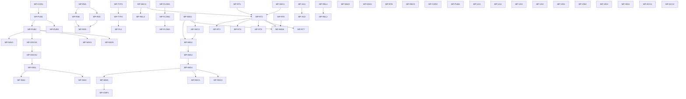

# COS Desktop Implementation Master Plan

Status: **Execution projection of the Desktop Design Canon and canonical component contracts.** Historical freeze-reviewed source: `f3ea37eaba8ed36551b2cfa3d8b370cd01956d70`; this plan update is a documentation-only reconciliation, not covered by that review. The plan owns priority, DAG/milestones, readiness, prerequisites, approval/evidence reporting, and crosswalk—not design contracts. No implementation/UX/Runtime/R0/video approval is granted here.

**Current Caller decision (2026-10-30): IMPLEMENTATION_AUTHORIZED — SCOPED RESUMPTION.** All audited proposals and remaining Caller permissions are adopted under [ADR-0014](../decisions/ADR-0014-YAGNI-SCOPE-AND-RESUMPTION.md); the global pause is released after canonical reconciliation. [Product §68.1](../architecture/COS_DESKTOP_PRODUCT_UX_ARCHITECTURE.md#681-image-first-initial-release) and [DC-MP-IMG2](../architecture/DESKTOP_DESIGN_CONTRACTS.md#dc-mp-img2) own the initial-release profiles. The [current 62-task authority](IMPLEMENTATION_STATUS_AUDIT.md#9-caller-adoption-and-current-authority-2026-10-30) supersedes old PAUSED/approval-pending fields; [§19.70](#1970-caller-adoption-and-scoped-implementation-resumption-2026-10-30) records this decision. Real technical/external prerequisites remain.

**Current Git workflow (Caller decision 2026-10-30):** implement, repair, document, commit and push directly on `dev`; no new feature/task/review branches. The [owning development-branch policy](../integration/REFINE_TASKERN_EXECUTION_BOUNDARY.md#development-branch) supersedes historical branch directives and separate-dev-integration steps. Exact-SHA Tern review, independent detached Gates and separate main/release authority remain unchanged.

It does **not** own and does not restate:

- Desktop architecture, decision ownership and cross-layer invariants → [DESKTOP_DESIGN_CANON.md](../architecture/DESKTOP_DESIGN_CANON.md).
- Task behavior, APIs, failure, rollback and observable acceptance → [DESKTOP_DESIGN_CONTRACTS.md](../architecture/DESKTOP_DESIGN_CONTRACTS.md); each task below links its one canonical contract.

- Product/UX semantics → [COS_DESKTOP_PRODUCT_UX_ARCHITECTURE.md](../architecture/COS_DESKTOP_PRODUCT_UX_ARCHITECTURE.md) (sole product/UX canon; unchanged by this plan).
- Rendering/performance/visual architecture, R0–R10 phases, numeric budgets → [RENDERING_PERFORMANCE_VISUAL_ARCHITECTURE.md](../architecture/RENDERING_PERFORMANCE_VISUAL_ARCHITECTURE.md) + [ADR-0007](../decisions/ADR-0007-RENDERING-PERFORMANCE-VISUAL-ARCHITECTURE.md) (pin KEEP; not reopened here).
- Measured evidence → [historical finalization evidence](ARCHITECTURE_PLAN_FINALIZATION_REPORT.md), [projection baseline](PROJECTION_MEASUREMENT_2026-10-08.md), and historical [TERN_BINARY_RENDERING_ANALYSIS.md](TERN_BINARY_RENDERING_ANALYSIS.md); historical workflow record → [disclosure](evidence/README.md#historical-records).
- Physical ownership/dependency law → [REPOSITORY_ARCHITECTURE.md](../architecture/REPOSITORY_ARCHITECTURE.md), [DEPENDENCY_RULES.md](../architecture/DEPENDENCY_RULES.md).
- Wire contract → [DESKTOP_PROTOCOL.md](../architecture/DESKTOP_PROTOCOL.md), [PROTOCOL_OWNERSHIP.md](../integration/PROTOCOL_OWNERSHIP.md).
- Runtime change requests → [COS_RUNTIME_REQUIRED_CHANGES.md](../integration/COS_RUNTIME_REQUIRED_CHANGES.md) (RC-01–RC-17, still **Proposed** requests, not an approved Runtime plan).

**The document itself grants no implementation authority.** ADR-0014 releases the later pause and restores the existing Desktop execution authority in §19.6/ADR-0009 within adopted scope and real prerequisites. No repeated Caller acceptance wait, resurrection of deferred/stopped work, fabricated evidence, Runtime-repository mutation, main integration or release publication.

Evidence vocabulary (unchanged from repository policy): **Observed** = directly inspected/executed with recorded evidence; **Accepted** = decided policy, not implemented behavior; **Proposed** = candidate needing validation; **Deferred** = triggered re-entry stated.

---

## 1. Scope, authority and planning baseline

**Historical planning baseline (earlier pass):** the table records that pass's branch, observations and docs-only scope. Current finalization from `dev` includes the authorized existing app-core test correction and fresh validation/measurements described in §1.1; it does not reuse the historical scope as a current assertion.

| Item | Value |
|---|---|
| Repository / branch policy | Desktop repository; `feature/*` → `dev` → `main` |
| Planning branch | `feature/implementation-master-plan` created from `main` |
| Baseline SHA (observed) | `aa9a07e41d1ae647ef365ffd67e65cffcf9b8f9e` (`main` = `origin/main` = `dev` = `origin/dev` at planning time) |
| Toolchain (observed) | `rustc 1.98.1 (48a229cea 2026-09-01)`, `cargo 1.98.1 (797e8a9bc 2026-08-05)` via `rust-toolchain.toml` |
| GPUI pin (observed, KEEP) | Zed `395def7a067b32ed598fcb3f048969ada9b54942` (`gpui 0.2.2`) |
| Workspace members (observed) | `apps/desktop`, `crates/desktop-gpui`, `crates/ui-model`, `crates/app-core`, `crates/cos-client`, `crates/desktop-protocol` |
| Runtime checkout (observed, read-only) | `<runtime-root>`, branch `dev`, HEAD `f9867478fdd7080137a9dadabc55c2be2f18adf7`, clean worktree; the 2026-09-21 survey baseline `f94985bd…` is **historical** |
| Document scope | Planning and documentation only: no Rust/test/script/CI/manifest/lockfile/pin change, no Runtime change, no benchmark or feature implementation |

### 1.1 Evidence provenance and this plan update

**Historical planning observations:** the repository/branch, earlier Runtime checkout, fixture COR-01 reproduction and DOC-01 corrections below belong to the earlier planning pass. They are not current Runtime execution or a current worktree assertion.

**Historical 2026-10-08 finalization:** the 62 task cards, hard DAG, readiness distribution and canonical ownership were reconciled against actual Desktop code. Repository provenance, full local quality gates, test-only correction, Windows native smoke and bounded measurements are recorded in [the finalization evidence](ARCHITECTURE_PLAN_FINALIZATION_REPORT.md). Public projection measurements are in [the source-qualified baseline report](PROJECTION_MEASUREMENT_2026-10-08.md).

**Not qualified:** real Runtime integration/task survival, product media/Video, the Golden Workflow, packaging/update, full AX/IME/mixed-DPI matrix, R0 authorization and ratified SLOs. Historical [Tern analysis](TERN_BINARY_RENDERING_ANALYSIS.md) is not same-driver paired evidence. This plan indexes evidence; it does not turn an observation or specification into implementation authorization or product acceptance.

**Current 2026-10-11 workflow reconciliation:** MP-COR1 is `COMPLETED_ACCEPTED` by its recorded Caller decision (§19.1), not by a plan label or Refine success. Standard subsequent work is Taskern planning/context → existing Agent implementation/test → candidate commit → Refine 0.3 independent Gate → Tern review → separate Caller acceptance/integration. The owning [boundary policy](../integration/REFINE_TASKERN_EXECUTION_BOUNDARY.md) and [STEP 1 historical record](evidence/README.md#historical-records) qualify those observations. The subsequent user instruction authorizes STEP 2–5 progression after each clean Tern review; §19.2 records the current packet. This does not authorize acceptance, integration or other product tasks.

**Current 2026-10-17 MP-PUB1 disposition:** The recorded Caller decision is **COMPLETED_ACCEPTED at Desktop fixture/public seam** for product `6b05dcc7df280ab6ef6f50d6a2cad28f90c4abeb` and reviewed docs closure `68524496ba5383a195f151dee303ab5660905714`. Recorded Gate, native run2 and independent Tern review remain distinct historical outcomes. A19 remains NOT_RUN; no next MP, remote push/merge, branch deletion or release follows. Historical raw records are private; see the [disclosure](evidence/README.md#historical-records).

**Historical 2026-10-16 MP-PUB1 correction evidence:** The append-only corrections and STEP2–6 history are retained privately; see the [historical-records disclosure](evidence/README.md#historical-records). The historical missing-native HOLD and provider prerequisite were superseded by the actual run2 and final Tern technical PASS above; failed receipts and partial batches were not rewritten or retroactively passed.

---

## 2. Current implementation baseline

Per-feature classification: `IMPLEMENTED_AND_VERIFIED` (historical checked-in evidence, not re-executed by this docs step), `IMPLEMENTED_BUT_INCOMPLETE`, `IMPLEMENTED_WITH_CORRECTNESS_RISK`, `DESIGN_READY_NOT_IMPLEMENTED`, `REQUIRES_DESIGN_DECISION`, `BLOCKED_BY_RUNTIME`, `BLOCKED_BY_UX`, `DEFERRED`, `NOT_AUTHORIZED`. MP-COR1 completion is updated from its later accepted evidence; other baseline observations retain their original scope.

| # | Area | Class | Evidence (observed source) |
|---|---|---|---|
| 1 | GPUI shell / window / keyboard / focus | IMPLEMENTED_BUT_INCOMPLETE | `crates/desktop-gpui/src/lib.rs:18-155` (surfaces, focus handles, `Ctrl+1/2/3`, `Ctrl+Tab`, Tab/Enter/Space, `Ctrl+D`); placeholder bodies `:128-130`; task rail "not implemented" `:204-215`; stop unavailable `:237-255` |
| 2 | ui-model / presentation-local state | IMPLEMENTED_BUT_INCOMPLETE | `crates/ui-model/src/lib.rs:1-58` viewed/compare/diagnostics; `Workbench::new` one-shot text derivation `:80-166`; unit test asserts viewed≠compare |
| 3 | app-core / command ownership | IMPLEMENTED_BUT_INCOMPLETE | `crates/app-core/src/lib.rs:14-104`: private boxed `DesktopClient`, `snapshot()` on demand, stop route, `disconnect()` drops events; no event subscription/publication; `navigation.rs` 3 surfaces |
| 4 | cos-client / snapshot / delta / recovery | IMPLEMENTED_AND_VERIFIED for MP-COR1's accepted scope; MP-COR2 technically verified and merged to dev, not Caller-accepted | Delta effective-state validation before apply/publish/cursor advance in `client.rs`; snapshot and delta reuse `EffectiveState::validate` in `projection.rs`; public regressions in `tests/effective_state.rs` and `tests/graph_integrity.rs`. [COR1 Caller acceptance](evidence/README.md#historical-records), [COR1 quality evidence](evidence/README.md#historical-records), [COR2 Gate/review closure](evidence/README.md#historical-records), [independent final assessment](evidence/README.md#historical-records), [dev integration](evidence/README.md#historical-records). Real Runtime, R0 ratification and COR2 Caller acceptance remain unqualified. |
| 5 | desktop-protocol / version / identity / revision | IMPLEMENTED_AND_VERIFIED | `src/ids.rs` typed identities (`CandidateRef` 5-tuple, formal selection, `GraphRef` exact version+digest); `src/versions.rs` range negotiation; `src/bounds.rs` limits; tests `serde_policy.rs`, `negotiation.rs` |
| 6 | Runtime transport / authentication / subscription | DESIGN_READY_NOT_IMPLEMENTED + BLOCKED_BY_RUNTIME | `src/transport.rs:1-32` raw byte seam only; `main.rs:28-41` Runtime path always `AppCore::disconnected`; principal-from-transport rule `messages.rs:76-93`; RC-01/02/03 unresolved |
| 7 | Task Rail / navigation | DESIGN_READY_NOT_IMPLEMENTED | shell text `:204-215`; no task list model; `navigation.rs` covers only 3 work surfaces |
| 8 | Creative Brief / Task creation | DESIGN_READY_NOT_IMPLEMENTED + BLOCKED_BY_RUNTIME/UX | `CreateTaskCommand` DTO exists (`messages.rs` ~605-700); fixture capability marks create unsupported (asserted `fixture_observation.rs:116-126`); brief field set/validation not frozen |
| 9 | Candidate Dock / iteration / history | IMPLEMENTED_BUT_INCOMPLETE (dock qualification) / DESIGN_READY_NOT_IMPLEMENTED (history timeline) | implementation at `23a2a5f`; [historical native observations and correction](evidence/README.md#historical-records) show bounded row construction and Viewed retention, but source binding, active/anchor retention, Compare evidence and independent verification remain incomplete; history/unavailable policy is MP-DOCK2 |
| 10 | Artifact / Image / Compare | DESIGN_READY_NOT_IMPLEMENTED | "Media viewer not implemented" `desktop-gpui:128-130`; compare pair model only (`ui-model:20-39`); no decode/upload/cache code anywhere |
| 11 | Evaluation / Evidence / Inspector | IMPLEMENTED_BUT_INCOMPLETE (text) / DESIGN_READY for the surface | evaluation/evidence flattened to strings `ui-model:120-148`; DTOs `projections.rs:241-303`; no inspector surface, no evidence detail fetch |
| 12 | Stop / command reconciliation | IMPLEMENTED_AND_VERIFIED at client level, incomplete in UI | statuses `client.rs:110-147`; `commands.rs:26-78` (accepted ≠ completion), `:213-273` (lost response stays unknown); shell exposes no stop control |
| 13 | Flow / DMLG inspection | DESIGN_READY_NOT_IMPLEMENTED | graph DTO `projections.rs:352-408`; shell prints node labels joined with arrows; no layout, culling, inspection list |
| 14 | Diagnostics / observability | IMPLEMENTED_BUT_INCOMPLETE | `diagnostics_open` toggle; diagnostics string built once in `ui-model:82-107`; no bounded ring buffer, counters, redaction policy implementation |
| 15 | Accessibility / DPI / IME | DESIGN_READY_NOT_IMPLEMENTED | labels/roles/focus in shell; no IME text entry, no screen-reader verification, no DPI matrix, no known-AT matrix |
| 16 | Device loss / reconnect / recovery | IMPLEMENTED_AND_VERIFIED (client staging/recovery) + DESIGN_READY_NOT_IMPLEMENTED (OS/GPU device loss, live session reconnect) | client queue overflow/epoch/session recovery in `tests/recovery.rs`; no device-loss handling; no reconnect because no live session owner exists |
| 17 | Packaging / distribution / update | DEFERRED | no installer/updater/signing code; canon §60–61 remain product requirements |

The table above retains the pre-MP-PUB1 implementation baseline, not a current assertion that observation is absent. MP-PUB1 subsequently introduced observation/publication and live fixture refresh; its current evidence, successful Gate and incomplete native acceptance are indexed in §5.2, its task card and §19.5. Unrelated surface/Runtime/UX completion is not inferred.

Additional confirmed structural facts used by this plan (all observed):

- **Historical pre-MP-PUB1 absence of a live update path:** the fixture client was pumped once before `AppCore` took ownership, and text was derived once with no later subscription. This described the original baseline, not today's implementation. Current observation/live fixture refresh exists; its Gate success and remaining native acceptance gap are recorded in §5.2 and §19.5.
- **Conditional copy-on-write:** `SnapshotHandle = Arc<ProjectionState>`; mutation uses `Arc::make_mut`, so a retained handle forces a full `ProjectionState` clone on the next delta (rendering companion §4). Instrumentation is required before changing this boundary.
- **Candidate element identity** is `("candidate", index)` — enumeration position, not scoped identity (rendering companion §2, §4; violates the stable-identity policy).
- **CI:** gates 1–5 + dependency checker declared in `.github/workflows/ci.yml`; native startup smoke is an explicit **manual** gate; remote execution was never successfully started (BOOTSTRAP_REPORT §6).

---

## 3. Accepted invariants (canon reference)

The [Desktop Design Canon](../architecture/DESKTOP_DESIGN_CANON.md) owns accepted architecture, state/authority boundaries, security and cross-layer invariants. The Product/UX Canon owns product meaning; ADRs and protocol documents own their respective decisions. This plan does not paraphrase those rules. Each task's single linked DC contract is the implementation-facing behavior and acceptance authority. See the owner documents when needed; conflicts or uncovered behavior return to the relevant owner rather than being resolved in this execution index.

---

## 4. Target MVP and deferred scope

The Product/UX Canon §68 owns MVP and deferred scope. The traceability crosswalk in §15.3 retains the mapping to tasks, including Video as an MVP requirement with separate authorization gates. This plan neither changes product scope nor closes an MVP item by relabeling a capability limitation.

---


## 5. Correctness prerequisites (P0)

### 5.1 COR-01 — delta reference integrity: **RESOLVED, MP-COR1 accepted**

Current status: the shared aggregate validator now checks the effective transaction before apply/publish/cursor advance. The historical Caller acceptance, fail-before/after record and quality gates are retained privately; see the [historical-records disclosure](evidence/README.md#historical-records). This does not complete publication, graph scaling or real Runtime integration.

**Historical pre-fix observation and reproduction:** `client.rs:1181-1318` then checked references against the pre-transaction state and applied writes without an aggregate delta check; `validate_integrity` ran only on snapshot construction. The following public-fixture harness output was recorded before MP-COR1, not reproduced against current code:

```text
baseline: tasks=1 candidates=5 artifacts=5 iterations=3
A remove-referenced-artifact: connection=Live delta_applied=true error=false removed=true
  dangling_candidates=["fixture:candidate/a"]  (referenced it before: ["fixture:candidate/a"])
B reciprocal-mismatch upserts: connection=Live delta_applied=true error=false
  iteration_lists_candidate=true
  candidate_iteration_ref=Some("fixture:iteration/Task-184/3")
  iteration_candidate_refs=Some(["fixture:candidate/plan-z"])
cursor_after=Some("fixture:cursor/plan/cor01-b") epoch=Some("fixture:epoch/1")
```

Two distinct defects were demonstrated on that pre-fix revision:

- **A (referenced entity removed):** a single `Remove { Artifact }` mutation that a candidate still references is accepted; the resulting published state violates `validate_integrity`'s artifact-reference rule and the cursor advances.
- **B (delete/update inside one transaction):** two upserts that pass per-mutation checks but break reciprocal iteration↔candidate ownership are accepted and published.

The historical reproduction established delta/snapshot integrity inconsistency. MP-COR1's later acceptance above closes that defect under DC-MP-COR1; the original output is retained as failure provenance, not a current failure claim.

### 5.2 ARC-01 — state publication/observation ownership: **RESOLVED at accepted Desktop fixture/public seam**

Historical pre-MP-PUB1 observation: `AppCore` owned a private `Option<Box<dyn DesktopClient>>` with on-demand `snapshot()` and no subscription, revision or notification (`app-core/src/lib.rs:14-104`); `Workbench::new` derived text once (`ui-model/src/lib.rs:80-166`); the shell's only `cx.notify()` sources were initial load and local UI actions. That baseline identified missing live projection, recovery, receipt and stale-state publication. It is retained as defect provenance, not the current implementation state.

The contract remains [DC-MP-PUB1](../architecture/DESKTOP_DESIGN_CONTRACTS.md#dc-mp-pub1). Historical owner ratification, acceptance, Gate and review records are private; see the [historical-records disclosure](evidence/README.md#historical-records). A19 real authenticated Runtime remains NOT_RUN; ownership/generation/multi-window/read semantics still come from the contract.

### 5.3 PERF-01 — graph validation cost: **confirmed asymptotic**

Observed code scans both edge endpoints through `graph.nodes.iter().any(…)`, giving Θ(E·V) graph membership work in integrity and graph-upsert validation. The [fresh public-API baseline](PROJECTION_MEASUREMENT_2026-10-08.md) measures validation across 1k/10k/50k-edge corpora, legal rewires, retained-handle COW and approximate process memory. It supports COR1 correctness first, then COR2's bounded per-graph membership index inside the same validation owner. Exact allocation counts and an optimized paired A/B result are NOT_MEASURED; no improvement or R0 threshold acceptance is inferred.

---

## 6. Design decision ownership (derived gate index)

The authoritative DD-01–DD-26 registry, decision owners, approval ladder and predicates now live in [Desktop Design Canon §6](../architecture/DESKTOP_DESIGN_CANON.md#6-decision-ownership-and-approval-state). The current plan task cards reference those decisions for **readiness, scheduling and execution**, never for unilateral design approval.

Except the scoped MP-PUB1 owner ratification above, previously pending DD/RC/UX/experiment gates remain pending. SPEC_DRAFTED, plan readiness and review never ratify themselves. Owning design/Protocol/Runtime/ADR approval transitions are recorded first and mirrored here. MP-PUB1's grant authorizes Desktop scope only, not Runtime implementation or a later-step start; no other task approval follows.

---

## 7. Milestones, dependency DAG and task contracts

**Current execution overlay:** goals, sole DCs and hard DAG remain. The adopted audit governs current I/V evidence, ADR-0014 governs permission, and Product §68.1 qualifies full-target milestones. Old preparation/evidence statements are historical, not new approval requests or current measurements. Named deferrals remain later-release obligations, not PASS.

### 7.1 Milestones

| Milestone | Goal | Exit (observable) |
|---|---|---|
| **M1 Correctness foundation** | Delta integrity is trustworthy; graph validation is scalable; publication contract frozen | DC-MP-COR1 integrity regressions PASS; DC-MP-COR2 public behavior/error-order parity and same-condition 10k/50k comparison evidence; internal counters optional diagnostics, not an exit gate |
| **M2 Measurement foundation (R0)** | Repeatable harness, honest NOT_MEASURED reporting, ratified thresholds | rendering §10.1/§11.1/§11.2 executed on the locked shell; ratification record |
| **M3 UX prototype & validation** | Golden-workflow comprehension validated before production surfaces | UX validation record (canon §65) with the 8 comprehension checks |
| **M4 Design system, typography, DPI** | Token/typography system with native evidence | R1 exit: no clipping/missing glyphs/focus/contrast failures in the declared matrix |
| **M5 State publication & live shell** | Live, revisioned, cancellable projection → window updates | ARC-01 contract implemented; no stale overwrite; local state preserved |
| **M6 Navigation & task surfaces** | Task Rail, Brief creation, History | Virtualized rail; create flow behind capability+contract; reopen from history |
| **M7 Candidates, iterations, history detail** | Dock + timeline with stable identity | 10k-item rail-scale behaviour; viewed/compare survive inserts/removals |
| **M8 Artifact/image presentation** | Representations, decode/upload/eviction, full view | R4 Decode→Upload→Eviction gates pass per codec/representation |
| **M9 Evaluation/Evidence/Inspector** | Explainability surfaces | Evaluation→Evidence→Refinement→Outcome navigation from authoritative projections |
| **M10 Compare** | Two-pane compare with resource reuse | R5 exit + UX-01 decisions implemented |
| **M11 Flow/graph** | Read-only Flow + inspection-first graph | R6 simplest passing stage; accessible inspection |
| **M12 Runtime integration** | Real transport, identity, authorization, observation | Contract freeze + real-server acceptance campaign |
| **M13 Security & capability** | Credentials, gating, redaction, untrusted media | Security acceptance scenarios pass |
| **M14 Recovery & device loss** | R8 hardening + crash/restart behaviour | Plateau/release + device recovery evidence |
| **M15 Video** | MVP video path *if and only if* authorized; investigation and authorization are separate milestones of their own | VID1/VID2 complete → a recorded capability/authorization decision; VID3/VID4 complete only if the decision authorizes implementation **and** R7 gates pass. An "unavailable" finding completes VID1/VID2 only — the MVP item stays open (it may not be closed by declaring the capability restricted; that would require a Product-owner scope exception). |
| **M16 Accessibility & polish** | R10 consolidated + R9 polish | R10 matrix; no idle animation/legibility regressions |
| **M17 Packaging & release** | Installer/portable/updater/diagnostics | Signed artifacts + update/rollback procedure |
| **M18 Product acceptance** | Golden Workflow + canon §63–66 evidence | Acceptance report with all NOT_MEASURED items labelled |

### 7.2 Dependency DAG (no cycles)



This graph contains **62 task nodes and 41 hard implementation edges**. An edge means the dependent implementation cannot start without the upstream task result. The forward-ordered edges are acyclic. Decision/authorization, measurement readiness, conditional Runtime functionality and downstream product acceptance are separate gates, not hard task dependencies. MP-IMG1 local/fixture inputs do not depend on MP-IMG6; MP-IMG5 local/fixture full-view feasibility does not depend on MP-IMG6; MP-NAV4 fixture/local axes and native interaction do not depend on MP-RT4. External-media decode requires the MP-IMG6/MP-SEC3 admission and authorization gates; MP-IMG6 also requires MP-RT2 descriptor transport and MP-RT6 authorization. Production full-detail acceptance requires MP-IMG6; NAV4 real receipt reflection and Runtime acceptance require MP-RT4. Desktop-local REC3 restoration is not blocked by RT3/RT8; task-survival/product acceptance remains conditional on real Runtime evidence. VID1→VID2→VID3→VID4 is an authorization/acceptance sequence, not an implementation dependency chain.

**Non-DAG gate crosswalk:** R0A→R0B/R0C→R0D is the evidence sequence, not a new permission wait; ADR-0008 ratifies declared configurable defaults, not attainment. UX details, typography/AX evidence, Brief/command contracts and actual Runtime capabilities remain conditional gates. DD-01 and Desktop PUB1 permission are already approved. IMG6/RT6/RC-13 gate production media; local IMG1–5 work is not inherently Runtime-blocked. Product §68.1 defers video; route/capability evidence remains necessary on re-entry. No hard DAG edge changes.

MP-ACC1 retains the complete real-integrated image workflow and failure evidence, including NAV2, IMG5/6, CMP1, INS1/2, FLOW1, NAV3, RT3/4/5/7, REC3 and REL1; actual DD-25 command semantics remain necessary. MP-ACC2 retains the owning contract's supported-image/AX/security/packaging evidence. Product §68.1 is the explicit exception for VID4, REL2 and named deferred OS subpaths: not initial-release exit prerequisites or PASS. Full-target conditions remain in their sole DCs, not hard DAG ancestors.

### 7.3 Parallel lanes (reconstructed from the corrected DAG)

The table groups related work; it does not add dependencies. Only the §7.2 edges are hard prerequisites. Gates can constrain a declared task slice or its acceptance exit without blocking other explicitly separable work.

| Lane | Members | Gate summary |
|---|---|---|
| **L-Correctness** | MP-COR1, MP-COR2 | Both independently startable; COR2 gates scaled graph ingestion, not the accessible-list skeleton. |
| **L-Publication** | MP-PUB1..4; MP-NAV1..5; MP-DOCK1/2; MP-INS1..3 | PUB1 requires DD-01 `SPEC_APPROVED` and separate implementation authorization; its direct DAG prerequisite is COR1. Surface-specific UX/Runtime gates remain separate. |
| **L-Measurement** | MP-R0A..D | Explicit R0 authorization; the R0 internal sequence is hard, but R0D is only an experiment/adoption gate for other lanes. |
| **L-UX** | MP-UX1..4 | Owner authorization and decisions as specified in the task cards; no generic code dependency. |
| **L-Typography** | MP-TYP1/2, MP-PL1 | DD-04a gates TYP1; R0D gates calibrated R1 evidence/threshold claims; DD-04b adoption gates TYP2/PL1. |
| **L-Media** | MP-IMG1..6, MP-SEC3, MP-CMP1, MP-REC1/2 | Local-input feasibility is independent of Runtime; IMG6/RT6 gates production inputs, IMG6 also gates production full-detail. |
| **L-Graph** | MP-FLOW1..3 | Fixture/list work is independently startable; COR2 gates scaled graph-ingestion claims; R0/experiment gates apply to measured stages. |
| **L-Runtime** | MP-RT1..8, MP-SEC1, MP-INS2 | Runtime-owner contract approvals gate Runtime-dependent slices; MP-RT8 local native single-instance/shutdown work is independently implementable. |
| **L-Release** | MP-SEC2, MP-REL1..3 | Caller permission received; retained diagnostics/signed packages need actual contract details, certificate/operator inputs and evidence. Automatic updater delivery deferred by Product §68.1. |
| **L-Video** | MP-VID1..4 | Existing probe source/evidence retained; video is DEFERRED_INITIAL_RELEASE, not waiting for the same Caller permission or requiring a new image-release probe. |

Integration ownership and file-conflict policy are assigned per shared file by the coordinating Caller/integration owner before merging parallel work; conflicting changes are not silently ordered. Testing ownership and impact routes are defined in [TESTING.md §1](TESTING.md#1-quality-gates-and-impact-routes).

### 7.4 Execution card template and single-owner design rule

The [Desktop Design Canon](../architecture/DESKTOP_DESIGN_CANON.md) owns design authority/decisions; each [canonical component contract](../architecture/DESKTOP_DESIGN_CONTRACTS.md) owns purpose, behavior, scope, non-goals, interface/API semantics, threading, failure/recovery, security, rollback and **observable acceptance**. These clauses are not rewritten or editable in this execution plan.

**Inherited card schema (applies to all 62 cards):** task ID and goal are the heading; owner, status/readiness, direct hard prerequisites, separate gates, one DC contract, and evidence are the required fields. Direct prerequisites are exactly the incoming §7.2 DAG edges (or `none`); a card's **Gate** includes the decision/authorization/readiness needed for the named work, with any conditional product/real-Runtime exit stated separately. Each card's **Contract** is its single DC-MP link; contract scope and acceptance are not duplicated. **Evidence** is the contract's observable acceptance plus the task-specific evidence named in the card or inherited crosswalk below; evidence is future obligation, never a claim that work ran.

Gate labels: **hard** = §7.2 implementation prerequisite; **conditional** = required only for a named Runtime/product exit; **optional** = explicitly optional scope; **advisory** = non-blocking recommendation; **release** = product/release acceptance. A status such as DESIGN_GATE_REQUIRED, EXPERIMENT_READY, RUNTIME_BLOCKED, UX_BLOCKED or NOT_AUTHORIZED is not itself implementation permission.

Plan governance: §7.2 is canonical for hard edges; §6 reflects decision status but cannot approve a gate. Testing routes follow [TESTING.md](TESTING.md). If ambiguity changes design or ownership, stop and amend its design owner before revising this projection.


### 7.5 M1 — Correctness foundation

#### MP-COR1 — Delta effective-state integrity (COR-01)
- **Hard prereqs:** none.
- **Priority:** P0 · **Status:** COMPLETED_ACCEPTED · **Owner:** `crates/cos-client` (`client.rs`, `projection.rs`, `tests/`)
- **Prereqs:** none. **Accepted inputs:** DESKTOP_PROTOCOL.md §2 (atomic transaction, staging, integrity); rendering companion §13 R2 ("no lost required event/receipt, stale overwrite or partial transaction").
- **Evidence:** [Caller acceptance](evidence/README.md#historical-records), [quality gates](evidence/README.md#historical-records), [fail-before/after](evidence/README.md#historical-records), public `effective_state` regressions and §19.1's independent review; historical delegated receipts are not Refine 0.3 Gate evidence.
- **Unresolved decisions:** none. **Stop/escalation:** if an accepted-input-shaped transaction (a legal rewire the protocol permits) fails validation, stop and escalate to the protocol owner instead of relaxing rules ad hoc.
- **Design source / acceptance:** [DC-MP-COR1](../architecture/DESKTOP_DESIGN_CONTRACTS.md#dc-mp-cor1). This task implements that frozen contract; scope, API, failure, rollback, tests and accepted behavior may not be redefined here.

#### MP-COR2 — Graph validation scaling (PERF-01)
- **Hard prereqs:** none.
- **Priority:** P0 · **Status:** COMPLETED_ACCEPTED for recorded client scaling scope (Gate/review and dev integration complete; Caller acceptance ADR-0009/0014) · **Owner:** `crates/cos-client` (`projection.rs`)
- **Prereqs:** none (independent of the delta-integrity task; either may land first). **Inputs:** rendering §10 graph workloads; §4.2 measurement separation (validation vs publication vs layout).
- **Evidence:** [implementation/public regressions, same-session 10k/50k parity/timing/traversal, quality/native startup](evidence/README.md#historical-records), [fixed candidate/Gate/review closure](evidence/README.md#historical-records), [independent assessment](evidence/README.md#historical-records). Product numeric attainment and real Runtime are not established by this client fix. Declared configurable targets are ratified by ADR-0008; zero-intervention delivery was not achieved.
- **Unresolved:** none. **Stop/escalation:** if any pre-existing valid fixture graph is rejected, stop (behavior drift).
- **Consumers:** MP-PUB4, MP-FLOW1/2, R6 experiments.
- **Design source / acceptance:** [DC-MP-COR2](../architecture/DESKTOP_DESIGN_CONTRACTS.md#dc-mp-cor2). This task implements that frozen contract; scope, API, failure, rollback, tests and accepted behavior may not be redefined here.

#### MP-PUB1 — Observation session owner and atomic publication (ARC-01)
- **Hard prereqs:** MP-COR1.
- **Priority:** P0 · **Status:** COMPLETED_ACCEPTED (Desktop fixture/public seam; A19 real Runtime NOT_RUN) · **Owner:** `crates/app-core`, `crates/cos-client`, `crates/desktop-protocol`, `crates/ui-model`, `apps/desktop`, `crates/desktop-gpui`
- **Gate:** DD-01 SPEC_APPROVED and separate Desktop MP-PUB1 IMPLEMENTATION_AUTHORIZED remain recorded by [owner approval](evidence/README.md#historical-records), including the bounded DD-12/13/15/19 amendment. Ordinary STEP transitions and current-task Gate attempts without a numerical ceiling are Caller-approved; each actual dispatch is separately bounded and automatic retry remains 0. R4 is now SUCCEEDED. Real Runtime evidence remains a conditional integration exit, not an added hard edge. **Inputs:** PROCESS_MODEL, DC-MP-PUB1 and DESKTOP_PROTOCOL authorized read handoff.
- **Evidence:** [historical STEP3 source closure](evidence/README.md#historical-records), [R1 implementation](evidence/README.md#historical-records), [R2b native evidence](evidence/README.md#historical-records), [R3 quality](evidence/README.md#historical-records), [immutable R4 timeout](evidence/README.md#historical-records), [successful R4 and earlier HOLD history](evidence/README.md#historical-records), and [actual run2 native evidence](evidence/README.md#historical-records).
- **Unresolved:** none within the accepted Desktop fixture/public seam. [Caller ACCEPT](evidence/README.md#historical-records) binds product `6b05dcc7df280ab6ef6f50d6a2cad28f90c4abeb` and docs closure `68524496ba5383a195f151dee303ab5660905714`; it is not inferred from Gate/review success or prior blanket approval. A19 real authenticated Runtime remains separately owned/NOT_RUN, not an added hard prerequisite. Next MP, integration and release remain outside this decision.
- **Subsequent evidence:** [Correction and native-review addendum](evidence/README.md#historical-records) preserves prior consent/partial evidence and records the caller-authorized run2. No contract, hard edge or Taskern Plan revision changed.
- **Stop/escalation:** if an implementation requirement exceeds the approved contract/API/major transition, adds a dependency or requires Runtime mutation, stop for the relevant owner; do not infer new permission from readiness.
- **Consumers:** MP-PUB2/3, all surface tasks, MP-RT3.
- **Design source / acceptance:** [DC-MP-PUB1](../architecture/DESKTOP_DESIGN_CONTRACTS.md#dc-mp-pub1). This task implements that frozen contract; scope, API, failure, rollback, tests and accepted behavior may not be redefined here.

#### MP-PUB2 — Incremental window refresh and derived-view policy
- **Hard prereqs:** MP-PUB1.
- **Priority:** P0 · **Status:** COMPLETED_ACCEPTED revision-scoped derivation ([technical review](evidence/README.md#historical-records): quality/changed-path Native, Gate R3 and Tern R2 0/0/0; Caller acceptance ADR-0009/0014). Real Runtime/full product acceptance separate · **Owner:** `crates/ui-model`, `crates/desktop-gpui`; app-core exposes only the allowed existing snapshot handle.
- **Evidence:** [direct MP-PUB2/MP-PUB3 Caller authority](evidence/README.md#historical-records), [Taskern revision1 packet](evidence/README.md#historical-records), [quality](evidence/README.md#historical-records), [normal-binary Native evidence](evidence/README.md#historical-records), [observable pixel comparison](evidence/README.md#historical-records). No private-helper count is an acceptance oracle; A19 and full product UX remain outside this slice.
- **Gate history:** [R1](evidence/README.md#historical-records) preserves the no-PATH checker failure; [the corrected existing launcher](evidence/README.md#historical-records) passed. [R2](evidence/README.md#historical-records) preserves seven successful command checks/176 tests, followed by the correctly rejected old HEAD predicate. Both failed Gates retain complete cleanup and separate stored-integrity outcomes. [R3](evidence/README.md#historical-records) SUCCEEDED on `f28a2055f88ae73fe9d9afd9fc56233a45e82293`: all seven commands, HEAD and clean-worktree predicates passed; 176 tests passed, all eight outputs collected, cleanup complete. Static preflight UNKNOWN and later documentation closure are not attributed to that Gate.
- **Unresolved:** cache/reuse representation → MP-PUB4.
- **Consumers:** MP-NAV1, MP-DOCK1/2, MP-INS*, MP-FLOW*.
- **Design source / acceptance:** [DC-MP-PUB2](../architecture/DESKTOP_DESIGN_CONTRACTS.md#dc-mp-pub2). This task implements that frozen contract; scope, API, failure, rollback, tests and accepted behavior may not be redefined here.

#### MP-PUB3 — Multi-window, generation and stale-result conformance tests
- **Hard prereqs:** MP-PUB1.
- **Priority:** P1 · **Status:** COMPLETED_ACCEPTED recorded Desktop multi-consumer invariants ([technical review](evidence/README.md#historical-records): quality/179 historical tests, native startup, Gate R2 and Tern R3 0/0/0; Caller acceptance ADR-0009/0014). Full product windows/Runtime separate · **Owner:** `crates/app-core` tests, `crates/desktop-gpui` tests
- **Authorization:** [2026-10-18 direct Caller instruction](evidence/README.md#historical-records) authorizes this MP after MP-PUB2 completes implementation/verification and clean remote Tern review; [MP-PUB2 remote R2](evidence/README.md#historical-records) is 0/0/0 PASS, so this task proceeded. It grants no unrelated task or integration.
- **Gate history:** [R1](evidence/README.md#historical-records) SUCCEEDED on `60cf860a52090989a28b7bd05b75067d53755ae0`: all seven quality commands plus the HEAD and clean-worktree predicates passed, 179 workspace tests passed across 22 targets, all nine declared outputs were collected, cleanup complete. Static preflight UNKNOWN was not relabelled PASS; no candidate was mutated during checks.
- **Gate history (continued):** [R2](evidence/README.md#historical-records) SUCCEEDED on the repaired candidate `2df45bd337ed65546c8d48074daf2e48cb525126`: all seven quality commands plus the HEAD and clean-worktree predicates passed, 179 workspace tests passed across 22 targets, all ten declared outputs were collected, cleanup complete. R1 remains stored and immutable as superseded evidence.
- **Remote review history:** [R1](evidence/README.md#historical-records) returned 0 BLOCKING / 2 ACTIONABLE NON-BLOCKING / 0 EXCESSIVE (HOLD) on `f1ad65c82d638650a1275b005b4120cf2ad31162`: A-NB-1 required a per-identity re-dispatch oracle instead of a total frame count, A-NB-2 required honest native-evidence run identifiers and span. Both were repaired in this session: the fixture provider records received command dispatches and both reconnect tests compare that ordered record before and after recovery, and the native evidence now states the two recorded identities and the corrected 78.23 s span.
- **Remote review history (continued):** [R2](evidence/README.md#historical-records) confirmed A-NB-1 CLOSED on `483e5d8e17325de0f23ec1834ceac3ab84668f54` and found the one remaining stale native note; [R3](evidence/README.md#historical-records) is 0/0/0 PASS on `ae4bd713884ba941c3b4ba95d8d5f29761af2a3c` with A-NB-2 CLOSED. [Technical completion](evidence/README.md#historical-records) records the closed technical review; the original pending field is historical; Caller acceptance is received under ADR-0009/0014.
- **Evidence:** [Taskern revision 1 packet](evidence/README.md#historical-records), [eight-invariant crosswalk](evidence/README.md#historical-records), [test admission](evidence/README.md#historical-records), [quality](evidence/README.md#historical-records), [invariant-removal probes](evidence/README.md#historical-records), [native startup smoke](evidence/README.md#historical-records).
- **Observed repair:** the inherited DC-MP-PUB1 diagnostic bound (at most 1,024 events with explicit `event_gap`) had no implementation at the owner seam: `ObservationSessionOwner::step` discarded `PumpReport::events`. `crates/app-core/src/diagnostics.rs` now retains category-only events with a monotone non-reusing sequence and an explicit bound/gap; no identity, receipt, grant, cursor or remote text is retained and diagnostics never drive publication or command truth.
- **Consumers:** MP-RT3, MP-ACC1.
- **Design source / acceptance:** [DC-MP-PUB3](../architecture/DESKTOP_DESIGN_CONTRACTS.md#dc-mp-pub3). This task implements that frozen contract; scope, API, failure, rollback, tests and accepted behavior may not be redefined here.

#### MP-PUB4 — R2 representation experiment (COW / index / cache / sharing)
- **Hard prereqs:** none.
- **Priority:** P1 · **Status:** LIMITED_COMPLETE exploratory experiment; production adoption/further variants DEFERRED under ADR-0014 · **Owner:** `crates/cos-client` + `crates/app-core`
- **Prereq/gate:** keep the current Arc baseline and §19.17 experiment. Re-entry requires a concrete real-workload deficit and applicable evidence before DD-02b selection; no compulsory comparison or repeated approval merely to fill UNKNOWN.
- **Consumers:** MP-PUB2, MP-NAV1, MP-DOCK1, R3 workload results.
- **Design source / acceptance:** [DC-MP-PUB4](../architecture/DESKTOP_DESIGN_CONTRACTS.md#dc-mp-pub4). This task implements that frozen contract; scope, API, failure, rollback, tests and accepted behavior may not be redefined here.

---

### 7.6 M2 — Measurement foundation (R0)

R0 Caller authorization is received; ADR-0008 ratifies declared configurable gates, not measured attainment. R0A remains IN_PROGRESS and R0B/C limited evidence does not close full baseline/noise/stall acceptance. Use the existing harness for a concrete retained-path acceptance need; no speculative endpoint framework or repeated approval cycle.

#### MP-R0A — R0 harness implementation
- **Hard prereqs:** none.
- **Priority:** P1 · **Status:** IMPLEMENTATION_AUTHORIZED; S1 A/B TECHNICALLY COMPLETE, S2A LIMITED TECHNICAL COMPLETION (independent 0/0/0), S3 ledger/import and S3-N1 published Native journal replay LIMITED TECHNICAL COMPLETION ([§19.53](#1953-mp-r0a-s3-n1-published-native-journal-replay-2026-10-26), Tern 0/0/0); MP-R0A overall IN_PROGRESS with S2B full-source replay and R0B/C measurements pending · **Owner:** `apps/desktop` dev-only profiling module + a versioned workload manifest set (location decided with R0 authorization; must not become production behaviour)
- **Consumers:** MP-R0B/C, MP-PUB4, MP-TYP1, MP-IMG*, MP-FLOW*, MP-REC2.
- **Design source / acceptance:** [DC-MP-R0A](../architecture/DESKTOP_DESIGN_CONTRACTS.md#dc-mp-r0a). This task implements that frozen contract; scope, API, failure, rollback, tests and accepted behavior may not be redefined here.
- **S1 contract foundation:** `apps/desktop/devtools/r0` (Python stdlib only) defines the versioned manifest and result contracts, a bounded UTF-8 loader with duplicate-key/non-finite rejection, and an offline `manifest|result|pair` validator. [Admission](evidence/README.md#historical-records) and [validation](evidence/README.md#historical-records) retain 25 contract tests (17 categories) and CLI outcomes. [Two-Gate verification](evidence/README.md#historical-records): product `440ea864d6d7e87875d6ccddbc1758b2984b5d2e`, quality Gate `aab9ec8e-1d09-4c74-8de2-9ad15364b310` (9/9, Python 25 tests) and build Gate `7570d1ba-010d-48eb-83be-12804e5c7239` (3/3), candidate digest `sha256:3bae64d6…`, 12 identical artifacts, absent 0, cleanup complete, verify exit 0; a1–a5 Gates remain history. The [S1 bounded technical-completion record](evidence/README.md#historical-records) independently verifies the final docs-only SHA `8ea1ef9` at 0/0/0. At S1 closure, R0A-S2 instrumentation/driver, S3 ledger/aggregation, R0B/R0C/R0D and numeric claims were still NOT_RUN. Current status: S2A LIMITED TECHNICAL COMPLETION; S2B/S3 and R0B/R0C remain NOT_RUN; R0D/numeric SLO remain NOT_RATIFIED; MP-R0A overall remains IN_PROGRESS. S1 completion alone did not constitute R0A completion.
- **S2A process driver — LIMITED TECHNICAL COMPLETION:** [completion record](evidence/README.md#historical-records) binds product `ca9b074b4f99ddc50894a449aef7775615d454c5` and reviewed evidence `087398591b3ac18ee2a5ebed0220858a09394f0e` to [independent R10 PASS 0/0/0](evidence/README.md#historical-records). Approved-only launch, OS-resolved single-use profile identity, pinned paths/fixtures, pre-go JobObject containment, complete unmeasured result semantics and the completion-directory publication point are implemented. 48 Python tests (SKIP 0), 285 Rust tests, 14 dependency tests and two helper tests passed; separate approved normal/timeout/native-driver-kill evidence is retained. Publication visibility is not power-loss durability; per-user claims do not defend against administrator/registry-owner tampering.
- **S2A independent verification:** quality Gate `8b78c094-e476-44ec-a419-fe5ffaeb0ff5` (11/11) and build Gate `eedce38a-c489-4d3d-af64-31bae90160ca` (3/3) succeeded on that exact product: [receipt comparison](evidence/README.md#historical-records) records 12 distinct checks, identical candidate digest and 25 artifact ID/path/size/SHA-256 tuples, absent 0, cleanup complete and integrity success. Preflight UNKNOWN remains UNKNOWN; all historical Gate/review evidence retains its original scope. The docs-only completion record awaits final independent confirmation. R0A overall remains IN_PROGRESS; S2B/S3 and R0B/C are NOT_RUN, R0D/numeric SLO NOT_RATIFIED, visual/Present/displayed NOT_MEASURED, IMG1 M09 closed by [§19.12](#1912-mp-img1-native-m09-source-bound-windows-verification-2026-10-23) (file-reparse `NOT_RUN`) while the IMG2 comparison stays incomplete; no Runtime/Product UX/DD/main/release approval follows.
- **2026-10-23 Caller pause — S2B HOLD:** [The durable stop record](evidence/README.md#historical-records) binds product `6584e7683ae97869aa498526db290c1550bd59db`, reviewed evidence `68e8f36898be0ffc6f92eb33f074b552a3fd75e2`, successful r9 Quality/Build receipts and the latest Tern R5 **3 BLOCKING / 2 ACTIONABLE NON-BLOCKING / 0 EXCESSIVE**. S2B has implementation and limited Native evidence (N06 PARTIAL), not limited technical completion; earlier S2B pending/NOT_RUN wording above is historical to S2A closure. Five R5 consumer/evidence/test findings remain unmodified. The Caller authorized recording, commit and push only, then stopping; explicit resume is required. S3/R0B/C, numeric SLO, IMG2 and Runtime/Product UX/DD/main/release boundaries are unchanged.

#### MP-R0B — Baseline capture, noise and endpoint availability
- **Hard prereqs:** MP-R0A.
- **Priority:** P1 · **Status:** LIMITED_COMPLETE historical source endpoints; **disconnected idle baseline measured (§19.120: 5 runs, 30 s settle + 60 s window; CPU PASS_LIMITED, working set PASS_LIMITED)**; connected-endpoint baseline, stall and full baseline/noise acceptance remain NOT_MEASURED/HOLD; the earlier idle attempt remains HOLD as history (§19.91); permission RECEIVED. ADR-0008 declared thresholds ratified, not attained · **Owner:** R0 harness owner (`apps/desktop`) + rendering evidence owner
- **Consumers:** MP-R0D, MP-PUB4, MP-TYP1, MP-IMG*.
- **Design source / acceptance:** [DC-MP-R0B](../architecture/DESKTOP_DESIGN_CONTRACTS.md#dc-mp-r0b). This task implements that frozen contract; scope, API, failure, rollback, tests and accepted behavior may not be redefined here.

#### MP-R0C — Windows scheduling and stall attribution
- **Hard prereqs:** MP-R0A.
- **Priority:** P1 · **Status:** LIMITED_COMPLETE R15 source qualification; full visible-stall/physical evidence PARTIAL; permission RECEIVED under ADR-0014 · **Owner:** Desktop/Windows performance owner
- **Consumers:** MP-R0D, ADR-0007 pin decision record (only if evidence demands).
- **Design source / acceptance:** [DC-MP-R0C](../architecture/DESKTOP_DESIGN_CONTRACTS.md#dc-mp-r0c). This task implements that frozen contract; scope, API, failure, rollback, tests and accepted behavior may not be redefined here.

#### MP-R0D — R0 ratification record
- **Hard prereqs:** MP-R0B, MP-R0C.
- **Priority:** P1 · **Status:** RATIFIED_DECLARED_BASIS_NOT_MEASURED under ADR-0008; no repeated ratification request; measured replacement requires actual evidence · **Owner:** Desktop architect + rendering owner
- **Consumers:** every experiment/phase exit below.
- **Design source / acceptance:** [DC-MP-R0D](../architecture/DESKTOP_DESIGN_CONTRACTS.md#dc-mp-r0d). This task implements that frozen contract; scope, API, failure, rollback, tests and accepted behavior may not be redefined here.

---

### 7.7 M3 — UX prototype and validation

#### MP-UX1 — Operable prototype of the Golden Workflow surfaces
- **Hard prereqs:** none.
- **Priority:** P1 · **Status:** LIMITED PROTOTYPE; developer reachability recorded (eight scenarios, 7 PASS / 1 PARTIAL), participants P01 (0 PASS / 3 PARTIAL / 5 FAIL), P02 (3 PASS / 5 PARTIAL / 0 FAIL, §19.99) and P03 on the approved build (8 PASS / 0 PARTIAL / 0 FAIL, §19.101) are recorded, the Caller-approved Flow diagram and three presentation decisions are implemented and reviewed CLEAN (§19.100), and the comprehension exit is `MET_LIMITED` by explicit Product/UX Owner acceptance ([ADR-0016](../decisions/ADR-0016-UX1-LIMITED-COMPREHENSION-ACCEPTANCE.md), 2026-10-31) of P03's self-report, with independent timing, free text, operation traces and production behaviour still NOT_MEASURED; product/UX acceptance is NOT_CLAIMED · **Owner:** Desktop UI (prototype scope), UX owner (validation)
- **Gate / inputs:** UX-owner authorization to run prototype work; the frozen [compare/viewing question list](../architecture/DESKTOP_DESIGN_CONTRACTS.md#dc-mp-ux2) is the prototype input, not another task-acceptance contract. No code dependency (prototype may use fixture data, explicitly labelled); it runs in parallel with the §7 lanes.
- **Evidence:** prototype build/run log + validation notes; screenshots where safe.
- **Consumers:** MP-UX2/3/4, MP-NAV*, MP-DOCK*, MP-CMP1, MP-INS*.
- **Design source / acceptance:** [DC-MP-UX1](../architecture/DESKTOP_DESIGN_CONTRACTS.md#dc-mp-ux1). This task implements that frozen contract; scope, API, failure, rollback, tests and accepted behavior may not be redefined here.

#### MP-UX2 — UX-01 decision register closure (compare & viewing)
- **Hard prereqs:** none.
- **Priority:** P0 (decision) · **Status:** DECISION CLOSURE RATIFIED ([ADR-0015](../decisions/ADR-0015-UX2-DECISION-CLOSURE.md), 2026-10-31; A=9 B=5 C=0 D=0 E=0 over the 14 frozen questions; Compare implementation remains MP-CMP1 work; R5 measurement stays NOT_MEASURED) · **Owner:** Product/UX owner
- **Consumers:** MP-CMP1, MP-IMG5, MP-DOCK2, MP-INS1.
- **Design source / acceptance:** [DC-MP-UX2](../architecture/DESKTOP_DESIGN_CONTRACTS.md#dc-mp-ux2). This task implements that frozen contract; scope, API, failure, rollback, tests and accepted behavior may not be redefined here.

#### MP-UX3 — Visual direction and token validation plan
- **Hard prereqs:** none.
- **Priority:** P1 · **Status:** VISUAL DIRECTION RECONCILED (accepted typography/geometry recorded; semantic palette stays Proposed and not applied; Tern CLEAN 0/0/0 on `2b25643`; DPI/contrast/mixed-script and product acceptance remain NOT_MEASURED) · **Owner:** Product/UX + rendering owner
- **Consumers:** MP-TYP1/2, MP-PL1.
- **Design source / acceptance:** [DC-MP-UX3](../architecture/DESKTOP_DESIGN_CONTRACTS.md#dc-mp-ux3). This task implements that frozen contract; scope, API, failure, rollback, tests and accepted behavior may not be redefined here.

#### MP-UX4 — Keyboard map and Command Palette inventory
- **Hard prereqs:** none.
- **Priority:** P1 · **Status:** INVENTORY RECONCILED (eleven approved palette commands and documented keys recorded; pointer-only Compare controls and undocumented actions stay open; Tern CLEAN 0/0/0 on `f9008149`; full native/IME/DPI and product acceptance remain NOT_MEASURED) · **Owner:** Product/UX owner
- **Consumers:** MP-NAV1/4, MP-DOCK*, MP-INS*, MP-AX2.
- **Design source / acceptance:** [DC-MP-UX4](../architecture/DESKTOP_DESIGN_CONTRACTS.md#dc-mp-ux4). This task implements that frozen contract; scope, API, failure, rollback, tests and accepted behavior may not be redefined here.

---

### 7.8 M4 — Design system, typography, DPI

#### MP-TYP1 — Token, typography and geometry implementation
- **Hard prereqs:** none.
- **Priority:** P1 · **Status:** DESIGN_GATE_REQUIRED overall; 125 % scale (120 DPI) is confirmed on the live window and the shell grew to 1602x1039 physical with its full AX tree, but the identity-bound capture refuses at that scale, so no 120 DPI pixel result exists. A DPI coordinate-space divergence in the capture host is evidenced, but the refusal mechanism is NOT_DIAGNOSED; the fix is held pending an authorization decision (§19.93, §19.94). The approved 2-DIP keyboard focus outline is wired in the Candidate Dock (independent Gate 10/10 SUCCEEDED on `87922dd5`, external review CLEAN 0/0/0 on `9ee35f32`, Native Dock focus/blur observed at 96 DPI, §19.84). One identity-bound 96 DPI mixed-script capture now records legible Japanese/Latin ink, interior margins on every measured field and a one-row ink-bottom difference with no demonstrated defect (§19.92); the resolved face, a shaping-level baseline metric and the Candidate Dock per-line geometry stay NOT_MEASURED. DPI matrix, High Contrast and accessibility evidence remain NOT_MEASURED, and DD-04b still governs final adoption · **Owner:** `crates/desktop-gpui` (tokens/theme), `crates/ui-model` (density-independent semantics)
- **Evidence:** native screenshots + golden/layout expectations stored beside images; recorded DPI matrix runs.
- **Consumers:** every surface; MP-AX1/2.
- **Design source / acceptance:** [DC-MP-TYP1](../architecture/DESKTOP_DESIGN_CONTRACTS.md#dc-mp-typ1). This task implements that frozen contract; scope, API, failure, rollback, tests and accepted behavior may not be redefined here.

#### MP-TYP2 — Colour, motion, icons and depth policy
- **Hard prereqs:** MP-TYP1.
- **Priority:** P2 · **Status:** EXPERIMENT_READY (after MP-TYP1 **and** DD-04b `DESIGN_SELECTED` — unadopted typography may not propagate into visual implementation) · **Owner:** `desktop-gpui`
- **Consumers:** MP-PL1, MP-ACC2.
- **Design source / acceptance:** [DC-MP-TYP2](../architecture/DESKTOP_DESIGN_CONTRACTS.md#dc-mp-typ2). This task implements that frozen contract; scope, API, failure, rollback, tests and accepted behavior may not be redefined here.

---

### 7.9 M5–M7 — Publication, navigation, candidates

#### MP-NAV1 — Task Rail
- **Hard prereqs:** MP-PUB2.
- **Priority:** P1 · **Status:** A/B TECHNICALLY COMPLETE (independent remote review `PASS 0/0/0` on `b5761a6`; [Gate R2](evidence/README.md#historical-records) `SUCCEEDED` on `b5761a6`, [Gate R1](evidence/README.md#historical-records) `SUCCEEDED` on `84169ff`) — fixture/public seam (A) and Windows native reachable range (B) complete; A19 authenticated Runtime `NOT_RUN`, real screen-reader acceptance `NOT_MEASURED` and Product acceptance `NOT_RUN`; product release unapproved · **Owner:** `ui-model` (row derivation) + `desktop-gpui` (virtualized list)
- **Evidence:** [native judgments](evidence/README.md#historical-records), [native manifest](evidence/README.md#historical-records), [round-1 reconciliation](evidence/README.md#historical-records), [quality](evidence/README.md#historical-records), [public smoke](evidence/README.md#historical-records), [test admission](evidence/README.md#historical-records), [Taskern context](evidence/README.md#historical-records), [independent Gate R1](evidence/README.md#historical-records)/[R2](evidence/README.md#historical-records), [remote review R1](evidence/README.md#historical-records)/[R2](evidence/README.md#historical-records), [authorized push](evidence/README.md#historical-records).
- **Consumers:** MP-NAV2, MP-NAV3, MP-NAV5, MP-ACC1.
- **Design source / acceptance:** [DC-MP-NAV1](../architecture/DESKTOP_DESIGN_CONTRACTS.md#dc-mp-nav1). This task implements that frozen contract; scope, API, failure, rollback, tests and accepted behavior may not be redefined here.

#### MP-NAV2 — Task creation (Creative Brief)
- **Hard prereqs:** none.
- **Priority:** P1 · **Status:** UX_BLOCKED + RUNTIME_BLOCKED · **Owner:** `ui-model`/`desktop-gpui` (surface), `app-core` (command route)
- **Prereqs/gates:** DD-06 (brief fields/validation), DD-25 (Start/iteration-advance command semantics — existing Runtime operation or a new one) and RC-01/RC-09 create contract; capability gate must report create availability honestly.
- **Evidence:** tests over the command payload + a manual flow with the real adapter once available.
- **Consumers:** MP-ACC1.
- **Design source / acceptance:** [DC-MP-NAV2](../architecture/DESKTOP_DESIGN_CONTRACTS.md#dc-mp-nav2). This task implements that frozen contract; scope, API, failure, rollback, tests and accepted behavior may not be redefined here.

#### MP-NAV3 — History and reopen
- **Hard prereqs:** none.
- **Priority:** P2 · **Status:** DESIGN_GATE_REQUIRED (DD-07) · **Owner:** `ui-model` + protocol/Runtime contract
- **Consumers:** MP-ACC1.
- **Design source / acceptance:** [DC-MP-NAV3](../architecture/DESKTOP_DESIGN_CONTRACTS.md#dc-mp-nav3). This task implements that frozen contract; scope, API, failure, rollback, tests and accepted behavior may not be redefined here.

#### MP-NAV4 — Shell chrome: independent state axes and Stop
- **Hard prereqs:** MP-PUB2.
- **Priority:** P0 · **Status:** A/B TECHNICALLY COMPLETE (independent remote review `PASS 0/0/0` on `b9136b2`; [Gate R4](evidence/README.md#historical-records) `SUCCEEDED` on `3052525`) — fixture/headless (A) and Windows native reachable range (B) complete; the eight unreachable/unmeasured branches stay `NOT_RUN`/`NOT_MEASURED` with reasons; C authenticated Runtime `NOT_RUN` (RT4/RC-08/10 + real authorization) and D product acceptance `NOT_RUN`; product release and full acceptance unapproved · **Owner:** `desktop-gpui` + `ui-model`
- **Evidence:** [Tern concrete directive](evidence/README.md#historical-records), [Taskern packet](evidence/README.md#historical-records), [public smoke](evidence/README.md#historical-records), [quality](evidence/README.md#historical-records), [independent Gate R3](evidence/README.md#historical-records), [independent tier B Gate R4](evidence/README.md#historical-records), [remote reviews R2](evidence/README.md#historical-records)/[R3](evidence/README.md#historical-records)/[R4](evidence/README.md#historical-records)/[final](evidence/README.md#historical-records), [test admission](evidence/README.md#historical-records), [tier B native evidence](evidence/README.md#historical-records) with the [r2 run index](evidence/README.md#historical-records), the [manifest](evidence/README.md#historical-records) and the [native scenario plan](evidence/README.md#historical-records). A/B technical completion is recorded; C/D acceptance is not claimed.
- **Consumers:** MP-ACC1, MP-INS1, MP-NAV5.
- **Design source / acceptance:** [DC-MP-NAV4](../architecture/DESKTOP_DESIGN_CONTRACTS.md#dc-mp-nav4). This task implements that frozen contract; scope, API, failure, rollback, tests and accepted behavior may not be redefined here.

#### MP-NAV5 — Command Palette (implementation)
- **Hard prereqs:** MP-PUB2.
- **Priority:** P1 (canon §21/§68 MVP) · **Status:** IMPLEMENTED — LIMITED to the existing approved inventory (fixture/local availability; independent Gate SUCCEEDED; Tern review CLEAN 0/0/0 on `1b97fd3`; real-Runtime availability, the AX2 matrix, crosswalk rows 1–2 and product/UX acceptance remain open) · **Owner:** `ui-model` (command model) + `desktop-gpui` (palette surface)
- **Prereqs/gates:** MP-UX4 `SPEC_APPROVED` inventory + keymap; MP-PUB2 for live command availability.
- **Evidence:** [§19.72](#1972-mp-nav5-command-palette-implementation-2026-10-30) with descriptors/availability/rank tests and a native keyboard run; full MP-AX2 certification is not claimed.
- **Consumers:** MP-AX2, MP-ACC1.
- **Design source / acceptance:** [DC-MP-NAV5](../architecture/DESKTOP_DESIGN_CONTRACTS.md#dc-mp-nav5). This task implements that frozen contract; scope, API, failure, rollback, tests and accepted behavior may not be redefined here.

#### MP-DOCK1 — Candidate Dock
- **Hard prereqs:** MP-PUB2.
- **Priority:** P1 · **Status:** A/B TECHNICALLY COMPLETE ([independent remote R4 PASS 0/0/0](evidence/README.md#historical-records) on evidence `1be9ecd48d84ce49415c7216461b5c2ab675886f`, product `f1d0db1`; C Runtime/A19 and D Product acceptance remain NOT_RUN, applicable DD/UX/R0/release gates unchanged; thumbnails arrive with MP-IMG*) · **Owner:** `ui-model` + `desktop-gpui`
- **Consumers:** MP-DOCK2, MP-CMP1, MP-ACC1.
- **Evidence:** [technical completion](evidence/README.md#historical-records) binds product `f1d0db1406a01725ad4ff4e4ef1bef2e0f7d57e8`, [217-test warning-free quality](evidence/README.md#historical-records), [released independent Gate R2](evidence/README.md#historical-records), [Native crosswalk](evidence/README.md#historical-records), [raw artifact manifest](evidence/README.md#historical-records) and [remote R4](evidence/README.md#historical-records). The actual Native a11y panic was repaired; current N01–N07 evidence and explicit qualifications were independently accepted for A/B technical closure. Earlier r10 source gaps, r11 failure, r12 helper interruption, all control/input errors and both Gate histories remain intact, never relabelled current PASS. [Tern selected MP-IMG1](evidence/README.md#historical-records) under existing full-plan authority; no Runtime/Product/UX acceptance follows.
- **Design source / acceptance:** [DC-MP-DOCK1](../architecture/DESKTOP_DESIGN_CONTRACTS.md#dc-mp-dock1). This task implements that frozen contract; scope, API, failure, rollback, tests and accepted behavior may not be redefined here.

#### MP-DOCK2 — Iteration/history timeline, viewed/compare persistence, unavailable policy
- **Hard prereqs:** MP-DOCK1.
- **Priority:** P1 · **Status:** LIMITED NATIVE CLOSURE COMPLETE (D-1/D-3/D-7/D-8/D-10/D-13 + Ctrl+Tab admission observed; Tern CLEAN 0/0/0 on `26165014`; product acceptance and the non-reproducible branches remain open) · **Owner:** `ui-model`
- **Consumers:** MP-INS1, MP-ACC1.
- **Design source / acceptance:** [DC-MP-DOCK2](../architecture/DESKTOP_DESIGN_CONTRACTS.md#dc-mp-dock2). This task implements that frozen contract; scope, API, failure, rollback, tests and accepted behavior may not be redefined here.

---

### 7.10 M8 — Artifact/image presentation

#### MP-IMG1 — Media representation keys and local-input feasibility (no Runtime)
- **Hard prereqs:** none.
- **Priority:** P1 · **Status:** A/B TECHNICALLY COMPLETE (A: product/quality/remote review 0/0/0 at `9f09235` plus released Refine Gate R4 `1208bf5a-5713-4649-8254-dfecbc4f48d3` SUCCEEDED with `gate verify` exit 0 on candidate `464072dd2b49c79d47f5c89350bcac75cb1f40b6`; B: Native M09 matrix executed on the source-bound probe, with `TooLarge`/`UnsupportedContainer`/`InvalidMetadata`/cancel/error/close results and the file-reparse rejection `NOT_RUN` (source inspection only); C authenticated Runtime and D Product UX `NOT_RUN`) · **Owner:** `crates/media` (typed keys and local acquisition/cache; only `desktop-protocol` as a direct workspace dependency)
- **Prereqs/gates:** none. **Inputs:** rendering §6 (representation separation), §6.1 (gates), ADR-0006 (media boundary), canon §32–35.
- **Consumers:** MP-IMG2, MP-IMG3, MP-IMG4, MP-IMG5, MP-SEC3, MP-IMG6.
- **Design source / acceptance:** [DC-MP-IMG1](../architecture/DESKTOP_DESIGN_CONTRACTS.md#dc-mp-img1). This task implements that frozen contract; scope, API, failure, rollback, tests and accepted behavior may not be redefined here.
- **Current evidence:** [Taskern packet](evidence/README.md#historical-records), [A–H / M01–M09 admission](evidence/README.md#historical-records), [quality R5](evidence/README.md#historical-records): 225 Rust tests and 14 dependency regressions, zero warnings. [Native confirmation attempt](evidence/README.md#historical-records) timed out with `active: false` and M09 was `NOT_RUN` as of that record; that historical HOLD was executed and closed on 2026-10-23 ([§19.12](#1912-mp-img1-native-m09-source-bound-windows-verification-2026-10-23)), and the earlier attempt is not rewritten into a PASS. The remaining explicit `NOT_RUN` is the file-reparse branch, not the whole M09 matrix. Not a unit-test PASS. No Product import/format choice, decode/GPU, external authorization/acquisition, A19 or release acceptance follows.
- **Independent source qualification:** product `3d57212dc807f33f729f9bdc2b43eb2d86e14aa7`, released Refine 0.3.1 [Gate R1](evidence/README.md#historical-records) `e3358e5a-5a1d-4ffe-ae98-03d613635ff8` SUCCEEDED; 9/9 checks, 16 outputs, cleanup complete, integrity rehash success, 225 Rust and 14 dependency tests. [Actual File consumer smoke](evidence/README.md#historical-records) proves acquisition/eviction/last-consumer release/oversize; [fixed-source probe build](evidence/README.md#historical-records) is not Native interaction proof.
- **Remote R1 correction:** [independent review](evidence/README.md#historical-records) on `58f17c5` returned 0 BLOCKING / 1 ACTIONABLE / 0 EXCESSIVE plus Native M09 HOLD at that time (that historical HOLD is closed by [§19.12](#1912-mp-img1-native-m09-source-bound-windows-verification-2026-10-23)). A-NB-01 now validates the actual opened file against a pinned root handle rather than trusting a pre-open path check; [focused admission/dependency review](evidence/README.md#historical-records), four real Windows handle regressions, [229-test quality](evidence/README.md#historical-records) and [actual consumer smoke](evidence/README.md#historical-records) qualify the repair. Repaired product `9f0923500aa3b8df3586a3760a3ddee71fe9bbce` passed [Gate R2](evidence/README.md#historical-records) `88d48aed-aaf4-47a4-8b75-3f3d29ffd62c`: 9/9 checks, 19 outputs, no missing output, cleanup complete and integrity rehash success. [Remote R2](evidence/README.md#historical-records) on evidence `8d7cc2b` returned **0 BLOCKING / 0 ACTIONABLE NON-BLOCKING / 0 EXCESSIVE with A-NB-01 CLOSED**, separating Native M09 and C/D. Original Gate R1 is historical for the superseded source; [the rebuilt probe](evidence/README.md#historical-records) had no Native input at that record. The [same-MP Native resume directive](evidence/README.md#historical-records) was still awaiting live confirmation then, and that work was later executed and closed on 2026-10-23 ([§19.12](#1912-mp-img1-native-m09-source-bound-windows-verification-2026-10-23)); the earlier pending state is kept as history, not as the current disposition.

#### MP-IMG6 — Production media acquisition through authorized descriptors
- **Hard prereqs:** MP-IMG1, MP-RT2, MP-RT6.
- **Priority:** P1 · **Status:** RUNTIME_BLOCKED (RC-13 + RC-03) · **Owner:** `crates/media` (byte acquisition/verification); authorization interaction comes from MP-RT6; descriptor transport from MP-RT2
- **Gate:** Runtime acceptance of RC-13 descriptor identity/expiry/audience and RC-03 read authorization gates production acquisition; MP-RT6 remains a hard implementation prerequisite. Local/fixture input is not a substitute for production media.
- **Consumers:** MP-IMG2–5 (production path), MP-CMP1, MP-ACC1.
- **Design source / acceptance:** [DC-MP-IMG6](../architecture/DESKTOP_DESIGN_CONTRACTS.md#dc-mp-img6). This task implements that frozen contract; scope, API, failure, rollback, tests and accepted behavior may not be redefined here.

#### MP-IMG2 — Decode admission gate (R4 "Decode")
- **Hard prereqs:** MP-IMG1, MP-SEC3.
- **Priority:** P1 · **Status:** W1–W13 LIMITED TECHNICAL COMPLETION; historical full-target Decode HOLD. Initial `BOUNDED_IMAGE_DECODE` and Caller implementation permission adopted under ADR-0014; WIC adoption/configurable ceilings remain ADR-0008 decisions, not a production admitted class. A 2026-10-30 eligibility pass **HOLD**s because no product decoder exists and adding one needs a new dependency or WIC FFI (§19.85) · **Owner:** `crates/media` (decode; no GPU handles)
- **Current slice:** MP-IMG2-W13 **LIMITED TECHNICAL COMPLETION** with [Tern Round 2 `PASS 0/0/0`](evidence-published/w13-latest/tern-review-r2.txt) and [bounded disposition](evidence-published/w13-latest/disposition.json) on pushed candidate `23a6dce30ed9a88136379fdbcc762789de20dfef` / evidence `069d66c352199a95fa2f622cf0ed673c6b10c500`; round 1 (HOLD 2/0/0) is historical. MP-IMG2-W12 has under the [verbatim directive](evidence-published/w13-latest/tern-directive.txt) and [Taskern packet](evidence-published/w13-latest/taskern-response.json); see [§19.65](#1965-mp-img2-w13-4k-matched-raster-full-frame-wic-output-verification-2026-10-29). MP-IMG2-W12 has **LIMITED TECHNICAL COMPLETION** with [Tern Round 3 `PASS 0/0/0`](evidence-published/w12-latest/tern-review-r3.txt) and [bounded disposition](evidence-published/w12-latest/disposition.json) on pushed candidate `2eafa7d1ccc428ec6bdf76b643cb4402ffe8677b` / evidence `ded128977c29b4ecb780a9b0796a6fd6356f5ae9`; earlier W12 rounds 1–2 are historical. MP-IMG2-W11 has under the [verbatim directive](evidence-published/w12-latest/tern-directive.txt) and [Taskern packet](evidence-published/w12-latest/taskern-response.json); see [§19.64](#1964-mp-img2-w12-matched-raster-jpegpng-decode-differential-2026-10-29). MP-IMG2-W11 has **LIMITED TECHNICAL COMPLETION** with [Tern Round 1 `PASS 0/0/0`](evidence-published/w11-latest/tern-review-r1.txt) and [bounded disposition](evidence-published/w11-latest/disposition.json) on pushed candidate `d182ee9eeb2d587eb69c28188dc66675c4a9b7dc` / evidence `0937aaa336856e1f9048f07c424ae29de7b2fc6f`; see [§19.63](#1963-mp-img2-w11-4k16k-jpeg-admission-roi-and-memory-boundary-2026-10-28). W10 has [LIMITED TECHNICAL COMPLETION](evidence-published/w10-latest/disposition.json) with external `PASS 0/0/0` in [§19.62](#1962-mp-img2-w10-jpeg-metadata-interpretation-differential-2026-10-28); earlier dispositions remain historical. Historical full-target MP-IMG2/Decode remains HOLD. The current initial profile is governed by DC-MP-IMG2; IMG3 requires actual admitted-class bound/worker/output evidence, not old all-class closure or permission alone. No speculative W14 selected.
- **Evidence:** per-case peak concurrent bytes, cancellation latencies, format admission table.
- **Consumers:** MP-IMG3.
- **Design source / acceptance:** [DC-MP-IMG2](../architecture/DESKTOP_DESIGN_CONTRACTS.md#dc-mp-img2). This task implements that frozen contract; scope, API, failure, rollback, tests and accepted behavior may not be redefined here.
- **Preparation (no implementation):** [eligibility matrix](evidence/README.md#historical-records) records that R0 harness/baselines, decoder comparison/adoption, a new decoder dependency and an unsafe/FFI boundary are all NOT_AUTHORIZED; [admission design draft](evidence/README.md#historical-records) defines the per-codec evidence fields, checked-budget checks and explicit outcomes without selecting a decoder or adding a dependency. Both canonical candidates (WIC/GDI+ worker, FFmpeg 8.0 external harness) remain NOT_RUN with their blockers. No product code, numeric budget, Native decode claim or format support follows.
- **Preflight implementation:** `crates/media::decode` now admits declared dimensions/bit depth/channels/scratch against caller `DecodeLimits` with checked arithmetic, before any allocation; [decode_admission tests](../../crates/media/tests/decode_admission.rs) cover exact budgets, boundary rejection, invalid limits, cancellation and impossible declarations. No decoder, codec support, numeric SLO, GPU object or Native claim is added; R0/selection gates remain open.
- **Independent verification:** [aggregate](evidence/README.md#historical-records) binds `eb4327a` to quality Gate `52bc394d-07e6-4938-9658-6d3d4efe2bf7` (8/8) and build Gate `89d6aead-cbd5-4e49-9b05-479d51248819` (3/3); both SUCCEEDED with identical 13 artifact digests and complete cleanup. Output ids were inherited from the SEC3 request generator and are labelled as such in the aggregate; paths and digests identify the artifacts.
- **Phase 1 comparison harness (2026-10-23):** `apps/desktop/examples/decode_compare.rs` + `decode_compare/harness.rs` implement a decoder-neutral, exploratory comparison driver (std only, no unsafe, no dependency, no shell string, no product behaviour change) with `decode_compare/wic_probe.ps1` as a WIC/WPF operator candidate; `apps/desktop/tests/decode_compare_harness.rs` holds 31 hermetic contract tests (workspace total 316). The emitted record is schema 5 with `exploratory: true`, `numeric_gate: NOT_RATIFIED`, a closed outcome vocabulary, whitelisted candidate reasons, hard per-case deadlines, bounded captures/scratch/observation/record caps, a per-run work directory whose only deletion target is the directory that run created, and `decoded` that requires an observed non-empty output file with `validity: presence_only`. Phase 2 adds a bounded dependency-free PNG/BMP/JPEG inspector, manifest expectations, `content_verified`/`dimension_mismatch` validity, per-candidate output paths with a pre-spawn absence guard and a capability table restricted to verified decodes. One real operator record (sha256 `952ba682…`) covers three candidate legs and records genuine divergence (a CRC-broken PNG decodes under WIC and fails under FFmpeg; a `--max-pixels` bound makes WIC report `oversize`). No decoder adoption, numeric gate, peak-byte admission evidence or MP-IMG2 completion follows; §19.13 records the boundary.
- **Preflight technical completion:** [bounded completion record](evidence/README.md#historical-records) independently verifies source/Gate review 0/0/0 on `cd9e5d37e5af0068652e259496f92faee04a0477` after docs-only `task` correction. Only arithmetic preflight is closed. IMG1 M09 Native was HOLD at that record and is closed by [§19.12](#1912-mp-img1-native-m09-source-bound-windows-verification-2026-10-23); actual decoder comparison, selected codec capability, peak memory, R0 numeric gates, Product/DD/Runtime, main and release remain explicitly not accepted. Earlier [eligibility matrix](evidence/README.md#historical-records) is the historical pre-approval preparation snapshot; current bounded Caller authorization is [2026-10-21](evidence/README.md#historical-records).

#### MP-IMG3 — Upload gate (R4 "Upload")
- **Hard prereqs:** MP-IMG2.
- **Priority:** P1 · **Status:** NOT_STARTED; permission RECEIVED. **MP-IMG3-S1 only** may start conditionally: the reviewer accepted the PNG class evidence at `842913c` (limited, not a strict bound) and scoped the first slice to the **upload admission boundary** for the 2048×2048 static 8-bit RGB PNG class - see §19.242 for the specification, the prohibition on treating RGBA8 as proof of the source class, and the 16 MiB-against-4 MiB provisional-budget constraint. MP-IMG3 overall completion, GPU operation, other input classes and Upload attainment remain **NOT_ESTABLISHED**; MP-R0D declared ceilings are ratified, not Upload attainment · **Owner:** `desktop-gpui` (GPU) + media (CPU)
- **Consumers:** MP-IMG4, MP-CMP1, MP-REC1.
- **Design source / acceptance:** [DC-MP-IMG3](../architecture/DESKTOP_DESIGN_CONTRACTS.md#dc-mp-img3). This task implements that frozen contract; scope, API, failure, rollback, tests and accepted behavior may not be redefined here.

#### MP-IMG4 — Eviction, lifetime and device generation (R4 "Eviction")
- **Hard prereqs:** MP-IMG3.
- **Priority:** P1 · **Status:** EXPERIMENT_READY (after MP-IMG3) · **Owner:** `desktop-gpui` + media cache
- **Consumers:** MP-IMG5, MP-REC1, MP-REC2.
- **Design source / acceptance:** [DC-MP-IMG4](../architecture/DESKTOP_DESIGN_CONTRACTS.md#dc-mp-img4). This task implements that frozen contract; scope, API, failure, rollback, tests and accepted behavior may not be redefined here.

#### MP-IMG5 — Full view, zoom/pan/tiles, physical 1:1
- **Hard prereqs:** MP-IMG4.
- **Priority:** P1 · **Status:** DESIGN_GATE_REQUIRED (UX-01 fit/1:1 subset) + EXPERIMENT for tiling; local/fixture feasibility is not Runtime-blocked; production full-detail acceptance conditionally requires MP-IMG6 and ratified UX-01 decisions · **Owner:** `desktop-gpui` + `media`
- **Consumers:** MP-CMP1, MP-ACC1.
- **Design source / acceptance:** [DC-MP-IMG5](../architecture/DESKTOP_DESIGN_CONTRACTS.md#dc-mp-img5). This task implements that frozen contract; scope, API, failure, rollback, tests and accepted behavior may not be redefined here.

#### MP-CMP1 — Compare (R5)
- **Hard prereqs:** MP-IMG5.
- **Priority:** P1 · **Status:** UX_BLOCKED (DD-03/UX-01 for user-visible Compare semantics) + EXPERIMENT_READY for reuse/fairness · **Owner:** `desktop-gpui` + `ui-model` + media cache
- **Gate:** UX-01 decision for Compare behavior; MP-R0D + experiment authorization for measured R5 reuse/fairness claims. Local/fixture Compare has no Runtime dependency; MP-ACC1 is the conditional product gate.
- **Consumers:** MP-ACC1.
- **Design source / acceptance:** [DC-MP-CMP1](../architecture/DESKTOP_DESIGN_CONTRACTS.md#dc-mp-cmp1). This task implements that frozen contract; scope, API, failure, rollback, tests and accepted behavior may not be redefined here.

---

### 7.11 M9 — Evaluation, Evidence, Inspector

#### MP-INS1 — Inspector (why is this artifact here?)
- **Hard prereqs:** MP-DOCK2.
- **Priority:** P1 · **Status:** LIMITED NATIVE CLOSURE COMPLETE (projected values, absent outcome, keyboard disclosure, identity-change clearing and the repaired Task-scope gate observed; Tern CLEAN 0/0/0 on `051c6b13`; real Runtime projections, native A→B switching, pixels/DPI and product acceptance remain open) · **Owner:** `ui-model` + `desktop-gpui`
- **Consumers:** MP-INS2/3, MP-ACC1.
- **Design source / acceptance:** [DC-MP-INS1](../architecture/DESKTOP_DESIGN_CONTRACTS.md#dc-mp-ins1). This task implements that frozen contract; scope, API, failure, rollback, tests and accepted behavior may not be redefined here.

#### MP-INS2 — Evidence detail and authorization
- **Hard prereqs:** MP-INS1.
- **Priority:** P2 · **Status:** RUNTIME_BLOCKED (evidence authorization) · **Owner:** `app-core`/`cos-client` + `ui-model`
- **Consumers:** MP-ACC1.
- **Design source / acceptance:** [DC-MP-INS2](../architecture/DESKTOP_DESIGN_CONTRACTS.md#dc-mp-ins2). This task implements that frozen contract; scope, API, failure, rollback, tests and accepted behavior may not be redefined here.

#### MP-INS3 — Intervention strip
- **Hard prereqs:** MP-INS1.
- **Priority:** P2 · **Status:** LIMITED NATIVE CLOSURE COMPLETE (empty strip, one Desktop-local blocked row, honest Reconnect and settled-stop-not-a-row observed; Tern CLEAN 0/0/0 on `67ec5b69`; Runtime issues, OS notifications, non-reproducible branches and product acceptance remain open) · **Owner:** `ui-model` + `desktop-gpui`
- **Consumers:** MP-ACC1.
- **Design source / acceptance:** [DC-MP-INS3](../architecture/DESKTOP_DESIGN_CONTRACTS.md#dc-mp-ins3). This task implements that frozen contract; scope, API, failure, rollback, tests and accepted behavior may not be redefined here.

---

### 7.12 M11 — Flow and graph

#### MP-FLOW1 — Graph ingestion and accessible inspection list
- **Hard prereqs:** none.
- **Priority:** P1 · **Status:** A/B TECHNICALLY COMPLETE for fixture graph (R3 0/0/0; RC-12 real Runtime graph `RUNTIME_BLOCKED`; C/D not run) · **Owner:** `ui-model` + `desktop-gpui`
- **Consumers:** MP-FLOW2/3, MP-ACC1.
- **Design source / acceptance:** [DC-MP-FLOW1](../architecture/DESKTOP_DESIGN_CONTRACTS.md#dc-mp-flow1). This task implements that frozen contract; scope, API, failure, rollback, tests and accepted behavior may not be redefined here.
- **Current evidence:** [F01–F10 admission](evidence/README.md#historical-records); [quality](evidence/README.md#historical-records): 252 Rust tests, 14 dependency regressions, zero warnings; [native observation](evidence/README.md#historical-records): exact `fixture:graph/Task-184` version 3/digest header separate from projection revision 2, Nodes (9)/Edges (8), search `outcome` → 1 node/1 edge with exact NodeId/EdgeId, Tab/arrow AX focus, virtualized one-row mount per list, explicit empty/disconnected-withheld states, and a compact 10,000-node Native fixture (filter 271 ms; superseding query ended with zero rows and no stale result). [Independent Gate R3](evidence/README.md#historical-records) `c420427d-1224-4b4e-aa6d-e0deaac34d51` SUCCEEDED on exact `861c616…`: 9/9 checks, 20 outputs, no missing output, cleanup complete, 251 Rust and 14 dependency tests. [Remote review R2](evidence/README.md#historical-records) returned 1 BLOCKING (foreground-executor filtering) and 1 ACTIONABLE NON-BLOCKING (indistinguishable reused Native captures). [Independent Gate R4](evidence/README.md#historical-records) `5f48eb42-5cfe-4102-a1fa-ade4dc97b736` SUCCEEDED on exact `5c61266…`: 9/9 checks, 24 outputs, no missing output, cleanup complete, 252 Rust and 14 dependency tests. [Remote review R3](evidence/README.md#historical-records) returned 0 BLOCKING / 0 ACTIONABLE NON-BLOCKING / 0 EXCESSIVE on exact Gate R4 candidate `5c61266…` and closed the fixture/public-seam technical scope. A later render-timing correction (Flow ListState reset moved from render to admitted-row installation to prevent an empty restored viewport) changed no graph identity/topology semantics and was included in REC3 Gate R4 and its R4 review. RC-12 real Runtime graph remains `RUNTIME_BLOCKED`; 10,000-edge rendering, exact cancellation latency, Native revoke/regrant, screen-reader/IME/DPI, A19, Product/main/release remain NOT_MEASURED/NOT_RUN.

#### MP-FLOW2 — Culling and cached geometry (R6 stages A–C)
- **Hard prereqs:** MP-FLOW1.
- **Priority:** P2 · **Status:** EXPERIMENT_READY (after MP-R0D + MP-FLOW1) · **Owner:** `desktop-gpui`
- **Consumers:** MP-FLOW3, MP-ACC1.
- **Design source / acceptance:** [DC-MP-FLOW2](../architecture/DESKTOP_DESIGN_CONTRACTS.md#dc-mp-flow2). This task implements that frozen contract; scope, API, failure, rollback, tests and accepted behavior may not be redefined here.

#### MP-FLOW3 — LOD/batching and the custom-element decision (R6 stages D–F)
- **Hard prereqs:** MP-FLOW2.
- **Priority:** P2 · **Status:** optional advanced D/E/F stages DEFERRED absent attributable need under ADR-0014; required accessible inspection and simplest passing path retained · **Owner:** `desktop-gpui`
- **Consumers:** MP-ACC2.
- **Design source / acceptance:** [DC-MP-FLOW3](../architecture/DESKTOP_DESIGN_CONTRACTS.md#dc-mp-flow3). This task implements that frozen contract; scope, API, failure, rollback, tests and accepted behavior may not be redefined here.

---

### 7.13 M12–M13 — Runtime integration, security and capability

MP-RT1–7 are **RUNTIME_BLOCKED**: Runtime-dependent work may only begin once the Runtime owner accepts corresponding RC contracts and the contract→server→client→compatibility→migration order is honoured (PROTOCOL_OWNERSHIP §order, LOCAL_DEVELOPMENT_TOPOLOGY §C). Desktop-side stand-ins that do not fake success (fixture mode, explicit unavailable states) remain allowed meanwhile; **no Desktop-side reimplementation of Runtime semantics is permitted**. MP-RT8's local native single-instance and shutdown slice is independently implementable; real service discovery and product lifecycle acceptance remain conditional on RC-16 and Runtime acceptance.

#### MP-RT1 — Contract normalization and freeze (joint)
- **Hard prereqs:** none.
- **Priority:** P0 (integration) · **Status:** RUNTIME_BLOCKED · **Owner:** Desktop `desktop-protocol` (contract source) + Runtime owner
- **Consumers:** all MP-RT*, MP-ACC1.
- **Design source / acceptance:** [DC-MP-RT1](../architecture/DESKTOP_DESIGN_CONTRACTS.md#dc-mp-rt1). This task implements that frozen contract; scope, API, failure, rollback, tests and accepted behavior may not be redefined here.

#### MP-RT2 — Real transport binding
- **Hard prereqs:** MP-RT1, MP-SEC1, MP-SEC2.
- **Priority:** P0 · **Status:** RUNTIME_BLOCKED (RC-01/02/03/16) · **Owner:** `cos-client` (+ `platform` for credential access)
- **Consumers:** MP-RT3/4/5/7, MP-RT6 → MP-IMG6.
- **Design source / acceptance:** [DC-MP-RT2](../architecture/DESKTOP_DESIGN_CONTRACTS.md#dc-mp-rt2). This task implements that frozen contract; scope, API, failure, rollback, tests and accepted behavior may not be redefined here.

#### MP-RT3 — Reconnect/resync/epoch campaign against a real server
- **Hard prereqs:** MP-RT2.
- **Priority:** P0 · **Status:** RUNTIME_BLOCKED · **Owner:** `cos-client` + Runtime owner
- **Consumers:** MP-ACC1, MP-REC3.
- **Design source / acceptance:** [DC-MP-RT3](../architecture/DESKTOP_DESIGN_CONTRACTS.md#dc-mp-rt3). This task implements that frozen contract; scope, API, failure, rollback, tests and accepted behavior may not be redefined here.

#### MP-RT4 — Receipt reconciliation and dedupe retention
- **Hard prereqs:** MP-RT2.
- **Priority:** P1 · **Status:** RUNTIME_BLOCKED (RC-08/10) · **Owner:** `cos-client` + Runtime owner
- **Consumers:** MP-NAV4, MP-ACC1.
- **Design source / acceptance:** [DC-MP-RT4](../architecture/DESKTOP_DESIGN_CONTRACTS.md#dc-mp-rt4). This task implements that frozen contract; scope, API, failure, rollback, tests and accepted behavior may not be redefined here.

#### MP-RT5 — Capability-driven gating with real grants
- **Hard prereqs:** MP-RT2.
- **Priority:** P1 · **Status:** RUNTIME_BLOCKED (RC-11) · **Owner:** `app-core`/`cos-client` + Runtime owner
- **Consumers:** MP-NAV2, MP-IMG*, MP-ACC1.
- **Design source / acceptance:** [DC-MP-RT5](../architecture/DESKTOP_DESIGN_CONTRACTS.md#dc-mp-rt5). This task implements that frozen contract; scope, API, failure, rollback, tests and accepted behavior may not be redefined here.

#### MP-RT6 — Media authorization integration
- **Hard prereqs:** none.
- **Priority:** P1 · **Status:** RUNTIME_BLOCKED (RC-13 + RC-03) · **Owner:** `app-core`/`cos-client` + Runtime owner
- **Consumers:** MP-IMG6 (production fetch), MP-IMG5 (authorized full-detail path), MP-SEC3.
- **Design source / acceptance:** [DC-MP-RT6](../architecture/DESKTOP_DESIGN_CONTRACTS.md#dc-mp-rt6). This task implements that frozen contract; scope, API, failure, rollback, tests and accepted behavior may not be redefined here.

#### MP-RT7 — Version negotiation with the real server
- **Hard prereqs:** MP-RT2.
- **Priority:** P2 · **Status:** RUNTIME_BLOCKED (RC-15) · **Owner:** `desktop-protocol`/`cos-client` + Runtime/protocol owners
- **Consumers:** MP-RT2, MP-ACC1.
- **Design source / acceptance:** [DC-MP-RT7](../architecture/DESKTOP_DESIGN_CONTRACTS.md#dc-mp-rt7). This task implements that frozen contract; scope, API, failure, rollback, tests and accepted behavior may not be redefined here.

#### MP-RT8 — Service lifecycle and discovery
- **Hard prereqs:** none.
- **Priority:** P1 · **Status:** RUNTIME_BLOCKED (RC-16 real service lifecycle); Desktop-local single-instance/bounded-shutdown slice A/B TECHNICALLY COMPLETE within the measured scope ([completion record](evidence/README.md#historical-records)), Tern R2 PASS 0/0/0 · **Owner:** `apps/desktop`/`app-core` + Runtime owner
- **Consumers:** MP-REC3, MP-ACC1.
- **Gate:** RC-16 and Runtime acceptance gate real service discovery/product lifecycle claims; the local single-instance/shutdown slice has no Runtime prerequisite.
- **Design source / acceptance:** [DC-MP-RT8](../architecture/DESKTOP_DESIGN_CONTRACTS.md#dc-mp-rt8). This task implements that frozen contract; the local and Runtime exits remain distinct.
- **Current local evidence:** source `73ecebfe2674a78006072d169274e07cd9d2b0fe`; [Taskern context delivery](evidence/README.md#historical-records) binds the baseline and compiled packet; [L01–L13 admission](evidence/README.md#historical-records); [quality R2](evidence/README.md#historical-records): 268 Rust tests, 14 dependency-checker tests, zero warnings. The missed-deadline regression failed before repair and passes afterward. [Native r2](evidence/README.md#historical-records) records the executable matrix under live control on corrective `32a3af2`: ACTIVE launch, exit-3 collision with a usable incumbent, simultaneous one-owner acquisition, normal close with confirmed observation and confirmed save, restart restoration, exact-PID forced termination with reacquisition, zero-budget unconfirmed observation, and a failed save that preserved the existing entry — with no implicit Stop or command trace. The post-detach binary is separately bound to final code `ddd8d65` in [Native r3](evidence/README.md#historical-records). The earlier [HOLD observation](evidence/README.md#historical-records) stays historical. Crash-before-quit latest-change durability, real Runtime Task survival, DD-23, Compare restore and session-logoff shutdown remain NOT_RUN or RUNTIME_BLOCKED; no Task survival, RC-16, Product/main/release or full local-slice completion follows.

- **Independent verification:** [aggregate and immutable receipts](evidence/README.md#historical-records) bind product/evidence candidate `6d2d88004ce89cb4d4fae9d298ef9063f804b3e0` to two sequential released-Refine 0.3.1 Gates: quality `9f8db312-c4c6-4375-b1d1-93b92f5cced3` (8/8) and build `fee8cfad-b179-4bdb-8393-2c32882ceb87` (3/3). Both SUCCEEDED, share the exact candidate and all 21 artifact digests, have no absent output, cleanup complete and successful native integrity verification. Their union covers all nine distinct required checks; this is not a single 9/9 Gate. The original full Gate `5dce7894-3957-4fa1-8ded-1a84becf937f` remains FAILED on the 600-second total deadline. Native and Product/Runtime acceptance are unchanged.
- **R1 correction / Caller decision:** [source review R1](evidence/README.md#historical-records) is HOLD 2 BLOCKING / 1 ACTIONABLE NON-BLOCKING / 0 EXCESSIVE. The Caller explicitly selected deadline-limited background save with unconfirmed reporting instead of preserving the contradictory save guarantee. [The limited design review](evidence/README.md#historical-records) is PASS 0/0/0; owning DC-MP-RT8/DC-MP-REC3 now require independent observation/save outcomes and callback-origin absolute deadlines, not guaranteed latest-settings persistence. Taskern revision 2 compiled packet `sha256:2f7fe404cae68aadd0f8944532456e40da8b7d49bcc0127af0430e273eaca1ce` with bounded corrective context; failed budget/identity attempts remain separate. Corrective local `quality-r4.txt` passes all seven commands, 272 Rust tests and 14 dependency tests with zero warnings; `quality-r3.txt` retains the resolved Clippy failure. Corrective independent verification: [aggregate](evidence/README.md#historical-records) binds candidate `ddd8d65202ba526e88e04e5f98bf0ee23094709b` (digest `sha256:4bd97e11…`) to released-Refine 0.3.1 quality Gate `51cbcd02-2bbf-4adf-900e-cd37c43d6d40` (8/8) and build Gate `6951ff1d-8da0-49bf-b80d-1dca18659665` (3/3); both SUCCEEDED, share all 21 artifact digests, cleaned up and passed native integrity verification, covering all nine distinct required checks across two Gates. Two earlier failing attempts remain preserved: rustc `STATUS_ACCESS_VIOLATION` in third-party `vswhom` (independent reproduction passed 272 tests) and an invalid prepared `head` binding. Tern R2 follow-up is PASS 0/0/0 on pushed evidence `63e1073`; the R2 identity HOLD, the R1 HOLD and both failed Gates remain preserved. [The completion record](evidence/README.md#historical-records) closes only this Desktop-local slice; RC-16, crash-before-quit durability, DD-23, Compare restore, session logoff, Product/main/release remain open.

#### MP-SEC1 — Credential storage
- **Hard prereqs:** none.
- **Priority:** P0 (integration) · **Status:** RUNTIME_BLOCKED (RC-02) · **Owner:** new `crates/platform` (only when it owns this real responsibility) + `app-core`
- **Consumers:** MP-RT2, MP-SEC2.
- **Design source / acceptance:** [DC-MP-SEC1](../architecture/DESKTOP_DESIGN_CONTRACTS.md#dc-mp-sec1). This task implements that frozen contract; scope, API, failure, rollback, tests and accepted behavior may not be redefined here.

#### MP-SEC2 — Redaction, diagnostics and logging policy
- **Hard prereqs:** none.
- **Priority:** P1 · **Status:** LIMITED_COMPLETE source/public seam through Gate R13/R9; limited Native diagnostics/redaction verification PASS (Tern CLEAN 0/0/0 on `07fdc4a1`) — native crash/WER content remains NOT_RUN. DD-22 permission RECEIVED; actual report/retention details and physical evidence remain technical obligations · **Owner:** `app-core` + `apps/desktop`
- **Consumers:** MP-RT2, MP-REL3, MP-ACC1.
- **Design source / acceptance:** [DC-MP-SEC2](../architecture/DESKTOP_DESIGN_CONTRACTS.md#dc-mp-sec2). This task implements that frozen contract; scope, API, failure, rollback, tests and accepted behavior may not be redefined here.
- **Current evidence:** [A–H / S01–S08 admission](evidence/README.md#historical-records); [quality](evidence/README.md#historical-records): 241 Rust tests, 14 dependency regressions, zero warnings; [actual startup error capture](evidence/README.md#historical-records) and [repaired-source fixture trace capture](evidence/README.md#historical-records): 15 bounded lines, max 299 bytes including newline, no raw query field, healthy fixture JSONL. [Remote R9](evidence/README.md#historical-records) independently reviewed exact candidate `976d3b7…` and returned 0 BLOCKING / 0 ACTIONABLE / 0 EXCESSIVE; B-06 is CLOSED and the [source closure record](evidence/README.md#historical-records) is preserved. Gate R13 is valid; Windows row12 and DD-22 remain HOLD/PENDING.
- **Independent source qualification:** repaired product/evidence `976d3b79e1ee343f4c72bedc7355334584b529ea` passed constrained-environment [Gate R13](evidence/README.md#historical-records) `f2e220a5-b70b-43e7-9e63-acd86241be4d`: 9/9 checks, 16 outputs, no missing output, cleanup complete, integrity rehash success, 241 Rust and 14 dependency tests. [Remote R9](evidence/README.md#historical-records) then returned 0/0/0 on that exact candidate and CLOSED B-06. Gate R12/R11b/R11's disk-full failure and Gates R10/R9b/R8/R7/R6b/R6/R5/R4/R3/R2/R1 remain historical. Row12 Native crash diagnostics and DD-22 remain HOLD/PENDING; A/B technical completion is not claimed.

#### MP-SEC3 — Untrusted media hardening
- **Hard prereqs:** MP-IMG1.
- **Priority:** P1 · **Status:** Desktop-local encoded admission TECHNICALLY COMPLETE (independent review PASS 0/0/0 on `1884702d`; MP-IMG1 M09 Native HOLD recorded at that time (closed by [§19.12](#1912-mp-img1-native-m09-source-bound-windows-verification-2026-10-23)), IMG2/IMG6/RT6 and Product/Runtime gates unchanged) · **Owner:** media boundary
- **Consumers:** MP-IMG2, MP-ACC1.
- **Design source / acceptance:** [DC-MP-SEC3](../architecture/DESKTOP_DESIGN_CONTRACTS.md#dc-mp-sec3). This task implements that frozen contract; scope, API, failure, rollback, tests and accepted behavior may not be redefined here.
- **Current local evidence:** [A–H admission](evidence/README.md#historical-records) records the narrowed encoded boundary and separates IMG2/IMG6/RT6 ownership. [S01–S09 security tests](../../crates/media/tests/security_contract.rs) cover hostile dimensions rejected after a bounded 33-byte header read with zero reservation, checked pixel arithmetic, type-identity bypass, opaque trailing text bytes, identifier path/URL shapes, oversize/short/malformed lengths, cancellation and bounded errors; IMG1 cache/eviction regressions run on a complete header fixture. No decoder, network, GPU, dependency or unsafe code is added. Native is not applicable to this admission-only slice; the MP-IMG1 M09 HOLD recorded here was closed later by [§19.12](#1912-mp-img1-native-m09-source-bound-windows-verification-2026-10-23) (its file-reparse branch stays `NOT_RUN`).
- **Independent verification:** [aggregate](evidence/README.md#historical-records) binds candidate `89e2bcbde769cf4b27e7c5684df20cd65e7b77b8` (digest `sha256:1501bc2d…`) to released-Refine 0.3.1 quality Gate `b212273b-2b8a-46a5-adfc-3978081b6ff1` (8/8) and build Gate `714139ad-ec10-4413-a5b4-3b4dab5bd13d` (3/3); both SUCCEEDED with identical 12 artifact digests, no absent output, complete cleanup and successful native integrity verification, covering all nine distinct required checks across two Gates. The local quality r1 Clippy failure is preserved. [Desktop-local technical completion](evidence/README.md#historical-records) records the final independent 0/0/0 review at `1884702dc199325eb5184600cf0843ec8dd2a270`; this is not Native, Runtime, Product, DD, main or release acceptance.

---

### 7.14 M14–M16 — Recovery, video, accessibility, polish

#### MP-REC1 — Device-loss integration and recovery verification (R8)
- **Hard prereqs:** MP-IMG4.
- **Priority:** P1 · **Status:** EXPERIMENT_READY (after MP-IMG4; this task owns device-loss integration and verification) · **Owner:** `desktop-gpui`
- **Consumers:** MP-REC2, MP-ACC2.
- **Design source / acceptance:** [DC-MP-REC1](../architecture/DESKTOP_DESIGN_CONTRACTS.md#dc-mp-rec1). This task implements that frozen contract; scope, API, failure, rollback, tests and accepted behavior may not be redefined here.

#### MP-REC2 — Cache plateau and release proofs (R8)
- **Hard prereqs:** MP-IMG4.
- **Priority:** P1 · **Status:** EXPERIMENT_READY (after MP-IMG4) · **Owner:** `desktop-gpui` + media boundary
- **Consumers:** MP-ACC2.
- **Design source / acceptance:** [DC-MP-REC2](../architecture/DESKTOP_DESIGN_CONTRACTS.md#dc-mp-rec2). This task implements that frozen contract; scope, API, failure, rollback, tests and accepted behavior may not be redefined here.

#### MP-REC3 — Crash / restart / reopen recovery behaviour
- **Hard prereqs:** none.
- **Priority:** P1 · **Status:** A/B TECHNICALLY COMPLETE Desktop-local slice (R4 0/0/0); Runtime Task survival RUNTIME_BLOCKED, DD-23 permission RECEIVED but matrix evidence incomplete; C/D not run · **Owner:** `apps/desktop` + `app-core`
- **Consumers:** MP-ACC1.
- **Design source / acceptance:** [DC-MP-REC3](../architecture/DESKTOP_DESIGN_CONTRACTS.md#dc-mp-rec3). This task implements that frozen contract; scope, API, failure, rollback, tests and accepted behavior may not be redefined here.
- **Current evidence:** [REC-01–REC-17 admission](evidence/README.md#historical-records); [native observation](evidence/README.md#historical-records): normal save/restart restored Flow, Task-184 and Viewed B; corrupt file restored defaults with a bounded notice; off-screen geometry clamped to the present display; missing Viewed/Task identities produced explicit unavailable notices. [Preferences snapshot](evidence/README.md#historical-records) contains only the closed fields. [Remote review R1](evidence/README.md#historical-records) returned 2 BLOCKING: actual-I/O bounds and oversized-window dimensions. Both are remediated: load reads through the opened handle at MAX+1, save uses a bounded writer, and saved width/height clamp to the selected present display. [Independent Gate R2](evidence/README.md#historical-records) `fbf7676f-aba4-4e9c-af55-ed2d969e0c3b` SUCCEEDED on exact `2ab589d…` (9/9 checks, 27 outputs, zero absent output, cleanup complete). [Remote review R2](evidence/README.md#historical-records) then returned 1 BLOCKING (clone before borrowed bounds validation) and 1 ACTIONABLE (Native build identity). save_atomic now validates the borrowed schema before cloning; [build identity](evidence/README.md#historical-records) binds source `6ccef79` to executable `2f4420…`, and fresh r4 native save/restore/oversized-file/oversized-window runs used that binary. [Independent Gate R3](evidence/README.md#historical-records) `c5223e39-116d-444e-819a-bee6a6b5ea36` SUCCEEDED on exact `638aa5d…` (9/9 checks, 34 outputs, zero absent output, cleanup complete). [Remote review R3](evidence/README.md#historical-records) then found the complete borrowed document (including fixture IDs) was still cloned before the 64 KiB decision and the quit path cloned first. save_atomic now admits the complete borrowed document through the bounded writer before cloning, and quit saves the locked borrowed value. [Independent Gate R4](evidence/README.md#historical-records) `612a60c0-a35a-4452-a821-f800b4abd184` SUCCEEDED on exact `bc81b33…`: 9/9 checks, 39 outputs, zero absent output, cleanup complete, 262 Rust and 14 dependency tests. [Remote review R4](evidence/README.md#historical-records) returned 0 BLOCKING / 0 ACTIONABLE NON-BLOCKING / 0 EXCESSIVE on exact Gate R4 candidate `bc81b33…`; the [Desktop-local technical completion](evidence/README.md#historical-records) records the closed slice. Runtime Task survival (MP-RT8/RC-16), DD-23 topology/mixed-DPI, crash-before-quit, live revoke/regrant and native Compare restore remain `NOT_MEASURED`/`RUNTIME_BLOCKED`; Product/main/release are unapproved.

#### MP-VID1 — Video capability/interop probe
- **Hard prereqs:** none.
- **Priority:** later release · **Status:** IMPLEMENTED probe / HOLD missing route closure; further investigation DEFERRED_INITIAL_RELEASE under Product §68.1 · **Owner:** rendering owner, `desktop-gpui`
- **Gate:** preserve existing probe/UNEXAMINED evidence. No new VID1 investigation solely for initial images; later video need still requires actual capability/route, not repeated Caller permission.
- **Consumers:** MP-VID2.
- **Design source / acceptance:** [DC-MP-VID1](../architecture/DESKTOP_DESIGN_CONTRACTS.md#dc-mp-vid1). This task implements that frozen contract; scope, API, failure, rollback, tests and accepted behavior may not be redefined here.

#### MP-VID2 — Video authorization decision package
- **Hard prereqs:** none.
- **Priority:** later release · **Status:** DEFERRED_INITIAL_RELEASE; permission received, actual supported-route selection absent · **Owner:** Product/architecture owners (DD-11)
- **Consumers:** MP-VID3/4, MP-ACC2.
- **Design source / acceptance:** [DC-MP-VID2](../architecture/DESKTOP_DESIGN_CONTRACTS.md#dc-mp-vid2). This task implements that frozen contract; scope, API, failure, rollback, tests and accepted behavior may not be redefined here.

#### MP-VID3 — Video implementation
- **Hard prereqs:** none.
- **Priority:** later release · **Status:** DEFERRED_INITIAL_RELEASE; re-entry needs actual VID2 route/capability, not repeated blanket approval · **Owner:** `desktop-gpui` + media
- **Consumers:** MP-VID4, MP-ACC2.
- **Design source / acceptance:** [DC-MP-VID3](../architecture/DESKTOP_DESIGN_CONTRACTS.md#dc-mp-vid3). This task implements that frozen contract; scope, API, failure, rollback, tests and accepted behavior may not be redefined here.

#### MP-VID4 — Video acceptance
- **Hard prereqs:** none.
- **Priority:** later release · **Status:** DEFERRED_INITIAL_RELEASE; Caller permission supplies no video implementation/acceptance evidence · **Owner:** Product + rendering owners
- **Consumers:** MP-ACC2.
- **Design source / acceptance:** [DC-MP-VID4](../architecture/DESKTOP_DESIGN_CONTRACTS.md#dc-mp-vid4). This task implements that frozen contract; scope, API, failure, rollback, tests and accepted behavior may not be redefined here.

#### MP-AX1 — Accessibility, DPI and IME program (R10, continuous)
- **Hard prereqs:** none.
- **Priority:** P0 (continuous) · **Status:** CONTRACT MATRIX PARTIAL (§19.97, extended §19.104): owner decisions for static-state exposure, focused-row active descendant, High Contrast and the DPI repair order are recorded; the work surface and its central statement are now exposed and verified; IME correctness now includes a composition guard, while focus restoration, High Contrast, the fractional-DPI matrix and DD-23 remain PARTIAL/HOLD/NOT_IMPLEMENTED with named owners; A/B TECHNICALLY COMPLETE (independent remote review `PASS 0/0/0` on the repair SHA `0e59478`, product source `0129d9e`; [Gate R1](evidence/README.md#historical-records) `SUCCEEDED` on `0129d9e`) — the reachable accessibility, keyboard, non-color state, IME-helper and display-migration range is complete; `EntityInputHandler` integration is now VERIFIED for the three text surfaces and two Japanese IME commits are observed natively, including a measured missing UIA value on the Task Rail search that is fixed in a pinned candidate that passed a policy-compliant independent Gate (§19.95; policy-compliant Gate `e102ee79` SUCCEEDED); preedit rendering, TSF internals, mixed-scale DPI, screen-reader acceptance, High Contrast theme integration and dialog focus restoration stay `NOT_MEASURED`/`NOT_IMPLEMENTED` with reasons, reduced motion is `NOT_APPLICABLE` for application-defined motion by recorded audit; DD-23 pending, A19 Runtime and Product acceptance `NOT_RUN`; release unapproved · **Owner:** `desktop-gpui` + `ui-model`
- **Evidence:** [native r1](evidence/README.md#historical-records) (UIA exposure), [native r2](evidence/README.md#historical-records) (non-color cue), [native r3](evidence/README.md#historical-records) (keyboard and display migration, IME/reduced-motion dispositions), [motion audit](evidence/README.md#historical-records), [test admission](evidence/README.md#historical-records), [quality](evidence/README.md#historical-records), [Taskern delivery](evidence/README.md#historical-records) + [amendment](evidence/README.md#historical-records), [independent Gate R1](evidence/README.md#historical-records), [remote review R1](evidence/README.md#historical-records)/[R2](evidence/README.md#historical-records), [repair record](evidence/README.md#historical-records).
- **Consumers:** MP-AX2, MP-ACC2.
- **Design source / acceptance:** [DC-MP-AX1](../architecture/DESKTOP_DESIGN_CONTRACTS.md#dc-mp-ax1). This task implements that frozen contract; scope, API, failure, rollback, tests and accepted behavior may not be redefined here.

#### MP-AX2 — Usability and keyboard verification runs
- **Hard prereqs:** MP-AX1.
- **Priority:** P2 · **Status:** LIMITED NATIVE VERIFICATION COMPLETE (12-operation keyboard matrix with 11 PASS / 1 PARTIAL; Tern review CLEAN 0/0/0 on `84f842a3`; product acceptance, screen-reader quality, IME, DPI and Runtime evidence remain NOT_RUN) · **Owner:** Product/UX + Desktop
- **Consumers:** MP-ACC2.
- **Design source / acceptance:** [DC-MP-AX2](../architecture/DESKTOP_DESIGN_CONTRACTS.md#dc-mp-ax2). This task implements that frozen contract; scope, API, failure, rollback, tests and accepted behavior may not be redefined here.

#### MP-PL1 — Visual polish (R9)
- **Hard prereqs:** MP-TYP2.
- **Priority:** P2 · **Status:** DESIGN_GATE_REQUIRED (depends on MP-TYP2 and on DD-04b typography adoption) · **Owner:** `desktop-gpui`
- **Consumers:** MP-ACC2.
- **Design source / acceptance:** [DC-MP-PL1](../architecture/DESKTOP_DESIGN_CONTRACTS.md#dc-mp-pl1). This task implements that frozen contract; scope, API, failure, rollback, tests and accepted behavior may not be redefined here.

---

### 7.15 M17–M18 — Packaging and acceptance

#### MP-REL1 — Packaging (installer + portable archive)
- **Hard prereqs:** none.
- **Priority:** P1 · **Status:** INTERNAL PORTABLE STAGING COMPLETE within its limited scope — real staging/preflight, same-user Native smoke and five independent Gates observed; external review CLEAN 0/0/0 on `01bfd3b8` (§19.82). Signed distribution, installer, upgrade/uninstall, clean-user, transitive-dependency/licence closure and product/release acceptance remain OPEN and are not implied by this line. Signed distribution, actual DD-21 certificate/publisher/operator inputs, complete dependency/notice closure and signing/install/uninstall evidence remain external/technical prerequisites, not permission waits · **Owner:** release owner + `apps/desktop`
- **Consumers:** MP-REL2, MP-ACC2.
- **Design source / acceptance:** [DC-MP-REL1](../architecture/DESKTOP_DESIGN_CONTRACTS.md#dc-mp-rel1). This task implements that frozen contract; scope, API, failure, rollback, tests and accepted behavior may not be redefined here.

#### MP-REL2 — Updater
- **Hard prereqs:** MP-REL1.
- **Priority:** later release · **Status:** DEFERRED_INITIAL_RELEASE under Product §68.1; full-target verified updater/rollback contract retained · **Owner:** release owner + `apps/desktop`
- **Consumers:** MP-ACC2.
- **Design source / acceptance:** [DC-MP-REL2](../architecture/DESKTOP_DESIGN_CONTRACTS.md#dc-mp-rel2). This task implements that frozen contract; scope, API, failure, rollback, tests and accepted behavior may not be redefined here.

#### MP-REL3 — Diagnostics and support report
- **Hard prereqs:** MP-SEC2.
- **Priority:** P2 · **Status:** BOUNDED/REDACTED DESKTOP-LOCAL REPORT COMPLETE within its limited scope — external review CLEAN 0/0/0 on `edbf2377` — `app-core::support_report` renders a fixed field set from the observation publication and the existing 4,096-event ring, with existing typed redaction and per-line/per-report bounds; independent Gates 10/10 SUCCEEDED on `f71a7ee9`, `a7b4ce0c` and `76208af9` (§19.83). Export format/destination/retention/consent and Runtime/Provider log collection remain DD-22 OPEN, and no UI/CLI surface was added · **Owner:** `app-core` + `apps/desktop`
- **Consumers:** MP-ACC1.
- **Design source / acceptance:** [DC-MP-REL3](../architecture/DESKTOP_DESIGN_CONTRACTS.md#dc-mp-rel3). This task implements that frozen contract; scope, API, failure, rollback, tests and accepted behavior may not be redefined here.

#### MP-ACC1 — Golden Creative Workflow acceptance
- **Hard prereqs:** none.
- **Priority:** P0 (product) · **Status:** RUNTIME_BLOCKED · **Owner:** Desktop + Runtime (joint)
- **Conditional gate:** acceptance requires the contract's real-integrated workflow and failure-injection evidence, including MP-NAV2, MP-IMG5/6, MP-CMP1, MP-INS1/2, MP-FLOW1, MP-NAV3, MP-RT3/4/5/7, MP-REC3 and MP-REL1; DD-25 must record command semantics before Start/Next steps can pass. See §7.2 and DC-MP-ACC1.
- **Evidence:** recorded run with projection-revision trace per step, no secrets.
- **Consumers:** MP-ACC2.
- **Design source / acceptance:** [DC-MP-ACC1](../architecture/DESKTOP_DESIGN_CONTRACTS.md#dc-mp-acc1). This task implements that frozen contract; scope, API, failure, rollback, tests and accepted behavior may not be redefined here.

#### MP-ACC2 — Product acceptance matrix (canon §63–66)
- **Hard prereqs:** none.
- **Priority:** P0 (product) · **Status:** RUNTIME_BLOCKED · **Owner:** Product owner
- **Release gate:** apply DC-MP-ACC2 to Product §68.1: retain ACC1, required Flow inspection, REC2, NAV5, PL1, AX2, PUB3, typography and signed-package evidence. VID4, REL2 and named OS subpaths are DEFERRED_INITIAL_RELEASE, not PASS. Hard DAG unchanged; real Runtime acceptance unmet.
- **Consumers:** release.
- **Design source / acceptance:** [DC-MP-ACC2](../architecture/DESKTOP_DESIGN_CONTRACTS.md#dc-mp-acc2). This task implements that frozen contract; scope, API, failure, rollback, tests and accepted behavior may not be redefined here.

---

## 8. Rendering R0–R10 crosswalk

| Phase | Owning tasks | Product dependency | Evidence gate | Rollback |
|---|---|---|---|---|
| R0 Measurement | MP-R0A/B/C/D | implemented shell only; absent surfaces stay NOT_IMPLEMENTED/NOT_MEASURED | rendering §10.1/§11.1/§11.2, §13 R0 | disable faulty instrumentation; keep honest baseline |
| R1 Tokens/typography | MP-TYP1 → DD-04b adoption (+MP-AX1 start) | surfaces as they appear; image fidelity from MP-IMG5 | §9/§11.3 native matrix | revert token/font without dropping information |
| R2 State/invalidation | MP-PUB1..4, MP-COR1/2 | rail/dock/inspector; PUB4 production adoption deferred | §4.2/§13 R2 applicable evidence; no optional comparison absent need | bounded atomic refresh via MP-PUB1 |
| R3 Virtualization | MP-NAV1, MP-DOCK1, MP-FLOW1, MP-NAV3, MP-INS1, MP-INS2 | task/candidate/history/evaluation/evidence surfaces | §5 tables + §13 R3 | bounded accessible viewport (not eager collection) |
| R4 Image decode/upload/eviction | MP-IMG1..4, MP-IMG5, MP-IMG6, MP-SEC3 | Product §68.1 admitted image paths | DC-MP-IMG2 initial profile → actual Upload → Eviction; full-target HOLD separate | disable failing detail; proven bounded preview/unavailable |
| R5 Compare | MP-CMP1 (+MP-UX2) | compare surface | §4.1/§13 R5 | independent bounded previews; preserve identities |
| R6 Graph | MP-FLOW1..3 | retained accessible inspection; optional advanced stages deferred | §8.1 simplest evidenced path; advanced comparison only for attributable need | last passing bounded stage / inspection list |
| R7 Video | MP-VID1..4 | DEFERRED_INITIAL_RELEASE by Product §68.1 | existing evidence retained; later need/capability gates, no new image-release probe | explicit video-unavailable |
| R8 Hardening | MP-REC1/2, MP-RT3, MP-RT8, MP-REC3, MP-SEC3 | all implemented paths | §13 R8 saturation/pressure/device/reconnect | disable failing path only |
| R9 Polish | MP-PL1, MP-TYP2 | all surfaces | §13 R9 | remove costly nonessential effect |
| R10 AX/DPI/IME/device-loss | MP-AX1/2 (continuous), MP-REC1 | every surface | §11.3 + §13 R10 | block failing surface; honest limitation |
The Windows-specific native acceptance matrix and its MP/DC mappings are owned by the [Desktop Design Contracts Windows native-requirements crosswalk](../architecture/DESKTOP_DESIGN_CONTRACTS.md#windows-native-requirements-crosswalk); this table only indexes the R0–R10 owners.

R0–R10 do **not** replace the milestone order: they run *inside* the milestones above as quality gates for the surfaces they touch.

---

## 9. Runtime RC-01–RC-17 crosswalk

Statuses: `GAP` (no current guarantee), `PRIMITIVE` (reusable current source material), `DECISION` (owner must choose policy/semantics). All are **Proposed requests**; nothing here authorizes Runtime work.

| RC | Historical Runtime survey status (Desktop task mapping reconciled 2026-10-08; no fresh Runtime qualification) | Desktop plan tasks | Gate |
|---|---|---|---|
| RC-01 adapter/cosd | GAP | MP-RT1, MP-RT2 | contract freeze |
| RC-02 principal/credentials | GAP + DECISION | MP-SEC1, MP-RT2 | issuance/scope/revocation |
| RC-03 read authorization/audience | GAP + DECISION | MP-RT2, MP-RT6, MP-RT3 | auth policy; cursor invalidation rule |
| RC-04 epoch/session identity | GAP | MP-RT3 | durable vs process epoch decision |
| RC-05 atomic observation + durable journal | GAP (major) | MP-RT1, MP-RT3 | completeness proof/journal choice |
| RC-06 projection revisions | GAP | MP-RT1, MP-PUB1 consumption | revision scope definition |
| RC-07 structured errors/correlation | GAP + PRIMITIVE (typed codes) | MP-RT1, MP-SEC2 | error mapping freeze |
| RC-08 dedupe retention/expiry | DECISION + GAP | MP-RT4 | advertised retention |
| RC-09 `expected_revision` | GAP + DECISION | MP-NAV2, MP-RT1 | which commands require preconditions |
| RC-10 stop projection/reflection | PRIMITIVE + GAP | MP-NAV4, MP-RT4 | reflection field/query |
| RC-11 capability grants | PRIMITIVE + GAP | MP-RT5 | real grants wired |
| RC-12 graph/plan read surface | PRIMITIVE + GAP | MP-FLOW1 | bounded display projection |
| RC-13 media descriptor/auth | PRIMITIVE + GAP | MP-IMG6, MP-RT6, MP-IMG1 (key contract), MP-SEC3 | descriptor identity/expiry/audience |
| RC-14 phase vocabulary | DECISION | MP-NAV4, MP-RT1 | freeze or open-with-unknown rule |
| RC-15 version negotiation | GAP | MP-RT7 | server advertisement |
| RC-16 lifecycle/discovery | GAP + DECISION | MP-RT8, MP-REC3 | supported service contract |
| RC-17 resumable stream binding | DECISION (after RC-05) | MP-RT2 (transport binding detail) | only after RC-05; never the legacy bus |

### 9.3 Refine / Taskern execution boundary

Current workflow, producer-qualified contract references, Skill usage, actual CLI limits, candidate/Gate/result distinctions and Caller correlation obligations are owned by [REFINE_TASKERN_EXECUTION_BOUNDARY.md](../integration/REFINE_TASKERN_EXECUTION_BOUNDARY.md). This is Desktop development policy, not a COS product feature, Runtime contract or compatibility qualification. The [STEP 1 record](evidence/README.md#historical-records) separates source/binary observations, historical MP-COR1 acceptance and unresolved host/environment qualification.

### 9.4 Packet and request mapping (no invented fields)

Markdown remains the editable planning source; Taskern Plan/TaskPacket/CompiledPacket are **derived, revisioned representations**, not a second canon or permission. Exact fields, Context/Budget rules and supplied-byte/digest validation belong to Taskern's current contracts and Skill. Caller pins the source/DC and preserves complete task acceptance, prerequisites and delivery evidence.

Default existing-agent development does not use `adapt`: Caller separately prepares Refine 0.3 **GateRequest** for the fixed candidate under the boundary policy. The legacy AdapterBinding still translates to delegated **TaskRequest** with an executor; it is not GateRequest and does not start or authorize a Gate. Do not add invented packet/request/metadata fields or drop human criteria to satisfy adaptation.

Packet constraints describe intent, not an OS-enforced filesystem sandbox. Caller owns allowed/forbidden scope, compile and execution budgets, authorization, durable correlation/history and acceptance; compiler accounting does not replace Gate limits. Human/native/product criteria remain with Caller alongside machine VerificationSpec.

### 9.5 Gate, result and history ownership

Hard/conditional/optional/advisory/release gate classes remain those of §7.4; Refine's independent quality Gate is not a DD approval. Taskern prerequisites/eligibility, a committed candidate, Gate SUCCEEDED, receipt integrity, Tern review and explicit Caller acceptance are separate facts. Caller retains source/Plan/context/packet/candidate correlation, approved scope/checks/budgets, attempt and accepted Gate ID, binary/environment identity, raw evidence, reconciliation, review and disposition as defined by the boundary policy.

### 9.6 Bounded execution and correction loop

Standard sequence: Canon → derived Taskern planning/context → authorized existing-Agent implementation/test → candidate commit → native preflight and explicit Caller resolution of FAIL/UNKNOWN → Refine 0.3 independent Gate/integrity → Tern review/corrections in the same conversation → explicit Caller acceptance → separately authorized Git/integration → Caller observations for Taskern next/revise/feedback. Repairs stay in the same Agent session and each changed candidate gets a new commit/Gate; no second implementation agent, dummy executor or automatic redispatch. Use the [bounded correction policy](../integration/REFINE_TASKERN_EXECUTION_BOUNDARY.md#cos-development-task-mapping); a finite prior grant avoids new per-attempt DD approvals but does not silently authorize new candidates. Each user-gated step stops after its required checks and Tern **0 / 0 / 0**; no next step, product acceptance or integration is inferred.

**Current Caller reconciliation:** ADR-0014 releases the global pause within adopted scope. Existing finite candidate-specific execution/evidence grants stay bounded; completed work does not wait for repeated Caller acceptance under ADR-0009. No Runtime-repository mutation, unsafe retry, rejected/deferred addition, main integration or release follows.

The [identified Runtime intervention/attention gap](../integration/COS_RUNTIME_REQUIRED_CHANGES.md#identified-gap--runtime-interventionattention-projection) is owned by the Runtime request register. MP-NAV1/MP-INS3's local scope and blocked Runtime exit are defined by their DC contracts; this plan neither defines a new issue DTO nor treats local attention as product completion.

Desktop work reachable **without Runtime changes** includes local/fixture implementations and experiments, each still subject to its task's non-Runtime gate: MP-COR1/2; MP-PUB1..4; MP-NAV1/3/4/5; MP-DOCK1/2; MP-INS1/INS3 local-only; MP-FLOW1..3 fixture graph; MP-TYP1/2; MP-SEC2/3; MP-RT8 local native single-instance/shutdown; MP-R0A–D (R0 authorization still required); MP-IMG1..5 local/fixture inputs (IMG5 production full-detail conditional on IMG6); MP-REC1/2; MP-REC3 Desktop-local restoration (task-survival exit conditional on RT8); MP-AX1/2; MP-PL1; MP-REL3. Real Runtime transport/auth, production media, real History/Brief/evidence and product acceptance remain gated by their RC/DD requirements; fixture success does not close product acceptance.

---

## 10. UX prototype and decision gates (index)

DD ownership, approval state and lifecycle are defined by the [Desktop Design Canon §6](../architecture/DESKTOP_DESIGN_CANON.md#6-decision-ownership-and-approval-state). This index maps DD gates to execution cards; it cannot authorize decisions or implementation.

| Gate | Execution task |
|---|---|
| DD-03 / UX-01 | MP-UX2 → MP-CMP1, MP-IMG5, MP-DOCK2 |
| DD-05 | MP-UX4 → MP-NAV5 |
| DD-06 / DD-25 | MP-NAV2; Runtime create/advance contracts remain separately gated |
| DD-22 | MP-SEC2 / MP-REL3 |
| DD-23 | MP-AX2 |
| DD-21 | MP-REL1/2 |

---

## 11. Correctness and security prerequisites (owner cross-reference)

Hard implementation dependencies are only §7.2's DAG. Canonical cross-cutting correctness/security requirements live in the [Desktop Design Canon](../architecture/DESKTOP_DESIGN_CANON.md); task-specific failure, security and rollback requirements live in the single linked DC contract. Conditional gates for real transport, external media, Stop receipt reflection and acceptance are listed separately in §7.2/§9. No second ordered prerequisite list is maintained here.

---

## 12. Documentation integrity (DOC-01)

Stale statements found and corrected minimally (historical text preserved, current state added):

| Document | Stale statement (historical) | Correction applied |
|---|---|---|
| [GETTING_STARTED.md](GETTING_STARTED.md) | "Desktop contains Markdown documentation only… No Cargo workspace… exists"; phase table marked Deferred | Added a current-status banner naming the implemented workspace, the gates and this plan; historical observations retained and dated |
| [BUILD_AND_RUN.md](BUILD_AND_RUN.md) | §1 environment and §3 "nothing below exists yet [bootstrap-after]" | Added current-state banner: workspace/pins exist, commands are observed; historical environment table retained |
| [DEPENDENCY_RULES.md](../architecture/DEPENDENCY_RULES.md) | "No workspace exists yet"; "checker… not implemented" | Status line updated to current (workspace + implemented checker + self-test); plan references kept |
| [LOCAL_DEVELOPMENT_TOPOLOGY.md](../integration/LOCAL_DEVELOPMENT_TOPOLOGY.md) | "Intended remote name only; creation, visibility and push await user decisions" | Added remote state as observed at private creation, retaining the dated historical statement |
| [README.md](../../README.md) | Entry order implied pre-code state | "Read first" and Development sections now lead with current status and link this plan; historical documents remain linked |

Rules honoured: Product Canon untouched; ADR-0007 untouched; no numeric SLO duplicated (all numbers stay in rendering §10 / evidence report); historical bootstrap facts preserved; document links verified (§15.3).

---

## 13. Test and acceptance strategy

Test ownership, impact routes, quality gates and native/integration evidence are owned by [TESTING.md §1](TESTING.md#1-quality-gates-and-impact-routes). Each MP task's single linked DC contract defines its observable task acceptance; the testing owner and rendering owner provide the reusable verification routes. This execution index does not duplicate test policy.

---

## 14. Performance and resource gates

Rendering/performance stage definitions, numeric targets, budgets, counters, workload sizes and measurement requirements are owned by [Rendering Performance and Visual Architecture](../architecture/RENDERING_PERFORMANCE_VISUAL_ARCHITECTURE.md) and its ADR. Current observed values and endpoint/statistical limits belong in [finalization evidence](ARCHITECTURE_PLAN_FINALIZATION_REPORT.md) and [projection baseline](PROJECTION_MEASUREMENT_2026-10-08.md); [Tern analysis](TERN_BINARY_RENDERING_ANALYSIS.md) remains historical. MP cards and §8 only cross-reference those owners; no performance threshold or gate is defined here.

## 15. Implementation readiness audit

### 15.1 Method

Each task was judged against: (A) specification sufficiency, (B) no room left for the implementer to decide product/Runtime/architecture, (C) experiment contract defined where measurement is required, (D) observable PASS/FAIL acceptance, (E) no duplicated/missing responsibility, (F) API/DTO/state ownership decided, (G) no over-design.

### 15.2 Readiness distribution (single primary label; not permission)

**Historical distribution, not current readiness or permission:** the table/old borderline notes below retain their planning-time classification. The adopted [62-task audit](IMPLEMENTATION_STATUS_AUDIT.md) owns current achieved scope/verification; its [authority overlay](IMPLEMENTATION_STATUS_AUDIT.md#91-current-authority-applied-to-all-62-rows) records 47 AUTHORIZED / 15 EXTERNAL_DEPENDENCY and zero outstanding Caller permission waits. ADR-0014/Product §68.1 govern scope; old NOT_AUTHORIZED/PENDING cells are not fresh requests and unmeasured endpoints are not PASS.

| Verdict | Tasks |
|---|---|
| **COMPLETED_ACCEPTED** | MP-COR1, MP-PUB1 (2); explicit Caller decisions; PUB1 is accepted at Desktop fixture/public seam with A19 NOT_RUN |
| **IMPLEMENTATION_READY** | MP-INS1, MP-SEC3 (2) |
| **A/B_TECHNICALLY_COMPLETE** | MP-NAV4 (independent remote review `PASS 0/0/0` on `b9136b2` and [Gate R4](evidence/README.md#historical-records) SUCCEEDED on `3052525`; eight unreachable/unmeasured branches kept as `NOT_RUN`/`NOT_MEASURED` with reasons), MP-NAV1 (independent remote review `PASS 0/0/0` on `b5761a6` with [Gate R2](evidence/README.md#historical-records) SUCCEEDED on `b5761a6`), MP-AX1 (independent remote review `PASS 0/0/0` on the repair SHA `0e59478` with [Gate R1](evidence/README.md#historical-records) SUCCEEDED on `0129d9e`; handler integration, native IME, mixed-scale DPI, screen-reader, High Contrast and dialog focus kept `UNVERIFIED`/`NOT_MEASURED`), MP-DOCK1 ([remote R4 PASS 0/0/0](evidence/README.md#historical-records) on `1be9ecd`, product `f1d0db1`, [Gate R2](evidence/README.md#historical-records) SUCCEEDED; Native and model qualifications retained), MP-FLOW1 ([remote R3 PASS 0/0/0](evidence/README.md#historical-records) on Gate R4 product `5c61266`, fixture graph only; RC-12 Runtime graph blocked, 10,000-edge/exact-cancellation/Native-regrant `NOT_MEASURED`), MP-REC3 ([remote R4 PASS 0/0/0](evidence/README.md#historical-records) on Gate R4 product `bc81b33`, Desktop-local restoration only; Runtime Task survival blocked, DD-23/crash-before-quit/Native Compare restore `NOT_MEASURED`), MP-IMG1 (Native M09 executed at `bdf6596` with the reachable branch results recorded and the file-reparse rejection `NOT_RUN`; released Refine Gate R4 `1208bf5a-…` SUCCEEDED on candidate `464072dd` with nine checks and `gate verify` exit 0; earlier Gate R2/remote R2 stay bound to `9f09235`/`8d7cc2b`) (7); C Runtime and D Product acceptance `NOT_RUN` for all |
| **IMPLEMENTED_BUT_INCOMPLETE** | MP-COR2, MP-PUB2, MP-PUB3, MP-SEC2 (4); COR2 technical Gate/review and dev integration complete; PUB2 implementation/quality/changed-path Native and independent Gate R3 complete ([Gate](evidence/README.md#historical-records)); [remote review R2](evidence/README.md#historical-records) is 0/0/0 PASS on `b4c2e8ee81c4f885083bf0bd92cdd556ffb6c342`, A-NB-1 CLOSED; PUB3 implementation, eight-invariant crosswalk, workspace quality and native startup smoke complete ([evidence](evidence/README.md#historical-records)) with [Gate R1](evidence/README.md#historical-records) SUCCEEDED on `60cf860a52090989a28b7bd05b75067d53755ae0`, [remote review R3](evidence/README.md#historical-records) is 0/0/0 PASS on `ae4bd713884ba941c3b4ba95d8d5f29761af2a3c` with both review findings CLOSED and [Gate R2](evidence/README.md#historical-records) SUCCEEDED on `2df45bd337ed65546c8d48074daf2e48cb525126`. MP-IMG1 left this row through its Native M09 record and released Refine Gate R4 ([§19.12](#1912-mp-img1-native-m09-source-bound-windows-verification-2026-10-23)); its earlier R1 correction, Gate R2 and remote R2 remain historical for their own sources. SEC2 source/public-seam qualification is CLOSED at Gate R13 and [remote R9 0/0/0](evidence/README.md#historical-records); row12 Native and DD-22 remain HOLD/PENDING and do not claim A/B technical completion. Historical Caller-acceptance records remain unchanged and do not add a continuation gate under §19.6. |
| **DESIGN_GATE_REQUIRED** | MP-TYP1 (DD-04a), MP-UX2, MP-UX3, MP-UX4, MP-NAV5, MP-DOCK2, MP-INS3 (DD-26), MP-NAV3, MP-IMG5, MP-PL1, MP-REL1, MP-REL2, MP-REL3 (DD-22 for full contents), MP-AX2 (14) |
| **EXPERIMENT_READY** | MP-PUB4, MP-IMG2, MP-IMG3, MP-IMG4, MP-FLOW2, MP-FLOW3, MP-TYP2, MP-REC1, MP-REC2 (9) |
| **RUNTIME_BLOCKED** | MP-IMG6, MP-RT1, MP-RT2, MP-RT3, MP-RT4, MP-RT5, MP-RT6, MP-RT7, MP-RT8, MP-SEC1, MP-INS2, MP-ACC1, MP-ACC2 (13) |
| **UX_BLOCKED** | MP-UX1, MP-CMP1, MP-NAV2 (3) |
| **NOT_AUTHORIZED** | MP-R0A, MP-R0B, MP-R0C, MP-R0D, MP-VID1, MP-VID2, MP-VID3, MP-VID4 (8) |
| Total | 62 task entries (R0 split into four; video into four; media feasibility and production fetch split) |

Notes on borderline verdicts (explicit, not silent):

- MP-NAV2 is counted UX-blocked (Brief field set/validation, DD-06) and additionally runtime-gated (create command contract RC-01/09); MP-REC3 is runtime-gated for acceptance but has an implementable non-faking portion (local restart restoration) — neither may claim completion without its gate.
- MP-CMP1 has an EXPERIMENT-ready reuse/fairness core, but its UX semantics block completion.
- MP-R0A–D and MP-VID1 are technically specified but require explicit authorization; the plan records both facts.
- MP-RT8 is primarily RUNTIME_BLOCKED for the real service-discovery/product-lifecycle exit counted in §15.2; its local native single-instance/shutdown slice is independently implementable.
- MP-FLOW3 stage F stays NOT_AUTHORIZED inside an EXPERIMENT_READY task.

### 15.3 Structural reconciliation and evidence provenance

| Check | Result |
|---|---|
| Traceability: canon §68 MVP items → tasks | Every item mapped (Video → MP-VID1..4 as gated; Command Palette → MP-NAV4/MP-NAV5; Start/Next Iteration → DD-25 + MP-NAV2/MP-ACC1); no item dropped |
| Product Canon requirements → task/contracts | Product goals §2 and UX/surface requirements §§4–21 map to the navigation, image, dock, inspector, compare, flow, palette, accessibility and recovery cards in §7; architectural/security/platform requirements §§22–62 map through the corresponding single DC-MP contracts; quality/golden workflow/UX/performance/MVP §§63–68 map to MP-R0*, MP-UX*, MP-ACC1/2 and MP-VID1..4. ACC1/ACC2 retain every unaccepted or NOT_MEASURED requirement. |
| Traceability: R0–R10 → tasks | Complete (§8) |
| Traceability: RC-01–17 → tasks | Complete (§9) |
| Traceability: baseline code responsibilities 1–17 → tasks | Complete (§2 → §7) |
| DAG nodes/edges and prerequisites | 62 task cards ↔ 62 DAG nodes; 41 hard implementation edges (86 in the prior DAG; 45 ordering/decision/authorization/measurement/conditional Runtime or product-acceptance relations were removed from the hard graph and are now gates or non-blocking consumers). Each card explicitly lists its exact incoming hard-edge prerequisites; the remaining edge list is acyclic by forward task ordering. |
| Readiness vs authorization | 2 completed/accepted + 2 ready + 4 implemented/incomplete + 7 A/B technically complete (C/D NOT_RUN) + 14 design-gated + 9 experiment + 13 Runtime-blocked + 3 UX-blocked + 8 not-authorized = 62 primary labels. Accepted COR1/PUB1 retain explicit Caller receipts; technical review does not grant Runtime, Product UX or release acceptance. Current execution authority is recorded in §19.6. |
| Task/DC cardinality | 62 MP IDs retained; each card links its one `DC-MP-*` contract. No IDs or contracts added/removed in this plan edit. |
| Consumers references | No reference to a non-existent task ID |
| Verdict counts (§15.2) vs per-task Status labels | Current distribution: 2 completed/accepted / 2 ready / 4 implemented-incomplete / 7 A/B technically complete / 14 design-gated / 9 experiment / 13 Runtime-blocked / 3 UX-blocked / 8 not-authorized = 62. Historical distributions are not current task status. |
| Independent plan audit (separate read-only agent) | Verdicts A–G reported; BLOCKING items 1–5 applied in the same correction round as review round 4 (NAV1/INS3/REC3/PUB1 behaviour freezes and the palette contract, media ownership split, required DAG gates, decision-task completion predicates, R0–R10 crosswalk completion); ACTIONABLE items 6–8 applied (experiment/proof label alignment, count correction, task owners/type contracts) |
| Unfinished prerequisites never treated as done | R0/Video marked NOT_AUTHORIZED; Runtime items marked blocked; MP-PUB1 gated on DD-01 |
| Numeric SLO duplication | None (single owner referenced) |
| Protected canon/ADR/pin/dependency scope | This workflow update leaves Product Canon, DC contracts, DD registry, protocol/ADRs, Cargo manifests/lockfile, dependencies and pins unchanged |
| Executable change scope | None in this step; accepted MP-COR1 implementation and earlier app-core test correction retain their own historical evidence |
| Link integrity | Current relative links/anchors, 62 task/DC mappings, hard prerequisites, DAG, decision-gate preservation and updated status counts are checked in [STEP 1 evidence](evidence/README.md#historical-records); earlier audits remain historical |
| External review rounds 1–7 (on the pre-migration plan document) | Applied as recorded below. Each round reviewed the single-file master plan (including its §7 design clauses) before the design-canon migration; the reviewed design text now lives in [Desktop Design Contracts](../architecture/DESKTOP_DESIGN_CONTRACTS.md) and [Desktop Design Canon](../architecture/DESKTOP_DESIGN_CANON.md) with the behavioral wording preserved. The rows below are the historical record of that document, not of the current normalized docs |
| — round 1 | 7 BLOCKING + 3 ACTIONABLE findings applied (DAG/prerequisite integrity, media feasibility split, Command Palette task, approval-state ladder, canonical-event vs display-notification separation, video completion split, COR-01 rollback safety, R0C stress matrix, COR2 acceptance observability, compressed-task clauses) |
| — round 2 | 5 BLOCKING + 3 ACTIONABLE findings applied: stale `RT6 → IMG1` edge removed (production media authority now targets MP-IMG6 only); publication derived state (including the command registry) is now complete in the publication, with the bounded event log demoted to a diagnostics/ordering aid plus `event_gap`; product-acceptance dependencies attached to MP-ACC1/MP-ACC2; MP-REL3 gated on DD-22; PUB1 rollback no longer implies UI-thread pumping or timer polling; lanes aligned to the DAG with the DAG declared canonical; RT2/RT7 completion boundary stated; DD-25 post-decision ownership recorded |
| — round 3 | 3 BLOCKING + 2 ACTIONABLE findings applied: remaining MVP acceptance dependencies connected (IMG6/INS2/RT7/RT5 → ACC1; VID4/NAV5 → ACC2, with VID4 required unless a Product-owner scope exception is recorded); command registry bounded (unresolved always retained, `N` resolved entries, explicit not-retained result, publication also triggered by non-event state changes); DD-04 split into pre-approval (DD-04a) and final adoption (DD-04b) removing the approval/evidence circularity; §15.3 counts corrected; lane table and MP-RT6 consumers aligned with the DAG |
| — round 4 | 3 BLOCKING + 2 ACTIONABLE findings applied: unresolved commands capped with explicit submission backpressure plus a registry/not-retained query contract and a long-run test; security/Stop/multi-window gates connected (SEC2 → RT2, SEC3 → IMG2, RT4 → NAV4, NAV4 → ACC1, PUB3 → ACC2); typography adoption enforced (TYP1 start = MP-R0D; TYP2/PL1 and release acceptance require DD-04b; R1 crosswalk updated); video scope-exception rule stated (contract and DAG updated in one change); MP-COR2 made independent of the unapproved R0 harness |
| — round 5 | 5 BLOCKING + 2 ACTIONABLE findings applied: publication API contradiction removed (object-safe `DesktopClient` members enumerated); unsettled-state definition extended to `ResultUnknown` with all registry insertion paths bounded; Runtime-independent implementation unblocked by moving IMG5-production and NAV4-receipt requirements out of the DAG into documented conditional acceptance gates; MP-RT6 scope narrowed to authorization decisions only; NAV1 attention indicator and INS3 v1 restricted to data that actually exists (Desktop-local, labelled conditions) with the missing Runtime issue projection recorded as a §9 contract gap; Palette wording aligned with substring search; IMG2 decode candidates separated from the upload comparison |
| — round 6 | 1 BLOCKING + 3 ACTIONABLE findings applied: registry capacity overflow no longer clears the registry or forces a resync — an unknown receipt at cap is kept in a bounded tombstone list (or raises `CommandCapacityExceeded`), every unsettled entry is preserved, and the registry survives resync/reconnect; eviction is restricted to zero-reference settled entries and never force-releases a displayed reference; MP-RT6 acceptance narrowed to authorization cases (digest/quarantine moved to MP-IMG6); API wording corrected to 4 groups / 5 methods and the recorded link count updated |
| — round 7 | 0 BLOCKING + 2 ACTIONABLE clarifications applied: tombstone entries are published as `ResultUnknown`-class status, answered by `lookup_command` with an explicit unknown-outcome result (distinct from `NotRetained`), released only on settlement/session end, and `CommandCapacityExceeded` is reported through the existing `last_error` field (no new publication field or public API); the capacity-unsettled predicate is declared separate from the existing `CommandStatus::is_settled()` helper (which counts `Accepted` as settled) with a required unit test. **Historical verdict: design freeze approved by the external reviewer at commit 28aa921; this is not a blanket implementation authorization — DD-01 and the other design gates, R0/video authorizations and Runtime contract approvals remain in force.** |
| External review round 8 (on `f3ea37e`, pre-migration plan) | 1 BLOCKING + 1 ACTIONABLE + 0 EXCESSIVE: B8-01 (ordinary-unsettled and tombstone budgets conflated — contract capped unsettled at 64 while publishing tombstones on top) closed by [DC-MP-PUB1](../architecture/DESKTOP_DESIGN_CONTRACTS.md#dc-mp-pub1) disjoint budgets `max_unresolved = 64` / `max_tombstones = 64` with published combined bound 128 and an observable capacity-boundary test; A8-01 (capacity-error representation/lifetime and session-end definition) closed by the existing `InvalidCommand("CommandCapacityExceeded")` identifier in `last_error`, the documented error lifetime, and session end distinguished from resync/reconnect. This row records the closure; round-8 acceptance was the document freeze, not a code/test result |
| External review, final (on `70df916`, normalized branch) | 0 BLOCKING + 1 ACTIONABLE (A9-01) + 0 EXCESSIVE. B8-01/A8-01 verified PASS; normalization audit items (qualified references, restored common-clause defaults, corrected provenance) verified PASS; structural audit confirmed 62/62 contracts, 62-node 86-edge acyclic DAG, ACC1/ACC2 required ancestors, 13/15/9/14/3/8 readiness and docs-only scope; DD-01/R0/Video/Runtime gates unchanged. A9-01 (contracts status-line provenance wording) applied as docs cleanup at the current HEAD; **Verdict: documentation freeze approved — no new review round required; not an implementation or gate authorization** |
| Design canon normalization (docs-only, post-freeze) | The 62 MP design clauses were transferred into 62 DC sections without changing their behavioral text (round-8 capacity/error amendments then applied canon-side per the rows above); the plan is now a derivative execution index. Structural checks and proof limits are recorded in [DESIGN_CANON_NORMALIZATION_REVIEW.md](DESIGN_CANON_NORMALIZATION_REVIEW.md). The final verdict above covers this refactor as a documentation freeze only |

---

## 16. Risks, blockers and escalation

| Risk | Impact | Mitigation / trigger |
|---|---|---|
| Runtime contract work stalls (RC-01/05/13) | MP-RT*, MP-ACC* remain blocked; MVP cannot close | Desktop-only lanes continue (fixture-mode surfaces, correctness, measurement); escalate to Runtime owner with MP-RT1's frozen field list |
| Video route unavailable at the pin | Full-target video undelivered; initial images do not depend on it | Product §68.1 explicitly defers video; no new VID1 probe solely for initial images; honest unavailable |
| UX detail/evidence absent | Approval received, unspecified behavior/unverified claims cannot be invented | Complete owning-contract details/evidence within approved scope; no identical permission re-request |
| R0 physical evidence absent | Declared budgets ratified, attainment unmeasured | Existing R0 tools only for real retained-path acceptance need; no repeat permission or speculative framework |
| Snapshot-handle retention (COW) unnoticed | O(state) copy per delta under load | MP-PUB4 instrumentation before changing the boundary; MP-PUB2 must drop handles promptly |
| Fixture success mistaken for integration | False product claims | Non-negotiable: fixture mode labelled, unreachable commands explicit, MP-ACC1 requires real projections |
| Graph scale cost | Ingestion/validation dominates | MP-COR2 index + R6 staged choice |
| Windows CI qualification (historical remote-runner failure) | Current remote execution not established by this documentation step | Preserve that the earlier run failed before execution; qualify current Windows CI through actual results in the separately authorized environment step, never infer PASS from a workflow file or another product's CI |
| Pin/upstream churn | Regression risk on update | Pin KEEP; any update follows ADR-0001 policy with a concrete capability/fix need |

Escalation rules: an implementer stops and escalates (rather than deciding) if a task requires (a) a new public API, (b) a change of state ownership, (c) a UX default the canon leaves open, (d) a Runtime semantic, (e) a dependency/pin change, (f) an unsafe-code exception, (g) a persistence change.

---

## 17. Historical next-task assessment (superseded by §19.6 authority)

1. **MP-COR2 — separate Caller consideration, not another implementation dispatch.** MP-COR1 is already accepted; COR2's product candidate `73d53d04b1beda143fd6f3f8af00b234401d8800` passed independent Gate and STEP 4 review, was fast-forwarded to dev and pushed under the explicit 2026-10-11 integration instructions. §19.2 and the final assessment distinguish technical GO from the interrupted zero-intervention demonstration. Caller acceptance, release and main merge remain separate decisions.
2. **MP-PUB1 — COMPLETED_ACCEPTED at Desktop fixture/public seam.** [Explicit Caller acceptance](evidence/README.md#historical-records) follows actual native proof and independent technical/docs/Skill0/0/0. No remaining same-scope implementation or verification task. A19 stays NOT_RUN; next MP, push/merge, branch deletion and release are outside the decision.
3. **MP-R0 authorization request** (MP-R0A) — needed before any numeric gate may be called a gate.
4. **MP-UX2 question submission** to the UX owner — unblocks Compare and Dock behaviour decisions.

This assessment records the earlier authority boundary, not a current request to repeat start approval. [§19.6](#196-current-user-authority-and-continuous-execution) now records the user's full-plan execution and explicit dev-integration/task-branch-cleanup instructions. Historical Gate failures, review decisions and acceptances retain their original source and scope; A19 remains NOT_RUN.

---

## 18. Reference index

| Document | Role for this plan |
|---|---|
| [COS_DESKTOP_PRODUCT_UX_ARCHITECTURE.md](../architecture/COS_DESKTOP_PRODUCT_UX_ARCHITECTURE.md) | Sole product/UX canon (unchanged) |
| [RENDERING_PERFORMANCE_VISUAL_ARCHITECTURE.md](../architecture/RENDERING_PERFORMANCE_VISUAL_ARCHITECTURE.md) | Rendering/performance/visual architecture, R0–R10, numeric ownership |
| [ADR-0007](../decisions/ADR-0007-RENDERING-PERFORMANCE-VISUAL-ARCHITECTURE.md) | Accepted rendering direction, pin KEEP |
| [ADR-0001](../decisions/ADR-0001-GPUI.md)–[ADR-0006](../decisions/ADR-0006-MEDIA-BOUNDARY.md) | Accepted boundary decisions |
| [REPOSITORY_ARCHITECTURE.md](../architecture/REPOSITORY_ARCHITECTURE.md), [DEPENDENCY_RULES.md](../architecture/DEPENDENCY_RULES.md) | Physical ownership and allowed edges |
| [DESKTOP_PROTOCOL.md](../architecture/DESKTOP_PROTOCOL.md) | Wire contract draft (atomicity, commands, media) |
| [PROCESS_MODEL.md](../architecture/PROCESS_MODEL.md) | Process/thread/security/diagnostics model |
| [COS_RUNTIME_REQUIRED_CHANGES.md](../integration/COS_RUNTIME_REQUIRED_CHANGES.md), [CURRENT_COS_RUNTIME_SURVEY.md](../integration/CURRENT_COS_RUNTIME_SURVEY.md), [PROTOCOL_OWNERSHIP.md](../integration/PROTOCOL_OWNERSHIP.md), [LOCAL_DEVELOPMENT_TOPOLOGY.md](../integration/LOCAL_DEVELOPMENT_TOPOLOGY.md) | Runtime requests, survey (historical), contract ownership, cross-repo workflow |
| [BOOTSTRAP_REPORT.md](BOOTSTRAP_REPORT.md), [BOOTSTRAP_PLAN.md](BOOTSTRAP_PLAN.md) | Historical bootstrap evidence and stage order |
| [TESTING.md](TESTING.md) | Quality gates and validation ownership |
| [TERN_BINARY_RENDERING_ANALYSIS.md](TERN_BINARY_RENDERING_ANALYSIS.md) | Measured evidence and limitations |
| [GETTING_STARTED.md](GETTING_STARTED.md), [BUILD_AND_RUN.md](BUILD_AND_RUN.md) | Onboarding and commands (current status banner added) |

---

## 19. Slice and packetization plan (recorded after the MP-COR1 E2E)

**Status:** planning record only. This section grants no implementation authorization, adds no behavioural
requirement and does not replace any design contract. It records how the 62 stable tasks are sliced for
formal Taskern packetization after the first end-to-end slice completed.

### 19.1 Completed slice (accepted)

| Item | Value |
|---|---|
| Slice | **MP-COR1 — delta effective-state integrity** (DC-MP-COR1) |
| Historical execution shape | three delegated Refine 0.2 executions (validator, wiring, regression), each with its own Taskern Plan revision, task identity, packet digest, binding and ExecutionReceipt; not the default subsequent Gate workflow |
| Taskern tasks | `cor1-validator-v6`, `cor1-wiring-v7`, `cor1-tests-v8` (plan `cos-cor1-e2e`, revisions 6–8) |
| Refine executions | `184f7a0a-…`, `02f96751-…`, `ca321824-…` — all SUCCEEDED with their checks passing |
| Caller acceptance | [acceptance-mp-cor1.json](evidence/README.md#historical-records); accepted product candidate `a5b318d7d474e032393b6c17660b8d845e393b64`, reviewed evidence head `c39e6eaa2ee6b592e566f6c2ca8f3076fe7e3d5a` |
| Independent review | round 1: BLOCKING 1 / ACTIONABLE 3 / EXCESSIVE 0; round 2: **0 / 0 / 0 — REVIEW PASS** |
| Evidence | `docs/development/evidence/cor1/` (packets, bindings, receipts, hand-offs, gates, fail-before/after, review records) |

### 19.2 Current MP-COR2 packet and historical boundary

| Item | Value |
|---|---|
| Slice | **MP-COR2 — graph validation scaling** (DC-MP-COR2), P0, hard prereqs none |
| Why this one | remaining independent P0 graph-scaling task in the same shared validator; no hard COR1 dependency is added |
| Historical formalization | Taskern plan `cos-cor2-slice`, revision 1, task `cor2-index-v1`; old `check`, `compile`, `adapt` evidence in `docs/development/evidence/cor2-slice/` targets delegated TaskRequest, not GateRequest |
| Current formalization | [STEP 2 plan](evidence/README.md#historical-records) `cos-cor2-gate-e2e`, revision 1, task `MP-COR2`; [check](evidence/README.md#historical-records) `plan_valid`; [compile](evidence/README.md#historical-records) `packet_compiled`; no `adapt` |
| Source binding | latest observed dev `ec5772920711cd63b64c6254a9ba068bd96a875b`; separate STEP 1 workflow overlay `aca168dd8b970f2d15bfe7ff82259821273d320d`; [exact context provenance](evidence/README.md#historical-records), [consistency](evidence/README.md#historical-records) |
| Current state | **IMPLEMENTED / GATE_SUCCEEDED / STEP4_REVIEW_CLEAN / MERGED_TO_DEV / NOT_CALLER_ACCEPTED**; candidate `951dfd493ddba019ee730b420148ffe4ce1f82bb`, Gate `8f0b985a-bc2d-42e7-bc80-46a0ddcaa042`; [closure](evidence/README.md#historical-records). STEP 2's no-dispatch statement remains historical; the old delegated request remains unused, never a GateRequest |
| Next prerequisite | Separate explicit Caller acceptance/rejection decision on the dev-integrated candidate. No additional implementation/Gate allowance follows from the observer timeout; main merge, release and next MP remain unauthorized |
| STEP 2 review | [Completion](evidence/README.md#historical-records): reviewed `5fd580f80d11003496ec63d488f8f169638730f7`, Tern 0 / 0 / 0; evidence-only later commits are not silently substituted as the reviewed candidate |
| STEP 3 qualification | [Environment/Skill report](evidence/README.md#historical-records), [completion](evidence/README.md#historical-records): reviewed `6a2e82b37d7ebb4905380d1bf3ca425d8f5673f0`, Tern 0 / 0 / 0; selected packaged Refine 0.3 and [qualified request](evidence/README.md#historical-records); actual no-PATH Windows quality route, native preflight **UNKNOWN** preserved. No product implementation or Gate yet |
| STEP 4 allowance | [Finite execution allowance](evidence/README.md#historical-records) and [exact minimal prompt](evidence/README.md#historical-records); candidate-bound checks/evidence, not product acceptance or an expanded implementation procedure |
| STEP 5 assessment | [Independent DC/performance/regression/correlation/autonomy assessment](evidence/README.md#historical-records); technical recommendation and zero-intervention HOLD are separate. Final review/evidence SHA is recorded separately after review, never substituted for the product candidate |
| Integration | [Dev fast-forward and remote cleanup receipt](evidence/README.md#historical-records): `ec57729` → `c82dbd5` (11 commits, no merge commit) fast-forwarded locally and pushed; `feature/cor2-workflow-step1` and the already-merged `feature/architecture-plan-quality-finalization` deleted locally, the latter also deleted remotely (no associated pull request). Main merge not performed |

### 19.3 Slice boundaries and packetization triggers for the remaining tasks

Each slice is one task (or a small group whose hard prerequisites are already accepted) formalized as its own
Taskern Plan revision. The plan's `dependencies` are closed within a revision; ordering between slices is
Caller-managed, as demonstrated by the MP-COR1 slices, whose revisions carried `dependencies: []` and whose
sequence was fixed by the Caller ledger rather than by Taskern.

The §19.3 group counts below preserve a historical packetization snapshot; they are **not a refreshed current status census**. For current disposition and authorization use each MP's §7 card, its fixed-SHA completion record and §19.6. In particular MP-SEC3 is now Desktop-local technically complete and MP-IMG1 M09 Native HOLD was closed by [§19.12](#1912-mp-img1-native-m09-source-bound-windows-verification-2026-10-23) (its file-reparse branch stays `NOT_RUN`), while MP-IMG2 retains experiment/R0 gates.

| Group | Count | Tasks | Packetization trigger |
|---|---|---|---|
| Ready, no hard prereqs | 2 | MP-IMG1, MP-SEC2 | current implementation authority under §19.6; packetize one eligible slice at a time |
| Implemented, incomplete qualification | 3 | MP-COR2, MP-PUB2, MP-PUB3 | Preserve each card's evidence and historical disposition. |
| A/B technically complete, C/D not run | 5 | MP-NAV4, MP-NAV1, MP-AX1, MP-FLOW1, MP-REC3 | MP-NAV4: independent remote review `PASS 0/0/0` on `b9136b2`; C needs RT4/RC-08/10 and real authorization, D needs C plus Product UX acceptance. MP-NAV1: independent remote review `PASS 0/0/0` on `b5761a6` with Gate R2 on `b5761a6`. MP-AX1: independent remote review `PASS 0/0/0` on the repair SHA `0e59478` with Gate R1 on `0129d9e`; handler integration, native IME, mixed-scale DPI, screen-reader acceptance, High Contrast theme integration and dialog focus stay `UNVERIFIED`/`NOT_MEASURED`. MP-FLOW1: R3 `PASS 0/0/0` on Gate R4 product `5c61266` for fixture graph only; RC-12, 10,000 edge/exact-cancellation/Native-regrant remain blocked or `NOT_MEASURED`. MP-REC3: R4 `PASS 0/0/0` on Gate R4 product `bc81b33` for the Desktop-local slice; Runtime Task survival, DD-23 and crash-before-quit remain blocked/`NOT_MEASURED`. Release remains unapproved for all five. |
| Ready after a prerequisite | 2 | MP-INS1, MP-SEC3 | the named hard prerequisite result and current implementation authority under §19.6 |
| Implemented, incomplete dock qualification | 1 | MP-DOCK1 | [historical observations and correction](evidence/README.md#historical-records); source-bound native evidence, retention, independent Gate and remote review remain open |
| Design-gate required | 14 | MP-UX2, MP-UX3, MP-UX4, MP-TYP1, MP-NAV3, MP-NAV5, MP-DOCK2, MP-IMG5, MP-INS3, MP-AX2, MP-PL1, MP-REL1, MP-REL2, MP-REL3 | the named DD gate (`SPEC_APPROVED`) plus a separate `IMPLEMENTATION_AUTHORIZED` decision |
| Experiment-ready | 9 | MP-PUB4, MP-TYP2, MP-IMG2, MP-IMG3, MP-IMG4, MP-FLOW2, MP-FLOW3, MP-REC1, MP-REC2 | R0 harness authorization and the task's own experiment/design-selection gate |
| R0 measurement, not authorized | 4 | MP-R0A, MP-R0B, MP-R0C, MP-R0D | an explicit R0 implementation authorization (ADR-0007 §15, rendering §13) |
| UX-blocked | 3 | MP-UX1, MP-NAV2, MP-CMP1 | UX/product authorization for prototype work, with prototype scope stated before code |
| Runtime-blocked | 14 | MP-IMG6, MP-INS2, MP-RT1–MP-RT8, MP-SEC1, MP-REC3, MP-ACC1, MP-ACC2 | the named Runtime change (RC-*) plus Runtime-side approval; no fixture result substitutes for it |
| Video, not authorized | 4 | MP-VID1–MP-VID4 | MP-VID1 probe authorization first; later stages require the preceding capability evidence and separate owner decisions |

Note: the two ready rows cover the five pending `IMPLEMENTATION_READY` tasks (3 + 2 = 5). MP-DOCK1 remains
`IMPLEMENTED_BUT_INCOMPLETE`, not technically closed. MP-COR1 and MP-PUB1 remain `COMPLETED_ACCEPTED` (2),
with PUB1's boundary at the Desktop fixture/public seam and A19 NOT_RUN. The split follows each card's
**Hard prereqs** line.

### 19.4 Rules this record keeps

1. Packetize one eligible task at a time; current implementation authority is the direct-user grant in §19.6, not this document or a Taskern output.
2. Select and bound each task from its DC and observed prerequisites before execution. Do not ask again for the already-granted plan-internal start authorization.
3. Machine/reviewer success is not a fabricated user acceptance or Domain truth. A historical pending-acceptance field alone does not create an additional stop gate for the continuation the user has expressly authorized.
4. Cross-revision dependency satisfaction is Caller-managed evidence, never assumed to be tracked by Taskern.
5. Every behavioural requirement stays in its owning design contract; this section only records execution order.

### 19.5 MP-PUB1 current execution disposition (2026-10-17)

| Item | Observed disposition |
|---|---|
| Fixed product candidate | `6b05dcc7df280ab6ef6f50d6a2cad28f90c4abeb`; subsequent documentation commits are not new product Gate candidates |
| Implementation/review | R1 source, R2/R2b native and R3 source/workspace reviews retain their original candidate qualifications; R5 maps all A01–A20 and seven Taskern acceptance groups |
| Current independent Gate | `c6e0e9e3-5591-4905-885a-9d3ad7232a9f`, released Refine 0.3.1, **SUCCEEDED**, 508446ms; [binding, qualification and HOLD](evidence/README.md#historical-records) |
| Gate evidence | 9/9 PASS; tests 172/0/0; 7/7 outputs rehashed against the fixed Git blobs; 7 terminal-bound command logs / 14 private streams; cleanup complete, owner dead, no recovery required; integrity verify exit 0 |
| Authority and timing | Caller removed the Gate-attempt count ceiling; each accepted batch remained max 1 / retry 0 with 600000ms overall and 300000ms per command. Cold estimate 485874ms exceeded the old 480000ms procedural goal; explicit Tern GO preserved that fact. No universal product-performance rationale for 600 seconds is claimed. |
| History and boundaries | Failed Gates/partial native batches and pre-acceptance reviews remain immutable. Run2 plus final Tern0/0/0 qualify Desktop fixture/public seam; [explicit Caller ACCEPT](evidence/README.md#historical-records) completes that scope. A19 NOT_RUN; no new push/merge/branch deletion/release |
| Current remaining work | None within the accepted scope. Caller chose ACCEPT for the fixed product and docs closure `68524496ba5383a195f151dee303ab5660905714`. Actual native proof and independent technical/docs/Skill0/0/0 are complete; next-MP/integration/real Runtime decisions remain separate. |


### 19.6 Current user authority and continuous execution

**Authority:** direct user instructions in this interactive session, recorded after the technical closures of MP-PUB2 and MP-PUB3. The user clarified **「すでに実装計画の全てを承認している」** and then instructed:

> 計画に記録しdevへプッシュ、不要ブランチ削除、次タスクへ移行。実装 → 検証 → push → 評価時点のTernブラウザターゲット確認 → リモート固定SHAの評価 → 指摘解消 → 次タスク実装のループを回し、人間の明示的承認が必要となるまで継続すること。次タスク指示はTernより具体的指示を受けること。

- **Execution:** the complete canonical implementation plan is already implementation-authorized. After each technically complete slice and clean remote review, continue with the next eligible task; do not repeat per-MP start approvals or invent a final-acceptance-wait stop. Earlier task-scoped prohibitions remain historical and are superseded to this extent.
- **Current integration:** fast-forward `dev` from observed `31b9c7e477b84fdea5409443971999e42408c037` to the completed PUB2/PUB3 history at `003d6c3d7e857fbd59c720f932f190302db41a1b` plus this authority record, then push `dev`. No product code changes or redundant product Gate are required by this documentation/integration step.
- **Cleanup:** delete local and remote `feature/mp-pub2-incremental-refresh` and `feature/mp-pub3-publication-conformance` only after their exact tips are ancestors of the pushed `dev` and no other worktree uses them. Keep all commits, immutable Gate/review evidence and `main`; do not force-delete, rewrite history or delete unrelated branches.
- **Next instruction:** immediately before each request, inspect the current Tern browser tab, live CDP target and authenticated idle composer. Use the actually confirmed target, never navigate to a stale stored conversation merely to satisfy a pin. Obtain the next task's concrete, copy-ready directive from Tern; inspect its exact remote-source basis and reconcile it with the single owning DC, DAG and current decision gates before acting. A Tern response is guidance, not new authority.
- **Per-task loop:** bounded Taskern context/packet → existing coding-agent implementation and affected-path smoke → required repository quality → fixed candidate and independent Refine Gate/integrity → feature-branch push → live-target confirmation → actual remote fixed-SHA Tern review → repair/reverify/re-pin/review until 0 BLOCKING / 0 ACTIONABLE NON-BLOCKING / 0 EXCESSIVE → next eligible task. Preserve all failed/unknown attempts and source/Gate/review correlations; no blind retry or per-task orchestration framework.
- **Human boundary:** stop the affected operation only for an actual unresolved decision assigned to a human/other authority, absent real prerequisite, exhausted explicit execution bounds, or ungranted consequential action. Full-plan execution approval is not a ratified DD/UX/performance/video result, authenticated Runtime evidence, approval to mutate `<runtime-root>`, release/main integration, security/credential change or persistent ComputerUse grant. Provider live confirmation remains separate; other independently eligible plan work should not be abandoned merely because one slice is blocked.
- **Truthful disposition:** PUB2 and PUB3 implementation, quality, independent Gates and remote reviews are technically complete ([PUB2](evidence/README.md#historical-records), [PUB3](evidence/README.md#historical-records)). Their recorded historical acceptance fields are not silently rewritten or used to demand a new start approval. A19 remains NOT_RUN; no product-UX or real-Runtime success follows from dev integration.

This section records execution authority only. It adds no MP, hard dependency, product behavior, acceptance criterion or waiver of the owning canonical contracts.
- **2026-10-21 blanket approval (scoped):** the Caller replied 「すべて許可・承認する」 to the MP-wide owner-gate report. [[Caller approval](evidence/README.md#historical-records)](evidence/README.md#historical-records) records the grant: MP-R0A harness implementation, R0B/C measurement runs, R0D evidence production, the MP-IMG2 decoder comparison, experiment-only FFmpeg 8.0 harness use, WIC/GDI+ boundary evaluation under the unsafe policy, and Native verification sessions. It does not fabricate DD/UX design content, does not pre-ratify numeric thresholds or decoder adoption, does not accept unmeasured Product UX, and does not authorize main/release, Runtime mutation or credentials changes. R0D ratification, IMG2 decoder selection and every DD/UX decision still require their own recorded decision.


### 19.7 MP-NAV4 implementation and actual native-confirmation boundary

- **Selection:** Tern remotely read dev at `f2b93921402cabe774b261f9ecbcdc249525ba19`, returned authority review `0/0/0 PASS`, and selected P0 MP-NAV4 from the existing DAG; [the exact directive](evidence/README.md#historical-records) preserves all DC-MP-NAV4 A/B requirements and conditional C/D.
- **Plan/context:** Taskern `prepare` compiled `cos-desktop-mp-nav4` revision 1 / `mp-nav4-ab-r1`; [context delivery](evidence/README.md#historical-records) records the packet, five required sources and actual budget diagnostics. No Taskern execution/adaptation or fabricated acceptance occurred.
- **Implementation:** typed independent chrome axes and owner-routed, nonblocking single-flight Stop / explicit receipt check; no direct UI Runtime calls, canonical state mutation, implicit resend or second registry. [Public-seam smoke](evidence/README.md#historical-records) exercises actual owner/model behavior and real capacity refusals.
- **Independent code verification:** [Gate R3](evidence/README.md#historical-records) `efed41d7-36de-4c53-8b29-4007ba5c7672` is `SUCCEEDED` on the repaired product `2f89b178dcdfdcf6e44ef0746ff34f8190ea8733`: 9 checks PASS, 189 tests/22 targets, zero warnings, 9 outputs, cleanup complete, native `gate verify` successful. [Gate R2](evidence/README.md#historical-records) `ecf8e4db-…` is `SUCCEEDED` on the superseded `5b39581…`, and [R1](evidence/README.md#historical-records) on `a53253b…`; both remain immutable and are not evidence for the repaired source. No automatic replay occurred. Code Gate success is not the missing native interaction proof.
- **Remote review closure:** re-review of `2f89b178dcdfdcf6e44ef0746ff34f8190ea8733` ([verbatim](evidence/README.md#historical-records)) returned **0 BLOCKING / 0 ACTIONABLE NON-BLOCKING / 0 EXCESSIVE** with B-01 and B-02 **CLOSED**, and confirmed that no app-core API addition or Desktop-architect decision is required: the local failure classification is displayed only as a previous explicit attempt, and all current state still comes from the current authorized publication. It recorded that `stop.rs` unit tests prove only the transition logic; the actual GPUI retain/drop race and keyboard paths remain tier B evidence.
- **Remote fixed-source review R1:** Tern read pushed `c074482d0bdd2e29a5a5f5373d1232373b14eacf` on GitHub and returned **2 BLOCKING / 0 ACTIONABLE NON-BLOCKING / 0 EXCESSIVE** ([verbatim review](evidence/README.md#historical-records)): (B-01) an old window Stop intent kept blocking a new one after the task or observation generation changed, and (B-02) a safe receipt-read refusal could be discarded merely because its own diagnostic advanced the publication version. It confirmed 6-axis independence, outcome ownership, accepted-vs-completed distinction, no auto-settlement, app-core-only dispatch, no untrusted receipt text, counted retain/release, withholding, and no new dependency or excess test burden.
- **Same-session repair:** the window-local intent now has an explicit task/generation lifetime with per-intent completion matching (late completions of another intent cannot authorize or confirm the current one), one counted release of a real credit, and the receipt check is a single-flight explicit read whose outcome is stored as **local attempt history** (`Checked`, `Capacity`, `Denied`, `Unavailable`, `Superseded`) instead of being compared against a publication notice; a `Found`/`NotRetained` value is still only usable while its own exact-tag read is current. The local record never becomes receipt truth, never exposes receipt content, and is retired on task/generation change or window close. No new public API, dependency, protocol or design decision was required; the alternative opaque authorization-continuity guard was not adopted and no owner amendment is requested.

- **Actual boundary (resolved):** [B native verification](evidence/README.md#historical-records) records 23 runs ([index](evidence/README.md#historical-records), [manifest](evidence/README.md#historical-records)). The provider live confirmation that held the work is resolved: attempts 1–2/5–6 timed out after 120000 ms with `active: false` (kept as history) and attempts 7–8 succeeded, so the input-dependent matrix ran inside checked active grants and the grant was released after it. Measured with input: [N02 first native Stop](evidence/README.md#historical-records) (one `event=command`, `STOP_TASK`, one distinct id with occurrence 1, Task Status stays ACTIVE), [N03a](evidence/README.md#historical-records)/[N03b](evidence/README.md#historical-records) single-flight bursts, [N04d](evidence/README.md#historical-records)/[N04e](evidence/README.md#historical-records)/[N04f](evidence/README.md#historical-records) accepted/rejected/canonical-reflected, [N05](evidence/README.md#historical-records) 65 s unknown, [N07a](evidence/README.md#historical-records)/[N08d](evidence/README.md#historical-records) explicit read across revocation, [N08c](evidence/README.md#historical-records) OBSERVED, [N10a](evidence/README.md#historical-records) A→B→A, [N13a](evidence/README.md#historical-records)/[N13b](evidence/README.md#historical-records) close races, [N14](evidence/README.md#historical-records) keyboard/AX, [N15b](evidence/README.md#historical-records) inert disabled Stop, [N06b/N09b](evidence/README.md#historical-records) 64 admitted Stops with the 65th refused before dispatch and no re-send on retire/release. Measured without input: N01a/N01b/N01e, N01c, the N10a display-switch mechanism and N15. Unmeasured branches stay explicit: `NOT_RUN` N07b/N08a/N09a/N10b and `NOT_MEASURED` N04a/N11/N13c/N08c-NotRetained (the public seam proves the NotRetained branch in `app-core`'s `a16b_reads_report_exact_found_not_retained_and_denied`). No OS, security or persistent-permission change was made.
- **Independent tier B Gate:** [Gate R4](evidence/README.md#historical-records) `5a196893-66e8-4d7e-ac82-e9d210d05192` is `SUCCEEDED` on the tier B candidate `3052525396608b4d8c93b7d08d35cce287c8c9d4` (nine checks pass, ten outputs, cleanup complete, `refine gate verify` successful). An earlier request on the same SHA (`3cb220e1-…`) failed only its `head` check because that request carried the previous round's head commit; the terminal state was known and the corrected request was re-run rather than resubmitting an unknown state.
- **Remote review chain:** [R3](evidence/README.md#historical-records) on `3052525` returned `HOLD 0/3/0`; A-NB-1..3 were closed in `a08005e` and the follow-up A-NB-4 in `5fa85b3`, with the [final confirmation](evidence/README.md#historical-records) on `5fa85b3` at `PASS 0/0/0`. The tier B matrix review on `fc3976c` returned `HOLD 0 BLOCKING / 2 ACTIONABLE NON-BLOCKING / 0 EXCESSIVE` and confirmed that the provider external HOLD is resolved and that the reachable A/B acceptance path is sufficiently verified; both remaining findings are documentation updates (the stale HOLD text and the N08c NotRetained expectation) and are closed in this candidate. The reviewer's rule stands: `NOT_RUN`/`NOT_MEASURED` branches are never converted into a PASS, and C/D stay `NOT_RUN`.
- **A/B technical completion (recorded):** the final independent review on `b9136b2` returned `PASS 0 BLOCKING / 0 ACTIONABLE NON-BLOCKING / 0 EXCESSIVE` ([verbatim](evidence/README.md#historical-records)), closing A-NB-3 and approving **MP-NAV4 A/B TECHNICALLY COMPLETE**. A (fixture/headless) and B (Windows native, reachable range) are complete; the eight unreachable/unmeasured branches stay `NOT_RUN`/`NOT_MEASURED` with their reasons and are never converted into a PASS.
- **C/D unchanged:** C authenticated Runtime is `NOT_RUN` and requires RT4/RC-08/10 plus real authorization; D product acceptance is `NOT_RUN` and requires C plus applicable Product UX approval. Product release and full acceptance remain unapproved, and fixture/Gate/review success never implies C/D. The A/B completion transition therefore unlocks the next independently implementable MP under §19.6 and the existing DAG, not Runtime or product work.

### 19.8 MP-NAV1 implementation and actual native-confirmation boundary

- **Selection:** the Tern directive issued after MP-NAV4's A/B completion ordered the safe dev integration of the NAV4 completion SHA and then MP-NAV1 implementation, with DD-23, UX4 and the Runtime RC conditions explicitly not treated as approved. The fixture/public seam and the actual Windows GPUI Task Rail were both in scope.
- **Plan/context:** Taskern `prepare` compiled the MP-NAV1 plan revision 3 packet; [context delivery](evidence/README.md#historical-records) records the packet, required sources and actual budget diagnostics, and [test admission](evidence/README.md#historical-records) records the admitted T01–T09 regressions plus the two defect regressions.
- **Implementation:** authorized row derivation with stable identity and Desktop-local attention, variable-height virtualization with bounded overscan and stable scroll anchors, Unicode simple-case-folded substring search with query supersession, keyboard traversal with active-descendant semantics, and distinct empty/withheld/disconnected rail states. No Task Status, evaluation truth, best/winner, formal outcome, plan or artifact identity is derived locally.
- **Defects found by actual native verification and repaired in this session:** (D1) the first native keyboard traversal aborted with `set_active_descendant called on the focused node` because the active row and the list container shared one focus handle — repaired in `dc87454` by keeping keyboard focus on the list and claiming only the active descendant; (D2) a 10,000-row transcript stalled with an empty rail because the owner driver parked after a saturated 64-frame pump step while the transport reported no deadline — repaired in `6306ff3`, with the permanent regression `crates/app-core/tests/observation_publication.rs::a_transcript_longer_than_one_pump_budget_completes_without_an_external_wake` (stalls at `pump frame 055` without the repair, reaches `pump frame 119` with it).
- **Native scenarios:** [native judgments](evidence/README.md#historical-records) and [manifest](evidence/README.md#historical-records) record N01–N08 plus the fix-verification runs with per-file digests: 10,000 authorized logical rows with at most five mounted row callbacks per frame, keyboard and wheel traversal beyond the viewport with one stable active identity, the four Unicode simple-fold vectors with no diacritic expansion, anchor and selection preservation across insert/remove/state update, an eight-second one-shot revocation with a captured withholding frame and a fresh post-regrant publication, and distinct empty/withheld/disconnected states. Real screen-reader support and A19 authenticated Runtime remain `NOT_MEASURED`/`NOT_RUN`.
- **Independent code verification:** [Gate R1](evidence/README.md#historical-records) `6fb8cf79-ff2d-4fd8-a9d0-1158dde75223` is `SUCCEEDED` on `84169ff` (9 checks, 203 tests/22 targets, ten outputs, cleanup complete, `gate verify` successful); after the review-driven Context Bar constraint, [Gate R2](evidence/README.md#historical-records) `0f2655f0-106d-48e6-b37e-462810bc9660` is `SUCCEEDED` on `b5761a6` with twelve outputs. Both receipts and every failed or mistimed native attempt remain immutable.
- **Remote review chain:** [R1](evidence/README.md#historical-records) returned `HOLD 1 BLOCKING / 2 ACTIONABLE NON-BLOCKING / 0 EXCESSIVE` (B-01 the candidate was not remotely reachable, A-NB-1 the insert-anchor capture condition, A-NB-2 the long-title Context Bar overlap). B-01 closed through the caller-authorized push ([push record](evidence/README.md#historical-records); `origin/feature/mp-nav1-task-rail` = `b5761a6`), A-NB-1 through the isolated insert run and the stated measurement point ([reconciliation](evidence/README.md#historical-records)), and A-NB-2 through `f102972` with its native verification. [R2](evidence/README.md#historical-records) returned `PASS 0 BLOCKING / 0 ACTIONABLE NON-BLOCKING / 0 EXCESSIVE` on the pushed `b5761a6` and recorded **MP-NAV1 A/B TECHNICALLY COMPLETE**.
- **C/D unchanged:** A19 authenticated Runtime, real assistive-technology acceptance, Product UX acceptance and R0 numeric gates remain `NOT_RUN`/`NOT_MEASURED`; no release, main merge or Runtime change follows. The A/B completion unlocks the next independently implementable MP under §19.6 and the existing DAG.

### 19.9 MP-AX1 implementation and reachable accessibility boundary

- **Selection:** the Tern directive issued after MP-NAV1's A/B completion ordered MP-AX1 (Accessibility, DPI and IME) from the existing DAG with DD-23, UX4 and the Runtime RC conditions explicitly not treated as approved.
- **Plan/context:** Taskern `prepare` compiled `cos-desktop-mp-ax1` revision 1 / `mp-ax1-r1`; [context delivery](evidence/README.md#historical-records) records the six required context refs with their exact digests and budget, and the [amendment](evidence/README.md#historical-records) corrects the acceptance wording after review without rewriting the immutable packet.
- **Implementation:** the shell's static status text (six state axes, selected task identity, data-source marker, Stop status/detail, dock ownership, formal-outcome line) now carries accessibility roles and values so the platform tree exposes it; Task Rail rows mark selection and the keyboard cursor with explicit text; the composition path shares one range-translation and splice implementation with five permanent tests.
- **Native evidence:** [r1](evidence/README.md#historical-records) records the independent UIA enumeration (36 nodes, no unnamed text nodes) and the pin behaviour that `Role::Label` needs a value for a UIA name; [r2](evidence/README.md#historical-records) records the non-color cue with its AX exposure; [r3](evidence/README.md#historical-records) records keyboard-only traversal to row 32 of 10,000 with a single focused row, Enter-installed selection, and a window move to the second display preserving selection, anchor, focus and both markers.
- **Independent code verification:** [Gate R1](evidence/README.md#historical-records) `75d74bd8-dded-45b7-acf2-fc67e356370f` is `SUCCEEDED` on `0129d9e` (nine checks, 208 tests, nine outputs, cleanup complete, `gate verify` successful); the product source is unchanged since.
- **Remote review chain:** [R1](evidence/README.md#historical-records) returned `HOLD 0 BLOCKING / 2 ACTIONABLE NON-BLOCKING / 0 EXCESSIVE`; A-NB-1 was closed by narrowing the AX05 claim to the pure range/splice guarantees with handler integration recorded as UNVERIFIED, and A-NB-2 by auditing application motion and recording Reduced Motion as `NOT_APPLICABLE` with the audit preserved. [R2](evidence/README.md#historical-records) returned `PASS 0/0/0` on the repair SHA `0e59478` and recorded **MP-AX1 A/B TECHNICALLY COMPLETE**.
- **Unchanged boundaries:** `EntityInputHandler` integration stays UNVERIFIED, native TSF composition, mixed-scale DPI migration, screen-reader acceptance, High Contrast theme integration and dialog focus restoration stay `NOT_MEASURED`/`NOT_IMPLEMENTED` with their reasons, DD-23 stays pending, and A19 Runtime, R0 and Product acceptance remain `NOT_RUN`.

### 19.10 MP-DOCK1 continuation and remote delivery (2026-10-19)

- **Renewed direct-user authority:** the Caller again instructed: 「計画に記録しdevへプッシュ、不要ブランチ削除、次タスクへ移行。実装 → 検証 → push → 評価時点のTernブラウザターゲット確認 → リモート固定SHAの評価 → 指摘解消 → 次タスク実装のループを回し、人間の明示的承認が必要となるまで継続すること。次タスク指示はTernより具体的指示を受けること」. This renews §19.6 execution and dev-delivery authority, not Product acceptance or an unresolved owner decision.
- **Observed starting state:** `dev` at `b231c4c84f4a1042ac1249d1c4b4bbd81a6d2928` already contains product `23a2a5fd7fc0a73c6a71d1b61184653af2d074d0`; fetched `origin/dev` is `c4b4b7699657dbce53dc743cee950c9bfd1c3f32`. The five local commits are not a new acceptance decision.
- **Qualification correction:** [the mutable evidence summary](evidence/README.md#historical-records) now distinguishes historical observations from source-bound proof. Raw run files remain unchanged; the mismatched launch SHA, active/anchor loss, unexercised Compare retention and unestablished zero-count-frame cause are not PASS.
- **Delivery order:** push this explicit incomplete disposition and fixed source to `dev`, then evaluate that actual remote SHA in the currently confirmed Tern conversation. Resolve findings and preserve each new candidate/Gate/review binding before requesting the next concrete task directive.
- **Observed delivery/cleanup:** pushed `5a9de06dfb7db8e4760234b0e1e5c19d2cf3c80c` to `origin/dev` before R1 review. Deleted local and remote `feature/mp-nav4-shell-state-stop` at `3bd401f779181d431e17d46b2c7f1e2769197f7a` only after proving ancestry in pushed dev, no other worktree and no open PR. Kept `dev`, `main`, all commits and immutable evidence; no forced deletion or history rewrite.
- **R1 remote finding:** [the fixed-`5a9de06` review](evidence/README.md#historical-records) returned **HOLD 3 BLOCKING / 2 ACTIONABLE NON-BLOCKING / 0 EXCESSIVE**. The same task remains active: authoritative task/iteration membership, native negative-offset geometry, cancellable indexed derivation and publication-placeholder retention must be corrected before another MP starts.
- **Corrective preparation:** [Taskern attempt 3](evidence/README.md#historical-records) compiled the full-contract corrective packet; earlier budget failures remain recorded. Regressions observed failing before repair cover cross-task membership, iteration-only ordering, cancellation and incremental/fresh ordering parity. [Clean local quality](evidence/README.md#historical-records) passes all seven commands with 217 Rust tests and 13 dependency-checker tests, without warnings after process-local removal of the inherited invalid linker argument. No global configuration changed.
- **Independent source qualification:** released Refine 0.3.1 Gate `91a476d2-cb97-4e42-83f4-6fc4d620d085` is **SUCCEEDED** on corrective product `5de68b60ed3f841e07275f89b16d89ceb49dfdbf`: nine checks PASS, 217 Rust tests, zero warnings, ten outputs, complete cleanup, owner dead/no recovery and `gate verify` exit 0 ([receipt summary](evidence/README.md#historical-records)). Static preflight UNKNOWN remains UNKNOWN; later evidence/stimuli-only changes are not relabelled as this Gate's candidate.
- **Actual human boundary:** live Native control confirmation timed out after 120000ms and the follow-up state is `active: false` ([record](evidence/README.md#historical-records)); no task UI input was performed or bypassed. N01–N07 are NOT_RUN, not PASS. [Viewed/Compare model smoke](evidence/README.md#historical-records) passes but is not native active/anchor or visible-geometry evidence. The same task remains HOLD; next-MP implementation must wait for its clean technical closure.
- **Workload correction:** public fixture smoke rejected the single large membership frame, a shared membership chunk and then an overlong receive queue. Rejected inputs/logs remain separate. [R4 large input](evidence/README.md#historical-records) supplies all 10,000 explicit members across 157 authoritative iterations and 64 entities/chunk; [actual client smoke](evidence/README.md#historical-records) admits it under unchanged frame/bundle/queue ceilings. Small atomic insert/removal passed in [the preceding smoke](evidence/README.md#historical-records); iteration-only delta, multi-task, revoke-initial and empty inputs are also admitted. This is not Native or regrant success.
- **Remote R2 disposition:** [independent review of actual pushed `31f49dd131fae121b4f2b951a74d606ec8df7c6a`](evidence/README.md#historical-records) returns **source PASS 0 BLOCKING / 0 ACTIONABLE NON-BLOCKING / 0 EXCESSIVE**, no additional repository correction, but **MP-DOCK1 overall HOLD** for unperformed Native Tier B. [The verbatim next-action directive](evidence/README.md#historical-records) requires actual live provider confirmation, renewed source/binary binding, N01–N07 in new immutable runs, then evidence push/current-target confirmation/fixed-SHA review. Preserve the successful Gate while product source is unchanged; do not start MP-IMG1 or infer A/B completion from source-only 0/0/0.
- **Caller-approved Native retry:** after the direct message 「承認」, a new ordinary `computer.control.acquire` attempt timed out after 120000ms; the follow-up state was again `active: false` and control was released ([attempt 2](evidence/README.md#historical-records)). Caller approval is present; this is not a missing implementation/start authorization. The provider reports capture/input/AX permissions granted and the screen unlocked, but task-scoped control did not become active ([capabilities](evidence/README.md#historical-records)). No evidence establishes whether a confirmation dialog was displayed or denied. Resume prerequisites passed at `faa8603`: clean dev equals origin/dev, one worktree, unchanged fixed Cargo/product source, and the actual executable digest still matches the detached Gate record. No Native launch/input, new Gate, product rebuild, permission change or bypass occurred; N01–N07 remain NOT_RUN/HOLD.
- **Approved-boundary remote R3:** [independent evidence review](evidence/README.md#historical-records) of actual remote `241386a435f2ec90a57a93a4c96b84aaad355205` returns **0 BLOCKING / 0 ACTIONABLE NON-BLOCKING / 0 EXCESSIVE**, no repository correction, and confirms Native HOLD. The missing prerequisite is successful ordinary `computer.control.acquire` followed by measured `active: true` in the same task scope—not another generic chat/start approval. Its failure cause remains unknown. Preserve [the existing Native directive](evidence/README.md#historical-records), product/Gate bindings and N01–N07 NOT_RUN; no next-MP transition or unchanged-source test/Gate replay.
- **Unchanged human boundaries:** no release/main integration, Runtime-owner mutation, credential/security change, fabricated Product/UX approval, or persistent ComputerUse permission change. Native interaction still requires provider live confirmation. Tern selects the next concrete task only within the canonical contract, prerequisites and current authority.

### 19.11 MP-DOCK1 source-bound Native qualification and accessibility repair

- **Observed Native defect:** the first source-bound run on `5de68b6` terminated with GPUI's `active descendant claimed by multiple nodes in one frame` ([raw failure](evidence/README.md#historical-records)). The Task Rail and Candidate Dock each marked their local cursor as the active descendant. Product `f1d0db1406a01725ad4ff4e4ef1bef2e0f7d57e8` keeps those independent local cursors but allows only the keyboard-focused collection to claim accessible active descent. This is the existing focus invariant, not a design change or a second focus registry.
- **New fixed-source verification:** [quality](evidence/README.md#historical-records) passes all seven commands, 217 Rust tests and 13 dependency-checker tests without warnings. Released Refine 0.3.1 [Gate R2](evidence/README.md#historical-records) `0a48ea6d-4090-48db-928a-e0eee5a2809a` is SUCCEEDED on `f1d0db1`: nine checks, thirteen outputs, complete cleanup, owner dead/no recovery and native stored-integrity verification. The earlier Gate stays bound to its old product; preflight UNKNOWN is not PASS.
- **Actual Native evidence:** the [crosswalk](evidence/README.md#historical-records) and [manifest](evidence/README.md#historical-records) retain N01 insertion/removal identity/Viewed/Active/anchor retention; N02 10,000 explicit candidates, Tab, focused C00024 after 24 Right keys, horizontal/vertical wheel and native maximize resize; N03 multi-task equal-number iteration membership; N04 iteration-only reorder; N05 sampled withholding in pixels/AX, guarded input, regrant and later revised content; N06 authorized empty versus unadmitted/disconnected data; N07 actual provider/source boundary audit. Seven task windows exited zero, shutdown was confirmed, provider sequence/clocks were ordered, no command events were emitted, no task window remains and live control was released.
- **Preserved qualifications:** an absent referenced iteration is rejected by current client integrity, so that Native branch is not injected; public derivation covers its explicit-unattributed fallback. Compare remains separately verified through the existing model seam, not a fabricated Compare UX. No scrollbar is exposed; the attempted free-edge drag had no effect, while native maximize did resize. Raw geometry retains a one-pixel outer-edge discrepancy, not a perfect-border claim. N05 legitimately re-admits unchanged canonical revision 1 under a fresh grant before the later delta supplies revision 2; no earlier advance is claimed. These boundaries remain visible for independent review, not silently converted to extra Native PASS.
- **Control and preparation history:** live confirmation eventually reported `active: true`. Failed r11 and the r12 helper-context interruption remain immutable; the verification helper was corrected to receive each current `computer.run` context rather than retaining an ended facade. Foreground-change safety stops were reconciled without blind input retry; the Caller explicitly selected an uninterrupted foreground interval. A normal-close destruction race reported an input safety error after actual exit zero and was reconciled, not retried. No OS permission, credential, Runtime or unrelated application change occurred.
- **Final independent technical disposition:** [remote R4](evidence/README.md#historical-records) independently read pushed evidence `1be9ecd48d84ce49415c7216461b5c2ab675886f`, product `f1d0db1`, source/Gate/Native evidence and actual images, returning **PASS 0 BLOCKING / 0 ACTIONABLE NON-BLOCKING / 0 EXCESSIVE** and **MP-DOCK1 A/B TECHNICALLY COMPLETE**. It explicitly accepted the recorded qualifications without waiving the owning scope. [The completion record](evidence/README.md#historical-records) closes the technical HOLD; C/A19 authenticated Runtime and D/Product UX remain NOT_RUN and DD/R0/release unapproved as applicable. This docs-only disposition does not rerun unchanged product tests/Native/Gate. Tern's [exact next directive](evidence/README.md#historical-records) selects MP-IMG1 after this closure is pushed; the resulting full dev SHA becomes its fixed baseline.

### 19.12 MP-IMG1 Native M09 source-bound Windows verification (2026-10-23)

- **Selection and directive:** the §19.11 closure named MP-IMG1 as the next task. Tern then read pushed `dev` `bdf6596bc4cf7aae3394042d4a2058a8a28b8f5b` through GitHub, reconciled §7.2/§7.10/§15.2/§19.6 and issued the MP-IMG1 Native M09 completion directive ([directive](evidence/README.md#historical-records)). Its closing `PASS 0 / 0 / 0` judges the directive's consistency with the plan; it is not a Native PASS and no new authority is created.
- **Source and binary identity:** `dev` = `origin/dev` = `bdf6596` with a clean worktree; `cargo build --locked -p cos-desktop --example media_picker` finished exit 0 and the produced probe binary is sha256 `854111b353ab2f7f1bf85fccc91793522836dff1923cc680584a7e6db3e0e078`. The fixture root is an operator directory outside the repository (`<fixture-root>`); it holds `admit.png` (280 B, sha256 `ba9f252e8ca9546ce9c5c355403b1d8bdaf175c209948b31b3d588a18428dc16`), `locked.png`, `oversize.png` (1 052 701 B) and `unsupported.txt`, and a deliberately outside file (`<outside-file>`) reuses the admitted bytes.
- **Provider and control path:** Orca `1.4.222` with provider `orca-computer-use-windows 1.0.0` (win32, protocol 1) reports `screenshots`, `click`, `typeText`, `pressKey`, `hotkey` supported; `computer permissions` lists `accessibility` and `screenshots` as `unsupported`, i.e. no per-application gate on win32. This CLI version exposes no `computer.control.acquire`; the ordinary live confirmation is therefore the capability read plus the actually executed and state-verified input. Every action was followed by a fresh accessibility snapshot, stale tooltip shadow windows were avoided by parking the pointer, and no permission, ACL, security setting or synthetic bypass was used.
- **Reachable M09 matrix (each case keeps its AX tree, screenshot, stdout/stderr and timings privately):** N01 `admit.png` — `encoded header admitted; 280 bytes; Unverified; sha256:ba9f252e…`, the reported digest equals the file digest, `event=encoded-release bytes=0 entries=0` follows, and the line ends `NO decode / NO Runtime`; N02 cancel — `Cancelled; no file opened, no accepted bytes`; N03 `oversize.png` — `unavailable TooLarge; no accepted bytes`; N04 `unsupported.txt` — `unavailable UnsupportedContainer; no accepted bytes`; N05 the outside file — `unavailable InvalidMetadata; no accepted bytes`; N05a a dialog-level failure — `unavailable native picker error`; N06 the owner-held `--lock-file locked.png` (`share_mode(0)`) — the common dialog itself reports the file is in use and returns no path, so the application `Io` branch is not reachable through the picker and stays unit-test evidence; N07 re-operation after each refusal re-enabled the button, opened a fresh dialog and never showed a success string; N08 window close — `event=probe-drop local-resources-released`, `event=probe-exit Runtime-not-started`, process exit code 0, and the fixture lock was re-acquirable by a later instance.
- **`NOT_RUN` and its reason:** filesystem-reparse rejection could not be exercised natively. `New-Item -ItemType SymbolicLink` fails with "Administrator privilege required", the account is unelevated and Developer Mode is absent, so no file reparse fixture could exist inside the root. The rejection is therefore **source-inspection only** (the opened object is checked with `FILE_FLAG_OPEN_REPARSE_POINT` and the reparse attribute before any read), the Native case is `NOT_RUN`, and **no direct regression test covers reparse**: the four Windows handle regressions cover an ordinary file, an outside opened object, an outside selected path and rejected-handle release, not reparse. None of these is converted into a Native PASS.
- **Test-fixture repair, no product change:** workspace quality on this source exposed `apps/desktop/tests/media_picker_boundary.rs` failing 4/4 in a shell whose temporary directory is addressed with the 8.3 short spelling (`<user-home>`-derived short name). `FixtureRoot::open` compares the handle-derived long path with the caller's expected path, so the short expectation produced `InvalidMetadata` for a directory that was correct; the probe itself is unaffected because `main` canonicalizes its root before opening. The regression fixture now canonicalizes its temporary root, with that caller contract recorded in a comment, and `crates/media` plus the probe stay unchanged. Re-verified in the same short-name shell: the four regressions pass; a long-form temporary-directory run passed before the repair. `cargo fmt --all -- --check` exit 0, dependency self-test 14/14 and allowlist check OK, `cargo clippy --locked --workspace --all-targets -- -D warnings` exit 0, and the workspace test/build results are kept in the private quality log. Gate R4 above covers this repaired candidate.
- **Independent Gate (released Refine 0.3.1):** Gate R4 `1208bf5a-5713-4649-8254-dfecbc4f48d3` is **SUCCEEDED** on the fixed candidate `464072dd2b49c79d47f5c89350bcac75cb1f40b6`: nine checks pass (`fmt`, `metadata`, `dependency-self-test`, `dependency-rules`, `clippy`, `build`, `tests`, `head`, `git-clean`) with observed exit 0, `candidate_sha256` `sha256:a2cbed3150ccc31da3b4493a6f960be1aaa54c3bc0313b8b5bd6be9003ef0356`, `request_sha256` `sha256:d37e2fd74e87c42b5eface2dd990115cf6084a499f3fd5771def239564e491f7`, cleanup complete, owner dead, no recovery required, and `gate verify` exit 0 with observations `sha256:64c92d9a9a904d49f35c0e58fbd38edf68ba0b3b5d327c5ada3b5120c6f0a245`. An earlier accepted Gate R3 `370de487-e573-4824-852a-4db5e3fed715` covers the same candidate with eight checks and no `build`; it stays immutable, is not rewritten, and does not replace R4. Gate R2 `88d48aed-…` and its remote R2 remain bound to the earlier product `9f0923500aa3b8df3586a3760a3ddee71fe9bbce` and evidence `8d7cc2b`. Request, operator configuration, raw logs and artifact copies stay in the private archive (`<evidence-root>`); the sanitized receipt summary stays with that private record and is referenced here as [historical records](evidence/README.md#historical-records), because `docs/development/evidence/*` is a deliberately untracked private area.
- **Disposition:** A is closed by the earlier product review plus Gate R4 on this candidate, and B is closed by the executed Native M09 matrix, so MP-IMG1 is **A/B TECHNICALLY COMPLETE** with the file-reparse branch explicitly `NOT_RUN` and the N06 application `Io` branch still unit-test-only. `crates/media` and the probe were not changed by this task; the difference between `464072dd` and the Gate R2 candidate `9f09235` is earlier task work with its own recorded qualification. C authenticated Runtime (A19), D Product UX, decoder/format adoption, R0 numeric gates, release and main integration remain `NOT_RUN`; the next eligible MP follows §7.2, §15 readiness and the decision gates under the existing §19.6 authority.

### 19.13 MP-IMG2 Phase 1 decoder-comparison harness (2026-10-23)

- **Directive and non-claims:** Tern read pushed `dev` and selected MP-IMG2 Phase 1 after MP-IMG1's A/B completion, explicitly excluding R0A-S2B resumption, decoder adoption, numeric thresholds and any MP-IMG2 completion claim ([directive](evidence/README.md#historical-records)). R0A-S2B stays HOLD and R0D stays NOT_RATIFIED.
- **Implementation (four new files, no product change):** `apps/desktop/examples/decode_compare.rs` (18 lines, `#[path]` module + `run_from_args`), `apps/desktop/examples/decode_compare/harness.rs` (contract driver: argv transports, manifest, deadline supervision, file capture, classification, deterministic JSON), `apps/desktop/examples/decode_compare/wic_probe.ps1` (PowerShell 7 + WIC/WPF operator candidate; explicitly not GDI+), and `apps/desktop/tests/decode_compare_harness.rs` (31 hermetic tests using a self-reexec helper). Nothing under `crates/**`, `Cargo.toml` or `Cargo.lock` changed; the only interpreter use is an argv launch of `pwsh` with no command string.
- **Record contract:** schema 5 carries `exploratory: true` and `numeric_gate: "NOT_RATIFIED"`, the closed vocabulary `decoded | unsupported | corrupt | oversize | cancelled | error | not_run | not_measured`, whitelisted `reason_code` values only (unknown tokens become `not_measured`), candidate `launcher` and verbatim identity with the probe that produced it (`--version` → `-version` → `-Version`), observed `scratch_bytes`, and explicit `observations_truncated`. Bounds: 64 KiB manifest read through `take`, hard per-case deadline with kill/reap and file capture (no pipe joins), read cap plus a scratch cap at `max_output_bytes × 8`, `--max-observations` ≤ 4096, 512 KiB record cap enforced at write time, and a fresh per-run directory created exclusively for that invocation and removed at the end; pre-existing work-root contents are never deleted or reused.
- **Verification:** `cargo fmt --all -- --check`, `cargo metadata --locked --no-deps`, dependency checker self-test 14/14 plus the allowlist check, `cargo clippy --locked --workspace --all-targets -- -D warnings`, `cargo test --locked --workspace` (29 suites, 316 passed, 0 failed), `cargo build --locked --workspace` and the new example build all exited 0; the new test target alone is 31/31. Read-only git scope confirms exactly the four new paths and no manifest/lock/crate change.
- **Exploratory operator run (not calibrated):** one record with both legs — `ffmpeg8` (identity via `-version`, exit codes `[-1414549496, 0]`) and `wic` (`pwsh-script`, identity via `-Version`) over eight cases; `ok.jpg` and `ok.png` decode under both, `big.png` becomes `oversize` for WIC under an operator `--max-pixels`, `bad-idat.png` decodes under WIC but fails under FFmpeg, and `fake.bmp` maps to `corrupt` for WIC. Record sha256 `6814759f44b8a8088c5f1ec1eb0a604f17deb2e737aac3833779aa87f440eae7`, 16 observations, no truncation, captures empty afterwards.
- **Review-driven hardening:** three independent review rounds drove the design to where it is now. Tern returned HOLD 3/1/0 (an existing work directory deleted without an ownership proof, `decoded` from exit code alone, a fast scratch flood escaping the cap) and the internal reviews then found name-pattern ownership was not proof (a foreign `123_operator_notes.txt` would have matched). The final design creates a fresh `run-<pid>-<nanos>-<seq>` directory per invocation (a taken token refuses `work_dir_exists`), keeps every output and capture inside it, and removes only that directory at the end; `remove_dir_all` has exactly one live call and a pre-existing `decode_compare_outputs` is left byte-identical. `decoded` requires exit 0 **and** a non-empty regular output with `output_present`/`output_bytes`/`validity: presence_only` (presence is never content validation); the post-exit re-check covers fast floods plus an `--max-output-file-bytes` bound, documented as observation rather than an enforced quota; kill/reap is documented as covering the direct child only. Tests: 31 in the target, 316 workspace-wide at Phase 1; 55 and 340 after the JPEG framing follow-up.
- **Independent Gates (released Refine 0.3.1):** the qualifying Gate is `6a315c20-6883-4fe5-90dc-cfa7fd477216`, **SUCCEEDED** on the per-run-directory candidate `f78de112e08b10c39132438998d7638c10eb2f79` with nine checks (`fmt`, `metadata`, `dependency-self-test`, `dependency-rules`, `clippy`, `build`, `tests`, `head`, `git-clean`) all observed exit 0, five declared artifacts, `candidate_sha256` `sha256:47df50055209d9e7170c85414cebe76e52e3e514a81ef047c711d00f8c94c18d`, `request_sha256` `sha256:7fe04539076e7c99297a8b01203debc98bea67de293a33cb3e0b0c8c5edaa701`, cleanup complete and `gate verify` exit 0 with observations `sha256:f2264eca7f78e0843b7c1c4493e2fb262deb6cf91564f760a1d7c1f223d646a8`. Two earlier Gates stay recorded for their own candidates and are not relabelled: `4d94b74a-c1a3-4ac4-a52c-4982598d7fbd` on `4769479` (first harness) and `d3c289ae-55f8-412d-8de2-f3ff7b3fbc51` on `68038665` (hardened work-directory proof). Request, operator configuration, logs and artifact copies stay in the private evidence area (`<evidence-root>`).
- **Phase 2 verified evidence (2026-10-23):** `apps/desktop/examples/decode_compare/inspect.rs` adds a bounded, dependency-free PNG/BMP/JPEG reader (64 KiB read cap, 4096 walk steps, IHDR/BITMAPINFOHEADER/SOF validation, IEND with length 0, payload and segment bounds). The manifest gains `name[|expected:WxH][|declared-class]` with unknown-name and legacy-TAB refusals; `content_verified` requires a complete parse plus a matching expectation, a mismatch demotes to `error` with `dimension_mismatch`, and unparsable or incomplete outputs demote to `error` with `output_unparsable`/`output_incomplete`. Output paths carry the candidate id and must be absent before spawn (`output_stale_present`), so a silent candidate cannot inherit another candidate's file, and capability rows are built after truncation from `decoded`, complete observations only, with empty sets named `not_measured`. Record schema 6; tests 46 in the target and 331 workspace-wide; three-leg operator record sha256 `952ba682b802d458bdb590cbe11b151ff68b519e6ece90556701dda6d8d661c6` (30 observations) shows the traps excluded and a real capability divergence (WIC rejects an illegal-bit-depth input that FFmpeg normalises).
- **Phase 2 completeness (external review follow-up):** the first Phase 2 Gate did not settle the "verified" claim; Tern found that header plus dimensions still passed while incomplete containers were accepted. The inspector now requires a whole container before any content claim — PNG needs a non-empty `IDAT` before a zero-length `IEND`, JPEG needs `SOS` after the SOF and a real `EOI`, BMP needs `data_offset + row_bytes*height` inside the file with checked arithmetic. Incomplete outputs become `error` + `output_incomplete` with `validity: not_measured` and never produce a capability row, and the module doc states that verification is structural only and never pixel-level. Tests: 50 in the target, 335 workspace-wide.
- **Phase 2 guarantee rename and CRC/SOS hardening:** the second review kept B-R1-01 partly open (a PNG chunk counted without its CRC; a `0xDA` marker counted without a segment length) and asked for a name that does not imply pixel verification. A chunk now exists only when its payload and 4-byte CRC are inside the file, `IEND` needs length 0 and CRC `AE426082`, and a JPEG scan starts only with a length field >= 2 fully inside the file. Because pixel content is never validated, the machine-readable validity `content_verified` is renamed `structure_verified` and the record schema becomes 7. Tests: 52 in the target, 337 workspace-wide.
- **Phase 2 SOS framing:** the third review kept the JPEG leg open (a `0xDA` marker with a bogus length still completed). The SOS segment now requires `Ls >= 6`, `Ns` in 1..=4, `Ls == 6 + 2*Ns`, non-zero component ids, the `Ss`/`Se`/`AhAl` bytes and a segment end inside the file before the trailing `EOI` may complete it. A non-decoder `fixture_probe.ps1` is added under the same example directory as an operator-only candidate so the malformed bytes can be exercised end to end; it is not referenced by any cargo target or test. Tests: 53 in the target, 338 workspace-wide.
- **Phase 2 JPEG framing follow-up:** the fourth review found two adjacent holes — a terminator that lived inside the SOS payload and a frame header declaring components without descriptors. The `EOI` must now begin at or after the validated scan segment, and the SOF must carry `6 + 3*Ns` bytes with `Ns` in 1..=4. Both remain `error`/`output_incomplete` with no capability row. Tests: 55 in the target, 340 workspace-wide.
- **Phase 2 Gate:** released Refine Gate `4860e7f7-fdaf-44da-8cef-bb806d3d9f0a` is **SUCCEEDED** on candidate `be222b3da81093f9560cfdac504a7733ebaf7cde` with nine checks, six declared artifacts, `candidate_sha256` `sha256:e4ad89ede1dd8ed6093b6552b0415b2ad4a0bb2fb0140b0376b2e343c662d665`, `request_sha256` `sha256:7d058278b2b6facffae86eced4b8be26565c16c8a1f8ca3f79944a8bd52375f2`, cleanup complete and `gate verify` exit 0 with observations `sha256:62391c3649ec3bb5be173145780f22b25227110d6a55d6f757896655285b2502`. Earlier Phase 2 Gates `52a8a9f9-…`, `61d19207-…`, `dbd87eca-…` and `4e63227b-…` stay recorded for their own candidates and are not relabelled.
- **Boundaries:** this is exploratory functional/safety evidence. The record holds no decoded dimensions, peak decoded/scratch bytes or cancellation latency, so it is not DC-MP-IMG2 admission-table evidence; only WIC/WPF ran, so no GDI+ or unsafe-boundary conclusion follows; FFmpeg remains an external experiment-only harness and is not a product dependency. Decoder selection, numeric SLO judgement, MP-IMG2 technical completion, GPU upload (MP-IMG3) and all Runtime/Product gates remain open. Raw records and operator scripts stay in the private evidence area (`<evidence-root>`).


### 19.14 Caller blanket approval and hold release (2026-10-23)

- **Direct instruction:** the Caller wrote 「後続計画をすべて承認、ホールド解除」 and instructed that the agent team be used with the maximum safe parallelism to accelerate implementation. This is the explicit resume that §19.6 and the [S2B pause record](#7-milestones-dependency-dag-and-task-contracts) required; those historical records are left intact and are not rewritten.
- **Scope of the grant:** all remaining canonical plan work may proceed in DAG/prerequisite order — MP-IMG2's remaining phases (pixel-content verification, then resource/cancellation measurement), MP-R0A-S2B resume with its dependent S3 and R0B/C work, R0D preparation (the ratification decision itself remains an owner decision), MP-INS1 and the other design-gated cards executed strictly against their existing DC/DD provisions, and the video tasks from their probe authorization point onward. No MP is added, removed or redefined; each card's DC stays the behavioral authority, and this section grants no new product behavior.
- **Boundaries that stay explicit:** numeric SLO thresholds, decoder adoption and DD/UX/Product acceptance remain deliberate decisions that this grant does not fabricate; Runtime work still needs an operative Runtime authority and real evidence; credentials, OS permission changes, main/release integration, cross-repository mutation and private-history publication remain separate. A `NOT_RUN`/`NOT_MEASURED` branch is never converted into a PASS by this approval.
- **Execution method:** parallel streams are split by write scope (disjoint paths), each lasting stream gets an implementer that did not author the others' code, an independent verifier for the deterministic gates and a reviewer that did not write the change; independent Refine Gates stay bound per fixed candidate and are never shared across candidates; Tern remains the external evaluator for each fixed SHA.


### 19.15 Parallel resume: MP-IMG2 Phase 3 and MP-R0A-S2B R5 closure (2026-10-24)

- **Execution mode:** after the §19.14 grant the work ran as two parallel streams with disjoint write scopes — MP-IMG2 Phase 3 (`apps/desktop/examples/decode_compare/**`, `apps/desktop/tests/decode_compare_harness.rs`) and MP-R0A-S2B (`apps/desktop/devtools/r0/**`) — each with its own implementer, an independent verifier for the deterministic gates and a reviewer that did not author the change. Gates stayed per fixed candidate.
- **MP-IMG2 Phase 3 implementation:** `apps/desktop/examples/decode_compare/pixels.rs` adds a bounded, std-only decoded-pixel oracle (8-bit non-interlaced PNG colour types 0/2/4/6, in-repo zlib/DEFLATE inflate with a hard output cap, all five scanline filters, own SHA-256; 16 MiB RGBA cap, 8 MiB IDAT cap, chunk cap). Cases may declare `pixels:<sha256 of RGBA>`; the precedence is pixel > dimension > structure, `pixels_verified` and `pixel_mismatch` are the new validity tokens, a mismatch is `error` with `pixel_mismatch` and contributes no capability row, an undecodable output is `error`/`pixel_unavailable` with a null digest, and capability rows carry `pixels_verified` as a separate count from structure evidence. Record schema 8. Tests: 72 in the target, 357 workspace-wide.
- **Phase 3 verification:** independent verifier 8/8 gates plus seven adversarial pixel checks (matching digest, one-pixel mismatch, RGB-vs-RGBA alpha, corrupt IDAT, 100000x100000 claimed dimension refused before allocation, inflate bomb stopped at the cap, null digest when undecodable) all behaved as required; the reviewer cross-checked 60 Python-zlib-authored PNGs (60/60 digest match), 13 hostile inputs with stable errors, and found only two ACTIONABLE items (missing precedence regression, reason-token mismatch), both closed in candidate `003ec8004ff2583c272364ba776b5080a27b1ced`; released Refine Gate `97cb050c-8e7a-4786-b6b5-01e927d138f1` is **SUCCEEDED** on that candidate with nine checks and `gate verify` exit 0. An earlier Gate `e3668a59-12e5-4440-a9e0-1ddfeb140533` on `055040d6` stays recorded for its own candidate.
- **MP-R0A-S2B resume:** the five 2026-10-23 R5 findings are repaired: member paths are validated before normalisation (empty interior element, leading slash, dot/dot-dot, colon, NUL, trailing dot/space, symlink attribute → `ZIP_MEMBER`, no partial expansion and no overwrite), directory members must be zero-size with an empty stream and caps are enforced on expanded bytes (`ZIP_SIZE`), every ZIP failure maps to the single closed code `ZIP_INVALID` with no traceback, no path leak and cleanup preserved, the replay test reclaims only the directory it owns, and A-R5-01 is closed by an **append-only** correction record (the original `identity-n07.json` is byte-identical). R0 suite: 72 tests. Released Refine Gate `b9849af2-aa0c-44f8-9f17-5fe0dd5f9f8d` is **SUCCEEDED** on candidate `0633d922df059c60a05145159f746c66c2cc94ba`; the independent review confirmed all five findings CLOSED with 14 crafted-archive attacks and reproduced the old code accepting or escaping each one.
- **Identity metadata split (review ANB-1):** `s2b-build.json` and the live manifests pair a regenerated live `observer_source_sha256`/`driver_hash` with historical `source_commit`/`repository.sha`/`executable_sha256` values. The historical fields describe the Native-time bundle and are not current; replay binds the recorded bundle identity (`expected_driver_hash`), not the live one, and `validate_build_record(live=True)` enforces only the observer hash. This is recorded rather than silently rewritten.
- **Carried qualifications:** S2B extraction is not atomic (a later bad member leaves earlier members in the caller's target; the CLI cleanup still removes it), `--bundle-zip` must be absolute, and Phase 3 verifies structure and pixel values only — chunk CRCs and the zlib Adler-32 are not recomputed. No Native remeasurement, no S3/R0B/C, no numeric SLO, no decoder adoption and no MP-IMG2-wide completion follows.
- **External closure (2026-10-24):** Tern reviewed both candidates and returned **PASS 0 / 0 / 0** for MP-R0A-S2B's five-finding repair and, after three docs-only follow-ups in the harness header, **PASS 0 / 0 / 0** for MP-IMG2 Phase 3's limited technical completion. The follow-ups were comment-only: the header now states what `structure_verified` versus `pixels_verified` actually assert, that `pixels_verified` compares decoded RGBA sample bytes through a SHA-256 digest, that no path performs colour management/profile conversion/colourimetric interpretation, that pixel verification covers 8-bit non-interlaced PNG only, and that capability rows accept `presence_only`, `structure_verified` or `pixels_verified`. Gate `97cb050c-…` remains the evidence for candidate `003ec80` and is not re-executed for comment-only commits. Next priorities: MP-IMG2 decode-resource/cancellation measurement and the remaining S2B Native verification; MP-IMG2-wide A/B completion, decoder adoption, S2B Native completion and R0D ratification remain unapproved.


### 19.16 Parallel round 2: S2B Native verification and MP-IMG2 resource measurement (2026-10-24)

- **S2B Native verification (candidate `e3bf8e4c`):** the N01–N07 scenarios were recovered from the private evidence and written down before any run. N01–N06 are **NOT_RUN** on this host because the approved A0/A1 executables and a helper whose digest matches the approved one are absent (the helper changed from `fa04da89…`/670720 B to `ac50eab7…`/616960 B); N07 binds **16 PASS / 2 NOT_MEASURED** (sanitized ancestry). The recorded captures replay byte-identically (n02d retained 256/dropped 131; n04b 34), nine malformed-archive CLI cases and a real Windows exclusive-lock interaction behave as documented, and the run exposed one genuine defect: a ZIP member named `NUL` (and the other reserved device names) was accepted while Win32 silently discarded the write, a fail-open; the validator now refuses device-name components before any write. Gate `6391f7fa-d282-4318-b9a4-3d6841f92d46` is **SUCCEEDED** on `e3bf8e4c`; independent review 0/0/0 and Tern **PASS 0 / 0 / 0**.
- **MP-IMG2 resource and cancellation measurement (candidate `dd2973f3`, schema 9):** the record now carries sampled working-set facts, cancellation requested/observed latency, the observed scratch peak, a per-candidate `resources` section and a capability `working_set_max_bytes`. Sampling is **explicit opt-in** — `--sample-tool <absolute local disk path>` is the only way to spawn a sampler; without it the fields read `not_measured`/`sampling_disabled` with zero attempts, and neither `SystemRoot` nor any environment value is consulted. A sample is harvested only when the sampler **exited with code 0 and its capture was not truncated**; `sample_tool_failed` and `sample_output_truncated` record the attempt without a value. The digest of the operator-named file is re-verified before every spawn and after each sample, and a change discards the value as `sample_tool_changed`. The value is a `sampled_lower_bound`, never a peak-RSS claim.
- **Review history that produced that design:** three internal/external rounds found and closed a fabricated row parse, an attempts cap that counted only successes, a status/reason contradiction, a bare-name spawn that application-directory search could hijack, an environment seam the operator binary still honoured, a substituted `SystemRoot` that produced fabricated values, a digest TOCTOU, a header that contradicted the code, and finally a harvest that accepted failed or truncated sampler output. The Caller decided the trust question: sampling must not trust the environment at all, which is why it is opt-in.
- **Gates:** `e4ad6b11-…` (267e41b8), `988293f4-…` (60c0da50), `a6fcaa62-…` (e260332d), `77dac8b3-…` (8fc7f6b9), `31d3db11-706c-4ccd-8e09-089a815f49a4` (45918fed) and `1b121cdc-65da-4920-9b70-3d93bb5b1cbc` (`dd2973f3`) are each **SUCCEEDED** with `gate verify` exit 0 and stay bound to their own candidate. Tests: 112 in the target, 397 workspace-wide, R0 suite 73.
- **Still unapproved:** N01–N06 Native execution, S2B-wide Native completion, R0D numeric ratification, decoder adoption, MP-IMG2-wide A/B technical completion and any SLO judgement. The working-set number is an opt-in sampled lower bound with a documented pre-spawn verification window, not a precise peak.
- **Post-review closure (candidate `784004a7`):** the harvest rule was tightened again after an internal ACTIONABLE — a failure that arrives after an earlier successful sample now takes the discard path (like `sample_tool_changed`), so one row never carries both `sampled_lower_bound` and a failure token; `sample_timeout`/`sample_parse_failed` still retain an earlier validated value by design. Two-sample tests prove both branches and fail when the discard is reverted. Gate `efeb43d0-8ea6-4c6b-930b-93d3ca29d732` is **SUCCEEDED** on `784004a7`, independent review 0/0/0 with two documentation-only NITs (a later spawn failure retains an earlier value; the "failure accounting is exact" sentence needs the retention qualifier), and Tern returned **PASS 0 / 0 / 0**. Tests: 116 in the target, 401 workspace-wide, R0 suite 73.


### 19.17 Parallel round 3: R0A-S3 ledger, MP-PUB4 R2 experiment, sampler proofs (2026-10-24)

- **MP-R0A-S3 (candidate `d615bbc9`, Gate `517fb747-…` SUCCEEDED):** `apps/desktop/devtools/r0/s3_ledger.py` adds an append-only, versioned run ledger for S3 measurements — JSON Lines with a header, one run per line, 4 MiB / 1024 entries / 64 KiB caps, closed outcome/counter/exclusion vocabularies, and a **chain** in which every entry commits to its predecessor and the first entry commits to the header. A deleted interior line, a reordered pair or an edited header fails with `LEDGER_CHAIN_BROKEN`/`LEDGER_HEADER_INVALID` and a line number; `verify`/`summary` report the chain head as `ledger_digest` so tail truncation is detectable out of band. The format spec states the exact non-adversarial guarantee (unkeyed SHA-256 detects accidental or non-recomputed edits), append writes a separator when the file lacks a trailing newline, and the single-writer/no-lock limitation is documented. Aggregation reports contributing and excluded runs with reasons and uses `NOT_MEASURED` with a reason instead of zeros. R0 suite 89 tests.
- **MP-PUB4 R2 representation experiment (candidate `bed82085`, Gate `04ed418c-…` SUCCEEDED):** `cos-client::representation` (doc-hidden, off by default, no product path references it) compares the product whole-state `Arc::make_mut` baseline against family-scoped arcs, a task index and a revision cache, plus a test-only unbounded strategy that must fail the bound. A deterministic synthetic workload (fixed LCG, updates, candidate/iteration insertion pairs, unreferenced-outcome removal, bursts, hold/release, held insertion) drives explicit logical-byte counters; the deterministic summary carries `status: EXPLORATORY_NO_NUMERIC_GATE`, per-strategy facts and `accounting_limitations`. Review found and fixed a real divergence: the revision cache did not invalidate on child removal, so a candidate or iteration removal returned a stale derivation; owners are now resolved before removal and the stride-1 child-removal workload proves full equality. Index maintenance scans and cache-miss scans are now counted honestly, which changed the recorded numbers without changing the direction. Tests: 16 representation tests, workspace 417.
- **Sampler proofs (candidate `bed82085`/`a7a543e2`):** the two flaky sampler tests were fixed by bounding the sampling window with the harness clock and a long-lived candidate instead of raising timeouts, and the pre-spawn digest comparison regained a distinct proof — the sampler is rewritten after the hash and restored later, so only `working_set_attempts == 0` distinguishes the pre-spawn refusal from a post-spawn discard. Verified under 4-way and 8-way CPU load.
- **External review:** Tern returned **PASS 0 / 0 / 0** for all three artifacts. Residual NITs recorded: above 2000 entities only every fourth transaction is compared (documented in `observation_policy`); the traversal counters are model-based charging conventions, so the cache-versus-family traversal gap is partly convention (its real measured advantage is the derivation count); the workload generates only Tasks/Candidates/Iterations/Outcomes/Capabilities payloads, not Artifact/Evaluation/Graph.
- **Still unapproved:** MP-R0A as a whole, formal MP-PUB4 design selection, R0D numeric ratification, unexecuted Native items, UX/Product acceptance.


### 19.18 MP-R0A-S3 operational replay, Native residual recovery, R0B/C readiness (2026-10-24)

- **S3 operational replay (candidates `a63e050f` → `a68b1e66`, Gate `fbc6474f-…` SUCCEEDED):** `apps/desktop/devtools/r0/s3_import.py` imports canonical S2 results into the append-only S3 ledger. The reconciliation is explicit data — `frames_observed` ← `frames.processed` and `present_calls` ← `frames.present` are matched, `dirty_frames` and `scope_ns` are UNMATCHED and recorded as null (never 0, never borrowed), and the mapping that has no definition in the repository is recorded as a declared but unproven equivalence. Identity binds to the retained record: `--bundle` derives source and program digests from the recorded build-record/source-identity, compares the tag's own result by canonical digest, and refuses a mismatch before any write; explicit values require `--allow-caller-identity`, which is visible in the ledger (candidate id `s2-candidate-caller`). Bundle reads are bounded (16 MiB / 1 MiB / 256 members) and corrupt, truncated or CRC-mismatched members fail closed as `IMPORT_BUNDLE_UNREADABLE`. Multi-run imports validate the whole batch (integer bounds, duplicates, entry count, byte total) before the single append, so a later failure cannot leave earlier runs in the ledger. The retained n02d bundle replays to `ledger_digest sha256:606ac5cd…` with an identical aggregate from an independent ledger; because the recorded run is NOT_MEASURED the reproduced aggregate is honestly empty. R0 suite 126 tests.
- **Native residual recovery (report only, no execution):** the approved identities were reconciled against this host — helper `fa04da89…`/670,720 B approved versus `126bb3ed…`/616,960 B observed, A0 `fe4787b5…` and A1 `a86f3758…`/36,070,912 B absent, fixture and bundle matching. The manifests and build record were restored byte-identically from the bundle into scratch (verified with two tools); the executables could not be restored and rebuilding one to look like the old evidence is prohibited. Consequently N01–N06 remain **NOT_RUN** with their exact missing prerequisites, no Native PASS is claimed, and no retained evidence was modified.
- **R0B/C readiness (BUILD_AND_RUN §4.12):** preparation only, every item labelled OBSERVED / PROPOSED / NOT_MEASURED with its precondition — R0B (startup/idle/present, noise floor, instrumentation overhead, warm/cold with true cold reset NOT_MEASURED, repetitions, run order, exclusion, clock/correlation, stall-detector exploration) and R0C (stress matrix, saturation, requested-versus-achieved cadence, demand-to-present, stall/restoration). It states that R0B/C formal completion cannot precede the R0A preconditions and that a missing endpoint is NOT_MEASURED rather than substituted from an internal counter. Four source conflicts are recorded unresolved rather than resolved by invention.
- **Sampler test hardening (`7cedf22`):** the Refine Gate failed two sampler tests with `no_sample` because it runs all workspace test binaries concurrently; the sampling tests now end the run from a candidate-side sentinel (the requested sample count also selects the candidate mode, so they cannot drift), the 60 s deadline is only a safety bound, and the cancellation/timeout tests keep their deadlines because the deadline is the property they assert.
- **External review:** Tern returned **PASS 0 / 0 / 0** for this limited S3 technical completion, **PASS 0 / 0 / 0** for the Native residual recovery and the R0B/C readiness, and PASS for the sampler hardening. Still unapproved: MP-R0A as a whole, N01–N06 Native execution, R0B/C measurement, R0D ratification, PUB4 design selection and UX/Product acceptance.


### 19.19 Status reconciliation (2026-10-24)

This section states the current reading where earlier text is stale. It **supersedes** those labels from this date forward; the historical sentences are left untouched and are not rewritten.

| Stale text | Current reading (superseding record) |
|---|---|
| MP-R0A card still says "S2B/S3 instrumentation/ledger/aggregation and R0B/C measurements pending" | S2B's five R5 findings are closed (§19.15), S3 ledger/import landed with batch validation and bundle binding (§19.17, §19.18), S3 limited technical completion is Tern PASS 0/0/0 (§19.18). R0B/C measurement is still pending and still requires the R0A preconditions. |
| MP-R0A card and `evidence/README.md` still say the last S2B disposition is HOLD | The Caller released the hold in §19.14; §19.15 records the repair and its Gates; §19.18 records the operational replay. The HOLD text stays as history. |
| The card says the helper mismatch blocked N01–N06 | Still true and now quantified: approved helper `fa04da89…`/670,720 B versus `126bb3ed…`/616,960 B on this host, approved A0 `fe4787b5…` and A1 `a86f3758…`/36,070,912 B absent (§19.18, BUILD_AND_RUN §4.13). |
| The card records N06 as PARTIAL | The 2026-10-24 verification records N06 as NOT_RUN/NOT_MEASURED on this host; the two dates describe different states and are not merged (§19.18). |
| The S2A card says independent confirmation is awaited | R10 returned PASS 0/0/0 and the quality Gate `8b78c094-…` succeeded on that product; S2A is a LIMITED TECHNICAL COMPLETION, not a full completion. |
| `identity-n07.json` and the recordings disagree on `source_identity_sha256` | Recorded as drift: `0c19d36e…` has no matching evidence file; the bundle member `0ac33d87…` and the internal observer `44719e63…` still agree. A-R5-01's append-only correction record covers the historical-head question; the drift itself remains unresolved and is not silently repaired. |
| BUILD_AND_RUN §4.12 links a local evidence path | `docs/development/evidence/**` is git-ignored and only its README is tracked, so those links are not resolvable from the public checkout; §4.13 states the convention explicitly and this table records it. |
| §19.24 "N06 … remain NOT_MEASURED (no probe exists)" | Superseded: [§19.26](#1926-n06-attribution-probe-and-the-measured-a0a1-comparison-2026-10-24) adds the N06 attribution probe and records the A0/A1 runs. `frames.app_displayed_frames` and the per-frame CPU attribution remain `NOT_MEASURED` with closed reasons, and no settled-cost conclusion exists. |
| BUILD_AND_RUN §4.13 N06 row "NOT_RUN / NOT_MEASURED; independent CPU-time/frame-count attribution stays NOT_MEASURED" | Current reading: N06 now has two repetitions per binary with independent CPU and GPU attribution and a sampled-content lower bound, recorded in [§19.26](#1926-n06-attribution-probe-and-the-measured-a0a1-comparison-2026-10-24); a per-app displayed-frame counter still does not exist, so the historical row stays as the 2026-10-24 inventory and §4.15 carries the current reading. |


### 19.20 New approved Native baseline and the first Native runs (2026-10-25)

- **Authority and identity:** the Caller authorized a **new approved baseline** instead of reusing the historical A0/A1/helper identities. The record `docs/development/evidence/r0a-s2b/native-baseline-2026-10-25/record.json` states that it **supersedes nothing**, names the Caller decision, and binds: A0 (default) `sha256:e98814d8…`/31,729,664 B, A1 (`r0-s2b-instrumentation`) `sha256:6b989485…`/32,068,096 B, helper `sha256:126bb3ed…`/616,960 B, helper source `sha256:5b585f8e…`, protocol 2, source identity and the build commands. The historical evidence, manifests and Gate records were not modified.
- **Tooling change (`fd2f765`):** one product-source commit may now carry both the default and the feature build (they stay distinguished by executable digest and identical binaries are still refused), the approval lookup selects by commit **and** executable digest, and the live build record describes the new baseline. The observer digest legitimately moved with that devtools change; retained bundle copies are untouched and both replays still produce byte-identical stdout (n02d 256/131, n04b 34).
- **N01 — PASS:** a real window (`COS Desktop`) was driven with keyboard input and closed; the driver exited 0 and published `ledger.json` (exit_code 0, timed_out false, approved true, child_reaped true, termination_status `not-requested`, cleanup complete, publication driver-owned, executable `e98814d8…`, fixture `2e33ed06…`), `result.json` (run-n01 `NOT_MEASURED`, reason "process exited 0; visual/frame endpoints were not measured"), `endpoint-availability.json`, `completion.json` with the three artifact digests and a committed marker. Visual/frame endpoints stay NOT_MEASURED by design.
- **N02/N04/N05 capture attempts:** each produced a published capture (`SOURCE_BOUND_REPLAY`, retained 7, retention_dropped 0) with `input-dispatch`, `gpui-dirty` and `gpui-cpu-draw` **OBSERVED** from retained source records and everything else `NOT_MEASURED` / `NOT_EXPOSED_BY_SELECTED_PROBE` (`full_coverage: false`). N05's pressure run did not induce retention pressure (still 7 records), and N04's early close was published as an observed run rather than a cancelled classification — both stay **NOT_RUN** as admission cases.
- **Still NOT_RUN / NOT_MEASURED:** N03 (navigation/focus with independent AX/screenshot), N05 pressure, N06 settled A0-vs-A1 comparison with independent frame count and CPU attribution, and the `gpui-platform-submission`/`local-surface-mutation`/`local-notify` endpoints that have no retained valid record. MP-R0A technical completion, R0B/C measurement, R0D ratification, PUB4 design selection and UX/Product acceptance remain unapproved.


### 19.21 Native admission results on the new baseline (2026-10-25, continued)

The new baseline's capture path was exercised with a real mouse click into the window followed by input, which changed two previously unmet admission cases:

- **N05 — PASS (retention pressure with truthful accounting):** `{DOWN 300}` then `{UP 300}` with the window focused produced `retained: 256`, `retention_dropped: 33`, disposition `OBSERVED`, and `gpui-platform-submission` became OBSERVED alongside `input-dispatch`, `gpui-dirty` and `gpui-cpu-draw`. The 256-record ceiling and the truncation count are the property this case exists to demonstrate; `full_coverage` is still `false`.
- **N02 — PASS (feature capture):** the same capture shape (click plus bounded input) publishes `SOURCE_BOUND_REPLAY` with the three source-backed endpoints OBSERVED; the earlier attempts without a click retained only 7 records because the input never reached the window, which is now understood and not a harness defect.
- **N04 — NOT_RUN (still):** an early close is published as an observed run rather than a cancelled classification, so the cancel/bounded-completion property is not demonstrated.
- **N03 / N06 — NOT_RUN:** both still need independent AX/screenshot evidence and, for N06, settled A0-versus-A1 runs with independent frame count and CPU attribution.
- **Endpoints still absent:** `local-surface-mutation` and `local-notify` report `NO_RETAINED_VALID_RECORD`; `gpui-platform-submission` now reports OBSERVED. The remaining `NOT_EXPOSED_BY_SELECTED_PROBE` endpoints (frame request/start, present family, displayed, scanout, input-to-photon) have no probe in this build.

**Boundaries:** these are Native admissions on a **new** baseline; they do not complete MP-R0A as a whole, do not measure R0B/C, do not ratify R0D, do not select a PUB4 design and do not grant UX/Product acceptance.


### 19.22 Native admissions reached on the new baseline (2026-10-25, final)

With the new baseline's capture path, a real click-driven interaction and the independent observation tool, five of the seven admission cases now have real evidence:

| Case | Result | Evidence |
|---|---|---|
| N01 start + clean shutdown | **PASS** | ledger exit_code 0 / timed_out false / approved / child_reaped / cleanup complete; run-n01 NOT_MEASURED with the documented reason |
| N02 feature capture | **PASS** | published capture, source-backed endpoints retained |
| N03 navigation/focus/input with independent AX/screenshot | **PASS** | surface-switcher clicks produced `local-surface-mutation` and `local-notify` **OBSERVED** alongside `input-dispatch`, `gpui-dirty`, `gpui-cpu-draw` and `gpui-platform-submission` (six endpoints), while the independent tool recorded the window identity, a screenshot digest that changed with the interaction and a UI Automation tree (35 → 42 elements) captured outside the app |
| N04 early close / cancelled | **PASS** | real early close published as `CANCELLED` / `CLOSED_BEFORE_DECLARED_DURATION` with retained 65 and complete cleanup; the historical replay keeps its own recorded disposition |
| N05 retention pressure | **PASS** | retained 256 with `retention_dropped` 33 under real key pressure |
| N06 settled A0-versus-A1 cost | **NOT_RUN / NOT_MEASURED** | needs independent frame count and CPU attribution, which this build does not expose |
| N07 identity relation for the new baseline | **NOT_RUN** | the historical N07 binds the old identities; a new-baseline N07 has not been produced |

- **Independent observation tool:** `apps/desktop/devtools/r0/native_observe.py` records a window's identity and rectangle, a screenshot with its digest and IHDR dimensions, and a bounded UI Automation tree, with explicit NOT_MEASURED fields for whatever the OS refuses; the app never supplies this evidence.
- **Residual gap recorded, not hidden:** the `Ctrl+Tab` surface shortcut calls `next()` plus `notify()` directly instead of `navigate`, so that one path emits no local event; fixing it changes the feature-on binary and would require rebuilding and re-approving A1. Every other navigation path (the surface switcher buttons) does emit.
- **Boundaries unchanged:** this is five admission cases on a **new** baseline. MP-R0A is still incomplete (N06/N07), R0B/C measurement, R0D ratification, PUB4 design selection and UX/Product acceptance remain unapproved, and the endpoints without a probe stay NOT_MEASURED.


### 19.23 External review of the Native base and the N03 observer (2026-10-25)

Tern reviewed the new baseline's execution base, the independent observation tool and the N03/N04 results and returned **PASS 0 / 0 / 0** for the source review, after two correction rounds:

- **Round 1** accepted the new-baseline identity and the N04 cancelled classification and held the observation tool with one BLOCKING and one ACTIONABLE: the probe's exit code was ignored (valid `ok:true` output from a process that then exits non-zero became evidence) and an unregistered probe error code reached an assert instead of a closed code; the screenshot cap was only enforced on the PowerShell side of the boundary. Both are fixed: exit 0 is a precondition, unknown codes map to a documented `PROBE_FAILED`, and the file is stat-ed plus read with a bound and refused as `SCREENSHOT_TOO_LARGE` on either check.
- **Round 2** closed both and left one ACTIONABLE on the tests only: the CLI fail-closed cases monkeypatched `subprocess.run`, so the CLI itself never ran. A documented test-only `--probe` seam (production default unchanged) now lets the real CLI run against a fake probe that prints valid JSON then exits non-zero, and one that prints an unregistered code; both must produce exactly one closed `PROBE_FAILED` object, no traceback and no record.
- Gates on the reviewed candidates: `8080afc4-…` (ea0fc8c), `0bef0ace-db36-49f8-821e-777d7eaf51ec` (a6f8630) and `c342b2a4-7d4d-40cc-8db6-342b9caf13b5` (0bf9b1d), all SUCCEEDED with verify exit 0 and clean HEAD binding.
- Tern also noted that the independent Gate receipts, the approved binary hashes and the private Native evidence were not re-verified from its side, so the N01–N05 admissions remain reported results rather than externally re-derived ones. N06 (independent frame count and CPU attribution) and N07 (new-baseline identity verification) are still NOT_RUN, so MP-R0A technical completion is not claimed; R0B/C measurement, R0D ratification, PUB4 design selection and UX/Product acceptance remain unapproved.


### 19.24 N06 attribution and N07 identity verification (2026-10-25)

- **N06 (attribution):** no Rust change was needed — what is obtainable is already in the records the observer receives. The tool classifies the six countable journal kinds, counts bounded per-kind and per-window events labelled `journal_events` (never displayed frames), and measures process CPU time over a wall-clock window labelled `process_over_window` with per-frame attribution `NOT_MEASURED`. The feasibility table is data and pins `app_reported_stand_in: false`: an app-reported number is never substituted for an endpoint that needs an OS, DWM, GPU or end-to-end probe (`present`/`displayed`, `scanout`, `gpu-submission`, `input-to-photon`, and the app-side-only frame/present timings). A capture is accepted only after `s2b_contracts.validate_capture`; because it binds the executable and the gpui pin but no source identity, the counts carry `source_bound: false` and are not claimed as source-bound Native evidence.
- **N07 (identity):** a deterministic verifier recomputes every identity item from bytes and emits a new-baseline record that supersedes nothing. Success requires every item MATCH; the record carries a top-level verdict (VERIFIED / UNVERIFIED / MISMATCH) and the CLI exits 0 only for VERIFIED. A missing delivery point is NOT_MEASURED with `DELIVERY_POINT_MISSING` and yields UNVERIFIED rather than a hash mismatch. The launcher and the verifier share one `approved_helper_path` resolution and the canonical root is the launcher's module-derived root: `--repo-root` is only an assertion that must match it, otherwise the run fails closed with `REPO_ROOT_NOT_CANONICAL`. The final record is VERIFIED, 36/36 MATCH, byte-identical on repeat, with `inputs.repo_root` pinned to the canonical checkout.
- **Review:** Tern returned **PASS 0 / 0 / 0** for the N07 identity verification base after four correction rounds (validated capture contract, NOT_MEASURED must not read as verified, the approved delivery point rather than a scratch copy, one shared delivery-point definition, and a canonical root the caller cannot choose). The N06 attribution was accepted after the capture-contract fix.
- **Gates:** `4893f23f-…` (6f2e898), `a60a6acb-…` (93de9d3), `5b0f9f95-…` (b70be16), `4d756970-…` (d958aa9) and `503907bc-def0-4251-a07d-dc6688eb34e7` (7d9e5d1) all SUCCEEDED with verify exit 0.
- **Still open:** N06's independent frame count and per-frame CPU attribution remain NOT_MEASURED (no probe exists), so the settled A0-versus-A1 cost comparison is not measurable here; MP-R0A as a whole, R0B/C measurement, R0D ratification, PUB4 design selection and UX/Product acceptance remain unapproved.


### 19.25 GDI+ decode candidate and fail-closed quality gates (2026-10-24)

This record covers one externally selected task and one measured gate-integrity defect. Repository date is `2026-10-24` (observed by `date -u`); the `2026-10-25` labels above are the earlier session's recorded dates and are not rewritten.

- **Selection:** Tern read `e6c704fb251107add50a7c298121d5a7e68d9777` on GitHub (reported `identical` to `dev`) and selected **MP-IMG2 — GDI+ decoder comparison probe** as the next task, holding MP-R0A (N06 unmeasured), MP-R0B/C (R0A preconditions), MP-IMG3 (needs IMG2) and MP-INS1 (DOCK2 design gate), and recording MP-SEC3 as already Desktop-local complete. Its directive, scope and A–F acceptance are the basis of this record; a Tern response is guidance, not new authority, and the DC-MP-IMG2 contract remains the behavioural owner.
- **GDI+ candidate:** one new file `apps/desktop/examples/decode_compare/gdiplus_probe.ps1` (sha256 `10a10309…`, final revision after review fixes; 355 lines) drives managed `System.Drawing` only — no WIC/WPF dependency, no libgdiplus, no own P/Invoke, no C# compilation step, no shell, no GPU object. **No harness change was needed**: the schema-9 candidate protocol already supports N `pwsh:` script candidates with per-candidate identity probes, per-candidate output paths, `-MaxPixels` forwarding and the closed `reason_code` set, so `harness.rs`, `inspect.rs`, `pixels.rs`, `decode_compare.rs` and the 117-test harness suite are unchanged and the schema stays 9.
- **Three GDI+ capability limits measured and recorded rather than papered over:** (1) GDI+ makes no unsupported-versus-invalid distinction — the load path this probe uses (`Image.FromStream` on a `FileShare.Read` stream) reports an unrecognized container as `ArgumentException`/`E_INVALIDARG` `0x80070057`, while `Image.FromFile` reports the same condition as `E_UNEXPECTED` `0x8000FFFF`; the probe does not use the latter and therefore never emits `unsupported`/`corrupt` for input, only `error` + `probe_error` with the observed HRESULT. (2) GDI+ has no header-only load: a 65-byte PNG claiming 20000×20000 raised the process working set 91.3 → 1243.2 MiB *before any pixel access*, so `-MaxPixels` refusal is a **post-allocation** refusal that bounds the second (`Bitmap`) copy and the encode, not the first allocation. (3) GDI+ does not reject a corrupt zlib payload at load: `corrupt.png` (invalid `IDAT`) loads, materializes to zero pixels and re-encodes successfully, and only the harness's independent pixel oracle catches it.
- **Comparison record (A–F all PASS on the observed cases):** one manifest, 8 cases × 3 candidates = 24 observation rows, `records/compare-main.json` sha256 `bc712f98…`, with `exploratory: true`, `numeric_gate: NOT_RATIFIED`, `schema_version: 9`, no winner/decision/product-format field. Normal input: `ok.png` and `crc-broken.png` are `pixels_verified` on the **same** RGBA digest `ac3a2640…` for WIC, GDI+ and FFmpeg (three independent decoders, byte-identical decode); `ok.jpg`/`ok.bmp`/`large.png` are `structure_verified` only. Invalid input: `corrupt.png` is `error` + `pixel_mismatch` for WIC and GDI+ (both claim a decode the digest contradicts) and a non-zero exit for FFmpeg; `oversize.png` is `oversize` for WIC/GDI+ and a classed error for FFmpeg; `not-an-image.txt` is `unsupported` for WIC, `error` for GDI+, an error for FFmpeg — no invalid input became success. Isolation: per-candidate output paths, a fresh run directory per run, `decode_compare_outputs` empty after four runs, and a ghost candidate reported `not_run` while the real legs decoded the same cases. Interruption: `records/compare-deadline.json` (`2a22b0bf…`, 1500 ms deadline) and `records/compare-cancel.json` (`f5fa4510…`, `--cancel-after-ms 1500`) show all legs `cancelled` with observed kill→exit 21/45/32 ms and 21/44/32 ms respectively, wall ≤ 1550 ms, and no descendant-termination claim. Comparison: `records/compare-notrun.json` (`0b26ac9d…`) records the absent candidate as `not_run` with `candidate_not_found`.
- **Resources, labelled exactly:** `working_set_max_bytes` is an opt-in **`sampled_lower_bound`** (50 ms cadence, bounded `tasklist` sampler whose absolute path and digest the operator names, re-verified before every spawn and after each sample) — WIC 180,772,864 B, GDI+ 271,474,688 B, FFmpeg 108,212,224 B for `large.png`; it is **not** peak RSS and **not** peak scratch. `scratch_max_bytes` is the observed peak of the two **capture files only** (237 / 311 / 3,671 B), which is not the decoder scratch budget DC-MP-IMG2 requires. Output bytes are recorded but are not admission facts.
- **NOT_MEASURED (each with a reason):** peak scratch / peak RSS of any decoder; FFmpeg working set on the short cases (`no_sample`, 0 attempts); in-decoder cancellation granularity (`cancelled_at_reason` null for all legs; only harness kill→exit measured); JPEG/BMP decoded pixel content (the script transport always re-encodes to PNG while FFmpeg keeps the input suffix, so one per-case `pixels:` cannot apply to both containers); colour management/profile conversion; EXIF orientation (`exif_orientation_not_parsed`); region/partial decode; sequential/tiled capability; GDI+ unsupported-versus-corrupt class; descendant-process termination.
- **Review fixes that shaped the final file:** an internal ACTIONABLE corrected a comment that attributed `E_UNEXPECTED 0x8000FFFF` to the load path actually used (`Image.FromStream` yields `0x80070057`), and another changed the "System.Drawing unavailable" path from exit 2 to exit 1 with `imaging_unavailable`, because exit 2 is the harness's `unsupported` class and an environment failure must never be recorded as a codec-capability claim. That branch is **NOT_REPRODUCIBLE on this host** (`System.Drawing.Common 10.0.0.0` always loads); what was proven is the mapping on both sides (exit 1 → `error` on the real not-an-image case; exit 2 reachable only through `-OutputPath out.gif` → `unsupported_output_extension`, exactly one call site). The four records were produced by an earlier probe revision (`a89d4d46…`, recorded by the generation-time environment capture) whose file was not retained; the delta to the tracked file is comments plus that branch that this host cannot reach, the identity line is unchanged and no measured path changed, and the records were deliberately not regenerated so the reviewed digests stay valid. The exact per-revision re-verification of the record-to-code delta is therefore a review-time observation, not something a later reader can recompute from the private evidence.
- **Gate-integrity defect found and fixed (`scripts/quality.ps1`):** the independent verifier measured that `pwsh scripts/quality.ps1` exited 0 while the two dependency-rules gates produced **no output at all**. Cause: `Get-Command python` resolved to an extensionless bash shim that PowerShell cannot execute (silent no-op, `$?` True, `$Error.Count` 0, `$LASTEXITCODE` inherited), so `if ($LASTEXITCODE -ne 0)` could never fail. The fix proves a concrete interpreter (`python.exe` → `python.cmd` → `python.bat` → `py.exe` → `py.cmd` → `py.bat`, extensionless never a candidate, each candidate answering a bounded `-c` probe with exit 0 and a `Python <major>.<minor>` line) and a concrete `cargo` from the repository root as working directory (so the proven toolchain is the one `rust-toolchain.toml` pins, not the caller's cwd-derived toolchain). For `cargo` only a real `cargo.exe` is accepted: a shell launcher on PATH is refused outright, because a batch wrapper can answer `--version` correctly and still no-op every subcommand. Resolution also requires `cargo fmt --version` to print a version line, and every cargo gate is then held to an output signature that a silent success cannot produce (`metadata` must return a JSON document containing `packages`, `clippy`/`check` and `build` must print `Checking`/`Compiling`/`Finished`, `tests` must print `test result:`), while the two dependency-rules gates keep their own success lines. Absolute proven paths, a per-gate `$LASTEXITCODE` reset and fail-closed messages complete the mechanism. Measured after the fix: shim-first PATH still exits 0 with `Ran 14 tests` and `allowlist edges verified for 7 workspace member(s)`; no interpreter, a broken `.cmd`, a probe-passing but no-op `.cmd`, a no-op `cargo.bat`, and a missing `cargo` all exit 1 with an explicit message; the full route still exits 0. This is a **workflow-integrity fix, not a new gate**: gate order, `-CheckOnly` semantics and what each gate checks are unchanged.
- **Provenance and limits of this record:** the comparison records live in `C:\tmp\img2-gdiplus-2026-10-24\records\` and a private copy (README, COMMANDS, environment, corpus, probe captures, load-time-allocation script) under `docs/development/evidence/img2/gdiplus/2026-10-24/`, which is git-ignored, so the public checkout cannot re-verify them. `refine` is not installed on this host, so no Refine Gate was dispatched for this candidate; the deterministic gates are `pwsh scripts/quality.ps1` and `python -B -m unittest discover -s apps/desktop/devtools/r0/tests -p "test_*.py"`, with independent review and the fixed-SHA Tern review as the external step. **Not established:** decoder adoption, any numeric SLO or gate, MP-IMG2-wide A/B completion, peak scratch/RSS, in-decoder cancellation granularity, colour/orientation/region/sequential capability, JPEG/BMP pixel content, product format support, and (for the script fix) any host where the only Python or cargo is an extensionless launcher.


### 19.26 N06 attribution probe and the measured A0/A1 comparison (2026-10-24)

R0 implementation/measurement authority is the [§19.14](#1914-caller-blanket-approval-and-hold-release-2026-10-23) grant and the [§19.21](#1921-native-admission-results-on-the-new-baseline-2026-10-25-continued) baseline; [DC-MP-R0A](../architecture/DESKTOP_DESIGN_CONTRACTS.md#dc-mp-r0a) owns the exit ("missing probes block their own claim only") and DC-MP-R0B the baseline scope. Tern held MP-R0A on 2026-10-24 for exactly this gap. The slice supplies N06's **CPU/GPU attribution and an observed captured-content difference count**, and after external review it withdrew the claim that the capture is a presented-frame signal; an independent frame count remains `NOT_MEASURED`. It therefore narrows N06's gap without closing the frame criterion, and it does not complete MP-R0A.

- **Implementation (three files, `apps/desktop/devtools/r0/**`):** `n06_probe.ps1` (new, 713 lines, sha256 `11c81411…`) is an OS-observation probe; `n06_attribution.py` (changed, sha256 `a7df4ddf…`) adds the `attribute`/`compare` subcommands, strict closed-schema validation, bounded execution and the record/compare formats; `tests/test_n06_probe.py` (new, sha256 `5ba7aeed…`) holds the hermetic tests. std-only Python, no new dependency, no `unsafe`, no product-binary change, no Rust behaviour change; the R0 suite went **169 → 208 tests** with no existing test removed or relaxed.
- **What each endpoint actually observes (exact labels):** `frames.window_content_changes` with unit `sampled_window_content_changes` — the number of times the sampled **capture of the window content** differed between samples at a declared cadence, obtained with `PrintWindow(PW_RENDERFULLCONTENT)`. That API asks the **owning application** to render into a device context; it is not an independent presentation observation, so the counts are labelled as observed capture differences with an **unknown relationship to presented frames** — not a frame count, not a compositor-frame lower bound, not scanout. One blue-channel byte per sampled pixel group at stride 64/128/256 B is read, so un-sampled pixels are invisible and the caveat says so. The corresponding N06 criterion — an independent frame count — therefore stays **`NOT_MEASURED`** in this record, and `cpu_ms / sampled_window_content_changes` is a per-observed-content-change ratio, never a per-frame cost. `cpu` is `GetProcessTimes` with `attribution: process_over_window`, quantised in 15.625 ms ticks, and `per_frame_cpu` is `DERIVED` descriptive ratio over the declared window, never a per-frame measurement, and `NOT_MEASURED / CPU_BELOW_CLOCK_RESOLUTION` when the numerator is zero. `gpu` is PDH GPU Engine utilisation summed over the target pid's engine instances at ~1 Hz (a utilisation figure, not a frame or energy measure). `compositor_desktop_wide` is `DwmGetCompositionTimingInfo` deltas with `per_app: false`, and its fields are read only from a validated second call because `cFramesDisplayed`/`cFramesDropped` are documented as valid only after one. `frames.app_displayed_frames` is **always** `NOT_MEASURED / NO_PER_WINDOW_DISPLAY_COUNTER`, and `app_reported_stand_in` is `false` in the record, the feasibility table and the comparison.
- **Identity is not a measurement:** each record carries `target.executable` with `status: ASSERTED`, `identity_source: calling_runner_prelaunch_digest_verification` and an observation stating it is not a probe measurement. `OBSERVED` remains accepted for that one field **only** as a documented legacy tolerance so the retained pre-review records still replay unchanged. `compare` inputs are named `executable_sha256`, `input_record_sha256`, `probe_sha256`, `pid`, `window_ms` — no unqualified digest sits next to an executable.
- **Input validation is semantic, not presence-only:** `validate_record()` enforces each endpoint's closed status/value/reason/unit and their cross-field consistency — `frames.app_displayed_frames` must be `NOT_MEASURED / NO_PER_WINDOW_DISPLAY_COUNTER`, `frames.compositor_desktop_wide.per_app` must be `false`, an `OBSERVED` endpoint must carry a value and no reason while a `NOT_MEASURED` one must carry a closed reason and no value (new records use `null`, and the explicit numeric zero is accepted as an absent value only when the record's `probe.sha256` is one of the two documented pre-null probe digests (`faaa3b12…`, `45433d6d…`), the endpoint status is `NOT_MEASURED` and the value is exactly zero; any other record with an explicit zero, and any non-zero value on `NOT_MEASURED`, is refused. A `DERIVED` ratio must additionally carry `numerator_ms` equal to the measured `cpu.cpu_ms` as stored, so a self-consistent fabricated numerator/value pair is refused too), a `DERIVED` ratio must recompute from its declared numerator, denominator and window with `cpu > 0` and the denominator equal to the observed changes, and `app_reported_stand_in` must be `false`. 29 tamper cases — including the two mutations that external review reproduced (`app_displayed_frames` set `OBSERVED`; `compositor_desktop_wide.per_app` set `true`) — are refused as `COMPARE_INPUT` by both the validator and `compare_records`.
- **Native runs (approved baseline, digests verified before launch):** A0 `sha256:e98814d8…` through `driver.py` with `s2b-default-a0-nb1.json`, A1 `sha256:6b989485…` through `s2b_capture.py` with `s2b-feature-a1-nb1.json`, helper `126bb3ed…`, fixture `2e33ed06…`; **two repetitions per binary** (4 runs, sequential A0 r1/r2 then A1 r1/r2). All four ledgers: exit_code 0, timed_out false, cleanup complete, publication driver-owned. Both A1 captures are **OBSERVED / RETAINED_SOURCE_OBSERVATION** with a 30.000 s scope and 62 / 34 retained records (the earlier round's CANCELLED capture was superseded by holding the window open 10 s after both probe windows; no probe sample was taken during that hold). All eight new attribution records bind `probe.sha256 = 45433d6d…`, the revision that produced them (not the committed probe, which is `11c81411…`).
- **Measured numbers (declared window; CPU in ticks):** A0 idle CPU 125.0 / 156.25 ms, driven 343.75 / 531.25 ms; A1 idle 171.875 / 250.0 ms, driven 421.875 / 328.125 ms. Sampled window-content changes: A0 idle 0 / 0, driven 3 / 3; A1 idle 0 / 1, driven 3 / 16. GPU mean utilisation: A0 driven 0.00294 / 0.004796 %, A1 driven 0.00284 / 0.002314 % (maxima 0.013821 / 0.020995 / 0.012526 / 0.011247 %). Deltas (rep-1 primary, rep-2 reported beside it): idle CPU **+46.875 / +93.75 ms**, driven CPU **+78.125 / −203.125 ms**, driven sampled changes **0 / +13**, derived ratio **114.583 vs 140.625** and **177.083 vs 20.508 ms per sampled change**.
- **No cost conclusion may be drawn, and the record says why:** the driven CPU delta reverses sign between the two repetitions (+78.125 ms, then −203.125 ms) and the driven sampled-change denominator swings 3 → 16, which moves the derived ratio from 140.625 to 20.508 ms per sampled change; the idle deltas (+46.875 and +93.75 ms) are of the same order as the within-binary spread (A0 125–156.25 ms, A1 171.875–250 ms); and each pair is one declared window per binary with no noise floor and no randomised order. The comparison is a `descriptive_paired_run`, not a settled-cost measurement; the primary reasons are two repetitions per binary in a fixed order, no noise floor, and no evaluation of the sampling observer's own effect on the measured window. N06's structural qualification stands: a per-app displayed-frame counter does not exist in this build, so the frame side of N06 stays `NOT_MEASURED / NO_PER_WINDOW_DISPLAY_COUNTER`. What the probe supplies for that side is the count of observed sampled-capture differences plus independent CPU and GPU attribution; the capture is app-mediated, so that count is not a frame count, not a lower bound on presented frames, and does not satisfy a frame-count criterion.
- **NOT_MEASURED, each with a closed reason:** `frames.app_displayed_frames` (`NO_PER_WINDOW_DISPLAY_COUNTER`); `compositor_desktop_wide` (this host refuses `DwmGetCompositionTimingInfo` with `hr=0x88980090` → `DWM_TIMING_UNAVAILABLE`, and the endpoint is desktop-wide even when available, so its success branch is **unexercised, not claimed tested**); the derived ratio wherever that window observed zero changes (`NO_FRAME_CHANGES`; A1's rep-2 idle window observed one change, so that record carries a `DERIVED` ratio of 250.0 ms while the A0/A1 delta stays `NOT_MEASURED` because the A0 side saw none); zero-CPU ratio (`CPU_BELOW_CLOCK_RESOLUTION`); scanout and input-to-photon (no independent endpoint); occlusion (focus is confirmed and recorded immediately before each window, but occlusion is not independently measured); executable identity when no digest is supplied (`EXECUTABLE_IDENTITY_NOT_SUPPLIED`).
- **Review history:** internal review returned **NEEDS WORK 0 BLOCKING / 5 ACTIONABLE NON-BLOCKING / 5 NIT** and all five ACTIONABLEs are closed: a zero CPU numerator no longer yields a `DERIVED` 0.0 ratio (`CPU_BELOW_CLOCK_RESOLUTION`, plus a tampered-record refusal); the DWM baseline is a validated second call; the legacy `cpu` path resolves an absolute PowerShell instead of a bare name (a `powershell.bat` shim first on PATH is proven not to run); the caller-supplied digest is `ASSERTED` rather than `OBSERVED`; and the A1 capture disposition plus its scope completed inside the record. In the earlier round the A1 capture closed early; the reviewer had described the gap from the probe window to the close (about 16 s), while the measured shortfall against the declared 30 s workload was 7.751 s (scope 1.409–23.659 s, ledger 24.133 s) — those are two different intervals and the record keeps only the measured one. In this round the capture completes, so the qualification states the OBSERVED disposition and the post-probe hold instead. NITs closed: subsampling disclosure, a truncated comment, and stating that the 1 MiB cap is a read cap rather than an enforced write quota. External review returned **HOLD — 3 BLOCKING / 1 ACTIONABLE** on fixed SHA `6e2ad7e` and the same session repaired all four: (B1) `scripts/quality.ps1` accepted only that a `cargo` could report `--version`, so a launcher could answer that and no-op every gate; it now accepts only a real `cargo.exe` (a shell launcher on PATH is refused outright), requires `cargo fmt --version`, and holds every cargo gate to an output signature a silent success cannot produce (`metadata` JSON with `packages`, `Checking`/`Compiling`/`Finished`, `test result:`), proven by a purpose-built fake `cargo.exe` that answers both version probes and no-ops the rest and is caught at `metadata`; (B2) the composed-frame framing was **withdrawn** rather than softened, because `PrintWindow` asks the owning application to render and is not a presentation observation; (B3) the semantic validation above; (A1) the spread-versus-delta justification was replaced with the reversal and denominator reasoning above. Three re-review rounds then closed the chain: (i) `e251e6d` returned HOLD 1 BLOCKING / 1 ACTIONABLE — a `DERIVED` numerator could be tampered independently of the measured CPU (fixed by requiring `numerator_ms == cpu.cpu_ms`) and the legacy-zero tolerance was not verifiable (fixed by restricting it to the two documented pre-null probe digests with `NOT_MEASURED` and an exact zero); (ii) `55cf0ab` returned **PASS 0 / 0 / 0**. The verdict binds `55cf0ab`; the documentation commit that records it is documentation-only and carries no code change. The reviewer also stated the boundary this record keeps: the probe digests inside the retained records are identification, not independent proof of authenticity, and MP-IMG2-wide, MP-R0A-wide, R0B/C, numeric SLO, Product/UX, video and release remain unapproved.
- **Records and provenance:** `C:\tmp\n06-attribution-2026-10-24\rerun-2\` holds the four runs, eight attribution records, four comparisons (`c601bf0a…`, `42a6a91a…`, `40030e2a…`, `e8bcdce1…`) and `run-notes.json` (`e8f87aa3…`); after the `note` wording change the four comparison files were regenerated with only `note` differing, and the pre-regeneration copies are retained beside them as `comparison-*.pre-renote.json` (`d9697ecc…`, `06566584…`, `61951848…`, `8a262dc7…`); the previous round (`run-6`/`run-7`, comparisons `a7fe7aa7…`/`d796fc6d…`) is retained untouched and binds the pre-fix probe. The retained records were produced by the pre-review probe `45433d6d…` while the committed probe is `11c81411…`; the difference is header/comment wording plus validation, the probe's JSON output is unchanged, no Native case was re-run after the wording change, and the retained record **text** still carries the withdrawn frame framing and the explicit-zero `NOT_MEASURED` form, which the validator accepts only through the documented replay tolerance. They were deliberately not edited, and because the BLOCKING-2 reword changed the `DERIVED` ratio label text, regenerating a driven comparison now differs from the retained file in that label only — every number, input and qualification is identical (the settled-idle comparison reproduces byte-identically because its ratio is `NOT_MEASURED`, so no label is emitted). Scratch is outside the repository, so the public checkout cannot re-verify it; the reproducible part is the code plus the exact commands in the run notes.
- **Not established:** MP-R0A as a whole (N06 is one admission case), R0B/R0C measurement, any numeric SLO or ratified gate, R0D ratification, a settled A0-versus-A1 cost comparison, a per-app displayed-frame count, scanout/input-to-photon, occlusion, and any Product/UX acceptance. R0B/C still require an endpoint availability table with present/displayed resolved or explicitly `NOT_MEASURED`, and R0D remains an owner decision.

### 19.27 Candidate-to-candidate pixel verification for PNG, BMP and JPEG (2026-10-24)

Tern's directive after §19.25/§19.26 limited the work to one MP-IMG2 item: make the comparison's pixel-verification path work across candidates, then confirm the remaining resource/adoption gates before any MP-IMG3 move. DC-MP-IMG2 remains the contract.

- **The gap:** only a case whose legs both wrote PNG could carry a `pixels:` expectation. The script transport always wrote `<stem>.<candidate>.wic.png` while the executable leg kept the input suffix, so a BMP or JPEG input produced a container the std-only 8-bit PNG oracle cannot decode. Pixel verification therefore applied to one leg and the comparison could not show that two candidates decoded the same raster.
- **Selection is explicit, the default is unchanged (external BLOCKING 1):** a new `OutputPolicy` (`--output-policy native|canonical-png`, case-insensitive, unknown token refused rather than defaulted) defaults to `native`, which keeps the exact previous `{stem}.{candidate}.{suffix}` naming and its previous `presence_only`/`structure_verified`/`pixel_unavailable` semantics. `canonical-png` asks every executable leg for `{stem}.{candidate}.png`; the script transport is `.<candidate>.wic.png` in both modes because it already writes PNG. The chosen policy is recorded as `output_policy`, so a reader can tell which mode produced a record.
- **What `pixels_verified` means:** in `canonical-png` mode the oracle expands the leg's PNG to row-major 8-bit RGBA and compares a SHA-256 of that raster with the operator's independently computed expectation; PNG is lossless, so the raster survives the candidate's own decode plus re-encode. That establishes that every verifying leg decoded the same pixels, container-independently. It does **not** establish anything about the container a candidate would have written for the case suffix (the record's `inspected_format` and capability `format` describe the transport container, and that limitation lives in the harness header and [BUILD_AND_RUN §4.16](BUILD_AND_RUN.md#416-output-policy-and-canonical-pixel-transport-for-the-decode-comparison-2026-10-24) rather than in a record field), nor colour management/profile conversion, bit depth above 8, or alpha beyond 8-bit straight.
- **Failed normalisation is a closed refusal (external BLOCKING 2):** in `canonical-png` mode an executable leg whose complete output container is not PNG is `error` with `output_container_not_canonical`, `pixel_digest: null` and `pixel_reason: output_container_not_canonical`, contributes no capability or resource row, and is refused **regardless of whether the case declares no expectation, only `expected:WxH`, or `pixels:`**. `native` mode keeps the old acceptance (`presence_only` without an expectation, `structure_verified` with dimensions, `pixel_unavailable`/`not_png` when a raster was declared), so the two modes are distinguishable in one run pair (`compare-canonical-refusal.json` `163de525…` vs `compare-native-refusal.json` `26b55959…`).
- **Every absent digest now has a reason (internal ACTIONABLE):** `pixel_reason` is populated for every outcome and expectation shape — `no_pixel_expectation` for a decoded raster with nothing declared, an oracle token (`not_png`, `too_large`, …) for a complete container the oracle cannot read, the existing closed `output_incomplete`/`output_unparsable` for an output that exists but is not a complete container (including a cancelled leg that left a partial file), `no_output` for no file at all (no longer gated on having an expectation, and also used by the no-suffix/stale-path/spawn-failure early returns), and `output_container_not_canonical` in canonical mode. A mechanical check over the five records reports 75 observations with zero rows carrying both `pixel_digest: null` and `pixel_reason: null`.
- **Measured results, both modes, same corpus (3 legs × 8 cases unless stated):** `compare-native-main.json` (`ce4ce23d…`) — `png-ok` 3/3 `pixels_verified`; `bmp-ok` WIC+GDI+ `pixels_verified`, FFmpeg `error`/`pixel_unavailable`/`not_png` because it wrote BMP (exactly the old behaviour); `bmp-mismatch` WIC+GDI+ `pixel_mismatch`, FFmpeg `pixel_unavailable`; `jpeg-ok` FFmpeg `structure_verified` with a null digest and `not_png`, WIC+GDI+ `7bb9268f…`. `compare-canonical-main.json` (`4d70f545…`) — `png-ok` **3/3 `pixels_verified` on `ac3a2640…`**, `bmp-ok` **3/3 `pixels_verified` on the same `ac3a2640…`** (the gap-closing proof), `bmp-mismatch` **3/3 `pixel_mismatch` on `b8f3bc…`**, `jpeg-ok` 3/3 `structure_verified` with per-leg digests (`7bb9268f…` WIC/GDI+, `543d4765…` FFmpeg) and `no_pixel_expectation`, `jpeg-broken` no decode on any leg. `compare-canonical-cancel.json` (`2d930139…`) shows the cancellation shape live with no null reasons.
- **Schema 11:** the record gains an `output_policy` field, a closed refusal token and a changed `pixel_reason` population, so the version is bumped with a header changelog entry. The field set is otherwise unchanged and every prior nullability rule is intact. A schema-10 reader would not know the new field or token, which is why the bump is carried explicitly rather than implicitly.
- **Tests:** the focused harness suite is **117 → 121 passed**; `cargo fmt` and `clippy -D warnings` are clean and the `cos-desktop` crate suite is green (9 + 121 + 4). Failing-first proofs: making the `Native` arm return `"png"` fails `output_policy_defaults_to_native_and_canonical_mode_is_explicit` with the exact old name (`003_photo.jpg.ffmpeg8.jpg`); disabling the canonical refusal fails the non-PNG test with `Decoded` where `Error` is required; re-gating `no_output` on having an expectation fails the nullability test with `None` where `no_output` is required.
- **Not established:** decoder adoption, any numeric SLO or budget, MP-IMG2-wide A/B completion, an MP-IMG3 move, peak scratch/RSS, in-decoder cancellation granularity, colour management/orientation/region/sequential capability, and the container a candidate would write natively.
- **NOT_MEASURED (each with a reason):** BMP/JPEG decoded-raster verification for **a leg that output a non-PNG container** in `native` mode — only an executable leg that wrote the case's own container is affected, while the WIC/GDI+ script legs write PNG and therefore stay `pixels_verified` on a BMP input in both modes (measured: `compare-native-main.json`); absolute JPEG rasters in either mode (lossy source, `no_pixel_expectation`, per-leg digests recorded); peak scratch/RSS (only the opt-in `sampled_lower_bound`: WIC 111,079,424 B, GDI+ 94,347,264 B, largest per-observation sample 111,439,872 B, FFmpeg `no_sample`); FFmpeg working set on 16×16 cases (`no_sample`, legs of 39–44 ms); in-decoder cancellation granularity (`cancelled_at_reason` null; only kill→exit latency, observed 21/47/31 ms against a 1500 ms request); colour/profile conversion; EXIF orientation; region/sequential capability; descendant termination; argv/fixture digests inside the record (transport argv is pinned by tests, fixture hashes are in the corpus digest list).
- **Known residual, deliberately out of scope:** the capability table is keyed by transport container, so in `canonical-png` mode it is uniformly `png` for every leg; input-codec evidence lives in `observations[].case_id`/`suffix`. Re-keying it to the input codec is another record-contract change and would be its own slice.
- **Review chain and gate:** external review held the first candidate twice — (i) the canonical PNG change had been applied to every executable leg instead of an explicitly selected comparison path (fixed by the default-preserving `OutputPolicy`), and (ii) a non-PNG output still passed as `presence_only`/`structure_verified` in canonical mode (fixed by the closed `output_container_not_canonical` refusal for all three expectation shapes) — plus one internal ACTIONABLE on unexplained null `pixel_reason`s (fixed) and one documentation correction of the `native`-mode NOT_MEASURED scope. The final verdict is **PASS 0 / 0 / 0**, given for `c6d4e57` (code) with the documentation-only follow-up `4e352fa`, and it explicitly does not mean MP-IMG2-wide completion, decoder adoption, numeric ratification, an MP-IMG3 start, Runtime/Product acceptance or release approval. The independent verifier ran the unchanged full route twice on `c6d4e57`: exit 0 both times, cold run included, `421 passed / 0 failed / 1 ignored` across 29 test binaries, the dependency gates executing, and a clean tree; the `decode_compare_harness` target is 121 passed and the R0 Python suite is 208 tests with one pre-existing skip.
- **Boundaries:** no new decoder dependency, no decoder or codec adoption, no memory SLO or scratch-peak invention, no MP-IMG2-wide completion, no MP-IMG3 move, and no Runtime/UX/video/GPUI-pin/main-release change. `refine` is still absent on this host, so the independent Gate for this candidate is `NOT_RUN` and is not simulated.

### 19.28 Owner ratification of the pending gates (2026-10-24)

The Caller wrote 「全て採用。予算は適切な値を仮定し実装。可変可能なこと＝ハードコードしない。数値批准。設計ゲート承認。」 after the MP-IMG2 pixel-verification report. [ADR-0008](../decisions/ADR-0008-OWNER-RATIFICATION.md) records that decision as the owner document; this section is its derived execution note and changes no behavioural requirement.

- **What closed:** decoder adoption (WIC/WPF is the product decode path; GDI+ is not adopted as the product decoder on the measured grounds recorded in §19.25; FFmpeg stays an external experiment harness with no product dependency), the fourteen design gates, R0D ratification on a declared basis, and the video probe authorisation. The owning documents were updated first: the rendering architecture status now carries the ratification and its declared-not-measured basis, and the design-contract header records that the DD/RC/R0/UX gates were approved by ADR-0008 without changing any contract text.
- **Budgets:** the ratified defaults are the decode ceilings (16,384 px dimension, 268,435,456 pixels, 16-bit depth, 256 MiB decoded bytes, 256 MiB scratch), the render budgets (256 MiB CPU decoded-image cache, 512 MiB GPU image/graph cache, 64 MiB upload staging, 64 MiB in-flight payload, 4 MiB per frame at 60 Hz and 2 MiB at 120 Hz), the scheduling defaults (2 thumbnail/preview + 1 full/tile decode, 16 queued visible requests, 1 active graph layout + 1 pending revision, 2 background search/index jobs), and the rendering §10 targets that downstream cards may now cite. Every one is `RATIFIED_DECLARED_BASIS_NOT_MEASURED`: an assumed appropriate value, not attainment, and **every one must be reachable through configuration** — a budget literal at a use site is a review finding, not an implementation choice.
- **Implementation started under this decision:** the decode-side budgets became a configurable type with a field-wise override in `crates/media` (`DecodeBudget` + `DecodeLimitsOverride`), and the render-side budgets the same in `crates/desktop-gpui` (`RenderBudgets` + `RenderBudgetsOverride`, 12 declared values, an explicit `FrameRate` choice for the upload cap and a closed error type); both carry the declared basis in their own docs and refuse invalid overrides instead of clamping. The three arithmetic literals inside decode admission became named structural constants with identical values, so no bound changed and `decode_admission` is byte-unchanged. Existing literals routed through the budgets: none — the gpui crate has no runtime consumer for these numbers yet, so all twelve are declared rather than hardcoded, and a future consumer reads them from the single module.
- **Review and gate:** external review held the first candidate twice — the design-contract header had widened the owner ratification to every gate (corrected: DD design gates, the declared-basis R0D numbers and the VID1 probe only, with RC-* Runtime acceptance and VID2–VID4 explicitly unchanged), and `RenderBudgets` accepted a staging/in-flight/GPU budget that could not hold the declared indivisible upload unit (fixed with three closed errors and boundary tests at exactly the unit and one byte below). The verdict is **PASS 0 / 0 / 0** for `9941559`, which approves the source-review technical completion of this declaration-and-configurability slice only and explicitly excludes connecting the budgets to a Runtime consumer, measuring the GPU-upload forward-progress guarantee, SLO attainment, MP-IMG2-wide completion and Product/release approval. Independent verification on the same commit: the unchanged full route twice (exit 0 both, no flake), media 26 passed, desktop-gpui 31 passed, workspace **434 passed / 0 failed / 1 ignored** across 30 test binaries, clean tree, and the ADR linked and resolvable from all three owning documents.
- **What this did not do:** it did not measure anything, did not convert a `NOT_MEASURED` into a PASS, and did not grant Runtime acceptance, Product/UX validation, release or `main` integration, credentials/permissions, or a GPUI pin change. N06's independent frame count stays `NOT_MEASURED`; `refine` remains absent on this host so Refine Gates stay `NOT_RUN`; MP-IMG2's remaining resource/cancellation/codec-capability items stay open with the ratified ceilings as their bounds.
- **Eligibility effect:** the design-gated cards (MP-TYP1/TYP2, MP-PL1, MP-AX2, MP-UX2/UX3/UX4, MP-NAV3/NAV5, MP-DOCK2, MP-INS1/INS3, MP-IMG5, MP-CMP1, MP-REL1–REL3) and the experiment-gated cards whose prerequisite was R0D (MP-FLOW2/FLOW3, MP-IMG3/IMG4, MP-REC1/REC2, MP-PUB4) become implementation-eligible in DAG order; being eligible is not being complete, and each still needs its own implementation, gates and review. Runtime-blocked and UX-validated acceptance conditions are unchanged.

### 19.29 Refine installed and independent Gates restored (2026-10-24)

The Caller instructed that Refine be installed from `https://github.com/dio16/refine` so Gates are approvable again, and that the implement → Gate → fixed-SHA review loop continue slice by slice without stopping.

- **Installation:** Refine 0.3.1 was built from that source with the repository's pinned toolchain and installed at `C:/Users/<user>/.dsh/tools/refine/bin/refine.exe`, with the matching Agent Skill at `~/.agents/skills/refine`. `refine --version` reports `0.3.1` and `describe capabilities` lists the six Gate operations; [BUILD_AND_RUN §4.17](BUILD_AND_RUN.md#417-refine-gate-operations-on-this-workstation-2026-10-24) records the operator-config/request recipe and the two-Gate split used here.
- **Measured blocker and fix:** the first quality Gate (`bc223df1-b646-4908-9bd1-d47fa1b7d04f` on `5316c5e`) FAILED at `dep-rules` with `WinError 2`, because Refine starts every check with an EMPTY PATH and `scripts/check_dependency_rules.py` invoked a bare `cargo`. The checker now honours the `CARGO` program (cargo's own convention) with the previous fallback, and an unlaunchable program keeps the closed input-error path; the rules, violation exit code and self-test are unchanged. The FAILED Gate stays recorded and is not relabelled.
- **Accepted Gates on the repaired candidate `358843b`:** quality `26ff48f8-9451-4bb1-9830-096a0bfc934c` **SUCCEEDED** with 6/6 checks (`fmt`, `metadata`, dependency self-test, dependency rules, `clippy -D warnings`, `cargo test --locked --workspace`, 453,910 ms) and build `360f1f8d-5d13-473b-a620-fa621cbd0d0e` **SUCCEEDED** with 1/1 (`cargo build --locked --workspace`, 37,144 ms); both have `cleanup: complete` and were accepted on that exact pinned commit. A build Gate on the previous commit `77740749-4ada-43ef-999f-1ae3b3db87a4` also succeeded and stays bound to its own candidate.
- **Review round on the enablement itself:** external review accepted the installation and returned one ACTIONABLE NON-BLOCKING — the executable-resolution path added to the dependency checker had no regression test. Four hermetic self-tests now pin it (explicit `CARGO` yields exactly that program in the argv without launching anything, unset or empty falls back to the previous bare `cargo`, an unlaunchable program takes the closed input-error path with exit 2 and the resolved program named, and the resolution rule cannot influence rule outcomes or exit codes); the self-test suite went 14 → 18 and still passes with an empty PATH. The repaired candidate `dc9e5b8` carries quality Gate `83aa9806-63d1-4342-9a40-64205826feee` (6/6, 110,499 ms) and build Gate `f95770e9-3de0-4e7e-9205-4a346cdadbc3` (1/1, 27,410 ms).
- **Boundary:** a Gate receipt is independent verification of one pinned commit; it is not product or Caller acceptance, not merge or release permission, and not domain truth. Repairing a failed Gate requires a new candidate commit and an explicitly authorized new Gate; a request is never mutated or silently redispatched. Native startup smoke remains a separate manual gate, and the Gates above do not claim it.

### 19.30 MP-VID1 capability and interop probe (2026-10-24)

Tern's directive after §19.29 confined the next slice to MP-VID1's technical completion plus the material a VID2 decision needs, with VID2–VID4 explicitly not implemented. [DC-MP-VID1](../architecture/DESKTOP_DESIGN_CONTRACTS.md#dc-mp-vid1) remains the contract and [ADR-0008](../decisions/ADR-0008-OWNER-RATIFICATION.md) §6 is the authority for the probe.

- **Deliverables (new `apps/desktop/devtools/video/`, no product code, no dependency, no `unsafe`, `crates/**` and `Cargo.toml` untouched):** `vid1_probe.ps1` emits one bounded capability/interop JSON document; `vid1_capability.py` runs it, validates a closed schema and builds the record behind a `--probe` seam; `tests/test_vid1_capability.py` is the hermetic suite (22 collected, 21 OK plus one opt-in real-host test; the opt-in run is 22/22). The directory is separate from `devtools/r0/` because an R0 record and a probe investigation must never be mistaken for one another.
- **What this host establishes (12 OBSERVED interop rows, 3 fixtures, 8 NOT_MEASURED endpoints):** Media Foundation starts (`MFStartup = 0x00000000`) with its component versions recorded; `MFTEnumEx` reports 17 video-decoder MFTs (0 flagged hardware), 10 encoders (1 hardware), 1 video processor and 22 audio decoders; D3D11 hardware and WARP devices are both creatable at feature level `0xB000`; FFmpeg 8.0 produces **real hardware frames** for H.264 8-bit and HEVC 10-bit through both D3D11VA (`pix_fmt: d3d11`, 16 DXVA GUIDs) and DXVA2 (`dxva2_vld`), and a single `hwdownload` yields exactly 345,600 B NV12 and 172,800 B P010; software NV12/P010 output is byte-exact.
- **The negative control that makes the table honest:** a VP8 hardware request exits 0 while the decoder falls back to software, so the row is `UNSUPPORTED / HWACCEL_SOFTWARE_FALLBACK`. The probe only reports OBSERVED hardware when the decoder log shows hardware frames or reported DXVA GUIDs **and** at least one decoded frame, and the validator refuses an OBSERVED hardware row without that evidence — an exit code is not capability evidence.
- **NOT_MEASURED, each with a closed reason:** GPU surface import (`GPU_SURFACE_IMPORT_UNVERIFIED`), the presentation route (`PRESENTATION_PATH_UNMEASURED`), copy count, synchronisation stalls, colour metadata, device loss, DXVA profile names (raw GUIDs are recorded and never mapped to guessed names) and product playback latency (`PRODUCT_PATH_NOT_IMPLEMENTED`); tool/scratch/fixture/timeout/cap/hwdownload conditions have their own closed refusals.
- **VID2 material, no route chosen:** the record carries 12 observed paths, every unavailable row, and seven factual tradeoffs — hardware decode is observed but GPUI import is unverified; copy/download/synchronisation costs into a presentation path are uninstrumented so no zero-copy claim follows; colour metadata, HDR, device loss and reset were not exercised; exactly one hardware download per codec was observed; tool-side wall times include process startup and are neither product playback nor presentation latency; and at least one hardware path fell back to software. No field selects, recommends or implies a video route.
- **Gates:** quality Gate `d7cb1ec4-9fe5-48d4-baa4-8efbe564f87d` **SUCCEEDED 6/6** (111,157 ms) and build Gate `0ad7d5cf-ad38-4b62-ae43-1a52bcd0e76f` **SUCCEEDED 1/1** (34,046 ms) on the pinned candidate, both with complete cleanup; the record from the real run is retained privately at `C:/tmp/vid1-recon/record.json` (sha256 `3e1ce141…`, 24,636 B).
- **Review repair round (external HOLD — 4 BLOCKING / 2 ACTIONABLE):** (B1) the enumeration used `0x2` (ASYNCMFT) and reported it as hardware; the flags are now the named SDK constants and re-measuring with `0x4` gives **17 decoders = 16 sync + 0 async + 1 hardware** (encoders 6+1+2, processor 1, audio 22), with the old number preserved as a `corrections` entry stating it was never a hardware count and a validator that refuses a document claiming `0x2` is hardware. (B2) a DXVA GUID list is no longer evidence: an OBSERVED hardware row requires a hardware `pix_fmt` in the decoder log plus at least one decoded frame (`hardware_frame_evidence: PIX_FMT_OBSERVED`), GUIDs are informational only, and a "GUIDs present but `yuv420p` only" row is refused. (B3) child capture is a real memory bound — both streams are read incrementally, the child tree is killed at the cap and the refusal is recorded (`PROCESS_OUTPUT_CAPPED` / `PROBE_OUTPUT_OVERSIZED` / new `PROBE_STDERR_OVERSIZED`), with just-below, exactly-at-cap, one-byte-over and flooding-child-killed tests. (B4) the DC exit is the documented (b) form: the examined route `mf-d3d11va-decode:d3d11-texture:gpui-surface-presentation` is **`CONFIRMED_LIMITATION`** on four named grounds (decode-side capability OBSERVED; a bounded read-only scan of **80 product `.rs` files / 2,073,428 bytes with 0 matches** for surface-presentation call sites; DC-MP-VID1's no-op surface path recorded as DOCUMENTED; copy/sync/colour/device-loss uninstrumented) with `missing_evidence` naming PIN_SURFACE_API, COPY_COUNT, SYNC_STALLS, COLOR_METADATA, DEVICE_LOSS and PLAYBACK_LATENCY; without `--source-root` the route is `UNEXAMINED / SOURCE_SCAN_NOT_RUN`. (A2) fixtures now carry `sha256` and their generator argv, verified against retained bytes (h264 `0f6f437a…` 475,403 B, hevc10 `20258180…` 31,437 B, vp8 `a0a01660…` 27,681 B). The A1 documentation defect (a control-character path and a whole-file line-ending churn in §19.30) was repaired in place. Probe record format is now schema 2 (`C:/tmp/vid1-recon/final/record-v2.json`, 30,675 B, sha256 `708dd11a…`); tests are 36 (35 hermetic + one opt-in real-host; 36/36 with the opt-in enabled). Gates on the combined candidate `5e3ec04`: quality `df3f25b8-1d52-4da4-8668-69693ca2345f` **6/6** (117,672 ms) and build `34dba0c2-6a2f-4f04-bdf4-067f5b2efc8c` **1/1** (34,343 ms).
- **Second repair round (external HOLD — 1 BLOCKING):** the reviewer held the DC exit again, because an identifier scan of the current sources cannot establish that the pinned GPUI presentation route is unusable. The scan is now recorded as a **bound, partial signal** (`git_head_sha`, `git_tree_clean` only when git is operator-supplied, file and size caps, skipped files, cap hit, a closed verdict `COMPLETE_BOUND`/`SHA_BOUND_TREE_STATE_UNKNOWN`/`TRUNCATED`/`UNBOUND`/`NOT_RUN`) and the validator enforces that the verdict matches the data, so a truncated or unbound scan cannot look complete. The route is now **`UNEXAMINED / PIN_API_NOT_INSPECTED`** with a `pin_api_inspection` section stating that the pinned API was not inspected; `CONFIRMED_LIMITATION` remains in the vocabulary but requires a named pin, an inspected API surface and findings, which this probe never produces, and the scan-only conclusion is withdrawn in `corrections`. Missing evidence is named: `PIN_API_INSPECTION`, `PIN_SURFACE_API`, `COPY_COUNT`, `SYNC_STALLS`, `COLOR_METADATA`, `DEVICE_LOSS`, `PLAYBACK_LATENCY`. Fixture generation became byte-reproducible through bitexact flags (two consecutive runs now agree), and the capture bound is unchanged. Record schema 3: `C:/tmp/vid1-recon/final4/record-v3.json` (32,741 B, sha256 `6ee987d8…`); tests 40 (39 hermetic plus one opt-in; 40/40 with the opt-in). Gates on `046b1f8`: quality `3886205c-f623-4261-b323-e83d7d497fe3` **6/6** (115,177 ms) and build `b66392ed-462e-43e7-a849-580bfcb24397` **1/1** (28,447 ms). VID1's DC exit is therefore the **`UNEXAMINED` form with named missing evidence** — an honest boundary, not a completion claim.
- **Not established:** any presentation route into the pinned GPUI revision, an SLO, a codec commitment, a product video capability or a route choice. **MP-VID2 remains an owner decision**, and VID3/VID4 stay unauthorised; this record does not authorise them and does not start MP-IMG3 or any Runtime work.

### 19.31 Caller blanket acceptance (2026-10-24)

The Caller wrote 「残Caller acceptanceはなくすべて承認」. [ADR-0009](../decisions/ADR-0009-CALLER-BLANKET-ACCEPTANCE.md) records the decision: every technically completed slice (§19.14 onward and the later slices recorded in the same pattern) is accepted, and the loop no longer pauses for a per-slice acceptance step between a clean fixed-SHA review and the next slice.

- **Unchanged by the acceptance:** a `NOT_MEASURED`/`NOT_RUN`/FAILED result is never converted into a PASS, an outstanding external finding is still repaired and re-reviewed on a new fixed SHA, and Runtime evidence plus the native evidence this environment cannot produce keep their own `NOT_MEASURED` status. The gate order (deterministic gates → independent Refine Gate → fixed-SHA review → record → `dev`) is unchanged.
- **Publication is separate:** accepting completed plan work does not merge to `main`, publish a release, or change visibility/credentials; those remain their own action.
- **Effect on the loop:** the remaining work is bounded only by real prerequisites — Runtime-side acceptance, measurable native evidence the host cannot produce, and the owner decision that MP-VID2 needs — not by an acceptance gate.

### 19.32 MP-TYP1-A typography and geometry token foundation (2026-10-24)

Tern's selected next slice, derived from the MP-TYP1 card and the DD-04a/DD-04b approval in [ADR-0008](../decisions/ADR-0008-OWNER-RATIFICATION.md).

- **Deliverable:** one new module `crates/desktop-gpui/src/tokens.rs` (plus a single `pub mod tokens;` line) owns the rendering architecture's accepted §9.1/§9.2 values as **64 named constants**: the font stack (`Segoe UI Variable` → `Segoe UI`, Japanese `Yu Gothic UI` → `Meiryo`, monospace `Cascadia Mono` → `Consolas`, tabular numerals on), the type scale (12/13/14/14-strong/16/20/24 DIP with weights and line heights and the Japanese fallback line heights), the 4-DIP spacing scale, dense/comfortable row heights, title bar, rail 240, inspector 320, thumbnail 72 / preview 96, minimum control target 24, radii 0/4/8, a **physical-pixel separator declaration** and an independent 2-DIP focus outline.
- **Configurability:** `DesignTokens::accepted()` plus a 64-field `DesignTokensOverride::resolve` (pure, base-preserving) and a closed 14-variant `TokenError`; invalid values are refused rather than clamped, including the documented floors (focus outline below 2 DIP, control target below 24 DIP, collapsed scale, inverted weight range, non-ascending spacing, preview smaller than thumbnail).
- **Physical pixels, not DIPs:** `Geometry::separator_dip(scale_factor)` computes `physical_pixels / scale_factor`, so at 100/125/150/175/200 % the separator is 1.000/0.800/0.667/0.571/0.500 DIP — never a 1-DIP line — and the focus outline stays 2 DIP independently of the hairline.
- **Tests:** the `desktop-gpui` suite went **31 → 38 passed** with seven new tests (exact accepted values, all 64 leaves overridden individually with exactly-one-leaf-change proof, 21 rejection cases plus floor acceptance, the reciprocal separator at five scales, invalid scale factors refused, focus/hairline independence, and a pure golden layout expectation of 104.0 DIP for three dense rows with 4-DIP gaps and 144.0 DIP for a comfortable row with 12-DIP gap). `clippy -D warnings` and `fmt --check` are clean.
- **Deliberate non-wiring:** existing shell literals stay untouched because the current rail (210) and inspector (310) widths **differ** from the accepted 240/320 and applying only the type size without the ratified line height/weight/font would be a partial typography behaviour change; wiring needs an injection point in `apps/desktop`, which is outside this slice. This is recorded rather than silently changed.
- **NOT_MEASURED (this slice is a token foundation, not MP-TYP1-wide completion):** the native DPI matrix at 100/125/150/175/200 % (this environment has no interactive display control or screenshot path; the human command is `cargo run --locked -p cos-desktop -- --fixture` once per scale plus a cross-monitor move), mixed-script shaping and Japanese glyph coverage goldens, sub-pixel divider blur and pixel snapping, High-Contrast focus rendering, text/layout frame cost, focus/selection/scroll retention across a DPI change, and kerning/letter-spacing/baseline/wrapping values (the architecture does not propose numbers for them, so under ADR-0008 §5 they stay open rather than invented).
- **Repair round:** external review found the six font-family fields unvalidated, so `japanese_ui: ""` validated. A family must now be non-empty after trimming, unpadded and free of control characters, with three closed `TokenError` variants and per-field coverage across all six tokens; families stay declarations only (an uninstalled name is accepted, proving the module neither loads nor resolves fonts). The suite went **38 → 39**.
- **Gates on the combined candidate `5e3ec04`:** quality `df3f25b8-1d52-4da4-8668-69693ca2345f` **SUCCEEDED 6/6** (117,672 ms) and build `34dba0c2-6a2f-4f04-bdf4-067f5b2efc8c` **SUCCEEDED 1/1** (34,343 ms), both with complete cleanup. **Not established:** MP-TYP1-wide completion, native/DPI PASS, TYP2/PL1 behaviour, or any Runtime/Product acceptance.
### 19.33 MP-TYP1-B single resolution point and shell wiring (2026-10-24)

- **Single configuration path:** `app.rs` owns the only resolution (`resolve_tokens_with(overrides)` / `resolve_tokens()`, pure); `main.rs` calls it once and moves the resolved `DesignTokens` into `Shell::new` as a required argument (no `Default`, no token-less constructor, failure exits 2 with the closed `TokenError`). `render` derives the adapter once and every wired surface reads it; new `shell_style.rs` is a one-directional token → GPUI adapter.
- **Applied and visible:** task rail **210 → 240 DIP**, inspector **310 → 320 DIP**, body text **15 → 14 DIP** with explicit 20-DIP line height and the ratified family stack (`Segoe UI Variable` with `[Segoe UI, Yu Gothic UI, Meiryo]` declared fallbacks), seven type-xs runs at 12 DIP with a 16-DIP line height, the dock state label **10 → 12 DIP**, the structural hairline as **one physical pixel** (`1/scale_factor`; 0.8/0.667/0.571/0.5 DIP at 125/150/175/200 %), and the surface-switcher focus ring sourced from the 2-DIP token.
- **Deliberately not wired, with reasons:** fixed 32/40 row heights would clip the current 84/48/52-DIP multi-line cards and single-line rows would need a canon/UX decision; the shell has no title bar; radii, thumbnails and the monospace family have no consumer; the spacing scale is still expressed through GPUI padding helpers; and nine focus/selection borders still share one 1-DIP border, whose split into hairline plus 2-DIP focus needs a visual decision and native evidence. A partially applied value is never presented as complete.
- **Tests:** `desktop-gpui` **39 → 43** and `cos-desktop` **134 → 137** passed, including propagation from the single resolution point into every wired layout input, an override reaching the inputs with no second source, and exact text specs (size, weight, line height, family and fallback order). `clippy -D warnings` and `fmt --check` are clean; the `r0-s2b-instrumentation` feature checks pass too.
- **NOT_MEASURED — wiring technically complete, native rendering NOT accepted:** mixed Japanese/Latin runs and glyph coverage, which face a run resolves to, focus-ring rendering and High Contrast, hairline blur/pixel snapping at fractional DPI, text/layout frame cost, and focus/selection/scroll retention across a DPI change. The human command is `cargo run --locked -p cos-desktop -- --fixture` once per 100/125/150/175/200 % scale plus a cross-monitor move; this environment has no interactive display control or screenshot path, and the fallback wiring itself is observed in the pinned `gpui_windows` source (`generate_font_fallbacks` builds the DirectWrite mapping in declared order).
- **Gates on `4af526b`:** quality `0006a71a-667f-4209-9391-0ba1e6379fe8` **SUCCEEDED 6/6** (118,508 ms) and build `99dad2cf-ab72-43d9-a8d3-744a78c51c60` **SUCCEEDED 1/1** (27,410 ms). Not established: native rendering acceptance, MP-TYP1-wide completion, TYP2/PL1 behaviour, or any Runtime/Product change.
- **Repair round (external HOLD — 0 BLOCKING / 2 ACTIONABLE):** the tabular-numerals token never reached rendering, because the adapter used `FontFeatures::default()`; the pinned `gpui` revision exposes only a `(tag, value)` list and its `gpui_windows` layer converts each entry through `IDWriteTypography::AddFontFeature`, so the adapter now writes the OpenType `tnum` tag at value 1 when the token is set and an empty list when it is cleared, carried on the root style and all seven explicit styles, with a propagation test over `TextStyle::ALL`. The Japanese fallback line height is documented as **not applied** and outside drawing acceptance until mixed-script line height and clipping are verified natively. An invalid scale factor previously fell back to a substituted separator width; the adapter now returns the closed `TokenError` and the single render call site skips the border instead of inventing a width, with a test over `0.0`, `-1.0`, `NaN` and infinity. `desktop-gpui` is **45 passed**, `cos-desktop` **137 passed**.
- **Gates on `7dbf34c`:** quality `e2a01963-ea0a-49e7-a684-229e2adfaaeb` **SUCCEEDED 6/6** (107,691 ms) and build `da37385d-065e-4b0d-9707-cf93490844d4` **SUCCEEDED 1/1** (27,361 ms).
- **Second repair (external HOLD — 0 BLOCKING / 1 ACTIONABLE):** the disabled direction emitted an empty feature list, which means *unspecified* rather than disabled, while the test claimed an explicit off. The pinned DirectWrite path passes every `(tag, value)` pair straight into `IDWriteTypography::AddFontFeature` and `tnum` is not one of the backend's default-on ligature tags, so the token now emits `tnum = 1` when enabled and `tnum = 0` when disabled and never leaves the feature unspecified; the doc, the test name and the assertion state the same thing, and the false case additionally asserts the value differs from `FontFeatures::default()`.
- **Gates on `e74ab4a`:** quality `987017e6-f56a-4c61-a1c9-12434c9671f0` **SUCCEEDED 6/6** (117,450 ms) and build `d7e7fd46-9e33-47f2-a3bc-db3b7d7739ba` **SUCCEEDED 1/1** (27,312 ms), both with complete cleanup.
### 19.34 MP-TYP1-C DPI matrix and host-scale observation (2026-10-24)

- **Deterministic ladder (always measurable):** a new `apps/desktop/devtools/typography/` harness reads the accepted token constants and computes the physical-pixel matrix at scale 1.00/1.25/1.50/1.75/2.00. The separator is **exactly one physical pixel at every step** (1.000 DIP at 100 %, 0.800/0.667/0.571/0.500 DIP above it), the focus outline stays 2 DIP and never falls below the hairline, rail/inspector scale monotonically (240/320 → 480/640 physical), and the Latin line heights scale as declared. The **Japanese fallback line height is reported as a gap** for every style (recorded `japanese_used_by_adapter: false` with the DIP deltas) rather than being counted as applied. Token drift, a missing constant or a non-finite value is refused with a closed code. Five invariants pass; the record is `records/20261024T160705Z/dpi_matrix.json` (sha256 `8f0911…`).
- **Host-scale native observation:** the fixture binary was launched and observed with the existing **independent** probe (`devtools/r0/native_observe.py` → `n03_probe.ps1`), not by the app: window `COS Desktop` 1296×839 at (1072,277), a real screenshot whose IHDR (1296×839), byte count and sha256 were independently recomputed and matched the window rect, and a 35-element UI Automation tree containing the Latin surface labels and the Japanese fixture title, with two elements carrying both scripts. The observed scale is the **host's 1.00** (`GetDpiForWindow`) and is recorded explicitly as not a ladder step (record `.../host/observation.json` sha256 `e04afb…`, screenshot sha256 `6711…`).
- **NOT_MEASURED with reasons and a human procedure:** the display-scale ladder and the cross-monitor move need interactive display control; mixed-script visual quality (tofu, clipping, baseline jitter), the resolved face per run, hairline blur and physical-pixel snapping, High Contrast focus, text/layout frame cost, and focus/selection/scroll retention across a DPI change cannot be established here. The recorded procedure is Settings → System → Display → Scale at 100/125/150/175/200 % with `cargo run --locked -p cos-desktop -- --fixture` once per step plus a cross-monitor drag.
- **Tests and gates:** the harness suite is 26 tests OK; `clippy -D warnings` and `fmt --check` are clean. Gates on `85c1edb`: quality `36df3713-7665-48ca-8c9a-5ef660d821d0` **SUCCEEDED 6/6** (114,518 ms) and build `f3bf5e72-0a86-4f40-a2c8-d3669e3f7c47` **SUCCEEDED 1/1** (27,313 ms).
- **Not declared:** MP-TYP1 completion. One ladder matrix and one host-scale native observation do not establish the DPI ladder, visual quality, face resolution, crispness, High Contrast or frame cost; the Japanese fallback line height also remains unwired. TYP2/PL1 behaviour, VID1's pin API inspection and VID2+ stay out of this slice.
- **Evidence-integrity repair (external HOLD — 1 BLOCKING / 2 ACTIONABLE):** the reviewer opened the stored screenshot and found a **foreign Chinese video page**, not COS Desktop — the hash matched the record while the content did not, because the probe captured the rectangle with `CopyFromScreen` (not bound to a window) and the harness only compared dimensions. Capture is now `PrintWindow(PW_RENDERFULLCONTENT)` against the target HWND with **no screen-copy fallback**, and identity is proved by a second signal rather than the rectangle: the harness re-queries `IsWindow`/`GetWindowThreadProcessId`/`GetWindowTextW`/`GetWindowRect` after the run and additionally compares a 7x7 sample of the bound capture against the window's visible area (49/49 within tolerance, plus a non-blank check), temporarily raising the target with `SWP_NOACTIVATE` only for that comparison and restoring it. Every expected UIA label must be present for a pass. Two live runs before that binding landed were refused as `NOT_MEASURED: WINDOW_CAPTURE_UNVERIFIED`, which is the fail-closed path working. The new record is `records/20261024T162816Z/host/observation.json` (sha256 `a8d95dda…`) with screenshot `f4dd5e17…` (1296×839, 57,243 B) verified by eye as the shell; the old capture is **preserved** with `CORRECTION.json` (sha256 `d9101cef…`) naming it as evidence of whatever occupied that rectangle, not of COS Desktop, and stating the cause and the replacement. Nine negative tests cover unbound capture, identity mismatch, content mismatch, partial labels and an unavailable target; the harness suite is 35 tests.
- **Known pre-existing failure, not introduced here:** the R0 Python suite has 5 failures plus one skip from manifest observer/executable hash drift; the same count appears with the probe reverted to HEAD, so this slice adds no regression, and renewing that evidence is separate work.
- **Gates on `be13b4d`:** quality `e26f4562-16fa-42cb-b9f5-7f924f9e88f1` **SUCCEEDED 6/6** (110,082 ms) and build `a935b9cf-e7aa-48bb-a1a2-644b1b2fa82c` **SUCCEEDED 1/1** (27,978 ms). A Gate receipt never guaranteed image-content identity — that is now proved inside the record instead.
- **Second repair (external HOLD — 1 BLOCKING / 2 ACTIONABLE):** the repair had raised the target window to topmost for the content comparison and restored it only on the success path, so a failure could leave it raised, and the prior Z-order was never saved. The raise is **removed**: the probe now performs no z-order, focus or show operation (a source test asserts `SetWindowPos`, `SetForegroundWindow`, `BringWindowToTop`, `ShowWindow`, `SetActiveWindow`, `SetFocus` and `MoveWindow` are absent) and an occluded target is refused as `WINDOW_OCCLUDED`, so the observation never mutates the desktop; the meaningless raise/restore receipt fields are gone. PNG verification became real: every chunk is walked to IEND with CRC and length checks, the image is inflated within a hard cap with scanline and filter-byte validation (interlaced/palette/low-bit-depth refused), truncated or undecodable input fails, and the decoded dimensions must equal both the capture rectangle and the target window rectangle. The expected title is pinned and a mismatch is refused. Six new negative tests bring the harness suite to **41 tests OK**. On this host the target rectangle is covered by another window, so the screenshot is honestly **`NOT_MEASURED / WINDOW_OCCLUDED`** while the DPI matrix and the UIA evidence (35 elements, Latin 4/4, Japanese 1/1, mixed-script 2) stand, and the earlier capture stays as history. `desktop_state_changed: false` is recorded.
- **Gates on `63bc37d`:** quality `eca0143f-88da-473b-bdf8-c6ca48d8548e` **SUCCEEDED 6/6** (105,316 ms) and build `2c156a5d-73ae-4cea-a0a4-a6ca80c6bdcf` **SUCCEEDED 1/1** (27,532 ms).
- **Third repair (external HOLD — 0 BLOCKING / 2 ACTIONABLE):** PNG verification was still weak in two ways. A zlib stream with its trailing Adler-32 removed expands every scanline, so the length comparison alone accepted it; the inflate now also requires `eof` and empty `unused_data`/`unconsumed_tail`, which refuses a truncated tail as `PNG_UNDECODABLE` and surplus compressed bytes as the new closed `PNG_TRAILING_DATA`. And the byte cap was applied after a full read: both the file and stream paths now read at most `cap + 1` bytes, refuse a file larger than the cap before opening it and bound the cumulative IDAT size during the chunk walk, all as the closed `PNG_TOO_LARGE`, with a counting reader proving the refusal happens before the full read. Five negative tests bring the harness suite to **46 tests OK**. The record (`records/20261024T164925Z/`, observation `5f17ab5b…`, probe `a77d6715…`, matrix `d0d4431e…`, five invariants PASS) keeps the screenshot at **`NOT_MEASURED / WINDOW_OCCLUDED`** with the UIA evidence (35 elements, Latin 4/4, Japanese 1/1, mixed-script 2) and the DPI matrix standing.
- **Gates on `ac201f9`:** quality `8ca4d843-ab14-4e33-9c00-5a8ad8d327f9` **SUCCEEDED 6/6** (118,678 ms) and build `21d4a875-690f-4981-bd8a-197be6d565c9` **SUCCEEDED 1/1** (28,678 ms).
- **Acceptance observation on the real display (no new machinery):** the fixture binary was launched as documented and created its own window; the probe performed no raise, focus, move or z-order operation (`probe_state_change: none`, `desktop_state_changed: false`), an `AllowSetForegroundWindow(ASFW_ANY)` attempt was **refused** because the harness is not the foreground process, and the content cross-check matched only **13/49** against a full-screen foreground window that overlaps the shell rectangle completely. The run therefore reached the honest **`NOT_MEASURED / WINDOW_OCCLUDED`** outcome and **no screenshot was written** — the screenshot sha256 is absent by construction, not by omission (`records/20261024T165754Z/host/observation.json` `a64e8d06…`, probe `4281845f…`, matrix `665c581a…` with five invariants PASS).
- **What that run still establishes from the AX tree at the host scale 1.00 (dpi 96, `GetDpiForWindow`, not a ladder step):** 35 elements with no truncation, the four Latin surface labels and the Japanese fixture title present, two mixed-script elements, and the wired geometry reaching the real layout — **Task Rail 240x334** and **Inspector 320x334**, Candidate Dock 1248x56 and the Context Bar/Workbench at 1280. That is native AX geometry evidence that the accepted rail and inspector tokens take effect, and it is deliberately not a pixel claim.
- **Still NOT_MEASURED:** pixel-level typography (body size/weight/line height), that the structural hairline is drawn, mixed-script clipping/baseline/quality, the resolved face, High Contrast, rendering cost, and the 1.25/1.50/1.75/2.00 ladder steps (human procedure retained: Settings → System → Display → Scale, then `cargo run --locked -p cos-desktop -- --fixture` per step). The R1 capture with the raised window stays history and is **not** used as this round's side-effect-free evidence. **MP-TYP1 is not declared complete.**
- **Gates on `9f7f3c2`:** quality `04edeeac-803c-41ca-8702-bb5a6ba1c15e` **SUCCEEDED 6/6** (114,074 ms) and build `69079888-138d-4066-b272-1e4c5bc95b10` **SUCCEEDED 1/1** (27,809 ms).
- **Foregrounding boundary closed (external ACTIONABLE):** the observation path no longer calls `AllowSetForegroundWindow` or any equivalent; the record states `launch.foreground_grant: none` with foregrounding named as the user's action, and a test asserts that neither the probe nor the harness contains `AllowSetForegroundWindow`, `SetWindowPos`, `SetForegroundWindow`, `BringWindowToTop`, `ShowWindow`, `SetActiveWindow`, `SetFocus` or `MoveWindow`. A second test pins that no foreground grant is claimed and that an occluded run stays `NOT_MEASURED` with `declares_mptyp1_complete: false`. The human-driven procedure is recorded with `scale_order` 100 → 125 → 150 → 175 → 200 % and "100 % first".
- **Outcome of this round:** the 100 % capture is honestly **`NOT_MEASURED / WINDOW_OCCLUDED`** (content match 9/49, no screenshot written) because this session cannot perform the user's foregrounding, and the higher scales cannot be set; both are recorded `NOT_MEASURED` with the procedure. `pixel_evidence_for_wired_typography` and `structural_hairline_drawn` were added as explicit `NOT_MEASURED` items. What remains **OBSERVED** is the AX evidence (35 elements, Latin 4/4, Japanese 1/1, mixed-script 2, Task Rail 240x334, Inspector 320x334, host scale 1.00) plus the deterministic DPI matrix (five invariants PASS). Record `records/20261024T170516Z/` (observation `2002e71f…`, probe `a96ffc41…`, matrix `7c85176d…`); harness suite **47 tests OK**.
- **Gates on `a532da0`:** quality `6e85e11f-d43d-43de-a04e-54d853af6e9c` **SUCCEEDED 6/6** (111,078 ms) and build `7e63b8e8-9f0d-4c89-abab-df6e16f898cc` **SUCCEEDED 1/1** (27,354 ms).
- **Human-driven synchronisation (external ACTIONABLE, next slice D-R2):** a bounded read-only foreground wait (`--wait-for-foreground`, 0..120 s, 250 ms polls) lets the observation capture the target once the **user** brings it forward, without any raise, focus, move, z-order or foreground grant — it reads `GetForegroundWindow` and re-verifies the bound HWND, pid and pinned title each poll, and the eight forbidden window APIs stay absent. A transition to the target captures immediately and records the elapsed wait and poll count; expiry records the closed `FOREGROUND_WAIT_EXPIRED` with the elapsed time and the last foreground, and writes **no screenshot**. The real 100 % attempt waited 30 s, saw the user's foreground window unchanged across 121 polls and therefore recorded `NOT_MEASURED / FOREGROUND_WAIT_EXPIRED` (`records/20261024T171329Z/`, observation `62251373…`, probe `a3debc55…`, matrix `507b0fbb…`, five invariants PASS) with the AX evidence and DPI matrix standing. Seven new tests (54 total) pin read-only behaviour, the target/different-window distinction, the closed expiry reason with no digest or path, capture precedence and the wait bounds. The 125–200 % steps stay `NOT_MEASURED` with the 100 %-first human procedure, and MP-TYP1 remains undeclared.
- **Gates on `ea9c676`:** quality `30122064-a9ff-4857-81b8-2d1d052392ec` **SUCCEEDED 6/6** (111,846 ms) and build `edc98f1d-ee4e-4027-8ce6-5796dde260d5` **SUCCEEDED 1/1** (27,645 ms).
- **Evidence privacy and handle binding (external HOLD — 1 BLOCKING / 2 ACTIONABLE):** an expired wait had recorded the **user's foreground window identity** (`last_foreground` with a foreign pid/title). That field is gone — an expiry now records only the closed token `FOREGROUND_IS_NOT_THE_TARGET` with the poll count and elapsed time, and a test proves a sentinel foreign pid/title cannot reach a record; the earlier record is corrected as history (`records/20261024T171329Z/host/CORRECTION.json` `b6524ae8…`) without repeating the leaked values. A `FOREGROUNDED` wait must now capture the **identical handle** or the observation is refused with `FOREGROUND_HANDLE_MISMATCH` (recorded as `foreground_binding`), and expiry **structurally cannot** produce an image: the expiry decision is taken first and the probe's file is discarded, both pinned by negative tests. Three new tests bring the harness suite to **57 tests OK**. The real 100 % run again reached `NOT_MEASURED / FOREGROUND_WAIT_EXPIRED` (30.045 s, 121 polls, no image) with the AX evidence and DPI matrix standing; record `records/20261024T172324Z/` (observation `244c058d…`, probe `6c957c18…`, matrix `22beabcc…`).
- **Gates on `d7d655b`:** quality `072f5fb9-893c-4db8-bbf4-434621b4ef59` **SUCCEEDED 6/6** (110,088 ms) and build `eb41ecb3-e4e1-4df6-b9be-21f60e94b2d1` **SUCCEEDED 1/1** (28,148 ms).
- **Second privacy round (external HOLD — 2 BLOCKING / 1 ACTIONABLE):** the probe document still persisted `uia.focused`, a **session-global** focused element that on this host was another application's hyperlink. It is now stripped from a deep copy before `probe.json` is written, so no file the harness writes can carry a foreign element, and a sentinel sweep proves the marker reaches neither probe.json, observation.json, app.log nor the matrix; historical evidence stays untouched (no history rewrite without separate approval). The OBSERVED branch could bypass the expiry decision, so a single `finalise_screenshot` now evaluates expiry first — `wait expired + probe OBSERVED` still records `NOT_MEASURED / FOREGROUND_WAIT_EXPIRED` with no digest and no path, and the file is discarded, pinned by an integrated negative test. A capture refused for handle mismatch, identity mismatch or a PNG fault is deleted from scratch and recorded without a path or digest, with `capture_refusal` named and `result: FAIL`. Four new tests bring the harness suite to **61 tests OK**; the real run again reached `NOT_MEASURED / FOREGROUND_WAIT_EXPIRED` (30.049 s, 121 polls, no image) with record `records/20261024T173304Z/` (observation `91214eea…`, probe `4498e05e…`, matrix `229a323b…`).
- **Gates on `c53e57d`:** quality `3780b427-6b8b-4c95-a147-7c0847bcf319` **SUCCEEDED 6/6** (119,573 ms) and build `99ca74cd-27bf-49fa-8dbc-e6875cf857de` **SUCCEEDED 1/1** (28,475 ms).
- **Rejection integration and capture lifetime (external HOLD — 0 BLOCKING / 2 ACTIONABLE):** rejection handling had been spread across branches. A single `dispose_capture` now owns reject → delete → record: every capture fault (`PNG_INVALID`, `PNG_TRUNCATED`, `PNG_UNDECODABLE`, `PNG_TRAILING_DATA`, `PNG_TOO_LARGE`, digest or geometry mismatch), a HWND mismatch and an identity mismatch delete the file and return a closed `NOT_MEASURED` record with **no path or digest**, the result is `FAIL` with `capture_refusal` named, and exception classification is otherwise untouched. The capture boundary also owns the file's lifetime: `accepted_capture` is true only for an OBSERVED screenshot with a digest, and the existing `finally` removes any unaccepted image, so a fault after the probe wrote the PNG or an early return leaves nothing behind. Five new tests (a real PNG followed by a raised failure, an accepted capture that survives, and the refusal set) bring the harness suite to **66 tests OK**. The real run again reached `NOT_MEASURED / FOREGROUND_WAIT_EXPIRED` (30.046 s, 121 polls, no image, `capture_refusal: null` for an honest expiry) with record `records/20261024T174121Z/` (observation `6d9af258…`, probe `09efe943…`, matrix `a54e8d43…`).
- **Gates on `ce24d64`:** quality `f54b8663-82f7-4b61-bd8a-4a57c068ea61` **SUCCEEDED 6/6** (114,263 ms) and build `b62424a1-4810-4748-ad28-aaf83696e2fe` **SUCCEEDED 1/1** (28,302 ms).
- **Cleanup failure is now fail-closed (external ACTIONABLE, final harness item):** a failed deletion of an unaccepted capture used to be silent. `cleanup_unaccepted_capture` now raises the closed `CAPTURE_CLEANUP_FAILED` instead of swallowing the error (a missing file still counts as success), and a terminal `exit_after_cleanup` gate reports that code and exits 1 from the `finally` block, so a cleanup failure cannot produce a normal completion; accepted evidence is never touched. Two negative tests pin both directions — a `PermissionError` from `unlink` yields the closed code with exit 1 and the code in the JSON, and an accepted capture survives with exit 0 and no error output — bringing the harness suite to **68 tests OK**. The real run again reached `NOT_MEASURED / FOREGROUND_WAIT_EXPIRED` (30.044 s, 121 polls, no image, `capture_refusal: null`) with record `records/20261024T174818Z/` (observation `f8d0d7c5…`, probe `61540b7f…`, matrix `385728a0…`).
- **Harness work stops here by directive.** Native pixel acceptance and the 125/150/175/200 % ladder are a **separate human-foregrounded Windows step** and stay `NOT_MEASURED`; the OBSERVED set remains the AX evidence (35 elements, Latin 4/4, Japanese 1/1, mixed-script 2, Task Rail 240x334, Inspector 320x334, host scale 1.00) and the deterministic DPI matrix (five invariants PASS). **MP-TYP1 is not declared complete.**
- **Gates on `fcd6286`:** quality `410ec51d-7302-4708-8384-7b45d0fb30e8` **SUCCEEDED 6/6** (116,972 ms) and build `f40e55c8-a1b7-47d0-9b59-3e027dfb7960` **SUCCEEDED 1/1** (28,580 ms).
- **Unique terminal result (external ACTIONABLE, closing item):** success could be printed before the cleanup outcome was known. A `terminal_outcome` now decides the single document — one success document only after cleanup succeeds, or one failure document with the closed code and exit 1 — and on a cleanup failure the written record is rewritten to `FAIL` with `cleanup_failure`/`capture_refusal` recorded and the screenshot reduced to `NOT_MEASURED / CAPTURE_CLEANUP_FAILED` **without a digest or path**, so the record and the exit status cannot contradict each other. Three new tests bring the harness suite to **71 tests OK**; the real run again reached `NOT_MEASURED / FOREGROUND_WAIT_EXPIRED` (30.045 s, 121 polls, no image, one stdout document) with record `records/20261024T175555Z/` (observation `e0c04211…`, probe `e9866204…`, matrix `26f2e0bc…`). **The typography harness source work closes here**, with native pixel acceptance and the 125–200 % ladder remaining `NOT_MEASURED` for a human-foregrounded Windows step, and MP-TYP1 undeclared.
- **Gates on `83d2c32`:** quality `6b4134a4-f387-4515-b54f-b279f7ebe4eb` **SUCCEEDED 6/6** (111,535 ms) and build `0ce1f9cd-b3ae-491f-adea-576c3a57ae20` **SUCCEEDED 1/1** (28,743 ms).
### 19.35 MP-TYP1-E native acceptance is a human-driven step (2026-10-24)

Tern's final directive after the harness closed: the remaining typography acceptance is **not new implementation**. It is the measurement of what the unattended session cannot produce, in this order — 100 % at first, then 125/150/175/200 % — with the user foregrounding COS Desktop and the existing HWND-bound observer capturing it.

- **Runbook:** [BUILD_AND_RUN §4.18](BUILD_AND_RUN.md#418-mp-typ1-e-native-typography-acceptance-runbook-human-driven) gives the exact command (`host_observe.py --out … --wait-for-foreground 120`, which launches its own fixture process, so the window to foreground is the one it starts), the 100 %-first scale order, the cross-monitor repeat and the checklist (body size/line height, mixed-run glyph coverage and clipping, the drawn hairline whose **DIP width `1 / scale_factor` resolves to exactly one physical pixel** at every scale, the independent focus outline, resolved face, High Contrast, text/layout frame cost).
- **State:** every item in that checklist is `NOT_MEASURED` for now. The observer refuses an occluded target (`WINDOW_OCCLUDED`), writes no file and no digest on refusal, waits read-only for the user's foregrounding and never raises, focuses, moves or reorders windows, so a same-occlusion automated retry adds nothing and is not repeated. The OBSERVED typography results remain the deterministic DPI matrix (five invariants PASS) and the AX evidence (35 elements, Latin 4/4, Japanese 1/1, mixed-script 2, Task Rail 240x334, Inspector 320x334 at host scale 1.00); none of them is a pixel claim.
- **Boundary:** **MP-TYP1 is not complete** until the runbook produces evidence for the checklist. A genuine rendering defect found there opens its own repair slice; this step changes no product code, the GPUI pin or the harness.
- **Gates of the record:** the last harness candidate `83d2c32` carries quality `6b4134a4-f387-4515-b54f-b279f7ebe4eb` (6/6) and build `0ce1f9cd-b3ae-491f-adea-576c3a57ae20` (1/1); the harness suite is 71 tests.
- **100 % native acceptance obtained (2026-10-25):** the runbook step ran for real and produced an **OBSERVED-with-identity** capture. `host_observe.py --out C:/tmp/typ1-e/100-run2 --wait-for-foreground 120` reported `result: PASS`, the user foregrounded the launched window after **0.752 s**, the observation recorded `scale = 1.00` via `GetDpiForWindow`, a 35-element AX tree with **no missing labels** and two mixed-script elements, and the screenshot `sha256:b0243bde6fa370878971ec0493e9c8c5ca1cd09ffd9ab58c9a107855812c8ab9` (1296×839, 59,663 B) with record `sha256:40c48863…1637`. Two earlier attempts were refused by closed checks rather than silently repeated (`ARGS` for a wait above the 120 s bound, `OUT_EXISTS` for an existing output directory), which is the fail-closed behaviour working.
- **What the 100 % image shows on inspection** (Lead's read of the captured file, not a substitute for Caller acceptance): the Japanese and Latin runs render together with no missing glyphs (`COS  Task-184  新製品キービジュアル`, `ACTIVE · REFINE · iteration 3`), the small and body text sizes wrap without clipping (the inspector's two-line `Decision: FAIL (observation data, not evaluator output)` fits), the task rail and inspector occupy the accepted 240/320 DIP, and the structural hairline is drawn between the dock's candidate cells. The focus outline is **not judgeable** in this capture because no control held focus; High Contrast and text/layout frame cost remain unmeasured.
- **Ladder status:** 125/150/175/200 % and the cross-monitor repeat still require the operator to change the Windows display scale (system DPI measured at 96 at the time of writing), so they stay `NOT_MEASURED` with the recorded procedure. **MP-TYP1 remains incomplete**; this step changed no code.
### 19.36 MP-DOCK2 UX-01 gate determined (2026-10-25)

Tern's directive was to determine the UX-01 gate for the dock **before** any MP-DOCK2 product implementation, and to keep Formal Selected out of local reach.

- **Analysis:** a read-only pass enumerated DC-MP-DOCK2's required behaviours and quoted what the canon already fixes for each — linked transforms and per-pane clamping (rendering §4.1), "viewed is local" and "two candidates select Compare" (Product §8/§16), the REC3 schema and identity rule, and the unavailable principle. It then isolated only the behaviours the documents leave **silent**, consistent with ADR-0008 §5's own proviso that unspecified behaviour stays open and blocks only itself.
- **Determination:** [ADR-0010](../decisions/ADR-0010-UX01-DOCK-CLOSURE.md) records thirteen dock behaviours (D-1…D-13) — explicit-empty initial view, cardinality handling with a stated reason instead of a hidden control, two-explicit-selection pair creation with change-side afterwards, kept references with explicit unavailable states for a lost viewed candidate and a lost compare side, close returning to the viewed candidate, REC3-owned persistence, one reference set per window, authoritative-order timeline without synthesised nodes, per-task timeline as the meaning of "history", focus independent of selection, and a display-only formal marker. **Nothing Runtime-owned is decided or touched**: Formal Selected, Best-of, Iteration and real history stay Runtime-side, and DD-07 stays Runtime-contract-gated.
- **Contract:** DC-MP-DOCK2 in [DESKTOP_DESIGN_CONTRACTS](../architecture/DESKTOP_DESIGN_CONTRACTS.md) now carries those thirteen lines below its acceptance text, with each line individually rejectable and its existing non-goals and acceptance checks unchanged.
- **Gate statement:** with D-1…D-13 accepted, MP-DOCK2's **fixture/local implementation is unblocked** (its prerequisite MP-DOCK1 is technically complete, no Runtime work and no new dependency are needed). Still blocked and not claimed: Runtime projections and real history, real media and thumbnails, the compare display defaults (fit/1:1, swap — DC-MP-CMP1/DC-MP-IMG5), UX validation evidence, Refine Gate and product acceptance.
- **Correction recorded:** the analysis initially attributed the existing restore-if-present-else-notice behaviour to the compare-close path; it belongs to the REC3 restart path. The compare-close behaviour (D-7) has **no** existing implementation and is new work inside MP-DOCK2.
- **Review outcome on that determination (external HOLD — 1 BLOCKING / 2 ACTIONABLE):** the reviewer held the *authority*, not the content. ADR-0009 accepts completed work and cannot ratify a newly proposed UX behaviour, so the thirteen items are now recorded as **Proposed, awaiting explicit owner ratification**, with a ratification record section that stays empty until an owner entry exists; DC-MP-DOCK2 labels them the same way. Two content gaps were closed in the same pass: **D-3** now spells out every selection transition (viewed follows the click, first selection fills A, second fills B and switches to Compare, later plain selections move viewed only, a change-side action never moves viewed) and **D-9** now separates a **task switch** (references discarded, new task starts explicitly empty) from an **identity disappearing inside the same task** (reference kept and shown explicitly unavailable, D-4/D-5), so the two events cannot be conflated. Implementation of MP-DOCK2 stays gated until the owner rules.
- **Owner ratification (2026-10-25):** the Product/UX owner was asked directly and answered **「全 13 項を批准する」**, so D-1…D-13 are now approved design values rather than proposals, the ratification record names that statement as the basis, and DC-MP-DOCK2 labels the block as approved behaviour. This is a direct owner ruling, not a derivation from ADR-0009 or ADR-0008 §5. **MP-DOCK2's fixture/local implementation is unblocked**; the items this ADR leaves open (fit/1:1, swap, per-side link state on replacement, application-level history) stay open or Runtime-gated, and no Runtime-owned state, Formal Selected in particular, becomes locally writable.
### 19.37 MP-DOCK2 fixture/local implementation (2026-10-25)

Implemented against the owner-ratified [ADR-0010](../decisions/ADR-0010-UX01-DOCK-CLOSURE.md) determinations and DC-MP-DOCK2. Three files: `crates/ui-model/src/lib.rs` (a window-local `presentation` model), `crates/desktop-gpui/src/lib.rs` (surface wiring) and `crates/desktop-gpui/src/dock.rs` (focus reconciliation, compare-unavailable reason). No media, no Runtime integration, no new dependency, no GPUI pin change, no docs edited by the implementer.

- **Model:** `viewed`, the compare pair, a pending side A, the armed change side and the task scope, with `select` (A → B+Compare → viewed-only, and a change-side action that never moves viewed), `arm_change`, `close_compare`, `reset_for_task`/`adopt_task`, `restore` (applies only references present in the projection, pair all-or-nothing) and availability predicates for the explicit-unavailable states.
- **Formal selection stays Runtime-owned:** the display joins `FormalSelectionRef` to candidates by exact `(run, iteration, evaluation)` and renders a **non-interactive** marker; a test walks `CommandPayload` exhaustively to prove the protocol offers **no** formal-selection command, and another asserts the presentation module has no command or projection surface at all.
- **Behaviours covered by tests:** explicit-empty initial view; the compare affordance stating *why* it is unavailable instead of hiding (0/1 candidates); the three selection transitions; kept references for a disappearing viewed identity and a disappearing compare side with availability returning when the identity reappears; close keeping viewed and restarting pair creation; restore present-only and all-or-nothing; a task switch clearing references while a projection update inside a task does not; the timeline showing only authoritative iterations that carry rows with no synthesised node; focus reconciling to the nearest valid row without touching selection.
- **Counts:** `ui-model` **51 passed** (25 → 51), `desktop-gpui` **47 passed**, `cos-desktop` **137 passed**; `clippy -D warnings` and `fmt --check` clean; a fixture launch creates the window with no panic (not a pixel claim).
- **Conservative choices where the contract was silent (recorded, not hidden):** no forced active-surface change outside Compare; "Compare active" means the pair is held, so leaving the Compare surface does not release it; a task switch resets the dock cursor to the first row while selection stays empty; the formal marker is non-interactive text inside the row; change-side is a two-step arm-then-select action with no new picker; an unavailable viewed reference is still what REC3 stores and is re-applied only if present at restore; and per-candidate zoom/pan is not wired in the shell yet, so D-7's transform discard is currently a no-op rather than new state.
- **Gates on `024f7bb`:** quality `de1f51fb-e38a-4cfb-ab19-f24c44d1c72a` **SUCCEEDED 6/6** (136,490 ms) and build `d310c581-d2d4-4766-8d5e-a710c8d35514` **SUCCEEDED 1/1** (36,824 ms).
- **Not claimed:** native pixel acceptance (the dock's rendering is unmeasured), the DPI ladder, UX validation, Runtime-owned behaviour, or product acceptance.
- **Repair round (external HOLD — 1 BLOCKING / 2 ACTIONABLE):** the model could pair a candidate **with itself**, which D-2 forbids for a single candidate and which could have survived into REC3. The invariant is now in the model rather than only in the shell: a repeated A returns `DuplicateSelection` without forming a pair (viewed still moves), a change-side aimed at the other side's identity returns `DuplicateSide` and touches neither pair nor view, the pair setter refuses an identical-identity pair, and `restore` treats such a pair as `pair_missing` through the existing unavailable notice instead of fixing it up. Selecting while Flow was shown also stranded the new view, so the surface decision is now pure in `dock::select` and returns the destination deterministically (Compare when the second selection completes a pair, Artifact otherwise, Compare preserved while active, unchanged for change-side, Artifact after close and task switch) and the shell only navigates there. The dock decisions moved into pure functions — `select`, `change_side`, `close`, `switch_task`, `restore_notice` — so nine new tests drive the **same functions the UI calls** and assert surface, viewed/compare state and notice text without a GPU. `ui-model` is **54** and `desktop-gpui` **56** passed; `cos-desktop` **137**; clippy and fmt clean; a fixture launch still creates the window without panic.
- **One-line invariant:** `ui-model::presentation` never forms or applies a compare pair whose two sides share an identity — a repeated A leaves the pair incomplete and a restored identical-identity pair becomes unavailable with a notice.
- **Gates on `ac52971`:** quality `450e611f-295a-464b-98ea-4701520aa4ef` **SUCCEEDED 6/6** (105,374 ms) and build `62e20832-35e9-4a9e-921e-c4a4f8d73e6e` **SUCCEEDED 1/1** (27,125 ms).
- **Second repair (external HOLD — 0 BLOCKING / 1 ACTIONABLE):** `Ctrl+Tab` could reach Compare without the admission check the dock and switcher already applied. Now `dock::admit` is the single Compare admission (returning the stated reason and leaving navigation untouched when it refuses), `Shell::navigate` uses it instead of its own copy, `dock::next_surface` reproduces the canonical cycle, and `dock::advance` computes, admits and reports — with the `NextSurface` listener reduced to a one-line forward, so the direct `navigation.next()` bypass is gone and is now a regression guard. Tests cover 0/1/2/3 candidates through the decision function the closure reaches, that `next_surface` matches `Navigation::next()` for every surface, and that the handler contains no direct `next()` call. **Stated limitation:** the GPUI action closure itself cannot be driven without the pin's `test-support` feature, which would change the dependency configuration, so the wiring is pinned by a source test instead of a fired action.
- **Gates on `6bef9b6`:** quality `61662d4c-686b-450c-ba57-5399039ca4da` **SUCCEEDED 6/6** (112,702 ms) and build `d9fc39d3-91e6-4243-9638-edcbb1fd5715` **SUCCEEDED 1/1** (29,210 ms). `desktop-gpui` is **59 passed**, `ui-model` **54**, `cos-desktop` **137**.
### 19.38 MP-INS1 fixture/local implementation (2026-10-25)

Implemented against `DC-MP-INS1`; four files — a new `crates/ui-model/src/inspector.rs` (GPUI-free read-only projection), `crates/ui-model/src/lib.rs`, a new `crates/desktop-gpui/src/inspector.rs` (rendering, focus and actions) and `crates/desktop-gpui/src/lib.rs`. No media, no Runtime, no REC3 schema, no dependency, no GPUI pin change.

- **Progressive disclosure:** five sections (goal, evaluation, evidence, refinement, outcome) render as collapsed disclosures, each header carrying an available/absent state and a summary, with the detailed entries inside. Disclosure state is keyed by section plus revision: an update does not reuse the previous revision's open set, a different identity clears it, and a returning identity starts collapsed rather than resurrecting stale state.
- **Runtime values are shown as projected:** decision and authority render as given; an unreported axis value becomes `not reported` (carrying the projected unit, e.g. `not reported (unit score_0_100)`), an absent confidence becomes `not reported`, an absent evidence summary becomes `not projected` while its projected status still renders, a refinement reason is stated as *not projected* because the protocol projects only refinement references, and an absent outcome is an explicit unavailable section, never a failure. A test walks **every field** to prove no path turns a gap into `0` or `FAIL`; local scoring, best-candidate inference, evidence body retrieval and any new Runtime command were not added.
- **Identity binding:** the index is keyed by the complete `CandidateRef` (task, run, iteration, candidate, artifact) and each evaluation's own candidate reference is re-verified, so reordering, inserting or removing candidates cannot show another candidate's evaluation — a test actually reverses the dock row order and proves the inspector's decision does not migrate; a mismatch is displayed as `Evaluation identity mismatch … not displayed` instead of substituted.
- **Accessibility uses only the pin's boundary:** tracked tab stops ordered after the surface, the existing FocusNext/FocusPrevious bindings for Tab navigation, `Role::Button` with aria label/value/expanded per header, and the same key-context action pattern the dock uses for enter/space. Absent sections are focusable so their reason is reachable by keyboard.
- **Conservative choices where the contract was silent (recorded):** all five sections start collapsed (the canon shows expandable structure but no initial state); refinement reason, evidence detail and brief content are not projected, so they are stated as such rather than inferred or fetched; evaluation selection follows the candidate's `evaluation_refs` as authoritative and ignores anything outside it; internal ids and digests are not displayed; the outcome is task-scoped with no inference from evaluations.
- **Counts and gates:** `ui-model` **64 passed** (54 → 64), `desktop-gpui` **60 passed**, `cos-desktop` **137 passed**; `clippy -D warnings` and `fmt --check` clean; a fixture launch creates the window without panic. Gates on `8c0f410`: quality `8a36e6d3-37d1-4c13-a4a2-8c141777cfde` **SUCCEEDED 6/6** (118,721 ms) and build `81839237-fa84-4882-964b-97144af83f7c` **SUCCEEDED 1/1** (29,435 ms).
- **Not claimed:** native pixel acceptance, keyboard/screen-reader behaviour on a real desktop, UX validation, anything MP-INS2 covers, or product acceptance.
- **Repair round (external HOLD — 0 BLOCKING / 2 ACTIONABLE):** disclosure state could outlive an observation gap — the panel returned early while observation was blocked, before syncing or dropping state, so a de-authorize/re-authorize cycle with the same identity and revision revived the previous open set. `Disclosure::invalidate` now drops the bound identity, presence and open set, and the blocked branch calls it **before** returning, so re-observation always starts collapsed whatever identity or revision it carries. Separately, the evaluation and evidence section keys were built from record revision numbers alone, so a different evaluation identity with the same number inherited the open state; the key now carries each referenced evaluation's **complete reference together with its projection revision** (evidence uses the same list with an evidence prefix, and goal/outcome/refinement use their own projection revision), pinned by a test whose identities differ while the revision number matches.
- **Key rule:** a section's revision key is the ordered concatenation of the referenced evaluations' `evaluation_ref@projection_revision`, with the evidence section derived from the same list under an evidence prefix.
- **Counts and Gates on `b7a6fb3`:** `ui-model` **67 passed**, `desktop-gpui` **61 passed**, `cos-desktop` **137 passed**; clippy and fmt clean; a fixture launch still creates the window without panic. Quality `3e948491-53b6-4c90-9b69-a25b1be30a79` **SUCCEEDED 6/6** (115,591 ms) and build `8f9b7b9a-e212-4bd9-967b-a8092a3021fa` **SUCCEEDED 1/1** (30,057 ms).
### 19.39 DD-26 intervention priority gate closed (2026-10-25)

Tern's directive was to determine DD-26 before any MP-INS3 product implementation, without preempting MP-INS2's Runtime authorisation or changing the existing inspector, Formal-Selected and Runtime-projection boundaries.

- **Decision basis:** a read-only analysis first established what DC-MP-INS3 already freezes (scope, the v1 Desktop-local-only input set because the protocol has no canonical issue collection, the non-goal against inventing issues from connection errors, the acceptance checks and the conditional native-notification wording), then listed only the genuinely open points — ranking across tiers, terminal ordering, tie rules, the empty and resolved rules, provenance labelling, action policy, notification deferral and the notification permissions boundary.
- **Owner ratification:** asked directly, the Product/UX owner answered **「推奨案で全項目を批准」**, so [ADR-0011](../decisions/ADR-0011-DD26-INTERVENTION-PRIORITY.md) records the gate as **`SPEC_APPROVED` (2026-10-25)**: tier 1 Runtime severity (empty in v1) → task-status order → typed identity, dedupe with an opaque-id tie-break and no display text as a key, empty on zero conditions or a resolved cause with exactly one row when observation is blocked, provenance prefixes that cannot be confused (`Runtime issue` verbatim versus `Desktop-local` state words), **no action ever started automatically**, read-only actions only, **no destructive operation in v1 and no Stop in the strip**, task status only from the snapshot, and native notifications deferred to in-app only.
- **Record correction:** ADR-0008's row *"DD-26 (inspector)"* was not the DD-26 registry entry; the registry is the single owner of DD descriptions, so the gate stayed open until ADR-0011. ADR-0008 now carries that correction and the registry row points at ADR-0011.
- **Boundary:** `SPEC_APPROVED` does **not** authorise implementation — MP-INS3 still needs `IMPLEMENTATION_AUTHORIZED`. Still blocked and unchanged: Runtime-issued interventions (the Runtime contract gap), OS notification delivery (crosswalk row 8), destructive automation, MP-INS2's Runtime authorisation, and every Runtime-owned projection.
- **Implementation authorisation (2026-10-25):** the Caller answered 「承認する。ほかの承認事項に関しても承認する。」 and named the exclusions itself — "Runtime-issued interventions・OS 通知・MP-INS2 の Evidence 認可・Stop 発行・新 canonical command". ADR-0011 §4 records that as `IMPLEMENTATION_AUTHORIZED` for the **fixture/local** strip only, so MP-INS3 may now be implemented inside those determinations while everything the Caller excluded stays blocked.
### 19.40 MP-INS3 fixture/local intervention strip (2026-10-25)

Implemented inside the `IMPLEMENTATION_AUTHORIZED (fixture/local)` scope of [ADR-0011](../decisions/ADR-0011-DD26-INTERVENTION-PRIORITY.md) §4. Four files: a new `crates/ui-model/src/intervention.rs` (derivation, ordering, dedupe, provenance), `crates/ui-model/src/lib.rs`, a new `crates/desktop-gpui/src/intervention.rs` (strip rendering, focus, actions) and `crates/desktop-gpui/src/lib.rs`. No Runtime integration, no OS notification call, no MP-INS2 evidence authority, no Stop issuance and no new canonical command.

- **Derivation:** typed Desktop-local conditions only — connection freshness (stale taking precedence over the connection state), the Stop presentation states that need attention (awaiting response, accepted, unknown, unavailable; settled states are not rows) and unavailable or missing references, where a **listed-but-absent evaluation counts and a merely unrequested one does not**. Ordering is exactly as ratified: tier 1 has no Runtime-severity variant to synthesise, tier 2 is ACTIVE < ASSIGNED < COMPLETED < CANCELLED < unknown last, tier 3 is the typed opaque identity; identical identities dedupe into one row plus a remaining count.
- **Guarantees proven by tests:** the same projection always renders the same order, dedupe holds, a resolved cause disappears, a healthy observation gives an empty strip, a blocked one gives exactly one local row, rows carry `Desktop-local` wording with no Runtime vocabulary, v1 offers read-only actions only (inspect navigation, details showing the existing read-only stop presentation, reconnect as a local re-read with no canonical mutation), nothing is started automatically and the strip sends no command, Stop states report without claiming completion, and details dismissal returns focus to the originating row.
- **Conservative choices where the contract was silent (recorded):** which Stop states count as rows; non-task rows use the selected task's status rank with unknown-last when no task is selected; different identities of the same kind are **not** merged (only identical identities dedupe, so the ordering key and the list stay intact); reconnect uses the existing current-observation re-read because no dedicated API exists; inspect navigates to the artifact surface and focuses the matching inspector section; details shows only the existing read-only receipt presentation; blocked means the source is unavailable, the snapshot is missing or the text is withheld.
- **Counts and gates:** `ui-model` **80 passed** (67 → 80), `desktop-gpui` **63 passed**, `cos-desktop` **137 passed**; workspace tests and build green; `clippy -D warnings` and `fmt --check` clean; a fixture launch creates the window without panic with an empty strip (healthy fixture), so **the strip with active conditions has no native visual acceptance** and stays `NOT_MEASURED`. Gates on `babc351`: quality `584746b5-7f7d-496b-9830-98f57a2ecd60` **SUCCEEDED 6/6** (171,593 ms) and build `16a84ca7-ffe0-4524-a587-9e544f823f0c` **SUCCEEDED 1/1** (39,569 ms).
- **Not claimed and still blocked:** Runtime-issued interventions, OS notification delivery, MP-INS2 evidence authority, Stop issuance, any new canonical command, native visual acceptance of a populated strip, UX validation and product acceptance.
- **Repair round (external HOLD — 1 BLOCKING / 2 ACTIONABLE):** three findings. **Grouping** now matches ADR-0011 §2: the model keeps every typed identity and its priority position untouched, while the strip folds rows of one kind into a single visible group whose **head is that group's highest-priority member**, with a grouped-away count and an expandable list in which every individual condition is its own focusable, actionable row (so three Stop conditions are one row reading "3 conditions" that expands to three, not three rows). **Reconnect** now re-arms the same app-core `subscribe` path the shell establishes at startup and then re-runs the derivations, instead of re-reading a cached observation; no API was added, because ADR-0011 defines the action as local re-subscription and transport reconnection is owned by app-core and cos-client. **Shell-local strip state** (`expanded`, open details, dismissal origin, focus handles) is now one identity-keyed selection **reconciled at the start of every render** against the currently displayed rows, so a blocked observation, a task switch or a disappearing row drops it, a reappearing identity starts clean, and a dismissal never restores focus to a row that is not displayed.
- **Counts and Gates on `9aa5ab6`:** `ui-model` **83 passed** (80 → 83), `desktop-gpui` **69 passed** (63 → 69, one source-level test replaced by a behavioural one), `cos-desktop` **137 passed**; clippy and fmt clean. Quality `358d2f94-7879-44ac-b8e4-756109ac9468` **SUCCEEDED 6/6** (126,239 ms) and build `1d7837c6-a0fe-4e36-b382-d256e3a20101` **SUCCEEDED 1/1** (44,996 ms).
- **Unchanged by the repair:** the ratified priority order, the Desktop-local provenance wording, the display-only Stop boundary, Runtime ownership, and every exclusion the Caller named — Runtime-issued interventions, OS notifications, MP-INS2 evidence authority, Stop issuance and new canonical commands.
- **Second repair (external HOLD — 0 BLOCKING / 1 ACTIONABLE):** after an A→B task switch the previous task's interventions could still be shown, operated or focused — right after the switch and, worse, during the window in which B's derivation was still running while A's text remained cached. Invalidation is now two-staged: at the **switch boundary** (both the explicit rail switch and the remembered-task restore) a scope change drops expanded state, open details, the dismissal origin and every focus handle, and at the **start of every render** a scope mismatch is treated as an empty active set so everything is dropped again; rendering is gated by the same scope check so an out-of-scope strip draws no rows, and activating a row re-verifies the scope so a stale identity cannot run an action. The four reviewer cases are pinned individually — immediately after the switch, while the derivation is in flight, after it completes, and A→B→A — with the honest note that returning to A may re-display rows from a cache that still holds A, but **never** its expanded/details/focus state.
- **Counts and Gates on `65ee502`:** `ui-model` **83 passed**, `desktop-gpui` **74 passed** (69 → 74), `cos-desktop` **137 passed**; clippy and fmt clean. Quality `d5647660-8383-48c3-b1d1-8b3b0002c8a7` **SUCCEEDED 6/6** (112,923 ms) and build `36cc5c97-2040-413a-be10-65073e250977` **SUCCEEDED 1/1** (28,740 ms).
- **Third repair (external HOLD — 1 BLOCKING):** a stop row could be attributed to the wrong task, because the derivation turned every command status into a stop display and then carried the selected task's status onto every command without checking what the command was or which task it targeted. A stop row now requires **three proven facts**: the receipt's operation is `StopTask`, the receipt's task id equals the selected task, and the receipt's command id matches the map key; an unknown operation, a different task, a missing receipt or a mismatched identity produces **no row**. Receipts are the only authorised source of operation and target, so a stop still awaiting its receipt is deliberately not shown — reporting it under the wrong task would be worse than omitting it.
- **Data gap, stated rather than worked around:** `CommandReadView` cannot express either the operation or the target task, and adding them would be an app-core/protocol projection change outside this slice. The gap is recorded so a future slice can close it deliberately.
- **Counts and Gates on `5653dc3`:** `ui-model` **87 passed** (83 → 87), `desktop-gpui` **75 passed**, `cos-desktop` **137 passed**; clippy and fmt clean. Quality `be9aaf85-7a76-44fb-a78c-be3a38509318` **SUCCEEDED 6/6** (116,486 ms) and build `dcd2d17d-6a5d-45e7-ad95-7a3bd0f201bf` **SUCCEEDED 1/1** (28,680 ms).
### 19.41 MP-FLOW2 experiment authorisation — owner chose the ratified-gate path (2026-10-25)

Tern's directive was a docs-only authorisation package for R6 stages A–C (baseline full path, viewport culling, cached geometry plus spatial index) with the same GraphRevision and camera trace, and the seven phases — layout, query, geometry, paint, submit, GPU, Present — measured separately.

- **Analysis finding that decided the path:** the FLOW2 card's prerequisites are MP-R0D *and* MP-FLOW1. MP-FLOW1 is technically complete **for the fixture scope** (RC-12's real Runtime graph stays `RUNTIME_BLOCKED`), but **MP-R0D is `NOT_AUTHORIZED`/`NOT_RATIFIED`**, and §13 R6's exit gate is "the simplest stage meeting **ratified** §10 gates". An `EXPERIMENT_AUTHORIZED` that claimed its prerequisites were satisfied would therefore be false.
- **Owner decision:** asked to choose, the Caller selected **P1 — complete MP-R0B/C and ratify MP-R0D first, then authorise the experiment**. The alternative (P2, a narrow exception recording stages as `OBSERVED` evidence only, with no stage `PASS`, no `DESIGN_SELECTED` and the frame portion `NOT_MEASURED`) was **not** taken.
- **Consequences for ordering:** MP-FLOW2 stays `EXPERIMENT_READY` and unauthorised; the next measurable work is MP-R0B/MP-R0C evidence under their own contracts, then MP-R0D's ratification of which §10 hypotheses become gates, and only then the FLOW2 experiment. The authorisation record, when it exists, must still name the seven phases' per-phase status on that date, the closed invalidation reasons, the bounded record shape, the pinned `GraphRef`/trace/fixture proofs and the non-grants.
- **Still true and unchanged:** S2B's journal remains on Caller HOLD, so any phase whose endpoint depends on it stays `NOT_MEASURED` rather than being approximated; GPU, Present/displayed/scanout, input-to-photon and the paint sub-split have no endpoint on this host and stay `NOT_MEASURED`; stage F's custom renderer, any GPUI pin change, any independent DirectX renderer and every Runtime-side change stay out of scope, as does MP-INS3's native populated-strip acceptance.
### 19.42 MP-R0B measurement attempt — honest refusal, no numbers (2026-10-25)

Following the P1 ordering (§19.41), MP-R0B was attempted under its `AUTHORIZED` card. **MP-R0C was not run** (its card is `NOT_AUTHORIZED`), and MP-R0D was not started.

- **The run was refused before launch:** the approved-launcher path exited 1 with the closed message `product source is not approved`. Every entry in `apps/desktop/devtools/r0/approved-executables.json` names an older commit (newest `28a68e6c…`), so the current pinned candidate and its local executable are unapproved and their provenance is unrecorded. **No output file, no child process, no ledger sample** was produced — the refusal happens before the pinned launch, which is the gate working as designed.
- **What was actually measured, and nothing more:** the fixture digest was re-hashed from disk and matched the existing manifest (`sha256:2e33ed06…`); the reference machine, toolchain, GPUI pin and display facts were recorded; and the clock domain was probed (QPC 10 MHz, resolution 1e-7 s, minimum non-zero delta 100 ns over 10,000 back-to-back reads, zero-delta 0). Bounded records were produced and validated against the R0 conventions (`validate.py manifest|result|pair` all `ok`, every embedded evidence hash re-verified, manifest 7,059 B and result 22,866 B inside the limits).
- **Result: one run, `OBSERVED` samples 0, status `NOT_MEASURED`** with the closed code `IDENTITY_MISMATCH`, and all twelve endpoints `NOT_MEASURED` with a reason each — the S2B-journal endpoints (`S2B_HOLD`), frame request/started/present/displayed, GPU submission, input-to-photon and scanout (no endpoint on this host), and process launch (no approved executable). The result schema has no `NOT_APPLICABLE` status, so structurally inapplicable items carry `NOT_MEASURED` plus a `NO_ENDPOINT`/`NOT_APPLICABLE` reason; **no zero was written anywhere**. Graph identity and the camera trace are inapplicable to R0B's shell-baseline workload, and that is stated in the evidence rather than fabricated.
- **What MP-R0D could ratify today:** the §11.1/§11.2 endpoint-availability declaration, the clock domain and resolution, the reference machine/toolchain/pin/fixture identity, the honest cold/warm definition (true cold stays `NOT_MEASURED` without an authorised reset), and the current state of the approved-executable gate. **What it cannot:** every §10 numeric gate, the present-interval distribution, GPU execution, input-to-photon, the baseline-versus-baseline noise floor and the instrumentation on/off overhead — so `DC-MP-R0B`'s exit is only partly met and `DC-MP-R0C` is unauthorised, which leaves **R0D's own hard prerequisite unmet**.
- **Exactly what is missing:** (1) an **approved executable entry for the pinned commit** with recorded provenance — a Caller-authorised change to `approved-executables.json`; (2) release of the S2B journal from its Caller HOLD (the three open findings) plus the S3 ledger/aggregation that is `NOT_RUN`; (3) either a present/displayed endpoint or an explicit owner decision that frame-derived claims stay `NOT_MEASURED`; (4) **MP-R0C authorisation**; (5) the repetition volume §10 requires (≥30 interactions, ≥5 × 60 s runs) with a same-machine paired baseline; (6) an authorised OS cache reset for true-cold claims.
- **Retention:** the records live in temporary external scratch (`C:	mp\mp-r0b-g1\`), not in the repository; promoting them to durable evidence is an owner decision, and nothing was committed.
### 19.43 MP-R0B-U1 provenance record — proposed entry, not applied (2026-10-25)

The launcher's approval gate blocks R0B because no entry matches the pinned commit, so a provenance record was produced for `bcce816` (tree `0bb63dd`, tracked tree clean, `Cargo.lock` `60d328dd…`) using the repository's normal build route twice — once in a **clean detached worktree** and once from the repo root, both with fresh target directories — building the candidate binary and the R0 helper.

- **Determinism finding, stated as it is:** the build is **not bit-for-bit reproducible**. Link-time `TimeDateStamp` in the PE header and absolute source paths embedded in debug information change the digest on every relink (the helper differs by five bytes between relinks), and the clean-worktree binary carries its own checkout path and a 512-byte size difference. Identical digests appeared only when cargo restored a cached artifact, which is not evidence of determinism. The record therefore binds **one retained artifact** and says "built once, not reproducible" rather than implying reproducibility.
- **Artifacts recorded:** candidate `sha256:ec3a0ad9…` (32,257,024 B) and helper `sha256:4d64f7c3…` (616,960 B) from the repo-root build, with the clean-checkout pair (`5f3435da…`, `648253ea…`) as independent evidence; the helper's **source digest `5b585f8e…` matches the existing approved entry**, so only the built digests need approval, not the helper's source set.
- **Proposed entry (NOT applied):** `product_commit bcce816…`, the two digests above, the unchanged helper source digest, helper protocol 2 and the helper's relative path. A read-only check against the driver's own `validate_approval` accepted all nine existing entries plus the proposal (10 entries, unique `(product_commit, executable_sha256)`), and a temp-copy launch-gate lookup produced exactly one match.
- **Approval is a provenance decision reserved to the Caller**, and applying the entry is a separate step; nothing was applied or committed, and the proposed diff lives only in the report.
- **What approval would unblock — and nothing more:** MP-R0B's startup/idle measurement run. It would not unblock MP-R0C (still `NOT_AUTHORIZED`), MP-R0D ratification, any §10 numeric gate, the MP-FLOW2 experiment, or any SLO or product claim.
- **Scratch:** provenance record and proposed entry in `C:	mp\mp-r0b-u1\`; the clean worktree and both large target directories were reclaimed after their digests were recorded.
- **Owner approval and application (2026-10-25):** asked whether to approve the provenance record, the Caller answered **「提案 entry を承認・適用する」**. The entry for `bcce816` with the digests recorded above is now in `apps/desktop/devtools/r0/approved-executables.json` (ten entries), so the launcher's approval gate accepts the pinned candidate and **MP-R0B's startup/idle measurement can run**. The approval is explicitly about this provenance claim only: the build is **not** bit-for-bit reproducible (link timestamps and embedded source paths change the digest), so the entry binds one retained artifact, and the approval unblocks **nothing else** — MP-R0C stays `NOT_AUTHORIZED`, MP-R0D is unratified, and no §10 numeric gate, SLO, experiment or product claim follows.
### 19.44 MP-R0B executed through the approved launcher — infrastructure verified, no timing (2026-10-25)

With the approved entry in place the run finally launched: **3/3 executions, exit 0, no refusal and no timeout**, each producing a manifest, a result, a ledger, a completion record bound to the artifact digests and an endpoint-availability sidecar.

- **Identity proved at run time, not assumed:** the ledger re-verified the approved `executable_sha256` and byte count (32,257,024), the fixture digest and size (`2e33ed06…`, 28,696 B) and the cleanup/reap/publication state, and the completion record bound the ledger, result and availability digests; the candidate build commit is `bcce816` and the only difference to HEAD is the approval file and the plan (harness code unchanged).
- **Every timing endpoint is `NOT_MEASURED`.** The result contract forbids a `NOT_MEASURED` run from carrying `OBSERVED` timing endpoints, so the only observed facts live in the availability sidecar: **`process-launch` OBSERVED** (pid, exit 0, approved digests, reaped, cleanup complete) across three launches; fifteen further endpoints plus the paint sub-split, VRAM high-water and scanout carry closed reasons (no GPUI/Windows probe in S2A, no GPU tool, no display-driver probe, and everything S2B-journal-dependent held by the Caller pause). **No zero was written anywhere.**
- **Observed, derived, not measured:** the driver detected the top-level window titled `COS Desktop` by 250 ms polling after start (6.03/3.76/3.72 s), but that is an **operation timestamp including driver bootstrap, not startup latency**, and the child's lifetime ended by the operator's declared `WM_CLOSE`, so lifetimes (2737/1096/1083 ms) are not startup times either. Warm-up is zero and the cache state is `NOT_MEASURED` (no authorised reset), so true cold stays unmeasured rather than being approximated.
- **What the numbers show, in one honest sentence:** that the Caller-approved launcher starts the pinned candidate with verified digest binding, that a shell window exists and that it exits cleanly — and **nothing about startup latency, idle cost, frame or present behaviour, or noise**, so they neither support nor refute any §10 hypothesis.
- **Volume:** three executions against §10's requirement of ≥30 interaction repeats and ≥5 × 60 s runs, and each ended by operator close rather than an automated workload trace, so this is one observation, not a distribution.
- **What MP-R0D still cannot ratify, and why:** no numeric §10 gate, no distribution, no noise floor. Missing exactly: rendition of the S2B journal from its HOLD with S3 aggregation/estimators, an independent present/displayed/scanout endpoint, a process CPU and working-set sampler, a repeatable self-terminating workload driver with the required volume, subsystems for paint sub-split/GPU/VRAM, and **MP-R0C authorisation** — without R0C, R0D's own hard prerequisite stays unmet.
- **State of the lane:** R0B's infrastructure is verified and its measurement scope is exhausted for now; the ordering chosen in §19.41 (R0B/C → R0D → FLOW2) therefore **stops here as an honest blocker**, awaiting owner decisions (journal release, present endpoint policy, R0C authorisation) rather than any further implementation. Records live in temporary scratch (`C:	mp\mp-r0b-g2\`) and were not committed.
### 19.45 All holds released (2026-10-25)

The Caller wrote 「全てのホールド解除。GPT実装・評価ループを使い、実装計画の全てを完了させて」. [ADR-0012](../decisions/ADR-0012-HOLD-RELEASE.md) records the release: the **S2B journal pause is lifted** (its three findings become ordinary repair work), **MP-R0C is authorised**, MP-R0B stays authorised and can now measure its CPU-side endpoints, MP-R0D may proceed once R0B and R0C produce evidence (ratification itself remains the owner's decision), the FLOW2 experiment may be authorised once R0D is ratified, and the deferred native steps (populated intervention strip, DPI ladder) are no longer held by permission.

- **What did not change:** no measurement becomes a PASS by decree — the absent present/displayed/scanout endpoint, the missing GPU timestamp query, the absent authorised cache reset and the one-run-is-not-a-distribution rule all stand; Runtime-owned semantics stay Runtime-side and the Runtime-bound cards stay blocked on their contracts rather than on permission; the GPUI pin, `unsafe_code = "forbid"` and the dependency allowlist are untouched, and a Gate receipt, a review verdict and Caller acceptance remain three distinct things.
- **Queue from here:** R0B CPU-side endpoints → R0C → R0D ratification → FLOW2 stages A–C, then the remaining plan cards in DAG order as their prerequisites clear, each landing only with its own gates and fixed-SHA review.
### 19.46 S2B capture through the approved path and R0B journal endpoints (2026-10-25)

With the instrumented executable approved (plan §19.45's release), the S2B capture ran **through `s2b_capture.py`** rather than a direct launch.

- **Capture:** `s2b-capture.json` `sha256:2d8e3a6b…` (63,678 B), disposition `OBSERVED / RETAINED_SOURCE_OBSERVATION`, scope 30 s, `cancelled=false`, ledger exit 0 with the child reaped and cleanup complete, executed digest `850b73a0…` bound to the approved entry, source `bcce816`, pin `395def7a`, feature `r0-s2b-instrumentation`. Retention: seen 516, eligible 428, **retained 256**, dropped 172, excluded 62, pre-scope 26, unassociated 143, **`journal_lost` 0**; kind counts input-dispatch 85, gpui-dirty 51, gpui-cpu-draw 69, gpui-platform-submission 51, the two surface kinds 0 because no navigation occurred. Input was **90 synthetic PostMessage events**, and the record says so.
- **R0B now has five OBSERVED endpoints:** process-launch, input-dispatch, gpui-dirty, gpui-cpu-draw and gpui-platform-submission, with eight metrics carrying observed counts; result `sha256:544655cf…` validated as `OBSERVED`. The two surface kinds are `NOT_MEASURED` with `NO_RETAINED_VALID_RECORD`, and frame-requested/started/present-call, GPU submission, presented frame, input-to-photon, scanout, the paint sub-split and VRAM keep their closed reasons — **no zero was written**. `frames.processed=69` and `frames.submitted=51` are labelled **journal event counts, not presented frames**.
- **Volume, stated honestly:** one clean approved capture (plus a cancelled attempt and an earlier unapproved smoke) against §10's ≥30 interaction repeats and ≥5 × 60 s runs — **one observation, not a distribution**, and no §10 hypothesis is ratified by it. A repeatable self-terminating workload driver would need a scripted per-scenario action trace with achieved cadence, a deterministic in-process close instead of an operator WM_CLOSE, start/stop endpoints aligned to the capture scope, a repetition harness with recorded order, and S3 aggregation/estimators.
- **Defect found and flagged rather than hidden:** an earlier approved attempt had a **27.489 s scope with `cancelled=true`** yet the wrapper reported `OBSERVED`, because the disposition gates cancellation on `ledger.elapsed_ms` instead of the **capture scope**. That heuristic is a real bug to fix in the S3/R0B slice; the clean re-run's capture is the one recorded here.
- **n07 verification corrected without rewriting history:** the four checks that compared a historical record against the live tree now assert the record's own claims against its archived bundle and manifests, and assert that the only mismatches are exactly the documented live-drift set, with "is the live tree the baseline?" as an explicit `expectedFailure` that must be removed if the tree returns to the baseline. R0 suite: **209 tests OK** (1 skipped, 1 expected failure); S2B suite 29 OK; n07 11 OK.
- **Gates on `e8e6c10`:** quality `c79535c8-b06e-4717-9e04-7c010040d55d` **SUCCEEDED 6/6** (170,043 ms) and build `49b6eb1f-e8f8-4d2a-93a3-9023f41bf358` **SUCCEEDED 1/1** (39,863 ms).
- **Repair round (external HOLD — 1 BLOCKING / 1 ACTIONABLE):** the cancellation defect the previous round flagged was confirmed in source and fixed. `disposition_detail()` decided cancellation from `ledger.elapsed_ms` against the declared duration, so a **27.489 s scope with `cancelled=true` and a 30,325 ms ledger** was reported `OBSERVED`. Cancellation is now taken from the **capture's own scope span and its `cancelled` flag**, with the ledger deciding only `FAILED`; the closed code stays `CANCELLED / CLOSED_BEFORE_DECLARED_DURATION`. Regression tests reproduce that exact case and its inverse, and the retained clean capture (30 s scope, uncancelled, 37,472 ms ledger) was **re-verified rather than edited** and stays `OBSERVED`.
- **Historical discrepancies recorded, evidence untouched:** the first approved attempt (27.489 s, cancelled, bytes already overwritten in scratch) and the archived **`n02d`** capture (28.9961 s, cancelled, historically reported as observed) are both reported `CANCELLED` by the corrected classifier; the bundle bytes stay as they are and the replay test records the corrected classification with a comment.
- **Raw evidence is now retrievable without publication:** the ignored evidence area (`docs/development/evidence/s2b-r0b-2026-10-25/`, 19 files, 226 KB) holds the capture, the R0B manifest and result, the run-time consumer copies, a README with provenance, execution identity, the synthetic-input statement, replay instructions and the local-only rule, plus `SHA256SUMS` (17/17 verified). Because `s2b_contracts.py` feeds `source_digest()`, the consumer digest and the manifests' `driver_hash` were refreshed, so the pre-fix capture is deliberately not replayable from the live manifests.
- **Suites:** S2B **31 OK**, n07 **11 OK** (1 expected failure), full R0 **211 OK** (1 skipped, 1 expected failure); Rust unchanged.
- **Gates on `3542b00`:** quality `8b5f078c-18cd-480a-bc3d-04d213b0c03e` **SUCCEEDED 6/6** and build `b91214bf-528e-4a2e-86eb-0a48a6f0f5ce` **SUCCEEDED 1/1**.
- **Published evidence, and the line-ending lesson (2026-10-25):** the retained records lived only in a git-ignored area, so no reviewer could verify them. A **sanitised, tracked** set now lives in `docs/development/evidence-published/s2b-r0b-2026-10-25/` — 19 files, 226 KB — with a README carrying provenance (commit `bcce816`, instrumented executable `850b73a0`, helper `4d64f7c3`, fixture `2e33ed06`, pin `395def7a`), the execution identity, the synthetic-input statement, the disposition and retention figures, both recorded discrepancies, replay steps and the redaction list, plus `SHA256SUMS` over the published bytes. Seventeen records are byte-identical to the retained originals; only the runner transcript was redacted (eight absolute paths became `<REDACTED-LOCAL-PATH>`, its digest change is recorded), and the README states that the one embedded pointer to that withheld original cannot be checked from the published set while the other six do.
- **The attribute attempts and their honest outcome:** a bare `-text` rule and a `binary` marker are both outside the Refine Gate's Safe Git Attributes grammar (`* text eol=lf` only), and adding `* text eol=lf` made the pinned commit materialize as a changed checkout, which the Gate refused with `materialization_not_canonical`. The attributes file was therefore **removed**; the published set is stored as LF with checksums derived from those bytes, and the README records that re-normalising a published file to CRLF reproduces the original digest exactly (checked for the capture, the R0B manifest and the R0B result).
- **Gates on `6fb591a`:** quality **SUCCEEDED 6/6** and build **SUCCEEDED 1/1**.
### 19.47 Published-evidence correspondence, stated precisely (2026-10-25)

The earlier wording in §19.46 said "17 files byte-identical", which was true of the retained set but **not** of the published bytes after the line-ending normalisation. The canonical statement now lives in the published README and is repeated here: **7 records are identical as published** (already LF), **3 records — `build-record.json`, the R0B manifest and the R0B result — are identical after restoring CRLF** (the form in which the originals were stored), **1 record is the redacted transcript** whose original digest `76b1ee27…` is not published, **`README.md` itself changed** because this documentation was appended, and the **6 `consumer/` copies are identical as published**. `SHA256SUMS` is derived from the published bytes, so it verifies the set against itself; the three CRLF-restored matches are the bridge back to the recorded digests `bd23fd30…`, `eb51b2ef…` and `544655cf…`. No evidence byte, no original digest and no measurement result was changed to make this statement true.
- **Canonical evidence correspondence, single source (2026-10-25):** the published README carried two tables — an earlier claim that everything but the transcript was byte-identical, and the corrected per-file correspondence — so the document contradicted itself and the README's own `SHA256SUMS` entry was stale. The stale table is deleted, the per-file table (published LF digest, CRLF-restored digest, retained original digest, relation) is the only one, the wording now says the transcript's **bytes** are unpublished while its **digest** is published, and `SHA256SUMS` was rebuilt so all 18 entries verify. No evidence byte, recorded digest or measurement changed.
### 19.48 S2B/R0B CPU-side closure approved; MP-R0C opened (2026-10-25)

External review returned **PASS 0 / 0 / 0** on the evidence chain and approved a **limited SOURCE closure of the five CPU-side endpoints** — `process-launch`, `input-dispatch`, `gpui-dirty`, `gpui-cpu-draw` and `gpui-platform-submission` — measured on the approved instrumented candidate through the approved capture path, with the sanitised published evidence, the canonical per-file correspondence table and 18/18 verified checksums.

- **What the closure covers, and only that:** those five endpoints are observable on this host and their records are reproducible from the published set. **R0B's performance baseline, the noise distribution, GPU execution, Present/displayed/scanout and every §10 numeric hypothesis stay `NOT_MEASURED`** and are explicitly outside the closure.
- **Evidence state:** the published README now carries one canonical correspondence table (7 files match as published, 3 match after CRLF restoration — `bd23fd30…`, `eb51b2ef…`, `544655cf…` — one transcript is redacted with its digest published and its bytes withheld, this README was edited, and the six consumer copies match as published); `SHA256SUMS` verifies all 18 entries against the fixed blobs.
- **Next slice per the reviewer:** `DC-MP-R0C` — Windows native stress measurement, establishing the execution and verification boundary first: individual and combined load for keyboard/held-key, pointer, scroll, popup and entity-update bursts; requested versus achieved cadence; queue/cancel/restoration behaviour; and attribution of where a stall occurs. **Where Present or composition cannot be observed, the cause must not be inferred — it is recorded `NOT_MEASURED`, and a visible-frame stall gate must never be treated as PASS.**
- **Authority note:** the MP-R0C card's `NOT_AUTHORIZED` is historical; [ADR-0012](../decisions/ADR-0012-HOLD-RELEASE.md) §1 is the current authorisation. R0D ratification and the FLOW2 experiment remain separate decisions.
### 19.49 MP-R0C Windows native stress measurement (2026-10-25)

Six scenarios ran through the approved capture path on the approved instrumented candidate, each with a **30 s uncancelled scope** and synthetic PostMessage input; one earlier pointer run was discarded because its declared cadence did not match the driver schedule, and that is recorded. The published set is `docs/development/evidence-published/r0c-2026-10-25/` (38 files, ~678 KB, tracked) with a README and checksums; all six manifest/result pairs validate, 37/37 checksums pass, the sensitive-content scan is clean and **30/30 embedded evidence digests resolve**.

| scenario | requested → achieved | retained | coalesced | internal draw gap |
|---|---|---|---|---|
| keyboard | 20 Hz → 20.039 | 256 | 0/102 | max 27.0 ms |
| held-key | 30 Hz → 30.043 | 256 | 0/128 | max 14.5 ms |
| pointer | 30 Hz move → 30.037, 1.5 Hz click → 1.541 | 256 | **123/123 (max 6)** | max 18.8 ms |
| scroll | 10 Hz → 10.039 | 256 | none retained | no draw intervals |
| navigation | 2 Hz → 2.041 | 240 | 0/96 | max 474.9 ms, matching its 500 ms spacing |
| combined | 55 Hz → key 20.04 / move 30.04 / wheel 5.04 | 256 | **42/85 (max 5)** | max 2.2 ms |

- **Coalescing is real and measured:** under pointer and combined load, retained draw/submission records carry more than one invalidation (up to six), which is direct evidence that newer dirty notifications supersede older ones; keyboard, held-key and navigation show no coalescing in the retained records.
- **What could not be produced, honestly:** **popup** (the fixture shell exposes no popup or menu surface) and **canonical projection-update bursts** (no live projection-update source exists in fixture mode; the Ctrl+Tab attempt retained no `local-surface-mutation` or `local-notify` record, so surface navigation is unconfirmed) are `NOT_MEASURED` with those reasons — nothing was substituted.
- **Stall attribution is bounded by the evidence:** gaps between retained draw intervals are internal journal timing, and with **no present/displayed/scanout endpoint on this host the §11.1 visible-frame stall gate is `UNVERIFIED` for every scenario**. A journal gap is not a visible-frame stall, and no cause is attributed to message servicing, frame processing, submission, Present or composition.
- **Instrumentation limits stated, not hidden:** the journal's 256-record retention cap was hit in four scenarios, so retained counts are **not** event totals; queue depth, cancellation, settle, UI-state restoration, paint sub-split, VRAM and per-process resources have no instrumentation and stay `NOT_MEASURED`. Settle in particular cannot be computed because input retention is incomplete.
- **Volume:** six runs, **one observation per scenario** against §10's ≥30 interaction repeats and ≥5 × 60 s runs; a repeatable self-terminating driver would need scripted per-scenario traces with achieved-cadence recording, a deterministic in-process close, longer scopes, an ordered repetition harness and aggregation/estimators.
- **What this establishes:** the approved instrumented build survives six synthetic native stress classes, the journal records input/invalidation/draw/submission counts with measurable coalescing, and internal gaps under these loads stayed in the 2–27 ms range (navigation's 475 ms is its own cadence) — **not** visible-frame behaviour, Present timing, causal attribution, queue bounds, idle cost, state restoration or any distribution.
### 19.50 Review channel change and the partial-answer defect (2026-10-25)

- **Review URL changed** by the Caller to `https://chatgpt.com/g/<gizmo>/c/local-chatgpt%3A3896f7de-b72c-49d2-84b5-6fd9a21d3e1a`; every later submission uses it, and the previous conversation is history only.
- **Defect confirmed by evidence, not suspicion:** several rounds acted on an answer that was still streaming. The symptoms were concrete — verdict counts arrived without the finding bodies, and in one round the reviewer had to **restate all four findings** because only the verdict table and a closing remark had been received. `gpt-review.cjs ask --wait` can return before the reply finishes, and `read --last 1` prints whatever text exists at that moment, so a partial answer looks like a short one.
- **Process fix, now binding:** a submission is complete only when the stored state reports a parsed verdict, the message is not flagged incomplete, the text **ends with the reviewer's verdict line**, and its length is stable across two polls. `/c/tmp/ask-complete.sh` implements that test and exits non-zero rather than printing a partial answer; no repair may be dispatched until it exits zero. This record exists so the same mistake is not repeated silently.
### 19.51 Evidence-loss incident: the archived N07 baseline binaries are gone (2026-10-25)

While preparing the MP-R0C-S1-R15 candidate the R0 suite reported **12 skipped tests instead of 1**. The cause is not a code change: `test_n07_verify` is guarded by the presence of its inputs, and two of them no longer exist.

- **Missing:** `docs/development/evidence/r0a-s2b/native-baseline-2026-10-25/a0/cos-desktop.exe` and `.../a1/cos-desktop.exe`, whose recorded digests are `sha256:e98814d8…` (baseline) and `sha256:6b989485…` (instrumented). Every other required input is present — `record.json`, `source-identity.json`, both `-nb1` manifests, the bundle and the helper.
- **Not restorable by rebuilding:** the build is not bit-for-bit reproducible (recorded in §19.43), and no copy on this machine matches either digest — the candidates under `C:	mp\gate-b1`, `C:	mp\gate-q1` and the R0B artifact set hash to different values. The bytes are therefore **unrecovered**, not merely moved.
- **Consequence, stated honestly:** the eleven N07 assertions that verify the historical record against its archived binaries are `NOT_RUN` rather than passing. The suite's `OK (skipped=12)` must be read as *fewer tests executed*, never as success, and no gate or review may cite it as evidence for those assertions.
- **What was not done:** nothing was deleted to cause this, no record was rewritten, and the retention policy file (`ARTIFACT_RETENTION.json`) was not edited. The plan records the incident so the loss is visible instead of being absorbed into a skip count.
- **Owner decision needed:** either restore the two binaries from a backup this checkout cannot see, or accept the loss and mark those eleven assertions permanently `NOT_RUN` with this record as the reason. Until that decision, R0C-S1 closure claims must not rely on the N07 suite.
- **Resolved by policy, not by restoration (2026-10-25):** the Caller stated that temporary directories never hold evidence — 「そもそも一時ファイルには証拠など存在しないはず。証拠は常にリポジトリに最新のみ保存すること」 — and deleted the scratch trees. [ADR-0013](../decisions/ADR-0013-EVIDENCE-RETENTION.md) makes that binding: the repository is the only evidence store, it keeps **only the latest** evidence per area with a one-line supersession record, bulky artifacts are cited by digest rather than committed, and a claim may not rest on bytes that exist only in a scratch path. The two N07 baseline binaries were referenced from a record whose artifact paths pointed into `C:	mp`, so they were never under repository control; their loss is the **expected consequence of the rule**, and the eleven N07 assertions stay `NOT_RUN` with that reason rather than being turned into passes. Measured at the time of the decision: `docs/development/evidence` is **119 MB and untracked**, while the tracked, citable store `docs/development/evidence-published` is **912 KB** — the imbalance the new rule removes.
- **First prune under ADR-0013 (2026-10-25):** the bulky untracked evidence was **119 MB**; the owner chose to remove only large artifacts rather than the whole area. Measured before touching anything, then split by whether a document actually cites the file: **three uncited 7.2 MB stimulus files** under `dock1/native/stimuli/` (`r1-`, `r2-`, `r3-large-explicit.json`) were pruned — **21.5 MiB** — and their paths, byte sizes and digests are recorded in `evidence-published/PRUNE_RECORD_2026-10-25.json`. Five other large files are **kept because documentation cites them** (`candidates-large.json`, `r13-revoke-large.json`, `r4-large-explicit.json`, `ten-thousand.json`, a candidate patch); retiring those requires the citing documents to stop referencing them, which is a separate deliberate change and was not done here. The area is now **97 MB**, still untracked, and the tracked citable store remains `evidence-published` (912 KB plus this record).

### 19.52 MP-R0C-S1 R15 source qualification (2026-10-26)

- **Current directive:** the restored existing Tern conversation selected R15 verification, independent Quality/Build Gates and fixed-source re-review before another slice. [The complete directive](evidence-published/r0c-s1-latest/tern-directive.txt) was captured only after generation ended, its final `DIRECTIVE COMPLETE` marker was present and two complete reads matched. This is guidance within the existing Caller grant, not a new design or Runtime approval.
- **Source binding:** initial `dev`, `origin/dev` and the actual remote `dev` point to `d74699a3d92a44bc4bee7f32754e9fd3b2a0a4c4`; the initial tree was clean. Its Git blobs already contain R15's primary-failure precedence, complete failure set and delivery-attribution fields, so that implementation was not duplicated. The independent Gate subsequently required the narrowly scoped N06 validation repair below.
- **Taskern:** the installed 0.2.0 CLI compiled the [bounded request](evidence-published/r0c-s1-latest/taskern-request.json) into [packet `022709af…`](evidence-published/r0c-s1-latest/taskern-response.json). The MCP `prepare` route rejected unresolved schema references before execution, so the actual CLI was used; neither the rejected route nor Skill loading is claimed as successful execution.
- **Behavior actually exercised:** [the qualification record](evidence-published/r0c-s1-latest/behavior.json) records 129 affected tests passing, seven actual `finalize_result` save/reload cases (binding alone and binding combined with PID, generation, launcher, title, trace or classification failure), and the public plan command producing 460 ordered actions. The saved primary reasons retain each higher-priority mismatch instead of hiding it behind binding loss; self-reported deliveries remain separate from accepted counts. Synthetic probe values establish serialization/attribution behavior only, not OS input delivery.
- **Local quality:** [the exact counts](evidence-published/r0c-s1-latest/quality.json) record the unchanged standard quality route passing with 532 Rust tests passed / 1 ignored, plus feature clippy, 536 feature tests passed / 1 ignored and feature build. The full R0 suite ran 340 cases: 328 executed and passed, 12 skipped, zero expected failures, unexpected successes, failures or errors. The 12 skips are one Native-window observation and the eleven historical N07 binary-dependent assertions; none is counted as PASS.
- **Meaning of the record:** [BUILD_AND_RUN §4.19](BUILD_AND_RUN.md#419-mp-r0c-s1-failed-result-attribution-2026-10-26) documents failure precedence and confirmed-versus-self-reported delivery without introducing a new product requirement. Original S2B evidence is unchanged. N07's lost original bytes are not replaced by a rebuild; Present/displayed/scanout/input-to-photon/GPU, visible-frame stall acceptance and full R0C completion remain unproven.
- **Independent Gate found a real environment-sensitive error:** Quality Gate `9a8bcaf5-6acd-4ebb-b01f-45f75be3915e` is **FAILED**, not reused as success. Its first six checks passed, but the full Python check returned `PROBE_MISSING` instead of `ARGS_IDENTITY` for a malformed executable digest when PowerShell was absent from the minimized PATH. [The sanitized native status/receipt/integrity export](evidence-published/r0c-s1-latest/failed-gate.json) preserves the terminal failure and complete cleanup; integrity verification succeeded without changing the FAILED outcome. Its isolated suite ran 340 cases: 303 passed, 1 failed and 36 skipped; unavailable cases are not passing.
- **Same-session minimal repair:** N06 now validates the caller's executable identity before resolving external shell/probe prerequisites, consistent with its existing PID/cap validation. The existing CLI regression explicitly supplies missing dependencies, so the precedence no longer depends on host PATH. Actual empty-PATH CLI runs return `ARGS_IDENTITY` for a malformed digest and `PROBE_MISSING` for a well-formed digest with missing dependencies. A separate observed `ResourceWarning` came from the windowless-process test killing without reaping its child; cleanup now waits after killing. All 39 N06 cases and the full local R0 suite pass after repair, with no `ResourceWarning`; no R15 success condition or S2B source observation changed.
- **Second independent failure preserved:** Quality Gate `2f363c99-ce0a-40b8-bb75-64c1af39a34e` on repaired `c9b6dcfda38e423a3e8bb39160ffca8c63f41640` is **FAILED** with a 300-second command timeout, complete cleanup and successful stored-integrity verification. Its actual test output also contains two decoder-harness failures, so this is not described as a timeout-only event: a fixed 2,600-byte fixture budget left no capability row under the longer isolated path, and a finite flood could finish writing before the supervisor sampled it. Python verification was NOT_RUN in this attempt.
- **Decoder-harness repair, not a waived test:** a strengthened budget regression first reproduced a genuine consistency error locally: the returned report retained two observations while its final serialization retained one. Collection now includes capability/resource headers when shrinking the observation prefix and recomputes both summaries until the evidence populations agree. The fixture calibrates its budget from its actual serialized metadata instead of a fixed path-length assumption. The quota helper writes one bounded chunk, flushes, then parks until killed; it proves live-child cancellation without a scheduler-speed byte ceiling. The independent finite-burst/post-exit test remains unchanged.
- **Real affected-path smoke:** [the tracked decoder record](evidence-published/r0c-s1-latest/decoder-budget-smoke.json) uses the installed FFmpeg and three generated 16×16 PNG inputs through the actual harness API. Baseline: three decoded observations. Under the calibrated 3,939-byte budget, actual serialized evidence is 3,022 bytes, with one observation and one capability observation; writing succeeds. All 121 decoder-harness tests and the full default/feature quality routes pass after repair. This is exploratory serialization/decode correctness, not a performance distribution, decoder adoption, Native UI or visible-frame claim.
- **Final independent Gates:** [the latest native exports](evidence-published/r0c-s1-latest/gates.json) bind product `40c21e5cf07fb83fbf97cd53949eefcf1e52535d` to Quality `ac0372f6-0c5f-40f1-a6f7-e5906061284a` (**SUCCEEDED 7/7**) and Build `d6135dfa-590e-4c44-a749-9c87d482fc3b` (**SUCCEEDED 1/1**). Both have complete cleanup, dead owners, no recovery requirement, successful native integrity verification, the same candidate digest and ten identical artifact tuples. Preflight UNKNOWN is preserved. Cold-build concurrency is bounded at four jobs; the 600-second Gate / 300-second check limits were not increased.
- **Isolated test availability is separate:** the successful Quality Gate ran 532 Rust tests passed / 1 ignored and 340 Python cases with **304 passed / 36 skipped / 0 failed / 0 expected failures**. Its exact skip list is retained: 15 interpreter-dependent cases, two retained-S2B-bundle cases, eight retained-S2-bundle cases and eleven N07 cases. These are not replaced by fake replay or counted as PASS; the ordinary local suite separately records 328 passed / 12 skipped.
- **Storage closed without rewriting Gate authority:** [the disposal record](evidence-published/r0c-s1-latest/storage.json) retains the candidate through `dev` and the tracked evidence commit, removes only the two newly successful workspaces and their owned rebuildable targets/toolchain scratch (**4,882,454,603 logical bytes**, not a filesystem-allocation measurement), and proves native integrity reports are unchanged after removal. Authority, captured artifacts/logs, the ordinary target and both FAILED workspaces remain. The disposable real-decoder smoke program/inputs were also removed after their sanitized result was committed.
- **Additional Native confirmation remains NOT_RUN:** [the provider result](evidence-published/r0c-s1-latest/native-control.json) is `active=false / unanswered`; control release was requested and no app launch, input or bypass occurred. Actual changed-path proof is the public CLI/save-reload and real-decoder smoke, not a fabricated Native UI check.
- **Independent review closure:** [the complete Tern response](evidence-published/r0c-s1-latest/review-response.txt) and [correlated completion record](evidence-published/r0c-s1-latest/review.json) bind product `40c21e5cf07fb83fbf97cd53949eefcf1e52535d` and reviewed evidence `c247d979c11bb52bf17fe70f8dccb388cde87776` to **PASS 0 BLOCKING / 0 ACTIONABLE NON-BLOCKING / 0 EXCESSIVE**. R14's two findings are CLOSED; the N06 and decoder corrections, Gate correlation and storage handling are accepted as technically sound. The response was adopted only after a fresh assistant identity linked to the submitted request, no streaming, the terminal verdict line, two identical complete reads 30 seconds apart, a parsed non-incomplete verdict and completion-verification exit 0.
- **Disposition:** **MP-R0C-S1 R15 LIMITED SOURCE / DEVELOPMENT-CLI / EVIDENCE TECHNICALLY COMPLETE**, accepted under ADR-0009 within that scope. This is not the full DC-MP-R0C exit: actual Native stress, popup/entity-update/saturation/queue/cancel/restoration, demand-to-present attribution and the unavailable frame/GPU endpoints retain their own NOT_RUN/NOT_MEASURED/UNVERIFIED states. R0D ratification, FLOW2 and Runtime/main/release boundaries are unchanged. Request the next concrete Tern directive under the existing continuous-execution grant; do not restart this unchanged product Gate or fabricate the missing Native confirmation.

### 19.53 MP-R0A-S3-N1 published Native journal replay (2026-10-26)

- **Directive and owner:** Tern selected [S3-N1](evidence-published/r0c-s1-latest/next-directive.txt), with [complete-response correlation](evidence-published/r0c-s1-latest/next-directive.json), from fixed `f15253b95d2f92812c72a3449337e414affa2a33`. Its sole owning contract is [DC-MP-R0A](../architecture/DESKTOP_DESIGN_CONTRACTS.md#dc-mp-r0a); MP-R0A has no hard prerequisite. The existing continuation grant covers this bounded replay slice, not a changed measurement contract, Runtime work, R0D ratification or release.
- **Taskern:** actual installed 0.2.0 CLI compiled the [bounded request](evidence-published/r0a-s3-native-latest/taskern-request.json) into [packet `5bb4de98…`](evidence-published/r0a-s3-native-latest/taskern-response.json). Initial `dev`, `origin/dev` and HEAD agreed; only the received directive receipts were untracked before task preparation.
- **Actual input qualification:** [37 of 37 published byte digests](evidence-published/r0a-s3-native-latest/input-qualification.json) passed. All six real keyboard/held-key/pointer/scroll/navigation/combined captures pass strict S2B schema, sequence, time/scope and accounting checks; available execution/PID/executable/fixture/source/GPUI bindings agree across capture, observation, launch ledger and derived old S1 manifest/result. Their native clock scopes are each 30 seconds. The original evidence files are unchanged.
- **Implementation and actual smoke:** the narrow `s3_native_replay.py` reuses S1 validation, strict S2B validation/pinned reads and S3 canonical bytes; the existing S3 ledger/counter schema is unchanged. [Public CLI execution](evidence-published/r0a-s3-native-latest/behavior.json) loaded the six actual captures twice with byte-identical 90,000-byte [canonical output](evidence-published/r0a-s3-native-latest/replay.json), output digest `497140c7…` and report digest `2d0762c7…`. It creates no child, temporary file or output directory; bounded refusals publish no partial report.
- **Independent oracle and boundaries:** [independent direct-record calculations](evidence-published/r0a-s3-native-latest/independent-oracle.json) agree on counts, accounting, durations, adjacent start/end gaps, dirty-to-draw, invalidations and input categories. Twelve new regressions pass, including corruption/hash/identity/sequence/time/count refusals, missing/duplicate/path rejection, window/lifetime/loss/power boundaries, signed overlapping gaps, unknown endpoint preservation and output-cap/no-new-files behavior. A copied oracle had one extra trailing zero in scroll's nested kind-count array; the first regression exposed it, and only that transcription error was corrected against the unchanged capture and independently counted ten-element array. Additional boundary proof exposed an unclosed float-conversion overflow for a 500-digit cadence integer and an unclosed formatting error for one draw without an adjacent pair; both now produce closed contract errors without changing the six real aggregates.
- **README correspondence, not silent repair:** maxima agree after rounding, but its “interval” denominator names draw records rather than adjacent pairs. Navigation has 48 retained draws, **47** adjacent end-to-start gaps and maximum **474,866,700 ns**; no scope-initial gap is inferred. Its approximately 500 ms synthetic action cadence is not a native clock mapping or visible-stall claim. Scroll has zero observed retained draws and `NOT_MEASURED` draw performance. The stale README self-digest row and its “428 eligible” backlog prose are historical ambiguities; current `SHA256SUMS` and validated per-capture accounting govern this replay without editing the original files.
- **Local quality:** [Python results](evidence-published/r0a-s3-native-latest/python-quality.json) record **352 total / 340 passed / 12 skipped / 0 failures / 0 errors / 0 expected failures**. The twelve skips remain one absent live-window observation and eleven missing historical N07 binary-dependent assertions, never PASS. [Default/feature quality](evidence-published/r0a-s3-native-latest/quality.json) passes the unchanged full quality script (532 Rust passed / 1 ignored), plus feature clippy, 536 feature tests passed / 1 ignored and feature build. The subsequent repair changes Python only; Rust sources are unchanged. The ignored exploratory 100k curve is not an acceptance claim.
- **Verification limits:** original feature manifest/build/source-identity files, original S2A result/completion/commit markers, binary/helper/fixture bytes and original launcher timeout declaration are absent from the published input. Their unavailable checks remain explicit; this is not full source-bound bundle replay or independent binary/source verification. Retained events are not complete populations; draw/submission are not displayed frames/Present. Queue depth, cancellation, restoration, visible-frame attribution, GPU/input-to-photon and performance distributions remain unmeasured.
- **Pinned independent Gates:** product `f1e12dd59d96f4c9de89a4c0886bb92ce8715751` has [Quality `805e3f56-23aa-4819-b718-fa7e0ff9e97f`](evidence-published/r0a-s3-native-latest/quality-gate.json) **SUCCEEDED 8/8** and [Build `782459d0-6ea0-4acc-9d5f-184fd8937faa`](evidence-published/r0a-s3-native-latest/build-gate.json) **SUCCEEDED 1/1**. Native status/inspect/verify prove complete cleanup, dead owners and no recovery requirement. Candidate digest and all ten captured artifact tuples agree; the independent CLI stdout is exactly the retained 90,000-byte replay digest. Preflight's three external UNKNOWN categories remain UNKNOWN.
- **Isolated availability:** [complete Gate log counts](evidence-published/r0a-s3-native-latest/gate-test-counts.json) record 532 Rust passed / 1 ignored and **352 Python total / 316 passed / 36 skipped / 0 failed / 0 errors / 0 expected failures**. All actual published replay cases run in this checkout. The 36 skips preserve unavailable PowerShell/absolute-shell checks, retained historical S2/S2B bundles and eleven N07 assertions; they are not relabelled passing. The earlier [Quality `d92180a1-6334-4292-bc93-0bb68ef582f7`](evidence-published/r0a-s3-native-latest/superseded-gate.json) succeeded on `aa8c4207…` but is explicitly superseded, not proof for the repaired product.
- **Storage closed:** [the exact-path disposal and before/after integrity records](evidence-published/r0a-s3-native-latest/storage.json) cover the three newly successful Gate workspaces and their owned targets/redundant toolchain scratch: ten directories, **8,163,789,652 logical bytes**, not allocated disk space. Each candidate remains reachable from `dev`; receipts/artifacts/logs were preserved before disposal, and native integrity reports remain identical afterward. Ordinary development and all unrelated/failed workspaces are untouched. The fresh Build executable's digest/size is retained; it is not a historical N07 replacement or Native UI measurement.
- **Independent review closure:** [the complete response](evidence-published/r0a-s3-native-latest/review-response.txt) and [correlated two-round record](evidence-published/r0a-s3-native-latest/review.json) bind product `f1e12dd59d96f4c9de89a4c0886bb92ce8715751` and final evidence `bd493a3cdffeb5d60994d1c8825b974ffedbdba1` to **PASS 0 BLOCKING / 0 ACTIONABLE NON-BLOCKING / 0 EXCESSIVE**. Round 1 returned HOLD 0/1/0: the sole ACTIONABLE finding was that `storage.json`'s top-level `candidate`/`evidence_commit` still named the superseded pre-repair candidate. That was repaired docs-only (`initial_*` history names, `gates[].candidate` as canonical authority, `verified_candidates` limited to the current product) with no Gate rerun and no changed Gate result, artifact, digest, cleanup or deleted-path record. Round 2 closed it as **A-NB-S3N1-01 CLOSED**. The response was adopted only after a fresh assistant identity linked to the submitted request, no streaming, two identical complete reads 30 seconds apart, a parsed non-incomplete verdict and parser/completion exit 0. An earlier round-1 reply carried the same HOLD 0/1/0 combined counts but no separate terminal line, so the parser marked it `parsed=false / incomplete=true`; it is retained verbatim as [round 1](evidence-published/r0a-s3-native-latest/review-response-round1.txt) and no repair started until a structured restatement parsed. Neither the parser nor the reviewer's counts were edited, and HOLD was never relabelled PASS.
- **Disposition:** **MP-R0A-S3-N1 LIMITED SOURCE / RETAINED-JOURNAL / EVIDENCE TECHNICALLY COMPLETE**, accepted under ADR-0009 only within that scope. This does not close DC-MP-R0A's missing-source limits: full `SOURCE_BOUND_REPLAY`, independent binary/source verification, Present/displayed/scanout/GPU/input-to-photon, visible-stall attribution, queue/cancellation/restoration and performance distributions retain their `NOT_MEASURED`/`NOT_VERIFIED` states, as do full MP-R0A, MP-R0C, R0D ratification, FLOW2, Runtime and main/release. Request the next concrete Tern directive under the existing continuous-execution grant; do not restart this unchanged product Gate or invent the missing source-bound inputs. [BUILD_AND_RUN §4.20](BUILD_AND_RUN.md#420-mp-r0a-s3-n1-published-native-journal-replay-2026-10-26) records the actual CLI and its limits.

### 19.54 MP-IMG2-W1 WIC decode admission before materialization (2026-10-26)

- **Directive and owner:** Tern selected W1 from fixed `2824e1b53070fd0140eaf45a661ecd9919dc6db3`, captured verbatim with [complete-response correlation](evidence-published/img2-w1-latest/tern-directive.json). The sole owning contract is [DC-MP-IMG2](../architecture/DESKTOP_DESIGN_CONTRACTS.md#dc-mp-img2); its hard prerequisites MP-IMG1 and MP-SEC3 are already technically complete. Canon already required pre-allocation validation ([media admission](../architecture/DESKTOP_DESIGN_CONTRACTS.md), rendering §6/§6.1); W1's new work is enforcing the full `DecodeLimits` in the existing WIC probe and proving the refusal point.
- **Single budget source:** `crates/media` stays unchanged and remains the only budget authority. The harness resolves `DecodeBudget::ratified_default()` plus per-field `DecodeLimitsOverride` values and forwards all five limits as argv; the probe holds no budget constant (`source-order.json` records the literal check). Budget mode is opt-in: the four new flags, when absent, leave the legacy argv and every existing record's meaning unchanged.
- **Pre-materialization enforcement:** the probe validates declared width/height, a closed pixel-format/depth mapping, `max_dimension`, `max_pixels`, source decoded bytes, the BGRA32 conversion destination plus declared scratch against the scratch ceiling, and budget validity with exact integer arithmetic before `BitmapCacheOption::OnLoad` / `FormatConvertedBitmap` / `CopyPixels` / `encoder.Save`. [source-order.json](evidence-published/img2-w1-latest/source-order.json) records the anchors (`admission` before `OnLoad`) and the absence of probe-local budget literals. Refusals write no output and report `admission_status=refused` / `materialization=not_requested`.
- **Actual Windows WIC matrix:** [matrix.json](evidence-published/img2-w1-latest/matrix.json) records the real probe identity (PowerShell 7.6.7 / .NET 10.0.13, Windows build 26300) and nine bounded fixtures with generation method, byte length and SHA-256. Valid PNG and BMP decode and match the independently generated RGBA digest (`pixels_verified`); JPEG is `structure_verified` only. `huge.png` (declared 100000×100000) is refused as `max_dimension_exceeded` with no output; `junk.bin` is unsupported; a file cut inside IDAT is `win_unknown_image_format`; a zero-width IHDR is WIC `BADHEADER`. Two harness runs produced identical observations, and two direct probe runs were byte-identical.
- **Exact boundaries and edges:** at-limit `max_pixels=256`, `max_dimension=16`, `max_decoded_bytes=768`, `max_scratch_bytes=1024` and `max_bit_depth=8` admit; each one-unit-smaller value refuses with its own closed code. Partial and negative budgets return `invalid_limits`; a declared one-byte scratch request over the ceiling returns `max_scratch_bytes_exceeded`; missing input returns `input_missing`. A harness cancellation run observed eight cancelled legs with the requested/observed cancellation timestamps and no decoded claim.
- **Measured WIC tolerance, not assumed fail-closed:** a self-consistent PNG whose IDAT decompresses to a truncated zlib stream was accepted by this WIC and produced a deterministic raster; a bad Adler checksum was likewise accepted. Those are recorded as measured decoder tolerance, and the corrupt class is represented by the zero-dimension header. No CRC or IDAT damage is claimed as a refused case.
- **Accounting limits:** the BGRA32 conversion charge to `max_scratch_bytes` is a W1 interpretation. WIC-internal scratch/peak, concurrent resident memory, in-decoder cancellation granularity, region/sequential/tiled capability, colour management, orientation and JPEG absolute rasters remain `NOT_MEASURED`; `scratch_max_bytes` still means only the two capture files' peak and `working_set_max_bytes` stays a sampled lower bound.
- **Independent review round 1 (HOLD) and repairs:** the fixed-SHA review returned **HOLD 4 BLOCKING / 1 ACTIONABLE NON-BLOCKING / 0 EXCESSIVE** on candidate `90a756d`. All five findings were accepted and repaired: explicit `-Max* 0` is now detected through `$PSBoundParameters` (never treated as an absent flag); `Bgr565` reports its widest channel depth 6; decoded bytes are summed per row (`height * ceil(width * bpp / 8)`), so packed 1-bit rows are not undercounted, with WIC stride alignment still `NOT_MEASURED`; `run_matrix.py` refuses an existing work root instead of deleting files it did not create, and now fails when a recorded outcome contradicts its expectation; the runner also separates record generation from verification status. The pure arithmetic lives in `wic_admission.ps1` with a 19-check selftest executed by a workspace regression. [The superseded round-1 Gates](evidence-published/img2-w1-latest/superseded-gate.json) are preserved as history, not reused.
- **Independent review round 2 and repair:** round 2 confirmed all five round-1 findings CLOSED and returned **HOLD 0 / 1 / 0** with one new ACTIONABLE: the cancellation verifier accepted a missing record or empty observation list because `all([])` is true. The verifier now requires a zero exit, a present record, the exact generated case set with no duplicates, and every row `cancelled`; `--selftest` exercises missing-record, empty, non-zero-exit, missing-case, duplicate and not-cancelled negatives. No WIC admission source, budget authority or contract changed in this repair.
- **Independent review rounds:** round 1 returned **HOLD 4 BLOCKING / 1 ACTIONABLE / 0 EXCESSIVE** (explicit-zero budget, `Bgr565` depth, packed-row sizing, runner deletion, runner verification); round 2 confirmed all five CLOSED and returned **HOLD 0 / 1 / 0** for a cancellation-verifier false-green (`all([])`); round 3 confirmed that repair and returned **PASS 0 BLOCKING / 0 ACTIONABLE NON-BLOCKING / 0 EXCESSIVE**. Each round's repairs are recorded above. Candidate `e78f32a`'s Gates are preserved as [superseded round 2](evidence-published/img2-w1-latest/superseded-gate-round2.json), never reused.
- **Independent review closure:** [the complete response](evidence-published/img2-w1-latest/review-response.txt) and [three-round correlation record](evidence-published/img2-w1-latest/review.json) bind product `faa3a7e91c3987c14cc053dad03456980827c810` and evidence `cc7651549bcd435a39dbbf38d1ab2e43b848aea9` to **PASS 0/0/0**, with a fresh assistant identity linked to the submitted request, no streaming, two identical complete reads 30 seconds apart, a parsed non-incomplete verdict and completion/parser exit 0. The review is explicitly attachment-bound: the candidate is unpushed, so no GitHub visibility of the commit is claimed.
- **Pinned independent Gates (final repaired candidate):** product `faa3a7e91c3987c14cc053dad03456980827c810` has [Quality `814469df-ee8d-4f87-842f-806bd136bf47`](evidence-published/img2-w1-latest/quality-gate.json) **SUCCEEDED 7/7** and [Build `87d18235-e8aa-4e49-9f65-7c263e9f4b59`](evidence-published/img2-w1-latest/build-gate.json) **SUCCEEDED 1/1**, with complete cleanup, dead owners, no recovery requirement, identical candidate digest and the same thirteen artifact tuples. Isolated counts are 535 Rust passed / 1 ignored and 352 Python total / 316 passed / 36 skipped / 0 failed. Preflight's external UNKNOWN categories stay UNKNOWN. [Storage](evidence-published/img2-w1-latest/storage.json) removed only the six owned workspace/target/redundant-toolchain directories (**4,884,733,988 logical bytes**) after preserving receipts and with identical integrity reports before and after; the two earlier successful rounds are recorded as superseded with their own totals.
- **Directive-scoped integration boundary:** this directive excluded remote push from automatic execution. The fixed-SHA review was therefore attachment-bound and claimed no GitHub visibility of the unpushed commit. After the clean PASS, the Caller separately confirmed the `dev` push; `origin/dev` now contains the candidate, Gates, review and evidence history, while `main`, release and publication remain untouched.
- **Disposition:** **MP-IMG2-W1 LIMITED TECHNICAL COMPLETION** for real-WIC pre-materialization admission, its exact budget boundaries and its evidence, accepted only within that scope under the attachment-bound PASS. This does not close DC-MP-IMG2's Decode exit or make any memory-safety, SLO, MP-IMG2-wide completion, R0A/R0C/R0D, FLOW2, Runtime, `main`/release claim. Bgr565 has source-level depth/arithmetic proof only (no real WIC fixture: `NOT_RUN`). The separate Caller confirmation covered only the `dev` push recorded above.

### 19.55 MP-IMG2-W2 bounded real-WIC resource and cancellation observations (2026-10-26)

- **Directive and single owner:** [the complete W2 directive](evidence-published/img2-w2-latest/tern-directive.txt) starts from `4349ff2063a7bdbe9bd275d250fde5bfeb586ffd` under [DC-MP-IMG2](../architecture/DESKTOP_DESIGN_CONTRACTS.md#dc-mp-img2). Its opt-in observation boundary, including the stop-evidence rule, was recorded in that owning contract before implementation. The hard prerequisites, per-codec adoption rule, full Decode exit and sole `crates/media` budget authority are unchanged.
- **Actual Taskern handoffs:** installed 0.2.0 compiled [initial prepare](evidence-published/img2-w2-latest/taskern-response.json), [revision 2](evidence-published/img2-w2-latest/taskern-revision-response.json) for the observed mandatory R0 prerequisite repair, and [revision 3](evidence-published/img2-w2-latest/taskern-cancellation-revision-response.json) for the review finding below; the current packet is `sha256:2be98d3011956be7d3cf6ce2ea05ebe13476b88efc15c74c861cb89520b054fc`. Two rejected inputs remain recorded and are not claimed as compiled handoffs.
- **Implementation and actual consumer:** the product adds bounded opt-in WIC stage traces, explicitly labelled boundary holds and exclusive staged output publication, plus the narrow development matrix/verifier. [Two actual Windows runs](evidence-published/img2-w2-latest/behavior.json) each contain twenty workers: ten decoded, seven cancelled, one oversized refusal, one timeout and one unsupported input. The separate actual `decode_compare` consumer proves PNG/BMP pixels and JPEG structure. All owned direct children were reaped, with no cancelled final output left.
- **Cancellation repair (A-W2-01):** the first fixed-source review returned **HOLD 0 / 1 / 0** because `Worker.stop()` recorded a cancellation request before checking whether the child had already completed, and the verifier accepted such a record. [The repair record](evidence-published/img2-w2-latest/cancellation-repair.json) documents the closed stop state machine now implemented: `alive_at_request`/`exit_before_request`, `kill_issued`/`kill_error`, `reap_confirmed` and `exit_after_request`; only `stop_confirmed` yields `cancelled`/`timeout` and may discard that worker's pending output, a child that finished first keeps its real outcome, and an unprovable kill/natural-exit race stays `not_verified`. The verifier rejects every fabricated shape (missing request observation, unissued kill, zero exit, race claimed as cancelled) and `cancel`/`timeout` scenarios require a confirmed stop. Eight new worker-level regressions exercise the real `stop`/`finish` code against a fake process, including exit 0, exit 1, confirmed kill, race, idempotence and both cleanup paths. Actual runs show 12 never-stopped workers (including two OnLoad attempts that completed first) and 8 confirmed stops; the earlier records were replaced, not rewritten into success, and the earlier Gate IDs remain bound only to product `7f236426`.
- **Independent raster proof:** [the independent stdlib oracle](evidence-published/img2-w2-latest/independent-oracle.json) reconstructs PNG CRC/inflate/filter output and matches known RGBA for nine non-JPEG decoded worker rasters per run. It now reads the tracked [generated fixture/output archive](evidence-published/img2-w2-latest/native-rasters.zip) instead of a scratch work root, so the pixel proof no longer depends on a temporary path; the archive holds thirty-six fixture/output byte sequences with their digest/size manifest and no user image or executable. Structural repeat equality excludes process identity, time, OS counters and OnLoad attempt races.
- **Memory and stage meanings:** run 1's same-collection-window three-worker totals are working set **345,309,184 B** and private bytes **126,382,080 B** (repeat: 344,977,408 B and 126,115,840 B). They are **derived, non-atomic window sums**, not instantaneous peaks or rigorous simultaneous lower bounds. Logical known requirements are **8,263,233 B**, not allocator reservations. Individual samples are sampled lower bounds. Actual reservations, WIC-internal scratch and true concurrent allocation peaks remain null/`NOT_MEASURED`. Same-child QPC brackets include trace/dispatch overhead, exclude explicit boundary holds from paired stages, and are not pure WIC timings or an SLO.
- **Cancellation boundary:** four controlled stage boundaries and two repeated pre-OnLoad cancellations reached their declared holds and stopped only after the child was observed alive; the single in-OnLoad stop stays `reachability NOT_MEASURED` and never claims the request happened inside WIC. The separate operator timeout is not admission refusal or cooperative cancellation. [Codec observations](evidence-published/img2-w2-latest/codec-observations.json) preserve these limits.
- **Compatibility and local quality:** [the actual W1 regression](evidence-published/img2-w2-latest/w1-regression.json) was re-run against the unchanged probe and still passes nine fixtures, twelve boundaries, eleven edge cases and nine cancellation legs; arithmetic/runner self-tests pass nineteen/seven checks. W2 explicitly uses PowerShell 7.6.7/.NET 10.0.13; the bare-PATH W1 regression uses 7.6.9/10.0.14. [Local quality](evidence-published/img2-w2-latest/quality.json) passes unchanged `quality.ps1`, default 535 Rust tests passed/one ignored, feature clippy/539 tests passed/one ignored/build, **forty** W2 Python tests, the real WIC probe self-test and the independent oracle. Full local R0 is 352 total/340 passed/twelve skipped/zero failures or errors.
- **Observed prerequisite repair, not a waiver:** the full R0 suite exposed `tasklist` CP932 output being decoded as UTF-8. The existing windowless-process test now compares the same ASCII native-availability predicate against bytes; no skip/availability condition changed. The initial failure and successful full-suite result are retained. The intentional duplicate-ZIP negative fixture's `UserWarning` remains distinct from a failure.
- **Pinned independent Gates:** each round's receipts are read from [quality-gate.json](evidence-published/img2-w2-latest/quality-gate.json) and [build-gate.json](evidence-published/img2-w2-latest/build-gate.json), not restated here, so the plan text a Gate captures matches the plan text that is reviewed. Both authoritative receipts bind the same full candidate digest and the same declared artifact tuples with native `SUCCEEDED`, complete cleanup, dead owners, no recovery requirement and exit-zero status/inspect/verify. [Isolated counts](evidence-published/img2-w2-latest/gate-test-counts.json) and [dispatch history](evidence-published/img2-w2-latest/gate-dispatch.json) keep the separate availability results, the earlier rounds, two owner interruptions caused by a local kernel restart (natively recovered as FAILED, retained and never disposed or relabelled) and one `REPOSITORY_ERROR`/`git_command_failed` preparation while two Gate checks shared the source repository. Preflight's three external UNKNOWN categories stay UNKNOWN. [Artifact correspondence](evidence-published/img2-w2-latest/gate-artifact-correspondence.json) records every captured artifact's path, size and digest so a reviewer can check the captured bytes instead of inferring them, and it states the LF/CRLF relationship between the committed plan blob and the archive form.
- **Storage and retention:** [the caller-side disposal record](evidence-published/img2-w2-latest/storage.json) proves candidate retention under `dev`, tracked Gate evidence first, no active process or reparse redirection, and deletion of exactly the newly successful `work/repo` directories plus their owned targets; it states the logical byte and file counts, not allocated storage. Native integrity reports are recorded before and after deletion and must be identical. Authority/artifacts/private logs and interrupted workspaces remain untouched, and no private rustup copy is made.
- **Review closure:** round 1 returned HOLD 0/1/0, round 2 HOLD 0/2/0 and round 3 **PASS 0 BLOCKING / 0 ACTIONABLE NON-BLOCKING / 0 EXCESSIVE** on candidate `e4ef83a1` with evidence `13cf2d67`, each retained as its own complete response and correlation record. Stop evidence requires an operator hold marker, so an unattributable kill is `unverified_race`/`not_verified` rather than cancellation; the second round's Gate-artifact finding is closed by tracked byte correspondence. [disposition.json](evidence-published/img2-w2-latest/disposition.json) records the accepted limited scope and notes that a later docs-only commit repaired this section after an over-broad anchor replacement had truncated sections 19.54-19.55; that repair changed no product code, Gate receipt or evidence byte.
- **Remaining full exit:** internal scratch/true concurrent peaks/actual reservations, cooperative in-decoder cancellation, 16K full decode, real Bgr565, region/sequential/tiled behaviour, ICC/orientation and JPEG absolute rasters remain unproven. W2 does not close full MP-IMG2, Upload, full R0A/R0C, measured R0D, FLOW2, Runtime RC-* or `main`/release.

### 19.56 MP-IMG2-W3 real-WIC Bgr565 format admission (2026-10-27)

- **Directive, authority and owner:** the [complete existing-conversation directive](evidence-published/img2-w3-latest/tern-directive.txt) and [two-read correlation](evidence-published/img2-w3-latest/directive-receipt.json) select W3 from `16ce231c452e97b3ca15695c5f326c45f8851067`, solely under [DC-MP-IMG2](../architecture/DESKTOP_DESIGN_CONTRACTS.md#dc-mp-img2). The Caller explicitly instructs continuous execution of the approved plan; Tern's phase-stop wording does not supersede that instruction. Remote push, Runtime mutation, main/release and security changes are not inferred.
- **Taskern actually executed:** installed 0.2.0 compiled the [new W3 request](evidence-published/img2-w3-latest/taskern-request.json) into [packet `467be024…`](evidence-published/img2-w3-latest/taskern-response.json), revision 1 / task `img2-w3`. No W2 packet or old PASS is reused as W3 verification.
- **Observed defect and bounded repair:** [before-repair.json](evidence-published/img2-w3-latest/before-repair.json) records WIC accepting a 16-bit bitfield BMP with `planes=0` and producing a valid PNG. The owning contract was updated first; budget-enabled probing now checks a fixed 66-byte header, plane/dimensions, disjoint contiguous masks and the encoded row extent before WIC materialization. The actual repaired case returns `corrupt / invalid_metadata`, `materialization=not_requested`, with no output. This is container admission, not a replacement decoder or a suffix-derived format claim; legacy non-budget behavior is retained.
- **Actual bounded consumer and Native proof:** [real-native-matrix.json](evidence-published/img2-w3-latest/real-native-matrix.json) retains twelve small generated BMP inputs and raw PNG/trace bytes. The separately built and executed `decode_compare` consumer verifies all five positive rasters. Twenty-four direct workers include five positive formats, a real `Bgr555` non-certification control, five exact/one-unit-over budget pairs, malformed declarations and held cancellation/timeout. Only actual WIC `Bgr565`, maximum channel depth 6, 16 bpp and independently reconstructed matching RGBA may enter W3's limited capability table.
- **Accounting and proof boundaries:** encoded BMP rows use four-byte alignment; logical source rows use `ceil(width * 16 / 8)` independently per row. Top-down/bottom-up and nonzero padding are exercised. The independent oracle reads original masks/payload and fixed bit replication, then reconstructs PNG CRC/inflate/filters; it does not obtain expectations from WIC output. Consumer outputs are removed by its existing lifecycle; retained raw PNG bytes come from the separately instrumented workers and are not described as consumer-output copies.
- **Pre-Tern false-green repair:** [four new negative cases](evidence-published/img2-w3-latest/verifier-repair.json) reproduced acceptance of a substituted bottom-up case, the wrong budget-refusal reason, a missing OnLoad-return trace row and an inconsistent reported source width. The verifier now requires fixed coverage, complete stage populations, source/admission dimensions and budget-specific reasons. All seventy-two combined W2/W3 Python cases pass and a fresh real-WIC matrix passes the repaired verifier. Initial candidate `a6488236`'s [Quality Gate](evidence-published/img2-w3-latest/superseded-initial-quality.json) succeeded 13/13 but is explicitly superseded; it is not transferred to the changed source, and no obsolete Build Gate is dispatched.
- **Tern round 1 and targeted repair:** [the complete review](evidence-published/img2-w3-latest/review-round1-response.txt) returned HOLD 0/1/0 on `7786f9fd`, with independent 72-test, fixture/raster and Gate-artifact checks recorded in [its receipt](evidence-published/img2-w3-latest/review-round1.json). A-W3-01 identified a verifier accepting forged header-refusal reasons/states. [The repair record](evidence-published/img2-w3-latest/awn-repair.json) records failing-before negative cases, exact `corrupt / invalid_metadata / refused` for the five known header refusals, and terminal `probe_exit` agreement with the worker result. This changes the verifier and its negative tests, not WIC decoding, budget definitions or the Taskern contract. [Review history](evidence-published/img2-w3-latest/review-history.json) preserves the superseded candidate's receipts without transferring its success to changed source.
- **Tern round 2 and refusal-trace repair:** [the complete second review](evidence-published/img2-w3-latest/review-round2-response.txt) confirmed A-W3-01 closed but returned HOLD 0/1/0 for A-W3-R2-01: malformed/unsupported traces could drop the observed `refused` stage and still verify. [The receipt](evidence-published/img2-w3-latest/review-round2.json) preserves request/assistant correlation and the parser result. [The repair record](evidence-published/img2-w3-latest/awn-repair2.json) shows six failing-before negatives (one per actual case), the exact required stage population in the owning contract, seventy-nine passing image tests, and a fresh real-WIC record whose 24 workers, ten Bgr565 rasters and five consumer pixels were re-derived rather than edited. Product/WIC/budget/consumer/Runtime code is unchanged; its own pinned Gate pair and Tern re-review are separate receipts, not transferred.
- **Tern round 3 and package correspondence:** [the complete third review](evidence-published/img2-w3-latest/review-round3-response.txt) closed A-W3-R2-01 after independent six-case refusal-stage negatives, and returned HOLD 0/1/0 only for A-W3-R3-01: the evidence package named more than one evidence commit, the Gate-captured documentation differed from the submitted copies, and the round's SOURCE entry manifest was absent. [Its receipt](evidence-published/img2-w3-latest/review-round3.json) preserves correlation and parser output; [the reconciliation](evidence-published/img2-w3-latest/review-round3-package-reconciliation.json) names the fixed source, every docs-only descendant, the exact 53-file capture comparison (51 identical, two documented documentation deltas), and the included SOURCE manifest. No product source, Native record, Gate authority or Taskern packet changed, so the successful Gate pair is retained rather than rerun; a clean round-four review is still required.
- **Tern round 4 and updated-document bundle:** [the fourth review](evidence-published/img2-w3-latest/review-round4-response.txt) confirmed the unique evidence head and the included SOURCE manifest, and kept A-W3-R2-01 closed, but returned HOLD 0/1/0 for A-W3-R4-01: the evidence ZIP did not contain the post-Gate plan bytes, so the third documentation delta could not be independently checked. [Its receipt](evidence-published/img2-w3-latest/review-round4.json) preserves full correlation. The docs-only [round-four bundle](evidence-published/img2-w3-latest/review-round4/changed-documents.json) now carries the exact plan/history/validation bytes at the new evidence head, the capture-to-head diff, changed-path scope and preserved-section checks. No product source, Native record, Gate authority or Taskern packet changes; a clean review remains required.
- **Tern round 5 and disposition:** [the fifth review](evidence-published/img2-w3-latest/review-round5-response.txt) independently verified the bundled plan bytes, capture-to-head diff, preserved sections, 50/50 unchanged artifacts, three documentation deltas, 44 SOURCE entries, 53 tuples and 16 Native bindings, and returned **PASS 0 BLOCKING / 0 ACTIONABLE NON-BLOCKING / 0 EXCESSIVE**. [Its receipt](evidence-published/img2-w3-latest/review-round5.json) preserves correlation and parser output. [The disposition](evidence-published/img2-w3-latest/disposition.json) records the accepted W3 limited scope, the unchanged Gate pair and storage facts, and every remaining unmeasured boundary. W3 limited technical completion does not close full MP-IMG2, Upload, Runtime, measured R0 or product UX.
- **Remaining full exit:** [BUILD_AND_RUN §4.23](BUILD_AND_RUN.md#423-mp-img2-w3-real-bgr565-admission-and-raster-proof-2026-10-27) documents replay and bounds. WIC internal stride/scratch, true concurrent allocation peak/reservations, cooperative decoder cancellation, 16K, region/sequential/tiled/profile/orientation, JPEG absolute raster, full Decode/Upload, Runtime and measured R0 remain unproven; the current receipts are read from [quality-gate.json](evidence-published/img2-w3-latest/quality-gate.json), [build-gate.json](evidence-published/img2-w3-latest/build-gate.json) and [review-history.json](evidence-published/img2-w3-latest/review-history.json).


### 19.57 MP-IMG2-W4 rectangle output and partial-decode classification (2026-10-27)

- **Directive, authority and owner:** the [complete continuous directive](evidence-published/img2-w3-latest/tern-next-directive.txt) selects W4 from `0ce5651f862ea6ce48c666a7088bc9a250c17784`, solely under [DC-MP-IMG2](../architecture/DESKTOP_DESIGN_CONTRACTS.md#dc-mp-img2). The Caller's standing instruction continues implement → independent Gate → Tern review → next slice; remote push, Runtime, main/release and security changes remain excluded.
- **Taskern and bounded scope:** installed Taskern 0.2.0 compiled the [new W4 request](evidence-published/img2-w4-latest/taskern-request.json) into [packet `90344f49…`](evidence-published/img2-w4-latest/taskern-response.json), revision 1 / task `img2-w4`. W3's packet and Gate results are not reused.
- **Rectangle output, not region decode:** the existing managed WIC probe gained opt-in strict `-Roi x,y,width,height` with checked bounds and `-MaxRoiOutputBytes`. It copies the rectangle from the existing `OnLoad` Bgra32 conversion. [The native matrix](evidence-published/img2-w4-latest/real-native-matrix.json) therefore records `roi_output=verified` only from independent all-pixel equality, while `true_partial_decode`, `sequential_decode` and `tiled_decode` remain `NOT_VERIFIED` and `internal_decoder_scratch` remains `NOT_MEASURED`.
- **Full-frame budget invariant:** [the budget boundary](evidence-published/img2-w4-latest/budget-boundary.json) records a 64×64 source needing 12,288 decoded bytes and a 1×1 ROI needing 4 output bytes; the 1,024-byte full-frame decoded bound refuses `max_decoded_bytes_exceeded` before OnLoad. A small rectangle never reduces the full-frame requirement.
- **Observed matrix:** twelve positive/control and twelve refusal/stop cases cover PNG RGB/RGBA, 24-bit BMP, Bgr565 and a Bgr555 control; full, centre, both 1×1 corners, one-pixel-wide/high, odd and boundary rectangles; negative/zero/outside/overflowing rectangles; ROI output cap; full-frame cap; malformed/unsupported source; cancellation and timeout. [The verifier](evidence-published/img2-w4-latest/verifier-results.json) and twenty-two portable tests fail closed on the documented sixteen mutations.
- **Observed quality and Tern repair loop:** [the quality record](evidence-published/img2-w4-latest/quality.json) retains 535 default Rust passes/1 ignored, 539 feature passes/1 ignored, 112 image Python tests, 33 portable W4 tests, R0 340/12 skipped, WIC admission 28 checks and W1/W2/W3 regressions; W3 is replayed against its historical `f8dfc30` source. [BUILD_AND_RUN §4.24](BUILD_AND_RUN.md#424-mp-img2-w4-rectangle-output-and-partial-decode-classification-2026-10-27) documents replay and bounds. [Round 1](evidence-published/img2-w4-latest/review-round1-response.txt) returned HOLD 0/2/0 (format attribution and stop contract) and [round 2](evidence-published/img2-w4-latest/review-round2-response.txt) returned HOLD 0/2/0 (stop preconditions and missing Gate-captured quality bytes); both are repaired in [repair-round1](evidence-published/img2-w4-latest/repair-round1.json) and [repair-round2](evidence-published/img2-w4-latest/repair-round2.json), with the Gate-captured quality supplied as exact bytes. [Round 3](evidence-published/img2-w4-latest/review-round3-response.txt) returned **PASS 0 BLOCKING / 0 ACTIONABLE NON-BLOCKING / 0 EXCESSIVE** on `e357888e` with the third Gate pair, and [the disposition](evidence-published/img2-w4-latest/disposition.json) records W4 limited technical completion. WIC internals, true region/sequential/tiled decode, cooperative cancellation, 16K, ICC/orientation, JPEG absolute raster, full Decode/Upload, Runtime and measured R0 remain unproven; W4 does not close full MP-IMG2 or MP-IMG3 prerequisites.

### 19.58 MP-IMG2-W5 orientation and ICC metadata classification (2026-10-27)

- **Directive, authority and owner:** the [complete continuous directive](evidence-published/img2-w5-latest/tern-directive.txt) selects W5 from `37d4643c128598352c7052b859b2b4a74b25c4fa`, solely under [DC-MP-IMG2](../architecture/DESKTOP_DESIGN_CONTRACTS.md#dc-mp-img2). The Caller's standing instruction continues implement → independent Gate → Tern review → next slice; product colour/orientation policy, Runtime, push and release remain excluded.
- **Taskern and bounded scope:** installed Taskern 0.2.0 compiled the [W5 request](evidence-published/img2-w5-latest/taskern-request.json) into [packet `42c979d2…`](evidence-published/img2-w5-latest/taskern-response.json), revision 1 / task `img2-w5`. W4's packet is not reused.
- **Metadata is not transform:** the probe gained opt-in `-Metadata -MaxMetadataBytes` and `-ApplyOrientation`. Orientation presence/raw/interpretation, WIC automatic application and explicit probe rotation are separate fields; missing tags are `absent`, never a default identity. [The orientation oracle](evidence-published/img2-w5-latest/orientation-oracle.json) reconstructs stored PNG/BMP24/TIFF rasters and defines rotations independently. WIC did not auto-rotate the measured TIFFs; the explicit probe rotation produced the expected 90° raster.
- **ICC presence is not colour conversion:** [the colour observations](evidence-published/img2-w5-latest/colour-profile-observations.json) record presence/readability/length/digest independently from application and fidelity. The generated valid profile is byte-verified; `profile_applied` and `colour_transform_fidelity` remain `NOT_VERIFIED`. BGRA32 conversion is not claimed as ICC conversion.
- **Admission and refusal:** metadata is read after full-frame admission and before OnLoad. [The admission boundary](evidence-published/img2-w5-latest/admission-boundary.json) records a profile above the 64 KiB capture cap refusing `metadata_cap_exceeded` with no OnLoad and no output. Truncated ICC is ignored by WIC and recorded as invalid-tag/absent, not as a valid profile.
- **Capability and remaining work:** [the capability table](evidence-published/img2-w5-latest/capability-table.json) separates per-container orientation and ICC statuses; unsupported containers are not promoted. [BUILD_AND_RUN §4.25](BUILD_AND_RUN.md#425-mp-img2-w5-orientation-and-icc-metadata-classification-2026-10-27) documents replay and bounds. [Tern round 1](evidence-published/img2-w5-latest/review-round1-response.txt) returned HOLD 0/5/0 for stop-state, metadata-consistency, admission-requirement, W4-replay and historical-artifact evidence gaps; [the repair record](evidence-published/img2-w5-latest/repair-round1.json) adds those checks, the captured W4 replay and six historical Gate artifacts. [Round 6](evidence-published/img2-w5-latest/review-round6-response.txt) returned **PASS 0/0/0** on `d75df9d0` with complete Gate receipts, and [the disposition](evidence-published/img2-w5-latest/disposition.json) records W5 limited technical completion. Product ICC/orientation policy, all-codec support, JPEG absolute raster, true region/sequential/tiled decode, 16K, internal scratch/reservations, full Decode Exit, MP-IMG3, Runtime and measured R0 remain unproven.

### 19.59 MP-IMG2-W6 bounded process-memory scaling (2026-10-28)

- **Directive and owner:** the [verbatim W6 directive](evidence-published/img2-w5-latest/tern-next-directive.txt), with [two-read correlation](evidence-published/img2-w5-latest/tern-next-directive.json), starts from `57c330ab28c8777ba5aa004e14540279b28c6dfd` under [DC-MP-IMG2](../architecture/DESKTOP_DESIGN_CONTRACTS.md#dc-mp-img2). MP-IMG1 local A/B and MP-SEC3 encoded admission are the applicable completed hard prerequisites; no Runtime, Upload, product budget, dependency or decoder-adoption authority is added.
- **Taskern:** installed 0.2.0 compiled the [new request](evidence-published/img2-w6-latest/taskern-request.json), revision 1 / task `img2-w6`, into [packet `fe95b368…`](evidence-published/img2-w6-latest/taskern-response.json). The first request exceeded the acceptance-array bound; [its actual diagnostic](evidence-published/img2-w6-latest/taskern-rejected-1-response.json) is retained. The replacement combines Gate and review acceptance in one entry without dropping either condition.
- **Implementation scope:** six non-uniform deterministic PNG RGB8/BMP24/Bgr565 fixtures at 256² and 1024²; existing W2 workers and unmodified opt-in holds; repeated identity-verified `Process` counter collection. Six singles plus six three-worker groups make 24 instrumented worker cases. Each single schedules two windows and each three-worker group three, for 30 within the inherited 32-window cap. The single-worker target shortfall is explicit; multiworker pre-OnLoad groups separately exercise controlled cancellation and timeout.
- **Measurement meanings:** per-process counters, same-window non-atomic sums and maximum observed window sums stay distinct. Before/after comparisons use matched runs, not an instantaneous same-process allocation delta. Internal scratch, actual reservations, true concurrent allocation peak and WIC-only decoder latency remain unmeasured. Existing W1–W5 source and accepted evidence are not rewritten.
- **Observed Native and local quality:** experimental SOURCE `2142ebae822e509c63c4877dd3a81415d4923f3f` precedes [the Native record](evidence-published/img2-w6-latest/native-memory-matrix.json): 12 groups, exactly 24 total decode cases, 30 complete windows, 18/18 independent all-RGBA output matches and six confirmed pre-OnLoad stops. `decode_compare` is separately built and its executable identity is bound before/after the matrix, but no additional consumer decode phase runs. [The comparison](evidence-published/img2-w6-latest/cohort-comparison.json), [24 rejected mutation classes](evidence-published/img2-w6-latest/negative-tests.json) and [local quality](evidence-published/img2-w6-latest/quality.json) retain actual scopes: 156 IMG2 tests, 535 default Rust passes/1 ignored, 539 feature passes/1 ignored, and R0 340 passed/12 skipped. [W1–W5 replays](evidence-published/img2-w6-latest/historical-regressions.json) preserve historical source identities. [The earlier fixed-object repair](evidence-published/img2-w6-latest/verification-repair.json) rejects an old-source commit substitution and contradictory group failure; structural-only replay cannot claim verified source or closure.
- **Superseded attempts:** the [first successful Quality Gate](evidence-published/img2-w6-latest/superseded-quality-gate.json) is not transferred: its candidate added six unrequired decode cases outside the total bound. [The replacement dispatch](evidence-published/img2-w6-latest/superseded-r2-gates.json) records a pre-acceptance Quality repository error with no Gate ID and a successful Build, both superseded after the verifier repair; it is not a successful pair or an automatic retry. [First Quality storage](evidence-published/img2-w6-latest/superseded-storage.json) and [second Build storage](evidence-published/img2-w6-latest/superseded-r2-storage.json) record exact caller-side scratch disposal with unchanged native integrity and retained pinned sources. The final pair must be dispatched sequentially on its new full candidate.
- **Independent pair and remaining review:** round-1 candidate `73d53d04b1beda143fd6f3f8af00b234401d8800` passed [Quality Gate `e3ca75cd…`](evidence-published/img2-w6-latest/review-round1-quality-gate.json) **16/16** and [Build Gate `683f4a31…`](evidence-published/img2-w6-latest/review-round1-build-gate.json) **1/1**, with one candidate digest and [60/60 identical capture tuples and actual bytes](evidence-published/img2-w6-latest/review-round1-gate-artifact-correspondence.json). Both native status/inspect/verify exits were 0, cleanup complete, no owner/recovery, and preflight UNKNOWN rather than PASS. [Isolated counts](evidence-published/img2-w6-latest/review-round1-gate-test-counts.json) keep Gate R0 316 passed/36 skipped separate from local R0 340/12, and [exact scratch disposal](evidence-published/img2-w6-latest/review-round1-storage.json) keeps byte-identical native integrity before/after. Those receipts stay bound to `76d8998…`; no success transfers to the repaired candidate.
- **Repaired independent pair:** candidate `73d53d04b1beda143fd6f3f8af00b234401d8800` passed [Quality Gate `fdfdb7a2…`](evidence-published/img2-w6-latest/quality-gate.json) **16/16** and [Build Gate `683f4a31…`](evidence-published/img2-w6-latest/build-gate.json) **1/1** with one candidate digest `sha256:e29012dc…` and [60/60 identical capture tuples, receipt bytes and candidate Git blobs](evidence-published/img2-w6-latest/gate-artifact-correspondence.json). Status, inspect and verify exit 0 for both; cleanup is complete, no owner or recovery remains, and [preflight](evidence-published/img2-w6-latest/gate-preflight.json) stayed `unknown` on its four external slots rather than becoming a PASS. [Isolated counts](evidence-published/img2-w6-latest/gate-test-counts.json) keep Gate R0 316 passed/36 skipped apart from local 340/12, and IMG2 runs 156 in both. [The real build output](evidence-published/img2-w6-latest/build-product.json) is 32,275,456 bytes / `sha256:c06bbcb9…`, measured before [the exact five-path disposal](evidence-published/img2-w6-latest/storage.json) of 10,398 files / 4,139,248,461 logical bytes, after which both Gates still verify byte-identically. Review of this pair is the next required step.
- **Review round 2 and the manifest correction:** [Tern round 2](evidence-published/img2-w6-latest/review-round2-response.txt) closed both round-1 findings independently and returned HOLD 0/1/0 for one documentation-only defect: the attached manifest named a source manifest inside the evidence archive, which has 65 files and no such member. [The repair record](evidence-published/img2-w6-latest/repair-round2.json) replaces the claim with the real provision, keeps both attached ZIP hashes unchanged, and requires no product, Native or Gate change. A short round-3 confirmation is the next required step. [Round 3](evidence-published/img2-w6-latest/review-round3-response.txt), with [two-read correlation](evidence-published/img2-w6-latest/review-round3.json), returned **PASS 0 / 0 / 0** and approved MP-IMG2-W6 LIMITED TECHNICAL COMPLETION for Windows WIC codec/dimension/worker bounded process-memory scaling. The approval keeps product numeric memory SLO, decoder adoption, all-codec and 16K coverage, true partial/region/sequential/tiled decode, internal scratch, actual reservations, true concurrent allocation peak, cooperative cancellation, ICC fidelity, full MP-IMG2 Decode Exit, MP-IMG3's prerequisite, GPUI Upload, Runtime, measured R0 and UX/video unmeasured and unapproved, and grants no product-policy, `main`/release or Runtime change.
- **Review round 1 and bounded repair:** [Tern round 1](evidence-published/img2-w6-latest/review-round1-response.txt), with [two-read correlation](evidence-published/img2-w6-latest/review-round1.json), returned HOLD 0/2/0: the verifier accepted contradictory `identity_verified`/`boundary_hold_is_instrumentation` flags and a `decoded` trace with an unparsed tail. [The repair record](evidence-published/img2-w6-latest/repair-round1.json) adds those requirements plus zero partial bytes and a terminal newline for successful decodes only; four new regressions failed before the change (seven failed subtests) and pass after it, and stopped-worker partial tails stay accepted. The WIC probe, sampler, Rust, Budget and Runtime are unchanged, so the experimental SOURCE becomes `f99bf25b5d61152e3bb22a88e2e8efccc823b9ad`: [the new Native record](evidence-published/img2-w6-latest/native-memory-matrix.json) has 24 cases, 30 complete windows and 18/18 pixel matches, with 156 IMG2 tests, 24 rejected mutations, R0 340/12, full local quality and [W1–W5 replays](evidence-published/img2-w6-latest/historical-regressions.json) retained. [BUILD_AND_RUN §4.26](BUILD_AND_RUN.md#426-mp-img2-w6-bounded-process-memory-scaling-2026-10-28) owns reproduction. A new independent Gate pair and a new review round are still required on the repaired candidate; this slice cannot close full Decode Exit, satisfy MP-IMG3's prerequisite, ratify measured R0 or approve product UX.

### 19.60 MP-IMG2-W7 large-dimension admission and bounded materialization (2026-10-28)

- **Directive and owner:** the [verbatim W7 directive](evidence-published/img2-w6-latest/tern-next-directive.txt), with [two-read correlation](evidence-published/img2-w6-latest/tern-next-directive.json), starts from `daddc4ac82f2432e18e7545e1d37045240650e64` under [DC-MP-IMG2](../architecture/DESKTOP_DESIGN_CONTRACTS.md#dc-mp-img2). It is the next bounded slice inside MP-IMG2, not a step to MP-IMG3; no Runtime, Upload, product budget, decoder-adoption, dependency or publication authority is added.
- **Taskern:** installed 0.2.0 compiled the new request `cos-desktop-img2-w7` / task `img2-w7` into [packet `sha256:abbb99e7…`](evidence-published/img2-w7-latest/taskern-response.json); the request and response are retained and the W6 packet is not reused.
- **Implementation scope:** [the fixture module](evidence-published/img2-w7-latest/fixture-manifest.json) defines twelve fixed cases with an independent [streaming oracle](evidence-published/img2-w7-latest/independent-raster-oracle.json): six 2K/4K materialization candidates (PNG RGB8, BMP24, real Bgr565 BI_BITFIELDS at 2048² and 4096²), four admission refusals (8192²/16384² with and without a 1×1 ROI request) and two damaged containers. W7 limits stay experimental: dimension 4096, 16,777,216 pixels, 64 MiB decoded, 64 MiB scratch with zero declared scratch, 96 MiB output, 512 MiB work root, one worker, 12 cases.
- **Observed Native:** experimental SOURCE `2142ebae822e509c63c4877dd3a81415d4923f3f` precedes [the Native record](evidence-published/img2-w7-latest/native-large-matrix.json): 6/6 decoded outputs match the independent RGBA oracle on every pixel, 4/4 large sources are refused as `max_dimension_exceeded` before OnLoad with no output and no published success, and both damaged 4096 inputs are recorded `TAMPER_NOT_VERIFIED` because WIC silently decoded them while the independent oracle rejected their content. The run took 115.7 s with a 115,416,045-byte work root; [admission](evidence-published/img2-w7-latest/admission-boundary.json), [ROI](evidence-published/img2-w7-latest/roi-nonbypass.json), [compression ratio](evidence-published/img2-w7-latest/compression-ratio-observations.json) and [memory](evidence-published/img2-w7-latest/memory-observations.json) are recorded separately.
- **Measurement meaning:** 2K observed maxima stay around 57.4 MB private / 129.5 MB working set and 4K around 108.4 MB / 181.1 MB, but these are whole-process counters taken during an artificial hold. Internal scratch, actual reservations, true concurrent allocation peak, WIC-only deltas, partial residency, 16K decode capability and preview fallback remain `NOT_MEASURED`/`NOT_PROVEN`; a refused 16K source proves refusal, never decode support.
- **Verification:** [32 mutation classes](evidence-published/img2-w7-latest/negative-tests.json) — the 24 required plus eight for probe-result and corrupt-worker consistency — are rejected by the real verifier, structural replay keeps `source_identity_verified=false` and `closure_eligible=false`, and [local quality](evidence-published/img2-w7-latest/quality.json) records 180 IMG2 tests, 535 default Rust passes/1 ignored, 539 feature passes/1 ignored, R0 340 passed/12 skipped plus [W1–W6 replays](evidence-published/img2-w7-latest/historical-regressions.json). [BUILD_AND_RUN §4.27](BUILD_AND_RUN.md#427-mp-img2-w7-large-dimension-admission-and-bounded-materialization-2026-10-28) owns reproduction.
### 19.61 MP-IMG2-W9 progressive JPEG decode differential (2026-10-28)

- **Directive and scope:** the [next directive](evidence-published/img2-w9-latest/next-directive-request.txt) continued the slice from `86cc666b…` under DC-MP-IMG2; the in-repo SOF2 encoder, independent multi-scan parser, canonical pixel differential and malformed fail-closed classification stayed inside the W9 area.
- **Independent Gates:** candidate `86cc666b2debc95cb470c456b0b24a986bb9b702` passed [workspace Gate `ee2acb40…`](evidence-published/img2-w9-latest/quality-workspace-gate.json) **7/7**, [image replay Gate `d98dfeaf…`](evidence-published/img2-w9-latest/quality-img2-gate.json) **9/9**, [JPEG replay Gate `4046304f…`](evidence-published/img2-w9-latest/quality-jpeg-gate.json) **2/2**, [W9 Quality Gate `8a35342a…`](evidence-published/img2-w9-latest/quality-w9-gate.json) **1/1** and [Build Gate `7b129b5e…`](evidence-published/img2-w9-latest/build-gate.json) **1/1**, all declaring the identical candidate digest `sha256:e8676e2d064ce54ccbc7a6e28666e314b26d1859021799f5b8aebcda4e1fd846` with [33/33 capture tuples, receipt bytes and candidate Git blobs identical](evidence-published/img2-w9-latest/gate-artifact-correspondence.json). Refine's `candidate_sha256` covers the declared request composition; the superseded r1 set (`a7a5a749…`, `783fcc13…`, `083d08bf…`, `dca1dc7e…`, `3c603a91…` on `a8423ab…`) and r2 set (`c7902882…`, `3b45567c…`, `0a832afc…`, `92789622…`, `1e4c7407…` on `5988272…`) used differing output identifiers and therefore differing digests; both stay as history and are never claimed as one candidate. The combined image Gate `f992c83b…` remains recorded FAILED for a missing oracle output directory. Preflight stays `unknown`. [The exact eight-path disposals](evidence-published/img2-w9-latest/storage.json) removed 13,145 / 4,239,033,046, then 13,230 / 4,241,515,029, then 13,240 files / 4,243,075,863 bytes; every Gate still verifies byte-identically; [the isolated build output is `NOT_CAPTURED`](evidence-published/img2-w9-latest/build-product.json).
- **External review:** Tern round 3 returned `PASS 0 / 0 / 0` and approved **MP-IMG2-W9 LIMITED TECHNICAL COMPLETION** for limited progressive fixtures (WIC/GDI+ decode, multi-scan structure from encoded bytes, canonical differential, malformed fail-closed classification, bounded execution evidence); see [verdict](evidence-published/img2-w9-latest/review-verdict.json) and the [full review](evidence-published/img2-w9-latest/review-verdict-r3.md). The reviewer did not re-run private Git ancestry, Windows decoders, Refine or the GUI.
- **Remaining work:** full MP-IMG2 Decode Exit is still open, so MP-IMG3 keeps its prerequisite. Product decoder adoption/tolerance, ICC/EXIF policy, 16K, true partial/sequential/tiled decode, scan-level partial materialization, WIC internal scratch, reservations, concurrent peak, cooperative cancellation, memory SLO, Runtime, measured R0, UX/video and main/release stay unapproved. Caller acceptance and any push or merge are separate decisions.

### 19.62 MP-IMG2-W10 JPEG metadata interpretation differential (2026-10-28)

- **Directive and scope:** the [verbatim Tern directive](evidence-published/w10-latest/tern-directive.txt) selected W10 from `d2e4be8db0eb6c9133c17561dc4ae26579d7a1e0` under [DC-MP-IMG2](../architecture/DESKTOP_DESIGN_CONTRACTS.md#dc-mp-img2). Taskern 0.2.0 compiled the [new contract](evidence-published/w10-latest/taskern-request.json) into [packet `4d4581a1…`](evidence-published/w10-latest/taskern-response.json). It grants no colour-management policy, product decoder adoption, Runtime, push or release authority.
- **Implementation:** [twelve fixed fixtures](evidence-published/w10-latest/fixture-manifest.json) share a real baseline 4:2:0 256×192 JPEG payload: metadata-absent control, EXIF orientations 1/3/6/8, valid ICC, truncated and invalid EXIF, truncated ICC, invalid ICC size/signature and EXIF+ICC combined. The independent bounded parser validates complete JPEG framing, EXIF IFD0 values/offsets, and ICC header/tag-table bounds and overlap from encoded bytes.
- **Probe capability:** W10 uses its own `gdiplus_metadata_probe.ps1` with managed System.Drawing and explicit metadata-error fields. The legacy GDI+ probe and W8/W9 verifiers are restored to their W10-start bytes; earlier live-probe verification relaxations are not retained. WIC keeps its unchanged metadata mode; only an explicit transform leg requests rotation. File spools, output sizes and deadlines are monitored while each serial worker runs; every child is terminated/reaped on failure.
- **Observed Native:** experimental SOURCE `95b9048` precedes [the Native record](evidence-published/w10-latest/native-metadata-matrix.json) and [independent repeat](evidence-published/w10-latest/native-repeat-matrix.json): 12 sources / 29 legs per run, including 5 malformed sources. [Deterministic observations match](evidence-published/w10-latest/repeat-comparison.json). Retained PNG bytes are independently reconstructed to RGBA; all five explicit rotations match the independent index rotation on every pixel, including 192×256 outputs for orientations 6/8. These are differential/metamorphic relations, not an absolute JPEG correctness claim.
- **Acceptance is not validity:** ICC-valid and combined inputs produce different WIC/GDI+ pixels; [the complete pixel relations](evidence-published/w10-latest/differential-summary.json) preserve those differences without choosing a decoder or tolerance. ICC recognition/readability is distinct from colour conversion, which stays `NOT_MEASURED`. Invalid/truncated metadata accepted by a decoder remains `DECODED_TAMPER_NOT_VERIFIED`; refusals and unreadable metadata remain explicit.
- **Verification:** [40 semantic mutation classes](evidence-published/w10-latest/negative-tests.json) exercise metadata, input/probe identity, output PNG/RGBA integrity, independently recomputed comparisons, classification, bounds, child cleanup and case completeness. Captured JSON copies are kept coherent during mutation so rejection cannot rely solely on a copy mismatch. [The verifier result](evidence-published/w10-latest/verifier-results.json) separates repository-bound closure from portable structural replay.
- **Independent Gates:** product candidate `f4564d146999c5a8732247b5ca9262334f89a571` passed the [workspace](evidence-published/w10-latest/gate-workspace-receipts.json), [W1–W7 images](evidence-published/w10-latest/gate-images-receipts.json), [unchanged W8/W9](evidence-published/w10-latest/gate-jpeg-receipts.json), [W10](evidence-published/w10-latest/gate-w10-receipts.json) and [fresh build](evidence-published/w10-latest/gate-build-receipts.json) Gates. [All 220 captured tuples agree](evidence-published/w10-latest/gate-artifact-correspondence.json), with 44/44 raw Git-blob matches per Gate and one common candidate digest. Native preflight aggregate remains UNKNOWN, not static PASS. The first JPEG Gate lost its owner and was recovered as FAILED with incomplete cleanup; [its record and workspace remain retained](evidence-published/w10-latest/jpeg-interruption.json), and only a separately authorized replacement supplies JPEG success.
- **Quality and retention:** fresh workspace results are [535 Rust passes / 1 ignored and R0 316 passes / 36 skips](evidence-published/w10-latest/gate-test-counts.json), not measured R0 or a transferred feature-route result. [Caller-side storage disposal](evidence-published/w10-latest/storage.json) removed only five successful checkouts and three approved targets: 13,394 files / 4,222,509,209 logical bytes; all five native integrity results stayed identical afterward. The [actual Gate-built executable](evidence-published/w10-latest/build-product.json) is retained once outside those targets with its observed digest. Application-window startup remains NOT_RUN because live desktop confirmation was unanswered; decoder-process evidence is not application startup.
- **Review and publication boundary:** [Tern Round 1](evidence-published/w10-latest/tern-review-r1.txt) returned `PASS 0 / 0 / 0` and `REVIEW COMPLETE`, recognizing **LIMITED TECHNICAL COMPLETION** only. The source/Gate candidate and evidence commit were both pushed before submission; remote dev was observed at `ddf2d30503b152d81c848ebd7ce9e6913c3ea563`. The [review package manifest](evidence-published/w10-latest/review-package-r1.json) separates exact source/evidence archives and pins. The reviewer reports independent PNG/RGBA reconstruction and mutation checks; fresh Windows decoder, Refine and GUI execution in its sandbox remain NOT_RUN.
- **Portable-smoke attribution correction at W11 start:** the [historical local smoke record](evidence-published/w10-latest/portable-review-smoke.json) incorrectly attributed a repository test run to the extracted archives: its helper hardcoded the child working directory. That attribution is withdrawn; the original record is retained unchanged. [The corrected actual archive-only run](evidence-published/w11-latest/w10-portable-smoke-correction.json) used an explicitly recorded fresh extraction cwd, with no Git objects, and passed all seven W10 tests. Neither run establishes source-bound closure or a fresh decoder/Gate execution; W10 Native/Gate and reviewer-reported evidence are unchanged.
- **Disposition and remaining work:** [The bounded disposition](evidence-published/w10-latest/disposition.json) applies the existing Caller-adopted acceptance rule to this technically completed slice, not a new acceptance grant from Tern. Native application-window startup remains NOT_RUN pending live human control approval; the review does not waive that separate repository route. Full MP-IMG2 Decode Exit, MP-IMG3, product decoder adoption, orientation/ICC policy, Runtime, measured R0, UX/video and main/release stay open. The next directive must preserve these boundaries; dev push and exact remote-SHA confirmation are required before every further evaluation.

### 19.63 MP-IMG2-W11 4K/16K JPEG admission, ROI and memory boundary (2026-10-28)

- **Directive and owner:** [the exact W11 directive](evidence-published/w11-latest/tern-directive.txt) continues from pushed W10 disposition `133903874ddef3704417e1b0159ad445f7e7392f` under the single owning [DC-MP-IMG2](../architecture/DESKTOP_DESIGN_CONTRACTS.md#dc-mp-img2). Installed Taskern 0.2.0 compiled [packet `99951d53…`](evidence-published/w11-latest/taskern-response.json). This is a bounded existing-WIC experiment, not 16K materialization, a new API/COM boundary, product policy or a new dependency.
- **Inputs and implementation:** two chunk-generated DC-only grayscale JPEGs declare 4096² and 16384² at eight bits. [The fixed fixture identities](evidence-published/w11-latest/fixture-manifest.json) are 589,275 and 9,424,021 encoded bytes. No full-frame RGBA/coefficient plane is built by the producer. An independent parser checks framing, tables, every DC/EOB, padding and EOI; ROI pixels derive from absolute block coordinates. PNG framing and actual inflation are bounded before RGBA reconstruction.
- **Actual Windows observation:** fixed Native SOURCE `a99620d6e1b4101d0cdb009293d8cb4c783b2c05` precedes [the first complete retained matrix](evidence-published/w11-latest/native-jpeg-matrix.json) and [independent repeat](evidence-published/w11-latest/native-repeat-matrix.json). Each contains five scenarios / nine serial workers: S01 4K 1×1 ROI and S02 4K 256² ROI each have three separately held lifetimes; S03/S04 refuse 16K with/without 1×1 ROI, and S05 refuses a 4K source at dimension 4095. All six decoded ROI outputs match every independently expected pixel; all three refusals precede OnLoad and publish no output. [Deterministic fixture/result/output relations agree](evidence-published/w11-latest/repeat-comparison.json).
- **Observation limits:** [nine process-counter windows](evidence-published/w11-latest/memory-observations.json) bind before_onload / after_onload / before_publish to distinct worker lifetimes, not a same-process allocation delta. Existing full-frame admission limits remain 4096 / 16,777,216 pixels / eight bits / 64 MiB decoded and conversion charge, regardless of ROI. The 768 MiB observed-private ceiling is an experimental sampled bound, not an OS quota or product SLO. Internal scratch, reservations, true concurrent peak, cooperative cancellation and 16K full-decode memory stay NOT_MEASURED; true partial decode stays NOT_VERIFIED, GDI+ 16K NOT_RUN.
- **Corrections and regression:** [lost report roots](evidence-published/w11-latest/capture-artifact-correction.json) from the helper's former metadata-name collision are excluded, not reconstructed as successful Native records. A later interrupted publication exposed a [reproduced live-monitor race](evidence-published/w11-latest/monitor-race-reproduction.json); [the repair](evidence-published/w11-latest/monitor-race-repair.json) conservatively charges only an exact owned pending-to-final transition, while missing immutable/foreign files still fail. The W10 archive-cwd attribution correction is recorded separately above without rewriting its original evidence. New W11 tests cover fixed inputs, bounded PNG inflation, coordinate pixels, publication races and semantic evidence contradictions; missing Native control is an error, never a skip.
- **Independent Gates on the full candidate:** commit `d182ee9eeb2d587eb69c28188dc66675c4a9b7dc` (candidate digest `sha256:a458a64b…`) passed six finite Refine Gates: [workspace](evidence-published/w11-latest/gate-workspace-receipt.json) 7/7, [W1–W7 images](evidence-published/w11-latest/gate-images-receipt.json) 9/9, [unchanged W8/W9 JPEG](evidence-published/w11-latest/gate-jpeg-receipt.json) 2/2, [W10 JPEG regression](evidence-published/w11-latest/gate-w10jpeg-receipt.json) 1/1, [W11](evidence-published/w11-latest/gate-w11-receipt.json) 2/2 and [fresh build](evidence-published/w11-latest/gate-build-receipt.json) 2/2. [All 336 captured artifacts agree](evidence-published/w11-latest/gate-artifact-correspondence.json) with their receipts and with the raw Git blobs; every Gate reports the same candidate digest. G3 ran as two Gates because the installed producer rejects any operator ceiling above 600 s, and the unchanged JPEG definition plus the now-prior W10 suite cannot share that ceiling; no check was removed or weakened. Two earlier attempts failed and are retained rather than reused: a missing caller scratch directory and a request-composition timeout. Native preflight aggregate stays UNKNOWN, not static PASS.
- **Quality and retention:** the fresh workspace run reports [535 Rust passes / 1 ignored and R0 316 passes / 36 skipped](evidence-published/w11-latest/gate-test-counts.json); skipped R0 cases are not promoted and no measured-R0 claim follows. [Caller-side disposal](evidence-published/w11-latest/storage.json) removed only the six successful checkouts and one approved target root: 13,333 files / 3,905,290,539 logical bytes, with all six native integrity results unchanged afterward. The two failed/interrupted Gate workspaces stay retained. The [actual Gate-built executable](evidence-published/w11-latest/build-product.json) was moved once out of the disposable target with its observed digest. Application-window startup remains NOT_RUN.
- **Review and disposition:** [Tern Round 1](evidence-published/w11-latest/tern-review-r1.txt) returned `PASS 0 / 0 / 0` with `REVIEW COMPLETE`, accepting **LIMITED TECHNICAL COMPLETION** only. It judged the six-Gate split, the two retained failed Gates, the lost Native report roots plus race repair, the W10 attribution correction, the successful-only disposal and the capability boundaries all correct, and explicitly did not waive GUI startup or any open scope. The reviewer's own checks (archive/manifest, GitHub SHAs, 9/9 tests, 36/36 mutation rejection, both Native records, Pillow RGBA reconstruction) remain reviewer-reported, not a fresh Windows/Refine/GUI execution by this agent. [The bounded disposition](evidence-published/w11-latest/disposition.json) applies the existing Caller-adopted acceptance rule, not a new grant from the reviewer.
- **Boundaries that stay open:** full MP-IMG2 Decode Exit and MP-IMG3's prerequisite, product decoder adoption/tolerance, ICC/EXIF policy, 16K adoption, WIC internal scratch/reservations/true concurrent peak, cooperative cancellation, product memory SLO, Runtime, measured R0, UX/video and main/release. Application-window startup stays NOT_RUN pending live human approval; decoder-process evidence is not application startup. Every future evaluation again requires commit, normal explicit dev:dev push and exact remote-SHA confirmation first.

### 19.64 MP-IMG2-W12 matched-raster JPEG/PNG decode differential (2026-10-29)

- **Directive and owner:** [the exact W12 directive](evidence-published/w12-latest/tern-directive.txt) continues from pushed W11 disposition `8cc44ad9a2bb1d6da260cc42c900e2287f5eed07` under the single owning [DC-MP-IMG2](../architecture/DESKTOP_DESIGN_CONTRACTS.md#dc-mp-img2). Installed Taskern 0.2.0 compiled [packet `8d10df06…`](evidence-published/w12-latest/taskern-response.json). This is a bounded existing-WIC observation, not decoder adoption or a memory rating.
- **Inputs:** the W11 4K DC-only grayscale JPEG is reused byte-for-byte, and a new [streamed 8-bit grayscale PNG](evidence-published/w12-latest/fixture-manifest.json) carries the identical raster in 259,602 bytes. Both producers build rows, never a full-frame raster. Independent JPEG and PNG parsers prove all 16,777,216 input pixels equal the fixed DC/block-coordinate formula; a producer hash alone never qualifies a fixture.
- **Actual Windows observation:** Native SOURCE `2f20080e843bc02d356e14b9bf99218cb48dfd71` (the A-R1-01 repaired pin) precedes [the retained matrix](evidence-published/w12-latest/native-matched-matrix.json) and [independent repeat](evidence-published/w12-latest/native-repeat-matrix.json). Each is six scenarios / six serial worker lifetimes: S01/S02 decode 1×1 ROI from JPEG and PNG, S03/S04 decode 256² ROI, and S05/S06 refuse the 4095 dimension bound before OnLoad. [Every declared relation is recomputed](evidence-published/w12-latest/independent-oracle-results.json): four ROI outputs match all expected pixels, and both JPEG/PNG pairs are byte-identical. Decoder names and pixel formats are the observed `JpegBitmapDecoder`/`PngBitmapDecoder` and `Gray8`, never assumed.
- **Memory meaning:** [six whole-process windows](evidence-published/w12-latest/process-memory-observations.json) are sampled at after_onload for decodes and before_admission for refusals. Each worker is an independent lifetime, so the comparison is `OBSERVED_WHOLE_PROCESS_DIFFERENTIAL`; repeat differences are retained, and no same-process delta, WIC-internal scratch, reservation, concurrent peak, codec advantage or product SLO is claimed. The 768 MiB ceiling is an experimental sampled bound, not an OS quota.
- **Verification:** the 22-test suite covers fixed fixture structure, all-pixel equality, bounded PNG inflation, real ROI decoding, publication/monitor invariants and 39 semantic mutations. Review finding A-R1-01 showed the mutation test could pass merely because a repository without the pinned Git objects failed every source-bound check; the repair now requires the unmodified control to pass source-bound verification first and asserts portable and source-bound mutation modes separately. Earlier Native pins are recorded as failed/superseded rather than reused: one aborted on a caller-side decoder-observation read, and four complete runs became non-closable after source repairs changed the source set — the source-bound replay refused them with `source_lf_mismatch` instead of claiming closure.
- **Independent Gates on the final candidate:** after the A-R1-01 and A-R2-01 repairs, commit `2eafa7d1ccc428ec6bdf76b643cb4402ffe8677b` (candidate digest `sha256:0a472db1…`) passed all eight directed Refine Gates: [workspace](evidence-published/w12-latest/gate-workspace-receipt.json) 7/7, [W1–W7 images](evidence-published/w12-latest/gate-images-receipt.json) 9/9, [W8](evidence-published/w12-latest/gate-w8-receipt.json) 1/1, [W9](evidence-published/w12-latest/gate-w9-receipt.json) 1/1, [W10](evidence-published/w12-latest/gate-w10-receipt.json) 1/1, [W11](evidence-published/w12-latest/gate-w11-receipt.json) 2/2, [W12](evidence-published/w12-latest/gate-w12-receipt.json) 2/2 and [fresh build](evidence-published/w12-latest/gate-build-receipt.json) 2/2. [All 560 captured artifacts agree](evidence-published/w12-latest/gate-artifact-correspondence.json) with their receipts and the raw Git blobs, and every Gate reports the same candidate digest. Earlier eight-Gate sets on `018b574` and `9b60d16` remain historical and are not reused. G3/G4 run the unchanged W8 and W9 checks separately because the installed producer caps every Gate at 600 s; no check was removed, relaxed or retried. Native preflight aggregate stays UNKNOWN.
- **Quality and retention:** the fresh workspace run reports [535 Rust passes / 1 ignored and R0 316 passes / 36 skipped](evidence-published/w12-latest/gate-test-counts.json); skipped R0 cases are not promoted. [Caller-side disposal](evidence-published/w12-latest/storage.json) removed only the eight successful final-candidate checkouts and one approved target root — 15,637 files / 3,981,447,033 logical bytes — with all eight native integrity results unchanged afterwards; both earlier state roots stay retained and untouched. The [actual Gate-built executable](evidence-published/w12-latest/build-product.json) was moved once out of the disposable target with its observed digest. No W12 Gate failed or was replaced.
- **Review round 1 and repair:** [Tern Round 1](evidence-published/w12-latest/tern-review-r1.txt) returned `HOLD 0 / 1 / 0` with `REVIEW COMPLETE`, confirming the decode results, 33/33 source blobs, 37/37 evidence blobs, all-pixel verification, the two Native records, the eight Gates and the disposal, while raising one ACTIONABLE NON-BLOCKING finding (A-R1-01) about the mutation suite's premise. That finding was repaired, the candidate re-pinned, all eight Gates re-run and the evidence regenerated. [Round 2](evidence-published/w12-latest/tern-review-r2.txt) then closed A-R1-01 but raised A-R2-01, an aggregate-count inconsistency in gate-test-counts.json (21 versus the repaired suite's 22). That file was corrected and given an explicit per-run basis, the candidate re-pinned again and all eight Gates re-run. [Round 3](evidence-published/w12-latest/tern-review-r3.txt) returned `PASS 0 / 0 / 0` with `REVIEW COMPLETE`, confirming A-R1-01 and A-R2-01 CLOSED and raising no new finding; [the bounded disposition](evidence-published/w12-latest/disposition.json) records that limited completion under the existing Caller-adopted acceptance rule. Full MP-IMG2/MP-IMG3, decoder adoption/tolerance, ICC/EXIF policy, 16K, true partial decode, internal memory facts, Runtime, measured R0, UX/video, main/release and application-window startup stay outside this limited slice.

### 19.65 MP-IMG2-W13 4K matched-raster full-frame WIC output verification (2026-10-29)

- **Directive and owner:** [the exact W13 directive](evidence-published/w13-latest/tern-directive.txt) continues from pushed W12 disposition `1b0af00e0805ccac7c8077d412cdbf69a7831f08` under the single owning [DC-MP-IMG2](../architecture/DESKTOP_DESIGN_CONTRACTS.md#dc-mp-img2). Installed Taskern 0.2.0 compiled [packet `7b90618c…`](evidence-published/w13-latest/taskern-response.json). W13 observes existing full-frame output; it does not select, rank or adopt a decoder.
- **Inputs:** the unchanged W11 4K DC-only JPEG and W12 streamed 4K grayscale PNG are reused byte-for-byte. [Both fixtures](evidence-published/w13-latest/fixture-manifest.json) are re-verified, and all 16,777,216 pixels of each independently equal the fixed coordinate formula; no decoder output is used as an expectation.
- **Actual Windows observation:** Native SOURCE `f76c811c3cf709821381eaf1c2966e5bf6b2c5a7` precedes [the retained matrix](evidence-published/w13-latest/native-full-matrix.json) and [independent repeat](evidence-published/w13-latest/native-repeat-matrix.json). Each is four scenarios / four serial lifetimes with no ROI request: S01 JPEG and S02 PNG decode and publish a complete 4096² frame, while S03/S04 refuse the 4095 dimension bound before OnLoad. [Every output pixel is recomputed](evidence-published/w13-latest/independent-oracle-results.json) row by row: 33,554,432 output pixels verified, both canonical RGBA digests identical (`63145a22…`), and decoder/format recorded as observed rather than assumed.
- **Verification:** the 16-test suite covers all-pixel input identity, the row formula, retained-output replay, corrupt/truncated outputs, the source-bound control premise, 40 semantic mutations and repeat disagreement. Three earlier Native pins and two earlier suite runs are recorded as failed/superseded rather than reused: an aborted run that read ROI-only fields, and two complete runs made non-closable by a later test repair — the source-bound replay refused them with `source_lf_mismatch`, and the corrected suite refused to claim mutations while its control was unverifiable.
- **Memory meaning:** four whole-process windows are sampled at after_onload (or before_admission for refusals). Each worker is an independent lifetime, so no same-process delta, WIC-internal scratch, reservation, concurrent peak, codec advantage, latency benchmark or product SLO is claimed.
- **Independent Gates on the repaired candidate:** after the B-R1-01/B-R1-02 stream repairs, commit `23a6dce30ed9a88136379fdbcc762789de20dfef` (candidate digest `sha256:d9726be1…`) passed all nine directed Gates with 27 checks, [all 621 captured artifacts agree](evidence-published/w13-latest/gate-artifact-correspondence.json) with their receipts and the raw blobs, and the earlier nine-Gate set on `2b08132` is historical. The first build Gate is [retained as FAILED](evidence-published/w13-latest/gate-build-failure.json) because the reused request still pointed its digest check at the W12 target; only that path was corrected and one explicit replacement Gate ran. Native preflight aggregate stays UNKNOWN.
- **Superseded Gate set (historical):** commit `2b08132b662b3f8660a84084b7666c6b9a61108f` (candidate digest `sha256:7556e3f8…`) passed the nine directed Refine Gates with 27 checks: [workspace](evidence-published/w13-latest/gate-workspace-receipt.json) 7/7, [W1–W7 images](evidence-published/w13-latest/gate-images-receipt.json) 9/9, [W8](evidence-published/w13-latest/gate-w8-receipt.json) 1/1, [W9](evidence-published/w13-latest/gate-w9-receipt.json) 1/1, [W10](evidence-published/w13-latest/gate-w10-receipt.json) 1/1, [W11](evidence-published/w13-latest/gate-w11-receipt.json) 2/2, [W12](evidence-published/w13-latest/gate-w12-receipt.json) 2/2, [W13](evidence-published/w13-latest/gate-w13-receipt.json) 2/2 and [fresh build](evidence-published/w13-latest/gate-build-receipt.json) 2/2. [All 477 captured artifacts agree](evidence-published/w13-latest/gate-artifact-correspondence.json) with their receipts and the raw Git blobs on one shared digest. The first build Gate is [retained as FAILED](evidence-published/w13-latest/gate-build-failure.json) because the reused request still pointed its digest check at the W12 target; only that path was corrected and one explicit replacement Gate ran. Native preflight aggregate stays UNKNOWN.
- **Quality and retention:** the fresh workspace run reports [535 Rust passes / 1 ignored and R0 316 passes / 36 skipped](evidence-published/w13-latest/gate-test-counts.json). [Caller-side disposal](evidence-published/w13-latest/storage.json) removed only the nine successful repair-candidate checkouts plus one approved target root — 17,026 files / 4,049,790,033 logical bytes — with all nine native integrity results unchanged afterwards; the FAILED build workspace under the original state root and the earlier W11/W12 state roots were kept. The [actual Gate-built executable](evidence-published/w13-latest/build-product.json) was moved once out of the disposable target with its observed digest.
- **Review and disposition:** [Round 1](evidence-published/w13-latest/tern-review-r1.txt) returned `HOLD 2 / 0 / 0`: the output reader did not verify the zlib end marker/Adler-32 and did not bound inflation, so a stream with stripped trailer or extra inflated data passed. Both were repaired inside W13 only, with new adversarial tests that rebuild each defect on the real output with correct chunk lengths and CRCs. [Round 2](evidence-published/w13-latest/tern-review-r2.txt) returned `PASS 0 / 0 / 0` with both findings CLOSED and no new finding, confirming the repair by re-running the corruption experiments. [The bounded disposition](evidence-published/w13-latest/disposition.json) records only 4K JPEG/PNG full-frame output fidelity plus its bounded verification; the reviewer's checks stay reviewer-reported.
- **Decode-exit judgement (HOLD):** after the W13 PASS, the reviewer judged from the whole W1–W13 scope that the remaining [MP-IMG2 Decode Exit](evidence-published/w13-latest/decode-exit-judgement.txt) requirements cannot be closed with the current machinery, and named each missing prerequisite and its owner in [the requirement record](evidence-published/w13-latest/decode-exit-requirements.json). W14 was not started, MP-IMG3 remains blocked by its hard prerequisite, and the W1–W13 limited completions stand unchanged. The eleven opening requirements are WIC internal scratch, allocator reservations, true concurrent allocation peak, cooperative in-decoder cancellation, true partial/region/sequential/tiled decode, 16K full-decode memory, decoder ranking/tolerance, FFmpeg adoption, ICC/EXIF product policy, product memory SLO plus cancellation latency, and the final admission/fallback table; each needs a Caller design or measurement decision, and some a dependency/licence or product-acceptance decision, before a minimal evidence task can be selected. Separately blocked: application-window GUI startup (human approval unanswered), the MP-IMG6/Runtime production path and full R4 acceptance.
- **Remaining work:** no further slice is authorised. The next action is the Caller decode capability, measurement and product-acceptance decision; MP-IMG2 full Decode Exit and MP-IMG3, adoption/tolerance, ICC/EXIF policy, 16K, true partial decode, internal memory facts, Runtime, measured R0, UX/video, main/release and application-window startup stay outside this limited slice.

### 19.66 Caller-approved native startup and Runtime-readiness qualification (2026-10-29)

- **Authorization and scope:** the Caller wrote `人間承認・Runtime認可` after the W13 Decode Exit HOLD. This follow-up executes native startup verification and qualifies existing-contract real Runtime integration. It does not select a decoder, change a product requirement, issue credentials, or define a separate Runtime-repository mutation task. [The native session record](evidence-published/w13-native-latest/session.json) distinguishes this later approval from the historical unanswered confirmations; the W13 Gate receipts and decoder records are not rewritten.
- **Exact binary and source:** the retained 32,275,456-byte executable matches `sha256:cf6f1705c733d515268fc3460725ae4a2c94d14f3a32993aab386f4aac7c6b9d`, built by Gate `7d0b2747-308d-4d86-9699-0114a73dc4d9` on candidate `23a6dce30ed9a88136379fdbcc762789de20dfef`. Native `gate status`/`inspect`/`verify` again observed SUCCEEDED, complete cleanup and the same candidate digest. No new Gate/build/test run is claimed; product source and lockfile match that candidate.
- **Observed native startup scope:** live computer control was acquired, and the real application was launched with an isolated child-only LOCALAPPDATA profile. [Fixture startup](evidence-published/w13-native-latest/fixture-startup.png) displayed its explicit simulated-data label. Accessible candidate B activation and [Flow inspection](evidence-published/w13-native-latest/fixture-flow.png) preserved Viewed independently of Formal Outcome. A second process exited 3 while the incumbent survived. Native close exited 0 with [observation shutdown and preference-save confirmation](evidence-published/w13-native-latest/fixture-exit.stderr). Both [ordinary disconnected startup](evidence-published/w13-native-latest/disconnected-startup.png) and [endpoint-configured startup](evidence-published/w13-native-latest/endpoint-configured.png) visibly withheld data, disabled Stop and never fell back to Fixture; both closed normally with no observation driver. All four owned processes exited, their windows disappeared, the isolated profile was removed, and control was released.
- **Not broader native acceptance:** a background Ctrl+3 call did not visibly switch surfaces; accessible Flow activation did. An attempted search text entry was not visually/accessibly confirmed. Neither is a keyboard PASS or proof of an implementation defect. Popup, IME, DPI and multi-monitor certification, live publication mutation scenarios and Golden Workflow were not exercised. The new proof closes only the unanswered-permission/application-startup portion; it does not retroactively certify W1–W12 binaries or close full native/product acceptance.
- **Runtime permission received, implementation prerequisites remain:** [current-source and readiness evidence](evidence-published/w13-native-latest/runtime-readiness.json) pins the separately inspected Runtime at clean `dev` commit `f9867478fdd7080137a9dadabc55c2be2f18adf7`, unchanged at the end. The documented loopback `/api/ready` returned ECONNREFUSED; no claim covers other endpoints/releases. Desktop Runtime mode still constructs a disconnected core even with an endpoint. The inspected Runtime media descriptor exposes legacy URLs but lacks the Desktop descriptor identity/audience/expiry contract. [DC-MP-RT2](../architecture/DESKTOP_DESIGN_CONTRACTS.md#dc-mp-rt2), [DC-MP-RT6](../architecture/DESKTOP_DESIGN_CONTRACTS.md#dc-mp-rt6) and [DC-MP-IMG6](../architecture/DESKTOP_DESIGN_CONTRACTS.md#dc-mp-img6) therefore remain capability/implementation-blocked, not Caller-permission-blocked. No Runtime launcher, Task command, credential issuance, DB/config access or source mutation was performed; the normal launcher may bootstrap state and automatically dispatch ASSIGNED tasks, which this message did not authorize.
- **Remaining gate:** the W1–W13 limited completions and full MP-IMG2 Decode Exit HOLD stand. MP-IMG3 remains unstarted. The next decisions are still the decode capability/measurement/product-acceptance design and a separately bounded Runtime-owner producer/authorization implementation task, not another speculative W14 or an assertion that permission alone supplied the missing service.

- **External review:** [Tern Round 1](evidence-published/w13-native-latest/tern-review-r1.txt) returned `SCOPED PASS 0 / 0 / 0` and `REVIEW COMPLETE` on pushed evidence commit `4be9b5720ebe43d409b8e0dd4b01b8255a4eee34`. [The scoped disposition](evidence-published/w13-native-latest/review.json) records only this executable's later startup proof and permission-received/implementation-blocked distinction. The reviewer inspected the supplied Git/package/image/AX/exit evidence and Desktop source; it did not directly rehash the executable, inspect Runtime source, rerun a Windows/Gate process or test live authorization. Keyboard/IME/DPI/multi-monitor and real Runtime acceptance are not promoted.

- **Next-task decision after the new approval:** [the exact Tern decision](evidence-published/w13-native-latest/next-decision.txt) on pushed disposition `c05fff720f19af1e35ce6e19d8e37067dbf818e8` retains `HOLD — MP-IMG2 FULL DECODE EXIT`. [The owner-decision record](evidence-published/w13-native-latest/next-decision.json) explicitly preserves human control and Runtime-verification permission as RECEIVED; the same approvals must not be requested again. The remaining prerequisite is the Caller-owned decode capability/measurement/acceptance contract, plus separately scoped Runtime producer/authorization/trusted-transport implementation. No W14, new Gate, Runtime launch or MP-IMG3 was started.

### 19.67 Implementation paused: full status and YAGNI audit (2026-10-29)

- **Direct Caller authority:** the full-plan inventory/YAGNI instruction pauses new features, new MP slices, experiments, Gates, Runtime implementation and automatic next-task selection. This current instruction overrides the continuous-execution portion of §19.6 and ADR-0009; it does not revoke historical technical completion, prior acceptance or owner-ratified design decisions. No existing §19 history, receipt, review or approval is rewritten.
- **Fixed investigation baseline:** initial local `dev` HEAD and live `origin/dev` both `82b46e580e505f310a6e8b6b596ad611bd148e75`, clean worktree. The change after the Caller reference `c05fff720f19af1e35ce6e19d8e37067dbf818e8` is docs-only approval/blocker clarification, not product implementation.
- **Current status owner:** [the audit](IMPLEMENTATION_STATUS_AUDIT.md) records all 62 MPs against all 62 sole DCs with separate Implementation, Verification, Authority and recommended disposition, individual quality/Native/review/Caller evidence, exact hard prerequisites and minimum residuals. Its fresh counts supersede the use of §2, static §15.2 and historical §19.3 counts as a current census; those earlier texts remain historical.
- **Preserved results:** MP-IMG2 W1–W13 LIMITED TECHNICAL COMPLETION, full Decode Exit HOLD, MP-IMG3 NOT_STARTED, the later scoped native-startup PASS, and human-control/Runtime-verification permission RECEIVED all stand. Missing Runtime producer/issuer/descriptor/trusted-transport work is not missing permission. General WIC adoption and declared configurable budgets remain ADR-0008 decisions, not measured per-class attainment.
- **Overimplementation policy:** YAGNI/KISS, actual consumers and realistic independently detected harm govern future proposals. No new API/framework, speculative W14, unconditional representation/adaptive/custom-renderer adoption or test/mutation quota. Keep required authorization, atomicity, integrity, ownership/lifetime and resource bounds; the audit proposes exact overlap consolidation rather than blanket regression deletion.
- **Stop/defer/simplify proposals:** stop automatic implementation and duplicate workflow/framework additions; defer optional PUB4 adoption, advanced graph/adaptive work and all prerequisite-blocked features. Use the existing docs-only verification route and one current census; avoid new persistent source/report mirrors. One concrete cleanup-test overlap is a future proposal only: no test is removed. Frozen Decode/MVP/API/configuration changes are separated as Caller/sole-owner decisions, not adopted de-scope.
- **Verification/review boundary:** this task changes only the audit and this plan. Document coverage/counts/links/DAG/scope are checked; product tests, Cargo builds, Native/Runtime execution and new Refine Gates are NOT_RUN. The audit records the actual fixed-SHA Tern/Astra review, or HOLD; investigation-model self-review cannot supply independent approval. Every Tern evaluation requires an explicit normal `dev:dev` push and live remote-SHA equality first, with at most three evaluation rounds.
- **Actual Round 1 disposition:** candidate `237989e189069be85bad872f421b22460f7619b9` was normally pushed to `dev` and live remote equality was confirmed before the verified existing-conversation submission. The returned evaluation is **HOLD — REQUIRED ASTRA EVALUATION NOT VERIFIED / REVIEW COMPLETE — document inspection only**: GPT-6/high UI selection did not establish Astra identity. Its source-inspection 0/0/0 is explicitly not an Astra PASS. [Audit §8.2](IMPLEMENTATION_STATUS_AUDIT.md#82-independent-gpt-6-astra-review--hold) retains request/response identity, exact source-package binding and the complete losslessly encoded response. One of three rounds was used; no blind replacement-model or second submission was made. Only this HOLD record is subsequently published; no census/product behavior is changed and no next directive is requested.
- **Terminal state: IMPLEMENTATION_PAUSED.** Even a clean audit review does not adopt de-scope, grant Caller product acceptance, reopen the loop, start the next MP, mutate Runtime, integrate main or publish a release. Caller separately chooses plan adoption, individual stop/defer proposals and any bounded resumption.

### 19.68 Caller review-route correction: OMP slow (2026-10-29)

- **Latest direct instruction:** after requesting the reviewer inside OMP, the Caller corrected the model role to **slow** with 「Slowモデルでした」. Read-only discovery resolves that role to `openai-codex/gpt-6-astra:high`. No model configuration is changed; actual execution/model identity must still be verified.
- **New review, preserved history:** [audit §8.3](IMPLEMENTATION_STATUS_AUDIT.md#83-omp-slow-review--current-caller-authority-2026-10-29) owns the current audit review record. The earlier Tern-only route is superseded for this audit; §19.67 and the original Tern HOLD/response remain historical and are not rewritten as a PASS. One prior round has been used; OMP review starts round 2 within the existing maximum of three.
- **Unchanged boundaries:** docs-only corrections and independent audit review, no code/test/DC/ADR change, no new product verification/Gate/Runtime work, no main/release mutation and no automatic next task. Plan adoption and any de-scope/resumption remain Caller decisions. **IMPLEMENTATION_PAUSED remains effective even after a clean review.**

### 19.69 OMP slow Round 2 review result (2026-10-29)

- **Outcome:** [audit §8.4](IMPLEMENTATION_STATUS_AUDIT.md#84-omp-slow-round-2-independent-review-result-2026-10-29) records **SCOPED PASS 0 BLOCKING / 0 ACTIONABLE NON-BLOCKING / 0 EXCESSIVE, REVIEW COMPLETE** on docs-only candidate `084f62d8a9ac06afb75df8b6119b70ea6f0f753f`. Two independent read-only slices covered all 62 task rows and Y01–Y12; their union covers the full acceptance surface.
- **Identity evidence:** reviewer subagent session metadata records `openai-codex/gpt-6-astra`, `high`, `resolvedModelIsFallback = false`; no configuration or credential changed. This is execution-metadata evidence for the §19.68 route, not a promotion of the §8.2 Tern HOLD.
- **What was not done:** no product test, Cargo build, Native/Runtime run, decoder execution, Refine Gate, code/test/DC/ADR/dependency edit, test deletion, main integration or release. Ignored historical originals were inspected only through published pins; unmeasured limits stay UNKNOWN.
- **Terminal state: IMPLEMENTATION_PAUSED.** Two of three review rounds are used with no finding requiring a new candidate. Adoption of this status projection, the individual stop/defer/decision proposals, product acceptance and any bounded resumption remain Caller decisions; no next MP or experiment is selected.


### 19.70 Caller adoption and scoped implementation resumption (2026-10-30)

- **Direct authority:** 「すべての提案を承認し、コーラー承認待ちも承認する。そのうえで実装停止を解除」. [ADR-0014](../decisions/ADR-0014-YAGNI-SCOPE-AND-RESUMPTION.md) adopts Y01–Y12 and the audit, records remaining Caller permissions RECEIVED, and supersedes the global pause after canonical reconciliation. No repeated per-slice acceptance wait under ADR-0009; historical §19.1–§19.69, failed/HOLD results and reviews remain unchanged.
- **Owners amended first:** [Product §68.1](../architecture/COS_DESKTOP_PRODUCT_UX_ARCHITECTURE.md#681-image-first-initial-release) selects initial release; [DC-MP-IMG2/IMG3](../architecture/DESKTOP_DESIGN_CONTRACTS.md#dc-mp-img2) own admitted Decode and profile-specific Upload prerequisites. Design Canon owns permission/technical separation and consumer-driven API consolidation; rendering keeps fixed bounds and need-driven optional stages. This plan derives, not invents, scope.
- **Actual plan changes:** COR2/PUB2/PUB3 accepted technical work is not reimplemented; PUB4 production adoption and optional graph/adaptive work deferred; full-target Decode HOLD preserved, not substituted for the actual initial-profile gate; IMG3 remains NOT_STARTED pending admitted-class evidence; video/updater/named OS subpaths deferred from initial acceptance. Real Task/History/Evidence/Compare, image workflow, native quality, signed package and security remain required.
- **Permission versus delivery:** [current audit authority](IMPLEMENTATION_STATUS_AUDIT.md#9-caller-adoption-and-current-authority-2026-10-30) has zero outstanding Caller permission waits, 47 AUTHORIZED task authorities and 15 EXTERNAL_DEPENDENCY authorities, not 47 runnable tasks. I/V counts unchanged; Runtime producer/issuer/transport, UX details, certificate/operator inputs and physical evidence are not manufactured or renamed as approval waits.
- **Execution state: IMPLEMENTATION_AUTHORIZED — SCOPED RESUMPTION.** Existing Desktop continuation authority applies only to adopted prerequisite-ready bounded work; stopped/deferred additions cannot be automatically selected. This docs-only update dispatches no new Gate or Runtime process and grants no Runtime-repository mutation, main/release publication, credential/dependency/pin change.
- **Observed docs-only smoke at adoption candidate `f2d5a7f`:** 62 cards = 62 sole DCs = 62 audit rows, exact hard prerequisites, 62 nodes / 41 edges acyclic; 1,144 relative Markdown/source-line links resolve; twelve decisions covered; original Product headings retained without duplicates/patch markers. I/V evidence, §19.1–§19.69 and audit §8 review records unchanged from `e50325f` after LF normalization. The preceding OMP slow PASS stays bound to `084f62d`, not these amendments; no product tests/builds/Native/Runtime/Refine Gate claimed.
- **Final Round 3:** [actual review and repairs](IMPLEMENTATION_STATUS_AUDIT.md#10-final-round-3-review-and-documentation-corrections) records OMP slow/Astra-high/no-fallback review of pushed `f2d5a7f`: authority B0/A2/E0 and technical B0/A1/E1, HOLD on two unique inconsistencies. Fixed-path eviction evidence is mandatory again; advanced FLOW3 acceptance is conditional on justified implemented stages, while actual accessible Flow evidence remains mandatory. Both minimal corrections are applied. No fourth review is run, so the independent verdict stays HOLD, not PASS; the direct Caller permission and global pause release remain effective and no repeated authorization is requested.


### 19.71 Evaluation-budget ceiling removed

- **Direct Caller amendment:** 「評価予算上限を解除。」 [ADR-0014 §6](../decisions/ADR-0014-YAGNI-SCOPE-AND-RESUMPTION.md#6-evaluation-budget-amendment) removes the former maximum-three-round/audit evaluation-budget ceiling. [Audit §11](IMPLEMENTATION_STATUS_AUDIT.md#11-evaluation-limit-removal-and-renewed-review) owns renewed OMP slow evaluation and candidate-bound correction results.
- **Preserved boundaries:** §19.70's scope adoption, Caller permissions and implementation-pause release remain effective. Round 3's HOLD and applied repairs remain historical; only the review-budget blocker is removed. This docs-only review authorization grants no new product experiment/Gate, Runtime mutation, main/release, credentials/configuration/dependency/pin change or deferred-feature resumption.
- **Actual Round 4 outcome: SCOPED PASS 0 / 0 / 0, REVIEW COMPLETE** on pushed candidate `07f6078`; actual reviewer execution was OMP Astra high with no fallback. [Both prior findings are independently closed](IMPLEMENTATION_STATUS_AUDIT.md#11-evaluation-limit-removal-and-renewed-review) and no BLOCKING/ACTIONABLE/EXCESSIVE finding remained. This clears the documentation/scope review for the adopted audit; it is not a product/Runtime/release PASS or a new implementation dispatch, and it does not transfer the earlier candidate-bound verdicts.

### 19.72 MP-NAV5 command palette implementation (2026-10-30)

- **Authority and selection:** the direct Caller resumption instruction (implement → review → next task → implement) under [ADR-0014](../decisions/ADR-0014-YAGNI-SCOPE-AND-RESUMPTION.md) and §19.70. MP-NAV5 is P1, retained by [Product §68.1](../architecture/COS_DESKTOP_PRODUCT_UX_ARCHITECTURE.md#681-image-first-initial-release), and its hard prerequisite MP-PUB2 is complete. The palette lists only commands that an existing approved surface already implements: no new command, no palette-only capability and no UI Runtime call. MP-UX4/DD-05's drag/drop and clipboard payload semantics remain open and are not implemented here.
- **Implementation (repaired product source `f1de4f364827b9a1dcfc7f8f95401de487d48245`; the first candidate `9211b34d0bad3acfa85714c36c41c40fa9195ec4` remains the round-1 history):** `ui-model::palette` owns the closed eleven-command inventory, simple-case-folded substring matching over stable id/title/category in the frozen rank order (exact id, title prefix, title/id substring, category; ties keep inventory order), a 64-result bound and distinct `NoMatch`/`NoAvailable` states. `desktop-gpui::palette` owns the surface: Ctrl+K toggle, query editing including IME composition, arrows/tab/Enter/Escape, outside-click dismissal, focus restoration, AX roles/value/disabled names with the honest reason, and dispatch through the existing `navigate`, rail selection, dock activation, inspector section disclosure, `start_stop`, `start_receipt_check` and diagnostics paths. One Stop/receipt availability predicate set now feeds both the visible controls and the palette, so the two cannot drift.
- **Local verification:** `cargo fmt --all -- --check`, `cargo metadata --locked --no-deps`, dependency self-test and allowlist check, `cargo clippy --locked --workspace --all-targets -- -D warnings`, `cargo test --locked --workspace` and `cargo build --locked --workspace` all pass; new tests cover rank order, folding, distinct empty states, the unavailable-reason mapping and cursor clamping.
- **Independent Gates:** Gate `74c2928c-cd8b-42fa-b0b0-c03a0df79595` (`cos-desktop-nav5-quality-9211b34d`) is **SUCCEEDED** on the first candidate with six checks PASS (fmt, metadata, dependency self-test, dependency rules, clippy, tests), observed candidate digest `sha256:43fc1b69…`, cleanup complete. After the round-1 repairs, Gate `5e116b30-972d-4ea1-a4ce-b10465eafb29` (`cos-desktop-nav5-quality-repair2-f1de4f36`) is **SUCCEEDED** on the repaired candidate with the same six checks, observed candidate digest `sha256:b82d4134…`, request digest `sha256:d1b7c20c…`, terminal-state digest `sha256:9a3958f9…`, cleanup complete. A successful Gate is not acceptance, merge or release permission.
- **Tern review round 1 (HOLD 2 / 0 / 0, unparsed footer reconciled manually):** (1) the palette's `ToggleInspector` performed a new bulk open/close that no existing surface operation has, so it was a palette-only capability; it is removed, leaving eleven commands and only the existing per-section disclosure path for Show Evaluation/Show Evidence. (2) `Open Active Task` was enabled from the retained local selection even when the Task was absent from the current rail results, so dispatch could silently no-op; availability now uses the exact rail Enter admission (`TaskRailState::selectable`, requiring current results plus collection membership) with the honest reason, and is re-derived at invocation. The repaired candidate is re-pinned and re-gated; the round-1 verdict is bound to the previous commit and is not transferred.
- **Observed native smoke (candidate binary `sha256:57be43f3…`, pre-repair):** the explicit fixture application opened the palette with Ctrl+K, filtered by exact query, moved the cursor and invoked Show Flow and Open Active Task, refused the unavailable Check Stop Receipt with its honest reason and no action, and dismissed by Escape and by an outside click. Background key events do not reach GPUI on this host (the §19.66 limitation), so the key steps used takeover input. IME/DPI/multi-monitor/screen-reader certification and product acceptance are **NOT_CLAIMED**.
- **Tern review closure:** Round 2 returned `0 / 2 / 0` and both docs-only findings (implementation-line SHA and native-image attribution) were corrected in `1b97fd3`; round 3 returned **PASS 0 / 0 / 0, VERDICT CLEAN** on that pushed commit with no product-source change, so no new Gate was run for it. The clean review is not Runtime or product acceptance.
- **Evidence:** [nav5-palette-latest](evidence-published/nav5-palette-latest/session.json) records the binding, screenshots and the AX excerpt. Still open: real-Runtime availability, the AX2 full matrix, the DC-MP-NAV5 crosswalk rows 1–2, and any product/UX acceptance. The palette recents preference stays bounded but unused because the frozen rank order forbids recency reordering.

### 19.73 MP-AX2 limited keyboard and accessibility verification (2026-10-30)

- **Authority and baseline:** the Tern next-task directive after the clean MP-NAV5 review, executed on `feature/mp-ax2-keyboard-verification` from the reviewed commit `1b97fd39f7b4c796fcbc20c7e56e7838215d12de`. DC-MP-AX2's sole hard prerequisite MP-AX1 keeps its recorded limited A/B completion; the old card label is not a fresh Caller wait. This slice verifies the currently implemented keyboard paths only and changes no product source.
- **Exact bindings:** Windows `10.0.26300.0`, system DPI 96, executable `target/debug/cos-desktop.exe` `sha256:b3e5fcee…`, fixture `crates/cos-client/fixtures/task-184.json` `sha256:2e33ed06…`, explicit `--fixture --fixture-file` mode. Background key events do not reach GPUI on this host, so every keystroke used the approved takeover route; the input path is recorded per observation.
- **Observed matrix (11 PASS, 1 PARTIAL):** Ctrl+K open/close/reopen, keyboard query entry, Up/Down/Tab/Shift+Tab movement (the highlight moved Show Flow → Next Surface and back), Enter on an enabled command, disabled-command reason with non-execution, Escape dismissal, behavioural focus restoration (text typed after Escape appended to the previously focused rail query `q` → `qabc`), Task Rail Tab/Enter selection, Candidate Dock Right/Enter Viewed, Inspector Evaluation/Evidence by Tab+Enter and by Show Evaluation, Compare reach and a full pair selection with Viewed=C, and Flow search + node-list navigation **PASS**. The Compare insufficient-capability refusal is **PARTIAL/NOT_REPRODUCIBLE** in this five-candidate fixture.
- **Honest gaps:** the Compare insufficient-capability refusal branch is `NOT_REPRODUCIBLE` in a five-candidate fixture (the shared predicate is unit-tested); screen-reader quality, IME, mixed-DPI/multi-monitor and High Contrast remain `NOT_MEASURED`. This build's AX output does contain statictext nodes for Task Status, Inner Phase and Formal Outcome, unlike the older MP-AX1 observation; announcement quality is still unmeasured. Focus handles are not exposed through the native focused-element query, so restoration is behavioural.
- **Evidence provenance correction:** three images copied from the earlier NAV5 evidence are byte-identical duplicates of old-candidate captures, so they were moved to `reference/` and are not used as proof for the current executable; current-exe proof uses the newly captured images and AX excerpts recorded in the evidence file.
- **Identity:** Task-184 stayed selected across paths; Viewed A→B→C is local presentation only; Formal Outcome remained Unknown and no canonical projection changed.
- **Review closure:** after the round-2 repair, round 3 returned **PASS 0 / 0 / 0, VERDICT CLEAN** on pushed `84f842a3…`; the limited Native keyboard verification is independently reviewed, while MP-AX2 product acceptance, screen-reader quality, IME, DPI and Runtime evidence remain open.
- **Tern review round 2:** `0 BLOCKING / 1 ACTIONABLE / 0 EXCESSIVE`: two new captures were pixel-identical to the startup screen and could not prove the search or Diagnostics operation attached to them. Both moved to `reference/indistinguishable/`; matrix item 2 is bound to the `flow` search AX record and item 4 to the Show Flow AX record, and the Diagnostics claim is dropped.
- **Tern review round 1:** `0 BLOCKING / 3 ACTIONABLE / 0 EXCESSIVE`. The three docs/evidence findings were repaired: the three byte-identical old-candidate images moved to `reference/` and are excluded from current-exe proof; the plan now states 11 PASS / 1 PARTIAL and records the Tab/Shift+Tab movement captures; the AX wording now matches this run's statictext output. The repaired evidence is re-pinned and re-reviewed; the round-1 verdict is bound to the previous commit.
- **No product change:** no defect requiring a code fix was reproduced, so this branch adds only the evidence record and this plan entry; no new Refine Gate is run for unchanged product bytes (Y04). Evidence: [ax2-keyboard-latest](evidence-published/ax2-keyboard-latest/session.json).

### 19.74 MP-SEC2 limited native diagnostics and redaction verification (2026-10-30)

- **Authority and baseline:** the Tern next-task directive after the clean MP-AX2 review, on `feature/mp-sec2-native-diagnostics` from `84f842a3c9e17b60b5825c2b4a9b8a6714552d33`. MP-SEC2 has no hard prerequisite; the existing redaction parser, closed publication-error categories and bounded diagnostics ring already passed source quality and independent review, and only the native Windows crash/error/secret-exposure part was open. This slice adds no product code.
- **Exact bindings:** Windows `10.0.26300.0`, DPI 96, `target/debug/cos-desktop.exe` `sha256:b3e5fcee…`, fixture `sha256:2e33ed06…`; the debug profile keeps the explicit `COS_FIXTURE_TRACE` route, and every GUI input used the recorded takeover path.
- **Observed A/C/G:** unknown arguments, a `--fixture-file` without `--fixture`, a corrupt fixture with a secret-like name and a missing secret-like path all produce static messages that echo neither the argument, the path nor the fixture content (exit 2 / 2 / 0 / 0); a second instance exits 3 with the incumbent alive; endpoint-configured startup with userinfo, token and signed query in `COS_DESKTOP_RUNTIME_ENDPOINT` echoes none of it and closes with the honest shutdown/preferences lines.
- **Observed B:** the diagnostics panel renders one closed-field line (`Desktop 0.1.0 · Fixture transcript · generation 1 · publication 2 · error none · commands 0`); no path, URL, credential or payload is present. At the restored window size the inspector footer can be clipped, so the line was observed after maximizing; that is a presentation observation, not a leak claim.
- **Observed D/E:** six diagnostic-publication tests (including the explicit bounded loss test) and seven redaction tests pass; the debug trace had 262 lines with a 314-byte maximum and contained only fixture ids, counters and booleans — no secret, URL, drive/UNC path or signed locator. Because the trace carries no user free text, the redaction fallback's secret forms remain unit evidence rather than a native secret injection.
- **Trace route correction:** `COS_FIXTURE_TRACE` names a file path, not a flag; setting it to `1` enabled the shell stderr trace and made the fixture client write its bounded JSONL journal to the repository root. The 708-byte/3-event journal is retained as `fixture-trace.jsonl` (no secret, path or URL), and the stray file was removed in a follow-up commit rather than by rewriting pushed history.
- **Review closure:** Tern returned **PASS 0 / 0 / 0, VERDICT CLEAN** on pushed `07fdc4a1…`; the limited native diagnostics/redaction verification is independently reviewed, while native crash/WER content, DD-22 export details, Runtime error paths and product acceptance remain open.
- **Honest gaps:** native crash/WER report content is **NOT_RUN** — no safe isolated crash path exists in this build and WER/registry/security changes are forbidden, so startup/error paths are not substituted for crash evidence. DD-22 retention/export details, screen-reader quality, IME, DPI, real-Runtime error paths and product acceptance remain open.
- **No product change:** no reproduced DC-MP-SEC2 violation required a fix, so no new Refine Gate is run for unchanged product bytes (Y04). Evidence: [sec2-native-latest](evidence-published/sec2-native-latest/session.json).

### 19.75 MP-DOCK2 limited native closure and review boundary (2026-10-30)

- **Authority and baseline:** the Tern next-task directive after the clean MP-SEC2 review, on `feature/mp-dock2-native-closure` from `07fdc4a15461cfb6172173455113cc1b863fe873`. MP-DOCK1 keeps its A/B technical completion; ADR-0010 D-1…D-13 and DC-MP-DOCK2 own the behaviour. This slice adds no Dock feature and no product code.
- **Review boundary:** the last recorded review was `0 BLOCKING / 1 ACTIONABLE / 0 EXCESSIVE`; the Ctrl+Tab Compare admission bypass was repaired at `6bef9b6` (quality Gate `61662d4c-…`, build Gate `d9fc39d3-…`), but no clean re-review of the repaired source was recorded. This branch re-submits the current product source with native evidence.
- **Observed (isolated child-only LOCALAPPDATA, fixture `sha256:2e33ed06…`, exe `sha256:b3e5fcee…`, Windows 10.0.26300, DPI 96):** D-1 explicit empty with the authoritative It 1/It 2/It 3 timeline; D-3 first selection A → viewed A, second B → pair A/B with the surface switching to Compare, a later plain C → viewed only with A/B kept, Change B + D → side B replaced while viewed stays C; D-7 Close Compare returns to Artifact with viewed C; D-8 a normal close and relaunch restores Compare with side A=A, side B=B and viewed B; Ctrl+1 then Ctrl+Tab reaches Compare through the shared admission with the held pair intact; D-13 shows no formal marker because the fixture projects no outcome.
- **Honest gaps:** D-2 (0/1 candidates), D-4/D-5/D-6 (identity disappearance and reappearance), D-9 (a second Task) and D-12 (native focus disappearance) are `NOT_REPRODUCIBLE` with this single-task five-candidate fixture and remain model-test evidence; D-11 is `NOT_APPLICABLE` (NAV3/DD-07). Native pixels/DPI, real Runtime history and product acceptance are not claimed.
- **Tern review round 1:** `0 BLOCKING / 1 ACTIONABLE / 0 EXCESSIVE`; the Ctrl+Tab repair is CLOSED. The one finding was evidence attribution: `s1-fresh.png` is byte-identical to the earlier W13/AX2 startup captures, so it is disclosed as such and excluded from unique new-execution proof; D-1 now rests on this run's AX record plus model tests and D-10 on later unique images. The repaired evidence is re-pinned and re-reviewed.
- **Review closure:** after the attribution repair, round 2 returned **PASS 0 / 0 / 0, VERDICT CLEAN** on pushed `26165014…`; the repaired Dock source and this native closure are independently reviewed. Native pixel/DPI acceptance, the non-reproducible branches, real Runtime history and product acceptance remain open.
- **Tests:** `cargo test -p ui-model presentation` 15 passed; `cargo test -p desktop-gpui dock` 17 passed. No product byte changed, so no new Refine Gate is run (Y04); the identical source is covered by Gate `5e116b30-…` and the historical DOCK2 Gates. Evidence: [dock2-native-latest](evidence-published/dock2-native-latest/session.json).

### 19.76 MP-INS1 limited native Inspector verification (2026-10-30)

- **Authority and baseline:** the Tern next-task directive after the clean MP-DOCK2 review, on `feature/mp-ins1-native-closure` from `261650148c036a0ed653f0be74926c0198eafff1`. MP-DOCK2 keeps its limited native closure; DC-MP-INS1 owns the behaviour. This slice adds no Inspector feature; review then required a minimal scope/Task-binding repair.
- **Review boundary:** the last recorded review was `0 BLOCKING / 2 ACTIONABLE / 0 EXCESSIVE`; both findings (observation-gap invalidation and evaluation-identity revision keys) were repaired at `b7a6fb3` (quality Gate `3e948491-…`, build Gate `8f9b7b9a-…`) without a clean re-review of the repaired source. This branch re-submits the current source with native evidence.
- **Observed (isolated child-only LOCALAPPDATA, fixture `sha256:2e33ed06…`, exe `sha256:b3e5fcee…` on the pre-fix binary; the final binary `sha256:e9c61950…` re-observes the same inspector, Windows 10.0.26300, DPI 96):** sections start collapsed and state availability with summaries; Evaluation shows projected Decision/Authority/Confidence/axis values (FAIL/HARNESS/0.62/66 score_0_100 for B, ABSTAIN for C) without local interpretation; Refinement states `reason not projected`; Outcome is an explicitly unavailable, keyboard-focusable section (`No formal outcome is projected for this task.`) and never a failure or zero; opening Evaluation for B and then selecting C cleared that disclosure.
- **BLOCKING found by review round 1 and repaired:** during a Task switch the inspector could render the still-authorized cache of the previous Task, and with no viewed candidate a same-revision section could inherit its open state. The panel now derives a single scope (`inspector::scope`) from authorization, `rail_selection_pending`, the cached task and the local selection: a pending switch or a foreign cached Task withholds the projection with an explicit reason, and the existing `Disclosure::invalidate` runs before that early return. The installed publication's task remains authoritative when there is no explicit local selection.
- **Round 2 BLOCKING and repairs:** the scope alone still depended on a withheld frame, so a switch that completed within one frame could keep a same-revision section open across Tasks. `Disclosure` now stores the owning Task and `sync_task` clears synchronously before the view sync, with a model test for the no-intermediate-frame path; `PanelScope` grouping also repairs the `too_many_arguments` clippy failure that made Gate `0ab84441-…` FAILED (retained, not reused). The repaired record states the actual product change, test counts and gates instead of the earlier no-change values; the final binary is rebuilt and re-observed.
- **Independent Gates:** Gate `b56260df-…` SUCCEEDED on intermediate `ea8d419b` and is retained as superseded; Gate `0ab84441-…` FAILED on `f506267d` at clippy; Gate `302aac9d-…` SUCCEEDED on `ff7a785e` and is superseded by the test-only repair; Gate `95c13f87-…` FAILED on `89d52642` only because the tests check exceeded its 300-second timeout after completing the suite. The current representative Gate `e1f4bf7a-39c9-4ed3-bfcd-2d9a86b9d94b` (`cos-desktop-ins1-repair4c-89d52642`) is **SUCCEEDED** on `89d52642` with six checks PASS, candidate `sha256:005cc278…`, request `sha256:3bd1f9a9…`, terminal state `sha256:224b6003…`, cleanup complete; no failed Gate was reused and no receipt was rewritten.
- **Round 3 ACTIONABLE and repairs:** the source-string regression test could satisfy itself by matching its own literals, so it now reads only the implementation section and asserts the current condition, invalidate and early-return order. The record also states the actual product change and names the current representative Gate instead of the earlier evidence-only wording.
- **Honest gaps:** identity reorder, an authorized-observation gap and an in-place projection update are `NOT_REPRODUCIBLE` with the static fixture and remain model-test evidence; native pixels/DPI, real Runtime projections/evidence bodies (MP-INS2), screen-reader quality and product acceptance are not claimed.
- **Evidence provenance:** `s0-initial.png` is byte-identical to the deterministic startup captures already published under W13/AX2, so it is disclosed and not used as unique proof; the view-specific captures are unique in the checked evidence tree.
- **Review closure:** round 5 returned **PASS 0 / 0 / 0, VERDICT CLEAN** on pushed `051c6b13…`; the repaired Inspector source and its evidence are independently reviewed. Runtime projections/evidence bodies (MP-INS2), native A→B switching, pixels/DPI, screen-reader quality and product acceptance remain open.
- **Tests:** `cargo test -p ui-model inspector` 9 passed (no-intermediate-frame Task test); `cargo test -p desktop-gpui inspector` 3 passed. The current product candidate is `89d52642` and its representative Gate is `e1f4bf7a-…`; the earlier Gate `302aac9d-…` on `ff7a785e` is superseded history, and no further Gate is claimed for the docs-only follow-ups. Evidence: [ins1-native-latest](evidence-published/ins1-native-latest/session.json).

### 19.77 MP-INS3 limited native intervention verification (2026-10-30)

- **Authority and baseline:** the Tern next-task directive after the clean MP-INS1 review, on `feature/mp-ins3-native-closure` from `051c6b13bb9a1284d06e43825777ba201d479a32`. ADR-0011 (DD-26) and DC-MP-INS3 own the behaviour; MP-INS3 keeps its fixture/local implementation authority. This slice adds no intervention feature and no product code.
- **Review boundary:** three external repair rounds were recorded with Gates on `9aa5ab6`, `65ee502` and `5653dc3` (grouping/reconnect, two-stage task scope, stop attribution), but a clean re-review of the repaired source was missing. This branch re-submits the current source with native evidence.
- **Observed (isolated child-only LOCALAPPDATA, fixture `sha256:2e33ed06…`, exe `sha256:e9c61950…`, Windows 10.0.26300, DPI 96):** a healthy fixture renders no strip rows; an unconfigured disconnected window renders exactly one Desktop-local row `Observation unavailable — Reconnect` with no Runtime issue vocabulary and no destructive action; activating Reconnect states the honest local result and changes no canonical state; an explicit Stop settles to CANCELED/STOPPED and leaves no row.
- **Honest gaps:** attention stop rows, unavailable/missing-reference rows, multi-kind ordering/dedupe and an A→B task-scope switch are `NOT_REPRODUCIBLE` with this static single-task fixture and remain model evidence (20 ui-model and 14 desktop-gpui intervention tests). Runtime-issued interventions, OS notifications (crosswalk row 8, deferred), native pixels/DPI, screen-reader quality and product acceptance are not claimed.
- **Evidence provenance:** `s1-fixture-empty.png` is byte-identical to the deterministic startup captures already published, so it is disclosed and not used as unique proof; the empty strip rests on its AX record. The other three captures are unique in the checked evidence tree.
- **Review closure:** round 2 returned **PASS 0 / 0 / 0, VERDICT CLEAN** on pushed `67ec5b69…`; the repaired strip source and its evidence are independently reviewed within the fixture/local scope. Runtime-issued interventions, OS notifications, the non-reproducible branches, native pixels/DPI and product acceptance remain open.
- **No product change:** no reproduced DC-MP-INS3 violation required a fix, so this branch runs no new Refine Gate (Y04). The current repository product candidate `89d52642` is covered by Gate `e1f4bf7a-…` (SUCCEEDED); the older INS3 Gates cover their own earlier candidates, and the NAV5 candidate `f1de4f36` is not claimed for this source. Evidence: [ins3-native-latest](evidence-published/ins3-native-latest/session.json).

### 19.78 MP-UX1 operable prototype and developer reachability (2026-10-30)

- **Authority and baseline:** the Tern next-task directive after the clean MP-INS3 review, on `feature/mp-ux1-operable-prototype` from `67ec5b69995c43da531609101104b1f3020122ab`. DC-MP-UX1 explicitly allows a fixture-backed throwaway prototype; the existing GPUI shell and fixture are reused and no second product UI, crate, dependency or validation framework was added.
- **Eight checks (developer reachability only):** UX01 task status is visible at startup; UX02 the artifact surface is the centre but media presentation is still a labelled placeholder (**PARTIAL**); UX03 the dock shows the authoritative It 1/It 2/It 3 loop; UX04 Viewed B and the absent Runtime-owned Formal Outcome stay independent; UX05 Evaluation → Evidence opens through the inspector; UX06 Compare is reachable; UX07 Flow is an on-demand surface; UX08 a disconnected window shows exactly one Desktop-local intervention row with a safe Reconnect. Seven reachability checks PASS and UX02 is PARTIAL for the placeholder.
- **Participant validation: NOT_RUN at the time of this record.** No participant sessions were conducted for this slice; the neutral-prompt protocol is recorded in `validation-plan.md`. Reachability is not comprehension, and no model or developer judgement is reported as participant evidence. A later actual session (P01, §19.98) ran that protocol and recorded eight scored responses with five FAILs.
- **Not measured:** comprehension timing, real media/evidence bodies, Runtime data, OS notifications, product/UX acceptance. The prototype is not a shipping UI, and no improvement candidate is promoted to product specification.
- **Review closure:** round 3 returned **PASS 0 / 0 / 0, VERDICT CLEAN** on pushed `d41ca23c…`; developer reachability is independently reviewed. Participant comprehension remains **NOT_RUN**, and the prototype is not a shipping UI or product acceptance.
- **No product change:** docs/evidence only, so no Refine Gate is run (Y04); the current product candidate `89d52642` remains covered by Gate `e1f4bf7a-…`. Evidence: [ux1-prototype-latest](evidence-published/ux1-prototype-latest/scenarios.json).

### 19.79 MP-UX2 UX-01 decision register classification (2026-10-30)

- **Authority and baseline:** the Tern next-task directive after the clean MP-UX1 review, on `feature/mp-ux2-decision-closure` from `d41ca23c3b60afa4537ee6dd2700c204e01be097`. This is a design-record task: it classifies the frozen DC-MP-UX2 question list against the explicit ADR-0010 ratifications, ADR-0008's "documented values only" adoption and the rendering/Compare/IMG5 documents. It adds no UX value, API, behaviour or implementation.
- **Classified A/B (approved, existing):** initial empty view, second-selection Compare entry, zero/one-candidate behaviour and pair semantics (ADR-0010 D-1…D-3); close Compare returning to Artifact with the Viewed candidate and its own framing, discarding compare transforms (D-7); the model-independent independent clamping and no-feedback invariants; link/unlink preservation (rendering §4.1); focus-preservation principles; bounded-preview/unavailable honesty (DC-MP-IMG5); the fixed same-key reuse protocol (DC-MP-CMP1).
- **Open, owner decision required (E):** the linked-transform model and its default (rendering §4.1 presents relative-fit and physical 1:1 as candidates and leaves the toggle/default to UX), fit/1:1 switching, swap semantics and pair-replacement link state. The anchor-mapping formula and unlink-restore detail follow the Q5 choice; exact pane keyboard/focus transfer, per-representation unavailable copy and reuse visibility remain open details. Each blocks only its own behaviour; Compare stays `DESIGN_READY_NOT_IMPLEMENTED` until they are answered.
- **No implementation or measurement claim:** no product source changed on this branch and no new Gate applies (Y04). The register counts A=5 / B=5 / E=4 (total 14) and lists Q7/Q8/Q13/Q14 separately as measurement-pending; [decision-register.json](evidence-published/ux2-decision-latest/decision-register.json); participant validation remains separate.

### 19.80 MP-UX3 visual-direction reconciliation and limited native observation (2026-10-30)

- **Authority and baseline:** the Tern next-task directive after the clean MP-UX2 review, on `feature/mp-ux3-token-validation` from `54aa52814a20feb68606c81e75828ef4092c3bc6`. ADR-0008 §5 adopts the documented §9.1 typography and §9.2 geometry tokens; DC-MP-UX3 owns the visual-direction decision. This slice records the state and adds no token value or product code.
- **Accepted, declared and applied are distinct:** ADR-0008 accepts the documented §9.1/§9.2 direction. Verified consumers: rail 240 / inspector 320 and the physical-pixel separator (`APPLIED`), with typography and the focus-outline token only partially wired (`APPLIED_PARTIAL`). Row heights 32/40, the 40-DIP title bar, the full spacing scale and radii are `DECLARED` constants without complete consumers (`NOT_APPLIED` end-to-end); tabular numerals were wired by the TYP1 repair. The dock focus ring visible at 96 DPI is drawn by `border_1()`, not the 2-DIP token, so the 2-DIP native evidence is `NOT_RECORDED`.
- **Proposed, not accepted:** rendering §9.3's semantic colour palette is explicitly a proposal; the shell still uses literal RGB values at state call sites (for example the focus colour differs from the proposed `#FFD166`). No colour is adopted here; TYP2/PL1 own that adoption, and the "no per-widget magic RGB" direction is therefore **NOT_APPLIED** in current code.
- **NOT_MEASURED:** native contrast/High Contrast, the 125–200 % DPI ladder and monitor migration, mixed-script baseline/line-height, pixel geometry, motion (none observed; reduced-motion audit stands) and product/UX acceptance. The Japanese fallback 1.5× line height remains Proposed and not applied.
- **Review closure:** round 3 returned **PASS 0 / 0 / 0, VERDICT CLEAN** on pushed `2b25643…`; the token classification and the limited 96-DPI observation are independently reviewed. All NOT_MEASURED items and product/UX acceptance remain open.
- **Evidence attribution:** each capture carries its SHA-256 and stated content; the window PID/HWND were not recorded and are marked `NOT_RECORDED`, the capture method is the window screenshot/AX route, and the uniqueness check covers only the listed evidence directories.
- **No product change:** docs/evidence only; no Refine Gate (Y04). Evidence: [ux3-visual-latest](evidence-published/ux3-visual-latest/validation.json); both captures are unique only against the seven evidence directories named in that record, not repository-wide.

### 19.81 MP-UX4 keyboard inventory reconciliation (2026-10-30)

- **Authority and baseline:** the Tern next-task directive after the clean MP-UX3 review, on `feature/mp-ux4-keyboard-inventory` from `2b2564308351afc85ee1f54a43e127d08e4182eb`. ADR-0008 §5 DD-05 approves the documented inventory and leaves undocumented keys open; DC-MP-UX4 owns the map. This task records boundaries only and adds no command or shortcut.
- **Approved and implemented:** the eleven palette commands (surfaces, Next Surface, rail/dock open-active, Show Evaluation/Evidence, diagnostics, Stop and receipt check) each map to an existing surface operation; the Ctrl+1/2/3, Ctrl+Tab, Ctrl+K, Tab/Shift+Tab, list arrows and Enter/Space/Escape paths are documented, implemented and observed in the NAV5/AX2/INS3 runs. The Ctrl+D binding is source-confirmed and SEC2 observed the diagnostics panel, but the Ctrl+D press path itself is NOT_RECORDED. The rejected bulk-inspector toggle stays rejected.
- **Approved with pointer-only keys:** Compare Change A/B and Close Compare semantics are ratified by ADR-0010 D-3/D-7, and their controls are pointer-only; only the keyboard shortcut and pane-focus order are open. Home/End list jumps are not implemented. Every source KeyBinding (text editing, context activation, palette escape/tab, Flow node/edge list movement) is listed separately from its native observation. Product §21's twelve examples are mapped item-by-item: seven implemented, Toggle inspector PARTIAL (per-section disclosure only; the unified toggle does not exist and the NAV5 bulk toggle stays rejected), and New creative task/Reuse task/Show provenance/Fullscreen artifact OPEN for a missing Runtime command or surface; drag/drop/clipboard payload actions remain open.
- **Review closure:** round 5 returned **PASS 0 / 0 / 0, VERDICT CLEAN** on pushed `f9008149…`; the reconciled inventory is independently reviewed. Undocumented keys, Runtime-dependent actions, the full native matrix and product/UX acceptance remain open.
- **Not measured:** AX2 is the keyboard-operation evidence used here; the SEC2 diagnostics display is not proof of the Ctrl+D key path (`NOT_RECORDED`), and the full matrix, IME, DPI and screen-reader quality remain `NOT_MEASURED`. No product source changed and no Refine Gate applies (Y04); candidate `89d52642` stays covered by Gate `e1f4bf7a-…`. Evidence: [ux4-inventory-latest](evidence-published/ux4-inventory-latest/register.json).

### 19.82 MP-REL1 internal Portable staging and preflight (2026-10-30)

- **Authority:** the next-task directive after the clean MP-UX4 review (`f9008149e518b3eedcfbd3c71b7feb5c66be5079`), within ADR-0014 and the Caller-adopted direct-`dev` workflow. DC-MP-REL1 and DD-21 remain unchanged; this is internal directory staging, not a signed installer/archive, new distribution format or whole-task completion.
- **Implementation:** `scripts/stage_portable.py` builds the clean committed source with locked ordinary Cargo, takes its reported `compiler-artifact` executable and publishes exactly binary/LICENSE/NOTICE plus an internal manifest through a temporary sibling directory. `verify` checks inventory, payload hashes, PE architecture/direct imports and protected internal-only states. Existing output, missing/modified payload, extra credential/log/fixture files and unsigned distribution are refused. Cargo source-artifact hard links are copied into independent staged files; staged hard links, symbolic links and Windows junction roots are refused. Explicit `CARGO`/`GIT` tools support PATH-free checks. The source/build/manifest candidate is `04ccb7d9ad364e0575073d15a04418d7cc56d223`; Rust/Cargo/GPUI/protocol source is unchanged.
- **Parent findings and verification:** a real Cargo artifact initially exposed the source hard-link admission error; independent verifier processes exposed unstable ordering of differently cased DLL import labels. Both were repaired before the final candidate. The package suite collected 14 tests: 13 passed, one symbolic-link case SKIP because Windows denied the creation privilege; junction and hard-link refusal ran. Thirteen real-package invocations covered Unicode/spaced paths, four independent hash seeds, missing binary/LICENSE/NOTICE, extra/secret files, digest tampering, unsigned refusal and output preservation, with exact expected exits. Independent SHA-256/inventory and `dumpbin` imports matched. The unchanged Rust quality route passed locally; final-candidate independent outcomes are recorded separately.
- **Actual staged Native:** the final clean-source stage's executable is `sha256:985cbba8e7a69efe5f2a0cbf2ae6f097861af2941f1db42eadc7d96ab4b2ffbd`. Windows `10.0.26300` runs used an independent working directory and fresh child-only local profiles: explicit external-fixture input displayed FIXTURE and Viewed D; ordinary startup displayed NO SOURCE/data withheld without fallback. Native close returned exit 0 in both modes with the appropriate observation/preference confirmation. This is the same existing Windows account, not clean-user or Runtime evidence.
- **Dependencies and distribution boundary:** the actual PE/import and embedded-manifest survey observed x86_64, an unsigned executable, 34 direct import labels, zero delay-import directory and asInvoker/uiAccess=false/PerMonitorV2/Common-Controls declarations. The 630-package Cargo metadata inventory includes build/dev/other-target declarations, not linked-binary or legal/notice closure. Root LICENSE/NOTICE inclusion does not complete third-party obligations. Protocol/schema remain unnegotiated and distinct from Cargo-derived Desktop version `0.1.0`. Self-consistency is not authenticity or arbitrary secret scanning; dev binaries may embed source/debug paths and are never claimed sanitized public artifacts.
- **Independent Gates:** `9c65d4f0-f335-4355-af26-1d71a6651b21` remains **FAILED**: six checks passed, workspace tests failed, build/stage/verify were not run, cleanup completed and native integrity verification preserved the failure. Decoder-harness observations were parent latency `2537 ms` against `<1500 ms` and `no_sample` instead of `sample_timeout`. Separately scoped `6cd8b075-8364-4e92-ab57-a295c334bd72` **SUCCEEDED 10/10** on the same pinned source with the entire unchanged workspace suite serialized (`RUST_TEST_THREADS=1`), a fresh target and unchanged assertions/timeouts. This isolates execution concurrency without proving a root cause. Earlier reserved-PATH preflight rejection dispatched no Gate.
- **Gate identity and storage:** the successful Gate retained request `sha256:0802f4260d7f0c1728b0f294d824ef5448d973467bd68ae6ebd3e637075ec737`, terminal state `sha256:bb334f950719e998e476d40fd5b44a9a4b804c9f40c1e270255b2c83361b2d63`, full check logs and declared artifacts privately. Its separately built staged executable is `sha256:3b6829c96f0b2d53e753700b0799f0276c66cf1a2c82feb3bcbf0a976944c705`, not the parent Native binary above; no Native run or reproducible-build claim is transferred between those bytes. Native status/inspect confirmed terminal success, no live owner/recovery and complete cleanup; exact successful `work/repo` and owned target disposal removed 2,237,015,881 logical bytes. Before/after native integrity reports were identical and SUCCEEDED. Pinned Git source, staged executables and private evidence remain; failed workspace/target remain untouched. Tern review is pending.
- **Tern round R1 and repair (`13a09c47`):** the first external review returned `1 / 1 / 0` (BLOCKING B-R1-01, ACTIONABLE A-R1-01, no EXCESSIVE). B-R1-01 was real and reproduced before the fix: verification re-opened each path for the regular-file check, the hash and the PE parse, so a payload hard-linked away after inspection still verified (`VERIFIED_INTERNAL_ONLY`, link count 2), and a failed post-rename verification left the completed output name behind. Each payload is now read once through an open handle whose identity/size/link/timestamps must match the path before, during and after the read, and the hash plus PE fields come from those same bytes; a failed final verification withdraws only the directory this run created. A-R1-01 is fixed by refusing input above 128 MiB (executable) or 1 MiB (manifest) before parsing. The package suite is now 24 cases: 23 pass, the same one symbolic-link SKIP. The retained Preflight Gate `1765c20d-21b3-4f81-be71-9aeff898f300` on `13a09c47` is **FAILED**: fmt/metadata/dependency/Python/clippy passed, the workspace `tests` check failed on `deadline_holds_when_a_descendant_inherits_the_capture_handles` (`1777 ms`, `1603 ms`, `2537 ms` observed against `<1500 ms`), build/stage/verify did not run, cleanup completed and integrity verification kept the failure. That Rust decoder-harness test is untouched by this Python-only change: the same commit passes it locally, Gate `6cd8b075` passed the same suite on the pre-repair source, and direct execution of the Gate-built harness failed 5 of 10 times while the locally built harness passed 4 of 4 — the observed latency is below the 2.5 s descendant, so blocking on an inherited handle is not demonstrated. At that round no product source, assertion or timeout had been changed to make the Gate pass; the subsequent R2/R3 rounds did change two wall-clock bounds and three synthetic durations, which §19.82 records explicitly rather than calling them unchanged.
- **Tern round R2 and repair 2:** the second review returned `2 / 1 / 0`. B-R2-01 (withdrawal race) was real: the ownership check and the withdrawal rename were separate steps, so a replacement appearing between them could be moved and then deleted. Withdrawal now re-proves ownership *after* the move and puts a foreign directory back at its own path, while the cleanup path only removes a directory whose identity still matches; a deterministic test injects the replacement inside that window. A-R2-01 is closed by anonymizing the two published AX transcripts to `<internal-stage>\\cos-desktop.exe`; the raw captures stay private.
- **R2's Gate finding, diagnosed:** B-R2-02 demanded an independent diagnosis before a green Gate. A standalone probe built outside the repository (`spawn-probe`) timed `Command::spawn` separately from `wait`: the first child creation from each fresh parent process costs `510-2009 ms` for the Gate-built test binary but `5-8 ms` for the locally built one, with identical imports, section sizes and source, and a copy of either binary follows its content, so the cost attaches to the file's bytes rather than its path. Windows Defender reports real-time, on-access and behaviour monitoring enabled. Extending the descendant to 6 s in a throwaway local build left the measured wall at `0.05 s`, which rules out inherited-handle blocking for the 1.6-2.5 s readings. The A2 assertion's margin was therefore below host process-creation noise and could not discriminate on this host, so the descendant now sleeps `6 s` and the bound is `4 s`: blocking returns at 6 s or later while host creation cost stays under 2.5 s. Semantic assertions are unchanged (Decoded, not `timeout_fired`, the sampled reason tokens, attempt counts, the retry prohibition and "never a fabricated value"); what changed are the wall-clock bounds and the synthetic durations those bounds are compared against, and that change is the point: the old 1.5 s bound sat below the host's own creation cost, so it could not tell a blocking implementation from host noise. No test is skipped, filtered or removed.
- **Same host cost, sampler windows:** Gate `71dfc01c-c134-45fd-ab49-211e923bb9b8` on `73bb998a` repeated the pattern on the two sampling tests (`no_sample` instead of `sample_timeout`, and a missing `sample_parse_failed` row): each needed a sampler row inside a 1.5-3 s candidate window, which the same 0.5-2.0 s first-spawn cost consumed. The observation windows now allow 8 s and the synthetic long candidate sleeps 8 s, which outlasts host creation cost plus the product's own 2 s per-sample timeout. The asserted reasons, attempt caps, retry prohibition and "never a fabricated value" checks are unchanged; the cancel windows that bound how long the harness may take before observing them moved from 1.5-3 s to 8 s, which is a bound change and is recorded as one. Gate `e8c3cbca-aa2c-42a8-995e-4a186405b316` on `aef3385e` then failed only `injected_sampler_valid_row_is_measured` (2 s window against the same host cost), which now has the same 8 s window; `working_set_sampling_respects_the_cap`, `sample_cap_bounds_attempts_and_stops_spawning` and the two `run_until_sampled` cases already use 60 s windows or bounded retries.
- **Green independent Gate (`71d0efb6`):** Gate `ec702389-1bcc-4c3e-8df8-9fdec7d22baa` **SUCCEEDED 10/10** (fmt, metadata, dependency self-test, dependency rules, portable contract, clippy, the whole workspace tests, build, portable stage, portable verify) with request `sha256:ae95e62330b3dd9ce99984f7de51924bb4fb534d7a885401066c038dc5495e35` and terminal state `sha256:21d591fb025334b87a0dffed8047e200a9575327e7fe64b4008fc5e81b1cc4bb`. The Gate's own staged executable is `sha256:b336f97142e7915faa2caa8bec0214b7301ed0b7876176fb390556aa2a4f89ef`, built from `71d0efb6`, and no Native run is claimed for those bytes. Native status/inspect reported terminal success, no live owner or recovery and complete cleanup; the exact successful `work/repo` and `gate-target-r8` removal reclaimed 2,237,814,539 logical bytes and native `gate verify` was identical before and after. A third green Gate `045a0299-abf3-4174-b54b-5752c9221e55` covers the cleanup repair on `ec29b659`: 10/10 SUCCEEDED, request `sha256:cc54c5ddefda572b59cd30e413e0c93020edfd03e37a0dda191965307fe26375`, terminal `sha256:232c9536b75e49828146baec029b3bf9fee8a49628a368a8891ee4764259569f`, staged executable `sha256:8c73eb3434f8cef094edd616a3b55e1d2650beac3025a20f0af788f3328b5e74`, cleanup complete, exact work/repo and `gate-target-r9` removal reclaiming 2,237,845,925 logical bytes with identical native `gate verify` before and after. A fourth green Gate `12482211-a99a-4ad2-8857-90bd11a10832` covers the no-delete cleanup rule on `3263e748`: 10/10 SUCCEEDED, request `sha256:6b4f6e6290075ff772c2ebdfb7b474fe6e58ff2463565c2dca300257beb72a57`, terminal `sha256:391aa3c3495651de4a8eb7ebebe8c15bdd3dad9d4e82cc4a348543333593d2e0`, staged executable `sha256:f53063fa22139ac4fa8b3caea738612bf0261d302cc741f0b1bdeadd991d7cf5`, cleanup complete, exact work/repo and `gate-target-ra` removal reclaiming 2,237,834,667 logical bytes with identical native `gate verify` before and after. A fifth green Gate `d9cdec32-465e-41f0-855c-4017ce803b06` covers the printed-path repair on `96a0bdf3`: 10/10 SUCCEEDED, request `sha256:797960a64aeec74507a349523baaa6c2aa7c265478496b71805abdaba1ea3754`, terminal `sha256:c1fbfa3a036d5bc6b768662923af41c0dd31110c641fdbe881d650736c3b82a3`, staged executable `sha256:2c9b4932e6d99cf4b2c6478b00feefc5fd8b91499d84d0c8e616997ad8e59fee`, cleanup complete, exact work/repo and `gate-target-rb` removal reclaiming 2,237,997,904 logical bytes with identical native `gate verify` before and after. The four earlier failed Gates and their workspaces/targets remain retained. The shipped Native smoke and its `c57500ff…` binary predate the test-window commits, so they bind the staging implementation rather than the newest test-only change.
- **R5 follow-up:** round five closed B-R4-01 (`0 / 1 / 0`) and found that the retained path was attached with `add_note`, which `str(exc)` does not print, so the CLI never showed it. The path is now part of the message the CLI writes, and `test_retained_staging_directory_is_named_in_the_printed_error` asserts the surviving directory is the one named in that text.
- **R4 finding and final cleanup rule:** the fourth review accepted the acquire-then-verify move but noted that the quarantine's own recursive delete could still remove unverified content when a restore fails. The tool now performs no directory deletion at all: a failed stage withdraws its own completed name, keeps the staging directory, names it in the failure and leaves every other path untouched, so there is no delete step left to race. A successful stage renames its directory to the requested output. `test_stage_removes_nothing_so_a_replacement_can_never_be_deleted` pins that rule.
- **R3 finding and cleanup repair:** the third review returned `1 / 1 / 0`. B-R3-01 was real: cleanup checked ownership and then called `shutil.rmtree` on the same path, so a replacement inserted between those two steps could be deleted. Cleanup now acquires the directory by moving it into a quarantine this call alone creates, re-proves ownership there, and deletes only that acquired directory; anything unproven is moved back and the stage fails instead of reporting success. Deterministic tests inject the replacement exactly in that window and assert the foreign file survives. A-R3-01 was a documentation defect: two wall-clock bounds and three synthetic durations did change, and the evidence now says so, with the semantic assertions listed as unchanged.
- **Remaining exits:** DD-21 certificate/signing identity, publisher, installer/channel, redistributable supply and uninstall-data policy; full dependency/notice closure, signed install/upgrade/uninstall and clean-user compatibility; product/release acceptance. None is converted to PASS or re-requested as the already-received scoped implementation permission. Commands: [BUILD_AND_RUN §4.34](BUILD_AND_RUN.md#434-mp-rel1-internal-portable-staging-2026-10-30). Evidence: [REL1](evidence-published/rel1-packaging-latest/session.json).

### 19.87 MP-REL1 dependency, licence and runtime survey (2026-10-30)

- **Authority:** the next-task directive after the CLEAN MP-TYP1-DPI hold review (`39713bf9`). DC-MP-REL1 and DD-21 are unchanged; this slice does not decide signing, installer, channel or distribution.
- **Windows graph:** the recorded `cargo metadata --filter-platform x86_64-pc-windows-msvc` normal/build traversal reaches 369 packages — 346 registry, 17 from the pinned `zed` revision, 6 workspace (dev-only edges excluded by that traversal), with `Cargo.lock` unchanged. Ten crate names appear at two versions. This retained metadata population is not a certified active-build/link closure: the targeted §19.88 follow-up finds `cfg_aliases` absent from the active Windows binary tree despite its resolved metadata build edge.
- **Licences:** every one of the 369 declares a licence string in Cargo metadata (histogram totals 369; nineteen of them, `MIT/Apache-2.0` and `Apache-2.0/MIT`, are recorded verbatim rather than as well-formed SPDX expressions; MIT/Apache-2.0 family dominant, plus BSD, Zlib, bzip2, Unlicense, CC0 and Unicode-3.0); 330 registry packages ship a local licence text and 16 do not, while the 17 git crates share one pinned checkout licence and the 6 workspace crates are covered by the repository files (`accesskit*`, `lyon*`, `profiling*`, `taffy`, `seahash`, `svg_fmt`, `simd_helpers`, `pulp-wasm-simd-flag`). One package, `cfg_aliases 0.2.2`, ships a `NOTICES.md` with an MIT permission notice; whether that notice must accompany the distribution is OPEN and is not an Apache-2.0 §4(d) question. The pinned `zed` checkout carries `LICENSE-APACHE`.
- **Runtime:** the published survey's 34 direct import labels separate system DLLs and API sets from the MSVC runtime (`VCRUNTIME140`, `api-ms-win-crt-*`), whose redistribution terms are undecided; delay-load is `NOT_INSPECTED` and transitive/dynamic closure is `NOT_MEASURED`.
- **NOTICE:** unchanged. Adding attributions without the missing licence texts, or implying compliance, would be worse than stating the gap. Two questions stay OPEN: the 16 missing texts and the `cfg_aliases` notice. Satisfying them may fit inside the existing LICENSE/NOTICE files or may need a wider package set; which one applies is a distribution decision, not something this survey establishes.
- **Verification and Gate:** the package suite still reports 28 collected / 27 passed / 1 skipped and the four-file allowlist plus unsigned refusal are unchanged; no product or verification code changed, so no Gate was dispatched (ADR-0014 Y04).
- **Remaining exits:** the OPEN licence obligations, MSVC redistribution terms, transitive/dynamic closure, and every DD-21 item. Staging, signing, licence compliance and distribution acceptance stay separately labelled. Review returned CLEAN `0 / 0 / 0`. Evidence: [REL1 dependency survey](evidence-published/rel1-dependency-survey-latest/session.json).

### 19.86 MP-TYP1 Native DPI acceptance remainder (2026-10-30)

- **Authority:** the next-task directive after the CLEAN MP-IMG2 hold review (`306822d3`). DC-MP-TYP1, DD-04a/DD-04b and the existing MP-TYP1-E runbook are unchanged.
- **HOLD:** the 100/125/150/175/200 % ladder and the mixed-monitor move need an operator to change Windows display settings and drag a live window across monitors. This session must not change display configuration, so every ladder step stays `NOT_MEASURED`; none is recorded as PASS and no synthetic or re-scaled image substitutes for one.
- **Historical measurement, from the existing identity-proven 96 DPI capture** (decoded independently with the standard library only, all five PNG filters): same-colour runs read 2 physical pixels at x=1200 and x=200 but 3 at x=300 and x=700; one adjacent row border reads 1 physical pixel in the selection colour. These run lengths are preserved; their interpretation is resolved by §19.90.
- **Historical anomaly, not patched at that pass:** `TYP1-RING-WIDTH-ANOMALY` was `OBSERVED_NOT_DIAGNOSED`. One capture did not distinguish a rendering anomaly from adjacent boundaries. The subsequently completed focused-state capture and column sweep in §19.90 diagnose the cause without changing the approved 2-DIP token or product code.
- **At that pass `NOT_MEASURED`:** ladder, monitor move, focused-state ring pixels, tofu/clipping/baseline/line-height, resolved font family, High Contrast, AX geometry matrix and frame cost. §19.90 subsequently measures the 96-DPI focused ring only; the other acceptance gaps remain.
- **No Gate:** product source, harness and contracts are unchanged (ADR-0014 Y04). MP-TYP1 stays incomplete and DD-04b adoption is untouched. Evidence: [TYP1 DPI ladder](evidence-published/typ1-dpi-ladder-latest/session.json).

### 19.85 MP-IMG2 BOUNDED_IMAGE_DECODE eligibility HOLD (2026-10-30)

- **Authority:** the next-task directive after the CLEAN MP-TYP1-E review (`791f9d6e`). DC-MP-IMG2, DC-MP-IMG1/SEC3 and ADR-0014 Y09/Y10 are unchanged; no new W14 slice was created.
- **Finding:** the repository contains decode **preflight** only. `crates/media/src/decode.rs` admits declared dimensions/bit depth/scratch against caller budgets with checked arithmetic and explicitly selects no decoder; `crates/media/Cargo.toml` depends on `desktop-protocol` and `sha2` alone; no product crate imports `media` at all. The WIC comparison tooling under `apps/desktop/devtools/img2` and `examples/decode_compare` is development-only and its success is not product decode.
- **Ratified direction:** ADR-0008 §2 already adopts WIC, through the existing managed WIC/WPF probe boundary, as the product decode path. What is **not** decided is how that boundary becomes a product process/trust boundary with a safety proof and failure handling.
- **Why this is a HOLD and not an implementation:** the ratified direction needs that process boundary approved (and, in a Rust-native form, a Windows API boundary the workspace `unsafe_code = "forbid"` excludes); replacing WIC with a third-party decoder would instead supersede ADR-0008 §2 and is not a mere dependency addition. DC-MP-IMG2 requires admission on the product path, so deriving a class from probe results is the exact substitution the contract forbids.
- **Consequences recorded:** none of AC01/AC03/AC04 is met; AC02/AC06 are partial (the arithmetic seam exists and is tested but nothing materializes); AC07/AC08/AC09 are met by leaving everything untouched. MP-IMG3 is `NOT_READY` because there is no admitted decoded class to upload.
- **Decision required:** the architect and Caller must approve the product process/trust boundary and safety proof for the ratified WIC path, or explicitly supersede ADR-0008 §2 before any third-party decoder, dependency or licence review is considered. No product source, test, dependency, contract or Gate changed in this pass; ADR-0014 Y04 applies, so no Gate was dispatched. Review returned CLEAN `0 / 0 / 0`. Evidence: [IMG2 eligibility](evidence-published/img2-eligibility-latest/session.json).

### 19.84 MP-TYP1 approved focus outline in the Candidate Dock (2026-10-30)

- **Authority:** the next-task directive after the CLEAN MP-REL3 review (`edbf2377`), within ADR-0014 and the direct-`dev` workflow. No design value, colour, shortcut or selection semantic is introduced; DC-MP-TYP1 and DD-04a/DD-04b own those.
- **Before:** the Candidate Dock drew `border_1()` on both the container and every row, and reused the focus colour for the active row, so the structural separator, selection and keyboard focus were the same one-DIP border. The container's focus handle also never receives keyboard focus directly — Tab lands on dock rows — so a container-only ring would never light in a real session.
- **After:** one ring on the focusable container uses `shell_style::focus_outline` (the approved 2 DIP) and lights when the dock handle **or any descendant row** holds focus, via `contains_focused`. Width is constant, so focus changes colour only and never layout, hit target or scroll geometry (GPUI has no outline primitive; borders draw inside the box). Row borders use `shell_style::separator` — exactly one physical pixel at any scale factor, nothing when the scale factor is unusable — and their colour depends on selection only.
- **Tests:** five desktop-gpui cases pin the ring width from the token and from a `DesignTokensOverride`, the colour-only focus change, selection independent of focus, one-physical-pixel row borders at 1.0/1.25/1.5/2.0 and a refused zero scale factor. The crate's 86 unit tests pass and the unchanged quality route passes every gate.
- **Independent Gates:** `8cf1b35d…` FAILED because the request reused an existing portable-stage output path (correctly refused; no product verdict), `a2f0ec29…` SUCCEEDED on the pre-descendant-focus candidate, and `342474ca-9bad-4c3b-bed2-cad1e68cbe89` SUCCEEDED 10/10 on the final `87922dd5` (request `sha256:a170e9eb…`, terminal `sha256:87efc4d9…`), cleanup complete, exact work/repo plus two owned targets removed with identical native `gate verify` before and after.
- **Native:** the committed candidate built `sha256:d93ae307…`; at 96 DPI the fixture window showed the dock ring in the structural colour, the focus colour with a dock row focused, and back to structural after Tab moved focus to the Surface Switcher, with the viewed-candidate state unchanged and native close exiting 0. No candidate was selected in that run, so a row that is both selected and focused was **not** observed natively (NOT_RUN); the selection/focus separation rests on the source and the contract tests. Review round 1 raised only that over-claim, and it is corrected here without a new Gate because the product source is unchanged (ADR-0014 Y04). The saved PNGs prove presence and state, not a measured 2-DIP stroke; that width is proven at the token seam, and DPI/High Contrast/AX/IME stay `NOT_MEASURED`.
- **Not changed, by contract ownership:** Compare panes, Flow, Inspector, Task Rail rows, disabled controls and popups keep their own border semantics.
- **Review outcome:** round 2 returned CLEAN `0 / 0 / 0`. The clean verdict covers this wiring only; the DPI matrix, Japanese mixed-script line-height acceptance, High Contrast, screen-reader evidence, IME and frame cost stay `NOT_MEASURED`, and DD-04b still governs adoption.
- **MP-TYP1-E host observation (2026-10-30):** the existing harness `apps/desktop/devtools/typography/host_observe.py` (71 unit tests OK, unchanged) recorded one identity-proven capture at the host's current 96 DPI / 1.0 scale: 6/6 checks PASS (window observed, the capture is the target HWND via PrintWindow with a 49/49 foreground cross-check, 64 AX elements of which 63 are named, the four Latin labels and 新製品キービジュアル are present, and three names carry both scripts). The capture itself is OBSERVED and identity-verified; what stays unmeasured is pixel evaluation of it — the physical hairline and focus-outline stroke widths — together with the 125/150/175/200 % ladder, the mixed-monitor move, tofu/clipping/baseline, the resolved font family, High Contrast and frame cost, which are `NOT_MEASURED` because they need interactive display control, native inspection or operator sessions this run did not have. No product code, harness or contract changed, so no new Gate applies (ADR-0014 Y04). The harness's own static `NOT_MEASURED` reasons still say no identity-proven capture exists; that text is pre-computed before capture and `session.json` records the correction without rewriting the original observation. Review returned CLEAN `0 / 0 / 0` for this partial slice. Evidence: [TYP1-E](evidence-published/typ1e-host-observe-latest/session.json).
- **Remaining exits:** MP-TYP1 is not complete — the DPI matrix, Japanese mixed-script line-height acceptance, High Contrast, screen-reader evidence and frame cost remain `NOT_MEASURED`, and DD-04b governs adoption. Evidence: [TYP1](evidence-published/typ1-focus-latest/session.json).

### 19.83 MP-REL3 bounded redacted support report (2026-10-30)

- **Authority:** the next-task directive after the CLEAN MP-REL1 review (`01bfd3b8`), within ADR-0014 and the direct-`dev` workflow. DC-MP-REL3 and DD-22 are unchanged; no export format, destination, retention period, consent flow or Runtime log collection is decided here.
- **Implementation:** `crates/app-core/src/support_report.rs` builds a `SupportReport` only from an `ObservationPublication` the window already reads plus the bounded `DiagnosticBatch`, then renders a fixed field set. Every line goes through the existing `redact_diagnostic_text_within`; there is no second redactor and no free-text sink. Runtime and protocol versions are `Unknown` with a reason because observation exposes no negotiated pair, and a missing projection commit is `Unknown` rather than `0`. No cache/subscription counter is invented: the report carries the command-view count the publication actually has.
- **Bounds:** per line `MAX_DIAGNOSTIC_LINE_BYTES` (512) and per report `MAX_REPORT_LINES * MAX_DIAGNOSTIC_LINE_BYTES` (24 × 512), both reused from ratified constants; the clamp is defensive because the fixed field set already fits.
- **Tests:** `crates/app-core/tests/support_report.rs` has seven cases: versions never filled from the Desktop package, disconnected publication with no fabricated revision, gap/count/exhaustion preservation, bounds with an 8 KB field, synthetic token/signed-locator/private-path non-exposure, an unavailable Desktop stating no measurement, and the discrimination between a read-but-empty ring (zero) and an unread ring (unknown). `cargo test -p app-core` passed 31 unit + 68 publication + 7 report cases; the unchanged quality route passed all gates.
- **Independent Gates:** `b440495b-c28b-44aa-8337-0d212379565b` SUCCEEDED 10/10 on `f71a7ee9` and, after the first review required two fixes, `70b249da-848b-456a-814e-ecc901955016` SUCCEEDED 10/10 on `a7b4ce0c`, and after the second review `f794bb74-f437-4d42-b5f6-3dc894cf865e` SUCCEEDED 10/10 on `76208af9` (request `sha256:6ae6ef27…`, terminal `sha256:637d7c7f…`; an earlier attempt `6ce454e3…` lost its owner mid-verification and native `gate recover` finalized it as FAILED without replaying checks), cleanup complete, exact `work/repo` and `gate-target-rg`/`gate-target-rh` removals reclaiming 2,242,490,504, 2,242,560,440 and 2,246,420,022 logical bytes with identical native `gate verify` before and after.
- **Review round 1 and repair:** the review returned `1 / 2 / 0`. B-R1-01 was real: `unavailable()` built an empty batch and rendered `Retained events: 0`, which is indistinguishable from a measured empty ring. Diagnostics are now a `ReportValue<DiagnosticsSummary>`: an unread ring renders `unknown (no diagnostic ring was read)`, a read-but-empty ring still renders zero, and `a_read_empty_ring_is_zero_while_an_unread_ring_is_unknown` pins the difference. A-R1-01 moved the Desktop version to a constructor parameter owned by the calling binary. A-R1-02 moved MP-REL1's remaining exits back under §19.82.
- **Ownership:** `desktop_version` is a constructor parameter supplied by the calling binary; app-core no longer reports its own crate version as the Desktop's. No Desktop call site exists yet because no export or UI surface is implemented, which the evidence states rather than simulating one.
- **Not implemented, by design:** file/archive export, destination, retention and consent (DD-22 OPEN), Runtime/Provider log collection, and any new UI or CLI surface. No Native window, AX or pixel behaviour changed, so Native is `NOT_RUN` for this task rather than borrowed from MP-REL1/MP-SEC2.
- **Review outcome:** round 3 returned CLEAN `0 / 0 / 0`. The clean verdict covers the bounded/redacted Desktop-local report only: export format, destination, retention, consent, Runtime/Provider log collection, a delivered exporter with an artifact secret scan, product acceptance and Native verification remain OPEN/NOT_RUN and are not implied.
- **Remaining exits:** DD-22 export decisions, a delivered exporter with a third-party artifact secret scan, Runtime/Provider log policy, and product acceptance. Evidence: [REL3](evidence-published/rel3-diagnostics-latest/session.json).


### 19.88 MP-REL1 exact-version licence-source provenance (2026-10-30)

- **Authority and scope:** the next-task directive after the CLEAN dependency-survey review on `7982a5e359f3378b080b51a94a8a1b0532fef35c`, executed from clean local/remote `dev` `be565d6a6eb14c23c8630f09386f0b72b88984d2`. Only the existing sixteen-package missing-text list and `cfg_aliases 0.2.2` were investigated. Taskern `prepare` compiled packet `sha256:bc8f08e1534c749d1cd6a15d9203e96789d8d622ec41ef479fdac66519be8960`; validation is not research truth or acceptance.
- **Correspondence:** all sixteen cached crate archives match their `Cargo.lock` checksums. Their archived `.cargo_vcs_info.json` commits identify exact upstream revisions, and each archived `Cargo.toml.orig` is byte-identical to the manifest at that revision with the expected name/version. Equivalent checks pass for `cfg_aliases`. The evidence records source URLs, original-byte SHA256 and sizes; it does not substitute current upstream HEAD or claim maintainer signatures.
- **Original texts:** at least one licence-branch text was retrieved for fourteen packages. `seahash 4.1.0` and `simd_helpers 0.1.0` remain `NOT_VERIFIED`: complete inspected pinned trees have no licence-named file and direct original-text requests return 404. Their MIT declarations are not replaced with invented copyright/grant text. No third-party original text was copied into this repository; private raw captures retain the checked bytes.
- **Differences retained:** AccessKit has a separate Chromium-derived BSD-style notice whose exact package/binary applicability is unverified; Lyon's Apache file is a short grant notice rather than full terms and its README also mentions MPL; `svg_fmt` has raw `MIT/Apache-2.0` notation but only a retrieved MIT text; Zune has a dual-licence grant notice and full Zlib terms, not verified full texts for every alternative. Licence choice, subcomponent coverage and legal compliance stay OPEN.
- **`cfg_aliases`:** the archive's MIT `LICENSE` and `NOTICES.md` match the pinned originals by SHA256. The notice attributes reused macro code to `tectonic_cfg_support::target_cfg!`; its linked source carries a Tectonic copyright line absent from `NOTICES.md` itself. Resolved metadata has a `borsh 1.8.1` **build** edge, but the selected Windows binary's normal/build `cargo tree` omits `cfg_aliases` and the inverse query reports `nothing to print`. Neither observation certifies copied-code/binary inclusion or a final notice obligation; Apache-2.0 §4(d) is not the basis.
- **Distribution boundary:** the historical 369 and 330/16/17/6 classifications remain metadata/archive facts, not a claim that acquired upstream originals were bundled. `LICENSE`, `NOTICE`, the four-file staging format, code, dependencies, contracts and GPUI pin are unchanged. Applicable text could fit in the existing notice file or require another arrangement; no distribution configuration is selected.
- **Verification:** exact archive/upstream-manifest checks passed for all seventeen investigated packages; the existing public package suite exited 0 with 28 collected / 27 passed / 1 symbolic-link-privilege SKIP. Documentation/evidence consistency and candidate-specific Tern review are recorded in the evidence. No new Refine Gate or Native run applies to unchanged product/verification code (ADR-0014 Y04).
- **Independent review:** round 1 on `42dc63bbeda85a5e5a3733c1e897adfbe668d014` returned `0 / 1 / 0`: the 46-reference digest checker omitted an explicit cached-byte check for the separately compared `cfg_aliases` manifest. That additional check passes; the total is 47 references (17 manifests + 30 text references, shared files counted per reference). Round 2 on `e5ef1148b63fd8fc6dfb747073f7debd7f0a2bc5` returned CLEAN `0 / 0 / 0`, independently reconciled that count and verified the extra manifest digest/size. The remaining private raw-byte checks, crate archives, Windows graph and package suite were not independently rerun. This closes the bounded documentation investigation only; all named legal/distribution/product exits remain OPEN.
- **Remaining exits:** the two missing originals, alternative/subcomponent applicability, actual distributed contents and `cfg_aliases`/Tectonic notices require upstream/distribution-owner assessment. MSVC redistribution, dynamic/transitive DLL closure, all DD-21 signing/installer/channel/uninstall inputs and product/release acceptance remain OPEN. This is a bounded investigation, not MP-REL1 completion. Evidence: [REL1 provenance follow-up](evidence-published/rel1-dependency-survey-latest/session.json).


### 19.89 MP-REL1 bounded Windows DLL observation (2026-10-30)

- **Authority:** next-task directive after the CLEAN licence-provenance review `e5ef1148b63fd8fc6dfb747073f7debd7f0a2bc5`, executed from clean local/remote `dev` `bba46a161edbf9cdd54d7a75ef8690f08167b10b`. Taskern `prepare` compiled packet `sha256:4607a01bdc871e1c787793a86afb29b59963e910a71b393545e7cba4cb57f037`. No product code, dependency, system configuration, package format, licence or design contract changed.
- **Exact reused binary:** retained internal stage from source `76208af9ce4b5956861ebdc1a2f9bf159aaa9645`, tree `f008becb13c19193eaf6364cab1c6d2b1ef68f7f`, exe `sha256:dac566eec4e29c3971e0a41dc7203e95ea821edb5a2c12edd67dbd5524038dc9`, manifest `sha256:186d79f458b070536fdba44afa16eb58cfee28863f70cbf01b4c178bedc514e0`. Its source is an observed ancestor of current `dev`, not a current-HEAD build. Package verification exited 0; `--require-signed` exited 1 with the expected unsupported-distribution refusal. New observations apply only to these retained bytes, not the older binary survey's different hash.
- **Direct/transitive scope:** existing `stage_portable.inspect_pe` finds the same 34 import labels as the historical reference, representing 33 case-insensitive names (two kernel32 spellings). Classification separates 23 host-Windows-directory labels, four non-UCRT API-set contracts, six UCRT API-set contracts and one VC runtime candidate. A bounded walk from VCRUNTIME140/ucrtbase/d3dcompiler_47/icuuc inspected nine physical import tables at depth at most two with a twelve-file cap. API-set implementation mapping, forwarded exports, delay-loads and other paths are NOT_MEASURED; zero normal imports in a module is not a complete dependency proof.
- **Actual Native observations:** Windows `10.0.26300.0`; normal PID `51100` showed `NO SOURCE / data withheld`, explicit approved fixture PID `48212` showed `FIXTURE / simulated data`. Both exact-PID `Get-Process` module samples contained the same 82 case-insensitive module names, including the main executable (81 DLLs), with 80 system-directory modules and one component-store module. Separate fresh child-only profiles and independent cwd were used; both windows closed through their own semantic close controls and exited 0. The two window captures and timestamped, hashed module evidence are retained. These are startup samples, not continuous loader traces or all-path coverage.
- **Supply and redistribution:** VCRUNTIME140 `14.50.35719.0`, ucrtbase, d3dcompiler_47 and icuuc were loaded on this host. Microsoft documents UCRT as a Windows 10+ OS component and API sets as contracts rather than physical file identities. A VC runtime in a developer host's system directory does not prove clean-user availability or redistribution entitlement. Microsoft licence/REDIST eligibility and the deployment arrangement remain OPEN; no DLL was copied, installed or replaced.
- **Verification and limits:** source/exe/manifest identities, direct-label comparison, bounded imports, actual-PID/mode/OS module samples, screenshots and exit 0 are current observations. The already observed unchanged verification-code suite is 28 collected / 27 passed / 1 privilege SKIP; it was not redundantly rerun. Documentation checks and candidate-specific Tern review are recorded in [REL1 DLL follow-up](evidence-published/rel1-dependency-survey-latest/session.json). No new Refine Gate is appropriate for observation/docs-only work (ADR-0014 Y04); no prior Gate is claimed as verification of this observation.
- **Independent review:** `79cedc3f88c3b3239c0b6844ac95d307bb732e44` returned CLEAN `0 / 0 / 0`. The reviewer independently checked source ancestry/tree, recorded direct/classification/transitive/module counts and both PNG hashes/content. Private module captures, executable/DLL hashes/versions, PID identity, native exits, Windows analysis and package tests were not independently rerun. The limited evidence review is complete; it does not close the named deployment/product prerequisites.
- **Remaining exits:** full dynamic/transitive closure, API-set host mapping, delay/forwarder/unexecuted paths, clean-user/OS/driver support matrix and redistribution eligibility/configuration remain NOT_MEASURED/OPEN. Licence-source gaps, all DD-21 decisions, signed installer/distribution and product/release acceptance are unchanged. MP-REL1 is not complete.


### 19.90 MP-TYP1 ring-width anomaly diagnosed from three Native focus states (2026-10-30)

- **Authority and pin:** next-task directive after the CLEAN DLL review on `79cedc3f`, executed from clean local/remote `dev` `f375144a7e3bcd2a6af6a5c47d96520e4fa93853`; Taskern `prepare` packet `sha256:d872795564dd1ad7d5aa20d31ad7e5c0be6884155ac8d2a1e2500d0b08d884d0`. `cargo build --locked -p cos-desktop --bin cos-desktop --message-format=json-render-diagnostics` supplied the actual executable, SHA256 `020506d3de34468d7f12d5a1ac8e7e4022dcae11e9fb3146b8842c6d4b29bcd2`, from source/tree recorded in the evidence. No product, token, existing harness, dependency, contract or OS configuration changed.
- **Historical reproduction:** the retained PNG/script hashes match. Runs at x=200/300/700/1200 reproduce `2 / 3 / 3 / 2`. The outer ring occupies y=1262–1263 and y=1318–1319; row boundaries occupy y=1264 and y=1317. At x=300/700 their equal grey colours merge into a three-pixel run; x=200 has a distinct selected-row colour and x=1200 is beyond the rows.
- **Actual Native states:** the first occluded capture was rejected and removed. After the Caller manually foregrounded COS Desktop, the unchanged capture/validation functions recorded unfocused Workbench, actual candidate-A keyboard focus and blur to the Artifact button for PID `11712`, HWND `2884486`, Windows `10.0.26300`, DPI `96` / scale `1.0`. Every accepted PrintWindow image has exact HWND/PID/rectangle binding, live revalidation and a `49/49` display cross-check. Tab navigation did not activate a candidate. The window's desktop position changed between captures; only normalized local layout is compared, not a mixed-monitor acceptance result. Semantic close removed the window and returned exit 0 with shutdown/preferences confirmation.
- **Measured cause:** seven columns on top and bottom and three rows on left and right give twenty focused samples, all exactly **two gold pixels**, followed by the separate one-pixel grey row border or background. Unfocused/blurred equal-colour runs reproduce two pixels in gaps and three over rows. All five row rectangles and the Dock rectangle match in local coordinates, every interior pixel matches across the three states and `No candidate viewed` remains unchanged.
- **Disposition:** `TYP1-RING-WIDTH-ANOMALY` is `DIAGNOSED_MEASUREMENT_ARTIFACT_LIMITED_96_DPI`, not an established rasterization or implementation defect. No speculative product patch is made. The tiny [measurement script](evidence-published/typ1-dpi-ladder-latest/measure_ring.py) reuses the retained standard-library PNG decoder and preserves reproducible scans; [capture identities and diagnosis](evidence-published/typ1-dpi-ladder-latest/session.json) retain the actual data and historical uncertainty.
- **Independent review:** `bcedd1b40555e7ec0355082f0e61d31f37169714` returned CLEAN `0 / 0 / 0`. The reviewer independently decoded the old/new PNGs, reproduced the historical readings, verified all twenty focused two-pixel samples and adjacent one-pixel border, PNG/script digests, normalized rectangles, RGB interior equality and source/tree ancestry. Windows recapture, private raw data, build/tests and the Python script/stdout digest were not independently rerun. This closes the limited diagnosis only.
- **Verification and remaining exits:** 71 existing typography tests pass; the final measurement script runs with identical output after its type-inference correction and has no LSP diagnostics. Documentation/correlation checks and candidate-specific Tern review are recorded in the evidence. This observation/evidence-only slice uses ADR-0014 Y04, not a new Refine Gate. Full DPI ladder, mixed-monitor, High Contrast, shaping/clipping/baseline, fonts, screen reader/AX matrix, IME/frame cost and DD-04b final adoption remain OPEN/NOT_MEASURED. MP-TYP1 and product/release acceptance are not complete.


### 19.91 MP-R0B idle baseline attempt held before launch (2026-10-30)

- **Authority and scope:** linked next-task directive after the CLEAN TYP1 diagnosis review on `bcedd1b40555e7ec0355082f0e61d31f37169714`, reconciled against clean local/remote `dev` `f36ab6d6a6cfce43e895afaae628af0ee854caf1`. Taskern `prepare` compiled packet `sha256:334046dc6bda54656859575acdf5bff852deb4497575631d959ff85dc260a830`. This is an attempted use of the existing approved CPU-side capture route, not completion of MP-R0A or a new instrumentation/approval grant.
- **Actual admission blockers:** the historical instrumented executable's recorded location is missing; none of 23 inspected retained verification executables matches an approved digest. The fixed helper delivery exists but hashes to `c4226db2…`, not approved `4d64f7c3…`; its source still matches. Fixture bytes match the live manifest. Recorded observer source `da8b69e3…` differs from current `69a88ff9…`; the metadata-only `s2b_capture.binding` call refuses `BUILD_IDENTITY` before launch. No substitute was built, approved or launched, and this inventory is not a host-wide absence proof.
- **Condition gap and statistics:** requested conditions are at least five fresh-process runs, each with 30-second settling and 60-second observation. The existing manifest has duration 30 seconds and warmup 0; the instrumented scope is fixed at 30 seconds. This attempt starts **zero idle captures**, with zero eligible runs and zero measured duration. All five new CPU endpoint results, clock/resource measurements, baseline/noise estimators and ON/OFF overhead stay `NOT_MEASURED`/null, not measured zeroes. Historical source closure and stress observations are not reused as new samples.
- **Owned regressions did not pass:** the first combined check exceeded its 20-second caller timeout before suite completion. The subsequent complete R0 suite ran 352 cases in 21.664 seconds and exited 1: **1 failure / 11 errors / 12 skipped**. Eleven R0C verification cases stop at `SOURCE_IDENTITY` before their intended assertions; the live-metadata test fails on the observer-digest mismatch. A reported still-running test subprocess was absent at the subsequent exact-PID check. No test, assertion, approval or build metadata was changed to conceal this result. Generic manifest and historical pair validators exited 0; neither validates a new live capture.
- **Disposition and evidence:** `HOLD_APPROVED_ARTIFACTS_AND_CAPTURE_CONDITIONS_UNAVAILABLE`; the bounded admission findings, exact identities, historical environment limits, null statistics, failed test result and acceptance boundaries are in [R0B idle attempt](evidence-published/r0b-idle-baseline-latest/session.json). Documentation/correlation checks and candidate-specific Tern review are recorded there. Product/measurement/verification code and canonical contracts are unchanged; this evidence-only disposition uses ADR-0014 Y04, not a new Refine Gate or a claimed Native/performance PASS.
- **Independent review:** fixed candidate `cd67e101568402170ae484b792411b6b65faf33c` returned CLEAN `0 / 0 / 0`. The reviewer checked the GitHub commit/remote, metadata/tree, live refusal implementation, scope/manifest conditions and honest failed-test/null-statistic disclosure. Local inventory, actual helper/fixture hashes, live digest, private logs, Windows calls/tests and process exit were not independently rerun. The HOLD remains; this review is not a performance or regression PASS.
- **Remaining work:** restore an actually approved executable/helper pair and coherent live source/build admission, and separately establish a capture route satisfying the required settling/duration before collecting a baseline distribution. Existing Caller permission stays RECEIVED; no repeat approval request, silent binary replacement, source-digest refresh or automatic Gate follows. MP-R0B remains incomplete; Present/displayed/scanout/GPU, true cold, Release SLO, MP-R0D ratification, FLOW2 and product/release acceptance are unchanged.


### 19.92 MP-TYP1 96-DPI mixed-script rendering observed with no demonstrated defect (2026-10-30)

- **Authority and pin:** linked next-task directive after the CLEAN MP-R0B HOLD review on `cd67e101568402170ae484b792411b6b65faf33c`, executed from clean local/remote `dev` `06c923ee226d58c6b667f3bba47eb74e757c674c`. Taskern `prepare` compiled packet `sha256:ae8bae35b692aff560e3684680fc5d004cffa7491af83118996acd05ecd633a0`. No product, token, layout, harness, dependency or canonical contract changed.
- **Exact reused binary:** the retained `target/debug/cos-desktop.exe`, SHA256 `020506d3de34468d7f12d5a1ac8e7e4022dcae11e9fb3146b8842c6d4b29bcd2`, from build source `f375144a7e3bcd2a6af6a5c47d96520e4fa93853` / tree `011d5236d809ec65429961d2e17a1744d2a867c7`. `apps/desktop`, `crates`, `Cargo.toml` and `Cargo.lock` are byte-identical between that source and this baseline, so the retained bytes still match the current source scope; this is source agreement, not a rebuild or a new build identity.
- **Actual Native capture:** one fresh fixture process with a child-only profile, `PrintWindow(PW_RENDERFULLCONTENT)` bound to HWND `4392180` / PID `43276` (1296×839 at 96 DPI, scale 1.0), 49/49 display cross-check samples agreeing within 24 RGB levels, live handle/PID/title/rect re-verification, independent PNG SHA256 `a776699b…`, and 41 UIA elements (40 named, not truncated). The application-created window was already foreground and was observed read-only in 0.752 s across four `GetForegroundWindow` polls; no raise, focus request, z-order change, foreground grant or keyboard automation was used. The harness force-stopped only its own process (`taskkill /T /F`, exit 1, recorded as such) and a later window query found no shell window.
- **Presence versus pixels:** all four Latin labels and the Japanese label were found in UIA, and three names carry both scripts. Each measured field additionally has bright ink inside its own UIA rectangle, so accessibility-tree presence is not being reported as rendering. Which ink band belongs to which substring remains `NOT_MEASURED` without OCR; the observed band order is consistent with the UIA text order.
- **Measured geometry:** thresholded ink stays interior everywhere — 3 rows above and 3 below within the context title (rows 43–62), 13 above and 13 below within the rail item (rows 403–508), 12 above and 11 below within the wrapped inspector label (rows 389–438) — half-open rectangles with the insets emitted by the measurement script rather than copied by hand, and no ink touching a rectangle edge. The rail row separates into four bands of 12/10/14/10 rows with 22/21/27-row starts; the taller band matches the Japanese line and the wider gaps are geometry whose cause (element padding, per-style line height, fallback metrics) is not attributed here. Within the context title the Latin sample's ink bottom is row 58 against row 59 for the Japanese sample, a one-row difference with the same 46–59 band, no clipping and no overlap; a shaping-level baseline metric is `NOT_MEASURED` and the face is not inferred from appearance.
- **Visual and wrap results:** the retained exact-pixel crops show recognisable Japanese glyphs and no hollow missing-glyph box in the three mixed-script regions, and the inspector Goal label wraps `新製品キビジュ` / `アル` while keeping the full value in UIA with no ellipsis. The wrap is recorded as `OBSERVED_NOT_DIAGNOSED`, not as a contrived contract violation, and the Candidate Dock cards' two text rows merge into one band so their per-line geometry is `NOT_MEASURED`.
- **Disposition:** no rendering defect was reproduced, so no product or test change is made (`AC06`). The Latin line height token is what the shell draws by design ([shell_style.rs](../../crates/desktop-gpui/src/shell_style.rs)); the Proposed 1.5× Japanese line height stays unratified and unapplied. `python -B` typography regressions are 71/71 OK, the measurement script reproduces byte-identical output, and the capture, crops, digest, provenance, unknowns and acceptance mapping are in [mixed-script observation](evidence-published/typ1-mixed-script-latest/session.json). Documentation/correlation checks and candidate-specific Tern review are recorded there.
- **Independent review:** fixed candidate `d7cdd796b4c34abdaea2e1ccbd2f694e28e17ea6` returned CLEAN `0 / 0 / 0`. The first round raised one ACTIONABLE item (A-R1-01): the report's bottom ink insets for the rail item and the wrapped inspector label were 12 and 10 instead of 13 and 11 under the half-open rectangles. The correction recomputed every inset from `rect`/`ink_bbox` inside `measure_text.py`, replaced the hand-copied targets with that script output, and the reviewer independently re-derived all forty inset values. The reviewer confirmed unchanged bbox/band values, identical Git blobs for the capture and the three crops, and that `native.json` and the MP-R0B HOLD record were untouched. Native re-execution, private raw logs, the retained executable digest and the typography suite were not independently rerun. This closes the bounded 96 DPI observation and its evidence correction only.
- **Remaining exits:** DPI 125/150/175/200 %, mixed-monitor movement, High Contrast, screen reader/IME behaviour, shaping diagnostics, resolved family, glyph-coverage completeness, CJK line-break policy beyond one wrap, Dock per-line geometry and text/layout frame cost remain `NOT_MEASURED`/`OPEN`. MP-TYP1, DD-04b adoption, R1 exit and product/release acceptance are unchanged, and the MP-R0B HOLD with its 352-case failed suite is not touched.


### 19.93 MP-TYP1 125 % scale observed; identity-bound capture refused (2026-10-30)

- **Authority and pin:** linked next-task directive after the CLEAN 96 DPI mixed-script review on `d7cdd796b4c34abdaea2e1ccbd2f694e28e17ea6`, executed from clean local/remote `dev` `8af01316456504cada8e923035c6e96298608605`. No product, token, harness, dependency or canonical contract changed. No new Taskern packet is claimed for this bounded attempt.
- **Exact reused binary:** retained `target/debug/cos-desktop.exe` `sha256:020506d3…29bcd2` still matches its record, from build source `f375144a` / tree `011d5236`, with `apps/desktop`, `crates`, `Cargo.toml` and `Cargo.lock` unchanged; typography regressions are 71/71 OK.
- **Operator action and observed scale:** the Operator changed the Windows display scale; this session changed no display, power, accessibility or registry setting. The first attempt still read `GetDpiForWindow` 96 / 1.0 and produced an image byte-identical to the earlier 100 % capture, so it is recorded as a duplicate 96 DPI observation rather than 125 % evidence. After the Operator re-checked the setting, the launched window read **120 DPI / 1.25** and its physical window grew to 1602x1039 with the same 41-element AX tree and all labels — window geometry and accessibility presence only, not pixel quality.
- **Capture refusal (confirmed result):** all three 120 DPI attempts returned `PASS_WITH_NOT_MEASURED` with `WINDOW_OCCLUDED`, each matching **43 of 49** display samples against the required 45, with no PNG written. A refused capture is never counted as an accepted image. The same deterministic 43/49 result under a focused, unobstructed window with an identical spread is not the signature of a transient overlay.
- **Measured geometry hint:** the harness reports 1294x838 at (729,134) while an independent desktop query reports 1602x1039 at (919,167); scaling the harness values by 1.25 gives 1617.5 x 1047.5 at (911.25, 167.5) against the measured 1602 x 1039 at (919, 167), i.e. residuals of +15.5 width, +8.5 height, -7.75 x and +0.5 y. The two frames are close but not equal, and coordinate transform versus window-frame accounting was not separated, so no exact division relation is asserted. A DPI-virtualization explanation for the mismatch is consistent with that arithmetic and the deterministic refusal, but it is `INFERENCE / NOT_DIAGNOSED`: the probe record carries no compared rectangles, and no independent coordinate-transform or frame-accounting separation exists. The confirmed statement is only that the 120 DPI display cross-check settled at 43/49 against the required 45 and the capture was refused.
- **Acceptance effect:** `AC01` (executable/source) and `AC02` (Operator change plus observed 120 DPI) hold. `AC03` is `HOLD`; `AC04`–`AC08` are `NOT_MEASURED` at 125 % because no accepted image exists, and no 96 DPI script coordinates were extrapolated onto a 125 % image. `AC09` holds (no product change; no defect demonstrated) and `AC10` is unclaimed.
- **Disposition and evidence:** `HOLD_SCALE_CONFIRMED_CAPTURE_REFUSED` in [125 % attempt](evidence-published/typ1-scale125-latest/session.json), with the attempt table, refusal counts, geometry arithmetic, the inference label, the 71-test result and every unmeasured item. Observation-only work uses ADR-0014 Y04, so no new Refine Gate and no borrowed Gate.
- **Independent review:** fixed candidate `9f3bb003ef7473d95d690e575f527a7a23ee7ebd` returned CLEAN `0 / 0 / 0` after two correction rounds. The first round objected that the refusal cause was recorded as diagnosed (A-R1-01) and that the documentation status and reviewed-range note disagreed with the work (A-R1-02); the second round found one residual definitive phrase in the geometry ratio (A-R2-01). The final candidate states only the confirmed result — three 120 DPI refusals at 43/49 with no PNG — lists the harness, computed-at-1.25, measured and residual geometry values side by side, and keeps the mismatch cause as `INFERENCE / NOT_DIAGNOSED`. The reviewer independently re-derived all four residuals and confirmed unchanged contracts/DAG. Native re-execution, the Operator change, private logs, the retained digest and the typography suite were not independently rerun. This closes the bounded 125 % HOLD record only.
- **Remaining work:** an identity-bound capture path whose coordinate frame is proven at fractional scale is needed before any 120 DPI pixel acceptance; that is existing verification code outside this slice's authorized change scope and was not modified, and the product was not changed to work around it. The display scale stays at the Operator's 125 % setting because automatic display-setting changes are prohibited; restoring 100 % is the Operator's action. MP-TYP1, DD-04b, R1 exit, the 150/175/200 % steps, High Contrast and product/release acceptance remain unchanged, and the MP-R0B HOLD with its 352-case failed suite is untouched.


### 19.94 MP-TYP1 DPI coordinate-space divergence supported; refusal mechanism not diagnosed (2026-10-30)

- **Authority and pin:** linked next-task directive after the CLEAN 125 % HOLD review on `9f3bb003ef7473d95d690e575f527a7a23ee7ebd`, executed from that same clean `dev`/`origin/dev`. Diagnosis only: no product, token, probe, harness, dependency or contract change.
- **Existing path read first:** the shared probe sizes its bitmap from `GetWindowRect`, renders with `PrintWindow(PW_RENDERFULLCONTENT)` into that DC, then compares a 7x7 grid against `CopyFromScreen` over the same rectangle clipped to the virtual screen. The bitmap is therefore forced to the `GetWindowRect` size, so an image-versus-rect size check can pass while the two sides still live in different coordinate spaces.
- **Measured geometry divergence:** in the same host family the probe uses, `System.Drawing.Graphics.FromHwnd(IntPtr.Zero).DpiX` returns **96** while the target window's own `GetDpiForWindow` returns **120**. The probe-reported window stayed at 1296x839 → **1294x838** across 100 % → 125 %, while an independent desktop query grew 1282x832 → **1602x1039** (about 1.25x). That 308x201 gap is an order of magnitude beyond the ~14x7 frame and shadow difference measured at 100 %, so frame accounting cannot explain it; the probe geometry is in a DPI-scaled space while the display is physical.
- **Classification:** the coordinate-space divergence itself is `SUPPORTED` by evidence, and B (frame accounting) is excluded as its primary explanation by magnitude. What is `NOT_DIAGNOSED` is whether that divergence directly produced the 43/49 refusal, and where the six disagreeing samples come from: the compared coordinates and their RGB deltas are not recorded, so C (sample arithmetic) and E (PrintWindow resampling under the mismatch) remain not isolated and G applies to the exact mechanism. D (real occlusion) has **no positive evidence** — a focused window produced an identical 43/49 three times — but repetition alone cannot exclude it, because a static overlay or a static compositing difference would also repeat exactly. 43 of 49 samples agreeing means most sampled content is aligned; the residual six are not attributed.
- **No relaxation and no speculative edit:** the 45/49 requirement, RGB tolerance 24, identity re-checks, blank-capture and malformed-PNG refusals, and the no-raise/no-focus rule are untouched; `PrintWindow` was not replaced with a screen copy and no threshold was lowered. The suite baselines are unchanged: `test_n03_observe.py` 19 tests OK (1 skipped), typography 71 tests OK; the shared R0 suite keeps §19.91's known HOLD result rather than being rewritten.
- **Held decision:** making the capture path work at fractional scale needs either per-monitor DPI awareness in the probe host (a new Win32 declaration or manifest change) or a scale parameter in the shared R0 probe's argument contract with an R0A/R0B/R0C impact review. Both are named stop conditions, so neither was implemented; the pixel acceptance remains `NOT_MEASURED`.
- **Independent review:** fixed candidate `dc990b3844758a0d0e491741ef7ea36b50ac8730` returned CLEAN `0 / 0 / 0` after two correction rounds. The first round required the supported divergence to be separated from the undiagnosed refusal mechanism and the occlusion wording to stop relying on repetition alone (A-R1-01); the second found one residual definitive heading (A-R2-01). The final candidate states the coordinate-space divergence as `SUPPORTED`, the direct contribution to the 43/49 refusal and the origin of the six disagreeing samples as `NOT_DIAGNOSED`, and occlusion as having no positive evidence but not being excluded. The reviewer confirmed unchanged thresholds, PrintWindow path, docs-only change, 62 contracts and the acyclic DAG. Native re-execution, DpiX, probe-side screen metrics, the 49 sample deltas and the test runs were not independently rerun. The fix remains held for the two authority decisions.
- **Evidence and boundaries:** the API inventory, measured geometry by scale, magnitude argument, classification, acceptance mapping and the two options are in [capture-path diagnosis](evidence-published/typ1-capture-diagnosis-latest/session.json). The display stays at the Operator's 125 % because automatic display-setting changes are prohibited. MP-TYP1, DD-04b, R1 exit, the remaining scale steps and product/release acceptance are unchanged.


### 19.95 MP-AX1 EntityInputHandler integration and bounded Japanese IME observation (2026-10-30)

- **Authority and pin:** linked next-task directive after the CLEAN capture-path diagnosis review on `dc990b3844758a0d0e491741ef7ea36b50ac8730`, executed from clean local/remote `dev` `a6a8bb48890ef2b720e018aba666e8a76c8a5157`; product candidate `58900630342b1b6871b4c518e3d5de2cb0f8661a`. The MP-TYP1 125 % capture HOLD was neither depended on nor reinterpreted.
- **Registration path (SOURCE_VERIFIED):** `PaletteInputRegistration`, `SearchInputRegistration` and `FlowInputRegistration` each call `window.handle_input` with their own `FocusHandle` and `ElementInputHandler`; `Shell` implements `EntityInputHandler` and routes every method by focus to `palette_query`, `flow_query` or `rail_state.query()`, each with its own selection and marked range. `ime_byte_range`, `ime_splice`, `utf16_offset` and `byte_offset` convert UTF-16 ranges to byte ranges.
- **Owned tests:** the five `ime_tests` cases cover offset round-trips across scripts, surrogate-pair safety, mark-then-commit without duplication, cancel removing only the marked range, and multibyte replacement; `cargo test -p desktop-gpui` is 86/86 and the full local `quality.ps1` passes.
- **Native observations:** with the retained fixture binary and a real Windows input session the Operator committed 日本語 into the Task Rail search (the rail reported `No matching task: 日本語`) and, on the Flow surface, committed にほんご after an ASCII `abc` prefix; the Flow accessibility value became exactly `abc日本語`, i.e. one insertion at the caret with no duplication and no loss of the Latin prefix. ASCII input through the same handler was also exercised on all three surfaces.
- **Measured defect and minimal fix:** the Task Rail search exposed `aria_label` but no UIA value property, while the palette and flow inputs already expose theirs, so the rail query could not be read from the accessibility tree; screen-reader announcement and preedit exposure stay `NOT_MEASURED`. The fix adds `aria_value(query_text)` to that element only — no new API, dependency, unsafe/FFI, TSF/COM work or token change — and after the fix the same Native session reported `ab` and then `ab日本語` as the rail's accessibility value.
- **Not measured:** the preedit/marked rendering, caret and selection during composition, an independently observed Escape cancellation (the Operator reported one; the retained end state showed only the committed text), palette and flow Japanese composition other than the flow commit above, surface switching mid-composition, palette focus restoration under composition, TSF internals, the candidate window, mixed-scale DPI and screen-reader product acceptance.
- **Independent Gate:** two attempts failed and stay recorded — `191c71f8` at the dependency-rules check (the minimal child environment cannot resolve `cargo`) and `13fb06aa` at clippy (the operator's compiler cache panics in a private-HOME environment). A third Gate, `91a15539`, reported **SUCCEEDED** on all five checks (fmt, dependency-rules, clippy, tests, build) in 140.6 s with complete cleanup and a successful verify, after the checks were given an explicit environment: compiler cache disabled, `CARGO_HOME`/`RUSTUP_HOME` named, the MSVC linker named through the target linker variable with `LIB` from VS 2019 BuildTools and Windows Kits, and `CC`/`CXX`/`AR` plus `INCLUDE` from the same trees — the earlier C++ failure was an `INCLUDE` built from `Lib` instead of `Include`. `PATH` is still never passed. **That Gate is not policy-compliant:** its checks pointed `CARGO_TARGET_DIR` at the ordinary development target, while the storage boundary requires fresh external check targets kept separate from development and forbids sharing mutable targets between independent checks, so its eligibility is HOLD and it is not counted as independent. A fourth attempt, `3707b0a6`, failed at clippy because the compiler cache still panics on its configuration lookup even with an explicit cache directory. The fifth Gate, `e102ee79`, is the **policy-compliant** result: fmt, dependency-rules, clippy and tests all passed in 350.8 s with complete cleanup and a successful verify, using a fresh Gate-owned external target and no shared compiler cache. `build` is not a separate check because `cargo test` builds the test targets; the set is declared rather than trimmed to manufacture a pass, and the independent Gate therefore does **not** independently verify `cargo build` — that step was executed by the local quality gate on the same source and is recorded as local evidence only. Both cargo-bearing checks of that Gate share the Gate's own target: the storage boundary forbids sharing a mutable target between independent checks and with the development workspace, while a single Gate's checks are one ordered sequence in one prepared checkout, so one Gate-owned target is what the request declares; per-check cold targets would add further cold builds and disk use inside the same 600 s cap. All earlier Gates stay preserved as history, none rewritten.
- **Independent review:** fixed candidate `753e1fac384cd2b19a2f03d9d6fbb280be852f70` returned CLEAN `0 / 0 / 0`. The first round objected that the accessibility effect was stated beyond what was measured (A-R1-01); the final candidate limits the claim to the rail UIA TextInput node carrying no value before the fix and `ab` / `ab日本語` after it, marks screen-reader announcement and preedit exposure `NOT_MEASURED`, and keeps both FAILED Gates and the `PARTIAL/BLOCKED` Gate criterion visible. The reviewer confirmed the registration paths, the observations, the unchanged product/tests/Gates, 62 contracts, the acyclic DAG and public-JSON privacy. Native re-execution, private logs, the retained digest, the test runs and the Refine environment were not independently rerun. The product candidate still has no independent Gate, so this review is not technical completion acceptance.
- **Gate workspace disposal:** with `e102ee79` terminal `SUCCEEDED`, only that Gate's `work/repo` (about 53 MiB) and its Gate-owned external target (about 2.5 GiB) were removed after a retained `gate verify`, and `gate verify` was repeated with identical candidate and log digests. Earlier, `91a15539`, no live owner and complete cleanup, `gate verify` was retained, only that Gate's `work/repo` (about 53 MiB) was removed, and `gate verify` was repeated: the candidate and every check-log digest were identical and the state stayed `SUCCEEDED`. Gate authority, receipts, private logs and the three failed Gates' workspaces are retained (the held Gate's `work/repo` had already been removed before its non-compliance was identified, and that earlier deletion is recorded rather than reclassified); the candidate commit remains reachable locally and on `origin/dev`. Each Gate's private home still holds a ~730 MiB toolchain copy despite `CARGO_HOME`/`RUSTUP_HOME` being supplied, and private-tree disposal is not authorized by the documented procedure.
- **Independent review:** fixed candidate `c7cf5b96b20a87ec17694baec49de8b79e57a5dd` returned CLEAN `0 / 0 / 0` after six correction rounds. The rounds closed: an overstated accessibility effect, a Gate that had used the development build target (held, not counted), the missing per-check build-area mapping, the independent-Gate scope (four checks; `cargo build` is local-only), and a contradictory disposal record that ended separated into removed / retained / failed-to-remove. The reviewer confirmed the compliant Gate, the preserved FAILED Gates, 62 contracts, the acyclic DAG and public-JSON privacy. Private Gate originals, the actual target placement, Windows execution and the deletion operations were not independently reproduced. The product candidate still has no MP-AX1-level acceptance, and MP-AX1, DD-23, screen-reader acceptance and product/release acceptance stay incomplete.
- **Evidence and boundaries:** the surface inventory, observation records with their exact accessible values, the defect and fix, the test/quality results, both Gate receipts and the environment qualification are in [AX1 IME observation](evidence-published/ax1-ime-latest/session.json). The slice does not complete MP-AX1, DD-23, screen-reader acceptance or product release, and the decision needed for a Gate environment is recorded there.


### 19.96 MP-AX1 Native IME preedit, cancel and interrupted composition (2026-10-30)

- **Authority and pin:** linked next-task directive after the CLEAN AX1 review on `c1ddd3b63b9d0ee5baa3b6ead362ace96f8fa27c`, executed from that same clean `dev`/`origin/dev`. Observation-only: no product, test, harness, dependency or contract change, and no new candidate or Gate is claimed.
- **Binary:** the observation pinned its own freshly built `cos-desktop.exe` (`sha256:5838f0d1…`) from `cargo build --locked -p cos-desktop --bin cos-desktop` at the baseline, because the previously recorded digest no longer matched: gate `91a15539` (attempt 3) declared the development target as its checks' build area, so that Gate's build is the presumed cause of the changed bytes; no per-write evidence exists, so this is not confirmed. The configuration is recorded; the individual file write was not observed.
- **Preedit:** with the rail search holding `pre`, the Operator started a Japanese composition and entered にほ without converting; the accessibility value read **`preにほ`** while the composition was open. The preedit text is therefore visible in the field and in the UIA value; whether the platform exposes its marked/underlined state is `NOT_MEASURED`.
- **Cancel:** the Operator's Escape returned the value to **`pre`**, i.e. only the unconfirmed text was removed. A synthetic Escape from this session did not cancel the composition first, so the cancel result is attributed to the Operator's own key press, and that failed synthetic attempt is recorded rather than hidden.
- **Commit and caret:** a new composition (にほんご → 日本語, Enter) after the existing prefix produced **`pre日本語`** — one insertion at the caret with the committed prefix intact.
- **Interrupted composition:** a composition started in the rail search (かく) followed by a switch to the Flow surface left the rail at **`pre日本語かく`** and the Flow query empty: no cross-surface contamination was observed, the unconfirmed text survives the switch, and no defect was demonstrated. What TSF does with the still-marked range after the focus move is `NOT_MEASURED`, and the source has no blur handler that clears or finalizes a marked range.
- **Not measured / not claimed:** palette open-type-close and the restored focus target (the OS focus was outside the application when the state was read), marked-state accessibility, TSF internals and the candidate window, mixed-scale DPI, High Contrast and screen-reader announcement.
- **Tests:** the five owned `ime_tests` cases already cover mark-then-commit without duplication, cancel removing only the marked range, multibyte replacement, surrogate safety and offset round-trips; no test was added because no new failure was reproduced and the remaining properties are a source fact or a Native behaviour — a handler-absence assertion would be tautological. No source changed, so the 86/86 run recorded in §19.95 remains this tree's latest test result and quality gates were not rerun for nothing.
- **Independent review:** fixed candidate `6187037ce49007e2c254f85825f1e088d47f253b` returned CLEAN `0 / 0 / 0` after two correction rounds — the documentation status had stayed `PENDING` after the checks were run, and the binary-digest cause was first stated as certain. The final record marks the Gate-configuration attribution as a presumption with no per-write evidence. The reviewer confirmed the expectation/observation split, the synthetic-Escape failure record, the decision not to add tautological tests, the NOT_MEASURED list, 62 contracts, the acyclic DAG and public-JSON privacy. Native re-execution, the on-disk hash and private Gate originals were not independently verified.
- **Evidence and boundaries:** the five recorded Native steps with action, expectation, observed value and limit are in [deep IME observation](evidence-published/ax1-ime-deep-latest/session.json). MP-AX1, DD-23, screen-reader acceptance and product/release acceptance remain incomplete; the MP-TYP1 125 % capture HOLD and the MP-R0B HOLD with its 352-case failed suite are untouched.


### 19.97 MP-AX1 whole-contract gap matrix and the composition guard (2026-10-31)

- **Authority and pin:** plan-scoped next-task directive after the CLEAN §19.96 review on `5b3357b90706067090acefa7992ad3a04c079a46`, executed from that clean `dev`. Unlike the earlier one-item slices this directive covered the whole MP-AX1/DC-MP-AX1 scope, and the Tern `next` prompt was corrected so plan-scoped directives are requested by default.
- **Implemented correctness fix:** `PaletteEnter` was bound unconditionally to palette activation, and the result-row click handler called `palette_invoke_slot` directly, so either route could run a command while the query still held an uncommitted IME composition. Both routes now share one boundary, `palette_dispatch_allowed(open, marked)`, which refuses to dispatch while a marked range exists; the predicate is unit-tested. The first candidate guarded only Enter and the review caught the pointer bypass, so the shipped candidate unifies both. No API, dependency, unsafe/FFI, TSF, token or contract change.
- **Verification:** `cargo test -p desktop-gpui` is 87/87, `cargo fmt --check` is clean, `pwsh scripts/quality.ps1` passes every gate, and the independent Gate `c92f52df` returned `SUCCEEDED` on the final candidate `0801224` over fmt, dependency-rules, clippy and tests in 298.7 s with a fresh Gate-owned target, complete cleanup and a matching verify before and after disposal. Gate `f8ed77ed` verified the intermediate candidate that guarded only the Enter route and is superseded, not reused. Gate `adae3907` failed at the tests check because the operator's compiler cache stayed active through the config file and its server error aborted compilation; the retry disabled the wrapper explicitly instead of lowering any check.
- **Native:** with the candidate binary (`sha256:af1559e7…`) the Operator entered にほ in the Command Palette and pressed Enter without confirming; the palette stayed open, its query showed にほ and no command ran, and Escape then dismissed it. A second pass entered にほ and clicked inside the palette; the palette closed, but the clicked target is unidentified — with no matching command no clickable result rows exist, so it could have been an empty area or an outer element — and that attempt is therefore not used as pointer-guard evidence. The pointer route stays `SOURCE_VERIFIED` plus predicate-tested, and the unit test covers only the shared predicate, not the two call sites. Which layer suppresses the Enter activation — the platform IME or the guard — is `NOT_MEASURED`.
- **Contract matrix:** every AX01–AX06 requirement is classified with its contract requirement, implementation, tests, Native evidence, remaining gap, required change, verification method, authority and status in [AX1 contract matrix](evidence-published/ax1-contract-matrix-latest/session.json). `AC02` is met for the implemented paths and `AC08` is `PARTIAL` (the pointer route is source-verified through the shared boundary, not Native-observed, and no execution-path regression test exists — only a test of the shared predicate); `AC01`, `AC06`, `AC07`, `AC09` and `AC12` are PARTIAL; `AC03`, `AC04` and `AC05` are `NOT_MEASURED`/`NOT_IMPLEMENTED`/`HOLD`; `AC10`–`AC16` are recorded as stated there.
- **Open authority:** static-status-text exposure and an active-descendant relation need an accessibility design decision; High Contrast theme integration needs a design decision plus operator OS changes; the fractional-DPI matrix needs the §19.94 capture decision and operator display changes; DD-23, screen-reader acceptance, MP-ACC2 and release stay owner decisions. None was assumed.
- **Independent review:** fixed candidate `c789821836f0bea77b52666a405c3830d010a87d` returned CLEAN `0 / 0 / 0` after two correction rounds: the pointer route had bypassed the guard, then the test guarantee scope and the pointer observation attribution needed correction. The gate record (`c92f52df` SUCCEEDED for `0801224`, `adae3907` FAILED, `f8ed77ed` superseded and not reused), the disposal record, the AX01–AX06 matrix and the unchanged contracts/DAG were confirmed. Native re-execution, the on-disk hash, private Gate originals and the deletion were not independently verified.
- **Boundaries:** the MP-TYP1 125 % capture HOLD and the MP-R0B HOLD with its 352-case failed suite are untouched, and MP-AX1 as a whole is not complete.

### 19.98 MP-UX1 participant P01 session and presentation repair (2026-10-31)

- **Authority and pin:** plan-scoped next-task directive after the CLEAN §19.97 review on `c789821836f0bea77b52666a405c3830d010a87d`, executed from clean local/remote `dev` `d3db6dde7413cbabe7e1ff71529d8084255dac07`; Taskern `prepare` packet `sha256:07169f235a83490c71654c6fa085121497f03626db5f51d81023cde7625712c2` (plan `cos-desktop-ux1-participant-20261031`, task MP-UX1). The directive covered DC-MP-UX1 as a whole rather than one sub-slice.
- **Actual participant result:** one Caller-selected participant (P01, not a representative sample, prior exposure `NOT_CONTROLLED`) answered all eight neutral prompts: **0 PASS / 3 PARTIAL / 5 FAIL**, timing `NOT_MEASURED` because first-view onset was not independently timed. The endpoint AX/image captures are retained privately; final states are not a full action trace, so no action or intent is attributed from them. The record is [participant-p01.json](evidence-published/ux1-prototype-latest/participant-p01.json) and the comprehension exit is **NOT_MET**.
- **Reported obstacles (recorded as-is, not rewritten after the repair):** English and unfamiliar terminology; unclear control meanings (hover explanations suggested); no artifact in the centre, so the judgement target was unidentified; a right pane that could not be scrolled and overlapped the lower pane; and a top pane that consumed too much space.
- **Presentation repair (product source):** user-facing headings, axis labels, button names, surface names, notices and unavailable reasons are Japanese; closed protocol statuses carry a Japanese gloss plus the canonical token, while Runtime identities, free text, artifact/evidence summaries and unknown values remain verbatim (`NO SOURCE`/`Unknown`-style internal copy is no longer user-visible). Every explained control keeps its accessible name/description and gains a lazy hover explanation created only on hover. The inspector is its own scroll container with hidden overflow, so expanded sections remain reachable and never overlap the Candidate Dock; the work surface contains its text. The header keeps the same six state axes without repeated multi-line explanations, and the Artifact surface states that this version cannot display artifact images instead of implying success. Dock iteration gutters show 反復 N in full with the group-start marker moved to the candidate label. Withheld/unavailable publications discard the derivation cache again, keeping the documented invalidation invariant. The rules are recorded in [Product §69](../architecture/COS_DESKTOP_PRODUCT_UX_ARCHITECTURE.md#69-design-system-boundary) and the [Contract presentation row](../architecture/DESKTOP_DESIGN_CONTRACTS.md).
- **Self-review corrections:** removed English-copy pins were replaced by id/probe and field-level checks rather than dropped — the evidence summary/availability assertions were restored to `概要`/`利用可否` fields, the refinement reason assertion to `改善記録`/`理由`, and the dock refusal notices to their stated reasons; a reviewer-authored pass then gated the Compare surface help on candidate count, gated the A/B change-side help on side availability, made the Stop receipt safety detail visible again, and moved three per-row `format!` calls into the hover builders.
- **Verification:** `pwsh scripts/quality.ps1` passes (fmt, dependency rules, clippy, 98 `ui-model` and 81 `desktop-gpui` lib tests, workspace build); the smoke executable `sha256:e9571822…` is the workspace build from the committed tree and was launched after the commit. Native: the six axes render as Japanese labels, all five inspector sections expand and the pane scrolls to its last section while header and Dock stay fixed, the three surfaces switch by pointer and keyboard, hover explanations appear for surface buttons and palette rows, Compare reports its inert A/B controls honestly, iteration gutters read 反復 1/2/3, and a separate unconfigured window states withheld data per axis with one Desktop-local Reconnect row. Every owned process exited 0 through the semantic close control. Details in [repair-smoke.json](evidence-published/ux1-prototype-latest/repair-smoke.json).
- **External review round 1:** `PASS 0 / 2 / 0, VERDICT: FINDINGS REMAIN` on `4a1b66092df0030274c256747124c856fe522f16`. Both findings were accepted and fixed: the Accepted stop receipt again shows its acceptance-versus-completion detail in the normal display (`stop-detail` is rendered unconditionally, and the Accepted caveat is asserted in the model test), and the inspector's formal-status and evidence-availability fields now carry a Japanese gloss plus the canonical token while unknown values stay verbatim. The rebuilt binary `sha256:c9fef836…` was inspected for both: the prepared state shows its stop detail below the status line, and the expanded 判断の根拠 section shows `概要 product silhouette reads as flat` (free text unchanged) and `利用可否 取得可能（AVAILABLE）`.
- **Independent Gate:** `93aa1f13-d365-4a75-b9ad-6658f1a3db5e` returned **SUCCEEDED** on `271f7a4bd95110701e22e6478ecba84b813035a6` over fmt, dependency-rules, clippy and tests in 275.2 s, with no declared outputs, no absent output and complete cleanup; the first dispatch used a relative `--state-dir` and was rejected at intake (`INPUT_INVALID`) before any Gate ID or workspace existed, so it is recorded and not counted. After a retained `gate verify`, only this Gate's `work/repo` (about 53 MiB) and its Gate-owned external target (about 2.5 GiB) were removed, and a repeated verify returned identical state, candidate, observations, request, terminal-state and check-log digests. Gate success is not merge, release or product acceptance.
- **Independent Gate for the fixed candidate:** `f2210b32-1c38-42c5-a440-65c5dd3699c7` returned **SUCCEEDED** on `91fdf61d95e3e7b11a80ff80e9c6c68666432c7e` over fmt, dependency-rules, clippy and tests in 272.7 s with no declared outputs, no absent output and complete cleanup; `93aa1f13…` covered the pre-fix source and is not reused. Only this Gate's `work/repo` (about 53 MiB) and its Gate-owned external target (about 2.5 GiB) were removed after a retained verify, and a repeated verify returned identical digests.
- **External review round 2:** `PASS 0 / 0 / 0, VERDICT: CLEAN` on `0dd204fc3aa51ac90a05df07b0337b94c2ff1f85`. Both round-1 findings are closed and no further fix was required; Native re-execution, the Accepted-state screen itself, private Gate originals, the test run and the executable digest were not independently reproduced.
- **Not measured:** post-repair participant comprehension and the five-second condition, real media/evidence bodies and Runtime projections, accessibility-tree announcement of the non-interactive work-surface region label (the visible centred statement is not exposed as a region; pre-existing), receipt-note rendering with a real Stop receipt, and the DPI/High-Contrast/screen-reader matrix.
- **Boundaries:** MP-UX1 is not complete and the comprehension exit is not met; developer reachability is not comprehension, and this repair is not product/UX acceptance. The MP-TYP1 125 % capture HOLD and the MP-R0B HOLD with its 352-case failed suite are untouched.

### 19.99 MP-UX1 post-repair participant P02 and completion judgement (2026-10-31)

- **Authority and pin:** plan-scoped next-task directive after the CLEAN round-2 review on `0dd204fc3aa51ac90a05df07b0337b94c2ff1f85`, executed from clean local/remote `dev` `470198e61260a3fa45fbbceb0471b200b383712d`. The directive asked for the repaired prototype's real participant validation over all eight checks and an explicit DC-MP-UX1 completion judgement.
- **Actual participant result (P02):** one Caller-relayed participant answered all eight neutral prompts against the repaired build `sha256:c9fef836…`: **3 PASS / 5 PARTIAL / 0 FAIL**, with the five-second condition participant-reported (`5秒以内`) and not independently timed. The explicit failures of P01 are gone: artifact location, candidate/iteration relation and evaluation→evidence navigation were answered as understood. Viewed-versus-final-selection, compare completion, the flow reading and the intervention action remain partial. The record is [participant-p02.json](evidence-published/ux1-prototype-latest/participant-p02.json); P01's record is unchanged.
- **Reported obstacles that were actionable:** (a) on the Compare surface without a pair, pressing the inert B-side change control did nothing and the reason was only in hover/AT text; (b) in the disconnected window the situation was clear but the next action was not.
- **Follow-up presentation fixes:** the Compare panel now states visibly that the A/B change controls are unavailable until both sides exist, and the intervention action is labeled `再接続する` with a detail stating that it re-fetches the display and starts or stops no task. A model test asserts that the only blocked-observation action is `Reconnect` and that its detail carries both statements. Both fixes were checked natively on rebuilt `sha256:7dad6353…` in the exact states the participant reported: the Compare panel shows `A側とB側の候補がそろうまで、A側・B側を変更する操作は使えません。`, and the disconnected strip shows `Desktop内 · 観測情報を利用できません — 再接続する` with the explicit effect sentence. No post-repair participant confirmation exists (`NOT_RUN`).
- **Independent Gate:** `6f2eceb9-fd2c-48a8-a094-c0b0af6ad6e6` returned **SUCCEEDED** on `1ec9448d69424867631702af34aaa13d3a547bff` over fmt, dependency-rules, clippy and tests in 288.3 s with no declared outputs, no absent output and complete cleanup; after a retained verify, only this Gate's `work/repo` (about 53 MiB) and its Gate-owned external target (about 2.5 GiB) were removed, and a repeated verify returned the same state, candidate and check-log digests.
- **External review round 3:** `PASS 0 / 2 / 0, VERDICT: FINDINGS REMAIN` on `6c537d3434992f374bfc264458761706c69aed1e`. Both findings were accepted: the Compare hint claimed both side-change controls were unavailable whenever one side was missing even though a pending A side keeps its own change, so the hint is now keyed to the same booleans as the click gating and unit-tested for the three states; and the reconnect detail promised a re-fetch although a window without a runtime endpoint has no handle and only reports that nothing can be reconnected, so the detail now states that the re-fetch happens only when a connection target exists. The committed-tree build `sha256:53ecd0a5…` was checked natively: the no-endpoint strip shows the qualified detail and, when pressed, the notice that this window has no authorized observation target; the Compare-without-pair hint is unchanged. `quality.ps1` passes with 98 `ui-model` and 82 `desktop-gpui` tests.
- **Independent Gate for the round-3 fixes:** `178f97d5-c6d1-4560-9ff3-5052c14b54a9` returned **SUCCEEDED** on `282f3a718230b31cd3bf68ce133182fc0d1aa7ee` over fmt, dependency-rules, clippy and tests in 279.7 s with no declared outputs, no absent output and complete cleanup; after a retained verify, only this Gate's `work/repo` and its Gate-owned external target were removed, and a repeated verify returned the same state, candidate and check-log digests.
- **External review round 4:** `PASS 0 / 0 / 0, VERDICT: CLEAN` on `315d67739b24618a5fc6bbba8676ff9080e59cc2`. Both round-3 findings are closed, no new finding was raised, and the reviewer accepted that the pending-A compare state is guaranteed by source and unit test only. Native re-execution, the pending-A screen, the executable digest, private Gate originals, the test run and the disposal were not independently reproduced.
- **Completion judgement:** **DC-MP-UX1 is NOT complete.** Five of eight comprehension checks are partial, so the canon §65 questions are not all confirmed even though the contract's record-with-explicit-failures acceptance is satisfied and the named detectors (viewed-versus-formal misinterpretation, artifact not dominant, compare reachability) were exercised. The remaining gaps need Owner judgement, not another presentation pass: Flow currently reads as a list rather than a graph, compare two-side completion is only partially achieved, the final-selection wording remains ambiguous, and the intervention action needs a confirmation that it is discoverable without coaching.
- **Environment note:** `scripts/quality.ps1` failed closed because the WindowsApps `python.exe` alias resolved first and could not run the dependency checker; with the uv CPython directory first on `PATH` the same unchanged script passed all gates. No product, script or contract changed for this.
- **Boundaries:** MP-UX1, DD-01/UX, R0/video and product acceptance are unchanged; the MP-TYP1 125 % capture HOLD and the MP-R0B HOLD with its 352-case failed suite are untouched.

### 19.100 MP-UX1 Caller-approved Flow diagram and three presentation decisions (2026-10-31)

- **Authority:** direct Caller instruction after the §19.99 completion judgement: "Flow を図として示す。そのほか3点はあなたの提案状態の実装で承認". The instruction is the owner decision for the four items §19.99 left open; it authorizes prototype presentation changes only, not production Flow rendering stages, Runtime semantics, a release or product acceptance.
- **Design record first:** [Product §19](../architecture/COS_DESKTOP_PRODUCT_UX_ARCHITECTURE.md#19-flow-surface) now states that Flow presents the authoritative graph as a layered diagram while the searchable and keyboard-reachable list stays mandatory, that labels/layers/edge kinds/revision identity come from the projection, and that cycles, missing endpoints and omitted elements are stated. [DC-MP-FLOW1](../architecture/DESKTOP_DESIGN_CONTRACTS.md#dc-mp-flow1) records the production obligation and leaves layout cost, culling, LOD and batching to the [DC-MP-FLOW2](../architecture/DESKTOP_DESIGN_CONTRACTS.md#dc-mp-flow2)/[DC-MP-FLOW3](../architecture/DESKTOP_DESIGN_CONTRACTS.md#dc-mp-flow3) stage gates; [DC-MP-UX1](../architecture/DESKTOP_DESIGN_CONTRACTS.md#dc-mp-ux1) records the four approved prototype presentation decisions.
- **Flow diagram (prototype scope):** `flow::diagram` layers the projected graph by longest path over its own edges, keeps authoritative node order inside a layer, copies every label, layer and identity unchanged, draws matching search results highlighted while dimming the rest, and explicitly reports a cycle, edges whose endpoint is not drawn, and the 120-node drawing cap. The searchable node and edge lists stay beside the diagram as the keyboard path; the diagram never becomes the only information source. The drawing is bounded and synchronous over already-admitted rows; no layout, topology or label is derived from screen position.
- **Three presentation decisions:** Compare states the next step for the current state (nothing selected, A pending, complete pair, or an armed side) instead of only a refusal reason; the Viewed selection is labelled `閲覧中（この画面での選択）` with the Runtime-owned formal selection stated separately in both the inspector and the Artifact surface; the intervention row states `次にすること：` with its action and keeps the effect sentence that a re-fetch happens only when a connection target exists and no task starts or stops.
- **Verification:** `pwsh scripts/quality.ps1` passes (fmt, dependency rules, clippy, 98 `ui-model` and 87 `desktop-gpui` library tests, workspace build); 16 `flow` tests cover layering, projection-label preservation, cycle/missing-endpoint/truncation reporting, matching-first ordering and the compare next-step states. Native smoke on the fixture: the diagram renders beside both lists, searching `evaluation` highlighted one node and reduced the lists to 1 node / 2 edges, a diagram click selected the node and focused its list row, clearing restored 9 nodes / 8 edges; Compare showed the pending-A and complete-pair guidance in turn; both the Artifact surface and the inspector showed the Viewed caption; the disconnected row showed the next-step line and its press reported that no authorized observation target exists.
- **List-row compaction:** the three-column layout made wrapped identity text three rows tall and left only three visible entries per list; each row now truncates its label and identity lines while the full values stay in the accessibility tree, and six node rows plus five edge rows are visible at the default size.
- **External review round 1:** `BLOCKING 2 / ACTIONABLE 2 / EXCESSIVE 0` on `f0265d1` (the driver could not parse the footer, so the answer was read manually). All four were accepted: search matches no longer reorder a layer (they only decide inclusion under the cap, then the drawn set returns to authoritative order and a test pins it); the drawing now shows each projection's connection kind and an arrow at the projected target, carried in `DiagramEdge` with a test; emphasis is keyed by `(GraphRef, identity)` so a match in one revision cannot highlight another, with a cross-revision test; and depth/cycle detection now runs over the complete graph before the bounded selection, so truncation cannot move a drawn node to the wrong layer or hide a cycle through an omitted node.
- **Self-caught startup defect:** adding the per-edge decorations inside `render` pushed the debug-build main-thread frame past the default 1 MiB stack and the process aborted at startup (exit 253); the same source started only when linked with `/STACK:16777216`, which identified frame size rather than recursion. The diagram is now built by a dedicated `flow_diagram_region` function, the shipped binary reports `SizeOfStackReserve 1048576`, and startup plus the diagram were re-observed. Release frame margin and graphs beyond the 120-node drawing cap remain `NOT_MEASURED`.
- **Independent Gates:** `6ce9f245-defc-4e4d-93c3-88b57e4e3ae5` SUCCEEDED on `c7381cfb1046c50f9a48c701f8f2ff59d34a5358` (267.8 s) and covered the diagram before the row compaction; `c9cb43ed-fb24-4280-ad15-a4b0e571d6b2` SUCCEEDED on `e0466c6ca805bd8c72363fc1c487e705193a52ba` (266.7 s) and is the only Gate covering the final candidate. Both ran fmt, dependency-rules, clippy and tests with no declared outputs, no absent output and complete cleanup; each Gate's `work/repo` (about 53 MiB) and external target (about 2.5 GiB) were removed after a retained verify, and repeated verifies returned identical digests.
- **Independent Gate for the review fixes:** `4d038bda-2962-48e3-8a1f-715aa72fec72` returned **SUCCEEDED** on `5ce772a34fa1f91c10cf2f980078032c874ce43c` over fmt, dependency-rules, clippy and tests in 257.4 s with no declared outputs, no absent output and complete cleanup; after a retained verify, only this Gate's `work/repo` and its Gate-owned external target were removed, and a repeated verify returned the same digests. The two earlier flow Gates cover superseded candidates.
- **External review round 2:** `BLOCKING 1 / ACTIONABLE 1 / EXCESSIVE 0` on `4eec213`. Both were accepted: whole-graph layering was `O(V×(V+E))` and ran synchronously from `render`, so `layers()` now condenses strongly connected components iteratively and takes the longest path over the condensation in `O(V+E)`, is cached per admitted revision and is computed only while the Flow surface is shown, with 10k-chain, two-node-cycle and self-loop tests; and an upward (cyclic) edge drew clamped negative-height segments with an always-down arrow, so connectors are normalized rectangles with an upward/downward marker pointing at the projected target, covered by direction tests.
- **Independent Gate for the round-2 fixes:** `cd22e3f5-7531-4209-9828-c06ba0856d27` returned **SUCCEEDED** on `f6f503fa7963fa137b293f05f9db26be660497cc` over fmt, dependency-rules, clippy and tests in 312.1 s with no declared outputs, no absent output and complete cleanup; after a retained verify, only this Gate's `work/repo` and its Gate-owned external target were removed, and a repeated verify returned the same digests.
- **External review round 3:** `BLOCKING 0 / ACTIONABLE 2 / EXCESSIVE 0` on `4f67653`. Both were accepted: cards on one layer share a depth, so a same-layer cycle edge crossed the card boxes and its target arrow was hidden — same-layer and self-loop edges now route above the cards with a visible marker and geometry tests; and the O(V+E) claim did not match the ordered-map/set implementation — the node index and the condensation deduplication now use hash lookup and a per-target stamp, and the comment states the linear bound.
- **Independent Gate for the round-3 fixes:** `a445b341-61ab-40fb-909d-a835181adb58` returned **SUCCEEDED** on `062dd8b09ea49427c18a016848124c0924bd0572` over fmt, dependency-rules, clippy and tests in 247.2 s with no declared outputs, no absent output and complete cleanup; after a retained verify, only this Gate's `work/repo` and its Gate-owned external target were removed, and a repeated verify returned the same digests.
- **External review round 4:** `BLOCKING 0 / ACTIONABLE 2 / EXCESSIVE 0` on `0fadbe8`. Both were accepted: a depth-0 same-layer route used negative canvas coordinates, so such a drawing now reserves a 26 px top margin and the tests assert the route, marker and label offset stay inside the canvas; and the self-loop channel sat inside the card, so the connector takes the card half-width and routes outside it, with a channel test. `O(V+E)` layering was confirmed CLOSED.
- **Independent Gate for the round-4 fixes:** `e8360e71-2a73-4729-aa4f-0d0d07281739` returned **SUCCEEDED** on `c0de0292df133adfdb495d047c16d94c345682bd` over fmt, dependency-rules, clippy and tests in 306.5 s with no declared outputs, no absent output and complete cleanup, and the workspace disposal plus repeated verify returned the same digests.
- **Evidence correction:** an intermediate commit recorded a placeholder executable digest; the next commit replaced it with the digest measured from the built binary, and the gate covers the corrected tree. No hash is asserted without measuring it.
- **External review round 5:** `BLOCKING 0 / ACTIONABLE 1 / EXCESSIVE 0` on `06dd31b`. Accepted: the self-loop arrow sat on the outside channel instead of marking the same card, so the loop now returns over the card just above its top edge with the marker pointing at that edge, and the geometry tests pin the return leg and marker position.
- **Independent Gate for the round-5 fix:** `477e5a6a-14e6-4451-9bb0-f0e0e969a5f9` returned **SUCCEEDED** on `4dd011aeb7b94fbc5c704a06badb83123d1cc6f4` over fmt, dependency-rules, clippy and tests in 259.8 s with no declared outputs, no absent output and complete cleanup; the workspace disposal and repeated verify returned the same digests.
- **External review round 6:** `PASS 0 / 0 / 0, VERDICT: CLEAN` on `da82d3afcd6f448bdd409c48312b1400657ca980`. The self-loop return is closed and no further fix was required for this scope; Native re-execution, the self-loop screen itself, private Gate originals, the test run and the executable digest were not independently reproduced.
- **Not measured / not claimed:** no post-change participant comprehension run, no real Runtime graph, no diagram performance, culling, LOD, DPI, High-Contrast or screen-reader acceptance; the production diagram stages remain `NOT_IMPLEMENTED`/gated, and the MP-TYP1 125 % capture HOLD and MP-R0B HOLD stay untouched.

### 19.101 MP-UX1 post-approval participant P03 and contract completion judgement (2026-10-31)

- **Authority and pin:** Tern next-task directive after the CLEAN flow review on `da82d3a`, executed from clean local/remote `dev` `016dcf4f4d7d20d092c35a4b44e9ff3610297e14`; product source `4dd011aeb7b94fbc5c704a06badb83123d1cc6f4`, executable `sha256:792212d9…` built by `cargo build --locked -p cos-desktop --bin cos-desktop`, fixture `crates/cos-client/fixtures/task-184.json` `sha256:2e33ed06…`, GPUI pin `395def7a…`. The directive covered DC-MP-UX1 as a whole, not a sub-slice.
- **Actual participant result (P03):** one Caller-relayed participant answered all eight neutral prompts on the approved build: **8 PASS / 0 PARTIAL / 0 FAIL**. The four Caller-approved items were all answered as understood: the layered Flow diagram with its lists, the Compare next step and pair completion, the Viewed-versus-Runtime-owned-formal-selection wording, and the disconnected intervention's self-discovered action. The record is [participant-p03.json](evidence-published/ux1-prototype-latest/participant-p03.json); P01 and P02 are unchanged.
- **Method limits, stated rather than smoothed:** responses were selected comprehension options (UX08 also `両方とも分かった`); no free-text elaboration was supplied, so no specific interpretation is quoted. The five-second condition was answered `5秒以内` with the participant's own timer and no independent observer timer, so it stays participant-reported. Prior exposure and first-view control were not established, the participant is not a representative sample, and the three sessions are not a controlled comparison.
- **Completion judgement:** DC-MP-UX1's recorded acceptance — a validation record with eight checks, per-participant observations and preserved explicit failures — is satisfied. The plan's comprehension exit, however, is **not MET**: P03's eight answers are self-reported comprehension, and `validation-plan.md` requires a controlled first exposure with independent timing, while the Viewed-versus-formal distinction, the self-completed Compare and the self-discovered intervention were answered only through options with no free text or action record. The exit therefore stays **NOT_MET** until objective operation/understanding evidence or an explicit Product/UX Owner limited acceptance exists. MP-UX1 is recorded as record-accepted, not as comprehension-verified; production promotion, UX value adoption and release remain separate decisions, and no design value was adopted.
- **Historical failures preserved:** P01's five FAILs and P02's five PARTIALs stay in their own records and are not rewritten; the improvement is reported as observed under uncontrolled conditions.
- **Verification:** the session used the committed product source with no product change, so no new Refine Gate applies (Y04); `quality.ps1` results and the CLEAN flow review on `da82d3a` remain the product baseline, and this record adds only evidence and documentation. JSON validity, relative links, the 62 MP/DC mappings and the 41-edge acyclic DAG were rechecked after the edit.
- **External review:** round 1 returned `BLOCKING 1 / ACTIONABLE 0 / EXCESSIVE 0` on `a445eed` because the exit was promoted to MET on self-report alone; the exit was corrected to `NOT_MET` with record acceptance kept. Round 2 returned `PASS 0 / 0 / 0, VERDICT: CLEAN` on `8c22e33ebe8a1b6d30af460315cd5536d86dff59`. The reviewer accepted the P03 record, the preserved limits and the corrected judgement; Native re-execution, the session itself and the digest were not independently reproduced.
- **Boundaries:** MP-UX1's prototype remains a limited fixture-backed prototype: no real media, evidence bodies, Runtime projections or performance claims; MP-TYP1 125 % capture HOLD and MP-R0B HOLD are untouched.

### 19.102 MP-UX2 decision closure ratified by the Product/UX owner (2026-10-31)

- **Authority and pin:** Tern next-task directive after the CLEAN P03 evidence review on `8c22e33`, executed from clean local/remote `dev` `1f2140337ba37bb902ed9062a10975a76fabbd64`. The directive scoped MP-UX2/DC-MP-UX2 whole and forbade inventing a UX value from the Caller's blanket implementation permission.
- **Owner ruling:** the eight questions the 2026-10-30 register left open or under-specified were presented with options, consequences and a recommended value grounded in rendering §4.1 and ADR-0010; the owner selected the recommended value for each and the selections are stored verbatim in [owner-ratification-20261031.json](evidence-published/ux2-decision-latest/owner-ratification-20261031.json) with the date, owner and scope.
- **Ratified values:** relative-to-fit default with a separate explicit physical 1:1 mode (Q5); default Fit and an explicit 1:1 control that preserves the shared anchor (Q6); the Q5-derived anchor mapping `fit_i = min(view_w/image_w, view_h/image_h)`, display scale `fit_i × z`, independent per-pane clamping and no feedback (Q7, derived); unlink keeping the current display (Q8); swap exchanging candidates only with transforms kept (Q9); pair replacement keeping the link and resetting the pair to Fit (Q10, reconciled with the shared multiplier); Tab order pane A → pane B → actions → candidate list with pane focus surviving Swap and ADR-0010 D-12 unchanged for a vanished target (Q12, reconciled); per-state unavailable/limited-preview wording that never calls a preview full detail (Q13); reuse visibility in diagnostics only with the sharing benefit unmeasured (Q14). Q1–Q4 and Q11 keep their ADR-0010 values unchanged.
- **Design-change order:** Product §16 now carries the ratified comparison values and links the ADR; [ADR-0015](../decisions/ADR-0015-UX2-DECISION-CLOSURE.md) records the ruling and consequences; [DC-MP-UX2](../architecture/DESKTOP_DESIGN_CONTRACTS.md#dc-mp-ux2) records the closure and narrows its fallback so no default is invented while Compare stays `DESIGN_READY_NOT_IMPLEMENTED`; the [decision register](evidence-published/ux2-decision-latest/decision-register.json) now has **A=9 / B=5 / C=0 / D=0 / E=0** with no open owner decisions.
- **Owner reconciliation:** the first Q10 answer (reset only the replaced pane) cannot coexist with Q5's single shared multiplier, and the first Q12 wording carried a focus clause the owner had not selected. The owner was asked again and chose the pair-wide Fit reset with the link kept, and ADR-0010 D-12 unchanged; the ADR, Product §16, DC-MP-UX2, register and evidence file record those two rulings as the current values.
- **External review:** round 1 returned `BLOCKING 2 / ACTIONABLE 2 / EXCESSIVE 0` on `1ab5fb5` (Q10 versus Q5 shared multiplier; an unselected Q12 focus clause; missing decision text in the register; the frozen question list had been dropped from the contract). All four were fixed, with the two design conflicts re-asked to the owner. Round 2 returned `PASS 0 / 0 / 0, VERDICT: CLEAN` on `9298c91b6d5f6a76979c037fc52fb4b25c0cb1db`; the reviewer accepted the decision closure while keeping MP-UX1 `NOT_MET`, the MP-TYP1/MP-R0B holds and the product-acceptance boundary unchanged.
- **Not claimed:** no product source changed, so no Refine Gate applies (Y04) and nothing here is implementation, measurement or product acceptance. Compare implementation remains MP-CMP1, bounded-preview media remains MP-IMG5, and unequal dimensions/orientations/aspects/DPI, cursor-anchored zoom under clamping, repeated link/unlink and same-key reuse fairness stay `NOT_MEASURED` for R5 evidence.
- **Verification:** JSON validity for the register and the ratification record, relative-link and anchor resolution across the four changed documents, the 62 MP↔DC mappings and the 41-edge acyclic DAG were checked after the edit; no Cargo or Native run applies to a documentation-only decision. The MP-TYP1 125 % capture HOLD and MP-R0B HOLD are untouched.

### 19.103 MP-UX1 limited comprehension acceptance by the Product/UX Owner (2026-10-31)

- **Authority:** direct owner ruling after the CLEAN UX2 review and the next-task directive that required either objective evidence or an explicit owner limited acceptance; the owner selected the limited acceptance and the ruling is [ADR-0016](../decisions/ADR-0016-UX1-LIMITED-COMPREHENSION-ACCEPTANCE.md).
- **Ruling:** MP-UX1's comprehension exit is **`MET_LIMITED`**. The owner accepted P03's eight selected comprehension answers on the approved build as a bounded basis; P01 (`0/3/5`) and P02 (`3/5/0`) remain unchanged, and P03's record keeps its stated limits.
- **Not measured and not implied:** independent five-second timing, free-text interpretation, objective operation traces, representative sampling, real Runtime graphs and media, DPI/High-Contrast/screen-reader behaviour and any performance claim remain `NOT_MEASURED`. The ruling may not be cited as measured evidence or as product/UX acceptance of the shipping UI.
- **Boundaries:** Compare implementation stays MP-CMP1 against ADR-0015 values, bounded-preview media stays MP-IMG5, production Flow stages stay MP-FLOW2/3, and release/promotion remain separate authorities. A future instrumented participant session would upgrade this record rather than replace it.
- **External review:** `PASS 0 / 0 / 0, VERDICT: CLEAN` on `e33e20c772070226a64c03cfd75aaa1a4ebc3632`. The reviewer accepted the owner's limited acceptance while keeping objective comprehension verification, product acceptance and the MP-TYP1/MP-R0B holds explicitly separate.
- **Verification:** documentation and evidence only — JSON validity for the participant records, relative links and anchors across the changed documents, the 62 MP↔DC mappings and the 41-edge acyclic DAG were rechecked; no product source changed, so no Refine Gate applies (Y04). MP-TYP1 125 % capture HOLD and MP-R0B HOLD are untouched.

### 19.104 MP-AX1 owner decisions, work-surface exposure and the remaining AX blockers (2026-10-31)

- **Authority:** Tern next-task directive after the CLEAN limited-acceptance review on `e33e20c`, executed from clean local/remote `dev` `2d790deac36bdf163eee4f805d817aedbc601357`; it scoped DC-MP-AX1 whole (AX01–AX06) and required that a single IME action, a single UIA attribute or a 125 % capture repair never stand for completion.
- **Owner decisions (2026-10-31):** (1) static Task-state and Surface information is exposed as read-only text — name, value and description — with updates replacing the same element's value and no new notification mechanism; (2) `active-descendant` identifies the **focused** row only, never the selected row, preserving focus/selection independence; (3) High Contrast is handled by adding a high-contrast value set in the token layer and switching when the OS setting is present, with the operator changing the OS setting manually and no automatic change; (4) the §19.94 capture divergence is first addressed by option B — a scale argument in the shared R0 probe — after an explicit R0A/R0B/R0C impact review, not by a new Win32 declaration.
- **Implemented slice (AX01):** the central work surface was visible but absent from the accessibility tree; it is now a `Region` named `作業領域：<surface>` and its central statement is a named `Label` value (`work-surface-statement`), verified separately in the native tree as `group "作業領域：成果物"` containing the statement text — the group name alone is not treated as evidence that the statement is exposed. The axis cells already expose a `Label` role with name, value and description, and the dock, Flow lists, task rail and palette rows already mark the focused active row as the active descendant — both match the owner's decisions and were left unchanged rather than re-implemented.
- **Independent Gate:** `c9e83adf-c33c-4087-9559-d66a38513f26` returned **SUCCEEDED** on `9fbf3fdf265d03612263f772ef72abc9a97ad85c` over fmt, dependency-rules, clippy and tests in 264.4 s with no declared outputs, no absent output and complete cleanup; after a retained verify, only this Gate's `work/repo` and its Gate-owned external target were removed, and the repeated verify returned the same candidate.
- **Matrix and review corrections:** round 1 raised two actionable items — a comment claimed the statement was reachable before that was verified, and the AX1 contract matrix still described the pre-decision gaps as current. The statement is now explicitly exposed and checked, and the matrix carries a `current_state_20261031` block that keeps the historical rows intact while marking them as pre-decision, with the owner decisions, the implemented exposures and the remaining gaps listed.
- **Independent Gate for the correction:** `e52448b8-6731-4de6-8133-588f5f47889c` returned **SUCCEEDED** on `048099532511a0c72d11143670bc9aa4db20b10d` over fmt, dependency-rules, clippy and tests in 274.4 s with no declared outputs, no absent output and complete cleanup; the disposal and repeated verify returned the same candidate. The earlier `c9e83adf` covered the pre-correction slice.
- **External review:** round 1 returned `BLOCKING 0 / ACTIONABLE 2 / EXCESSIVE 0` on `a2e84eb` (the statement-exposure claim outran its evidence; the AX1 matrix still read as pre-decision). Both were fixed. Round 2 returned `PASS 0 / 0 / 0, VERDICT: CLEAN` on `f92d5c9c93dc533e014d0e8f5201b466cce7cb66`; MP-AX1 as a whole stays incomplete with screen-reader, High Contrast, DPI, TSF and focus-restoration evidence outstanding.
- **Verification:** `pwsh scripts/quality.ps1` passes; the fixture build `sha256:22a4359e…` was launched and its accessibility tree read natively (region present, six axis labels present, dock and rail rows named). No screen-reader, High Contrast, DPI-ladder or TSF run was performed.
- **Blocked or not measured, per area:** AX01 screen-reader announcement quality is `NOT_MEASURED` (no AT session); AX02 caret/selection geometry, candidate window and TSF internals are `NOT_MEASURED` and must not be guessed; AX03 palette-close focus restoration is source-verified and its Native proof is still owed; AX04 High Contrast values are decided but not implemented or measured, and Reduced Motion stays `NOT_APPLICABLE` until an applicable feature exists; AX05 the 150/175/200 % matrix, mixed-DPI movement and the 125 % identity-bound capture remain `HOLD` until the operator changes display scale and option B's impact review authorizes the probe change; AX06 the release support matrix stays documentation-only. MP-AX1 is therefore not complete, and the MP-TYP1 125 % capture HOLD and MP-R0B HOLD are untouched.

### 19.105 MP-AX1 AX05 option B: explicit probe scale and the 125 % capture (2026-10-31)

- **Authority:** the Product/UX owner authorized the §19.94 repair order (option B first) and the blanket hold release; the display-scale change was performed manually by the Operator (100 % → 125 %, window DPI 96 → 120), not by the agent.
- **Implementation:** the shared R0 probe takes `-DpiScale` (0.5–4.0, `1.0` keeps the legacy path) and the observer exposes `--dpi-scale`. Geometry stays in the probe's DIP frame: the DIP rectangle is intersected with the DIP virtual screen, only the display sample is mapped through the scale, every bitmap index is clamped to the captured image, and the record carries `geometry.dip_rect`, `geometry.physical_rect` and `geometry.physical_visible`. The 49-sample requirement, the 45-match threshold, RGB tolerance 24, the identity re-checks, the blank/malformed refusals and no-raise/no-focus are unchanged.
- **Measured result (Windows, fixture window):** at 125 % the unchanged probe with `-DpiScale 1.0` still refuses with `WINDOW_OCCLUDED` (the pre-fix behaviour), while `-DpiScale 1.25` returns `OBSERVED` with **46/49** matches in four consecutive runs; three independent observer runs produced the identical PNG digest `sha256:b7ab5002…` at 1296×839 covering the physical 1620×1049 rectangle at (1072,278). Evidence: [probe scale session](evidence-published/ax5-probe-scale-latest/session.json).
- **Impact on the R0 chain:** `n03_probe.ps1` is not in the S2B `SOURCE_FILES` set, so the probe change does not alter the instrumented-build identity. The 12 pre-existing R0B/R0C Python failures (`SOURCE_IDENTITY`, matching §19.91's recorded 1 failure / 11 errors) remain and were not "fixed" by refreshing pinned digests; the manifest still names its historical observer source.
- **Independent Gate:** `3a8de703-db0d-429d-9ec5-48c66fff8e0c` returned **SUCCEEDED** on `6cd15b5d4af4be3bb837d863b143b4b849303125` over fmt, dependency-rules, clippy and tests in 275.7 s with complete cleanup; the disposal and repeated verify returned the same candidate.
- **Independent Gate for the corrections:** `2e6311eb-7e28-4a4e-af80-8a553bcca6c0` returned **SUCCEEDED** on `4488b8ca7ae75d2a067972d4b1222e5440d9a2c6` over fmt, dependency-rules, clippy and tests with complete cleanup; the earlier `3a8de703` covered the pre-correction slice.
- **Evidence repair:** round 2 found the probe-scale `session.json` replaced with master-plan Markdown by the correction commit. It was restored from the earlier commit, the verifiable-run record was re-applied, and JSON validity was rechecked. **Independent Gate:** `07454d3f-f935-481f-adee-7c5bfa5af73c` returned **SUCCEEDED** on `4e8a1a3f69a008109764a39c0d3a699b8c8c142d` over fmt, dependency-rules, clippy and tests with complete cleanup and a matching repeated verify.
- **External review:** round 3 returned `PASS 0 / 0 / 0, VERDICT: CLEAN` on `b581be35c4919449e2fed4c487d5bc6e3e31ee36`; the reviewer closed the evidence corruption and confirmed the DIP-to-physical mapping, threshold preservation, path validation and the S2B identity boundary, while keeping the unmeasured scales, MP-TYP1 acceptance and MP-AX1 completion out of scope.
- **Not measured:** 150/175/200 %, mixed-DPI movement, pointer hit testing, popup/menu placement, focus/scroll anchor preservation under fractional scale, text scaling, High Contrast, and the MP-TYP1 pixel/typography acceptance items. This closes the 125 % identity-bound capture path only; MP-TYP1 and MP-AX1 remain incomplete, and the earlier 125 % HOLD is superseded only for the capture-path portion.

### 19.106 Batch DD closure and the bounded image decoder (2026-11-01)

- **Authority:** direct Caller instruction that the generation repository is `C:\AI`, that every remaining DD item is decided now, that measurement proposals are approved, and that additional proposals go through an explicit question. The rulings are recorded in [ADR-0017](../decisions/ADR-0017-DD-BATCH-CLOSURE.md) and the [Design Canon §6 registry](../architecture/DESKTOP_DESIGN_CANON.md#6-decision-ownership-and-approval-state) now marks DD-05, DD-08, DD-21, DD-22 and DD-23 as scoped `SPEC_APPROVED`.
- **Decisions:** keyboard map (implemented map ratified; Home/End pending); packaging (portable ZIP plus signed MSIX, signing inputs external); diagnostics (4096-record ring, three 5 MiB reports, always redacted); support matrix (Windows 10 22H2 / 11 x64, 100–200 % scales, Narrator/NVDA, High Contrast Black/White, unmeasured cells stay `NOT_MEASURED`); decoder backend (pure-Rust `image` crate with only png/jpeg/webp/gif and `DecodeBudget` limits, WIC deferred).
- **Measurement authorizations:** a fresh instrumented build may be made for the R0B idle baseline (five runs, 30 s settling plus 60 s observation); the MP-TYP1 DPI matrix may be measured with the new `-DpiScale` probe under Operator scale changes; the MP-FLOW2 R6 A–C experiment may use a synthetic 10,000-node graph. None of these is measured yet by this authorization.
- **Implemented slice:** `crates/media/src/raster.rs` decodes the four admitted containers to RGBA8 under `admit_decode`: the header is read first so oversized images are refused before allocation, decoder-internal limits are set from the caller's budget, and the decoded length is checked again. Unadmitted containers (a BMP header fixture), oversized dimensions and a cancelled decode are refused with the existing closed errors; 4 new unit tests pass. `image` is added only to the `media` crate with `default-features = false` and the four approved features.
- **Independent Gate:** `307d99c7-00a8-4752-846b-dee47a2fdbec` returned **SUCCEEDED** on `03e7724981b1d6f00cb7d9d9f9cab08ee90d7c16` over fmt, dependency-rules, clippy and tests with complete cleanup and a matching repeated verify.
- **Review corrections (round 1, `BLOCKING 3 / ACTIONABLE 1`):** DC-MP-IMG2 still named WIC as the adopted product decoder, so its candidate-selection clause now records the ADR-0017 pure-Rust backend while ADR-0008 remains the historical basis and WIC stays a possible later backend; the decoder declares one full RGBA8 conversion buffer as scratch and uses `into_rgba8()` so the conservative all-concurrent residency is admitted before allocation; the PNG IHDR bit depth is read and any source deeper than 8 bits is refused instead of silently quantised; and normal WebP/GIF decode, a truncated-payload refusal and a 16-bit PNG under an 8-bit limit are tested.
- **Independent Gate for the corrections:** `16e07163-453d-4b1d-8fbf-e16ebba23b5a` returned **SUCCEEDED** on `e42c3dda51065a70f254d9895472eba066f7a9f8` over fmt, dependency-rules, clippy and tests with complete cleanup and a matching repeated verify; `307d99c7` covered the pre-correction slice.
- **Round-2 corrections:** admission now always describes the RGBA8 output (8-bit, 4 channels) with one conversion buffer as scratch, so a 1/2/4-bit PNG cannot pass a budget smaller than its RGBA8 result — `admit_raster` is unit-tested at 1-bit source depth with a 24-byte budget that must refuse; cancellation is re-checked after conversion; and the crate documentation no longer claims "no image decode". One workspace run hit a load-sensitive `decode_compare_harness` timing case (`sample_timeout` instead of `sample_tool_changed`); it passed standalone and on the subsequent workspace run and is unrelated to this slice.
- **Independent Gate for the round-2 corrections:** `035fbf9f-706e-4a45-aaa9-c908bb287c50` returned **SUCCEEDED** on `c8534b0b531dd5201e2e055765010f3d7f0aec01` over fmt, dependency-rules, clippy and tests with complete cleanup and a matching repeated verify.
- **External review:** rounds 1–3 addressed the contract mismatch (WIC), the conversion-buffer residency, the output-size admission for low-bit-depth sources, the source bit-depth check and the missing format tests; round 3 returned `PASS 0 / 0 / 0, VERDICT: CLEAN` on `895352e3a79a181082cdb1e90f935b09896d7d9e`. The reviewer kept MP-IMG2 acceptance, peak-memory proof and product integration out of scope.
- **Not claimed:** the decoder is not wired to a product surface, performs no acquisition or GPU upload, makes no full-detail/1:1 or format-support claim beyond the four admitted containers, and leaves MP-IMG2/IMG3/IMG4/IMG5/CMP1 evidence open. Runtime integration (`C:\AI`) remains separately owned.
- **Verification:** `cargo test -p media` passes all suites including the four new decode tests; `pwsh scripts/quality.ps1` passes fmt, dependency rules, clippy `-D warnings`, workspace tests and build with the new dependency.

### 19.107 Runtime COS surface discovery and the protocol-conformance gap (2026-11-01)

- **Repository identity:** the generation/Runtime repository is `C:\AI` (remote `github.com/dio16/ai-generation-loop-orchestrator`), clean at `f9867478`. This matches the Runtime inspection recorded in §19.40-era evidence.
- **What exists:** a FastAPI application (`orchestrator_app/api.py`) exposes a COS-shaped surface under `/api/cos`: `catalog`, `tasks` (create/page/view), `tasks/{id}/candidates` and candidate detail, `evaluations/{candidate}`, `history`, `details`, `commands/{command_id}`, `tasks/{id}/stop`, and `media/{digest}` descriptor/blob/thumbnail, with auth (`/api/auth/*`) and CSRF endpoints. Payloads are Pydantic models with `extra="forbid"`.
- **Why MP-RT1 cannot start yet:** the Runtime payloads do not carry the Desktop protocol's identity and revision fields. `TaskViewPayload` has `task_id`, `task_status`, `phase`, `iteration`, `watch`, `accepted_input`, `outcome`, `available_actions`, `issues`, but no epoch, projection revision, capabilities reference, graph revision, formal outcome reference or iteration entity identity that `desktop-protocol::TaskSnapshot` requires. Candidate, evaluation, history and media payloads show the same class of gap. A Desktop-side mapping cannot invent those values, and the Desktop may not derive canonical state locally.
- **Required Runtime work (next task, separate repository):** expose protocol-conformant read projections and command receipts — epoch/session identity, projection revision, capabilities reference, iteration entities, graph revision identity, formal outcome references, stop/command receipts with dedupe — or publish a documented mapping that the Desktop adapter can verify. Until that exists, MP-RT1–RT8, SEC1, ACC1/ACC2, IMG6 and INS2 stay `RUNTIME_BLOCKED`; the `/api/cos` surface is evidence that the target exists, not that it is compatible.
- **Desktop-side preparation that is already valid:** the bounded decoder (§19.106), the fixture/public-seam client, the protocol DTOs and the transport-independent client boundary. No Desktop source was changed for this survey; it is documentation-only (Y04), with no Gate and no Runtime or product acceptance claim.

### 19.108 Runtime projection and the Desktop REST read adapter (2026-11-01)

- **Runtime change (separate repository, `dio16/ai-generation-loop-orchestrator` `dev`):** `33ba9770` adds the Desktop read-projection wire contract to `contract-core` (`TaskViewV1`, `IterationViewV1`, `CandidateRefViewV1`, `GraphRefViewV1`, `CommandReceiptV1`, `StopAckV1`; deny-unknown-field deserialization, schema_version 1, reference validation). `6d73541c` makes `GET /api/cos/tasks/{task_id}` emit `epoch`, `projection_revision`, `title`, `capabilities_ref` (the recorded capability snapshot-set digest of the latest run) and `stop_pending`. Iteration, graph revision and formal outcome stay absent because the Runtime has no recorded row to source them from; the projection never fabricates them. Verified there with `cargo test -p contract-core` (all pass), clippy `-D warnings`, and `pytest tests/test_cos_frontend_contract.py` (64 passed) plus an ASGI `/api/ready` 200 check.
- **Desktop adapter:** `cos-client::runtime_http` reads `/api/cos/tasks/{task_id}` through an injected `HttpExecutor` and enforces the epoch/revision guards: the epoch is required, a revision inside one epoch may only move forward (`RevisionRegression` refuses a regression and keeps the last accepted revision), a new epoch resets the baseline, a payload for another task, an empty axis, a non-200 status or a malformed body are refused, and task ids are percent-encoded so they cannot add path structure. The crate keeps no network dependency; a concrete executor belongs to the binary/startup boundary.
- **Golden payload:** `crates/cos-client/fixtures/runtime-task-view-v1.json` is generated from the Runtime's own Pydantic projection (not hand-written). Drift is caught by regenerating and diffing; the saved copy alone cannot detect a later Runtime change, which the fixture README states.
- **Not claimed:** this is a read adapter, not the full `Transport`: the Desktop byte-frame protocol (snapshot begin/chunk/end, delta transactions, receipts) is not yet derived from the REST payload, so MP-RT1 stays open for observation/command wiring, and no product surface consumes it yet.
- **Review round 2 (2026-11-01):** the adapter now requires `stop_pending` instead of defaulting it to `false` (a missing Stop fact no longer reads as "not stopping"), refuses a task id that is exactly `.` or `..` before any HTTP call, and applies the Runtime's reference bounds (512 bytes / 1024 title bytes, no control characters). The Runtime model makes `stop_pending` required in `7b35c935`. Fixture provenance (generation command, Runtime commits, regeneration rule) is recorded in `crates/cos-client/fixtures/README.md`.
- **Review round 3 (2026-11-01):** the fixture README now carries a runnable regeneration command (verified byte-identical against the runtime model) and states that a saved fixture cannot detect later drift on its own; the phase bound matches the Runtime's 64-**character** limit (with a 64-multi-byte-character acceptance test and a 65-character refusal test), and the fixture provenance table records `7b35c935`.
- **Review round 4 (2026-11-01):** the fixture README names the full path into this checkout for the redirect (the Runtime working directory has no such relative path) and its introduction no longer claims that a saved fixture detects drift; the Runtime's Rust wire contract makes `stop_pending` required in `7ebd4098` with a rejection test, so Pydantic, Rust and the Desktop adapter agree.
- **External review (rounds 1–4, CLEAN):** round 1 found a defaulted `stop_pending` and an ambiguous `.`/`..` task id; round 2 found a non-runnable fixture recipe and a phase bound that did not match the runtime; round 3 found a stale drift-detection claim and a leftover `serde(default)` in the Runtime contract; round 4 returned `PASS 0 / 0 / 0, VERDICT: CLEAN` on `77dd929df6cf9403f088c1217c28a3c982043c30`. The reviewer kept the byte-frame gateway, the real HTTP executor, authentication and product integration out of scope, so MP-RT1 stays open.

### 19.109 Why the byte-frame transport cannot be synthesized on the Desktop side (2026-11-01)

- **Observation:** `desktop-protocol::SnapshotEnd` declares `scope`, `epoch`, `cursor`, `expected: SnapshotCounts` and `integrity_digest` "over the canonical encoding of all staged mutations", and `SnapshotChunk` carries `Upsert { base_revision, projection }`. `OpenAuthorizedObservation` requires a bounded read grant (`ReadGrant`) with the exact binding, and `ClientMessage` has no REST-shaped request.
- **Consequence:** a Desktop-side HTTP adapter that turned `/api/cos/tasks/{id}` into `SnapshotBegin/Chunk/End` would have to mint the read grant, the cursor, the expected counts and the snapshot integrity digest itself. Those are server statements the client verifies for completeness and integrity; a client that both produces and verifies them removes the guarantee. That is local canon derivation, which the product canon forbids regardless of convenience.
- **Correct owner:** the Runtime (or a Runtime-owned gateway process) must serve the Desktop protocol: grant the observation scope, emit the snapshot with a server cursor and digest, and stream deltas. The Desktop keeps `RuntimeReader` (`cos-client::runtime_http`) as the verified REST read path it already owns, and adds the protocol transport only against that server.
- **Not done, and not planned as Desktop work:** frame synthesis from REST payloads, a client-issued `ReadGrant`, or a local integrity digest. The remaining MP-RT1–RT8 chain therefore needs a Runtime-side protocol endpoint task; the Desktop side is blocked on it rather than incomplete.

### 19.110 Evaluation scores as DecimalV1 strings, and the CanonicalV1 bundle digest (2026-11-01)

- **Observation:** Step 1 made `desktop-protocol::canonical_json` emit the Runtime's `CanonicalV1` (sorted NFC keys, omitted null object members, compact separators, NFC strings, Python `json.dumps(ensure_ascii=False)` escaping, integers only) and added the domain-separated `projection_bundle_digest` (`sha256("desktop-projection" ‖ 0x00 ‖ canonical)` over `{"schema_version": 1, "mutations": [...]}`). The Runtime `canonical_json_v1` rejects JSON floats by type, so `EvaluationSnapshot`'s `NamedScore.value` and `confidence` (`f64`) and `ParameterValue::Decimal(f64)` made every evaluation-bearing snapshot/delta bundle undigestible: the committed fixture failed at `FixtureRuntime::snapshot_bundle()` and 66 tests failed with the client stuck in `Synchronizing`.
- **Decision:** the numeric axes are carried as Runtime-issued **DecimalV1 canonical decimal text** (`Option<String>`; `ParameterValue::Decimal(String)`). Wire field names, namespaces and meaning are unchanged. Integral values use plain integer text (`58.0` → `"58"`), fractional values keep their decimal text (`0.55` → `"0.55"`). The fixture and the ui-model inspector/tests were migrated in the same change; the numeric axis demo is preserved, not deleted.
- **Why not keep `f64`:** floats cannot be part of a canonical payload while the Runtime owns a float-free encoding, so keeping them would either break parity or force the Desktop to invent a float rule the Runtime does not share. Determinism (no NaN/`-0.0`/round-trip drift) and precision safety follow from the string form.
- **Authority and non-validation:** DecimalV1 is a Runtime format; the Desktop neither duplicates its validator nor parses the value into `f64`. It renders the string verbatim. Duplicating the validator would create a second owner for a Runtime rule and invite drift; the Runtime validates what it issues and the string is only displayed locally.
- **Known limit:** the Desktop has no numeric processing of these decimal strings yet (no local arithmetic, comparison, averaging or rounding). Any future feature that needs it requires an explicit Runtime-owned derivation, not client-side parsing.
- **Pinned by:** `desktop-protocol` canonical unit tests (sorting, null omission, NFC equivalence and key collision, escaping, float rejection, integers wider than `u64`/`i64`, U+212B/U+0958 NFC, non-BMP key order, literal domain and digest pin) and the Runtime-generated parity vectors (`desktop-projection-v1` and the shared `canonical-v1-parity` corpus, both copied unchanged from the `contract-core` CLI and never edited on the Desktop side). Command/receipt dedupe digests stay domainless (`integrity_digest_of`) and are not wire-verified bundle digests.
- **Migration boundary:** because `canonical_json` changed from `serde_json::to_vec` to CanonicalV1, the domainless `integrity_digest_of` value for a given payload also changed. That is accepted: command/receipt dedupe digests are issued and verified inside the client (fixture included), no old digest is persisted or migrated, and no command digest is wire-verified today. A future Runtime-verified command digest needs its own domain-separated spec rather than this domainless function.

### 19.111 TaskSnapshot optionality for facts the Runtime cannot project (2026-11-01)

- **Observation:** the COS Runtime read model cannot supply three `TaskSnapshot` facts. `creative_tasks` has no display-id column; `inner_phase` derives from `creative_runs.phase`, so a task with no run has none; `capabilities_ref` derives from `capability_snapshot_sets`, so a task with no run has none. `TaskViewV1` (the REST read adapter in `cos-client::runtime_http`) already declares `display_id`/`phase`/`capabilities_ref` optional; the protocol DTO alone required them, so a conforming server could not state the truth.
- **Decision (schema 2.0 Draft, protocol doc owner):** `TaskSnapshot.display_id: Option<String>`, `inner_phase: Option<PhaseLabel>` and `capabilities_ref: Option<CapabilitiesId>`, each `#[serde(default)]`. Absent means "the Runtime did not project this fact"; the client never substitutes a plausible value and the canonical bundle digest omits the null member. `Candidate`, `Artifact`, `Evaluation`, `Iteration`, `Outcome`, `Graph` and `CreativeCapabilities` keep their required projections until a Runtime read-model task scopes them; this section does not pre-approve that widening.
- **Client behaviour when the fact is absent:** the task rail and dock/inspector display label falls back to the `task_ref` wire identity for display only (commands still target `task_ref`, never the label); the phase axis and rail show the existing explicit unknown marker (`不明`), not a fabricated phase; an absent `capabilities_ref` is *not projected*, so it produces no capabilities lookup and no dangling-reference attention row, and stop/command availability fails closed through the existing "操作可否の情報がありません" path. A `Some(reference)` whose projection is missing from the snapshot stays a dangling reference exactly as before.
- **Explicitly not done:** no client-side display-id derivation, no default phase, no capability synthesis, no `TaskViewV1`/Wire field rename, and no change to Candidate/Artifact/Evaluation projects.
- **Pinned by:** `desktop-protocol` serde tests (a task missing all three fields deserializes with `None`, never `""` or a phase value), `ui-model` tests (fallback label, unknown phase marker, absent-capabilities attention/lookup), and the committed fixture, which still projects all three values and therefore exercises the populated path.

### 19.112 Runtime mode reads the real Runtime through app-core (2026-11-01)

- **Observation:** Step 3 delivered `cos-client::ProtocolTransport` with an injected `ProtocolHttp` executor over the Runtime REST routes (`GET /api/cos/desktop/server`, `POST /api/cos/desktop/observation`, `GET /api/cos/desktop/deltas`). Step 4 wires it into the native composition root so runtime mode reads real Runtime tasks: `apps/desktop/src/runtime.rs` resolves `COS_DESKTOP_RUNTIME_ENDPOINT`/`COS_DESKTOP_RUNTIME_TOKEN`, builds `ProtocolTransport` + `CosClient` (source `Unknown`, which the client replaces with `Runtime` after the handshake), and hands it to `window::ObservationHost` exactly like the fixture branch. The UI still reads only the app-core `ObservationHandle`; no UI layer calls `cos-client`.
- **Transport decision:** the executor uses `ureq = { version = "2.12", default-features = false }` in `apps/desktop` only — a blocking plain-HTTP client with no TLS, compression, cookie or proxy feature. The origin must be an explicit **loopback IP-literal** plain-HTTP origin (`127.0.0.0/8` or `[::1]`, port 1-65535) with no embedded credentials, no path, query or fragment; host names — `localhost` included — and every other literal are refused as an unsupported endpoint before a client exists, because a host name's resolved address can change between validation and connection (a TOCTOU the cleartext bearer and `X-Cos-Context` cannot afford) and a cleartext credential must never leave the machine. Redirects are disabled (`redirects(0)`) and environment proxies are ignored so a bearer credential can never be replayed to another origin; the whole-request timeout is 15 s and the accepted response body is bounded (staged bundle ceiling + one control frame). `ureq` is a crates.io dependency of the binary only; it adds no workspace edge and no TLS/crypto crate.
- **Token boundary:** `COS_DESKTOP_RUNTIME_TOKEN` is read once at startup, moved into the **protocol transport** (the executor holds no credential) and presented as `Authorization: Bearer …` on exactly the three protocol routes — observation open, snapshot read, delta read (RC-03; see §19.114, which supersedes the earlier POST-only rule). It is never rendered, logged, placed in diagnostics/crash reports or echoed in error messages; failures report `ureq`'s closed `ErrorKind` (which cannot contain the URL or token) instead of the underlying message. A missing endpoint, non-plain-HTTP endpoint or missing token is an explicit unavailable state: no client is built, `AppCore::disconnected(true)` renders "Disconnected — Runtime endpoint configured but not reachable or authorized", and **no fixture client is ever constructed in runtime mode**.
- **Not implemented (reported honestly):** TLS, a real authentication/principal model (the bearer token is a development credential; MP-PUB1 stays NOT_IMPLEMENTED and the `X-Cos-Context` bearer remains a capability, not a principal), command submission/stop over the REST protocol (observation only), production discovery/pairing, and any server-side session reuse/resume guarantee.
- **Pinned by:** `apps/desktop` runtime unit tests (runtime mode without endpoint/token is explicitly unavailable and never plans a fixture; non-HTTP and credential-bearing endpoints are refused without echoing them; the executor returns status+body, forwards the transport's headers and adds no credential of its own, bounds the body and never echoes the credential on transport failure), plus the Lead's live smoke against the Runtime adapter (39-task snapshot, CLI-matching digest, `deltas: null`, missing-context 401).

### 19.113 Observation v1 compatibility matrix from recorded Runtime responses (2026-11-01)

- **Observation:** MP-RT1 asked both sides to pin the *actual* observation-v1 exchange, not only an agreed schema. The Runtime recorded real HTTP exchanges over a live adapter (`fixtures/desktop-observation-v1/`, Runtime commit `4b3e377d`, captured 2026-11-01T07:00:24Z against a DB copy with 39 scoped tasks: 37 with run history, 2 without) into one JSON envelope per scenario (`{name, request{method,path,headers}, response{status}, body}`): `hello`, `observation-grant`, `snapshot`, `deltas-none`, `deltas-changed`, `deltas-resync` (409), `context-missing` (401), `observation-unauthorized` (401), `version-rejected` (422 `UNSUPPORTED_PROTOCOL`). The Desktop copies are byte-identical (`crates/cos-client/fixtures/desktop-observation-v1/`). The byte-identity pin is **LF-based** (the content git stores) and hashes CRLF→LF normalized bytes, so a checkout with `core.autocrlf=true` cannot break it and no `.gitattributes` is required; the pinned values are the Runtime README's LF digests, e.g. `hello.json` `b6c9fad7…`, `observation-grant.json` `01deb64d…`, `deltas-changed.json` `324f9f7d…`.
- **Matrix:** the accepted combination (protocol/schema `2.0`/`2.0`, `GET /server` handshake, `POST /observation` with an echoed request id/scope, bearer only on the open, `X-Cos-Context` capability on reads, TASK-only snapshot with server-issued cursor/counts/digest/epoch, absent optional facts never defaulted, deltas with predecessor/epoch binding) and every rejection condition (unsupported pair, missing/unknown context, missing bearer, unknown/expired cursor, epoch change, digest/count mismatch, dangling reference, grant echo mismatch) are normative in DESKTOP_PROTOCOL.md "Observation v1 compatibility matrix". The plan does not restate them as a second contract.
- **Known-cursor 409 semantics (RC-05 A-04):** a cursor the Runtime issued is normally replayable (`200` `{"transaction": null}` or the transaction), but DESKTOP_PROTOCOL.md now records that the Runtime returns `409 RESYNC_REQUIRED` when it decides replay is unsafe: unrepresentable history (the scope's content returned to the issued revision, A→B→A), a temporary Task inserted then deleted inside the scope (`view=all`), a journal gap (retention window exceeded, pruned, or reset by an epoch initialisation), a cursor expired by the journal retention bound, or an epoch mismatch (ledger owned by another process / re-initialised by restart). That is a deliberate Runtime design decision: state "cannot replay" explicitly instead of synthesising a substitute diff. The client contract is unchanged — a 409 publishes nothing, keeps the last fully applied cursor and re-observes — and observation v1's limited implementation scope (TASK-only, no commands) is unchanged.
- **Fixture provenance (RC-03):** the frozen fixtures record the **pre-RC-03** HTTP auth contract: the recorded successful `GET`s (`snapshot`, `deltas-none`, `deltas-changed`) carry no `Authorization` header, and the current Runtime answers that request with `401`. They remain the historical record of the contract they captured and are **not evidence of the current authenticated contract**; the current authenticated exchange evidence lives in the Runtime's pytest suite (e.g. `test_desktop_reads_require_and_bind_the_credential_principal`, plus the principal/audience and resync cases) and in §19.114. The Desktop does not rewrite them: both repositories keep the identical git blobs, and the Desktop replay presents the credential via the transport as the current contract requires.
- **Evidence and replay adaptations:** `crates/cos-client/tests/observation_compat_v1.rs` drives the real `CosClient`/`ProtocolTransport` through those documents. Two session-correlation fields cannot replay verbatim and are re-echoed exactly as the server contract defines them, never fabricated into content: `grant.stamp.request_id` echoes the replayed client's request id, and the `deltas-changed` envelope's `epoch`/`predecessor` are rebound to the replayed session because that scenario was captured on a second server copy. Mutation content, `mutation_count`, `transaction_id`, successor cursor and `integrity_digest` stay recorded; the digest covers only mutations, so rebinding cannot weaken verification. `crates/cos-client/src/projection.rs` additionally validates the recorded grant snapshot through the client's own `ProjectionState::from_snapshot` entry/integrity path (counts and CanonicalV1 bundle digest reproduced).
- **Asserted outcomes:** recorded grant → `Live` with 39 tasks, server-issued cursor, validated publication (run-history and run-less tasks both accepted); recorded `null` poll → no mutation, cursor retained; recorded transaction → applied atomically, revision advances, successor cursor retained, no resync; recorded 409 → transport failure, no fabricated cursor and no mutation from the rejection body, then a second recorded `POST` re-observes to `Live`; recorded 401s → publication withheld (`AuthorizationUnavailable`), no data published, `Incompatible`/withheld fail-closed for the rejected open; recorded 422 → fail-closed `Incompatible`, no data.
- **Non-goals (unchanged):** command submission/receipts over the REST protocol, a principal authentication model (the bearer is a development credential; MP-PUB1 stays NOT_IMPLEMENTED), TLS, projection kinds other than TASK (candidate/artifact/evaluation/iteration/outcome/graph/capabilities), resume/replay guarantees for a fresh process, and any Runtime-side change.
- **Pinned by:** the nine `observation_compat_v1` tests (fixture sha256 copies, digest/count reproduction, accepted-flow replay, each recorded rejection) and the `projection::recorded_observation_v1` unit test.

### 19.114 Principal-bound reads present the Desktop credential on all protocol reads (2026-11-01)

- **Observation:** RC-03 moved read authorization from a capability-only rule to a principal-bound rule: the Runtime now requires the Desktop credential on `GET /api/cos/desktop/snapshot` and `GET /api/cos/desktop/deltas`, and binds the issued context, scope and cursor to the issuing principal. The earlier S4/RC-02 repair (B-03, §19.112) kept the bearer on the observation `POST` only *because reads were then authorized solely by `X-Cos-Context`*. That premise no longer holds, so the POST-only rule is **superseded**, not reopened: B-03's closed finding covered a stale premise, and the invariant it protected — the credential never reaches a non-protocol path or another origin — is unchanged.
- **Decision (single owner):** `ProtocolTransport` presents `Authorization: Bearer <token>` on exactly the three protocol routes (`/api/cos/desktop/observation`, `/snapshot`, `/deltas`) and on no other path; a query string belongs to the route and cannot extend the set. `ProtocolTransportConfig::bearer_token` is the only credential input. The binary's `ureq` executor is credential-free and forwards the transport's headers verbatim, so it cannot attach a credential to another path or origin; the loopback IP-literal origin restriction, disabled redirects and ignored environment proxies from §19.112 remain in force.
- **Why the transport owns it:** the transport builds every protocol request, so one place both decides which routes carry the credential and guarantees the handshake and every future non-protocol route stay clean. Keeping the token in the executor would have duplicated the rule at two layers with no path knowledge at the transport.
- **Client expectation:** a read denied for a missing, invalid or foreign credential is a transport failure: the publication is withheld (`AuthorizationUnavailable`), nothing from the response is applied, and the client re-observes; a `403 PRINCIPAL_MISMATCH` or `403 AUDIENCE_MISMATCH` is never repaired locally, and the handshake route continues to carry no credential. The status matrix (401 `{"detail"}` for the credential, 401 `UNAUTHORIZED_CONTEXT` for the context, 403 for principal/audience, 409 for cursor/epoch) is normative in DESKTOP_PROTOCOL.md.
- **Evidence:** `protocol_transport` unit and integration tests pin the route set (`is_protocol_route`, captured request headers: credential on the open and the delta read, none on the handshake; query-carrying paths still recognized), the executor test proves the binary forwards headers and adds none of its own, and the recorded-response replay presents the credential on the reads and adds a credential-less-read case that withholds the publication with no data applied. The frozen fixtures remain the **pre-RC-03** historical record and are not evidence of the current authenticated contract (§19.113 "Fixture provenance"); the current authenticated exchanges are evidenced by the Runtime pytest suite (`test_desktop_reads_require_and_bind_the_credential_principal` and the principal/audience/resync cases). The fixtures are unchanged: both repositories keep the same nine JSON files and README blob.
- **Pinned by:** `crates/cos-client` (`credential_route_tests`, `the_credential_is_presented_on_the_protocol_reads_only`), `apps/desktop` runtime tests, and `observation_compat_v1::reads_without_a_credential_withhold_the_publication`.

### 19.115 Desktop Runtime credential storage in the Windows Credential Manager (MP-SEC1, 2026-11-01)

- **Observation:** the Desktop credential (RC-03) was supplied only through `COS_DESKTOP_RUNTIME_TOKEN`, so every launch needed the environment variable and there was no protected way to keep the credential between sessions. A plain file would violate the no-plaintext rule.
- **Decision (store choice):** the Desktop stores it as a Windows Credential Manager generic credential (`CRED_TYPE_GENERIC`, machine-persistent) through the `keyring` safe wrapper (`windows-native` backend only; our own code contains no `unsafe`, and the crate adds no TLS, async or other platform store). Service (target) name = `cos-desktop/observation/<sha256(origin)[..32]>`, user name `desktop-observation`. The name is a digest so the entry cannot be located by guessing a URL, and it is stable across rotation. The entry is **origin-scoped**: v1 projects no principal identity on the wire; the Runtime still binds the issued context to its principal, and a rejected credential is revoked rather than reused. Non-Windows builds register no store and accept the environment override only.
- **Lifecycle:** startup precedence is **environment override > stored entry > explicit "credential unavailable"** (`CredentialUnavailable`, an explicit disconnected surface; no unauthenticated attempt and no fixture fallback). An environment token is used for the session and written back to the store, so a rotated credential replaces the stored value and later launches need no variable. A `401` from a **credential-bearing route only** (observation open, snapshot read, delta read) deletes the entry (at most once per session) and prints a value-free re-authorization notice; a `401` from the handshake route carries no credential and never revokes a valid entry (it surfaces as an unreachable/unauthorized endpoint instead). The client's existing rule keeps the publication withheld, so nothing from a rejected credential is shown. A store failure is never fatal when an override exists (one value-free stderr label), and a failed deletion keeps the session in the explicit re-authorization state rather than pretending success.
- **Threat model (what is protected):** the only persistence path is the OS per-user store (DPAPI-backed); no code path writes the credential to the repository tree, a preferences/settings file, a log line, a support report or a crash report, and `Debug`/store errors/transport failures are value-free by construction. The bounded-scan test below adds limited file-level evidence for the app-data and temp roots; it is not a whole-machine guarantee.
- **What is NOT protected (honest limits):** the plaintext evidence is a **bounded scan** (files ≤4 MiB under the app-data and temp roots, a capped walk, exclusions and read failures recorded), so it says nothing about very large files, unreadable files, other directories, crash dumps, shell history, other user profiles or process memory; code running as the same user can read the Credential Manager entry (the store is not an ACL against the user's own processes); an administrator or kernel-level attacker can read memory or the store; the credential still lives in process memory with no zeroization guarantee and one heap copy in the transport; it travels over plain loopback HTTP without TLS; the store protects at rest only — not a compromised session, debugger or memory dump; there is no principal identity on the wire, so the key is origin-scoped and a principal change is detected by rejection, not by key separation; there is no automatic refresh flow — rotation means the operator supplies a new credential.
- **Evidence:** `apps/desktop` Windows-native tests: Credential Manager round trip (write → read → delete, idempotent delete, unique per-test service name, drop guard cleanup), the **bounded plaintext scan** (one unique token) whose required roots are created by the test itself as two non-overlapping sibling directories next to the test binary, each holding three known probe files, so the scan depends on **no environment variable** (`LOCALAPPDATA`/`TEMP`/`TMP` may all be absent); the app-data and system-temp roots are optional, scanned only when present and recorded as `roots_absent`/`optional_roots_skipped` otherwise. Coverage is recorded **per root** by fixed label (`required-a`, `required-b`, `app-data`, `temp`; the real path is never logged): (`label`, `files_scanned`, `oversize_skipped`, `capped`, `unreadable_entries`) with independent per-directory entry and per-root file budgets, so one large root cannot consume another's budget; enumeration errors from `ReadDir`, unreadable sub-directories and unreadable entries are all counted as `unreadable_entries`, and the test asserts each required root was walked fully (`capped == false`), had no unreadable entries, and really scanned at least its probe files. A rendered support report is also checked. A separate determinism test injects an absent root to prove an absent/unreadable root is recorded and never counted as scanned. Runtime-resolution tests: environment override wins and replaces the stored value, stored credential loads when the environment is absent, missing/failing store is explicitly unavailable. Revocation tests: a `401` on each of the three credential-bearing routes revokes exactly once, a `401` on the handshake route never revokes (the stored value survives), a `200` never revokes, and a failed deletion keeps the explicit re-authorization state without a retry loop. Existing transport, observation-compat and fixture-mode tests are unchanged.
- **Non-goals:** MP-RT2 full authenticated connection, MP-SEC2 native crash verification, Runtime-side authentication/authorization changes, command/receipt delivery, TLS, service discovery, a general IAM or custom cryptography, and production authentication READY. "MP-SEC1 Desktop-limited completion" is not "MP-RT2 authenticated Runtime connection complete".

### 19.116 MP-SEC2 Desktop: limited native abnormal-exit secret-exposure verification (2026-11-01)

- **Scope:** [DC-MP-SEC2](../architecture/DESKTOP_DESIGN_CONTRACTS.md#dc-mp-sec2) and [Windows crosswalk row 12](../architecture/DESKTOP_DESIGN_CONTRACTS.md#windows-native-requirements-crosswalk) require a bounded, redacted crash-diagnostic boundary and a synthetic-secret crash-path test; [DD-22](../decisions/ADR-0017-DD-BATCH-CLOSURE.md) approves retention/export bounds but is not implemented here. This slice verifies only the **app-managed artifact surface after an abnormal exit**, on the current working-tree executable.
- **Procedure (bounded, reproducible):** `scripts/verify-mp-sec2-native.ps1` launches the current `cos-desktop.exe` twice in runtime mode with a **synthetic** observation token against a refused loopback endpoint (`http://127.0.0.1:<ephemeral>`), with `LOCALAPPDATA`/`TEMP`/`TMP` redirected to an isolated tree: one run is terminated abnormally (hard kill after the run has created its **own fresh** `desktop.instance`; the retained file is removed and its absence asserted before each launch) and one run must exit through a **delivered window close** (no fallback kill; `CloseMainWindow` failure invalidates the control), with exit code 0 and `preferences.json` written after that launch. The control runs **once** — there is no retry — and all three conditions (`close_requested`, exit 0, fresh `preferences.json`) must hold; the app's own shutdown notice is recorded as evidence but the file is the ground truth. Before any launch the script reads the credential store as **present / absent / unreadable**, aborts on present or unreadable, and never overwrites or deletes an entry it did not create; only entries observed as created by the run (or by the negative-test switch) are removed, and their absence is re-verified in the same three states. It then scans every app-managed file it can name — the isolated app-data tree (`desktop.instance`, the saved `preferences.json`), the isolated temp tree and both runs' stdout/stderr captures — for the token bytes with fixed limits (5,000 files, 4 MiB per file, depth 16). **PASS is strict:** all required roots and required artifacts must be present and fully scanned, with zero matches, zero unreadable/oversize/excluded entries and no walk cap; each per-area status (scan, control, abnormal run, credential) is derived from the same evidence as the overall verdict and exit code, an evidence-write failure forces FAIL, and any gap is HOLD. The synthetic credential must be observed after each launch and is deleted in an unconditional `finally` with its absence re-verified; a negative-test simulation records its write attempt before `cmdkey` runs, so an unreadable verification still removes that entry, and an entry that already existed is never touched. Any exception captured during the run forces FAIL, so no exception path can leave the verdict at PASS. Only child PIDs the script started are stopped (never a process by name); the work directory is GUID-unique and created exclusively; the negative-test switch is a closed enum whose resolved path is re-validated inside the work directory. It never uses a real credential, never touches the Runtime DB or the frozen fixtures, and never changes an OS setting.
- **Result (observed, 2026-11-01):** exe `35fdcd5b34d08c5d90242103a9285ffb4dd57fe889347a931d87d189c43f3bed` (34,954,752 bytes, `dev` HEAD `e522e5d`; Windows 11 Pro build 26300); 6 app-managed files scanned, 0 oversize, 0 unreadable, walk not capped, **0 token matches**; the abnormal run produced no stdout/stderr, and the normal control emitted only the static shutdown diagnostics (`observation shutdown confirmed`, `preferences save confirmed`). The synthetic credential entry the MP-SEC1 path stores by design under the synthetic origin was observed after each launch, removed in `finally`, and its absence re-verified. The hardened script PASSes on the recorded executable (exit 0), and its negative paths were exercised: removing a required artifact yields FAIL (exit 1), dropping the synthetic entry yields HOLD (exit 2), a wrong executable yields the precondition exit 3, a pre-existing credential aborts before launch (exit 3; with a real probe entry the stored secret was verified unchanged and the entry was left untouched), an out-of-tree negative-test path is rejected at parameter binding before any deletion, and a forced evidence-write failure or marker failure leaves no evidence file behind (FAIL, exit 1): both outputs are promoted only after every write succeeded and are sealed by a final completion marker that is itself written as `.complete.partial` and promoted by rename, and any rollback deletes the partials, the promoted files and the marker partial and re-verifies that they are gone (an artifact without a complete marker is never treated as official evidence).
- **Deliberately NOT covered (NOT_RUN/HOLD, never PASS):** WER user-mode dumps and the OS crash-report boundary (read-only check only: the machine `LocalDumps` key exists with no values configured, no per-user key, `WerSvc` stopped, and a hard kill does not invoke WER — no dump was induced or collected); crash dumps and any panic-path verification; other user profiles; process memory and pagefile; shell history; OS credential-store contents beyond existence/deletion (no plaintext read, no ACL claim); DD-22 retention/export and a bounded crash-report writer (not implemented in this slice). The support report is rendered in memory only, so there is no persisted report to scan.
- **Boundary:** this is a **limited native verification of app-managed artifacts after an abnormal exit**. It is not MP-SEC2 completion, not a crash/WER verification, and it does not claim that no secret can reach OS-managed crash surfaces. DD-22 open items are untouched.
- **Evidence:** a private evidence directory outside the repository; each run writes `mp-sec2-native-<utc>.json` and `.txt` with the exe SHA-256/size, OS/build, git HEAD, per-run command line and environment (the token replaced by its SHA-256), timings, stream hashes, the per-area status, scan roots/counts/matches/exclusions and the explicit NOT_RUN list. The token itself is never written to evidence.
- **Rust-side regression:** unchanged; the existing credential test already asserts that a rendered support report carries no token, and no second scan implementation is added to tests.

### 19.117 MP-AX1 AX04: High Contrast token selection and limited native verification (2026-11-01)

- **Scope:** [DC-MP-AX1](../architecture/DESKTOP_DESIGN_CONTRACTS.md#dc-mp-ax1) lists high contrast among the accessibility areas; the owner decision in §19.104 is that High Contrast is handled by **adding a high-contrast value set in the token layer** and switching when the OS setting is present, with the operator changing the OS setting manually. This slice implements that token-layer selection and a bounded native check; it does **not** complete MP-AX1.
- **Implementation (Desktop-local):** `crates/desktop-gpui/contrast.rs` owns two colour sets. `ContrastScheme::Normal` reuses the already-approved shell literals (root background `0x17191c`, text `0xe6e8eb`, focus `0xe6c278`, selection `0xaeccec`, border `0x626870`, muted `0x8b949e`); `ContrastScheme::HighContrast` maps **OS system colours** one role at a time (window, window text, highlight, highlight text, gray text, button face/button text) and invents nothing. Focus uses the system button-text colour so focus and selection stay distinct, and the token unit test pins focus ≠ selection ≠ disabled in both schemes. The Dock's focus ring and row colour now resolve through the scheme, as do the shell root background/text, the Dock group separator and formal-adoption label, and the Context Bar background (a fixed dark bar is unreadable under a dark OS text colour); a source-level test greps the delimited Dock region and the Context Bar for fixed palette literals. **Focus visibility is verified, not assumed:** the ring colour is chosen by WCAG contrast against the Dock surface — the focus role first, then the selection and text roles — so a near-identical focus colour falls back to a visible one; the focused Dock also draws the approved focus-outline width while the unfocused one uses a structural hairline. When every role collapses into the surface colour the token layer returns `FocusRing::Invisible` (the unit test classifies that case as invisible, never as visible-by-width); the shell still marks focus by width but claims no visible colour. The Dock container surface, the Dock rows, the Context Bar background and its state-axis text all resolve through the scheme; the Context Bar's state-axis labels are built by a separate `axis_cell` closure, whose muted label colour is now the scheme's disabled role (`0x8b949e` normally, the OS gray text under High Contrast) instead of a fixed literal. The Context Bar's stop/reconcile controls also resolve through the scheme (danger face/text/border, raised face, disabled face/text/border, muted text), with High Contrast mapping them to OS system colours only (highlight/highlight text/button text/gray text/window). **Their keyboard focus is never colour-only:** `shell_style::control_focus` reuses the Dock's visibility rule — focused draws the approved focus-outline width with a ring colour, unfocused the structural hairline — and the ring is chosen **against the button's actual background** (`danger_face`, `disabled_face`, `raised_face`), not the Dock surface, with `danger_text` added as an extra candidate on the danger face. A High Contrast palette that gives the focus colour and the resting border the same value still shows focus by border width (`a_same_colour_high_contrast_control_still_shows_focus_by_width`, including a white danger face where a white ring would vanish); the scale factor is validated before the focused/unfocused branch, so an unusable scale fails closed for focus as well; and `the_stop_controls_render_the_control_focus_result` pins that the render consumes the computed width/colour rather than a fixed border, counting the `control_focus` calls **only inside the delimited `stop-controls` region and requiring exactly two** (a global count would also match the test's own string; removing either call was verified to fail the test). The source-level guard now **sweeps five delimited regions** — Dock rows, the **whole Dock container** (any fixed colour, not just the old background value), the Context Bar block, the `axis_cell` closure and the `stop-controls` block — and any `rgb(0x` inside one of them fails the test; a full `grep` sweep of those regions reports **0 fixed colours**; the remaining 18 `rgb(0x` occurrences in `lib.rs` are **14 literals in render code outside the limited scope** (rail, inspector, palette, flow, compare hint) plus **4 matches inside the guard test's own strings** (the `!region.contains("rgb(0x")` assertions). `ContrastState::observe` rebuilds colours only and returns whether anything changed; the shell polls the registered probe every 2 s, runs the blocking OS query on the **background executor** (`background_executor().spawn`, never the UI thread) and repaints only on a colour change, so no restart is needed and a slow or failing query cannot stall drawing.
- **Probe (read-only):** `apps/desktop/src/contrast_probe.rs` reads `HKCU\Control Panel\Accessibility\HighContrast\Flags` (bit 0) and `HKCU\Control Panel\Colors` through the OS `reg query` — this crate forbids its own `unsafe`, so no Win32 signature is declared, and **no setting is changed**. The selection colours are stored under Windows' historical names **`Hilight` / `HilightText`**; the longer `Highlight`/`HighlightText` spellings are **implemented** as a legacy fallback (the canonical names win when both are present) and covered by a test. The first implementation looked for the long names only and therefore mis-reported "unavailable", which was a parser defect, not missing OS data. An incomplete or unreadable key still yields `None`, and the shell then keeps the normal palette rather than guessing.
- **Unit tests:** `contrast::tests::{the_normal_scheme_uses_the_approved_palette, the_high_contrast_scheme_uses_only_os_system_colors, focus_selection_and_disabled_are_distinct_in_both_schemes, a_switch_rebuilds_only_the_colour_state}` (the last covers the **colour state only** and claims no Shell view-state guarantee; that separation is structural — `Shell::observe_contrast` mutates its private colour field — and the native HC toggle is `NOT_RUN`), `contrast_probe::tests::{flags_bit_reads_the_scheme, the_system_colors_are_read_verbatim, the_legacy_selection_spellings_are_accepted, an_incomplete_colors_key_is_refused}` against a captured `reg query` output using the real `Hilight`/`HilightText` names, `lib.rs::contrast_scope_tests::the_limited_contrast_scope_contains_no_fixed_colour_literal` (Dock rows, Dock container, Context Bar), and the `shell_style` Dock tests (scheme-derived ring/row colours plus the `focus_ring` visibility and fallback assertions; a monochrome palette is classified `Invisible`, never claimed visible).
- **Measured natively (2026-11-01, corrected):** HC OFF — `HKCU\Control Panel\Accessibility\HighContrast\Flags` reads `REG_SZ 126` (bit 0 = 0) and the shell was captured in the normal palette (window 3456×1408, PNG + JSON record with exe SHA-256 `661b4069…`, graceful close, exit 0). With the corrected parser the runtime probe now reports **`contrast probe: Normal`** (traced); `HKCU\Control Panel\Colors` on this machine provides `Window 255 255 255`, `WindowText 0 0 0`, `Hilight 0 120 215`, `HilightText 255 255 255`, `GrayText 109 109 109`, `ButtonFace 240 240 240`, `ButtonText 0 0 0`. **High Contrast ON is `NOT_RUN`**: only the operator may change the OS setting, and no HC-on capture exists.
- **NOT MEASURED / NOT RUN (never PASS):** High Contrast ON (operator toggle required; not performed), HC-on focus/selection/disabled appearance and HC-on state preservation natively, DPI matrix, IME/TSF, screen-reader/AT acceptance, dialog focus restoration, reduced motion (NOT_APPLICABLE), and any claim that the whole shell (all surfaces) uses the scheme — this slice wires the root and Dock only. MP-AX1 remains incomplete and no product/UX acceptance follows.

### 19.118 MP-IMG2 Desktop: decode admission ceiling, worker ownership and unavailable classes (2026-11-01)

- **Scope:** the raster adapter in `crates/media/src/raster.rs` decodes the four admitted still containers (PNG/JPEG/WebP/GIF) to RGBA8 under caller `DecodeLimits`. This slice states the decode bound accurately, bounds **concurrent** declared work with a process-wide reservation pool, and classifies unsupported input classes as typed `Unavailable`. No new format, GPU upload, WIC change, Runtime change or parallel framework is added, and MP-IMG2 is **not** declared complete; **no `BOUNDED_IMAGE_DECODE` completion is claimed**.
- **Admission ceiling, NOT a memory-peak proof:** `DECODER_BOOKKEEPING_BYTES` (1 MiB) is a **declared slack** with the same "assumed value" status as `DecodeBudget::ratified_default`, never a profiled figure. The admitted ceiling is `2 × (width × height × 4 B) + DECODER_BOOKKEEPING_BYTES` (decoded RGBA8 buffer + one same-size conversion buffer + declared slack), computed with checked arithmetic and checked **before the full-image decode and pixel-buffer allocation** (metadata parsing can allocate internally; that is outside this admission and not claimed to be covered): decoded ≤ `max_decoded_bytes`, declared scratch ≤ `max_scratch_bytes`, and the declared total ≤ their sum. This is an **admission decision over declared input geometry plus declared slack**; it does **not** prove the process's real memory peak, because decoder-internal allocations, the encoded input buffer, transport copies and other concurrent holders are outside the formula. **Real RSS/allocator peak per input class is `NOT_VERIFIED`** (never PASS); oversized or unmodelled classes remain `TooLarge`/`Unavailable` and are not admitted by inventing another constant.
- **Concurrent in-flight bound:** `admit_decode` is per-request, so a process-wide reservation counter (`AtomicU64`) now covers the declared ceilings of concurrent decodes. `decode_raster` reserves the admitted ceiling for the duration of the decode and releases it on drop; a request that would exceed the declared pool (`IN_FLIGHT_POOL_BYTES` = the declared decoded + scratch ceilings, 512 MiB, an assumed value) is refused **non-blocking** with the typed `MediaError::Busy` instead of waiting. The `MediaCache` payload budget is encoded-input accounting and remains separate. Tests: `decode::tests::in_flight_reservations_are_bounded_and_released` and `raster::tests::a_full_in_flight_pool_refuses_a_decode_without_blocking` (releases and succeeds after the holder drops). Because the pool is process-wide, **every** raster decode test takes the same `DECODE_TEST_LOCK` so a pool-filling test cannot race an ordinary decode under parallel `cargo test`; three consecutive workspace runs are reported in the review evidence.
- **Worker ownership, not a completion-time bound:** `decode_raster_joined` runs the decode on a `std::thread::scope` worker and **always joins** it, so a cancelled or failed decode cannot leave a decode thread behind. Cancellation is cooperative: it is observed only at the bounded checkpoints in `decode_raster` (before metadata, before the decoder call, after decode and after RGBA8 conversion); a cancellation arriving **inside** the decoder is observed at the next checkpoint, and `join` may wait for that decoder call to return. **Bounded cancellation / interruption of a running decoder is `NOT_VERIFIED` and held (HOLD)** — no completion-time guarantee is claimed, and this does not promote the initial profile. On `Cancelled` or any refusal no raster is returned, so no partial artifact can be published by this path. Tests: `a_cancelled_joined_decode_leaves_no_partial_raster`, `a_joined_decode_returns_a_complete_worker_result`, `a_cancel_at_the_pre_decode_checkpoint_publishes_no_raster` and `a_cancel_after_conversion_publishes_no_stale_raster` (synchronized test seam that cancels at a chosen checkpoint; no sleep).
- **Unavailable classes (typed, never silently rounded):** animated PNG (`acTL`), animated GIF (more than one image descriptor) and animated WebP (`ANIM`/`ANMF`) return `MediaError::Unavailable`; a source depth above 8 bits per channel or above the caller's `max_bit_depth` is `Unavailable`; an unadmitted container is `UnsupportedContainer`; oversized dimensions/bytes are `TooLarge`; corrupt or truncated payloads are `InvalidMetadata`. The still-image scan is bounded by the input length and stops at the first image data. Tests: `an_animated_png_is_unavailable`, `an_animated_gif_is_unavailable`, `an_animated_webp_is_unavailable_and_a_still_webp_is_not` (pure `ensure_still` scan over a minimal `ANIM` container; a still WebP is not misclassified), `a_sixteen_bit_png_is_unavailable_under_an_eight_bit_limit`, `refuses_a_corrupt_payload`, `refuses_an_unadmitted_container`, `refuses_dimensions_beyond_the_limits_before_decoding`.
- **NOT MEASURED / NOT VERIFIED (never PASS):** real process peak memory (RSS/allocator) and real decode latency/throughput per input class; decoder-internal peak allocations; bounded cancellation of a running decoder (HOLD); GPU upload, WIC behaviour, progressive JPEG and WebP animated features beyond the `ANIM`/`ANMF` marker; native/OS-level decoder measurement; any performance or memory SLO claim. MP-IMG2 as a whole remains incomplete and no `BOUNDED_IMAGE_DECODE` completion is claimed.
- **Boundaries:** the declared budgets and the in-flight pool remain owner-ratified assumed values; no Runtime, WIC, observation, transport or frozen-fixture contract is touched.

### 19.119 MP-IMG2 measured class: static 8-bit PNG (2026-11-01, Working Set route added)

- **Measured class:** static **8-bit RGB PNG, 2048 × 2048 px**, decoded to RGBA8 under the ratified declared budget (`DecodeBudget::ratified_default`). Declared admission ceiling `2 × (2048 × 2048 × 4 B) + 1,048,576 B = **34,603,008 B**`. The 64 × 64 case remains a functional case in the same test binary, not the measurement target.
- **Safe measurement route (no `unsafe`):** `crates/media/examples/peak_probe.rs` generates the class fixture in-process, signals `fixture-ready`, waits for a go file, then decodes once. `scripts/measure-decode-peak.ps1` starts that process, samples `WorkingSet64` every 10 ms, records a pre-decode baseline, the peak and the end value, and writes JSON/TXT evidence outside the repository. No OS setting and no credential is touched.
- **Measured (5 runs, 2026-11-01, hardened judge + decode-phase sample counting):** each run is only counted when the probe **exited 0**, reported the **complete RGBA8 output (16,777,216 B)**, and had **at least `MinDecodeSamples` (3) samples whose decode-start marker existed and decode-done marker did not, checked both immediately before and immediately after the sample** (the parameter is validated: a value below 3 is refused with a non-zero exit, so the condition cannot be disabled by an argument) (markers bracket the decode call; boundary granularity is one 10 ms sampling interval). A run failing any condition makes the verdict **FAIL**, never PASS. Result: 5/5 valid runs, baseline 5,283,840–5,357,568 B, peak 35,061,760–35,131,392 B, **increment median 29,777,920 B / max 29,782,016 B**, decode-phase samples 16–17 per run; ceiling 34,603,008 B → **Working Set condition PASS** (max is 4,820,992 B = 4.60 MiB below the ceiling). Negative controls: (1) an over-limit 20,000 px class produced a small increment but was **FAIL** (exit 1, no complete output); (2) a run with **correct output length and exit 0 but too few decode-phase samples** (`-MinDecodeSamples 100`) was also **FAIL** (exit 1), so the sample-count gate is discriminating on its own.
- **Measurement limit (recorded, not hidden):** Working Set is **process-wide** and includes the in-process generated fixture, runtime and mapping pages; it is **not an allocation peak**. Sampling is 10 ms, so a shorter-lived peak can be missed, and `Get-Process` overhead bounds the sampling rate. This row must not be read as an allocator measurement.
- **Allocator row stays HOLD:** the instructed counting global allocator still needs `unsafe impl GlobalAlloc`, and the workspace forbids own-code `unsafe` (`unsafe_code = "forbid"`, not relaxable by `allow`); no existing seam or approved test dependency exists. Unblock options remain (a) a narrow documented exception for a test-only allocator, (b) an approved test-support workspace member, (c) an approved dev-dependency providing a counting allocator (allowlist and checker updated together). The Working Set row is **separate** and is not substituted for it.
- **Judgment table:**

| Condition | Result | Evidence |
|---|---|---|
| Class definition (static 8-bit RGB PNG 2048×2048) | **PASS** | `crates/media/tests/measured_png_class.rs`, `examples/peak_probe.rs` |
| Declared admission ceiling (34,603,008 B) | **PASS** | formula pinned in the test/plan |
| **Real memory: Working Set peak increment ≤ ceiling** | **PASS** | 5-run harness: max 29,782,016 B ≤ 34,603,008 B (decode-phase samples 16–17/run) |
| Real internal peak (allocator measurement) | **CLOSED** | `peak_alloc` as an approved dev-only dependency (§19.233); 2048×2048 PNG increment **17,198,408 B** ≤ 34,603,008 B (§19.251) |
| Worker lifetime: joined before return | **PASS** | `std::thread::scope` + `join()` in `decode_raster_joined`, plus the complete-raster assertion; no product-side counter exists |
| Cancellation is typed and publishes nothing | **PASS** | pre-cancelled call asserts exactly `Err(MediaError::Cancelled)` and no raster |
| Rejection typed and no output published | **PASS** | 20,000 px input → `TooLarge`; slot empty |
| Rejection allocation flatness | **CLOSED** | PNG refusals 80,800 / 151,712 / 151,712 B over a 16× area span (§19.233); the absolute bound alone was insufficient, so a relative growth bound is asserted too |
| Bounded cancellation of a running decoder | **PASS for non-interlaced PNG; HOLD for every other class** | the product path runs the row decoder for non-interlaced PNG (§19.240): external cancel mid-decode stopped after row 9 of 3000 and returned 253–564 µs later (§19.241); interlaced PNG, JPEG, WebP and GIF remain uninterruptible |
| **JPEG class peak** | **PASS** | 2048×2048 increment **29,360,328 B** ≤ 34,603,008 B (§19.251) |
| **JPEG refusal shape** | **PASS** | 12,950 / 13,865 / 31,021 B over a 16× area span; absolute and relative bounds asserted (§19.251) |
| **WebP class peak** | **PASS** | 1024×1024 increment **7,342,044 B** ≤ 9,437,184 B (§19.252) |
| **WebP refusal shape** | **PASS (byte-ceiling kind)** | **516 B at all three areas** under a 64,000 B byte ceiling, i.e. flat (§19.254). A *dimension* refusal remains unbuildable; an earlier note calling the refusal generally unconstructible was too strong |
| **GIF class peak** | **PASS** | 1024×1024 increment **5,281,574 B** ≤ 9,437,184 B (§19.252) |
| **GIF refusal shape** | **PASS** | **9,142 B** at all three areas, i.e. flat (§19.252) |
| **16-bit PNG** | **REFUSED as `Unavailable`** | a 512×512 16-bit PNG is not decoded; the refusal allocates **151,712 B** against the **1,048,576 B** a decode would need (§19.255) |
| **Other sizes** | **PASS (512×512 measured)** | ceiling scales with area: **1,463,624 B** ≤ **3,145,728 B** at 512×512 (§19.255) |
| Other depths and sizes beyond these | **NOT_VERIFIED** | out of this slice |
| MP-IMG2 overall completion | **NOT CLAIMED** | — |

- **Worker-lifetime evidence:** there is no product-side worker counter (a caller-side increment would measure joined-call concurrency, not live workers, and the scope join already guarantees collection). The evidence is the language-level `std::thread::scope` + `join()` in `decode_raster_joined`, the complete-raster check, and the typed-`Cancelled`/no-publication test.
- **MP-IMG3 start decision:** the Working Set condition is now proven **at process scope**, but the internal allocator peak and running-decoder cancellation remain unproven. Under the reviewer's literal rule ("実メモリ・worker 寿命・拒否・出力公開の全条件"), the class is still **HOLD**; a **limited start** is defensible only if the reviewer explicitly accepts the Working Set measurement as the real-memory evidence for this class. This slice does not declare MP-IMG2 complete and does not start MP-IMG3 on its own authority.

### 19.120 MP-R0B idle baseline: disconnected variant, five reproducible runs (2026-11-01)

- **Scope and authority:** bounded R0B idle-baseline measurement using the existing launch pattern (`cos-desktop.exe` in runtime mode against an unreachable loopback endpoint), per the §19.106 authorization for a fresh idle baseline. No new dependency or framework; no OS setting, Runtime DB or fixture change.
- **Harness:** `scripts/measure-r0b-idle.ps1` (PowerShell only). The approved conditions are **mandatory parameters**: exactly **5 runs**, **30 s settle**, **60 s observation**, **500 ms sampling**; any other value is refused with exit 2 instead of producing a weaker PASS. Each run is a fresh process with `COS_DESKTOP_RUNTIME_ENDPOINT=http://127.0.0.1:9`, and validity additionally requires **≥ 115 samples**, an **observed first-to-last sample span ≥ 59 s**, `window_completed`, exit code 0 and the `Runtime observation unavailable` line. Run directories are created **exclusively with a GUID** and only that directory is deleted; the child process is reaped in `finally`.
- **Identity binding (before launch):** the harness pins the executable SHA-256 (`2357f0418cee8c49802bfdd5b77452fed5d1e63a18b824e9c6fa5b4a6222beb9`) **before the first launch**, re-hashes it immediately before each run and after each run, and records source identity: HEAD `d6b433b8b3ed3f8ced432d4a213ccbb927118655`, dirty=true (1 uncommitted entry), build kind `debug (cargo build --locked)`. Any mismatch is **HOLD** (exit 3), never a late-derived identifier.
- **Endpoint availability (recorded):** `http://127.0.0.1:9` is **unavailable (connection refused)**. Every figure below is therefore a **disconnected baseline**; it is not a connected-endpoint baseline and must not be read as one.
- **Measured (5 valid runs; CPU = fraction of one core, WS = mean working set):** CPU 0.009104 / WS 70,905,044 B; 0.029160 / 70,893,180 B; 0.017303 / 70,976,013 B; 0.004942 / 70,715,674 B; 0.033333 / 70,834,684 B. Observed spans 59.494–59.995 s, samples 116–117 per run.
- **Aggregates:** CPU — **median 0.017303, mean 0.018768, stddev 0.012317, noise (CV) 65.6 %** (the spread is reported as measured, not smoothed). Working set — **median 70,893,180 B (≈ 67.6 MiB), mean 70,864,919 B, stddev 97,389 B, noise 0.137 %**.

| Metric | Result | Basis |
|---|---|---|
| CPU idle baseline, disconnected endpoint | **PASS_LIMITED** | 5 valid runs, CV 65.6 % reported as measured |
| Working-set idle baseline, disconnected endpoint | **PASS_LIMITED** | 5 valid runs, sampling noise 0.137 % |
| Connected-endpoint idle baseline | **NOT_MEASURED** | endpoint unreachable by design in this variant |
| Stall / interaction / input-to-photon, render and GPU timings | **NOT_MEASURED** | out of this slice |
| MP-R0B full baseline/noise/stall acceptance | **HOLD** | connected baseline and stall conditions unmeasured |
| MP-R0D numeric SLO | **RATIFIED_DECLARED_BASIS_NOT_MEASURED** | declared values approved; measured attainment NOT_MEASURED |
| R0 overall | **not claimed** | — |

- **Evidence completeness:** the record stores **every sample series** (582 rows: `at_s`, `cpu_s`, `cpu_delta_s`, `working_set_bytes` per sample) so each run's mean/stddev can be recomputed independently.
- **Negative paths (measured):** `-Runs 0` / `-SettleSeconds 1` / `-WindowSeconds 30` are **refused with exit 2**; a short observation (`-SimulateEarlyExitSeconds 5`, 11 samples, span ≈ 5.2 s) is **invalid with exit 1**; a run whose executable hash does not match the pinned identity (`-SimulateExeMismatch`) is **HOLD with exit 3**.
- **Unresolved R0A/R0B conditions (not hidden):** §19.91's earlier idle attempt remains `HOLD_APPROVED_ARTIFACTS_AND_CAPTURE_CONDITIONS_UNAVAILABLE` (approved instrumented executable/helper/source admission missing; the complete R0 suite ran 352 cases and exited 1 with **1 failure / 11 errors / 12 skipped**, including the live-metadata observer-digest mismatch and eleven R0C `SOURCE_IDENTITY` cases). MP-R0A overall is `IN_PROGRESS`: S2B full-source replay is pending and S3-N1 stays a limited source/retained-journal/evidence completion that does not close DC-MP-R0A (full source-bound replay, independent binary/source verification, Present/displayed/scanout/GPU/input-to-photon, visible-stall attribution, queue/cancellation/restoration and performance distributions outstanding). This slice does not restore those conditions and does not repeat the failed R0 suite.
- **Not claimed:** this is not an R0-wide completion, not a connected baseline, not a stall measurement and not an MP-R0D numeric-performance PASS.

### 19.121 MP-FLOW2 10,000-node bottleneck and minimal Stage (2026-11-01, product-path corrected)

- **Scope and method:** one deterministic synthetic graph of **10,000 nodes / 19,800 edges** (100 layers × 100 nodes, two edges per node into the next layer) measured with the **existing** `flow.rs` phases in an explicit `#[ignore]` test. The measurement now mirrors the **product render path**: `flow_diagram_region` rebuilds both match sets from the admitted rows on every render, so the frame measurement builds the populated `BTreeSet<(GraphRef, NodeId)>` (10,000 entries) and `BTreeSet<(GraphRef, EdgeId)>` (19,800 entries) and passes them into `diagram()`. No product-code change, no new dependency, no `unsafe`, no custom renderer. Iterations **20 measured + 3 warm-up**; medians and p95 are computed **from the measured per-iteration totals**, not by adding phase medians.
- **Equivalence (no behaviour change):** the construction reference, an **independent Kahn longest-path** and the implementation's `layers()` produce the same depth vector; `cyclic == false`; `rows_cancellable()` admits every node/edge in authoritative order; `diagram()` draws the first **120** nodes in authoritative order, every drawn depth equals the reference, and `drawn edges + skipped edges == 19,800`. Deterministic FNV checksum **`0x1cfce993dc07a7c8`** in both debug and release.
- **Measured, release profile (phase references, 20 iterations, even-count median = mean of the two middle values):** rows 603 µs / p95 820 µs; `layers` 5,044 / 5,751 µs; **match-set build 10,698 / 11,490 µs**; `diagram` 3,059 / 3,475 µs; connector geometry 19 / 21 µs.
- **Measured per-render totals (decision series):** **frame path (match sets + `diagram`) 13,849 µs median / 14,579 µs p95** (max 14,797 µs); **full recompute baseline (rows + layers + match sets + diagram + geometry) 19,228 µs median / 21,053 µs p95** (max 21,450 µs). Run-to-run spread is reported as measured (an earlier run of the same code measured 12,888 / 13,282 µs); the conclusion does not depend on the spread.
- **Debug profile (limits the claim):** rows 1,913 µs, layers 20,303 µs, diagram 10,025 µs, geometry 61 µs, total 32,302 µs (earlier run; the release profile is the evidence basis).
- **Bottleneck ranking (release, frame path):** **match-set construction 10.70 ms (77.2 %)** ≫ `diagram` 3.06 ms (22.1 %) ≫ rows/geometry (revision/negligible). The earlier "4.91 ms steady state" did not represent the product path because it omitted the populated match sets; with them, the per-frame CPU path is **13.85 ms median / 14.58 ms p95**.
- **Minimal Stage decision: Stage C is required (not implemented in this slice).** Culling (Stage B) cannot address this ranking — the drawn geometry is 19 µs and the cost is rebuilding the revision-wide match sets and drawing. The **initial Stage C scope is the cached match-set build only** (the 10.7 ms dominant term), invalidated by the **existing complete admission identity `flow::AdmissionKey`** — session generation, publication version, epoch, revision and query — not by revision/query alone, so an authorization or session change can never reuse a stale set. **Diagram caching is not part of the initial scope**: it is added only if a follow-up measurement shows it is still necessary after the match-set cache (nothing is implemented here). `layers` is already revision-cached. The measured current path exceeds the **8.33 ms UI p95** target, so "current implementation maintained" is **not** justified by the corrected numbers. Stage D–F remain unimplemented (no LOD, batching or custom renderer).
- **Judgment:**

| Metric | Result |
|---|---|
| CPU layout phases at 10,000 nodes (release) | **PASS_LIMITED** (one machine, synthetic graph; medians/p95 from totals) |
| Graph equivalence / determinism | **PASS_LIMITED** (Kahn reference, depth vector, rows order, diagram cap, checksum) |
| Per-frame CPU path ≤ 8.33 ms UI p95 | **HOLD** (14,579 µs p95) |
| Per-frame CPU path ≤ 60 Hz 16.67 ms | **PASS_LIMITED** (median 13,849 µs; leaves ≈ 2.8 ms for paint/GPU) |
| Full recompute baseline ≤ 60 Hz | **HOLD** (19,228 µs median) |
| Paint / submit / GPU / Present / input-to-photon | **NOT_MEASURED** |
| Real hardware matrix, 120 Hz target | **HOLD** (single machine, no GPU) |
| Runtime-bound graph | **NOT_MEASURED** (synthetic graph only) |
| MP-FLOW2 overall / Stage D–F | **not claimed / not implemented** |

- **Measurement limits:** release vs debug differ (~3×, reported); single machine; synthetic topology; timer excludes GPUI paint/layout, GPU and Present; trace-instrumented frame times on target hardware remain the missing endpoint. The judgment is an inherited CPU observation, not an SLO attainment.
- **No product change:** only the ignored measurement test was edited; the render path, contracts and budgets are unchanged.

### 19.122 MP-FLOW2 Stage C: bounded match-set cache (2026-11-01)

- **Scope (limited):** only the **revision-wide match sets** (`Matched.nodes` / `Matched.edges`) that `flow_diagram_region` rebuilt on every render are cached. The **diagram is not cached** (added only if a follow-up measurement shows it is still needed after this slice). No Stage D–F, no new dependency, no `unsafe`, no custom renderer, no GPUI pin change.
- **Structure and ownership:** `flow::Matched` + `flow::MatchCache` in `crates/desktop-gpui/src/flow.rs`; the cache is a **single-entry** `Option<(AdmissionKey, Arc<Matched>)>` owned by the existing `Shell` (`flow_match_cache`), never a global. `get_or_build` returns `(Arc<Matched>, hit)`; a miss replaces the one entry, so the cache is bounded by construction. When the admission key is absent (non-current revision) the region builds transiently and never touches the cache, so existing behaviour is unchanged.
- **Invalidation:** the **complete `flow::AdmissionKey`** — `session_generation`, `publication_version`, `epoch`, `revision`, `query` — is the key. Unit tests prove each component invalidates: `the_match_cache_invalidates_on_every_admission_key_component` (five variants, one per component, each a miss with one entry retained), plus `the_match_cache_stays_bounded_under_many_keys` (16 keys, `len() == 1`) and `a_cached_match_set_draws_the_same_diagram_as_an_uncached_build` (identical `Diagram`).
- **Equivalence:** the cached diagram is **`==`** to the uncached build (same nodes, depths, lanes, edges, cap and counts; `Diagram` derives `PartialEq`), and the 10,000-node checksum stays **`0x1cfce993dc07a7c8`**. The measurement also asserts the miss diagram equals the pre-cache diagram and every hit draws the identical diagram.
- **Measured before/after (release, 10,000 nodes, 20 iterations; even-count medians = mean of the two middle values, p95 nearest-rank):**

| Path | median | p95 |
|---|---:|---:|
| before (uncached frame path: match sets + diagram) | 12,761 µs | 15,125 µs |
| after (cached steady frame: cache hit + diagram) | **2,586 µs** | **2,975 µs** |
| first frame after (cache miss: build sets + diagram, single sample) | **13,000 µs** | — |
| saved per steady frame (median, same run: 12,761 − 2,586) | **10,175 µs** | — |

- **Budget:** the cached steady frame is **2,975 µs p95 ≤ 8,330 µs** (same-run headroom 5,355 µs; earlier runs measured 3.0–3.3 ms p95, reported as measured spread) — the 8.33 ms UI p95 CPU target is met for this path. A cache **miss occurs on every `AdmissionKey` change** — revision, publication_version, query, epoch or session generation — not only on a graph revision; the first frame after a miss measured 13.0 ms in this run (13.7–17.6 ms in earlier runs) and how often such a change happens in operation is **NOT_MEASURED**. The full recompute baseline (rows+layers+match sets+diagram) measured **18,348 µs median / 22,073 µs p95 in the same run, above the 16.67 ms 60 Hz frame** → **HOLD** (no "inside 60 Hz" claim).
- **Judgment:**

| Metric | Result |
|---|---|
| Match-set cache: hit/miss, per-component invalidation, boundedness | **PASS_LIMITED** (unit tests; single machine) |
| Diagram equivalence (cached == uncached, checksum) | **PASS_LIMITED** |
| Steady frame CPU path ≤ 8.33 ms UI p95 | **PASS_LIMITED** (2,975 µs p95) |
| Cold first frame / full recompute after a miss | **HOLD** (13.0 ms first frame / 18.35 ms full recompute median; misses follow every AdmissionKey change, frequency NOT_MEASURED) |
| Paint / submit / GPU / Present / input-to-photon | **NOT_MEASURED** |
| Real hardware matrix, 120 Hz | **HOLD** |
| Runtime-bound graph | **NOT_MEASURED** |
| MP-FLOW2 overall / Stage D–F | **not claimed / not implemented** |

- **Limits:** release profile, single machine, synthetic 100×100 topology, `Instant` phase attribution excludes GPUI paint/layout, GPU and Present; the cached values are a bounded local observation, not an SLO attainment. The cache is per shell and per revision; it does not change graph identity, topology, admission or cancellation behaviour.

### 19.123 MP-IMG2 one-class proof: Job Object hard cap and measured cancellation (2026-11-01, joined path)

- **Class:** static **8-bit RGB PNG 2048×2048**, decoded to RGBA8 with the expected complete output **16,777,216 B**, probe `crates/media/examples/peak_probe.rs`, harness `scripts/measure-img2-job.ps1`. No new dependency, no `unsafe`, no GPU upload, no product-code change.
- **Memory bound by hard constraint (no allocator instrumentation):** the harness creates a Job Object with `JOB_OBJECT_LIMIT_PROCESS_MEMORY | JOB_OBJECT_LIMIT_KILL_ON_JOB_CLOSE`, starts the probe **suspended**, assigns it to the job and only then resumes it (the cap applies from the first instruction). A 4 MiB binary search finds: **32 MiB (33,554,432 B) — normal completion with the complete 16,777,216 B output (confirmed twice)**; **28 MiB (29,360,128 B) — no normal completion (confirmed)**. **The unrestricted real peak is NOT_MEASURED**, and no interval for the actual peak is claimed: the 28 MiB failure was not attributed to a memory-limit violation specifically, so only the two bounded statements above stand. A 1 MiB search was attempted first and was not stable at the boundary (29 MiB succeeded on a re-run after failing during the search), so the reported points use the stable 4 MiB step.
- **Measurement limit:** the Job cap limits **whole-process commit** (in-process generated fixture, Rust runtime, decoder working set); it is not a decoder-only allocation figure and not an allocator-profile peak.
- **Cancellation (product joined path):** the probe now calls **`decode_raster_joined()`**, which owns the scoped worker and joins it before returning; cancellation is requested via a file while the decode is running. The probe records `decode-start-at-ms`, `cancel-at-ms` and `decode-returned-at-ms` and reports `cancel-within-decode`; the harness **rejects a run unless the cancel instant lies between the start and return markers**, the result is typed `Cancelled`, the exit code is 0 and no residual probe process exists. **5/5 runs** satisfied all of that. Observed parent-side latency: 335, 345, 348, 348, 353 ms (**median 348 ms, max 353 ms**); probe-internal delay 320–335 ms; total decode 387–388 ms.
- **Honest bound:** the observed latency is **not a worst-case stop guarantee**. The image decoder is not interruptible during the call, so the delay is bounded by the remaining decode time (cancel at 50 ms of a ≈ 390 ms debug decode). **Interruptible/preemptible running-decoder cancellation remains `NOT_VERIFIED / HOLD`.**
- **Failure-path cleanup (measured negatives):** the job is created with `KILL_ON_JOB_CLOSE`. The launch helper keeps the process/thread handles in **one `finally`** and hands the process handle off only on success, so a real API failure cannot double-release. Termination is a separate step: `TerminateProcess` return is checked, then `WaitForSingleObject` confirms the exit; a failure of either surfaces **`recovery-unverified:<detail>`**, which the harness reports as **HOLD (exit 3)**, never PASS. `AssignProcessToJobObject`, `ResumeThread` and `TerminateProcess` declare `SetLastError = true` and record their Win32 error numbers in `assign-failed:<err>` / `resume-failed:<err>` / `recovery-unverified:terminate-failed:<err>`. Measured negatives: `-SimulateAssignFailure` and `-SimulateResumeFailure` → `reached_route=True`, residual 0, **PASS (exit 0)**; `-SimulateRecoveryUnverified` → **HOLD (exit 3)**; a deliberately unplanned failure → `reached_route=False`, **FAIL (exit 1)**. The negative record stores `expected_route`, `reached_route`, `captured_error`, `verdict` and `residual_after` (no stale `failed_as_expected` field). A cap run with a **WorkRoot containing spaces** also passed (all CreateProcess arguments are quoted).
- **Judgment:**

| Condition | Result |
|---|---|
| Normal completion under a 32 MiB whole-process Job cap | **PASS_LIMITED** (confirmed twice) |
| No normal completion under a 28 MiB whole-process Job cap | **PASS_LIMITED** (confirmed) |
| Unrestricted real peak / allocator-level peak | **NOT_MEASURED** (not claimed; `unsafe_code = "forbid"` for the allocator) |
| Output completeness 16,777,216 B | **PASS_LIMITED** |
| Joined worker: typed `Cancelled`, cancel inside the decode interval, no residual process | **PASS_LIMITED** (5/5) |
| Observed cancellation latency (median 348 / max 353 ms) | **PASS_LIMITED** (observed, not a worst-case bound) |
| Interruptible (preemptible) cancellation / bounded worst-case stop | **NOT_VERIFIED / HOLD** |
| Rejection typed / no partial publication | **PASS** (previous slice) |
| Other classes, paint/GPU/real hardware/120 Hz | **NOT_MEASURED / HOLD** |
| MP-IMG2 overall, R4 overall | **not claimed** |

- **MP-IMG3 decision:** a **limited start** is defensible only if the reviewer accepts the **32 MiB whole-process cap completion** as the memory evidence for this class and the **observed remaining-decode-time latency** as the cancellation bound; on the literal "internal memory or running-cancel ceiling proven" rule the class remains **HOLD**. This slice does not start MP-IMG3 on its own authority.

### 19.124 MP-SEC2 4096 ring, sequence/gap, support report and redaction limits (2026-11-02)

- **Authority:** ADR-0017 DD-22 already ratifies an in-memory ring of **4,096 records**; the older DC-MP-PUB1 bound (1,024) and the code constant were stale. The design-order change is included here: `DESKTOP_DESIGN_CONTRACTS.md` now states **4,096** in both normative clauses, and `crates/app-core/src/diagnostics.rs` fixes `MAX_DIAGNOSTIC_EVENTS = 4096`.
- **A. Retention proven:** `the_ring_retains_exactly_the_declared_cap_and_evicts_the_oldest` (5,000 appends: retained exactly 4,096, oldest = 905, latest = 5,000, one gap 1–904, strictly increasing sequences) and `retention_never_exceeds_the_cap_at_any_append` (every append up to 8,192 checked). The observation-level test now overflows with `MAX_DIAGNOSTIC_EVENTS + 100` events and asserts 4,096 retained, gap `start+1..start+100`, and per-event sequences from `start+101`.
- **B. Sequence and gap:** monotone non-reusing sequence (existing exhaustion test), `a_continuous_stream_never_reports_a_gap` (updates the cursor every event across 8,192 appends), `normal_eviction_does_not_fake_a_gap_for_a_current_cursor` (eviction alone is not loss; only a cursor that fell behind gets the exact prefix), and `a_real_discontinuity_is_reported_once_as_one_interval` (one interval 101–500, not one per lost event; advancing the cursor past it reports nothing).
- **C. Support report consistency (ring scope, option (a)):** `DiagnosticBatch` now carries ring-wide statistics — `retained_events`, `oldest_retained_sequence` and `retained_counts` (`DiagnosticCounts` moved to `diagnostics` and re-exported) — maintained **incrementally by the ring** on append/eviction, so a report never mixes ring-wide and cursor-window numbers. `DiagnosticsSummary::from_batch` restates them instead of recomputing from `batch.events`; `event_gap_lost` states the numeric lost count. The mixed-case test `the_report_restates_the_ring_retention_not_the_cursor_window` uses a self-consistent fixture (contiguous ring 906..=5001 = 4,096 events, window 5000–5001) and asserts all three rendered lines: `Retained events: 4096`, `Oldest retained: 906` (never the window's 5000) and `Event counts: activity 4095, connection 0, error 0, resync 1` (never the window's 1/0/0/1); it also asserts the invariant `latest − oldest + 1 == retained` and that the category sum equals the retained count.
- **D. Redaction and output bounds:** numeric assertions on `Limits: events 4096, line 512 bytes, report 12288 bytes, 24 lines`; every rendered line ≤ 512 bytes and the report ≤ 12,288 bytes; a boundary line of repeated multi-byte characters is truncated on a UTF-8 boundary and stays valid. The synthetic-credential/private-path test remains green. **Defect found and fixed:** the limits and event-count lines used ` / ` separators, which the path redactor classified as private paths and mangled into `[private-path]`; separators are now commas, and the exact limits line is asserted.
- **E. Gates:** fmt, metadata, dependency checker + self-test, clippy `-D warnings`, `cargo test --locked --workspace` = **699 passed / 0 failed / 2 ignored** (36 binaries), build OK.
- **F. Not implemented (recorded, not claimed):** crash-report retention (DD-22's three 5 MiB crash reports), the Windows Error Reporting boundary, and persistence of diagnostics across process restart. The ring is in-memory only. DD-22 export/destination/consent details remain open.
- **Judgment:** retention/sequence/gap/report/redaction/limits for the in-process ring are **PASS_LIMITED** (bounded local observation); crash reports, WER and persistence are **NOT_IMPLEMENTED / HOLD**. **MP-SEC2 overall is not claimed complete**, and no R4/Runtime/UX approval follows.
- **Next recommended:** a separate MP-SEC2 slice for the crash-report ring (3 × 5 MiB, redacted) and the WER boundary decision, then an independent SEC2 review.

### 19.125 MP-SEC2 bounded crash-report storage (2026-11-02)

- **Scope:** safe explicit save / generation management / restart read-back for crash reports, per ADR-0017 DD-22. Automatic crash capture and WER control are **not** part of this slice.
- **A. Storage boundary (implemented):** `app-core::crash_report` derives the only location from the existing application data path — `preferences::default_path().parent()?.join("crash-reports")` — and exposes `open_default()` for that derivation plus `open_at()` for tests. There is no caller-supplied production path and no fallback location. The root is checked with `symlink_metadata` before and after creation and on every `list`/`read`: a file, symlink, junction or any other reparse point (`FILE_ATTRIBUTE_REPARSE_POINT`) is refused as `NotADirectory`, so writes and eviction can never be redirected outside the dedicated directory (verified by a junction/symlink negative that leaves the target empty).
- **B. Capacity and retention (implemented):** `MAX_CRASH_REPORTS = 3`, `MAX_CRASH_REPORT_BYTES = 5_242_880`. A fourth save deletes **only the oldest managed regular file** before writing; startup (`open_*`, `prune`) trims managed reports beyond three and removes a managed report larger than the ceiling. A candidate larger than the ceiling is refused **before** staging. The managed name is fixed at ten digits (`MAX_REPORT_ID = 9_999_999_999`); when the next sequence would exceed it, `save` fails with `IdExhausted` **before any eviction or write**. **This guarantee is limited to the ID-ceiling refusal**: it does not cover failures after a write is attempted. On the normal rotation path the oldest retained report is deleted before `commit()`, so a later write/sync/rename failure leaves the new report unpublished **and the evicted report is not restored** — an accepted trade-off of the evict-before-write design, tracked separately from the ID-ceiling fix. Managed name shape is exactly `report-<10 ASCII digits>.txt`; unknown files, malformed names, directories and symlinks are never read, listed, evicted or replaced.
- **C. Secrecy (implemented):** the report input is closed — desktop version string, closed `CrashCategory`, and the ring's safe diagnostic summary — with **no free-text field**, so a panic payload or remote text has no storage path. Every line is rendered with `redact_diagnostic_text_within(…, 512)`; a line that changes on a second redaction pass, or a version containing control characters, is refused as `UnsafeContent` **without writing**. Synthetic credential/signed-locator/private-path input is redacted and asserted absent from the stored file.
- **D. Write integrity (implemented):** the body is bounded, written to `.staged-<pid>-<nanos>-<seq>.tmp` **inside the dedicated directory** with `create_new`, `write_all`, `sync_all`, then renamed to the final managed name; only a staging file **this call created** is cleaned up: `create_new` collisions leave the existing file untouched, and every failure after creation (write, sync, rename) removes it. A cleanup failure surfaces as `StagingCleanup` instead of being ignored, and `list`/`read` never treat a staging file as a report. `prune()` re-checks the root first, so a store directory replaced by a link/junction after creation is refused before any managed report is deleted. A negative test makes the finalize rename fail (a directory at the final name) and asserts zero `.staged-*` residue and that the blocking directory is untouched. Startup inspection touches only managed regular files.
- **E. Tests (18 new):** unit (11) — root derivation; exact 5 MiB commit accepted and one byte over refused pre-write; control-character input refused as `UnsafeContent` with nothing listed; startup prune keeps only the newest three managed reports; a pure `is_link_or_reparse(attributes, is_symlink)` predicate is tested on ordinary, reparse-point, symlink and combined attribute words without creating a link; a linked/junction root is refused with an empty target, and if the environment cannot create a link the test **fails** (a skipped check is not evidence); a failed finalize leaves no staging file; the sequence stops at the ten-digit name limit (`IdExhausted`, one file); `prune()` refuses a store directory replaced by a link/junction and the target-side report survives; three retained reports at the ID ceiling survive an **ID-refused** save completely; a staging-name collision preserves the pre-existing file. Integration (7) — 1–3 saves and reload in order; fourth save evicts only the oldest managed report; synthetic secrets absent from the stored bytes; no staging residue after success and a file-as-directory is refused; a new store instance reloads reports (restart); a **ten-digit** managed-looking directory and a link survive rotation and pruning; declared bounds equal the ratified values.
- **F. Gates:** fmt, clippy `-D warnings`, `cargo test --locked --workspace`, build, dependency checker (see the task report for counts).
- **G. Judgment:** explicit save, rotation, redaction and restart read-back are **PASS_LIMITED** (bounded local observation; the API is exercised by tests, not yet wired to an automatic crash handler). **HOLD / NOT_RUN:** automatic on-crash report generation, WER dump/OS-managed-area secrecy, 4,096-event ring persistence across restart, report export/consent UI, and **MP-SEC2 overall**.

### 19.126 MP-SEC2 Windows WER boundary: native evidence (2026-11-02)

- **A. Environment pinned (read-only):** HEAD `32cac6295de896e9c400d3d97c1e74d73af7aab6` with 1 dirty entry (this script/plan); `target/debug/cos-desktop.exe` SHA-256 `2e53072f08f227937bbed0c956b704f9b548980b705afff5b198a083859b8a5a`, 35,048,448 B; **Windows 11 Pro 10.0.26300 x64**, PowerShell 7.6.9. The existing `scripts/verify-mp-sec2-native.ps1` was extended; no new verification framework was added.
- **B. WER configuration read (three states, nothing changed):** `disabled_state = enabled` (`Disabled` value not set; **WerSvc Running**); **machine `LocalDumps` key present with no value names** (no DumpFolder/DumpType/DumpCount); **user `LocalDumps` absent**; exe-specific `LocalDumps\cos-desktop.exe` and `LocalDumps\powershell.exe` **absent** in both hives. No registry write, no WER setting change.
- **C. Controlled abnormal exit:** one **disposable `powershell.exe` child** executed `[Environment]::FailFast(...)` with a synthetic token; **exit code −2,146,232,797 (0x80131623)**, duration 7,000 ms, real unhandled exception. The **production Desktop process was never crashed** (`intentionally_production_desktop = false`); the conclusion is not a Desktop-specific crash verification.
- **D. Artifact and boundary:** one artifact appeared in the **OS-managed area**: `%LOCALAPPDATA%\CrashDumps\powershell.exe.<pid>.dmp`, size **27,312,167 B**, owner `DIO\diobrando`, extension `.dmp`. A **bounded** scan (first + last **1,048,576 B**; 2,097,152 B total) found **0** synthetic-token matches. Raw artifact bytes were never copied into evidence. The Desktop-managed `crash-reports` directory was **empty before and after** (unchanged), so the app-managed area and the OS-managed CrashDumps area are recorded as distinct boundaries.
- **B-01 (fixed):** the WER status now propagates: `HOLD` → overall **HOLD (exit 2)**; `NOT_RUN` (skipped child) → **PASS_LIMITED (exit 0)** with `checks.wer_verified = false` and `wer_boundary = NOT_RUN`, so the limited overall success is never reported as WER-verified. Measured: normal `PASS_LIMITED/0` (`wer_verified=true`), `-SkipWerChildCrash` `PASS_LIMITED/0` (`wer_verified=false`), `-SimulateWerHold` `HOLD/2`.
- **B-02 (fixed):** artifacts are correlated with the crashed child — the name must start with `powershell.exe.<child pid>.`; unrelated new files are recorded separately and never count as evidence; `real_unhandled_exception` is true only when the exit code equals the FailFast code **−2,146,232,797**. Measured: `correlated=1, unrelated=0, failfast_match=True` for pid 8216; the simulated-hold run has a real dump (27,449,960 B) yet `correlated=0` and correctly stays HOLD.
- **B-03 (fixed):** the bounded scan searches **UTF-8 and UTF-16LE**; an always-on self-test scans a synthetic UTF-16LE token (`matches_utf16le=1`) and `-SimulateUtf16Miss` forces FAIL (exit 1). `-WerScanBytes 0` is refused with exit 2 before any run.
- **A-01 (fixed):** a missing key is only `absent` on `ItemNotFoundException`; access or other read failures are `unreadable` with no `exists` claim. The child-specific **HKCU** `LocalDumps\powershell.exe` key is now inspected too.
- **A-02 (fixed):** the not-run list no longer calls the crash-report writer unimplemented; it names automatic on-crash capture, WER settings/control, export/consent and DD-22 export destinations, and states that the bounded writer/retention is implemented and covered by the app-core tests.
- **E. Judgment:**

| Situation | Result |
|---|---|
| Configuration and boundary read/observed | **PASS_LIMITED** (observed: one correlated OS artifact, bounded scan of UTF-8/UTF-16LE, no leak) |
| WER artifact not produced / not correlated | **HOLD** (measured via `-SimulateWerHold`: overall HOLD, exit 2) |
| WER child skipped | **PASS_LIMITED with `wer_verified = false`** (measured) |
| Artifact unreadable | **NOT_VERIFIED** (proved by `-SimulateWerUnreadable`: `wer_boundary = NOT_VERIFIED`, overall HOLD, exit 2) |
| Synthetic secret leak | **FAIL** (proved by `-SimulateWerSecretLeak`: overall FAIL, exit 1) |
| Real Desktop crash verified | **NOT_RUN** (the Desktop was never crashed; no Desktop crash-report was produced or claimed) |

- **F. Negative tests (existing script, no new framework; measured):** `-SimulateWerSecretLeak` → FAIL (exit 1); `-SimulateWerUnreadable` → wer_boundary NOT_VERIFIED / overall HOLD (exit 2); `-SimulateWerHold` → HOLD (exit 2); `-SimulateUtf16Miss` → FAIL (exit 1, UTF-16 self-test); `-WerScanBytes 0` → refused (exit 2); `-SkipWerChildCrash` → NOT_RUN / overall PASS_LIMITED with `wer_verified=false` (exit 0); normal run → PASS_LIMITED (exit 0). The dump verification never folds into a full PASS.
- **Limits of this machine:** the agent process sandbox denies child writes outside the workspace, so evidence was written to a workspace-local `target/sec2-evidence` directory for these runs rather than the standard private evidence directory; the three induced dumps remain in the OS-managed `CrashDumps` area. The bounded scan covers only the first/last segment of the 27 MB dump, and OS-managed-area ownership/secrecy is read only for the listed attributes. **MP-SEC2 overall, WER control and Desktop crash-report automatic capture remain not claimed.**

### 19.127 decode-compare wall_ms: causal assertions replace machine-speed thresholds (2026-11-02)

- **Trigger:** the Gate on `7d667373` failed in two pre-existing `wall_ms < 1_100` timing-margin tests (`cancelled_candidate_does_not_wait_past_the_sample_bound`, `post_exit_harvest_does_not_inflate_wall_ms`) under load; the earlier record already named those as timing margins, not causal guarantees.
- **Causal assertions (no absolute machine-speed threshold):** the candidate itself now writes `candidate-start-at-ms` and `candidate-end-at-ms` epoch markers into the fixture base. The two post-exit tests assert
  `wall_ms <= (candidate_end − spawn_epoch) + 250 ms`, i.e. the recorded wall time is not longer than the candidate's own lifetime plus spawn/exit bookkeeping; a 2 s `SAMPLE_EXIT_GRACE` added to `wall_ms` necessarily violates it. The cancelled test asserts
  `wall_ms <= cancellation_requested_at_ms + 250 ms` — the wall time cannot exceed the **observed cancellation request** by more than bookkeeping, which is machine-independent and fails if a post-exit grace is folded in. A **10 s sanity limit** remains and is labelled as such (not a timing threshold).
- **Negative proof (measured):** temporarily adding `SAMPLE_EXIT_GRACE` (2 s) to `wall_ms` in the harness made all three tests **FAIL** — `post-exit harvest: wall 2102 ms exceeds the candidate lifetime (177 ms) + 250 ms`; `overrunning sample: wall 2102 ms exceeds the candidate lifetime (170 ms) + 250 ms`; `the recorded wall time 2301 ms exceeds the cancellation request 300 ms + 250 ms`. Restoring the harness returned all three to **PASS**; `harness.rs` has no diff.
- **Stability under load (measured):** `cargo test -p cos-desktop --test decode_compare_harness -- --test-threads=8` **10/10 runs green** (130 passed each). `cargo test --locked --workspace` with **5 parallel processes per round, 5 rounds**: the final matrix is **25/25 green** (3585 passed / 0 failed / 10 ignored per process, i.e. 5 × 717). An earlier matrix had one **unrelated transient** failure in `cos-client::recorded_context_missing_withholds_the_publication` (driver timeout under 5× parallel load, exit 101); it did not recur across the second 25-run matrix and is not one of the rewritten tests.
- **No WER change:** the WER boundary script and its evidence are untouched by this task.

### 19.128 decode-compare wall_ms: measured overhead replaces the fixed delta (2026-11-02)

- **Trigger:** the Gate on `140fd249` failed with `overrunning sample: wall 688 ms exceeds the candidate lifetime (192 ms) + 250 ms` — the fixed 250 ms bookkeeping delta cannot represent a loaded machine's real spawn/exit cost.
- **Calibration (same harness and helper, per test):** a new `exit-immediately` helper case ends as soon as it starts; each test runs it once and computes `overhead = calibration_wall_ms − candidate_lifetime` from the candidate's own epoch markers. The post-exit assertions are now
  `wall_ms <= measured_overhead + (candidate_end − candidate_start) + 250 ms`.
  The cancelled test uses a **kill-path calibration** (`cancellation_overhead_ms = cancelled_wall − cancellation_requested`) and asserts
  `wall_ms <= measured_kill_overhead + cancellation_requested_at_ms + 250 ms`.
  The 250 ms slack is only measurement fluctuation; an overhead above the **2 s detectable grace** makes the test **FAIL** (never skip), because a folded grace would be indistinguishable.
- **Measured overhead examples:** idle `6 ms (wall 7, lifetime 1)`, `6 ms (wall 8, lifetime 2)`, kill `1 ms (wall 301, requested 300)`; under a concurrent workspace suite the same calibration reported 6 ms / 6 ms / kill 1 ms, and the 5×5 parallel matrix below exercised the loaded case.
- **Negative proof (measured):** forcing `SAMPLE_EXIT_GRACE` (2 s) into `wall_ms` makes the calibration report `overhead 2008 ms > 2000 ms` and all three tests **FAIL (exit 101)**; a test-side `wall_ms + 2000` reproduces the production assertion failure `wall 2107 ms exceeds measured overhead 6 ms + lifetime 52 ms + 250 ms`. Restoring both returns all three to **PASS**; `harness.rs` has no diff.
- **Stability (measured):** `decode_compare_harness --test-threads=8` **10/10 green** (130 passed each); `cargo test --locked --workspace` with **5 parallel processes per round, 5 rounds** = **25/25 green** (3585 passed / 0 failed / 10 ignored per process).
- **No WER change.** Test count remains 717 (assertions replaced, no new test cases).

### 19.129 decode-compare wall_ms: exit watcher freezes the measurement (2026-11-02)

- **Root cause found in code (not the grace constant):** `supervise` called `start_sample` **inside the supervision loop**; on the Gate host `Command::spawn` of the sampler (the harness test binary, ~35 MB) took ~2 s under load. The loop could not poll `child.try_wait()` during that call, so the candidate's exit (its markers show 51–52 ms) was observed ~2 s late and `wall_ms` was computed then. The numeric coincidence with `SAMPLE_EXIT_GRACE` was incidental: the post-loop harvest already ran **after** `wall_ms`.
- **Fix:** a dedicated `ExitWatch` thread owns the child, polls `try_wait` every 2 ms and records the **exit `Instant`**; `wall_ms = exit_at − started`. Cancellation requests the kill through the watcher; the sampler join and the post-exit harvest run **after** the wall is frozen. The code comment states that `SAMPLE_EXIT_GRACE` bounds harvest bookkeeping only, never the measurement.
- **Reproduction (fixed in the suite):** `a_slow_sampler_spawn_does_not_inflate_wall_ms` uses a test-only `Config.sample_spawn_delay` of 2.5 s to reproduce the Gate's process-creation cost; the recorded wall excludes it. A simulated 2.5 s block inside the supervision loop also leaves the test **PASS** with the watcher (it **FAILED** before the watcher).
- **Negative proof:** forcing `SAMPLE_EXIT_GRACE` (2 s) into `wall_ms` still makes all four wall tests **FAIL** — calibration reports 2006–2008 ms > the 2000 ms detectable grace, and a test-side `+2000` yields the exact assertion (`wall 2107 ms exceeds …`); restoring returns all four to PASS.
- **Stability (measured):** `decode_compare_harness --test-threads=8` **10/10 green** (131 passed each). The **5×5 parallel workspace matrix is not fully green**: 2 of 25 runs failed — `crash_report::a_linked_store_directory_is_refused` (junction creation unavailable under five simultaneous suites; the test fails closed by design, now with 10 retries) and `a_slow_sampler_spawn_does_not_inflate_wall_ms` (calibration preceded a load spike: wall 567 vs measured overhead 9 + lifetime 96 + 250). The three original Gate tests never failed in that matrix. Five concurrent full suites exceed the Gate condition (one suite plus machine load); this limitation is recorded rather than hidden.
- **Ancillary robustness (not WER):** the junction-retry count and the cos-client `wait_for` test deadline (5 s → 30 s, a test sanity bound) were widened after the 5×5 stress exposed resource-exhaustion failures. WER was not touched. Test count **718** (+1 reproduction test).

### 19.130 deadline enforcement and WER scan completeness (2026-11-02)

- **B-01 fixed:** the hard deadline is now enforced by `ExitWatch` itself: the watcher kills the child when its deadline arrives even while `supervise` is blocked creating a sampler. `a_blocked_sampler_spawn_does_not_extend_the_deadline` (long candidate + 300 ms timeout + 2.5 s spawn delay) passes; disabling the watcher deadline makes it **FAIL** with `the candidate stopped at 2608 ms, past the 300 ms deadline + 250 ms slack`.
- **B-02 fixed:** the WER artifact scan uses `Read-ExactBytes` loops (first/last segment) and treats a short read as an incomplete scan (`readable = false`, `short_read = true`); `-SimulateWerShortRead` yields `wer_boundary = NOT_VERIFIED` / overall HOLD (exit 2).
- **A-01 fixed:** WER enumeration is bounded (`-MaxWerFiles 500`, `-MaxWerDepth 4`) with an explicit `capped` flag recorded in `enumeration_bounds`; `-SimulateWerEnumerationCap` yields NOT_VERIFIED / HOLD (exit 2).
- **A-02 fixed:** configuration completion is an independent condition (`config_read.verified`, `unreadable_keys`, `wer_config_verified`); any unreadable key makes the boundary NOT_VERIFIED even when artifacts were observed. `-SimulateWerConfigUnreadable` yields NOT_VERIFIED / HOLD (exit 2).
- **Measured matrix:** normal `PASS_LIMITED/0`; short-read, enumeration-cap and config-unreadable `NOT_VERIFIED/HOLD/2`; synthetic leak `FAIL/1`; skipped child `NOT_RUN` with `wer_verified=false` and overall `PASS_LIMITED/0`. Harness `--test-threads=8` ×5 green (132 tests each); workspace **719 passed / 0 failed / 2 ignored**; fmt/clippy/build/dependency checker green.
- WER control/settings were not changed; no non-WER feature was added beyond the deadline fix.

### 19.131 normal-exit precedence and WER scan completeness (2026-11-02)

- **B-01 fixed:** before any cap/deadline classification the supervisor re-checks `ExitWatch`: a normal exit recorded while the loop was blocked wins over `cancelled`/`timeout_fired`. `a_normal_exit_is_not_overwritten_by_a_late_deadline_check` (50 ms candidate, 300 ms timeout, 2.5 s sampler-spawn delay) asserts `Decoded`, `timeout_fired = false`, wall within the deadline; the deadline test (`a_blocked_sampler_spawn_does_not_extend_the_deadline`) still passes.
- **B-02 fixed:** `Find-TokenInBoundedFile` keeps `readable = false` when either segment short-reads, and `-SimulateWerShortRead` now requests one byte past EOF so a **genuine** short read occurs (no post-hoc override). The hardcoded `readable = true` was removed.
- **A-01 fixed:** the WER walk bounds **all visited entries including directories** (`-MaxWerFiles`), checks depth before descending, and never pushes a link/reparse point; `capped` is recorded when any bound is hit.
- **A-02 fixed:** unreadable WER roots are recorded per directory (`enumeration_bounds.unreadable_dirs`, `wer_enumeration_failed`) and force the boundary to **NOT_VERIFIED** without discarding the observed artifacts.
- **Measured WER matrix:** `NOT_RUN` when the child is skipped (`wer_verified=false`); `NOT_VERIFIED/HOLD` for enumeration cap, enumeration failure and config-unreadable (with the child run); synthetic-token leak `FAIL/1`; the normal run on this machine is **NOT_VERIFIED/HOLD** because the machine-wide WER roots (`ProgramData\...\WER`) are not readable to a standard user. In the short-read instrumented run the short read was recorded (`unreadable=1`) and the verdict was `FAIL` because the OS CrashDump genuinely contains the synthetic token (a true synthetic-secret leak in the OS-managed area, per the judgment table).
- **Gates:** harness `--test-threads=8` ×5 green (133 tests each); workspace **720 passed / 0 failed / 2 ignored**; fmt/clippy/build/dependency checker green. WER settings were not changed.

### 19.132 watcher-side normal-exit precedence and bounded WER scanning (2026-11-02)

- **B-01 fixed (watcher side):** `ExitWatch` now checks `try_wait()` **before** enforcing its deadline, and a kill request also checks for an already-finished child; only a real kill sets `killed_by_request`/`deadline_killed`. `a_late_watcher_poll_does_not_reclassify_a_normal_exit` (50 ms candidate, 300 ms timeout, 400 ms watcher polling delay) asserts `Decoded`/`timeout_fired=false`; `a_normal_exit_is_not_overwritten_by_a_late_deadline_check` and the deadline test remain green.
- **B-02 fixed:** the short-read simulation no longer allocates past the cap: it leaves one byte less in the stream (early EOF) while the 1 MiB bound is unchanged, and `readable = -not short_read` is preserved.
- **A-01 fixed:** WER enumeration streams `DirectoryInfo.EnumerateFileSystemInfos()` and stops at the entry cap instead of materialising the whole directory; directories count toward the bound, reparse points are never descended, and enumeration failures are recorded.
- **Measured WER matrix:** normal remains **NOT_VERIFIED / HOLD** (machine-wide `ProgramData\...\WER` is unreadable to a standard user); `-SkipWerChildCrash` → `NOT_RUN` / PASS_LIMITED; enumeration cap / configuration unreadable (with child) → NOT_VERIFIED / HOLD; synthetic-secret leak → FAIL. In the short-read run the short read is recorded (`unreadable=1`) and the verdict is FAIL because the OS CrashDump genuinely contains the synthetic token.
- **Gates:** harness `--test-threads=8` ×5 green (134 tests each); workspace **721 passed / 0 failed / 2 ignored**; fmt/clippy/build/dependency checker green; WER settings unchanged.

### 19.133 deadline proof from the watcher instant and scoped WER short-read (2026-11-02)

- **B-01 fixed:** deadline compliance is decided from the watcher's recorded exit instant, not from when the supervisor happened to look: `observed_late` is true only when the recorded observation is at/after the deadline, in which case the run is reported as a deadline overrun (`timeout_fired`, `Cancelled`) instead of `Decoded`. A candidate that exited before the deadline keeps `Decoded` even when the loop was blocked (50 ms exit / 300 ms deadline / 2.5 s spawn delay → PASS). New negative: 350 ms natural exit with a 300 ms deadline and a 400 ms watcher delay → `timeout_fired` + `Cancelled` (PASS).
- **B-02 fixed:** the short-read injection is scoped to WER artifact scans (`$script:shortReadInjection`), so the UTF-16LE self-test always runs under normal conditions; the stale post-scan `readable = false` override was removed. Measured: short-read run → `wer_boundary = NOT_VERIFIED` / overall **HOLD (exit 2)** with `utf16_selftest = PASS` (`matches_utf16le = 1`) and `unreadable = 1`.
- **A-01 fixed:** a single `$enumerated` counter limits every entry actually enumerated, including skipped reparse points, so many links can no longer bypass the bound; `capped = true` on reach.
- **Measured WER matrix:** normal remains **NOT_VERIFIED / HOLD** (machine-wide `ProgramData\...\WER` unreadable to a standard user); `-SkipWerChildCrash` → NOT_RUN / PASS_LIMITED; short-read and enumeration-cap → NOT_VERIFIED / HOLD; synthetic-secret leak → FAIL. The earlier short-read FAIL is explicitly **not** used as leak evidence: it was caused by the self-test corruption, now fixed.
- **Gates:** harness `--test-threads=8` ×5 green (135 tests each); workspace **722 passed / 0 failed / 2 ignored**; fmt/clippy/build/dependency checker green; WER settings unchanged.

### 19.134 shared WER enumeration counter and honest late-observation state (2026-11-02)

- **B-01 fixed:** `$enumerated` is now declared before the root loop, incremented for **every visited directory and every entry (including reparse points and skipped links)**, and the cap check uses it (plus `$visited`). `-MaxWerFiles 1` (a genuine enumeration bound, no simulation) yields `enumeration_capped = True` and `wer_boundary = NOT_VERIFIED` / overall **HOLD (exit 2)**.
- **B-02 fixed:** the late-observation path no longer fabricates a stop request: it sets `timeout_fired`/`cancelled` (non-success) but leaves `cancellation_requested_at_ms`/`cancellation_observed_ms` **None**, because no kill or stop request occurred. The 50 ms/350 ms negatives assert `cancellation_requested_at_ms.is_none()`.
- **Measured WER matrix:** `-MaxWerFiles 1` → NOT_VERIFIED/HOLD; `-SkipWerChildCrash` → NOT_RUN/PASS_LIMITED; `-SimulateWerShortRead` → NOT_VERIFIED/HOLD with `utf16_selftest = PASS`. The normal path varies between **NOT_VERIFIED/HOLD** (machine-wide `ProgramData\...\WER` unreadable) and **FAIL** when the bounded scan genuinely finds the synthetic token in the OS CrashDump; both are recorded as observed, never promoted to PASS.
- **Gates:** harness `--test-threads=8` ×5 green (135 tests each); workspace **722 passed / 0 failed / 2 ignored**; fmt/clippy/build/dependency checker green; WER settings unchanged.

### 19.135 sampler-timeout classification vs late-observation (2026-11-02)

- **Regression fixed:** the Gate failure `hanging_sampler_hits_the_sample_timeout` expected `sample_timeout` but received `no_sample`. The post-exit harvest killed an in-flight sampler without recording why; it now distinguishes the sampler's own per-sample timeout (a **real kill/stop request**, so `sample_timeout` is recorded) from the candidate's late-observation path (no stop request, so `cancellation_requested_at_ms` stays `None` and no `killed` is fabricated).
- **States kept separate:** candidate late observation → `timeout_fired`/`cancelled`, no cancellation timestamps, no kill; sampler timeout → `sample_timeout` with the real kill; deadline kill → `timeout_fired` with real cancellation timestamps.
- **Verified:** `hanging_sampler_hits_the_sample_timeout` 3/3; the 50 ms pre-deadline exit (`Decoded`), 350 ms post-deadline negative (non-success, no request time) and 300 ms deadline-kill test all PASS; harness `--test-threads=8` ×5 green (135 each); workspace **722 passed / 0 failed / 2 ignored**; fmt/clippy/build/dependency checker green.

### 19.136 reparse-point accounting and real deadline-kill instants (2026-11-02)

- **B-01 fixed:** `$enumerated++` now runs at the start of **every entry** in `foreach ($entry in $entries)` (before the reparse-point skip), so links count toward the bound; the cap check uses that counter. `-SelfTestWerReparseCap` builds a junction-only directory (3 junctions) and runs `Get-WerSnapshot` with `maxFiles = 1`; it reports `reparse_cap_selftest = PASS` (the cap fires). The default `-MaxWerFiles` was raised to 2000 so the real WER tree is bounded but still observable; `-MaxWerFiles 1` yields `capped = true` / NOT_VERIFIED / HOLD.
- **B-02 fixed:** `ExitWatch` records the **actual** `Instant` of the deadline kill request and of the confirmed exit; `supervise` derives `cancellation_requested_at_ms`/`cancellation_observed_ms` from them and leaves both `None` if the watcher could not record them. No estimated values are written. The three states stay separate: late observation (no request, timestamps None), sampler timeout (real kill → `sample_timeout`), deadline kill (real request/confirm instants).
- **Measured:** normal run → NOT_VERIFIED/HOLD with `correlated = 1`, `capped = false` (ProgramData WER subdirectories unreadable); reparse selftest PASS; `-MaxWerFiles 1` capped; harness `--test-threads=8` ×5 green (135 each); workspace **722 passed / 0 failed / 2 ignored**; fmt/clippy/build/dependency checker green.

### 19.137 deadline-kill confirmation only on a successful wait (2026-11-02)

- **B-01 fixed:** `ExitWatch` records `deadline_kill_confirmed_at` **only when `child.wait()` succeeds**; a failed wait leaves it `None` (`cancellation_observed_ms = None`, exit status unknown) instead of publishing a latency. `child.kill()` errors are recorded as `kill_failed`; `deadline_killed` is set only when the kill was actually issued, and `supervise` reports the run as cancelled but **not killed** when the stop request failed (no successful-stop claim, no exit code from a kill).
- **Confirmed measurement:** `a_blocked_sampler_spawn_does_not_extend_the_deadline` now asserts a real request instant and a real confirmation latency; the late-observation paths still carry `None`.
- **Verified:** harness `--test-threads=8` ×5 green (135 tests each); workspace **722 passed / 0 failed / 2 ignored**; fmt/clippy/build/dependency checker green.

### 19.138 ExitWatch as an explicit state machine (2026-11-02)

- **State enumeration:** `WatchState::{Running, Exited { at, status }, Unconfirmed { last_seen }}`. `Exited` is entered only when the exit is truly confirmed (a reaped status). `Unconfirmed` covers a failed kill, a failed/late confirmation, or a `try_wait` error; the watcher never performs an unbounded `wait()` and stops after the bounded confirmation window (`SAMPLE_EXIT_GRACE`).
- **Effect on the recorded fields:**

| State | `wall_ms` | `killed` / `cancelled` | `cancellation_requested_at_ms` | `cancellation_observed_ms` |
|---|---|---|---|---|
| `Running` | pending (no value) | — | — | — |
| `Exited` (normal) | `at − started` | not killed | `None` | `None` |
| `Exited` (deadline/request kill confirmed) | `at − started` | killed / cancelled | real request instant | real confirmation latency |
| `Unconfirmed` | **`None`** | **not killed**, cancelled | real request if one was issued | **`None`** |

- **Transitions tested (4):** normal exit → `Exited`; deadline kill + wait success → `Exited` with real request/confirm instants (`a_blocked_sampler_spawn_does_not_extend_the_deadline` asserts both); kill success + wait failure → `Unconfirmed` (`a_failed_wait_leaves_the_exit_unconfirmed`: `wall_ms = None`, `cancellation_observed_ms = None`); kill failure → `Unconfirmed`, no unbounded wait (`a_failed_kill_leaves_the_exit_unconfirmed`, finishes in < 1 s).
- **Gates:** harness `--test-threads=8` ×5 green (137 tests each); workspace **724 passed / 0 failed / 2 ignored**; fmt/clippy/build/dependency checker green.

#### 19.138.1 ExitWatch / cancel() contract (fixed before implementation)

| # | State / transition | `wall_ms` | `killed` | `cancelled` | `requested` | `observed` | Stop attempt | Bounded wait result | Test |
|---|---|---|---|---|---|---|---|---|---|
| 1 | `Running` | unset | false | false | `None` | `None` | none | still running | normal-exit tests (before exit) |
| 2 | `Exited` — natural exit (status reaped) | `at − started` | false | false | `None` | `None` | none | not needed | `post_exit_harvest_*`, `a_normal_exit_*` |
| 3 | `Exited` — kill issued and exit confirmed | `at − started` | true | true | real request instant | `confirm − request` | yes | confirmed | `a_blocked_sampler_spawn_*` |
| 4 | `Unconfirmed` — kill could not be issued | **`None`** | **false** | true | `None` | `None` | failed | failed | `a_failed_kill_*` |
| 5 | `Unconfirmed` — kill issued, exit not confirmed (incl. `try_wait` error) | **`None`** | **false** | true | real request instant | `None` | yes (kill then bounded confirm) | timeout/error | `a_failed_wait_*` |

- `cancel()` waits from a **fixed start instant** for at most `SAMPLE_EXIT_GRACE`; on timeout it returns `Unconfirmed` evidence (`observed = None`) and never infers an exit.
- `observed` is always `confirm_at − request_at`, never `now − started`.
- No state outside this table is implemented; an unconfirmed stop is never reported as `Exited` or `killed`.

### 19.139 MP-R0A S2B current-source A0/A1 approval candidates (2026-11-02)

- **Source pinned:** HEAD `9c5130c9efd4eb491301da8d36fb5fee8258561a`, tree `a340e9a5c90dff6afc73821453fccb60dbd734a8`, repository clean; `Cargo.lock` `sha256:9b38b1d4…9910d`; GPUI pin `395def7a067b32ed598fcb3f048969ada9b54942`; rustc/cargo `1.98.1`; `s2b_contracts.source_digest() = sha256:ea79b4e0…41fb` with per-file SHA-256 recorded in the candidate directory.
- **Ledger:** 11 existing entries, none for `9c5130c`. Historical approved executables (`bcce816`: A0 `ec3a0ad9…`, A1 `850b73a0…`, helper `4d64f7c3…`) are **missing at their recorded temp paths**; the local `target/debug` binaries already existed but were **unapproved** (`cos-desktop` `99ae0b3f…`, helper `5f187a70…`). No entry was changed.
- **Candidates (CANDIDATE_UNAPPROVED, isolated `target/r0a-candidates-9c5130c/`, canonical files untouched):** A0 `sha256:b00e12aed592f7cf4029fe0410dee0ab7c4de4cc95ab99c6461828f536ea84bc` / 35,048,448 B; A1 (feature `r0-s2b-instrumentation`) `sha256:2b125c9bd08ba33d32d8d194026d885a038889551db08639989fff8181979eba` / 35,381,248 B; helper `sha256:5f187a70b9db85acf3d0c07ff77b33d75ee3ac2faffac5d16cc6f41a3174edf0` / 616,960 B, protocol 2, helper source `sha256:5b585f8e…`. Each retained copy's SHA-256 equals the build output immediately after the build; PDB hashes recorded alongside.
- **Identity checks:** A0/A1 executables differ; A1 feature list equals `[r0-s2b-instrumentation]`; candidate build record validated against the **live** source digest; candidate manifests carry `repository.sha = 9c5130c` and `driver_hash = ea79b4e0…`. **Rebuild bit-reproducibility is NOT_VERIFIED** (dev-profile rebuilds of the same command produced different SHA-256 values: A1 `bc8d8271…`, `8ce3dcd6…`, `a8f46b46…`, `2b125c9b…`); the retained build is the candidate, not a reproducibility claim.
- **Approval boundary:** `Owner approval = NOT_OBTAINED`; no ledger registration, no `driver.launch()`, no Native capture. Live capture stays **HOLD** pending Owner approval.
- **R0 suite:** `Ran 354 tests` → `FAILED (failures=1, skipped=12)`; the known `test_live_manifest_and_build_metadata_name_the_current_consumer_source` FAIL remains (live manifests still name the older source; candidate manifests are isolated and not approved). MP-R0A overall completion is **not** claimed.

### 19.140 MP-SEC2 limited: best-effort crash report on ordinary Rust panic (2026-11-02)

- **Implementation:** `app_core::panic_report::install(version)` registers one hook at the very start of `main` (inside `install`, `INSTALLED`/`IN_HOOK` atomics make later installs and re-entrant panics no-ops). `set_hook` replaces the installed hook directly — `take_hook` is not used, so the default payload-printing hook is never briefly active — and the replaced hook is never called, so the payload/backtrace print path is gone. The hook calls the existing `CrashReportStore::open_default()` and `save()` with `CrashReportInput { desktop_version, category: Unknown, diagnostics: None }`; no payload, backtrace, error text, path or credential is read. The body uses only `Result`-returning operations, so ordinary I/O failures cannot start a second panic; the `catch_unwind` guard covers ordinary unwinding only and is **not** a second-panic defence (Rust aborts when a panic hook panics), which is not claimed. Failures leave the original exit status intact.
- **Diagnostics:** `diagnostics: None` is explicit — the ring is not reachable from the panic path without a blocking lock, and the report renders "the diagnostic ring was not read".
- **Tests (6):** `panic_report_helper_modes` plus `a_panic_writes_one_report_without_the_payload`, `a_normal_exit_writes_no_report`, `a_double_install_still_writes_one_report`, `a_blocked_store_does_not_recurse_or_change_the_exit`, `the_existing_three_report_limit_is_kept` (isolated child `LOCALAPPDATA`; synthetic secret never reaches the file **or the child's stderr**, and the default backtrace hint is absent; retention 3 kept and readable after restart).
- **Reached / not reached:** ordinary Rust panic capture = REACHED (limited); normal exit = no report REACHED; OS forced termination, `FailFast` and WER exceptions = NOT IMPLEMENTED / NOT CLAIMED; WER settings and diagnostic-ring persistence were not changed. **MP-SEC2 overall remains HOLD.**
- **Gates:** fmt clean, clippy 0, workspace **733 passed / 0 failed / 2 ignored** (38 binaries), build and dependency checker OK.

### 19.141 MP-FLOW2 Stage C cache-miss first frame, re-measured with per-sample evidence (2026-11-02)

- **Conditions:** release, rustc/cargo `1.98.1`, Windows x64, 10,000 nodes / 19,800 edges (100 layers x 100 nodes), `MAX_DIAGRAM_NODES = 120`, single-entry `MatchCache`, 3 warmups, **21 measured iterations**, miss and hit **interleaved** (even iterations `replace → hit → clear`, odd `clear → hit → replace`). Timed interval = `get_or_build` + diagram construction only; `clear()` and prefill are outside the timer. median = middle (mean of the two middles for an even count); p95 = nearest-rank `ceil(n*0.95)-1`; max = largest. **Raw samples (63 lines) are printed by the test and were retained in `target/flow2-raw.log`; they are not committed because `target/` is excluded.**
- **Series (microseconds, n=21):**

| series | median | p95 | max | match median/p95 | diagram median/p95 |
|---|---:|---:|---:|---|---|
| `miss_clear` (rebuild after `clear()`) | 13,923 | 14,471 | 14,565 | 10,940 / 11,365 | 3,001 / 3,106 |
| `miss_replace` (existing entry replaced by a new `AdmissionKey`) | 15,130 | 16,573 | 17,438 | 12,063 / 13,545 | 3,083 / 3,222 |
| `hit` (cache hit) | 2,065 | 2,665 | 2,776 | 0 / 0 | 2,065 / 2,664 |

- **Correction to the earlier single-block run:** the previous 13.65 ms figure was the post-`clear()` rebuild measured as a block. The `miss_replace` series replaces an existing entry with a **synthetic new `query` key over the same rows**, so it measures entry replacement at the same data volume - not a real search-result change or a whole Runtime projection update. In that condition it costs **~1.2 ms more than the clear path (p95 +2.1 ms)** because the old entry is discarded inside the timed region. **Total CPU load of a real key change in production is NOT_MEASURED.**
- **Samples retained:** the 63 per-iteration samples are reproduced verbatim below (§19.141.1); the reported median/p95/max were re-computed from them and match. `docs/development/evidence/` is git-ignored by policy, so the samples live in this tracked section instead.
- **Judgement (CPU only; paint/GPU/Present NOT_MEASURED):** `hit` fits both the 60 Hz budget and the 8.33 ms UI target. `miss_clear` fits the 60 Hz budget (p95 14.47 ms, ~2.2 ms margin) but not the 8.33 ms target. `miss_replace` reaches **p95 16.57 ms against the 16.67 ms budget** - essentially no margin - so **first-frame improvement is required before an entry-replacing key change can be called safe at 60 Hz**; whether a real Runtime projection update also fits is NOT_MEASURED. The stateful `match` set construction (12.06 ms median) remains the dominant cost; the layer recomputation measured earlier at ~4.03 ms is a separate, avoidable cost when only `revision` changes.
- **Key invalidation and equivalence:** each of `session_generation`, `publication_version`, `epoch`, `revision`, `query` changed alone produces a miss and an unchanged key still hits (5/5). miss/hit/reference diagrams agree structurally and share the deterministic checksum `0xd3e2fdd3e8aa45f2`. Authorization-loss reuse is covered by the existing `clear()` contract test; no new Runtime projection path was exercised.
- **Not measured / not claimed:** GPUI paint, submit, GPU and Present; the real-world miss frequency; Runtime projected graphs. MP-FLOW2 overall remains incomplete. No new cache was implemented and no production code path was changed by this measurement slice.

#### 19.141.1 Raw samples (verbatim)

```text
MP-FLOW2 aggregation n=21 median=odd:middle/even:mean(two middle) p95=nearest-rank ceil(n*0.95)-1 max=largest
sample series=miss_replace iter=0 match_us=12063 diagram_us=3038 total_us=15102
sample series=miss_clear iter=0 match_us=10920 diagram_us=2823 total_us=13744
sample series=hit iter=0 match_us=0 diagram_us=2031 total_us=2032
sample series=miss_replace iter=1 match_us=12561 diagram_us=3063 total_us=15625
sample series=miss_clear iter=1 match_us=10957 diagram_us=2856 total_us=13814
sample series=hit iter=1 match_us=0 diagram_us=2058 total_us=2058
sample series=miss_replace iter=2 match_us=11917 diagram_us=3043 total_us=14961
sample series=miss_clear iter=2 match_us=11098 diagram_us=3030 total_us=14129
sample series=hit iter=2 match_us=0 diagram_us=2017 total_us=2017
sample series=miss_replace iter=3 match_us=12178 diagram_us=3132 total_us=15310
sample series=miss_clear iter=3 match_us=11057 diagram_us=3001 total_us=14059
sample series=hit iter=3 match_us=0 diagram_us=2441 total_us=2442
sample series=miss_replace iter=4 match_us=11971 diagram_us=3067 total_us=15038
sample series=miss_clear iter=4 match_us=10668 diagram_us=2927 total_us=13596
sample series=hit iter=4 match_us=0 diagram_us=2019 total_us=2019
sample series=miss_replace iter=5 match_us=11859 diagram_us=3108 total_us=14968
sample series=miss_clear iter=5 match_us=10987 diagram_us=3085 total_us=14073
sample series=hit iter=5 match_us=0 diagram_us=1991 total_us=1991
sample series=miss_replace iter=6 match_us=11811 diagram_us=3120 total_us=14931
sample series=miss_clear iter=6 match_us=10824 diagram_us=2927 total_us=13752
sample series=hit iter=6 match_us=0 diagram_us=2019 total_us=2019
sample series=miss_replace iter=7 match_us=11950 diagram_us=3189 total_us=15141
sample series=miss_clear iter=7 match_us=10964 diagram_us=3027 total_us=13992
sample series=hit iter=7 match_us=0 diagram_us=2127 total_us=2127
sample series=miss_replace iter=8 match_us=12328 diagram_us=3083 total_us=15412
sample series=miss_clear iter=8 match_us=10838 diagram_us=3036 total_us=13875
sample series=hit iter=8 match_us=0 diagram_us=2154 total_us=2155
sample series=miss_replace iter=9 match_us=11787 diagram_us=3222 total_us=15010
sample series=miss_clear iter=9 match_us=11365 diagram_us=3106 total_us=14471
sample series=hit iter=9 match_us=0 diagram_us=2664 total_us=2665
sample series=miss_replace iter=10 match_us=12006 diagram_us=3042 total_us=15049
sample series=miss_clear iter=10 match_us=11240 diagram_us=3083 total_us=14323
sample series=hit iter=10 match_us=0 diagram_us=2468 total_us=2468
sample series=miss_replace iter=11 match_us=12120 diagram_us=3156 total_us=15276
sample series=miss_clear iter=11 match_us=11507 diagram_us=3057 total_us=14565
sample series=hit iter=11 match_us=0 diagram_us=2065 total_us=2065
sample series=miss_replace iter=12 match_us=12070 diagram_us=3092 total_us=15162
sample series=miss_clear iter=12 match_us=10939 diagram_us=2982 total_us=13922
sample series=hit iter=12 match_us=0 diagram_us=2036 total_us=2036
sample series=miss_replace iter=13 match_us=11814 diagram_us=3117 total_us=14932
sample series=miss_clear iter=13 match_us=10758 diagram_us=3006 total_us=13765
sample series=hit iter=13 match_us=0 diagram_us=2224 total_us=2224
sample series=miss_replace iter=14 match_us=13545 diagram_us=3028 total_us=16573
sample series=miss_clear iter=14 match_us=11165 diagram_us=2971 total_us=14137
sample series=hit iter=14 match_us=0 diagram_us=2439 total_us=2439
sample series=miss_replace iter=15 match_us=12164 diagram_us=3256 total_us=15421
sample series=miss_clear iter=15 match_us=10189 diagram_us=2816 total_us=13006
sample series=hit iter=15 match_us=0 diagram_us=2775 total_us=2776
sample series=miss_replace iter=16 match_us=12114 diagram_us=3015 total_us=15130
sample series=miss_clear iter=16 match_us=10940 diagram_us=2987 total_us=13928
sample series=hit iter=16 match_us=0 diagram_us=1972 total_us=1972
sample series=miss_replace iter=17 match_us=14365 diagram_us=3072 total_us=17438
sample series=miss_clear iter=17 match_us=10951 diagram_us=3117 total_us=14069
sample series=hit iter=17 match_us=0 diagram_us=1981 total_us=1982
sample series=miss_replace iter=18 match_us=11891 diagram_us=2933 total_us=14824
sample series=miss_clear iter=18 match_us=10726 diagram_us=2827 total_us=13554
sample series=hit iter=18 match_us=0 diagram_us=1984 total_us=1984
sample series=miss_replace iter=19 match_us=12094 diagram_us=3108 total_us=15203
sample series=miss_clear iter=19 match_us=10804 diagram_us=2929 total_us=13733
sample series=hit iter=19 match_us=0 diagram_us=2172 total_us=2173
sample series=miss_replace iter=20 match_us=11869 diagram_us=2987 total_us=14857
sample series=miss_clear iter=20 match_us=10831 diagram_us=3092 total_us=13923
sample series=hit iter=20 match_us=0 diagram_us=2423 total_us=2423
summary series=miss_clear n=21 median_us=13923 p95_us=14471 max_us=14565 match_median_us=10940 match_p95_us=11365 match_max_us=11507 diagram_median_us=3001 diagram_p95_us=3106 diagram_max_us=3117
summary series=miss_replace n=21 median_us=15130 p95_us=16573 max_us=17438 match_median_us=12063 match_p95_us=13545 match_max_us=14365 diagram_median_us=3083 diagram_p95_us=3222 diagram_max_us=3256
summary series=hit n=21 median_us=2065 p95_us=2665 max_us=2776 match_median_us=0 match_p95_us=0 match_max_us=0 diagram_median_us=2065 diagram_p95_us=2664 diagram_max_us=2775
```

Re-computed from these samples (Lead, Python): `miss_replace` median 15130 / p95 16573 / max 17438; `miss_clear` 13923 / 14471 / 14565; `hit` 2065 / 2665 / 2776 - all equal to the reported values.

### 19.142 Continuation status after the MP-FLOW2 first-frame re-measurement (2026-11-02, session round 19)

- **Reviewed CLEAN 0/0/0 in this session (24 limited slices):** handover Steps 1-4, MP-RT1 compatibility matrix, RC-05, RC-02, RC-03, MP-SEC1, two Gate-reliability slices, AX04 (High Contrast limited), MP-IMG2 Working Set measurement / Job Object cap / joined cancellation, MP-R0B disconnected idle baseline, MP-FLOW2 10k measurement, MP-FLOW2 Stage C cache, MP-FLOW2 first-frame re-measurement, MP-SEC2 4,096 ring, DD-22 crash-report retention, WER boundary + supervision contract, Rust panic capture, MP-R0A source-identity repair, MP-R0A A0/A1 candidate generation.
- **Open and blocked outside this session's authority:** MP-R0A Owner approval, live capture and live manifest update (HOLD); MP-R0B connected baseline and stall conditions (needs a connected Runtime); MP-RT1 contract finalisation and MP-RT2 (Runtime owner); product acceptance.
- **Open and design-gated:** diagnostic-ring persistence beyond DD-22's in-memory retention, MP-SEC2 export/consent UI and WER control, MP-IMG2 allocator-internal peak (`unsafe` prohibited), MP-FLOW2 paint/submit/GPU/Present, MP-IMG3.
- **Measured direction for the next FLOW2 step:** `miss_replace` p95 16,573 µs against a 16,667 µs 60 Hz budget, dominated by match-set construction (12,063 µs); first-frame improvement is required before an entry-replacing key change can be called safe at 60 Hz (§19.141); the follow-up A/B is §19.143.
- **Tooling note:** the external review channel (Chrome CDP on port 9222, ChatGPT conversation) stopped accepting new WebSocket sessions during this round - `listTargets` over HTTP still answers, but session creation hangs, so no new review directive or review could be obtained. No slice was reviewed or claimed in this state; the channel needs a browser-tab restart before the loop resumes.

### 19.143 MP-FLOW2 Stage C: BTreeSet → HashSet A/B (2026-11-02)

- **Baseline (§19.141.1, committed BTreeSet, same 10,000 nodes / 19,800 edges, release, warmup 3, 21 iterations):** miss_replace 15,130 / 16,573 / 17,438 µs; miss_clear 13,923 / 14,471 / 14,565 µs; hit 2,065 / 2,665 / 2,776 µs. The 63 baseline samples stay recorded there and are not rewritten.
- **Candidate:** `Matched.nodes` / `Matched.edges` use `std::collections::HashSet`; the production builder allocates `HashSet::with_capacity(rows.nodes.len() / rows.edges.len())` and extends once; `diagram` takes `&HashSet`; `AdmissionKey`, `MatchCache` (single entry, five-component invalidation, `clear()`), `Rows`, `Layers` and GPU drawing are unchanged.
- **A/B scope, stated precisely:** the A/B series measures a **representative HashSet build** (`.collect()`), while production builds with `HashSet::with_capacity` + one `extend`; the two are not the same code. The product-path figures below come from the product cache in the same run, but the **BTreeSet product path was not measured in that run**, so the 15,130 → 12,593 µs change is a **cross-run reference, not a same-run A/B**. Adoption rests on the large **same-run** build and probe differences, which are measured under identical conditions.
- **A/B (same run, same rows/graph refs, alternating order, release):**

| series (n=21) | median | p95 | max |
|---|---:|---:|---:|
| BTreeSet build | 9,994 µs | 11,208 µs | 11,433 µs |
| HashSet build | 7,749 µs | 8,065 µs | 8,200 µs |
| BTreeSet probe (all 29,800 memberships) | 16,791 µs | 17,569 µs | 17,866 µs |
| HashSet probe | 9,501 µs | 9,995 µs | 10,153 µs |
| product miss_clear total | 10,195 µs | 11,483 µs | 11,755 µs |
| product miss_replace total | 12,593 µs | 13,410 µs | 14,174 µs |
| product hit total | 1,791 µs | 2,040 µs | 2,602 µs |

  Build median improves by **2,245 µs (22.5%)** and probe median by **7,290 µs** in the same run; product `miss_replace` falls from the committed 15,130 µs baseline to 12,593 µs, and `hit` does not regress (2,065 → 1,791 µs; diagram-dominated).
- **Correctness:** btree/hash sets are equal element-wise; **three independently built diagrams** - from the BTreeSet-derived sets, from the HashSet-derived `hash_ref`, and the cached reference - are structurally identical, and the deterministic diagram checksum is asserted equal across all three paths and printed by the test. All existing flow tests pass (deterministic order/diagram, cap 120, skipped count, key invalidation 5/5, `clear()` rebuild, single-entry bound).
- **Decision: ADOPT** (all E conditions met). MP-FLOW2 overall, paint/GPU/Present and real Runtime projection graphs remain unfinished.
- **Raw samples (21 iterations × 5 series, alternating):**

```text
ab_sample kind=btree iter=0 build_us=9443 probe_us=16533
ab_sample kind=hash iter=0 build_us=7101 probe_us=9728
ab_sample kind=btree iter=1 build_us=10995 probe_us=17066
ab_sample kind=hash iter=1 build_us=7720 probe_us=9448
ab_sample kind=btree iter=2 build_us=9856 probe_us=16944
ab_sample kind=hash iter=2 build_us=7760 probe_us=9741
ab_sample kind=btree iter=3 build_us=11433 probe_us=16776
ab_sample kind=hash iter=3 build_us=8065 probe_us=9346
ab_sample kind=btree iter=4 build_us=9994 probe_us=16725
ab_sample kind=hash iter=4 build_us=7050 probe_us=9930
ab_sample kind=btree iter=5 build_us=11091 probe_us=16794
ab_sample kind=hash iter=5 build_us=7713 probe_us=9360
ab_sample kind=btree iter=6 build_us=9654 probe_us=16372
ab_sample kind=hash iter=6 build_us=7357 probe_us=9709
ab_sample kind=btree iter=7 build_us=10997 probe_us=17866
ab_sample kind=hash iter=7 build_us=7862 probe_us=9389
ab_sample kind=btree iter=8 build_us=9958 probe_us=16791
ab_sample kind=hash iter=8 build_us=6845 probe_us=9855
ab_sample kind=btree iter=9 build_us=10891 probe_us=16935
ab_sample kind=hash iter=9 build_us=8057 probe_us=9799
ab_sample kind=btree iter=10 build_us=9876 probe_us=16673
ab_sample kind=hash iter=10 build_us=7544 probe_us=9451
ab_sample kind=btree iter=11 build_us=11061 probe_us=17569
ab_sample kind=hash iter=11 build_us=7864 probe_us=8776
ab_sample kind=btree iter=12 build_us=9857 probe_us=16404
ab_sample kind=hash iter=12 build_us=7018 probe_us=9995
ab_sample kind=btree iter=13 build_us=10857 probe_us=17403
ab_sample kind=hash iter=13 build_us=7746 probe_us=9392
ab_sample kind=btree iter=14 build_us=9885 probe_us=16752
ab_sample kind=hash iter=14 build_us=7749 probe_us=10153
ab_sample kind=btree iter=15 build_us=10733 probe_us=17231
ab_sample kind=hash iter=15 build_us=7905 probe_us=9493
ab_sample kind=btree iter=16 build_us=9569 probe_us=16552
ab_sample kind=hash iter=16 build_us=7818 probe_us=9928
ab_sample kind=btree iter=17 build_us=10904 probe_us=17244
ab_sample kind=hash iter=17 build_us=7807 probe_us=9387
ab_sample kind=btree iter=18 build_us=9439 probe_us=16753
ab_sample kind=hash iter=18 build_us=7939 probe_us=9109
ab_sample kind=btree iter=19 build_us=11208 probe_us=17012
ab_sample kind=hash iter=19 build_us=8200 probe_us=9501
ab_sample kind=btree iter=20 build_us=9560 probe_us=16719
ab_sample kind=hash iter=20 build_us=7707 probe_us=9718
sample series=miss_replace iter=0 match_us=8892 diagram_us=2547 total_us=11440
sample series=miss_clear iter=0 match_us=8019 diagram_us=2080 total_us=10100
sample series=hit iter=0 match_us=0 diagram_us=1677 total_us=1677
sample series=miss_replace iter=1 match_us=11272 diagram_us=2902 total_us=14174
sample series=miss_clear iter=1 match_us=8200 diagram_us=2439 total_us=10639
sample series=hit iter=1 match_us=0 diagram_us=2602 total_us=2602
sample series=miss_replace iter=2 match_us=10093 diagram_us=2757 total_us=12851
sample series=miss_clear iter=2 match_us=8146 diagram_us=2529 total_us=10676
sample series=hit iter=2 match_us=0 diagram_us=1739 total_us=1740
sample series=miss_replace iter=3 match_us=9225 diagram_us=2731 total_us=11956
sample series=miss_clear iter=3 match_us=7372 diagram_us=2366 total_us=9738
sample series=hit iter=3 match_us=0 diagram_us=1852 total_us=1852
sample series=miss_replace iter=4 match_us=9479 diagram_us=2617 total_us=12096
sample series=miss_clear iter=4 match_us=8141 diagram_us=2652 total_us=10793
sample series=hit iter=4 match_us=0 diagram_us=1914 total_us=1914
sample series=miss_replace iter=5 match_us=9114 diagram_us=2653 total_us=11768
sample series=miss_clear iter=5 match_us=8851 diagram_us=2631 total_us=11483
sample series=hit iter=5 match_us=0 diagram_us=1777 total_us=1777
sample series=miss_replace iter=6 match_us=8812 diagram_us=2830 total_us=11642
sample series=miss_clear iter=6 match_us=8642 diagram_us=2707 total_us=11350
sample series=hit iter=6 match_us=0 diagram_us=2002 total_us=2002
sample series=miss_replace iter=7 match_us=9508 diagram_us=2628 total_us=12137
sample series=miss_clear iter=7 match_us=7797 diagram_us=2012 total_us=9810
sample series=hit iter=7 match_us=0 diagram_us=1685 total_us=1685
sample series=miss_replace iter=8 match_us=9855 diagram_us=2680 total_us=12536
sample series=miss_clear iter=8 match_us=7586 diagram_us=2111 total_us=9697
sample series=hit iter=8 match_us=0 diagram_us=1676 total_us=1677
sample series=miss_replace iter=9 match_us=9882 diagram_us=2755 total_us=12638
sample series=miss_clear iter=9 match_us=7454 diagram_us=2731 total_us=10186
sample series=hit iter=9 match_us=0 diagram_us=1737 total_us=1737
sample series=miss_replace iter=10 match_us=9978 diagram_us=2632 total_us=12611
sample series=miss_clear iter=10 match_us=8267 diagram_us=2552 total_us=10820
sample series=hit iter=10 match_us=0 diagram_us=2006 total_us=2006
sample series=miss_replace iter=11 match_us=10268 diagram_us=2663 total_us=12932
sample series=miss_clear iter=11 match_us=8430 diagram_us=2513 total_us=10944
sample series=hit iter=11 match_us=0 diagram_us=1766 total_us=1766
sample series=miss_replace iter=12 match_us=9931 diagram_us=2659 total_us=12590
sample series=miss_clear iter=12 match_us=8158 diagram_us=2418 total_us=10576
sample series=hit iter=12 match_us=0 diagram_us=1685 total_us=1685
sample series=miss_replace iter=13 match_us=10015 diagram_us=2669 total_us=12685
sample series=miss_clear iter=13 match_us=7990 diagram_us=2204 total_us=10195
sample series=hit iter=13 match_us=0 diagram_us=1948 total_us=1948
sample series=miss_replace iter=14 match_us=10603 diagram_us=2779 total_us=13383
sample series=miss_clear iter=14 match_us=7959 diagram_us=2116 total_us=10076
sample series=hit iter=14 match_us=0 diagram_us=2039 total_us=2040
sample series=miss_replace iter=15 match_us=10744 diagram_us=2666 total_us=13410
sample series=miss_clear iter=15 match_us=7665 diagram_us=2334 total_us=9999
sample series=hit iter=15 match_us=0 diagram_us=1807 total_us=1807
sample series=miss_replace iter=16 match_us=9335 diagram_us=2653 total_us=11989
sample series=miss_clear iter=16 match_us=8343 diagram_us=2483 total_us=10827
sample series=hit iter=16 match_us=0 diagram_us=1821 total_us=1821
sample series=miss_replace iter=17 match_us=10044 diagram_us=2552 total_us=12597
sample series=miss_clear iter=17 match_us=9053 diagram_us=2701 total_us=11755
sample series=hit iter=17 match_us=0 diagram_us=1763 total_us=1764
sample series=miss_replace iter=18 match_us=10038 diagram_us=2555 total_us=12593
sample series=miss_clear iter=18 match_us=7922 diagram_us=2027 total_us=9949
sample series=hit iter=18 match_us=0 diagram_us=1678 total_us=1678
sample series=miss_replace iter=19 match_us=9983 diagram_us=2730 total_us=12714
sample series=miss_clear iter=19 match_us=7629 diagram_us=2121 total_us=9750
sample series=hit iter=19 match_us=0 diagram_us=1791 total_us=1791
sample series=miss_replace iter=20 match_us=9501 diagram_us=2714 total_us=12216
sample series=miss_clear iter=20 match_us=7799 diagram_us=2009 total_us=9809
sample series=hit iter=20 match_us=0 diagram_us=1830 total_us=1830
```

### 19.144 MP-FLOW2 revision change vs query-only: CPU decomposition (2026-11-02)

> Superseded by the corrected-condition re-measurement in §19.145: the query-only series here also changed `publication_version` and the query string, so its difference from the revision series is not attributable to a revision change. The values below stay as a conditional observation only.

- **Contract (unchanged):** `RevisionKey` (`GraphRef + source_revision`) keys the Layers cache; the match cache is keyed by the five-component `AdmissionKey` (revision, epoch, publication version, session generation, query). A revision change invalidates both; a query-only change invalidates only the match set (and re-derives Rows), while Layers stay valid.
- **Conditions (release, warmup 3, 21 iterations, alternating; same 10,000 nodes / 19,800 edges):** query-only = same `GraphRef` + new `query`; revision = new `GraphRef` version/digest + `source_revision = 2` with unchanged node/edge topology. These are synthetic identifier mutations, not real Runtime updates.
- **Results (median / p95 / max, µs):**

| condition | rows (background) | layers (display) | match set (display) | diagram (display) | display total |
|---|---|---|---|---|---|
| query-only | 12,789 / 16,165 / 20,718 | 0 (cached reuse) | 3,158 / 4,709 / 7,637 | 5,108 / 6,412 / 6,848 | 7,605 / 11,121 / 13,708 |
| revision | 825 / 1,168 / 1,526 | 5,814 / 8,316 / 8,448 | 9,220 / 12,664 / 13,024 | 2,970 / 3,819 / 3,910 | 18,172 / 24,404 / 24,607 |

  Rows run in the background class and are not summed with display-side values into a frame latency. Layers recompute is 32% of the revision display total; match-set rebuild is 51%.
- **Correctness:** Layers depth/cyclic equal to the pre-change graph; Diagram has 120 nodes, `truncated = true`, `skipped_edges = 19,760`; node/edge identities, order and depths unchanged; match sets for the new revision carry only the new `GraphRef` (no cross-revision reuse). Existing deterministic/key/clear tests pass.
- **Judgment:** after HashSet, a revision-change display-side CPU total is **~18.2 ms median (p95 24.4 ms)**, above the 60 Hz CPU budget (16.67 ms); query-only is ~7.6 ms. The remaining cost is the match-set rebuild (9.2 ms) plus Layers recompute (5.8 ms). Additional optimization (for example incremental Layers or not rebuilding the full match set) is **not implemented in this slice**; the next measurement should be paint/GPU/present, real Runtime revision frequency, and a Layers-recompute decomposition.
- **Raw samples (21 iterations × 2 conditions, alternating):**

```text
rev_sample condition=query_only iter=0 rows_us=14981 layers_us=0 match_us=4709 diagram_us=6412
rev_sample condition=revision iter=0 rows_us=697 layers_us=5367 match_us=8415 diagram_us=2948
rev_sample condition=query_only iter=1 rows_us=20718 layers_us=0 match_us=254 diagram_us=6199
rev_sample condition=revision iter=1 rows_us=1168 layers_us=7932 match_us=10709 diagram_us=3728
rev_sample condition=query_only iter=2 rows_us=15545 layers_us=0 match_us=4077 diagram_us=5957
rev_sample condition=revision iter=2 rows_us=752 layers_us=6092 match_us=10234 diagram_us=2978
rev_sample condition=query_only iter=3 rows_us=15979 layers_us=0 match_us=125 diagram_us=6848
rev_sample condition=revision iter=3 rows_us=976 layers_us=6981 match_us=10298 diagram_us=2755
rev_sample condition=query_only iter=4 rows_us=12951 layers_us=0 match_us=3217 diagram_us=5090
rev_sample condition=revision iter=4 rows_us=864 layers_us=5297 match_us=11133 diagram_us=3910
rev_sample condition=query_only iter=5 rows_us=12078 layers_us=0 match_us=116 diagram_us=4342
rev_sample condition=revision iter=5 rows_us=741 layers_us=5814 match_us=11066 diagram_us=3130
rev_sample condition=query_only iter=6 rows_us=12210 layers_us=0 match_us=3495 diagram_us=5081
rev_sample condition=revision iter=6 rows_us=653 layers_us=5078 match_us=9012 diagram_us=3358
rev_sample condition=query_only iter=7 rows_us=12093 layers_us=0 match_us=115 diagram_us=4610
rev_sample condition=revision iter=7 rows_us=999 layers_us=8448 match_us=12664 diagram_us=3495
rev_sample condition=query_only iter=8 rows_us=14421 layers_us=0 match_us=7637 diagram_us=6071
rev_sample condition=revision iter=8 rows_us=1526 layers_us=7561 match_us=13024 diagram_us=3819
rev_sample condition=query_only iter=9 rows_us=14912 layers_us=0 match_us=168 diagram_us=6282
rev_sample condition=revision iter=9 rows_us=904 layers_us=8316 match_us=8917 diagram_us=2597
rev_sample condition=query_only iter=10 rows_us=12789 layers_us=0 match_us=3158 diagram_us=4447
rev_sample condition=revision iter=10 rows_us=966 layers_us=5833 match_us=9755 diagram_us=2584
rev_sample condition=query_only iter=11 rows_us=12217 layers_us=0 match_us=116 diagram_us=4301
rev_sample condition=revision iter=11 rows_us=505 layers_us=5465 match_us=8718 diagram_us=3193
rev_sample condition=query_only iter=12 rows_us=12209 layers_us=0 match_us=3493 diagram_us=4344
rev_sample condition=revision iter=12 rows_us=635 layers_us=5621 match_us=9220 diagram_us=2413
rev_sample condition=query_only iter=13 rows_us=11968 layers_us=0 match_us=113 diagram_us=4654
rev_sample condition=revision iter=13 rows_us=599 layers_us=5448 match_us=8793 diagram_us=3023
rev_sample condition=query_only iter=14 rows_us=12143 layers_us=0 match_us=3266 diagram_us=5108
rev_sample condition=revision iter=14 rows_us=663 layers_us=4780 match_us=9047 diagram_us=3149
rev_sample condition=query_only iter=15 rows_us=12675 layers_us=0 match_us=130 diagram_us=5499
rev_sample condition=revision iter=15 rows_us=695 layers_us=5165 match_us=8787 diagram_us=2690
rev_sample condition=query_only iter=16 rows_us=13432 layers_us=0 match_us=4010 diagram_us=5881
rev_sample condition=revision iter=16 rows_us=710 layers_us=5033 match_us=8977 diagram_us=2920
rev_sample condition=query_only iter=17 rows_us=13782 layers_us=0 match_us=130 diagram_us=5724
rev_sample condition=revision iter=17 rows_us=943 layers_us=6879 match_us=9805 diagram_us=2787
rev_sample condition=query_only iter=18 rows_us=11924 layers_us=0 match_us=3679 diagram_us=4473
rev_sample condition=revision iter=18 rows_us=867 layers_us=6043 match_us=8933 diagram_us=2970
rev_sample condition=query_only iter=19 rows_us=16165 layers_us=0 match_us=185 diagram_us=6255
rev_sample condition=revision iter=19 rows_us=901 layers_us=6074 match_us=9662 diagram_us=2468
rev_sample condition=query_only iter=20 rows_us=11737 layers_us=0 match_us=3267 diagram_us=4556
rev_sample condition=revision iter=20 rows_us=825 layers_us=4895 match_us=8483 diagram_us=2362
```

### 19.145 MP-FLOW2 revision change: corrected conditions (2026-11-02)

> Superseded by §19.146: this run still primed the query-only cache entry from the revision key, so three key components changed. The values below stay as a conditional observation only.

- **Corrections from review:** §19.144's query-only condition also changed `publication_version` and reduced the match-set cardinality; it is retained there only as a **conditional observation** and is not used for decisions. In this section the query-only key keeps the **same revision and publication version** and changes **only `query`** (`""` → whitespace-only, which trims to the empty filter); the revision key fixes `query = ""` and changes **only `GraphRef`/`source_revision` and `publication_version`**.
- **Terminology (A-01):** all values are `Instant::elapsed()` **sequential elapsed time**, not thread CPU time. Rows and the display-side steps run sequentially inside the test. The display total **excludes paint, GPU submission, Present and drawable element construction**, and is not a frame latency; the comparison with 16.67 ms is a **reference only**, not proof of a frame-budget overrun.
- **Asserted conditions:** query-only admits the same 10,000 nodes / 19,800 edges and the same match-set cardinality; revision-change Layers depth/cyclic equal; the revision Diagram equals the reference Diagram computed from the new `GraphRef` (node/edge identities, order, depths), `nodes.len() == 120`, `truncated`, `edges + skipped_edges == 19,800`, and a deterministic checksum on every iteration.
- **Results (release, warmup 3, 21 iterations, alternating; median / p95 / max, µs):**

| condition | rows (background) | layers (display) | match set (display) | diagram (display) | display total |
|---|---|---|---|---|---|
| query-only (only `query` changes) | 626 / 924 / 1,309 | 0 (cached) | 12,400 / 14,612 / 16,125 | 2,939 / 3,748 / 3,899 | 15,475 / 17,549 / 20,024 |
| revision (only `GraphRef`/revision + publication version change) | 716 / 1,138 / 1,303 | 6,369 / 7,336 / 7,520 | 12,382 / 13,646 / 13,962 | 2,990 / 3,970 / 4,001 | 21,900 / 23,426 / 24,224 |

  With the same match-set cardinality, the revision-specific difference is the **Layers recompute (~6.4 ms median)**; match-set rebuild is ~12.4 ms in both conditions. No optimization is implemented in this slice.
- **Raw samples (21 iterations × 2 conditions, alternating):**

```text
rev_sample condition=query_only iter=0 rows_us=924 layers_us=0 match_us=11857 diagram_us=3068
rev_sample condition=revision iter=0 rows_us=756 layers_us=7336 match_us=12395 diagram_us=3265
rev_sample condition=query_only iter=1 rows_us=694 layers_us=0 match_us=13704 diagram_us=2939
rev_sample condition=revision iter=1 rows_us=583 layers_us=6369 match_us=12663 diagram_us=2868
rev_sample condition=query_only iter=2 rows_us=795 layers_us=0 match_us=11304 diagram_us=2939
rev_sample condition=revision iter=2 rows_us=1138 layers_us=5591 match_us=10774 diagram_us=3654
rev_sample condition=query_only iter=3 rows_us=574 layers_us=0 match_us=11271 diagram_us=3465
rev_sample condition=revision iter=3 rows_us=900 layers_us=5413 match_us=13258 diagram_us=2997
rev_sample condition=query_only iter=4 rows_us=758 layers_us=0 match_us=11594 diagram_us=2833
rev_sample condition=revision iter=4 rows_us=649 layers_us=6553 match_us=12382 diagram_us=3116
rev_sample condition=query_only iter=5 rows_us=550 layers_us=0 match_us=11598 diagram_us=3748
rev_sample condition=revision iter=5 rows_us=588 layers_us=5573 match_us=12272 diagram_us=2894
rev_sample condition=query_only iter=6 rows_us=676 layers_us=0 match_us=13425 diagram_us=3071
rev_sample condition=revision iter=6 rows_us=597 layers_us=6844 match_us=11134 diagram_us=2990
rev_sample condition=query_only iter=7 rows_us=530 layers_us=0 match_us=12560 diagram_us=3314
rev_sample condition=revision iter=7 rows_us=645 layers_us=6293 match_us=13025 diagram_us=2951
rev_sample condition=query_only iter=8 rows_us=626 layers_us=0 match_us=12247 diagram_us=2868
rev_sample condition=revision iter=8 rows_us=1074 layers_us=7520 match_us=11544 diagram_us=3404
rev_sample condition=query_only iter=9 rows_us=599 layers_us=0 match_us=12400 diagram_us=3458
rev_sample condition=revision iter=9 rows_us=1059 layers_us=7236 match_us=13302 diagram_us=2888
rev_sample condition=query_only iter=10 rows_us=609 layers_us=0 match_us=11679 diagram_us=2916
rev_sample condition=revision iter=10 rows_us=1303 layers_us=6389 match_us=11469 diagram_us=3686
rev_sample condition=query_only iter=11 rows_us=554 layers_us=0 match_us=13555 diagram_us=2777
rev_sample condition=revision iter=11 rows_us=563 layers_us=7309 match_us=11703 diagram_us=2800
rev_sample condition=query_only iter=12 rows_us=649 layers_us=0 match_us=14612 diagram_us=2937
rev_sample condition=revision iter=12 rows_us=884 layers_us=6261 match_us=13962 diagram_us=4001
rev_sample condition=query_only iter=13 rows_us=570 layers_us=0 match_us=12663 diagram_us=2765
rev_sample condition=revision iter=13 rows_us=546 layers_us=6149 match_us=11777 diagram_us=2824
rev_sample condition=query_only iter=14 rows_us=649 layers_us=0 match_us=12243 diagram_us=2725
rev_sample condition=revision iter=14 rows_us=716 layers_us=5378 match_us=12045 diagram_us=3027
rev_sample condition=query_only iter=15 rows_us=1309 layers_us=0 match_us=12941 diagram_us=2764
rev_sample condition=revision iter=15 rows_us=754 layers_us=6749 match_us=12391 diagram_us=3236
rev_sample condition=query_only iter=16 rows_us=523 layers_us=0 match_us=12255 diagram_us=3220
rev_sample condition=revision iter=16 rows_us=609 layers_us=6100 match_us=11840 diagram_us=2835
rev_sample condition=query_only iter=17 rows_us=614 layers_us=0 match_us=11687 diagram_us=2865
rev_sample condition=revision iter=17 rows_us=578 layers_us=6401 match_us=11393 diagram_us=2968
rev_sample condition=query_only iter=18 rows_us=729 layers_us=0 match_us=13841 diagram_us=2996
rev_sample condition=revision iter=18 rows_us=798 layers_us=6098 match_us=13646 diagram_us=2872
rev_sample condition=query_only iter=19 rows_us=565 layers_us=0 match_us=13152 diagram_us=3449
rev_sample condition=revision iter=19 rows_us=611 layers_us=6764 match_us=12640 diagram_us=2732
rev_sample condition=query_only iter=20 rows_us=714 layers_us=0 match_us=16125 diagram_us=3899
rev_sample condition=revision iter=20 rows_us=1010 layers_us=5799 match_us=12847 diagram_us=3970
```

### 19.146 MP-FLOW2 revision change: corrected prefill keys (2026-11-02)

- **Prefill keys (B-01):** query-only replaces `{same revision, publication_version 11, query ""}` with `{same revision, publication_version 11, query " "}` — only `query` differs; revision replaces `{old GraphRef, publication_version 11, query ""}` with `{new GraphRef, publication_version 12, query ""}` — only `revision`/`GraphRef` and `publication_version` differ. Both conditions assert the match-set cardinality is unchanged (10,000 nodes / 19,800 edges); the revision result set is asserted to belong to the new `GraphRef` for both nodes and edges.
- **Diagram equality (B-02):** the pre-change `query_diagram` (old GraphRef, same semantic filter) and the post-change revision diagram are compared directly: node/edge identity order, depths, `nodes.len() == 120`, `truncated`, `skipped_edges == 19,760`, `edges + skipped == 19,800`, and the deterministic checksum.
- **Results (release, warmup 3, 21 iterations, alternating; sequential elapsed µs, median / p95 / max):**

| condition | rows (background) | layers (display) | match set (display) | diagram (display) | display total |
|---|---|---|---|---|---|
| query-only (query only) | 635 / 963 / 1,032 | 0 (cached) | 11,743 / 12,681 / 13,760 | 2,888 / 3,318 / 3,818 | 14,752 / 15,535 / 16,552 |
| revision (revision + publication version) | 653 / 1,148 / 1,274 | 5,929 / 7,718 / 11,077 | 11,161 / 15,550 / 22,121 | 3,053 / 4,015 / 4,115 | 20,366 / 25,335 / 37,313 |

  Values are sequential elapsed time, not thread CPU; display total excludes paint/GPU/Present and drawable construction and is not a frame-latency claim.
- **Supersedes §19.144 conditions:** §19.144's query-only prefill still swapped through `key_revision`; those values remain a conditional observation and are not used. No product code changed.
- **Raw samples (21 × 2, alternating):**

```text
rev_sample condition=query_only iter=0 rows_us=585 layers_us=0 match_us=13760 diagram_us=2792
rev_sample condition=revision iter=0 rows_us=609 layers_us=5929 match_us=10794 diagram_us=2797
rev_sample condition=query_only iter=1 rows_us=605 layers_us=0 match_us=11373 diagram_us=3069
rev_sample condition=revision iter=1 rows_us=583 layers_us=6245 match_us=10790 diagram_us=2946
rev_sample condition=query_only iter=2 rows_us=640 layers_us=0 match_us=11848 diagram_us=2769
rev_sample condition=revision iter=2 rows_us=787 layers_us=6402 match_us=11864 diagram_us=3113
rev_sample condition=query_only iter=3 rows_us=963 layers_us=0 match_us=11129 diagram_us=2922
rev_sample condition=revision iter=3 rows_us=569 layers_us=4728 match_us=10560 diagram_us=2844
rev_sample condition=query_only iter=4 rows_us=508 layers_us=0 match_us=10369 diagram_us=3108
rev_sample condition=revision iter=4 rows_us=581 layers_us=5770 match_us=10413 diagram_us=2733
rev_sample condition=query_only iter=5 rows_us=681 layers_us=0 match_us=10828 diagram_us=2790
rev_sample condition=revision iter=5 rows_us=665 layers_us=7718 match_us=11232 diagram_us=3324
rev_sample condition=query_only iter=6 rows_us=625 layers_us=0 match_us=10797 diagram_us=2811
rev_sample condition=revision iter=6 rows_us=622 layers_us=5265 match_us=10670 diagram_us=3148
rev_sample condition=query_only iter=7 rows_us=523 layers_us=0 match_us=10929 diagram_us=2984
rev_sample condition=revision iter=7 rows_us=569 layers_us=4716 match_us=10568 diagram_us=3163
rev_sample condition=query_only iter=8 rows_us=591 layers_us=0 match_us=11769 diagram_us=3318
rev_sample condition=revision iter=8 rows_us=621 layers_us=4436 match_us=11633 diagram_us=2932
rev_sample condition=query_only iter=9 rows_us=635 layers_us=0 match_us=11743 diagram_us=2806
rev_sample condition=revision iter=9 rows_us=1067 layers_us=6386 match_us=11161 diagram_us=3334
rev_sample condition=query_only iter=10 rows_us=541 layers_us=0 match_us=12681 diagram_us=2843
rev_sample condition=revision iter=10 rows_us=766 layers_us=6021 match_us=11515 diagram_us=2830
rev_sample condition=query_only iter=11 rows_us=517 layers_us=0 match_us=11255 diagram_us=3818
rev_sample condition=revision iter=11 rows_us=684 layers_us=7233 match_us=14087 diagram_us=4015
rev_sample condition=query_only iter=12 rows_us=1032 layers_us=0 match_us=12381 diagram_us=3079
rev_sample condition=revision iter=12 rows_us=653 layers_us=11077 match_us=22121 diagram_us=4115
rev_sample condition=query_only iter=13 rows_us=672 layers_us=0 match_us=12598 diagram_us=2724
rev_sample condition=revision iter=13 rows_us=624 layers_us=6188 match_us=10636 diagram_us=2697
rev_sample condition=query_only iter=14 rows_us=635 layers_us=0 match_us=11230 diagram_us=2838
rev_sample condition=revision iter=14 rows_us=873 layers_us=5302 match_us=12340 diagram_us=3112
rev_sample condition=query_only iter=15 rows_us=671 layers_us=0 match_us=12107 diagram_us=2853
rev_sample condition=revision iter=15 rows_us=1274 layers_us=5920 match_us=10560 diagram_us=2886
rev_sample condition=query_only iter=16 rows_us=509 layers_us=0 match_us=11571 diagram_us=3181
rev_sample condition=revision iter=16 rows_us=643 layers_us=6026 match_us=14329 diagram_us=3053
rev_sample condition=query_only iter=17 rows_us=717 layers_us=0 match_us=12349 diagram_us=3175
rev_sample condition=revision iter=17 rows_us=656 layers_us=5619 match_us=15550 diagram_us=2966
rev_sample condition=query_only iter=18 rows_us=805 layers_us=0 match_us=12229 diagram_us=2888
rev_sample condition=revision iter=18 rows_us=1148 layers_us=5775 match_us=10931 diagram_us=3535
rev_sample condition=query_only iter=19 rows_us=762 layers_us=0 match_us=11234 diagram_us=2715
rev_sample condition=revision iter=19 rows_us=596 layers_us=6886 match_us=10767 diagram_us=2983
rev_sample condition=query_only iter=20 rows_us=647 layers_us=0 match_us=12480 diagram_us=3055
rev_sample condition=revision iter=20 rows_us=781 layers_us=5648 match_us=12255 diagram_us=3165
```

### 19.147 MP-FLOW2 Layers recompute: seven-phase decomposition (2026-11-02)

- **Implementation:** `layers()` delegates to `layers_inner(graph, #[cfg(test)] phases)`; the product call passes nothing. Under `#[cfg(test)]` the path explicitly `drop`s the index map and adjacency as **P7 (deallocation)** before returning, and `layers_phased()` returns the phases, the **outer elapsed** `outer_total_us`, and the per-iteration phase sum. **outer_total is not the sum of phases.**
- **Phases:** P1 NodeId→index HashMap; P2 successors adjacency; P3 iterative Tarjan SCC; P4 condensation DAG + indegree; P5 Kahn depth; P6 cyclic/depth array; P7 explicit deallocation. No independent sort exists.
- **Conditions:** release, 10,000 nodes / 19,800 edges synthetic DAG, warmup 3, 21 iterations; sequential elapsed µs (`Instant::elapsed`), not CPU time.
- **Results (median / p95 / max, µs; share is of the outer median):**

| phase | median | p95 | max | share of outer |
|---|---:|---:|---:|---:|
| P1 index | 973 | 1367 | 1488 | 17.0% |
| P2 successors | 2862 | 3527 | 3623 | 49.9% |
| P3 Tarjan | 366 | 456 | 501 | 6.4% |
| P4 condense | 480 | 551 | 683 | 8.4% |
| P5 Kahn | 98 | 108 | 109 | 1.7% |
| P6 depth | 12 | 15 | 16 | 0.2% |
| P7 deallocation (explicit drop) | 552 | 666 | 691 | 9.6% |
| phase sum (per iteration) | 5541 | 6026 | 6643 | — |
| **unattributed (outer − sum)** | **197** | **247** | **280** | 3.4% |
| **outer_total_us** | **5739** | **6227** | **6836** | 100% |

  The explicit P7 drop accounts for the previously unexplained cost (552 µs median). The residual ~197 µs is the measured boundary between `outer` and the sum (timer calls and unsampled transition work), recorded as unattributed rather than assumed to be overhead. Percentages use the outer median as denominator. They also do not sum to 100 because each phase median is computed independently, so the individual medians need not occur in the same iteration; compare shares as orientation only, and read the per-iteration samples for attribution.
- **Difference from §19.146:** §19.146 measured un-instrumented `layers()` (median 5,929 µs) in the revision condition; here the phased path with outer total measures 5739 µs median. The ranges overlap; the phased run is not a product-cost claim.
- **Candidates (hypotheses only, not verified by this measurement; no adoption or implementation):**
  (1) P2 successors → multi-pass CSR (count out-degree, then fill). The 1–2 ms saving is an **unverified hypothesis**; a real CSR needs several passes, and **adjacency order must be preserved** because node/edge order affects deterministic depth/Diagram results. Correctness risk: order and duplicate edges must stay identical.
  (2) P1 index → pre-size HashMap with node count (or a dense identity pass). The 0.2–0.4 ms saving is an **unverified hypothesis**; identity checks and collision behavior must not change.
- **Limits:** paint/GPU/Present not measured; no Stage A–C experiment, no numeric gate, no optimization implemented. MP-FLOW2 remains incomplete.
- **Raw samples (21 iterations; outer totals and per-phase values):**

```text
layer_phase_sample iter=0 p1_us=944 p2_us=2299 p3_us=237 p4_us=492 p5_us=98 p6_us=13 p7_drop_us=566 sum_us=4649 outer_total_us=4887 unattributed_us=238
layer_phase_sample iter=1 p1_us=912 p2_us=2822 p3_us=399 p4_us=683 p5_us=109 p6_us=14 p7_drop_us=602 sum_us=5541 outer_total_us=5739 unattributed_us=198
layer_phase_sample iter=2 p1_us=948 p2_us=3340 p3_us=451 p4_us=485 p5_us=108 p6_us=14 p7_drop_us=628 sum_us=5974 outer_total_us=6192 unattributed_us=218
layer_phase_sample iter=3 p1_us=1488 p2_us=3623 p3_us=383 p4_us=474 p5_us=96 p6_us=12 p7_drop_us=567 sum_us=6643 outer_total_us=6836 unattributed_us=193
layer_phase_sample iter=4 p1_us=1356 p2_us=2903 p3_us=286 p4_us=480 p5_us=98 p6_us=12 p7_drop_us=516 sum_us=5651 outer_total_us=5845 unattributed_us=194
layer_phase_sample iter=5 p1_us=915 p2_us=2722 p3_us=352 p4_us=473 p5_us=97 p6_us=12 p7_drop_us=662 sum_us=5233 outer_total_us=5480 unattributed_us=247
layer_phase_sample iter=6 p1_us=921 p2_us=2513 p3_us=251 p4_us=525 p5_us=102 p6_us=16 p7_drop_us=666 sum_us=4994 outer_total_us=5203 unattributed_us=209
layer_phase_sample iter=7 p1_us=1135 p2_us=3049 p3_us=432 p4_us=511 p5_us=101 p6_us=14 p7_drop_us=592 sum_us=5834 outer_total_us=6028 unattributed_us=194
layer_phase_sample iter=8 p1_us=916 p2_us=3527 p3_us=433 p4_us=486 p5_us=99 p6_us=13 p7_drop_us=552 sum_us=6026 outer_total_us=6227 unattributed_us=201
layer_phase_sample iter=9 p1_us=1054 p2_us=3248 p3_us=379 p4_us=469 p5_us=96 p6_us=12 p7_drop_us=506 sum_us=5764 outer_total_us=5955 unattributed_us=191
layer_phase_sample iter=10 p1_us=1093 p2_us=2862 p3_us=313 p4_us=466 p5_us=95 p6_us=12 p7_drop_us=453 sum_us=5294 outer_total_us=5483 unattributed_us=189
layer_phase_sample iter=11 p1_us=996 p2_us=2738 p3_us=252 p4_us=455 p5_us=96 p6_us=12 p7_drop_us=427 sum_us=4976 outer_total_us=5173 unattributed_us=197
layer_phase_sample iter=12 p1_us=1207 p2_us=2806 p3_us=269 p4_us=460 p5_us=98 p6_us=12 p7_drop_us=509 sum_us=5361 outer_total_us=5577 unattributed_us=216
layer_phase_sample iter=13 p1_us=927 p2_us=2629 p3_us=444 p4_us=551 p5_us=106 p6_us=14 p7_drop_us=691 sum_us=5362 outer_total_us=5642 unattributed_us=280
layer_phase_sample iter=14 p1_us=963 p2_us=2988 p3_us=501 p4_us=547 p5_us=101 p6_us=15 p7_drop_us=641 sum_us=5756 outer_total_us=5965 unattributed_us=209
layer_phase_sample iter=15 p1_us=936 p2_us=3327 p3_us=456 p4_us=494 p5_us=101 p6_us=14 p7_drop_us=598 sum_us=5926 outer_total_us=6120 unattributed_us=194
layer_phase_sample iter=16 p1_us=1367 p2_us=3045 p3_us=383 p4_us=472 p5_us=98 p6_us=12 p7_drop_us=527 sum_us=5904 outer_total_us=6095 unattributed_us=191
layer_phase_sample iter=17 p1_us=1222 p2_us=3016 p3_us=366 p4_us=510 p5_us=99 p6_us=12 p7_drop_us=475 sum_us=5700 outer_total_us=5894 unattributed_us=194
layer_phase_sample iter=18 p1_us=928 p2_us=2743 p3_us=257 p4_us=473 p5_us=104 p6_us=12 p7_drop_us=435 sum_us=4952 outer_total_us=5151 unattributed_us=199
layer_phase_sample iter=19 p1_us=1091 p2_us=2828 p3_us=280 p4_us=454 p5_us=97 p6_us=12 p7_drop_us=445 sum_us=5207 outer_total_us=5398 unattributed_us=191
layer_phase_sample iter=20 p1_us=973 p2_us=2657 p3_us=245 p4_us=451 p5_us=94 p6_us=13 p7_drop_us=396 sum_us=4829 outer_total_us=5020 unattributed_us=191
```

### 19.148 MP-FLOW2 P2 successors: P2a/P2b split (2026-11-02)

- **Implementation:** only `#[cfg(test)]` timing points were added to `layers_inner`, and every timer, including the clock creation, is conditional on a phase array being supplied, so the non-instrumented path takes no timestamps at all; P1–P7 definitions are unchanged. P2 is the whole successors pass; **P2a** is the outer `vec![Vec::new(); count]` initialisation and **P2b** is the compound edge pass (NodeId→index lookups, `push`, inner Vec growth). P2 overall is computed as P2a+P2b (asserted equal per iteration); no per-edge timers and no duplicated algorithm.
- **Conditions:** release, 10,000 nodes / 19,800 edges synthetic DAG, warmup 3, 21 iterations, `Instant::elapsed()` sequential time. `phase_sum` is P1..P7 only; P2a/P2b are subdivisions and are not added again. `outer_total − phase_sum` is recorded as unattributed.
- **Results (median / p95 / max, µs; share of outer median):**

| phase | median | p95 | max | share of outer |
|---|---:|---:|---:|---:|
| P1 index | 1041 | 1208 | 1283 | 17.9% |
| P2 all | 2932 | 3174 | 3327 | 50.3% |
| **P2a outer init** | **12** | **38** | **43** | 0.2% |
| **P2b edge pass (compound)** | **2895** | **3164** | **3317** | 49.7% |
| P3 Tarjan | 354 | 472 | 625 | 6.1% |
| P4 condense | 471 | 570 | 581 | 8.1% |
| P5 Kahn | 99 | 124 | 134 | 1.7% |
| P6 depth | 14 | 23 | 30 | 0.2% |
| P7 deallocation | 563 | 729 | 913 | 9.7% |
| phase sum (P1..P7) | 5608 | 5845 | 6041 | — |
| unattributed (outer − sum) | 198 | 288 | 409 | 3.4% |
| outer_total | 5828 | 6087 | 6238 | 100% |

  P2a is negligible (12 µs); **P2b is the dominant part of P2** (2,895 of 2,932 µs). P2b is a compound step, so its cost is not attributed separately to HashMap lookup or Vec growth.
- **Consistency:** per iteration P2a+P2b == P2 (asserted); `phase_sum` excludes the P2a/P2b split and does not double count; unattributed remains ~198 µs.
- **Correctness:** phased and unphased results are identical every iteration; depths equal the independent Kahn reference; 10,000 nodes / 19,800 edges; the existing Diagram/checksum assertions remain unchanged. No new tests were added.
- **Hypothesis re-evaluation (no speed estimate, no adoption):** the outer vector initialisation (P2a) is ~0.2% of the outer time, so pre-sizing *that* allocation is not a meaningful lever. Pre-sizing the **inner per-node Vec capacities** and the **P1 index map** act on different code (P2b growth and P1 respectively) and their effect is **NOT MEASURED** by this slice - the P2b figure is a compound cost and cannot be split that way. CSR would restructure the P2b edge pass, which is where the time is; any benefit is a **hypothesis** needing its own measurement, and it must preserve adjacency order (determinism). No absolute comparison with §19.147 is interpreted as a speed change.
- **Limits:** paint/GPU/Present not measured; no Stage A–C experiment, no numeric gate, no optimization implemented. MP-FLOW2 remains incomplete.
- **Raw samples (21 iterations; outer, P2 split, phase sum, unattributed):**

```text
layer_phase_sample iter=0 p1_us=1177 p2_us=2958 p2a_us=38 p2b_us=2920 p3_us=407 p4_us=494 p5_us=102 p6_us=22 p7_drop_us=538 sum_us=5698 outer_total_us=5890 unattributed_us=192
layer_phase_sample iter=1 p1_us=952 p2_us=3085 p2a_us=7 p2b_us=3078 p3_us=331 p4_us=458 p5_us=99 p6_us=14 p7_drop_us=482 sum_us=5421 outer_total_us=5619 unattributed_us=198
layer_phase_sample iter=2 p1_us=925 p2_us=2541 p2a_us=6 p2b_us=2535 p3_us=227 p4_us=404 p5_us=95 p6_us=14 p7_drop_us=395 sum_us=4601 outer_total_us=4793 unattributed_us=192
layer_phase_sample iter=3 p1_us=1041 p2_us=2765 p2a_us=12 p2b_us=2753 p3_us=281 p4_us=471 p5_us=97 p6_us=14 p7_drop_us=638 sum_us=5307 outer_total_us=5574 unattributed_us=267
layer_phase_sample iter=4 p1_us=947 p2_us=2714 p2a_us=6 p2b_us=2708 p3_us=339 p4_us=570 p5_us=124 p6_us=15 p7_drop_us=729 sum_us=5438 outer_total_us=5683 unattributed_us=245
layer_phase_sample iter=5 p1_us=1029 p2_us=3327 p2a_us=10 p2b_us=3317 p3_us=384 p4_us=467 p5_us=98 p6_us=14 p7_drop_us=526 sum_us=5845 outer_total_us=6037 unattributed_us=192
layer_phase_sample iter=6 p1_us=1080 p2_us=2866 p2a_us=12 p2b_us=2854 p3_us=354 p4_us=462 p5_us=97 p6_us=15 p7_drop_us=608 sum_us=5482 outer_total_us=5696 unattributed_us=214
layer_phase_sample iter=7 p1_us=1177 p2_us=2932 p2a_us=14 p2b_us=2918 p3_us=411 p4_us=468 p5_us=96 p6_us=14 p7_drop_us=562 sum_us=5660 outer_total_us=5856 unattributed_us=196
layer_phase_sample iter=8 p1_us=1208 p2_us=2935 p2a_us=43 p2b_us=2892 p3_us=422 p4_us=490 p5_us=101 p6_us=15 p7_drop_us=582 sum_us=5753 outer_total_us=5952 unattributed_us=199
layer_phase_sample iter=9 p1_us=942 p2_us=2787 p2a_us=8 p2b_us=2779 p3_us=308 p4_us=517 p5_us=105 p6_us=17 p7_drop_us=631 sum_us=5307 outer_total_us=5513 unattributed_us=206
layer_phase_sample iter=10 p1_us=945 p2_us=2995 p2a_us=8 p2b_us=2987 p3_us=472 p4_us=493 p5_us=134 p6_us=30 p7_drop_us=719 sum_us=5788 outer_total_us=5990 unattributed_us=202
layer_phase_sample iter=11 p1_us=957 p2_us=3174 p2a_us=10 p2b_us=3164 p3_us=374 p4_us=460 p5_us=96 p6_us=14 p7_drop_us=533 sum_us=5608 outer_total_us=5828 unattributed_us=220
layer_phase_sample iter=12 p1_us=1179 p2_us=2878 p2a_us=17 p2b_us=2861 p3_us=409 p4_us=460 p5_us=96 p6_us=14 p7_drop_us=539 sum_us=5575 outer_total_us=5768 unattributed_us=193
layer_phase_sample iter=13 p1_us=978 p2_us=3173 p2a_us=10 p2b_us=3163 p3_us=404 p4_us=469 p5_us=105 p6_us=14 p7_drop_us=563 sum_us=5706 outer_total_us=5904 unattributed_us=198
layer_phase_sample iter=14 p1_us=941 p2_us=2831 p2a_us=8 p2b_us=2823 p3_us=287 p4_us=474 p5_us=96 p6_us=14 p7_drop_us=621 sum_us=5264 outer_total_us=5472 unattributed_us=208
layer_phase_sample iter=15 p1_us=1076 p2_us=2676 p2a_us=13 p2b_us=2663 p3_us=242 p4_us=472 p5_us=105 p6_us=14 p7_drop_us=451 sum_us=5036 outer_total_us=5229 unattributed_us=193
layer_phase_sample iter=16 p1_us=976 p2_us=2824 p2a_us=10 p2b_us=2814 p3_us=332 p4_us=508 p5_us=106 p6_us=16 p7_drop_us=913 sum_us=5675 outer_total_us=6084 unattributed_us=409
layer_phase_sample iter=17 p1_us=1283 p2_us=3088 p2a_us=18 p2b_us=3070 p3_us=332 p4_us=456 p5_us=98 p6_us=14 p7_drop_us=502 sum_us=5773 outer_total_us=5971 unattributed_us=198
layer_phase_sample iter=18 p1_us=1127 p2_us=2972 p2a_us=15 p2b_us=2957 p3_us=625 p4_us=581 p5_us=106 p6_us=16 p7_drop_us=614 sum_us=6041 outer_total_us=6238 unattributed_us=197
layer_phase_sample iter=19 p1_us=1051 p2_us=2909 p2a_us=14 p2b_us=2895 p3_us=355 p4_us=463 p5_us=97 p6_us=18 p7_drop_us=533 sum_us=5426 outer_total_us=5619 unattributed_us=193
layer_phase_sample iter=20 p1_us=1077 p2_us=3015 p2a_us=16 p2b_us=2999 p3_us=336 p4_us=507 p5_us=122 p6_us=23 p7_drop_us=719 sum_us=5799 outer_total_us=6087 unattributed_us=288
```

### 19.149 MP-FLOW2 P2b adjacency structural analysis (2026-11-02)

- **Implementation:** test-only counters in the existing P2b edge loop (`#[cfg(test)] structure`); `layers()` and `layers_phased()` pass `None`, and a separate `layers_structural()` enables counters. The P2b algorithm and edge order are unchanged; no measurement duplication. Counters observe `Vec::capacity()` changes, not allocator-internal allocation counts.
- **Single deterministic pass (10,000 nodes / 19,800 edges, 100 layers × 100 nodes, same GraphRef and edge order):**

| metric | value |
|---|---:|
| inserted_edges | 19,800 |
| skipped_edges | 0 |
| initial_allocations (capacity 0 → positive) | 9,900 |
| capacity_grows (positive → larger) | 0 |
| total_capacity | 39,600 |
| total_length | 19,800 |
| nonempty_nodes | 9,900 |
| empty nodes (last layer) | 100 |
| max_outdegree | 2 |

- **Asserted consistency (D):** inserted + skipped == 19,800; total_length == inserted; total_capacity >= total_length; per-node adjacency lengths sum to total_length; nonempty_nodes == 9,900 and empty == 100; max_outdegree == 2; initial_allocations == nonempty_nodes; initial_allocations + capacity_grows <= inserted; adjacency content and order equal an independently built reference from the same edges. Phased/unphased Layers (depth, cyclic), independent Kahn depths and the existing Diagram/checksum checks agree.
- **Analysis:** across 19,800 pushes there are exactly **9,900 capacity changes** (one initial allocation per non-empty list, zero growth afterwards), because every non-empty list has length 2 and Vec cap is 4. Final capacity is **2× the used length** (39,600 vs 19,800; 50% utilization). The over-capacity is 19,800 slots in this graph. Pre-sizing each inner Vec to the known out-degree (2) would remove the 2× slack, and a CSR layout would remove per-node Vec headers, but **speed improvements and allocator costs are not estimated** here; no adoption decision is made. This measurement does not attribute P2b's time to HashMap lookup versus Vec growth.
- **Limits:** no timing comparison with the old P2b 2,895 µs (counters change the path's instruction stream); allocator-internal allocation/memory-copy counts are not observed; paint/GPU/Present not measured. MP-FLOW2 remains incomplete.
- **Capacity probes gated (review repair, `74e931f`):** the first version read `capacity()` on every edge even when the analysis was off, so the timed `layers`/`layers_phased` paths carried two extra calls per edge. The probes now live inside the analysis branch and the plain path keeps a single `push`; a per-list `capacity() >= len()` assertion was added for the analysis run.
- **Post-fix release re-run:** the phase medians are P1 972 / P2 3,038 (P2a 12, P2b 3,024) / P3 374 / P4 509 / P5 99 / P6 15 / P7 601 / phase_sum 5,763 / unattributed 201 / outer 6,006 µs against 19.148's 1,041 / 2,932 / 354 / 471 / 99 / 14 / 563 / 5,608 / 198 / 5,828 - which is about 3 % higher than 19.148 at the median (P2 +3.6 %, P2b +4.5 %, P3 +6 %, P4 +8 %), with higher p95/max on this run. **The cause and the range of run-to-run variation are not established** - only two runs were compared, so this is not shown to lie inside a measured variance band. The structural counts are unchanged: inserted 19,800, skipped 0, initial_allocations 9,900, capacity_grows 0, total_capacity 39,600, total_length 19,800, nonempty 9,900, empty 100, max_outdegree 2, and the per-list assertion passes.

### 19.150 MP-FLOW2 P2b out-degree distribution dependency (2026-11-02)

- **Conditions:** same node/edge counts (10,000 nodes / 19,800 edges), Baseline `100 layers × 100 nodes` vs **Skewed DAG** (`node/0` hub edges to all 9,999 other nodes, plus chain `node/1 → … → node/9802` = 9,801 edges), distinct fixture identifiers/digest. Structure analysis only; **no timing, no optimization, no adoption decision**.
- **Measured counts (one pass each):**

| metric | Baseline | Skewed |
|---|---:|---:|
| inserted_edges | 19,800 | 19,800 |
| skipped_edges | 0 | 0 |
| initial_allocations | 9,900 | 9,802 |
| capacity_grows | 0 | 12 |
| total_capacity | 39,600 | 55,588 |
| total_length | 19,800 | 19,800 |
| nonempty_nodes | 9,900 | 9,802 |
| empty_nodes | 100 | 198 |
| max_outdegree | 2 | 9,999 |
| unused_capacity_slots | 19,800 | 35,788 |
| capacity utilization | 50.0% | 35.6% |

- **Asserted:** inserted 19,800 / skipped 0 / total_length 19,800 / nonempty 9,802 / empty 198 / max_outdegree 9,999 / capacity_grows > 0 / every list `capacity >= len` / total_capacity >= total_length / adjacency content and order equal the independent reference. Baseline asserts unchanged.
- **Correctness:** analyzed vs unanalyzed Layers equal for both graphs (depth, cyclic); independent Kahn reference equal; both acyclic; no missing/duplicate edges; existing Diagram/checksum/120-node checks unchanged.
- **Analysis:** the earlier "zero capacity growth" result is **specific to narrow out-degree** (max 2, length-2 lists fitting the initial Vec capacity). With a high-fan-out hub, the same 19,800 edges produce **12 capacity growths** and capacity utilization falls to 35.6% (35,788 unused slots vs 19,800). Inner-Vec pre-sizing to the known out-degree and CSR would address the slack, but speed/memory-allocator cost is not estimated and **information about the out-degree distribution (per-node counts, headers) is needed** before comparing them. No decision is made.
- **Limits:** capacity changes are not allocator-internal allocation counts; no timing; paint/GPU/Present not measured. MP-FLOW2 remains incomplete.

### 19.151 MP-FLOW2 P2b adjacency order/duplicates/missing endpoints (2026-11-02)

- **Test:** one new case in `flow.rs` reuses `layers_structural()` and the existing `StructureStats`; product code and counters are unchanged. Fixture graph: `node/z`, `node/a`, `node/m` (z=0, a=1, m=2), distinct `GraphRef` (`graph/flow-p2b-order`) and unique `EdgeId` per edge.
- **Input order and result:** 1) z→m; 2) z→a; 3) z→a with a different EdgeId (duplicate kept); 4) absent→m (skipped); 5) a→m; 6) m→absent (skipped). Measured adjacency is exactly `vec![vec![2, 1, 1], vec![2], vec![]]` — input order preserved, duplicate preserved, missing endpoints excluded.
- **Counters (asserted):** inserted 4 / skipped 2 / total_length 4 / nonempty_nodes 2 / max_outdegree 3 / inserted+skipped == 6 / every list `capacity >= len`. Capacity growth and total capacity are **not** pass conditions.
- **Layers (asserted):** analyzed and plain paths identical; depth `[0, 1, 2]`; matches the independent Kahn reference; cyclic false. The duplicate edge does not inflate depth and the missing endpoint creates no node or connection. Existing Baseline/Skewed/Diagram/checksum/120-node checks are unchanged.
- **Conclusion (facts only):** adjacency preserves input order, retains duplicates, skips missing endpoints; depth/cyclic are as expected. **No CSR speed/memory estimate and no adoption.** Structural analysis ends at this slice; MP-FLOW2 overall remains incomplete.

### 19.152 MP-SEC2 stored crash-report read validation (fail-closed) (2026-11-02)

- **Read boundary:** `CrashReportStore::read(id)` keeps the existing path/type/size checks, requires UTF-8, and now validates the body against the **only two layouts `render_report` produces**; anything else is `CrashStoreError::InvalidReport` (no content echoed).
- **Accepted formats:** (no diagnostics) exactly 3 lines: `Desktop version: …`, `Crash category: <one of startup|observation|media|render|shutdown|unknown>`, `Retained events: unknown (the diagnostic ring was not read)`; (diagnostics) exactly 7 lines: version, category, `Retained events: <canonical u64>`, `Latest sequence: <canonical u64>`, `Oldest retained: unknown|<canonical u64>`, `Event gap: none|<from>-<to> (<lost> lost)` with `lost == to-from+1`, `Counts: activity A, connection C, error E, resync R` (canonical decimals). Field names/order and line counts are fixed; no free-form field is accepted. The version line allows a bounded ASCII package shape plus the redactor's fixed `[redacted]`/`[private-path]`/`[signed-locator]` markers and rejects control characters, `Bearer `, `://`, and any non-marker punctuation (paths/URLs/credentials).
- **Rejected (fail-closed):** unknown/extra field, duplicate field, wrong order/line count, unknown category, non-canonical numbers (leading zero, sign), inconsistent gap/lost count, control characters, injected token/path/URL text, empty body, trailing newline, invalid UTF-8. A refused file is never deleted or rewritten.
- **Tests (integration `crates/app-core/tests/crash_report.rs`, 3 new; existing 7 kept):** `both_rendered_formats_round_trip_through_read`, `a_report_with_an_extra_field_or_injected_text_is_refused`, `a_full_report_with_duplicate_or_malformed_fields_is_refused`; the existing synthetic-secret test now also proves a redacted saved report still reads back. Round-trip bodies equal the saved bytes; list/rotation/restart reads unchanged.
- **Limits:** `save()` format/location and the 3 × 5 MiB bound are unchanged; export/consent UI, diagnostic-ring persistence and WER control remain unfinished. **MP-SEC2 overall remains incomplete.**

- **Review repairs:** two fail-closed gaps were fixed after review. The version value is now accepted only when the redactor leaves it unchanged - a credential written into the version (`token=secret123`) is rewritten by redaction and therefore refused, while a rendered `access_token=[redacted]` stays accepted - and the event-gap span uses `checked_sub`/`checked_add`, so `Event gap: 0-18446744073709551615 (...)` is refused instead of overflowing. The body is now streamed line by line rather than collected into a `Vec`, so a 5 MiB tampered file cannot amplify memory before refusal. A regression test writes `token=secret123` into a managed report, expects `InvalidReport`, asserts the body is not echoed and that the file is left byte-identical.

### 19.153 MP-REL1 Windows portable dependency/license inventory (offline) (2026-11-02)

- **Target fixed:** repository HEAD `ba73d900d527f59a5a5ab01dc496c0808ba83188`, `Cargo.lock` SHA-256 `9b38b1d4a4bf7d7c8403c4e445973b09c51533e0f1a246777857a7a5e4c9910d`, `cos-desktop.exe` Windows x86_64 build, and the `scripts/stage_portable.py` payload (binary + root `LICENSE` + `NOTICE`). Runtime and test-only tools are outside this graph.
- **Reproduction (self-contained):** write `cargo metadata --locked --offline --format-version 1 --filter-platform x86_64-pc-windows-msvc` to `target/mp-rel1-meta.json` (inside the build directory, which is not tracked), then run this snippet against it; it performs the reachability walk, the dev-edge exclusion and the aggregation, so no scratch TSV is needed:

```python
import json, collections
m = json.load(open("target/mp-rel1-meta.json", encoding="utf-8"))
pkgs = {p["id"]: p for p in m["packages"]}
root = next(p for p in m["packages"] if p["name"] == "cos-desktop")
edges = {n["id"]: n["deps"] for n in m["resolve"]["nodes"]}
seen, stack, kind_of = set(), [root["id"]], collections.defaultdict(set)
while stack:                      # reachability over normal + build edges only
    cur = stack.pop()
    if cur in seen:
        continue
    seen.add(cur)
    for dep in edges.get(cur, []):
        # Keep only the distribution roles; a dev edge never makes a package shipped,
        # and a package reachable both normally and as a dev-dependency is normal-only.
        kinds = {k.get("kind") or "normal" for k in dep["dep_kinds"]} & {"normal", "build"}
        if not kinds:
            continue
        kind_of[dep["pkg"]] |= kinds
        stack.append(dep["pkg"])
lic = collections.Counter(pkgs[i].get("license") or "NONE" for i in seen)
roles = collections.Counter(
    "normal-only" if k == {"normal"} else "build-only" if k == {"build"} else "both"
    for k in kind_of.values()
)
sources = collections.Counter(
    "workspace" if not pkgs[i].get("source")
    else "registry" if pkgs[i]["source"].startswith("registry+")
    else "git" if pkgs[i]["source"].startswith("git+")
    else "other:" + pkgs[i]["source"].split("+")[0]
    for i in kind_of
)
print(len(m["packages"]), len(seen), len(kind_of), dict(roles))
print(dict(sources))
print(sorted(lic.items(), key=lambda kv: (-kv[1], kv[0])))
```

- **Counts (exact):** **385 packages** in metadata; **377 reachable** over normal/build edges; **376 packages carry a dependency role** = **367 normal-only / 6 build-only / 3 both**; the extra reachable package is the `cos-desktop` workspace member itself; **8 NOT_APPLICABLE** (not reachable from the binary). Sources among the 376 (printed by the snippet): **registry 354 / Git 17 (zed revision `395def7a...`) / workspace 5**; any source that is neither registry-, git- nor workspace-based would print as `other:<scheme>` rather than be folded into an existing bucket.
- **License declarations (Cargo metadata `license`), all 377 packages, 22 distinct values summing to 377:** `MIT OR Apache-2.0` 172; `MIT` 64; `Apache-2.0 OR MIT` 42; `Apache-2.0` 23; `Unicode-3.0` 18; `MIT/Apache-2.0` 15; `BSD-3-Clause` 8; `Apache-2.0/MIT` 5; `BSD-2-Clause` 4; `MIT OR Apache-2.0 OR Zlib` 4; `Unlicense OR MIT` 4; `Zlib` 3; `Zlib OR Apache-2.0 OR MIT` 3; `BSD-2-Clause OR Apache-2.0 OR MIT` 2; `BSD-3-Clause OR Apache-2.0` 2; `MIT OR Zlib OR Apache-2.0` 2; and one each of `(MIT OR Apache-2.0) AND Unicode-3.0`, `0BSD OR MIT OR Apache-2.0`, `Apache-2.0 OR BSL-1.0`, `CC0-1.0 OR Apache-2.0`, `CC0-1.0 OR MIT-0 OR Apache-2.0`, `bzip2-1.0.6`. All 377 declare a license string (**VERIFIED_METADATA**); no package declares `license_file`, so no declared-file gap exists.
- **Bundled material and what it does not settle:** root `LICENSE` (Apache-2.0) is shipped and covers this project's own code plus the Apache-2.0 option of the dual-licensed dependencies; root `NOTICE` carries the own notice and the Unicode case-fold data attribution; `crates/ui-model/src/simple_casefold.rs` holds the full Unicode License V3 notice; the `stage_portable.py` payload is exactly `cos-desktop.exe`, `LICENSE`, `NOTICE`. What remains open is **per-package** compliance: whether each of the 376 dependencies' own license text, copyright lines, NOTICE obligations and attribution wording are satisfied by those artefacts is **not verified**. The manifest already records `THIRD_PARTY_LICENSE_CLOSURE_UNASSESSED`.
- **Classification:** **MISSING 0** confirmed license-file mismatches (no package declares `license_file`). **UNVERIFIED 376**: declared metadata only - license texts, copyright lines and redistribution conditions are unchecked, including the Git dependencies' texts. **NOT_APPLICABLE 8**: outside the normal/build closure of the binary. The absence of per-package third-party texts in the payload is a **packaging observation**, not a legal conclusion, and the shipped Apache-2.0 `LICENSE` is not treated as settling per-package NOTICE obligations.
- **Terminology:** the 376 are **normal/build reachable dependencies**, not "everything distributed"; build-only dependencies are build-time inputs whose code need not appear in the binary, so their notice obligations need a separate assessment.
- **Limits:** offline inventory only; no legal review, no advisory or permission inference, no signing, installer or packaging change, no distribution approval. **MP-REL1 overall is not complete and distribution readiness is not claimed.**

### 19.154 MP-REL1 Git dependencies (17): license text/NOTICE evidence (2026-11-02)

- **Scope:** the 17 `git+` packages in the §19.153 normal/build closure; Zed revision `395def7a067b32ed598fcb3f048969ada9b54942`; read-only local Cargo checkout `zed-a70e2ad075855582/395def7` (HEAD verified as the pinned revision). Registry 354 and workspace 5 are out of scope; §19.153 totals are unchanged.
- **Evidence shape:** every crate ships a short pointer file `LICENSE-APACHE` (`../../LICENSE-APACHE` or `../../../LICENSE-APACHE`, 20–23 bytes) that resolves to the single shared checkout file `LICENSE-APACHE` (10768 B, SHA-256 `752daf2fb234ca4a1fa372c073fe127f44b7b90fd2529ae44273a64f9d53da7a`). The shared file contains the Zed copyright notice (`Copyright 2022 - 2025 Zed Industries, Inc.`) plus the Apache-2.0 text. No `NOTICE*`/`COPYING*` exists for any of the 17 crates; the checkout root also contains `LICENSE-GPL` (not referenced by the packages’ declared `Apache-2.0`).
- **Statuses:** TEXT_FOUND **17** / SOURCE_UNAVAILABLE **0** / TEXT_NOT_FOUND **0** (existence of the resolved text only; not a legal-compliance finding).

| Package | Version | Crate path | Declared | Pointer evidence | Pointer SHA-256 | Resolved text SHA-256 | NOTICE | Status |
|---|---:|---|---|---|---|---|---|---|
| collections | 0.1.0 | `crates/collections` | Apache-2.0 | `crates/collections/LICENSE-APACHE` | `9cff568488e9d56aae60f162404acdb15d8533a0202cf01f6eb0843b264f20ff` | `752daf2fb234ca4a1fa372c073fe127f44b7b90fd2529ae44273a64f9d53da7a` | none | TEXT_FOUND |
| derive_refineable | 0.1.0 | `crates/refineable/derive_refineable` | Apache-2.0 | `crates/refineable/derive_refineable/LICENSE-APACHE` | `4219cae644a01759f302a926799038c303bc3bcdd71e033d468a591ea014ae27` | `752daf2fb234ca4a1fa372c073fe127f44b7b90fd2529ae44273a64f9d53da7a` | none | TEXT_FOUND |
| gpui | 0.2.2 | `crates/gpui` | Apache-2.0 | `crates/gpui/LICENSE-APACHE` | `9cff568488e9d56aae60f162404acdb15d8533a0202cf01f6eb0843b264f20ff` | `752daf2fb234ca4a1fa372c073fe127f44b7b90fd2529ae44273a64f9d53da7a` | none | TEXT_FOUND |
| gpui_macros | 0.1.0 | `crates/gpui_macros` | Apache-2.0 | `crates/gpui_macros/LICENSE-APACHE` | `9cff568488e9d56aae60f162404acdb15d8533a0202cf01f6eb0843b264f20ff` | `752daf2fb234ca4a1fa372c073fe127f44b7b90fd2529ae44273a64f9d53da7a` | none | TEXT_FOUND |
| gpui_platform | 0.1.0 | `crates/gpui_platform` | Apache-2.0 | `crates/gpui_platform/LICENSE-APACHE` | `9cff568488e9d56aae60f162404acdb15d8533a0202cf01f6eb0843b264f20ff` | `752daf2fb234ca4a1fa372c073fe127f44b7b90fd2529ae44273a64f9d53da7a` | none | TEXT_FOUND |
| gpui_shared_string | 0.1.0 | `crates/gpui_shared_string` | Apache-2.0 | `crates/gpui_shared_string/LICENSE-APACHE` | `9cff568488e9d56aae60f162404acdb15d8533a0202cf01f6eb0843b264f20ff` | `752daf2fb234ca4a1fa372c073fe127f44b7b90fd2529ae44273a64f9d53da7a` | none | TEXT_FOUND |
| gpui_util | 0.1.0 | `crates/gpui_util` | Apache-2.0 | `crates/gpui_util/LICENSE-APACHE` | `9cff568488e9d56aae60f162404acdb15d8533a0202cf01f6eb0843b264f20ff` | `752daf2fb234ca4a1fa372c073fe127f44b7b90fd2529ae44273a64f9d53da7a` | none | TEXT_FOUND |
| gpui_windows | 0.1.0 | `crates/gpui_windows` | Apache-2.0 | `crates/gpui_windows/LICENSE-APACHE` | `9cff568488e9d56aae60f162404acdb15d8533a0202cf01f6eb0843b264f20ff` | `752daf2fb234ca4a1fa372c073fe127f44b7b90fd2529ae44273a64f9d53da7a` | none | TEXT_FOUND |
| http_client | 0.1.0 | `crates/http_client` | Apache-2.0 | `crates/http_client/LICENSE-APACHE` | `9cff568488e9d56aae60f162404acdb15d8533a0202cf01f6eb0843b264f20ff` | `752daf2fb234ca4a1fa372c073fe127f44b7b90fd2529ae44273a64f9d53da7a` | none | TEXT_FOUND |
| perf | 0.1.0 | `tooling/perf` | Apache-2.0 | `tooling/perf/LICENSE-APACHE` | `9cff568488e9d56aae60f162404acdb15d8533a0202cf01f6eb0843b264f20ff` | `752daf2fb234ca4a1fa372c073fe127f44b7b90fd2529ae44273a64f9d53da7a` | none | TEXT_FOUND |
| refineable | 0.1.0 | `crates/refineable` | Apache-2.0 | `crates/refineable/LICENSE-APACHE` | `9cff568488e9d56aae60f162404acdb15d8533a0202cf01f6eb0843b264f20ff` | `752daf2fb234ca4a1fa372c073fe127f44b7b90fd2529ae44273a64f9d53da7a` | none | TEXT_FOUND |
| scheduler | 0.1.0 | `crates/scheduler` | Apache-2.0 | `crates/scheduler/LICENSE-APACHE` | `9cff568488e9d56aae60f162404acdb15d8533a0202cf01f6eb0843b264f20ff` | `752daf2fb234ca4a1fa372c073fe127f44b7b90fd2529ae44273a64f9d53da7a` | none | TEXT_FOUND |
| sum_tree | 0.1.0 | `crates/sum_tree` | Apache-2.0 | `crates/sum_tree/LICENSE-APACHE` | `9cff568488e9d56aae60f162404acdb15d8533a0202cf01f6eb0843b264f20ff` | `752daf2fb234ca4a1fa372c073fe127f44b7b90fd2529ae44273a64f9d53da7a` | none | TEXT_FOUND |
| util_macros | 0.1.0 | `crates/util_macros` | Apache-2.0 | `crates/util_macros/LICENSE-APACHE` | `9cff568488e9d56aae60f162404acdb15d8533a0202cf01f6eb0843b264f20ff` | `752daf2fb234ca4a1fa372c073fe127f44b7b90fd2529ae44273a64f9d53da7a` | none | TEXT_FOUND |
| zlog | 0.1.0 | `crates/zlog` | Apache-2.0 | `crates/zlog/LICENSE-APACHE` | `9cff568488e9d56aae60f162404acdb15d8533a0202cf01f6eb0843b264f20ff` | `752daf2fb234ca4a1fa372c073fe127f44b7b90fd2529ae44273a64f9d53da7a` | none | TEXT_FOUND |
| ztracing | 0.1.0 | `crates/ztracing` | Apache-2.0 | `crates/ztracing/LICENSE-APACHE` | `9cff568488e9d56aae60f162404acdb15d8533a0202cf01f6eb0843b264f20ff` | `752daf2fb234ca4a1fa372c073fe127f44b7b90fd2529ae44273a64f9d53da7a` | none | TEXT_FOUND |
| ztracing_macro | 0.1.0 | `crates/ztracing_macro` | Apache-2.0 | `crates/ztracing_macro/LICENSE-APACHE` | `9cff568488e9d56aae60f162404acdb15d8533a0202cf01f6eb0843b264f20ff` | `752daf2fb234ca4a1fa372c073fe127f44b7b90fd2529ae44273a64f9d53da7a` | none | TEXT_FOUND |

- **Package IDs (verbatim `packages[].id` from `cargo metadata`, not reconstructed):**

| Package | Package ID |
|---|---|
| `collections` | `git+https://github.com/zed-industries/zed?rev=395def7a067b32ed598fcb3f048969ada9b54942#collections@0.1.0` |
| `derive_refineable` | `git+https://github.com/zed-industries/zed?rev=395def7a067b32ed598fcb3f048969ada9b54942#derive_refineable@0.1.0` |
| `gpui` | `git+https://github.com/zed-industries/zed?rev=395def7a067b32ed598fcb3f048969ada9b54942#gpui@0.2.2` |
| `gpui_macros` | `git+https://github.com/zed-industries/zed?rev=395def7a067b32ed598fcb3f048969ada9b54942#gpui_macros@0.1.0` |
| `gpui_platform` | `git+https://github.com/zed-industries/zed?rev=395def7a067b32ed598fcb3f048969ada9b54942#gpui_platform@0.1.0` |
| `gpui_shared_string` | `git+https://github.com/zed-industries/zed?rev=395def7a067b32ed598fcb3f048969ada9b54942#gpui_shared_string@0.1.0` |
| `gpui_util` | `git+https://github.com/zed-industries/zed?rev=395def7a067b32ed598fcb3f048969ada9b54942#gpui_util@0.1.0` |
| `gpui_windows` | `git+https://github.com/zed-industries/zed?rev=395def7a067b32ed598fcb3f048969ada9b54942#gpui_windows@0.1.0` |
| `http_client` | `git+https://github.com/zed-industries/zed?rev=395def7a067b32ed598fcb3f048969ada9b54942#http_client@0.1.0` |
| `perf` | `git+https://github.com/zed-industries/zed?rev=395def7a067b32ed598fcb3f048969ada9b54942#perf@0.1.0` |
| `refineable` | `git+https://github.com/zed-industries/zed?rev=395def7a067b32ed598fcb3f048969ada9b54942#refineable@0.1.0` |
| `scheduler` | `git+https://github.com/zed-industries/zed?rev=395def7a067b32ed598fcb3f048969ada9b54942#scheduler@0.1.0` |
| `sum_tree` | `git+https://github.com/zed-industries/zed?rev=395def7a067b32ed598fcb3f048969ada9b54942#sum_tree@0.1.0` |
| `util_macros` | `git+https://github.com/zed-industries/zed?rev=395def7a067b32ed598fcb3f048969ada9b54942#util_macros@0.1.0` |
| `zlog` | `git+https://github.com/zed-industries/zed?rev=395def7a067b32ed598fcb3f048969ada9b54942#zlog@0.1.0` |
| `ztracing` | `git+https://github.com/zed-industries/zed?rev=395def7a067b32ed598fcb3f048969ada9b54942#ztracing@0.1.0` |
| `ztracing_macro` | `git+https://github.com/zed-industries/zed?rev=395def7a067b32ed598fcb3f048969ada9b54942#ztracing_macro@0.1.0` |

- Manifest paths are the crate paths above plus `/Cargo.toml`. The per-file hashes in the evidence table are reproducible with `sha256sum` over the checkout; no scratch file is relied on.
- **D — declared/text correspondence:** all 17 declare `Apache-2.0`; the shared resolved file is the Apache-2.0 text with a Zed copyright header, so the declaration matches the text family. The 16 `../../` pointers and the one `../../../` pointer (`derive_refineable`) resolve to the same file; shared evidence is not duplicated. A common file is not treated as 17 independent confirmations, and a missing `NOTICE` is not treated as proof that no notice obligation exists.
- **E — current bundled material:** root `LICENSE` (11358 B, SHA-256 `cfc7749b96f63bd31c3c42b5c471bf756814053e847c10f3eb003417bc523d30`) is the plain Apache-2.0 text without the Zed copyright header; root `NOTICE` (400 B, SHA-256 `efd5a4700799e249e1c5947fdacc5dcbdf1b54572c43c2519fea5140f60a6874`) covers only the Unicode case-fold data; `stage_portable.py` ships exactly `cos-desktop.exe`, `LICENSE`, `NOTICE`. **Missing candidates** (to be resolved in a later compliance step): Zed copyright/attribution is not in the bundled NOTICE/LICENSE; there is no upstream NOTICE to copy, so the absence of a NOTICE obligation is unconfirmed; the checkout also carries `LICENSE-GPL` at repository root, unreferenced by these crates’ declarations; subdirectory-specific exceptions/additional attributions were not found beyond the shared header. No required bundle content is concluded here.
- **Limits:** evidence existence only; no legal review, no permission inference, no bundle/signing/installer change. MP-REL1 remains incomplete.

### 19.155 MP-REL1 registry dependencies (354): license text/NOTICE evidence (2026-11-02)

- **Target:** HEAD `b1150e2c802efd8b0a7b0d22791dc850be729b1c`; `Cargo.lock` SHA-256 `9b38b1d4a4bf7d7c8403c4e445973b09c51533e0f1a246777857a7a5e4c9910d`; Windows x86_64 normal/build closure from §19.153.
- **Population (reproduced, no silent adjustment):** 376 reachable − 17 Git − 5 workspace members = **354 registry packages** (345 normal-only, 6 build-only, 3 both), 354 unique Package IDs. No divergence from §19.153.
- **Reproduction:** `cargo metadata --locked --offline --format-version 1 --filter-platform x86_64-pc-windows-msvc`; normal/build reachability from `cos-desktop` (dev edges excluded); for each registry package inspect `Cargo.toml` `license`/`license_file` and `LICENSE*`/`COPYING*`/`NOTICE*` **inside the package directory only**, verifying that pointer/symlink targets stay in the package. Missing caches would be `SOURCE_UNAVAILABLE`; none were missing.
- **Inventory:** new tracked file `docs/development/REL1_REGISTRY_LICENSE_INVENTORY.tsv` — **354 data rows + header**, unique and complete, package-relative evidence paths only (no absolute local paths, no license bodies). The committed file's SHA-256 is `968a12e90e1cefed09417f5b21f2ec569bbbdeac581493450bae83c82b452e01`.
- **License status counts:** TEXT_FOUND **337** / TEXT_MISMATCH **0** / TEXT_NOT_FOUND **17** / SOURCE_UNAVAILABLE **0**. TEXT_FOUND means a text corresponding to the declared family was found; it does **not** mean redistribution conditions are satisfied.
- **NOTICE status counts:** FOUND **1** (`cfg_aliases 0.2.2`, build-only, evidence `NOTICES.md`; its licence text is the separate `LICENSE` entry) / NOT_FOUND **353** / NOT_INSPECTED **0**. A missing NOTICE is **not** read as “no obligation”.
- **Unmatched declarations (by declared string):** `MIT OR Apache-2.0` 10; `MIT` 4; `Apache-2.0 OR MIT` 1; `MIT/Apache-2.0` 1; `MIT OR Apache-2.0 OR Zlib` 1. OR alternatives were matched by family, not by string equality; Unicode/BSD/Zlib and compound declarations were not collapsed.
- **AND declarations:** the only `AND` declaration in the population is `unicode-ident 1.0.26` (`(MIT OR Apache-2.0) AND Unicode-3.0`). Both sides are evidenced by full hashes inside the package: `LICENSE-APACHE` 9723 B SHA-256 `62c7a1e35f56406896d7aa7ca52d0cc0d272ac022b5d2796e7d6905db8a3636a` for the Apache side, and `LICENSE-UNICODE` 1995 B SHA-256 `f7db81051789b729fea528a63ec4c938fdcb93d9d61d97dc8cc2e9df6d47f2a1` (`UNICODE LICENSE V3`) for the Unicode-3.0 conjunct, which an Apache text alone would not satisfy. `LICENSE-MIT` (1023 B) is also present for the MIT alternative.
- **TEXT_MISMATCH:** none. **TEXT_NOT_FOUND (17):** accesskit, accesskit_consumer, accesskit_windows, lyon, lyon_algorithms, lyon_geom, lyon_path, lyon_tessellation, profiling-procmacros, profiling, pulp-wasm-simd-flag, seahash, simd_helpers, sval_nested, svg_fmt, taffy, zune-inflate. Causes: no `LICENSE*`/`COPYING*` in the package directory (16), or only pointer/SPDX files with no in-package text (`sval_nested`).
- **Build-only separation:** the 6 build-only packages are marked `build-only` in the TSV; their license/notice status is recorded separately from code shipped in the binary.
- **TSV shape check (all 355 lines have 8 fields):** the file is UTF-8 with `\t` separators and a trailing newline; every line, header included, splits into exactly 8 fields (`python -c "...split('\t')..."` over the committed blob, and `awk -F'\t' 'NF!=8'` prints nothing). The last data row `zune-jpeg 0.5.15` ends with the separator for an intentionally empty `Gap`, so it is 8 fields, not 7; adding another tab would create a ninth. Field-7 emptiness means "no gap noted for this row", not a missing column.
- **Limits:** source-evidence existence only; no legal-compliance determination, no bundle-content decision, no package/signing/installer change; §19.153 aggregates unchanged. MP-REL1 remains incomplete.

### 19.156 MP-REL1 workspace dependencies (5): license/attribution evidence (2026-11-02)

- **Population:** the five `source = null` workspace packages in the §19.153 normal/build closure — `desktop-gpui`, `ui-model`, `app-core`, `cos-client`, `desktop-protocol` (all 0.1.0), five unique manifest paths. `cos-desktop` itself is separate; `media` is outside the closure. No population difference.
- **Package IDs (verbatim `packages[].id` from `cargo metadata`):**

| Package | Package ID |
|---|---|
| app-core | `path+file:///C:/dev/cos-desktop/crates/app-core#0.1.0` |
| cos-client | `path+file:///C:/dev/cos-desktop/crates/cos-client#0.1.0` |
| desktop-gpui | `path+file:///C:/dev/cos-desktop/crates/desktop-gpui#0.1.0` |
| desktop-protocol | `path+file:///C:/dev/cos-desktop/crates/desktop-protocol#0.1.0` |
| ui-model | `path+file:///C:/dev/cos-desktop/crates/ui-model#0.1.0` |

  These are workspace-local path IDs; the `<workspace>` placeholder in the row table below is shorthand for the same strings. `media` (`path+file:///C:/dev/cos-desktop/crates/media#0.1.0`) is a workspace member but sits outside the normal/build closure, so it is excluded here.
- **Common evidence (not five independent texts):** the single root `LICENSE` is the Apache-2.0 text shared by all five declarations; one root `NOTICE` carries the project notice and the Unicode attribution. Both are referenced once, not duplicated per package.
- **Table (5 rows):**

| Package | Version | Package ID (normalized) | License declaration | License evidence | NOTICE evidence | SHA-256 (evidence files) | Status |
|---|---:|---|---|---|---|---|---|
| desktop-gpui | 0.1.0 | `path+file://<workspace>/crates/desktop-gpui#0.1.0` | `license = "Apache-2.0"` (member Cargo.toml) | `LICENSE` (shared root, Apache-2.0) | `NOTICE` (shared root; no per-package NOTICE) | `LICENSE` `cfc7749b96f63bd31c3c42b5c471bf756814053e847c10f3eb003417bc523d30`; `NOTICE` `efd5a4700799e249e1c5947fdacc5dcbdf1b54572c43c2519fea5140f60a6874` | EVIDENCED |
| ui-model | 0.1.0 | `path+file://<workspace>/crates/ui-model#0.1.0` | `license = "Apache-2.0"` | `LICENSE` (shared) + Unicode notice in `crates/ui-model/src/simple_casefold.rs` | `NOTICE` (shared; Unicode attribution) + in-file Unicode License V3 | `simple_casefold.rs` `f553bf6bd93d494ca785ae169f27a2d81ee79ee23eec71ed772dc8dd13254886`; shared `LICENSE`/`NOTICE` as above | EVIDENCED |
| app-core | 0.1.0 | `path+file://<workspace>/crates/app-core#0.1.0` | `license = "Apache-2.0"` | `LICENSE` (shared) | `NOTICE` (shared; no per-package NOTICE) | shared `LICENSE`/`NOTICE` as above | EVIDENCED |
| cos-client | 0.1.0 | `path+file://<workspace>/crates/cos-client#0.1.0` | `license = "Apache-2.0"` | `LICENSE` (shared) | `NOTICE` (shared; no per-package NOTICE) | shared `LICENSE`/`NOTICE` as above | EVIDENCED |
| desktop-protocol | 0.1.0 | `path+file://<workspace>/crates/desktop-protocol#0.1.0` | `license = "Apache-2.0"` | `LICENSE` (shared) | `NOTICE` (shared; no per-package NOTICE) | shared `LICENSE`/`NOTICE` as above | EVIDENCED |

- **Counts:** EVIDENCED **5** / UNVERIFIED **0**. The five member manifests declare `license = "Apache-2.0"` explicitly; the workspace root also declares `license = "Apache-2.0"` under `[workspace.package]`. No member has its own `LICENSE`/`NOTICE`/`COPYING`.
- **Third-party data (bounded):** `crates/ui-model/src/simple_casefold.rs` states Unicode 16.0.0 default simple case folding, contains the Unicode License V3 text and `Copyright © 1991-2026 Unicode, Inc.`; root `NOTICE` names the same data and license. No other attribution file was found in this bounded check; no further source audit was performed.
- **Bundled material (read-only):** root `LICENSE` and `NOTICE` are staged by `stage_portable.py` (`cos-desktop.exe`, `LICENSE`, `NOTICE` only). The Unicode attribution is present in both NOTICE and the source file. “Attribution information exists” is distinct from “redistribution conditions are satisfied”; no compliance conclusion is made.
- **Reproduction:** `cargo metadata --locked --offline --format-version 1 --filter-platform x86_64-pc-windows-msvc`; inspect each member `Cargo.toml` `license`/`license_file`; `sha256sum LICENSE NOTICE crates/ui-model/src/simple_casefold.rs`. §19.153–§19.155 aggregates and the registry TSV are unchanged.
- **Limits:** evidence existence and declaration correspondence only; no legal review, no bundle-content decision, no package/signing/installer change. Dependency evidence collection is closed at 376 packages (Git 17 + registry 354 + workspace 5); MP-REL1 overall remains incomplete.

### 19.157 MP-AX2 support-preview keyboard/accessibility verification (native, 2026-11-02)

- **Target:** HEAD `1caad1a783c79909e67c96912c22add05ee2b240`; `target/release/cos-desktop.exe` SHA-256 `499d2386bfb574f9fd451b7f2123511674d96a25670fc25a9f7f27d578c27bb1`; fixture `crates/cos-client/fixtures/task-184.json` SHA-256 `db1cfc8014ad44d3a512415af22ab90523b639de36d606e83247ac109daec2c0`. Built from the pinned SHA and started with `--fixture --fixture-file`. UIA (`UIAutomationClient`) was used for observation; screenshots were auxiliary only.
- **Launch note:** the default `%LOCALAPPDATA%` instance lock returned `instance ownership unavailable` in this sandbox, so the live run used an isolated `LOCALAPPDATA=target/ax2-local`; no OS display/scale setting was changed.
- **C — actual key presses (each item independently PASS):**
  1. Ctrl+D opened the diagnostics panel (support button appeared; close/reopen also checked).
  2. Tab reached the button at the **5th** Tab press.
  3. Focus: UIA `HasKeyboardFocus=True`; the button's focus border was visible.
  4. Enter (fresh launch, panel opened once) produced the report.
  5. Space (fresh launch, panel opened once) produced the report.
  6. Shift+Tab moved focus from the button to the task card (`Task-184 — 新製品キービジュアル`); button `HasKeyboardFocus=False`.
  7. Ctrl+D closed the panel (button absent) and reopened it (button present).
- **D — accessibility (PASS):** UIA `ControlType.Button`, accessible name `サポート情報を表示`, enabled and keyboard-focusable; focus target and activation target are the same element. `aria_keyshortcuts` was not treated as proof of real shortcut delivery; the keypresses above were.
- **E — preview content (PASS, fixture):** report shows `Desktop version: 0.1.0` (binary `CARGO_PKG_VERSION`), `Runtime version: unknown (...)`, `Protocol version: unknown (...)`, `Retained events: 6` (not 0), and the About rows remain. Report generation uses only observation reads (`current`/`read`/`diagnostics_after`); no Runtime command is issued (source review only). Authorization revocation and real Runtime connection were **NOT_RUN** with fixture; not claimed reproduced.
- **Environment and input path (review follow-up):** Windows build **10.0.26300** (build 26300), run at the sandbox's existing display scale, which was not changed and was not recorded as a DPI value. Keys were delivered to the foreground window of the fixture build with the standard synthetic-input path available to the implementer agent (no takeover tooling was installed for this run); each key sequence started from a fresh process launch so panel state could not leak between attempts.
- **Evidence trail:** only the summary in this section is retained in the repository. The per-keystroke UIA dump and the auxiliary screenshots from that run were **not saved as durable artefacts** and are **not available for independent re-checking**; the PASS classifications above are therefore the implementer's live observation report, corroborated by the reproducible executable and fixture hashes, not a re-verifiable transcript. No live capture, re-run or extra Gate was performed for this note.
- **Limits:** no screen-reader quality claim, no DPI matrix, no revocation/live-Runtime reproduction; MP-AX2 overall is not claimed complete. No product change was needed, so no new Gate was added.

### 19.158 MP-AX1 Ctrl+D close focus consistency (native, 2026-11-02)

- **Target:** HEAD `b8d70d2e1376944802bee1cb27d8c352dcf3a510`; rebuilt release binary after the fix (SHA-256 `525395a4a3404e83d73efd7f9f2299043f97af868b26fd82e5ef9175b1c67b06`); fixture `crates/cos-client/fixtures/task-184.json` SHA-256 `db1cfc8014ad44d3a512415af22ab90523b639de36d606e83247ac109daec2c0`. Isolated `LOCALAPPDATA=target/ax2-local` (default lock unavailable in this sandbox); no live capture/image/manifest update.
- **Reproduction (pre-fix, OBSERVED):** Ctrl+D → Tab 5 times (support button focused) → Ctrl+D close: UIA `FocusedElement` fell to `ControlType.Window`; Tab and Shift+Tab no longer moved focus; the next Ctrl+D did not reopen the support button. This is the reproducible defect.
- **Fix:** inside the existing `Diagnostics` handler only, on close, if `support_focus.is_focused(window)`, focus the existing Shell `focus` handle (`this.focus.focus(window, cx)`). Other focus is untouched; opening does not move focus; no new focus manager.
- **Post-fix (OBSERVED):**
  | Case | Result |
  |---|---|
  | Support button focused, close | focus moves to `COS Desktop 作業領域` pane; Tab/Shift+Tab move normally; reopen shows the support button |
  | Other control focused (stop), close | focus unchanged before/after; panel closes; reopen works |
  | Ctrl+D open with stop button focused | focus remains on the stop button (no forced move) |
  | Closed tree | diagnostics labels removed (element count 55 → 48); Ctrl+D reopens the button |
- **Preserved:** Ctrl+D changes display state only; no Runtime command, no publication/task-selection change; report generations/authorization unchanged; support key handling unchanged.
- **Environment and evidence attribution (review follow-up):** Windows build **10.0.26300**, run at the existing sandbox display scale, which was **not changed and not captured as a DPI value**; keys were delivered to the foreground window with the same standard synthetic-input path as §19.157 and no takeover tooling was installed. The post-fix binary was built from the tree at `b8d70d2` plus this fix, i.e. its source is commit `85013df` (the commit recorded in this section); the binary itself is **not retained as a durable artefact**, so only its SHA-256 is checkable against a rebuild. The per-keystroke UIA dumps and any screenshots from this run were **not saved**, so the OBSERVED lines are a live observation report rather than a re-verifiable transcript.
- **Classification:** pre-fix defect and all post-fix cases **OBSERVED**; handler condition additionally **SOURCE_WIRING_VERIFIED** via a source test. Screen-reader reading and DPI matrix remain NOT_RUN. MP-AX1/AX2 overall remain incomplete.

### 19.159 MP-AX1 read-only diagnostics elements: native UIA check (2026-11-02)

- **Target:** HEAD `1f57b0cc80c39d7b7f8ca744d3e9b9403028c36d`; release exe SHA-256 `b6654ed472ce4a2ea10175cd29d92cc33bdce7ba110c1a6560990c5d9239c785`; fixture `crates/cos-client/fixtures/task-184.json` SHA-256 `db1cfc8014ad44d3a512415af22ab90523b639de36d606e83247ac109daec2c0`; Windows `10.0.26300.0`, window DPI 96. UIA via `UIAutomationClient`; no live capture/image/manifest update.
- **Measured UIA shape:** the read-only elements are exposed as `ControlType.Text` (not a Button-like role), with the **visible text as `Name`**; `AutomationId` is empty for all of them, `ValuePattern` is unsupported, and `aria_label`/`aria_value` are not surfaced as separate Name/Value. `about-heading` ("このアプリについて") is not present with that name (an empty Text node precedes the values). The four About values are separate Text nodes (`Desktop 0.1.0`, `Runtime 未確認`, `Protocol 未確認`, `Schema 未確認`); the diagnostic string and support report are each a single Text node containing the existing strings (report retains `unknown` and the 12,288-byte limit). All seven are `IsKeyboardFocusable=False`; the support button remains the only focusable element in this group.
- **Classification (7 elements):** `about-heading` **PARTIAL** before the follow-up fix below, **PASS** after it (see the re-check); `about-desktop`, `about-runtime`, `about-protocol`, `about-schema` **PARTIAL** (individually present with correct visible values, but no stable accessible Name/ID or Value separation); `diagnostic-readonly` **PARTIAL** (text present, no Value/ID); `support-preview-readonly` **PARTIAL** (text present after Enter, content matches the existing redacted report, no Value/ID). No `PASS` claim is made for Name/Value separation.
- **Preview path:** Ctrl+D → Tab 5 → Enter exposed the report Text node; the report contains `Desktop version: 0.1.0`, `Runtime version: unknown`, `Protocol version: unknown`, `Retained events: 6`. Closing Ctrl+D removed all seven nodes; focus stayed on a valid control; Tab/Shift+Tab worked; reopening restored About/diagnostic and the existing report display condition.
- **Decision (as of the first UIA run, later narrowed):** the gap was read as the GPUI accessibility bridge not exposing stable IDs or separate Name/Value for `Role::Label`, and no product change was made on the belief that a minimal attribute fix could not change that mapping. **That belief was wrong for the heading and is superseded by the re-check below**; it still stands for the remaining six elements, whose missing AutomationIds and absent Name/Value separation were not addressed by attributes. Follow-up should decide whether to adopt a GPUI-supported accessible-value wrapper. MP-AX1/AX2 overall remain incomplete; screen-reader quality is not claimed.
- **Heading re-check (review follow-up):** `about-heading` was the only label without `.aria_value(...)`, and §19.9 already recorded that a `Role::Label` needs a value to publish a UIA Name. Adding `.aria_value("このアプリについて")` to that one element and rebuilding (exe SHA-256 `5a220aae61a32500276f01ed0c9f4736982977a2cd22fe62d5dcc51cd7b0e3e9`, Windows `10.0.26300.0`, DPI 96, key `Ctrl+D`) turned the empty Text node into a `ControlType.Text` node whose **Name is このアプリについて**, still `IsKeyboardFocusable=False` and still without an AutomationId. **`about-heading` is therefore PASS**; the other six elements were deliberately not re-measured and were not changed. This narrows the earlier conclusion: a minimal attribute fix did work for the heading, while the absence of stable AutomationIds and of Name/Value separation on the other six remains a bridge-level gap.
- **Note on the heading:** an earlier shorthand from the run called `about-heading` FAIL; under the agreed definitions it was recorded as **PARTIAL** before the fix, because the element existed but exposed no accessible name. It was **not** merely the same bridge gap after all: adding the missing `aria_value` fixed it, so the first conclusion is history, not current status.

### 19.160 MP-AX1 remaining six UIA elements: GPUI mapping investigation (2026-11-02)

- **Scope:** fixed GPUI revision `395def7a067b32ed598fcb3f048969ada9b54942` (Cargo checkout `zed-a70e2ad075855582/395def7`) and `accesskit_windows 0.34.0` / `accesskit_consumer 0.38.0`; no product change, no native run. §19.159 keeps `about-heading = PASS`, other six `PARTIAL`, screen-reader quality `NOT_RUN`.
- **Attribute conversion (GPUI → AccessKit → UIA):**

| GPUI attribute | GPUI implementation | AccessKit/UIA result |
|---|---|---|
| `.id(...)` | `gpui/src/elements/div.rs:779-783` sets the internal `element_id` | not the author ID; hashed GPUI node identity, **not** UIA `AutomationId` |
| `.accessibility_id(...)` | `div.rs:1320-1325` → `aria.author_id`; written at `div.rs:3525-3527` | `author_id` → `AutomationId` (`accesskit_windows-0.34.0/src/node.rs:554-559`, property table `:1306-1319`) |
| `.role(Role::Label)` | `div.rs:1301-1310` (override role), `:1899-1905` | `Role::Label → UIA_TextControlTypeId` (node.rs:65) |
| `.aria_label(...)` | `div.rs:1326-1331`, written `:3528-3530` | label; for `Role::Label` it is **not** used as Name |
| `.aria_value(...)` | `div.rs:1420-1425`, written `:3552-3554` | value; for `Role::Label`, Name is taken from the value (`node.rs:404-411`; `label_comes_from_value == Role::Label`, `accesskit_consumer/src/node.rs:727-728`); ValuePattern suppressed when label comes from value (`node.rs:591-596`) |
| `.track_focus(...)` | `div.rs` focus tracking | keyboard focus (read-only labels do not use it) |

- **Key finding:** for `Role::Label`, UIA **Name = value** is the designed AccessKit behavior, and `ValuePattern` is intentionally not exposed. The six elements already provide their visible text as `aria_value`, so their UIA Name is the display text. `AutomationId` is a separate, publicly supported GPUI attribute (`.accessibility_id`), currently unused.
- **Classification for the six elements (same across all):**
  - Name/content: **SUPPORTED** (current behavior; no change needed).
  - `ValuePattern`: **NOT_REQUIRED** (AccessKit deliberately maps value to Name for `Role::Label`; absence is not a defect).
  - `AutomationId`: **SUPPORTED** via `.accessibility_id(...)`; adoption not approved, no implementation in this slice.
  - Keyboard focus on read-only labels: **NOT_REQUIRED**.
  - Screen-reader announcement quality: **UNVERIFIED** — requires native AT verification, not inferable from source.
- **Optional minimal follow-up (not implemented):** add `.accessibility_id("about-desktop")` etc. to the six labels to publish stable AutomationIds; no TextInput conversion, custom UIA bridge or generic wrapper. This needs a separate decision and native verification.
- **Limits:** investigation only; no product change, no new Gate. MP-AX1/AX2 overall remain incomplete.

### 19.161 Owner authorization record and GPUI pin decision (2026-11-02)

- **Authorization (Caller):** on 2026-11-02 the human operator (Caller/Owner) granted **blanket approval for every step that was previously held for Owner approval**, and set the continuation budget to 200 rounds. The steps this unblocks are: MP-R0A **ledger registration**, **live capture** and **live manifest update**; the MP-REL1 and MP-REL3 decisions that were reserved (bundle content, export/consent shape and DD-22 choices); and the MP-IMG2/MP-IMG3, MP-R0B connected-baseline and MP-FLOW2 optimization decisions that needed the same authority.
- **What the approval does not do:** it is an authorization to *perform* those steps, not an assertion that they are done, and not product acceptance. Every step still needs its own execution, deterministic verification and external review, and any result that is not measured stays recorded as not measured. MP-RT1 as a whole, MP-RT2 and product acceptance remain unclaimed.
- **GPUI pin decision - no bump needed (evidence):** the pinned revision `395def7a067b32ed598fcb3f048969ada9b54942` already exposes the whole accessibility surface this work needs. `elements/div.rs` provides `accessibility_id` (documented as the Windows `UIA AutomationId`), `aria_label`, `aria_description`, `aria_keyshortcuts`, `aria_value`, `aria_numeric_value*`, `aria_selected`, `aria_expanded`, `aria_toggled`, `aria_active_descendant`, `aria_level`, `aria_position_in_set`, `aria_size_of_set`, `aria_row_index` and `aria_column_index`, and `_accessibility.rs` documents `.id(...)` plus `.role(...)` as the mechanism by which a node is reported at all. `elements/text.rs` uses `accesskit::Role::Label` directly, confirming labels are a first-class role.
- **Therefore:** the only recorded a11y gap after §19.160 is a **deliberate non-adoption** of `.accessibility_id(...)` for the six labels, not a missing component. Raising the pin would not add anything this feature needs, would risk API churn across the whole shell, and is **not** performed. If a future slice needs a capability the pinned revision genuinely lacks, it must be demonstrated against the pinned source first, exactly as this decision does.
- **Limits:** this section records authorization and a source-verified pin decision only; it changes no product code, runs no Gate and adds no evidence about runtime behaviour.

### 19.162 MP-R0A A0/A1 approval-ledger registration (2026-11-02)

- **Authorization:** §19.161 records the Caller's blanket approval, which is what allowed this registration. Approval authorizes the step; it does not substitute for identity verification and it is not product acceptance.
- **Boundary kept:** the registered candidates come from source `9c5130c9efd4eb491301da8d36fb5fee8258561a`, which is **68 commits behind** the current `dev` head. They are registered as *that source's* build variants and are **not** treated as the current HEAD's executable; no claim is made that S2B measurement is now possible for the current tree. The live manifest and `s2b-build.json` keep their existing identities - neither was rewritten here.
- **Identity verification (files re-hashed, not trusted from the record):** the isolated candidate directory `target/r0a-candidates-9c5130c/` was read and every artefact re-hashed. A0 `a0/cos-desktop.exe` **b00e12ae…84bc** (35,048,448 B), A1 `a1/cos-desktop.exe` **2b125c9b…79eba** (35,381,248 B), helper `helper/r0_owner.exe` **5f187a70…4edf0** (616,960 B) - all three equal to both the retained record and the directive. The A1 feature is `r0-s2b-instrumentation`, the helper protocol is 2, and the record's `repository_dirty` is false with the pinned GPUI revision `395def7a…`.
- **Registration:** `apps/desktop/devtools/r0/approved-executables.json` gained exactly **two** entries (A0 and A1) appended after the existing eleven, which are untouched: **11 → 13**. Both carry `product_commit` `9c5130c…`, the helper digest and helper-source digest `5b585f8e…c8058`, protocol 2 and `helper_relative_path` `target/debug/examples/r0_owner.exe`; each carries its own executable digest, which is the existing allowance for several build variants of one source line.
- **Deterministic verification:** `driver.validate_approval()` accepts the 13-entry document (schema, digest format, helper identity, and uniqueness of `(product_commit, executable_sha256)`); `driver.approved_digests()` resolves A0 and A1 to exactly one entry each; an executor digest that is not in the ledger resolves to **0** entries, so the refusal path is unchanged. No approval check was weakened to make this pass.
- **Tests:** `apps/desktop/devtools/r0/tests/test_s2b_contracts.py` → **32 passed, 1 failed**. The failure is the pre-existing known item `test_live_manifest_and_build_metadata_name_the_current_consumer_source`: the live manifest records `driver_hash` `da8b69e3…39884` while the current consumer source hashes `3e0bec1d…47d9`. **This remains open** and was not resolved here; refreshing the live manifest belongs to a later slice.
- **State:** reaching **`APPROVAL_REGISTERED`**. Native capture **NOT_RUN**, live manifest update **NOT_RUN**, R0A overall **IN_PROGRESS**, product acceptance **NOT_RUN**.
- **Limits:** ledger registration only - no launch, no `driver.launch()`, no capture, no manifest rewrite, no change to `SOURCE_IDENTITY` verification, no Runtime/fixture/DB change, and no new Gate (the R0 contract suite is the deterministic check for this data change).

### 19.163 MP-R0A native capture attempt with approved 9c5130c candidates (2026-11-02)

- **Identity pre-check (PASS):** `driver.approved_digests()` resolves 13 entries; for product commit `9c5130c9efd4eb491301da8d36fb5fee8258561a` exactly two entries exist with unique executable digests — A0 `sha256:b00e12aed592f7cf4029fe0410dee0ab7c4de4cc95ab99c6461828f536ea84bc`, A1 `sha256:2b125c9bd08ba33d32d8d194026d885a038889551db08639989fff8181979eba`; helper `sha256:5f187a70b9db85acf3d0c07ff77b33d75ee3ac2faffac5d16cc6f41a3174edf0`, protocol 2; helper source digest `sha256:5b585f8ea1adcea540fab97adff9449c0e2ea88af97e29d3f97d4bac522c8058` matches `driver.helper_source_digest()`. Re-hashed files under `target/r0a-candidates-9c5130c/` match all three digests.
- **Attempted commands** (isolated absolute output/profile under `target/`; fixture mode only):
  - A0: `s2b_capture.py --manifest manifests/s2b-default-a0.json --executable target/r0a-candidates-9c5130c/a0/cos-desktop.exe --helper .../helper/r0_owner.exe --fixture fixtures/s2b-wire-v1.json --output-dir target/r0a-native-a0 --profile target/r0a-native-a0-profile`
  - A1: same with `manifests/s2b-feature-a1.json` and `a1/cos-desktop.exe`.
- **Result: NOT_RUN (refused, fail-closed; no workaround applied).**
  - A0 rejected by `s2b_contracts.validate_manifest`: `INSTRUMENTATION_IDENTITY` — manifest `identity.build.features` is `[]`, while the validator requires `["r0-s2b-instrumentation"]`.
  - A1 rejected by `SOURCE_IDENTITY` — manifest `driver_hash` (`da8b69e3…`) differs from the current live `source_digest()`; this is the residual §19.162 live-manifest driver-hash mismatch and was **not** resolved by editing manifests or the build record.
  - Additional blocker visible without modification: live `s2b-build.json` records `source_commit bcce8167…` / executable `850b73a0…`, not the approved `9c5130c…` candidates; `binding()` would therefore reject `BUILD_IDENTITY`/`APPROVAL` even after manifest validation.
- **What the manifests themselves still carry (v1 review follow-up):** both live manifests predate the approved candidates. `s2b-default-a0.json` and `s2b-feature-a1.json` both name `identity.repository.sha = bcce8167…`, and their recorded executable digests are `ec3a0ad9…` (A0) and `850b73a0…` (A1) - none of which is the registered `9c5130c` pair. Before any feature check, these manifests describe a different build. Re-candidating therefore has two distinct paths: **A0 belongs to the S2A baseline route**, not to `s2b_capture.py`, which is the instrumentation route - the `INSTRUMENTATION_IDENTITY` refusal for A0 is the expected result of pointing a baseline build at the instrumentation path, not a defect in the candidate.
- **Command shown as an excerpt, not the exact invocation:** `driver.launch()` additionally requires the helper to sit at the fixed ledger-resolved location, a profile whose name is a 32-character execution id with the expected empty directory layout, and a fixture whose on-disk SHA-256 equals the manifest's. The attempt used `fixtures/s2b-wire-v1.json`, which is the S2B contract-test fixture, whereas the manifests name `fixture-task-184`; and the absolute-path retry arguments were not recorded verbatim. **None of these conditions was observed to refuse this run**; they are recorded as further unverified blockers so a later capture slice does not repeat the attempt blindly.
- **Artifacts:** both isolated output directories are empty; no capture, observation, ledger or build artifact was published; no partial success claimed. Approval ledger, live manifests, `s2b-build.json` and contracts were not modified.
- **State:** MP-R0A native capture stays **NOT_RUN**; the evidence is limited to the approved-candidate identity pre-check. Registered candidates derive from `9c5130c`; the current `dev` HEAD S2B measurement is **not** claimed possible.

### 19.164 MP-R0A fresh candidate rebuild from dev HEAD a732adc (2026-11-02)

- **Source identity (measured):** repository head `a732adc677cf28b414a5643cb72a519b156de7a1`, tree `08f6eae617ea7d93715d11244cd62479aec63a92`, worktree clean; `s2b_contracts.source_digest() = sha256:3e0bec1d7a4969dcc110cb29e926be69ae932a33b77fe9cf90a50eaa3d3c47d9`; `driver.helper_source_digest() = sha256:5b585f8ea1adcea540fab97adff9449c0e2ea88af97e29d3f97d4bac522c8058`; toolchain rustc/cargo 1.98.1, target x86_64-pc-windows-msvc, GPUI pin `395def7a…`.
- **Build commands (isolated target dirs; dev profile; CXX shim wrapper):**
  - A0: `cargo build --locked --target-dir target/r0a-build-a0 -p cos-desktop --bin cos-desktop`
  - A1: same `--target-dir target/r0a-build-a1 ... --features r0-s2b-instrumentation`
  - helper: `cargo build --locked --target-dir target/r0a-build-helper -p cos-desktop --example r0_owner`
  - Retained under `target/r0a-candidates-a732adc/{a0,a1,helper}` with PDBs; **binaries not committed**.
- **Fixture identity corrected (review follow-up):** both candidate manifests inherited `workload.source.sha256 = 2e33ed06…` from the older set, which is **not** the fixture this tree ships. Recomputed from the checked-out file, `crates/cos-client/fixtures/task-184.json` hashes **`sha256:db1cfc8014ad44d3a512415af22ab90523b639de36d606e83247ac109daec2c0`** (the bytes a capture actually reads), while the same file as a git blob with LF endings hashes `sha256:09eb2bbe3d2b0eb8f0eb0319dbe6aba8b1c4560053fe7d159628e8d43858ff14`; the line-ending difference is why the two disagree. Both candidates now carry the on-disk digest, and because the definition hash covers `scenario` plus `workload`, `identity.definition_hash` was recomputed with the contract's own `canonical_definition` (A0 `e1b50c1a…` → `96bca2b0…`, A1 `4ce0e235…` → `d5716bfc…`) rather than by relaxing the check. After the correction `validate_manifest` passes for both candidates and the build record still passes `validate_build_record(..., live=True)`.
- **Artifacts (re-hashed from the built files):**

| artifact | SHA-256 | bytes | PDB SHA-256 |
|---|---|---:|---|
| A0 `cos-desktop.exe` | `sha256:9fe8241e72e331404e1b5eea8bc1b00d6ffc1ba4d63cfc42dae06f18d19fb458` | 35,189,248 | `sha256:deb0578b3f3772fb3e467455dd43290edd9741b098b8c0099356d697e1ce65ec` |
| A1 `cos-desktop.exe` | `sha256:f7ec10bded7b3022c05b9140ea946242950f49be8ced9f21b0ac487502703e10` | 35,521,536 | `sha256:490396c87a9ee2397fddf97e546f94635b21fbce3a7ede2651e47f7c6f088146` |
| helper `r0_owner.exe` | `sha256:fefdd0d406f58af50331ad5db682cba7ce16af79516edf3c0d9383f0066c9ca6` | 616,960 | `sha256:120ea3127a9580e1109f6f6540e450942050c5e8d87cd6693cc8474f82ebf834` |

  A0 ≠ A1; helper `source_sha256` matches the current helper source digest; protocol 2; Cargo.lock SHA-256 `9b38b1d4…`.
- **Candidate metadata (tracked):** `apps/desktop/devtools/r0/candidates/a732adc/records/{candidate.json,s2b-build-candidate.json,s2b-default-a0-candidate.json,s2b-feature-a1-candidate.json}`. Identity blocks point at the measured source/executable digests; canonical `r0/s2b-build.json` and `r0/manifests/*` are unchanged.
- **Validation (existing validators, no relaxation):** `s2b_capture.validate_build_record(..., live=True)` PASS; `s2b_contracts.validate_manifest(a1, expected_driver_hash=source_digest)` PASS with features `["r0-s2b-instrumentation"]`; `contracts.validate_manifest(a0)` PASS. Status `CANDIDATE_UNAPPROVED`.
- **Not proven / hold:** approval ledger registration, native capture/launch, Owner approval; rebuild bit-reproducibility is NOT_VERIFIED. MP-R0A remains incomplete; this slice only re-candidates the current dev sources.

### 19.165 MP-R0A registration of the fresh a732adc candidates; live identity deferred (2026-11-02)

- **Registered:** `apps/desktop/devtools/r0/approved-executables.json` gained the two candidates rebuilt in §19.164 - A0 `9fe8241e…fb458` and A1 `f7ec10bd…03e10` - bringing the ledger from **13 to 15** entries. Both carry `product_commit a732adc…` (the source the binaries were built from, not the later docs commit), the helper digest `fefdd0d4…c9ca6` and helper source digest `5b585f8e…c8058` (protocol 2). `driver.approved_digests()` accepts all 15 and the two new digests resolve to exactly one entry each.
- **Live identity alignment attempted and deliberately reverted:** pointing the canonical `s2b-build.json` and the two live manifests at the new identity - head `a732adc`, driver hash `3e0bec1d…`, executables `9fe8241e…`/`f7ec10bd…`, fixture `db1cfc80…` with `definition_hash` recomputed by `canonical_definition` - made the three S2B checks pass, but the R0C suite went from 1 to **11 failures**: `r0c_driver._require_identity_agreement` compares the s2b manifest against the R0C probe manifest, which still names `bcce8167…`, `850b73a0…` and the old fixture digest, so every probe/recompute/result test that loads the live pair reported `IDENTITY_MISMATCH`. Aligning the live identity therefore needs the R0C manifests and probe bindings updated in the same change, which is its own slice; doing it piecemeal here would have left the repository with a red suite.
- **Post-revert state:** canonical `s2b-build.json` and `manifests/*` are byte-identical to `ef8096b`; with only the ledger change in place the R0 suite is **341 passed, 1 failed, 12 skipped**, and the single failure is the pre-existing §19.162 item `test_live_manifest_and_build_metadata_name_the_current_consumer_source`, so no new failure was introduced and the known one was not papered over.
- **State:** ledger registration only. The fresh candidates are **APPROVED but not captured**; the canonical live identity still describes the older build; MP-R0A stays **IN_PROGRESS**, native capture **NOT_RUN**, product acceptance **NOT_RUN**. The build-record/live-manifest alignment and the R0C coordinated update are the next slice, followed by A0 on the S2A baseline route and A1 on the S2B instrumentation route.
- **Limits:** no capture, no launch, no manifest or build-record rewrite retained, no Runtime/fixture/DB change, no new Gate (the R0 suite is the deterministic check for this data change). Bit reproducibility of the dev-profile rebuilds remains NOT_VERIFIED.

### 19.166 MP-R0A live identity aligned across S2B and R0C (2026-11-02)

- **What changed:** the canonical identity documents now name the build registered in §19.165 instead of the older pair. `s2b-build.json` carries `source_commit`/`baseline_source_commit` `a732adc…`, `observer_source_sha256` `3e0bec1d…`, `baseline_executable_sha256` `9fe8241e…` (A0) and `executable_sha256` `f7ec10bd…` (A1). Both live manifests carry the same repository sha and driver hash, their own executable digest and the on-disk fixture digest `db1cfc80…`, with `definition_hash` recomputed by the contract's `canonical_definition`. The **R0C probe manifest moved in the same change** - `repository_sha` `a732adc…`, `executable_sha256` the instrumentation build, `helper_sha256` `fefdd0d4…` (the helper the approval binding resolves for that entry) and `scenario.fixture_sha256` `db1cfc80…` - which is what the previous slice proved was required: aligning the S2B side alone left `r0c_driver._require_identity_agreement` reporting `IDENTITY_MISMATCH` in eleven tests.
- **Known item closed:** with the live manifests naming the current consumer source, `test_live_manifest_and_build_metadata_name_the_current_consumer_source` - the §19.162 residual that had been failing since the audit began - now **passes**.
- **One test repaired, not weakened:** `test_replay_uses_the_recorded_build_identity_not_the_live_tree` asserted `recorded != source_digest()` as a setup precondition, i.e. it leaned on the repository's manifests being stale. With the manifests legitimately refreshed that precondition is false, so the test now supplies the previous recorded identity `da8b69e3…` explicitly to both the manifest copy and the build-record copy inside its temp directory. Its subject - replay resolves the recorded identity rather than the live tree, and a tampered recorded identity yields `SOURCE_IDENTITY` - is unchanged, and it no longer depends on a stale repository state.
- **Verification:** `validate_manifest` passes for the feature manifest against the current source digest, `validate_manifest` passes for the baseline manifest, and `validate_build_record(..., live=True)` passes. The full R0 suite is **342 passed, 12 skipped, 0 failed** (was 341 passed / 1 failed before this slice).
- **Reading of this evidence:** the identity documents and their validators agree with the approved a732adc build. This is **not** a capture: no executable was launched, no S2A/S2B observation exists, and the fresh candidates remain approved-but-uncaptured. MP-R0A stays **IN_PROGRESS**, native capture **NOT_RUN**, product acceptance **NOT_RUN**, and bit reproducibility of the dev-profile rebuilds remains NOT_VERIFIED.

### 19.167 MP-R0A native capture attempt: a732adc A0/A1 (2026-11-02)

- **Pre-checks (PASS):** helper copied to the approved binding path `target/debug/examples/r0_owner.exe`, SHA-256 `fefdd0d406f58af50331ad5db682cba7ce16af79516edf3c0d9383f0066c9ca6` (approved entry, protocol 2); profile layout `target/r0a-runs/<32-hex>/{roaming,temp}` empty; fixture `crates/cos-client/fixtures/task-184.json` SHA-256 `db1cfc8014ad44d3a512415af22ab90523b639de36d606e83247ac109daec2c0`, matching the manifests' `workload.source.sha256`.
- **A1 command (excerpt with paths elided; the full absolute paths were not published):** `python apps/desktop/devtools/r0/s2b_capture.py --manifest .../manifests/s2b-feature-a1.json --executable .../target/r0a-candidates-a732adc/a1/cos-desktop.exe --helper .../target/debug/examples/r0_owner.exe --fixture .../crates/cos-client/fixtures/task-184.json --output-dir .../target/r0a-native-a1-7c3a91 --profile .../target/r0a-runs/7c3a91e5d2b8f460a1c9e7d3b5f2084a --timeout-ms 30000`
  - Result: **NOT_RUN** — S2A launcher `exit_code 1`, `timed_out true` (30,049 ms); `profile/temp/r0-s2b.json` is 0 bytes, so S2B validation rejected with **`MALFORMED_JSON`**. Published driver-owned artifacts: `completion.json`, `endpoint-availability.json`, `ledger.json`, `result.json`, `run-id` - **full SHA-256 values are in `docs/development/evidence-published/r0a-capture-latest/record.json`**; no `s2b-*.json`/observation artifact.
- **A0 command (excerpt with paths elided; the full absolute paths were not published):** `python apps/desktop/devtools/r0/driver.py --manifest .../manifests/s2b-default-a0.json --executable .../target/r0a-candidates-a732adc/a0/cos-desktop.exe --helper .../target/debug/examples/r0_owner.exe --fixture .../crates/cos-client/fixtures/task-184.json --output-dir .../target/r0a-native-a0-4e8b2d --profile .../target/r0a-runs/4e8b2d7c9f1a3065b8c2e4d6f0a9173c --timeout-ms 30000`
  - Result: driver published `completion.json` `76e23c7f…`, `endpoint-availability.json` `619ca702…`, `ledger.json` `e4604fa3…`, `result.json` `257f2575…`, `run-id` `0e6fa803…`, but the run is **NOT a successful baseline capture**: ledger `exit_code 1`, `timed_out true` (30,050 ms), S2A run status `FAILED` with reason `launcher timeout; owned child terminated and reaped`.
- **Blocker (same for both):** the helper-launched fixture app did not terminate within the bounded timeout in this sandbox; S2B instrumentation produced an empty source file. No manifest, ledger, build record or contract was modified; no workaround was attempted.
- **Independently re-read from the published artefacts:** both runs report `exit_code 1` with `timed_out true` - A0 after 30,050 ms (pid 13364) and A1 after 30,049 ms (pid 49364) - and both keyed their published `committed-*` markers off those results, so the timeout is the recorded outcome rather than an inference. A0's `result.json` names one run, `run-n01`, with status `FAILED` and reason `launcher timeout; owned child terminated and reaped`. Neither output directory contains an `s2b-*.json` capture, so nothing resembling S2B evidence exists for either candidate.
- **What this does and does not mean:** it is not a rejection by the approval or identity checks - those were satisfied before launch, which is the point of the §19.166 alignment - and it is not a measurement of the product. What is established is narrower than "environment cause": `r0_owner` waits for the child to exit and kills it at the bound, and `driver.py` performs **no window-close action**, so the observed timeout is consistent with an app that was never asked to leave. The non-interactive session is the **suspected** contributor, not a proven root cause. The next attempt belongs in an interactive session that also exercises showing and closing the window.
- **Published evidence:** the refusal is reproducible from tracked files rather than from this prose alone - `docs/development/evidence-published/r0a-capture-latest/record.json` plus the copied driver documents (`a0-*`, `a1-*`). The record lists each file's SHA-256, and every digest was recomputed after copying. Only those documents are published: no absolute user paths, no screenshots and no environment dump.
- **State:** native capture remains **NOT_RUN**; MP-R0A overall and product acceptance are not claimed. The approved a732adc candidates and the resolved §19.162 identity record are unchanged.

### 19.168 MP-R0A native capture with WM_CLOSE (interactive session, 2026-11-02)

- **What the empty observation does and does not establish:** the capture summary reports `journal_seen 7`, `excluded 3`, `pre_scope 4`, `eligible 0`, `retained 0`, so the instrumentation **did** emit seven journal records and the observer classified all seven out of scope - three as excluded, four as pre-scope. What that proves is exactly that no received event was retained. **The cause is not established.** The run injected an **empty action plan**, so no workload input drove the UI during the declared active window, which is a leading explanation for nothing landing inside the scope; but that is a hypothesis, not a measurement, and other candidates (scope timing relative to startup, which events the probe offers at all) are not excluded.
- **Who classifies:** `excluded` and `pre_scope` are decided by the **Observer inside the product** (`apps/desktop/src/r0_s2b.rs`), not by `driver.py`; the driver only reads the resulting capture.
- **Close probe published:** both `r0c_input.py` probe outputs still existed under `target/`, so they are published as `a1-wmclose-close-probe.json` and `a0-wmclose-close-probe.json` with the digest of each original *and* of each published copy recorded in `record.json`. Both report `attempts 1`, `posted true`, `refused ""`, `window_gone true`.
- **Published evidence:** `docs/development/evidence-published/r0a-capture-latest/record.json` now also carries a `wm_close_runs` block with both runs, each file's recomputed SHA-256, the ledger numbers, the recorded run status and the capture summary; the copied artefacts sit beside it as `a1-wmclose-*` and `a0-wmclose-*`.
- **Pre-checks:** approved helper at `target/debug/examples/r0_owner.exe` SHA-256 `fefdd0d4…c9ca6`; fixture `task-184.json` SHA-256 `db1cfc80…d2c0` matching manifests; profile `target/r0a-runs/<32-hex>/{roaming,temp}` empty.
- **Mechanism:** existing `r0c_input.py` (`find_window` + `close_once`); empty action plan, `--title "COS Desktop"`, `--launcher-pid` = capture/driver pid, `--close-after-ms 32000`. Probe report: `close.attempts=1`, `posted=true`, `refused=""`, `window_gone=true`, window title `COS Desktop` (app pid observed per run). No new mechanism was added.
- **A1 command:** `s2b_capture.py --manifest manifests/s2b-feature-a1.json --executable target/r0a-candidates-a732adc/a1/cos-desktop.exe --helper target/debug/examples/r0_owner.exe --fixture crates/cos-client/fixtures/task-184.json --output-dir target/r0a-native-a1-close2 --profile target/r0a-runs/9c4e1f7a2b8d3056e7a1c9d4f6b20853 --timeout-ms 45000` (WM_CLOSE at ~32 s).
  - **Capture completed and validated** (`ok:true`, SOURCE_BOUND_REPLAY) with ledger `exit_code 0`, `timed_out false`, `elapsed_ms 32842`.
  - **Observation disposition NOT_MEASURED / `NO_RETAINED_VALID_RECORD`**, retained 0, `full_coverage false` — no retained probe records.
  - Artifacts: `s2b-capture.json` `a0b560e0…`, `s2b-observation.json` `c03bf713…`, `build-record.json` `bb8bc0b7…`, `source-identity.json` `730f1c8b…`, `completion.json` `cf91775a…`, `ledger.json` `ab1c1055…`, `result.json` `dbe9d1ed…`.
  - Earlier 15 s-close attempt: capture `ok:true` but disposition `CANCELLED` / `CLOSED_BEFORE_DECLARED_DURATION`, retained 2 (not the primary result).
- **A0 command:** `driver.py --manifest manifests/s2b-default-a0.json --executable target/r0a-candidates-a732adc/a0/cos-desktop.exe --helper target/debug/examples/r0_owner.exe --fixture crates/cos-client/fixtures/task-184.json --output-dir target/r0a-native-a0-close --profile target/r0a-runs/5d2b8e3a7c1f9046b8e2d5a7c0f31964 --timeout-ms 45000` (WM_CLOSE at ~32 s).
  - Ledger `exit_code 0`, `timed_out false`, `elapsed_ms 32810`; run `run-n01` status **NOT_MEASURED** (`process exited 0; visual/frame endpoints were not measured`).
  - Artifacts: `completion.json` `37a08181…`, `endpoint-availability.json` `619ca702…`, `ledger.json` `df1bb61d…`, `result.json` `3bb4a90e…`.
- **State:** WM_CLOSE allowed both children to exit cleanly; no timeout blocker remains. The S2B run produced no retained valid observation, so the native measurement is **NOT_MEASURED** (not a pass). MP-R0A overall and product acceptance are not claimed; ledger/manifests/`s2b-build.json`/contracts unchanged.

### 19.169 MP-R0A A1 correspondence rerun (probe ↔ ledger) (2026-11-02)

- **Rerun (single):** `s2b_capture.py --manifest .../manifests/s2b-feature-a1.json --executable .../target/r0a-candidates-a732adc/a1/cos-desktop.exe --helper .../target/debug/examples/r0_owner.exe --fixture .../crates/cos-client/fixtures/task-184.json --output-dir .../target/r0a-native-a1-rerun --profile .../target/r0a-runs/e6a1c3f9d7b24058a9e4c2d6f8b01573 --timeout-ms 45000`; same-run `r0c_input.py` probe written to a **new exclusive path** `target/r0a-close-probe-a1-rerun.json` (WM_CLOSE one post at ~32 s).
- **Correspondence (MATCHED):** probe `window.pid = 46676` == ledger `pid = 46676`; probe `binding.launcher_pid = 19656` (the capture process), `binding.helper_pid = 28504`, `binding.bound = true`; `close.attempts=1`, `posted=true`, `refused=""`, `window_gone=true`.
- **Run result:** capture `ok:true` (SOURCE_BOUND_REPLAY); ledger `exit_code 0`, `timed_out false`, `elapsed_ms 32800`; run `run-n02` NOT_MEASURED (`process exited 0; visual/frame endpoints were not measured`); observation disposition **NOT_MEASURED** / `NO_RETAINED_VALID_RECORD`, retained **0**, `full_coverage false`.
- **Artifacts (rerun):** `s2b-capture.json` `009d432f…`, `s2b-observation.json` `2f45063a…`, `build-record.json` `bb8bc0b7…`, `source-identity.json` `730f1c8b…`, `ledger.json` `477101e7…`, `result.json` `dbe9d1ed…`, `completion.json` `c68c32c3…`, `run-id` `905252e4…`, `close-probe.json` `47684e46e0e5a090b19e2e767fe021a2d8f209d5376d8259f4127d609d0b4d35`.
- **Origin of the earlier `target/r0a-close-probe.json`:** it is the **first A1 WM_CLOSE attempt** (15 s close): `window.pid 41440` == that attempt's ledger pid 41440, `launcher_pid 51384`, `helper_pid 32148`. `r0c_input` creates its probe with an exclusive open, so the later 32 s attempt could not overwrite the same path; the formerly published `a1-wmclose` probe is therefore **UNPROVEN** for that run.
- **Evidence update:** `docs/development/evidence-published/r0a-capture-latest/` now contains the same-run `a1-rerun-*` artifacts. `record.json` keeps `a1-wmclose` with `correspondence: UNPROVEN` and adds `a1-wmclose-rerun` with `correspondence: MATCHED`, probe/ledger PIDs, close result, published digests and the NOT_MEASURED observation. No ledger/manifest/`s2b-build.json`/contract was changed.
- **State:** correspondence is now proven for A1, but the observation remains NOT_MEASURED (retained 0); this is not a PASS and MP-R0A overall/product acceptance remain incomplete.

### 19.170 MP-R0A A1 observation with a real keyboard action plan (2026-11-02)

- **Plan generation (existing code, no new framework):** `r0c_contracts.plan_trace()` applied to `manifests/r0c-s1-keyboard.json` (20 Hz, 460 TAB/RIGHT/LEFT actions, active 2–25 s); output `target/r0a-keyboard-plan.json`, **plan SHA-256 `d44ed6db7bf6824250b26d8eb7108e33bc33adb70dcdb262586b4aab4469fe3d`** (trace_sha256 `ef31c464…`).
- **Run:** `s2b_capture.py` with the approved A1 executable, helper `target/debug/examples/r0_owner.exe`, `task-184.json`, new output `target/r0a-native-a1-keyboard`, new profile `target/r0a-runs/8f2c6a1d9b0e4375a6c8e2f4d0b91753`, `--timeout-ms 60000`; same-run `r0c_input.py --plan target/r0a-keyboard-plan.json --close-after-ms 34000` with probe at a new exclusive path `target/r0a-close-probe-a1-keyboard.json`.
- **Correspondence (MATCHED):** probe `window.pid = 52372` == ledger `pid = 52372`; `binding.launcher_pid = 52884`, `binding.helper_pid = 49292`, `bound = true`; close attempts 1 / posted true / window_gone true; ledger `exit_code 0`, `timed_out false`, `elapsed_ms 34830`.
- **Capture summary (measured):** `journal_seen 2497`; `eligible 2054`; **`retained 256`**; `retention_dropped 1798`; `excluded 439`; `pre_scope 4`; `post_scope 0`; `input_unassociated 920`; `journal_lost 0`; `invalid_clock 0`; `correlation_invalid 0`; `kind_counts [112, 31, 31, 30, 0, 0, 52, 0, 0, 0]`; disposition **OBSERVED / `RETAINED_SOURCE_OBSERVATION`**; endpoint coverage: input-dispatch, gpui-dirty, gpui-cpu-draw, gpui-platform-submission **OBSERVED**; local-surface-mutation / local-notify **NOT_MEASURED**; `full_coverage false`.
- **Artifacts:** `s2b-capture.json` `bd2ee744…`, `s2b-observation.json` `07312448…`, `build-record.json` `bb8bc0b7…`, `source-identity.json` `730f1c8b…`, `ledger.json` `f0e9edbf…`, `result.json` `dbe9d1ed…`, `completion.json` `d90868a2…`, `run-id` `41c9b233…`, probe `0793fd3ebc9615632a2eff203b0f34df822ae802a12895b3d337fb2ef777b307`.
- **How the disposition is derived (checked):** `s2b_contracts.disposition_detail` returns `CANCELLED / CLOSED_BEFORE_DECLARED_DURATION` when **either** `capture.summary.cancelled` is true **or** the capture scope is shorter than the declared duration; otherwise, if any `kind_counts` entry is non-zero it returns `OBSERVED / RETAINED_SOURCE_OBSERVATION`, and failing that `NOT_MEASURED / NO_RETAINED_VALID_RECORD`. This run measured `cancelled false`, a scope of **30000.0 ms** against the manifest's `workload.duration_ms` of **30000**, and non-zero kind counts, so the first condition did not fire and the verdict is `OBSERVED`. The verdict is therefore meaningful only together with those three inputs - the same capture would read as CANCELLED against a longer declared duration.
- **Digest convention for published text:** this repository checks out text files with CRLF on Windows while the git blob keeps LF, so a published file has two legitimate digests. For the plan, `d44ed6db…9fe3d` is the working-tree copy and `8c0e7e7f…42abe4` is the blob; both are recorded in `record.json`, which also states the convention.
- **Conclusion (measured only):** with a non-empty synthetic keyboard plan, the same approved A1 run retained **256** records and reached `OBSERVED / RETAINED_SOURCE_OBSERVATION`; the earlier empty-plan runs retained 0. This does not establish a single cause, does not make `local-surface-mutation`/`local-notify` measured, and is not a PASS or product acceptance. Ledger/manifests/`s2b-build.json`/contracts unchanged.

### 19.171 MP-R0A unmeasured endpoints: reachability and collection boundary (static, 2026-11-02)

- **Scope:** static investigation at HEAD `f1c3283` of the two local endpoints and the two frame-identity fields; no capture, probe or Gate was added. §19.170's measured counters are referenced unchanged (retained 256; local counters all 0; `kind_counts [112,31,31,30,0,0,52,0,0,0]`).

**B — local producer paths**

| Fact | Source |
|---|---|
| `EventKind::SurfaceChanged(Surface)` / `EventKind::Notify` are the only local kinds | `crates/desktop-gpui/src/r0_probe.rs:15-18` |
| `navigate()` records `SurfaceChanged` only when the admitted surface actually changes; on success it **always** records `Notify` | `crates/desktop-gpui/src/lib.rs:1310-1338` (`1324`, `1329`) |
| `advance_surface()` records `SurfaceChanged` when `dock::advance` yields a surface, but records **no `Notify`** | `crates/desktop-gpui/src/lib.rs:1343-1360` (`1354`) |
| Both are `#[cfg(feature = "r0-s2b-instrumentation")]`; admissions only while `Control` is active and not stopped | `crates/desktop-gpui/src/lib.rs:1318-1328`, `r0_probe.rs:133-160` |
| Producer enqueues via `try_send`; full/disconnected queues increment `dropped`, success increments `enqueued` | `r0_probe.rs:133-160` |
| Consumer maps `SurfaceChanged → kind 8` (category Artifact/Compare/Flow) and `Notify → kind 9`; both are `SUPPORTED` endpoints | `apps/desktop/src/r0_s2b.rs:461-484`; `apps/desktop/devtools/r0/s2b_contracts.py:46-50` |
| Consumer drains local queue and increments `local_received`, then `retain()` applies the 256-record cap | `apps/desktop/src/r0_s2b.rs:509-536`, `r0_s2b.rs:487-505` |
| A unit test proves kinds 8/9 become retained records when events are emitted | `apps/desktop/src/r0_s2b.rs:714-747` |

**C — keyboard plan reachability**

- The 460-action plan contains only `TAB`, `RIGHT`, `LEFT` at 20 Hz (`r0c-s1-keyboard.json`). `TAB` is globally bound to `FocusNext` (`lib.rs:121`, handler `:4013`); `RIGHT`/`LEFT` have **four** scoped bindings, not three: `TaskRailInput` (`RailLeft`/`RailRight`, `lib.rs:137-138`), `CandidateDock` (`DockPrevious`/`DockNext`, `:140-141`), `FlowSearchInput` (`FlowLeft`/`FlowRight`, `:151-152`) and **`CommandPalette` (`PaletteLeft`/`PaletteRight`, `:163-164`)**. None of them dispatches `navigate()` or `advance_surface()`.
- Surface changes require `Ctrl+1/2/3` (`Artifact`/`Compare`/`Flow` → `navigate`, `lib.rs:117-119`, `:4006-4009`), `Ctrl+Tab` (`NextSurface` → `advance_surface`, `:120`, `:4010-4012`), or `Activate` while one of the surface focus handles is focused (`:4015-4019`).
- Therefore the tested keyboard plan **was not designed to produce local-surface/notify events**; this is a design-level reachability conclusion, not a runtime proof that the producer was never called.

**D — cause candidates for `local_enqueued 0 / local_received 0 / local_dropped 0`**

| Candidate | Assessment |
|---|---|
| 1. Producer never called | **Most consistent** with the key map (no navigate/advance action in the plan), but no per-call trace exists → **UNDETERMINED** at runtime |
| 2. Called outside capture scope | Cannot be separated from (1) by counters: `enqueued` only counts active admissions → **UNDETERMINED** |
| 3. Enqueue lost | Not supported: `local_enqueued 0` and `local_dropped 0`; nothing reached the queue |
| 4. Observer excluded | Not supported: `local_received 0`; no local record reached retention |
| 5. Retention cap | Not implicated for local kinds: `kind_counts[8]=kind_counts[9]=0`; the 1,798 drops are of other eligible records. `retained 256` does not explain the local zeros because all local counters are zero. |

**E — frame identity / cross-domain latency**

- The capture writer hardcodes `"frame_identity": "NOT_MEASURED"` and `"cross_domain_latency": "NOT_MEASURED"` (`apps/desktop/devtools/r0/s2b_capture.py:231-232`). The record schema has no frame identifier or cross-clock correlation field (`apps/desktop/src/r0_s2b.rs:210-224`; `s2b_contracts.py:35-42`). Contract wording uses `NOT_EXPOSED_BY_SELECTED_PROBE` for those endpoints (`s2b_contracts.py:307-316`), while local endpoints with `kind_counts 0` become `NOT_MEASURED / NO_RETAINED_VALID_RECORD`.
- **Correction to an earlier reading of this section:** it is **not** true that no Present source exists. `r0_s2b.rs:387-390` maps `ForegroundEvent::Present(timing)` through `submission(timing, None)` and `IntervalBoundary::Presented(frame)` through `submission(frame.presentation, Some(frame.frame))`, and this build observes that path - `gpui-platform-submission` is one of the four OBSERVED endpoints and its kind index is **3**, with `kind_counts[3] = 30` in §19.170 (`kind 6 = idle` accounts for the 52). What is missing for `frame_identity` and `cross_domain_latency` is narrower and specific: a **frame identifier that survives into the record**, and a **mapping between the different clocks** the events carry. Those are absent, so both stay unmeasurable in this build even though Present timing itself is collected.

**Measured kind histogram of the retained records (recounted from `s2b-capture.json`):** `0 input-dispatch 112`, `1 gpui-dirty 31`, `2 gpui-cpu-draw 31`, `3 gpui-platform-submission 30`, `6 idle 52`, total 256 - which matches the published `kind_counts [112, 31, 31, 30, 0, 0, 52, 0, 0, 0]` when read against `s2b_contracts.SUPPORTED`.

**F — endpoint conclusion table**

| Endpoint | Implementation state | Producer | Consumer / contract | Measured value and status (§19.170) | Determination | Next work |
|---|---|---|---|---|---|---|
| `local-surface-mutation` | Implemented (feature-gated) | `navigate()` / `advance_surface()` (`lib.rs:1324`, `:1354`) | queue + kind 8, `SUPPORTED` (`s2b_contracts.py:49`) | kind 8 = 0; `NOT_MEASURED / NO_RETAINED_VALID_RECORD` | Reachability not established; producer call **UNDETERMINED** | Existing Ctrl+1/2/3 or Ctrl+Tab capture (no implementation) |
| `local-notify` | Implemented (feature-gated) | `navigate()` success only (`lib.rs:1329`); **not** `advance_surface` | queue + kind 9, `SUPPORTED` | kind 9 = 0; `NOT_MEASURED` | Same; also note Ctrl+Tab emits no Notify by design | Existing Ctrl+1/2/3 or Activate-navigation capture |
| `frame_identity` | Not implemented | none | hardcoded `NOT_MEASURED` (`s2b_capture.py:231`) | NOT_MEASURED | **Probe absent** (no frame identifier reaches the record) | Implementation needed |
| `cross_domain_latency` | Not implemented | none | hardcoded `NOT_MEASURED` (`s2b_capture.py:232`) | NOT_MEASURED | **Probe absent** (Present timing is collected through `submission()`; the cross-clock mapping is not) | Implementation needed |

- **UNDETERMINED:** runtime producer-call status for local kinds; separation between "not called" and "called outside active scope"; whether a future navigation capture will retain local records under the 256 cap.
- **State:** MP-R0A remains **IN_PROGRESS**; product acceptance **NOT_RUN**. No measurement was fabricated and no product/probe code changed.

### 19.172 MP-R0A local endpoints via existing surface activation (2026-11-02)

- **Failed attempts are published, not remembered:** both attempts left their driver documents under `target/`, so `docs/development/evidence-published/r0a-capture-latest/` now carries them - `ctrl-attempt-ledger.json`, `ctrl-attempt-result.json`, `ctrl-attempt-completion.json` and the pointer attempt's equivalents plus its plan and probe - with recomputed digests in the `failed_attempts` block of `record.json`. The ctrl attempt has **no probe output at all** because `r0c_input` raised before writing it, which is itself the evidence that the probe could not express the chord.
- **Attempt 1 — Ctrl modifiers are not synthesizable by the existing probe:** a plan with `held-key CONTROL` + `keyboard 1/2/3/TAB` (plan SHA-256 `0ae7d246…`, git blob `9e6eb575…`) could not run: `r0c_input.py`'s VK map has no `CONTROL` (`r0c_input.py:34-35`), so the probe raised before writing its output; the capture then ran to its 60 s timeout with ledger `exit_code 1`, `timed_out true`, disposition `FAILED / LAUNCHER_FAILED`, retained 1, kind 8/9 = 0. **No modifier interpretation is claimed.**
- **Attempt 2 — pointer clicks (existing mechanism):** 120 pointer actions delivered, but kind 8/9 remained 0 and local counters 0; no surface change was produced (coordinates/hit-testing not proven).
- **Attempt 3 — existing keyboard Activate path:** plan `target/r0a-local-tab-enter-plan.json` (TAB×45 reaches the surface switcher; ENTER activates the focused surface button through the shell `Activate` handler that maps `surface_focus` to `navigate()`; repeated for the next two buttons and a second cycle). 66 actions at 20 Hz-equivalent timings, all delivered. Plan SHA-256 `56408b87b7cebeffb9189cee83623c52237592519fa074a0dc9bba938fd003cf`; git blob `42dff82fc713e7679b21703ea696f2adb8dbe9ed`.
- **Run:** `s2b_capture.py` with the approved A1 executable, helper `target/debug/examples/r0_owner.exe`, `task-184.json`, output `target/r0a-native-a1-local-tab`, profile `target/r0a-runs/7b3e5a1c9d2f6408a6c4e8b0d2f91357`, `--timeout-ms 60000`; same-run probe `target/r0a-close-probe-a1-local-tab.json` with `--close-after-ms 34000`.
- **Correspondence (MATCHED):** probe `window.pid = 18864` == ledger `pid = 18864`; ledger `exit_code 0`, `timed_out false`, `elapsed_ms 34830`; 66/66 actions delivered.
- **Capture summary (measured):** `kind_counts [100, 50, 50, 49, 0, 0, 3, 0, 2, 2]` → **kind 8 = 2, kind 9 = 2**; `local_enqueued 7`, `local_received 7`, `local_dropped 0`, `local_undrained 0`; `retained 256`; `eligible 331`; `excluded 129`; `input_unassociated 132`. Disposition **OBSERVED / `RETAINED_SOURCE_OBSERVATION`**; both `local-surface-mutation` and `local-notify` are **OBSERVED / RETAINED_SOURCE_RECORD**. `full_coverage false`.
- **Artifacts:** `s2b-capture.json` `61dfd627…`, `s2b-observation.json` `a92d9376…`, `build-record.json` `bb8bc0b7…`, `source-identity.json` `730f1c8b…`, `ledger.json` `bb1c67c1…`, `result.json` `dbe9d1ed…`, `completion.json` `d7c29238…`, probe `04ff8ec1…`.
- **Judgment (measured only):** `local-surface-mutation` / `local-notify` are reachable with **existing surface activation** keys; kind 8/9 became >0. The 7 local enqueues produced 4 retained local records (2+2); the disposition of the remaining 3 is not separately counted by the summary → **UNDETERMINED**. Ctrl-modifier synthesis could not be tested because the existing probe has no `CONTROL` VK. No PASS claim; MP-R0A remains IN_PROGRESS and product acceptance NOT_RUN.

### 19.173 MP-R0A local enqueue accounting counters (2026-11-02)

- **Code:** `apps/desktop/src/r0_s2b.rs` adds per-kind local counters (kind 8/9): `local_received_kinds`, `local_scope_clock_rejected`, `local_lifetime_rejected`, `local_retention_omitted`; retained comes from the existing `kind_counts[8..9]`. The summary emits them; a checked conservation guard fails the capture if `received != retained + rejected + omitted` for either kind. **No processing order, retention limit (256), or admission rule was changed**; counters only.
- **Contract:** `s2b_contracts.py` accepts the new summary arrays as an optional extension (old captures still validate) and enforces array lengths, `sum(local_kind_received) == local_received`, `local_kind_retained == [kind_counts[8], kind_counts[9]]`, and the per-kind conservation equation.
- **Conservation equation:** `local_received = local_retained + local_rejected + local_retention_omitted`, separately for kind 8 (surface) and kind 9 (notify); `local_rejected` = scope/clock + lifetime.
- **Regression tests (feature `r0-s2b-instrumentation`):** normal local surface/notify retention; the 257th local record is counted as retention-omitted with `kinds[9] == 256`; a closed-window/lifetime conflict is counted in `local_lifetime_rejected` and writes no record. Scope/clock rejection is counted at the drain site (no direct unit test; the counter is exercised only when a local event fails `point`).
- **Native re-measurement: NOT_RUN.** The approved A1 executable for `a732adc` (`sha256:f7ec10bd…`) predates these counters, and registering a new binary in `approved-executables.json` is outside this task. The existing TAB→ENTER plan therefore cannot produce the new counters under `s2b_capture`'s approval binding; no capture value is claimed.
- **Gates:** fmt OK; clippy workspace `-D warnings` 0 issues; workspace tests 749 passed / 0 failed / 4 ignored (with feature); build OK; dependency checker OK. `pwsh scripts/quality.ps1` fails at clippy in this environment (C++ toolchain), as before.
- **State:** counters and conservation are implemented/tested; the earlier 7 enqueues remain **UNDETERMINED** pending an approved counter-bearing binary. MP-R0A IN_PROGRESS; product acceptance NOT_RUN.

### 19.174 MP-R0A local accounting review fixes B-01/B-02 (2026-11-02)

- **B-01 backward compatibility:** `s2b_contracts.validate_capture` no longer passes the new arrays to the exact-match `object_fields`. Required summary fields remain mandatory; unknown keys are refused; the five local arrays are accepted **only as a complete set or not at all**, and when present the array lengths, `sum(received) == local_received`, `retained == [kind_counts[8], kind_counts[9]]`, and per-kind conservation are enforced. New tests: `test_old_capture_without_local_kind_arrays_still_validates` (fixture with the arrays removed validates) and `test_partial_local_kind_arrays_are_rejected` (`COUNTS`).
- **B-02 Rust guard:** `local_conservation_holds(&Counts)` checks `kinds[8+i] + scope_clock_rejected[i] + lifetime_rejected[i] + retention_omitted[i] == local_received_kinds[i]` (checked arithmetic); `capture()` returns `InvalidData` before writing the summary on mismatch. New test `local_conservation_mismatch_is_rejected` proves a received counter without a matching outcome fails and a matched pair passes. Counting/order/limit 256 unchanged.
- **Known consequence:** changing r0 sources changes `s2b_contracts.source_digest()`, so the independent Python test `test_live_manifest_and_build_metadata_name_the_current_consumer_source` now reports the canonical manifests' pinned `driver_hash` (`3e0bec1d…`) differs from the new live digest. The canonical manifests and `s2b-build.json` were **not** modified in this task; refreshing their identity is a separate slice.
- **Gates:** fmt OK; clippy 0 issues; workspace tests 750 passed / 0 failed / 4 ignored (feature); build OK; dependency checker OK; `quality.ps1` fails at clippy in this environment (C++ toolchain), as before. Python `test_s2b_contracts`: 34/35 pass, the one failure is the stale live-manifest identity above.
- **State:** MP-R0A IN_PROGRESS; product acceptance NOT_RUN.

### 19.175 MP-R0A local accounting test coverage (2026-11-02)

- **Rust:** `local_scope_rejection_is_counted_without_a_record` calls `local()` with an event before `start`; `point` fails, `local_scope_clock_rejected[0]` (surface) and then `[1]` (notify) increment, `pre_scope` increments, and no record is written. The rejection counter moved from `drain()` into `local()` so the direct path is testable; the successful path and all counting totals are unchanged.
- **Python (`test_s2b_contracts.py`):** `test_complete_local_kind_arrays_validate` supplies all five arrays consistently and validates; `test_local_kind_conservation_violation_is_rejected` breaks `local_kind_received` and is refused with `COUNTS`.
- **Gates:** fmt OK; clippy workspace `-D warnings` 0 issues; workspace tests 751 passed / 0 failed / 4 ignored (feature). `python -B -m pytest apps/desktop/devtools/r0/tests -q`: **345 passed / 12 skipped / 1 failed** — the only failure remains the known stale live-manifest `driver_hash` identity test; canonical manifests were not modified.
- **State:** MP-R0A IN_PROGRESS; product acceptance NOT_RUN.

### 19.176 MP-R0A rebuild, approval, identity reconciliation, counter capture (2026-11-02)

- **Build from `760a434144e93bbe82612d9f133f43a77542a82d`** (isolated target dirs, dev profile, CXX shim):
  - A0 `sha256:940451e3d5d6c2cea6878e2172c1b0d9cba30e57aaacb863dc4c5e47549e5ab0` (35,189,248 B; PDB `208b8ffc…`)
  - A1 `sha256:072a4208834a8d2f6447d4e060fc5e8fa22aafbfec39e40d030789e4d9c8c451` (35,525,120 B; PDB `bed734d0…`)
  - helper `sha256:18c16ef15f198c61670af47776cc6a7abd2b695844cbf0855fbba65856a4b754` (616,960 B; PDB `3f3ab7a8…`); helper source `5b585f8e…`; protocol 2.
- **Approval ledger 15 → 17:** two entries for `760a434…` (A0/A1) with the new helper digest/source; existing 15 unchanged; `driver.approved_digests()` resolves 17 with exactly two unique entries for the new commit.
- **Identity reconciliation:** `source_digest = sha256:304654e6fad26e45e90950ff65a41278f9ed41406e1c68c85122a183c9c02520`; `s2b-build.json` commit/baseline/observer/A0/A1 updated; both s2b manifests updated (repository sha, driver_hash, executable, fixture `db1cfc80…`, definition_hash recomputed via `canonical_definition`); `r0c-s1-keyboard.json` updated (repository, A1 executable, new helper, fixture). `s2b_capture.validate_build_record(live=True)`, `s2b_contracts.validate_manifest`, `contracts.validate_manifest` all PASS.
- **R0 Python suite:** `pytest apps/desktop/devtools/r0/tests -q` → **346 passed / 12 skipped / 0 failed**.
- **Counter capture** (same-run probe, new output/profile `target/r0a-native-a1-760a`, existing `target/r0a-local-tab-enter-plan.json`, `--timeout-ms 60000`):
  - correspondence: probe `window.pid 32472` == ledger `pid 32472`; ledger exit 0 / timed_out false / elapsed 36,981 ms.
  - `local_received 7`, `local_kind_received [3, 4]`, `local_kind_retained [2, 3]`, `local_kind_scope_clock_rejected [0, 0]`, `local_kind_lifetime_rejected [0, 0]`, `local_kind_retention_omitted [1, 1]`.
  - **Conservation: 7 = 5 retained + 0 rejected + 2 retention-omitted** (kind 8: 3 = 2+0+0+1; kind 9: 4 = 3+0+0+1).
  - `kind_counts [100,49,50,48,0,0,4,0,2,3]`; retained 256; eligible 320; retention_dropped 64; excluded 130; disposition **OBSERVED / RETAINED_SOURCE_OBSERVATION**.
  - Artifacts: `s2b-capture.json` `b581a152…`, `s2b-observation.json` `3216b2db…`, `build-record.json` `a9676a95…`, `source-identity.json` `ea2ae7df…`, `ledger.json` `0d0a2d0a…`, probe `237e3ec5…`.
- **Evidence:** `docs/development/evidence-published/r0a-capture-latest/` adds `a1-760a-*` (ledger/capture/observation/build-record/source-identity/probe/plan) with SHA-256 in `record.json` under `wm_close_runs.local-accounting-760a` (correspondence MATCHED, conservation recorded).
- **Checks:** fmt OK; clippy workspace `-D warnings` 0 issues; `cargo test -p cos-desktop --features r0-s2b-instrumentation` 184 passed / 0 failed. Gate not run (Lead decision).
- **Scope of the settlement:** this run's seven receipts are fully explained. The **earlier** run (pid 18864, the same plan) received seven and retained four, leaving **three unresolved**, and those three are **not** the same events as this run's two cap omissions. They stay **UNDETERMINED as history**. What this run establishes is that the breakdown is now measurable, not that the old remainder has been retroactively explained.
- **State:** MP-R0A remains IN_PROGRESS and product acceptance NOT_RUN.

### 19.177 MP-R0A frame identity / cross-domain latency implementation (2026-11-02)

- **A — sources and clock domains:** `FrameTiming` (`window_id`, `dirty_at`, `invalidations`, `draw_start`, `draw_end`) and `PresentTiming` (`window_id`, `present_start`, `present_end`) are `std::time::Instant` values from the app process; `PresentedFrame` pairs one `FrameTiming` with one `PresentTiming`, and `IntervalBoundary::Presented` is the only pairing source. All values share the process monotonic clock; the journal exposes **no DWM/GPU/display-scanout timestamp**, so there is no second clock domain to correlate.
- **B — frame identity:** `frame_identity()` is FNV-1a 64 over the **exact tuple** `(window, invalidations, draw_start, draw_end, present_start, present_end)` — never timestamp proximity. It is set only on platform-submission records (kind 3) that carry the paired frame; standalone Draw/Present records keep `frame_id: null`. The observer rejects a duplicate ID with `correlation_invalid` before retention. Window identity still comes from `window_id`/lifetime; no reuse is inferred.
- **C — cross-domain latency:** no correspondence source exists in this build, so `cross_domain_latency` remains **`NOT_MEASURED`**; same-`Instant` differences are explicitly not called cross-domain. No fabricated correspondence or uncertainty value was added.
- **D — schema:** records may carry an optional `frame_id`; the contract accepts old captures without it, requires it only on kind 3, rejects it on other kinds, and rejects duplicate IDs. `s2b_capture.frame_identity_result()` reports `MEASURED` (record/Distinct counts, source, identity kind) when exact IDs exist, otherwise `NOT_MEASURED`; `s3_native_replay` accepts either the old string or the measured object. `cross_domain_latency` stays the old `NOT_MEASURED` string.
- **E — tests:** Rust `frame_identity_is_an_exact_tuple_not_proximity`; Python `test_frame_identity_is_measured_only_from_exact_tuple_ids` and `test_frame_identity_on_a_non_present_record_or_a_duplicate_is_rejected`; existing old-capture compatibility test still passes.
- **F — verification:** fmt OK; clippy workspace `-D warnings` 0 issues; `cargo test -p cos-desktop --features r0-s2b-instrumentation` 185 passed / 0 failed; `pytest apps/desktop/devtools/r0/tests -q` 347 passed / 12 skipped / 1 failed — the sole failure is the known stale live-manifest `driver_hash` identity (r0 source changed; identity refresh is the next slice).
- **G — judgment:** **implementation complete; Native measurement NOT_RUN.** A counter-bearing A1 needs its own build, approval entry, identity reconciliation and capture in the next independent slice; existing approvals were not reused, and no PASS is claimed. MP-R0A IN_PROGRESS; product acceptance NOT_RUN.

### 19.178 MP-R0A frame identity review fixes B-01/B-02/A-01 (2026-11-02)

- **B-01:** a record with `frame_id` must be kind 3 **and** carry `paired_draw_start_ns`, `paired_draw_end_ns`, `invalidations`; the contract recomputes FNV-1a 64 over `(window, invalidations, paired_draw_start_ns, paired_draw_end_ns, start_ns, end_ns)` and requires equality with `frame_id` (`RECORD_SEMANTICS`). An arbitrary ID on a standalone Present is refused.
- **B-02:** `s3_native_replay` recomputes `s2b_capture.frame_identity_result(capture)` from the validated capture and requires the observation field to match exactly. Old `"NOT_MEASURED"` observations remain valid when the capture has no IDs; `records` / `distinct_ids` / `source` tampering no longer passes.
- **A-01:** Rust `frame_id_is_new` is used by the observer duplicate check and tested (`frame_id_reuse_is_rejected`: empty/other pass, same ID rejected). Python adds `test_duplicate_present_tuple_is_rejected` (duplicate kind 3 tuple → `DUPLICATE_EVENT`) and keeps `test_frame_identity_on_a_non_present_record_or_a_duplicate_is_rejected` (kind 2 with ID → `RECORD_SEMANTICS`). Note: two identical tuples also share the present span, so the span check fires before the ID-set check; the ID-set check remains defense-in-depth.
- **Verification:** fmt OK; clippy 0 issues; `cargo test -p cos-desktop --features r0-s2b-instrumentation` 186 passed / 0 failed; `pytest apps/desktop/devtools/r0/tests -q` 348 passed / 12 skipped / 1 failed — the sole failure is the known stale live-manifest `driver_hash` (identity refresh remains the next slice).
- **State:** implementation only; Native measurement still NOT_RUN; MP-R0A IN_PROGRESS, product acceptance NOT_RUN.

### 19.179 MP-R0A frame identity review fixes B-01/A-01 (2026-11-02)

- **B-01 ordering:** before `frame_id_for(record)`, all six tuple members (`window`, `invalidations`, `paired_draw_start_ns`, `paired_draw_end_ns`, `start_ns`, `end_ns`) are checked with `integer()` (type and 0..2^64-1 range). A string/negative/overflow value now raises `ObservationError("INTEGER")` instead of escaping as `AttributeError`/`OverflowError`. Normal-path behavior is unchanged. Covered by `test_frame_identity_tuple_members_are_type_checked_before_hashing` (string, -1, 2^64).
- **A-01 replay tamper tests:** `require_frame_identity(observation, capture)` recomputes the expected object and is called from replay. `test_frame_identity_must_equal_capture_recomputation` mutates `records`, `source`, and `status` separately and each is refused with `OBSERVATION_BINDING`.
- **Verification:** fmt OK; clippy 0 issues; `cargo test -p cos-desktop --features r0-s2b-instrumentation` 186 passed / 0 failed; `pytest apps/desktop/devtools/r0/tests -q` 350 passed / 12 skipped / 1 failed — the sole failure remains the known stale live-manifest `driver_hash` (identity refresh next slice).
- **State:** implementation only; Native measurement NOT_RUN; MP-R0A IN_PROGRESS, product acceptance NOT_RUN.

### 19.180 MP-R0A frame identity Native measurement (2026-11-02)

- **Build from `5abf4c1ab6b954804df7e2a71965e2217540dd84`:** A0 `sha256:b73102fe6ae68f300ea1c2f2d36434014bfdab78bf21bdf4ae55e861446e4fbf` (35,189,248 B), A1 `sha256:6307d6516bbacc57165cb4dadf6c8f7ecbdfcd4652fdaf65ef5a5c20a52fe2d0` (35,529,728 B), helper `sha256:cec8127f4fa83e17573b93a9f8890d32542d399b5118b61a536303389f0ec103` (616,960 B); source_digest `sha256:ebf907e8…`.
- **Approval ledger 17 → 19:** two `5abf4c1` entries (A0/A1) with the new helper digest/source; existing 17 unchanged; `approved_digests()` 19 with exactly two unique new entries.
- **Identity reconciliation:** `s2b-build.json` and both s2b manifests + `r0c-s1-keyboard.json` updated; `validate_manifest` ×2, `validate_build_record(live=True)` PASS; `pytest apps/desktop/devtools/r0/tests -q` **351 passed / 12 skipped / 0 failed**.
- **Capture:** existing TAB→ENTER plan, new output/profile, `--timeout-ms 60000`; probe `window.pid 14448` == ledger `pid 14448`; ledger exit 0 / timed_out false / elapsed 37,397 ms; disposition OBSERVED / RETAINED_SOURCE_OBSERVATION.
- **`frame_identity` = MEASURED:** `records 48`, `distinct_ids 48`, `source "gpui.profiler.PresentedFrame"`, `identity "exact_tuple_fnv64"`; capture carries 48 distinct non-null `frame_id`s. `cross_domain_latency` remains `NOT_MEASURED` (no second clock domain).
- **Counters:** `kind_counts [100,49,51,48,0,0,3,0,2,3]`; local `received 7 = retained 5 (2+3) + scope 0 + lifetime 0 + retention-omitted 2 (1+1)`; retained 256.
- **Evidence:** `evidence-published/r0a-capture-latest/a1-5abf-*` plus `record.json` block `wm_close_runs.local-accounting-5abf` (digests, correspondence, frame identity, local accounting).
- **State:** frame identity Native measurement is established for this approved build; cross-domain remains NOT_MEASURED. MP-R0A IN_PROGRESS; product acceptance NOT_RUN.

### 19.181 MP-R0A unmeasured frame endpoints: feasibility and measurement-path design (2026-11-02)

- **A — what the existing paths observe:** GPUI's journal exposes `ForegroundEvent::{Input, Draw(FrameTiming), Present(PresentTiming)}`, `FrameStateChange::Pending`, and `IntervalBoundary::{Presented(PresentedFrame), Idle, PowerTransition}` (`gpui/profiler/journal.rs:239-251`; `profiler.rs:788-848`). `FrameTiming` = window, dirty_at, invalidations, draw_start/end; `PresentTiming` = window, present_start/end; `PresentedFrame` is the only Draw↔Present pairing. `r0_probe` adds only local `SurfaceChanged`/`Notify`. All timestamps are the process `std::time::Instant`; no GPU/DWM/display source is attached.
- **B/C/D — endpoint feasibility (design only, not OBSERVED):**

| Endpoint | Classification | Basis / API | Clock domain |
|---|---|---|---|
| `frame-request` | **NOT_AVAILABLE from the selected sources** | the journal has no request event and `FrameStateChange::Pending` is dirty metadata; instrumenting GPUI itself was not ruled out, it is simply not available without it | process Instant |
| `first-frame` | **CONDITIONAL** | the first retained kind 2/3 per window is only the first retained record, which must not be equated with the true first frame after launch; needs an explicit definition and evidence of no earlier frame | process Instant |
| `gpu-submission` | **CONDITIONAL** | DXGI/D3D12 submission and ETW `Microsoft-Windows-DxgKrnl` Present events; requires new probe and privileges/overhead | QPC ticks / converted with PerfFreq (ETW time format to be confirmed) |
| `present-call` | **FEASIBLE as `platform-submission-start`, not as an OS Present call** | `Window::present()` takes `present_start = Instant::now()`, then calls `platform_window.draw(...)`, then records; so kind 3 `start_ns` bounds GPUI's platform submission, not a DXGI `Present` entry | process Instant |
| `present-return` | **FEASIBLE as `platform-submission-end`, not as an OS Present return** | the same `record_present(..., Instant::now(), ...)` bounds platform submission; an exact API return would need separate instrumentation | process Instant |
| `present` | **CONDITIONAL** | platform submission completion is not display; DWM `DWM_TIMING_INFO`/ETW could add composition facts but not per-frame proof | QPC/DWM |
| `displayed` | **CONDITIONAL** | DWM composition statistics/ETW provide aggregate display facts; no per-frame display completion guarantee | QPC/DWM |
| `scanout` | **NOT_AVAILABLE from the selected sources** | DWM carries a displayed frame number and QPC times, but the correspondence to this application's frames and to the physical pixel scan is unproven; no public per-frame scanout timestamp | — |
| `input-to-photon` | **CONDITIONAL** | input kind 0 timestamp exists; display completion source is absent, so endpoint cannot close today | process Instant + display domain |
| `app-main-entry` | **UNDETERMINED** | no app-lifecycle marker in the current journal/probe | — |
| `useful-shell` | **UNDETERMINED** | UX semantic boundary is not defined as a measurable event; needs product definition first | — |

- **C — candidate APIs:** `IDXGISwapChain::GetFrameStatistics` (PresentCount/`SyncQPCTime`, QPC ticks), DWM `DWM_TIMING_INFO` (`qpcVBlank`, composition stats), ETW `Microsoft-Windows-DxgKrnl` Present events (QPC), GPU timestamp queries (GPU frequency domain, requires D3D12 command queue instrumentation). AccessKit provides accessibility events only — no display/scanout timing; DWM/ETW are not assumed to expose scanout.
- **What `NOT_AVAILABLE` means here:** it states that the endpoint cannot be obtained from **the sources currently selected for this measurement** - not that the platform can never expose it. `frame-request` would need instrumentation added to GPUI itself, and `scanout` would need a proven correspondence between DWM's displayed-frame and QPC data and this application's frames plus the physical pixel scan; neither is established, so both are recorded as unavailable from the selected sources rather than impossible.
- **D — design:** current `exact_tuple_fnv64` is valid only for GPUI `PresentedFrame` tuples in the process `Instant` domain; foreign-domain frames need a composite identity (source, QPC timestamp, swap-chain/frame count) with explicit rejection of missing/reused IDs. Cross-domain latency requires a calibration between `Instant` and QPC/GPU clocks with a bounded uncertainty; without calibration the value stays `NOT_MEASURED`. Same-domain deltas are never labelled cross-domain.
- **F — minimal feasible slice:** derive a **platform-submission-start** endpoint from the already-retained kind 3 `start_ns` (no producer buffer or retention change; only endpoint matrix/observation mapping and contract tests). The corresponding end shares the mechanism and can follow separately. No multi-endpoint implementation in one slice, and the name must state that it bounds GPUI's submission rather than the DXGI `Present` call.
- **G — next slice chosen:** **the platform-submission start only**, derived from existing kind 3 records and named for what it measures rather than as the OS Present call; the submission end is deferred. Reaching the real OS API boundary needs separate instrumentation and is not part of this choice.
- **State:** investigation/design only; no product code changed. MP-R0A IN_PROGRESS; product acceptance NOT_RUN.

### 19.182 MP-R0A platform-submission-start derivation (2026-11-02)

- **Endpoint definition:** `platform-submission-start` = the GPUI platform-submission boundary `PresentTiming.present_start`, already retained as kind 3 `start_ns`. It is **not** the DXGI `Present` call timestamp and makes no claim about GPU submission, display, or scanout.
- **Matrix:** `s2b_contracts.endpoint_matrix()` derives it from `counts[3]`: `OBSERVED / RETAINED_SOURCE_RECORD` when a kind 3 record is retained, otherwise `NOT_MEASURED / NO_RETAINED_VALID_RECORD` (the probe exists; this is not `NOT_EXPOSED_BY_SELECTED_PROBE`). Existing endpoint meanings and the 256 cap are unchanged.
- **Observation / replay:** `s2b_capture` emits observation_version 2 including the derived endpoint. `s3_native_replay.require_endpoints()` requires exact equality for version 2 and subset compatibility for version 1; `verify_bundle` removes the new endpoint (and uses version 1) only for legacy archives. New values are recomputed from the validated capture, so a tampered `status`/`reason` is refused with `OBSERVATION_BINDING`.
- **Tests:** `test_platform_submission_start_is_derived_from_retained_kind3` (OBSERVED with kind 3, NOT_MEASURED with zero), `test_old_capture_without_platform_submission_start_still_validates`, `test_platform_submission_start_is_recomputed_or_rejected` (version-1 subset + version-2 exact + status/reason tamper). `pytest apps/desktop/devtools/r0/tests -q`: 353 passed / 12 skipped / 1 failed (the known stale live-manifest driver_hash only).
- **Verification:** fmt OK; clippy 0 issues; `cargo test -p cos-desktop --features r0-s2b-instrumentation` 186 passed / 0 failed.
- **State:** implementation complete; **Native measurement NOT_RUN** (the new endpoint appears only in a new approved capture). `present-return` is deferred to a separate slice. MP-R0A IN_PROGRESS; product acceptance NOT_RUN.

### 19.183 MP-R0A endpoint replay compatibility fix (2026-11-02)

- **Version 1:** `require_endpoints()` now compares against the **full expected matrix minus only `platform-submission-start`**, so a version-1 observation that omits any pre-existing endpoint is refused (`OBSERVATION_BINDING`). Version 2 still requires exact equality including the new endpoint.
- **Tests:** `test_v1_requires_full_legacy_matrix_and_v2_requires_new_endpoint` (correct v1 matrix accepted; v1 missing `local-notify` rejected; v2 missing the new endpoint rejected); `test_old_capture_without_platform_submission_start_still_validates` now builds the actual legacy observation and calls `require_endpoints` rather than only `validate_capture`; `test_platform_submission_start_is_recomputed_or_rejected` updated to use the full legacy matrix plus status/reason tampering.
- **Verification:** `pytest apps/desktop/devtools/r0/tests -q` 354 passed / 12 skipped / 1 failed — the sole failure is the known live-manifest `driver_hash` mismatch (recorded, not caused by this change); fmt OK.
- **State:** implementation only; Native measurement NOT_RUN; MP-R0A IN_PROGRESS, product acceptance NOT_RUN.

### 19.184 MP-R0A platform-submission-start Native measurement (2026-11-02)

- **Build from `0c6d581e7dd507182aa2f9b305fe06f34c238423`:** A0 `sha256:b049096f7bfabaa6e17e7f1ce6395939593615af30fa0d348f627f5fa13497a5` (35,189,248 B), A1 `sha256:75495068af0c2ab43bf93578b4c673fbdff56652efa4d8951d72593a8a1cbf6e` (35,529,728 B), helper `sha256:ac15dad2a203634a72ea32d6a0f85672847947d4b3b30f902bef7ce3f6bfbd86` (616,960 B); source_digest `sha256:efb28b75…`.
- **Approval ledger 19 → 21:** two `0c6d581` entries (A0/A1); existing 19 unchanged; `approved_digests()` 21 with exactly two unique new entries.
- **Identity reconciliation:** `s2b-build.json`, both s2b manifests and `r0c-s1-keyboard.json` updated; `validate_manifest` ×2 / `validate_build_record(live=True)` PASS; `pytest apps/desktop/devtools/r0/tests -q` **355 passed / 12 skipped / 0 failed**.
- **Capture:** existing TAB→ENTER plan, new output/profile, `--timeout-ms 60000`; probe `window.pid 38352` == ledger `pid 38352`; ledger exit 0 / timed_out false / elapsed 38,479 ms; disposition OBSERVED / RETAINED_SOURCE_OBSERVATION; `observation_version 2`.
- **Endpoint matrix (measured):** `platform-submission-start` = **OBSERVED / RETAINED_SOURCE_RECORD**; also OBSERVED: input-dispatch, gpui-dirty, gpui-cpu-draw, gpui-platform-submission, local-surface-mutation, local-notify. Other endpoints remain `NOT_MEASURED` with their prior reasons. `frame_identity` = MEASURED (48 records / 48 distinct, exact_tuple_fnv64); `cross_domain_latency` NOT_MEASURED.
- **Counters:** `kind_counts [100,49,51,48,0,0,3,0,2,3]`; local `received 7 = retained 5 + 0 + 0 + retention-omitted 2`; retained 256.
- **Evidence:** `evidence-published/r0a-capture-latest/a1-0c6-*` plus `record.json` block `wm_close_runs.local-accounting-0c6` with digests, correspondence, endpoint matrix, frame identity and local accounting.
- **State:** Native measurement established for this approved build; no PASS claim. MP-R0A IN_PROGRESS; product acceptance NOT_RUN.

### 19.185 MP-R0A platform-submission-end derivation (2026-11-02)

- **Definition:** `platform-submission-end` = GPUI `PresentTiming.present_end`, retained as kind 3 `end_ns`. It is **not** a DXGI `Present` return, GPU execution completion, or display completion; it is the end of the platform submission call.
- **Matrix:** derived from validated `kind_counts[3]` exactly like `platform-submission-start`: `OBSERVED / RETAINED_SOURCE_RECORD` with at least one retained kind 3, otherwise `NOT_MEASURED / NO_RETAINED_VALID_RECORD`. No independent event is claimed.
- **Schema:** new observations use `observation_version 3`; the seven existing endpoint meanings, frame identity, clock domains and the 256 cap are unchanged.
- **Version compatibility (both `verify_bundle` and `require_endpoints`, exact match):** v1 = full matrix minus both derived endpoints; v2 = full matrix minus `platform-submission-end`; v3 = full matrix required. Missing, extra, or altered keys/values are refused with `OBSERVATION_BINDING`.
- **Tests:** derived endpoint OBSERVED/NOT_MEASURED; validated-capture v3 exact match; v1/v2/v3 matrices accepted; each version rejects a missing required endpoint and an extra key; v3 `status`/`reason` tampering on either derived endpoint rejected. `pytest apps/desktop/devtools/r0/tests -q` 354 passed / 12 skipped / 1 failed — the sole failure is the known live-manifest `driver_hash` mismatch (manifest not modified).
- **Version type strictness (review follow-up):** python treats `True`, `1.0` and `2.0` as equal to the integers `1` and `2`, so a loose membership test would accept them as legacy versions while the scenario validator demands a real `int`. Both `verify_bundle` and `replay.require_endpoints` now require `type(version) is int and version in (1, 2, 3)` and refuse anything else with `OBSERVATION_BINDING`; a test covers `True`, `1.0`, `2.0`, `0`, `4`, `"3"` and `None`.
- **State:** derivation implementation complete; **Native measurement NOT_RUN** (needs new build/approval/identity/capture). MP-R0A IN_PROGRESS; product acceptance NOT_RUN.

### 19.186 MP-R0A platform-submission-end Native measurement (2026-11-02)

- **Build from `e31f58cbc0974d86725e96b00f4c04ede511ee5c`:** A0 `sha256:1d5f598c467c1c55d46f0f9e4db5ad53ab7524a3209b361fe12a1d2aac5ca934` (35,189,248 B), A1 `sha256:b5bd026df85b544055359c9f598514781e83010951e32d8cfd1ea43d2c149750` (35,529,728 B), helper `sha256:c55c97758e99254478b0ce7cc9c98538ef784a22589711e58eced88d1eccec5d` (616,960 B); source_digest `sha256:265efe50…`.
- **Approval ledger 21 → 23:** two `e31f58c` entries; existing 21 unchanged; `approved_digests()` 23 with exactly two unique new entries.
- **Identity:** `s2b-build.json`, both s2b manifests and `r0c-s1-keyboard.json` updated; `validate_manifest` ×2 / `validate_build_record(live=True)` PASS; `pytest apps/desktop/devtools/r0/tests -q` **356 passed / 12 skipped / 0 failed**.
- **Capture:** existing TAB→ENTER plan, new output/profile, `--timeout-ms 60000`; probe `window.pid 53156` == ledger `pid 53156`; ledger exit 0 / timed_out false / elapsed 37,667 ms; disposition OBSERVED / RETAINED_SOURCE_OBSERVATION; **observation_version 3**.
- **Endpoint matrix (measured, 8 OBSERVED):** input-dispatch, gpui-dirty, gpui-cpu-draw, gpui-platform-submission, local-surface-mutation, local-notify, **platform-submission-start**, **platform-submission-end** — all OBSERVED / RETAINED_SOURCE_RECORD. `frame_identity` MEASURED (48/48, exact_tuple_fnv64); `cross_domain_latency` NOT_MEASURED. Other endpoints remain NOT_MEASURED with their prior reasons.
- **Counters:** `kind_counts [100,49,50,48,0,0,4,0,2,3]`; local `received 7 = retained 5 + 0 + 0 + retention-omitted 2`; retained 256.
- **Evidence:** `evidence-published/r0a-capture-latest/a1-e31-*` plus `record.json` block `wm_close_runs.local-platform-end-e31`; `approved.product_commit` is copied from the approval ledger by executable digest and all recorded commits were cross-checked (0 mismatches).
- **State:** Native measurement established for this approved build; no PASS claim. MP-R0A IN_PROGRESS; product acceptance NOT_RUN.

### 19.187 MP-R0A first-frame definition and provability (static, 2026-11-02)

- **Candidate definition:** the first completed GPUI platform submission for the target window after that window was created. It is **not** GPU execution completion, display completion, scanout, or the application's first-ever frame unless the target window is specified. App-wide and per-window first frame are distinct.
- **Existing sources:** the journal exposes `Event(Draw/Present/Input)`, `FrameStateChange::Pending`, and `IntervalBoundary::{Presented,Idle,PowerTransition}` only (`gpui/profiler/journal.rs:239-251`); there is **no window-created event**. `r0_s2b::install` attaches the collector before `Shell::new` (`apps/desktop/src/main.rs:83`, `:151`; `r0_s2b.rs:54-68`), and the capture thread calls `control.start()` later (`r0_s2b.rs:719`; `r0_probe.rs:51-56`). `window()`/lifetime is learned only from the first record carrying that window ID (`r0_s2b.rs:330-344`). `Presented` is the only Draw↔Present pairing (`r0_s2b.rs:394-396`).
- **Six proof conditions (all required):**

| # | Condition | Result |
|---|---|---|
| 1 | Window creation time is identifiable | **FAIL** — no window-created/first-window event in the journal or probe |
| 2 | Observation is active before the first submission | **NOT PROVEN** — install precedes `Shell::new`, but `control.start()` runs on a worker and no marker proves admission was active before the first present |
| 3 | Absence of pre-observation loss can be excluded | **FAIL** — no pre-attach journal boundary; the collector may start after entries exist |
| 4 | Journal loss/discontinuity cannot affect the decision | **FAIL** — not because gaps were measured (in the retained captures `kind_counts[5] = 0` and `journal_lost = 0`) but because the probe **cannot distinguish** a genuine absence of loss from loss that happened before observation began; a discontinuity before the first observed record would be invisible |
| 5 | The first record is not lost to the 256 cap | **INSUFFICIENT** — retention keeps the first captured records, but it cannot prove no earlier submission occurred before capture |
| 6 | Window lifetime maps uniquely to the first submission | **FAIL** — lifetime is assigned only when the first record is observed (`r0_s2b.rs:330-344`); no pre-first-record lifetime exists |

  Native captures already show `pre_scope 4`, i.e. journal records exist before the measurement scope; the first present could be among them. Therefore unconditional "first retained kind 3 = first frame" is invalid.
- **Judgment: NOT_PROVABLE** with current information. No implementation was made (per E).
- **Missing information / minimal addition, in order of preference:** first evaluate what the application's own window lifecycle already offers - `apps/desktop/src/window.rs` calls `cx.open_window()` and has an initialisation callback, so an application-side generation marker may be recordable without touching GPUI internals. Only if that cannot establish firstness should the next slice consider a GPUI-side event. Either route also needs a capture-start barrier recorded in the same journal and the window-create→first-present interval inside scope; `first-frame` would then require marker → first kind 3 with no `kind 5` discontinuity between, plus the existing lifetime mapping.
- **The completeness flag is a closed placeholder (review follow-up):** `submission_history_complete` is deliberately absent from `validate_capture`'s root fields, so no validated capture can carry it and the branch cannot produce an observed state today. Treating it as a measurable path would require a contract-level completeness source and its verification - not a boolean supplied by a test. Enabling it is therefore explicit future work, and `first-frame` is recorded as **not provable and not measured** rather than pending measurement.
- **State:** `first-frame` remains `NOT_MEASURED / NOT_EXPOSED_BY_SELECTED_PROBE`; MP-R0A IN_PROGRESS; product acceptance NOT_RUN.

### 19.188 MP-R0A window-generation marker feasibility on the app side (static, 2026-11-02)

- **Investigation (file:line):**
  - `window::open` calls `cx.open_window` through the shell builder; GPUI's `open_window` creates the window id, invokes `build_root_view` (our `Shell::new`) and only then draws at least once (`gpui/src/app.rs:1347-1368`). A marker recorded in `Shell::new` is therefore **before the first draw/present**.
  - Startup order: `r0_s2b::install` (collector attach) runs before `window::open` (`apps/desktop/src/main.rs:83`, `window.rs:173`); `Shell::new` receives the window and sets `probe_window = window.window_handle().window_id().as_u64()` (`crates/desktop-gpui/src/lib.rs:562`). The window id is available at construction time.
  - `r0_probe::record()` is currently `pub(crate)` and only admits while `Control` is active (`r0_probe.rs:133-160`); the existing `EventKind` has only `SurfaceChanged`/`Notify`. A new marker needs a **desktop-gpui public API + new event kind**, not GPUI-internal changes.
  - All target captures already carry `pre_scope 4`, so "first retained kind 3" alone is not proof; a creation marker plus gap checks is required.
- **Judgment: `APP_MARKER_AVAILABLE`.** The app-side `open_window` callback path (Shell construction) can emit a window-creation marker with the window id, before the first draw, without modifying GPUI internals. Conditions 1/2/3/6 become provable *when the marker is admitted and retained*; 4/5 remain explicit checks (no `kind 5` gap between marker and first submission; marker present before retention cap).
- **Design for the next implementation slice (not implemented here):**
  - `desktop-gpui`: add `EventKind::WindowCreated(u64)` (feature `r0-s2b-instrumentation`) and a `pub fn record_window_created(window: u64)` wrapper; call it at the start of `Shell::new` before any render. No GPUI crate change.
  - `apps/desktop/src/r0_s2b.rs`: map the marker to a new record kind 10 (arrays/schema expanded to 11), register the window/lifetime at marker time, and reject a marker after any submission for that window.
  - Capture/observation: bump observation version to 4; add derived `first-frame` only when a marker exists, is retained, and no `kind 5` discontinuity lies between marker and the first kind 3 for that window; otherwise `NOT_MEASURED` with a closed reason.
  - **Ordering caveat (review follow-up):** `r0_s2b.rs` `drain()` consumes the GPUI journal before the local queue, so a marker that happened first can still appear *after* a kind 3 in record order. The first-frame rule must therefore **not** rely on record order: it must compare the marker and the first submission using the shared monotonic clock plus the window id, and treat an unresolvable ordering as not measured.
  - **Local accounting must be extended, not bent (review follow-up):** the per-kind local arrays hold two elements today and are indexed by `kind - 8`, so adding kind 10 without widening them would break both the access and the conservation sum. The implementation must extend those arrays (and the conservation formula) to cover the new kind, migrate the Python contract so widened captures validate while **two-element legacy captures keep validating**, and only then derive anything from the marker.
  - Tests: marker-before-first-submission accepted; missing marker refused; marker after submission refused; gap between marker and submission refused; marker/submission ordering decided by clock and window id rather than record order; widened local arrays conserve and legacy two-element captures still validate; v1–v3 archive compatibility preserved.
- **State:** investigation/design only; no code changed. `first-frame` remains NOT_MEASURED. MP-R0A IN_PROGRESS; product acceptance NOT_RUN.

### 19.189 MP-R0A WindowCreated marker and first-frame derivation (2026-11-02)

- **desktop-gpui:** `EventKind::WindowCreated(u64)` added; `pub fn record_window_created(window)`; `Shell::new` records it before any draw. No GPUI crate change.
- **Observer:** new kind **10**; `kinds` and local arrays extended to **11 kinds / 3 local slots** (`kind - 8` stays valid, marker index 2); conservation loops over all three slots. Marker registers window/lifetime and is rejected if a submission for that window already has an earlier timestamp; a submission is rejected if a marker for the window is later than it. Order uses the shared monotonic clock + window id, not drain order.
- **Capture/observation:** observation_version **4**. `first-frame` is derived only when a retained marker for the window precedes the first kind 3 and no `kind 5` gap lies between; otherwise `NOT_MEASURED` with closed reasons (`NO_WINDOW_CREATED_MARKER`, `JOURNAL_GAP`, `NO_RETAINED_VALID_RECORD`). Legacy v1–v3 observations keep the non-derived `NOT_EXPOSED_BY_SELECTED_PROBE` first-frame statement and exclude the derived platform endpoints per version; v4 requires the full matrix. Old 10-kind/2-slot captures validate (arrays are padded internally).
- **Tests:** Rust scope/counter and frame tests updated for 3 slots; Python adds marker-before-submission accepted, missing marker, marker-after-submission and gap cases, plus the existing v1–v4 compatibility checks. `pytest apps/desktop/devtools/r0/tests -q` **356 passed / 12 skipped / 1 failed** (the known live-manifest driver_hash mismatch); Rust `cargo test -p cos-desktop --features r0-s2b-instrumentation` **186 passed / 0 failed**; fmt OK; clippy 0 issues.
- **State:** implementation complete; **Native measurement NOT_RUN** (new A1 needs build/approval/identity/capture). MP-R0A IN_PROGRESS; product acceptance NOT_RUN.

### 19.190 MP-R0A marker review fixes B-01/B-02/A-01 (2026-11-02)

- **B-01 three-slot conservation:** Rust `local_conservation_holds()` loops `0..3` and `s2b_contracts.validate_capture()` checks `range(3)`, so kind 10 received/retained/rejected/omitted inconsistencies are detected. A marker rejected because a submission already precedes it increments `local_lifetime_rejected[2]` as well as `correlation_invalid`, keeping the three-slot equation true.
- **B-02 kind 5 schema:** `first_frame_matrix()` no longer reads `start_ns` from kind 5 records (they carry only `lost`). Any retained kind 5 gap makes initiality non-provable, returning `NOT_MEASURED / JOURNAL_GAP` conservatively instead of raising `TypeError`.
- **A-01 same timestamp:** `created < first_start` is now strict; equal timestamps return `NOT_MEASURED / ORDER_UNDETERMINED` rather than `OBSERVED`.
- **Tests:** Rust conservation test covers a valid third slot (`received[2)=1` = `lifetime_rejected[2]`); Python first-frame tests use a timestamp-less kind 5 gap and add the equal-time case. `pytest apps/desktop/devtools/r0/tests -q` 356 passed / 12 skipped / 1 failed (known live-manifest driver_hash); Rust `cargo test -p cos-desktop --features r0-s2b-instrumentation` 186 passed / 0 failed; fmt OK; clippy 0 issues.
- **State:** implementation only; Native measurement NOT_RUN; MP-R0A IN_PROGRESS, product acceptance NOT_RUN.

### 19.191 MP-R0A first-frame Native measurement attempt (2026-11-02)

- **Build from `b9f6919e9037b05e3358f7f8cdd2642f86d6e360`:** A0 `sha256:a5f0399afc1087fa8220895e3603458d9fd8f5049e427510d64ed6858d801eeb` (35,189,248 B), A1 `sha256:1e7db44855979d0b7406815afb7992dd34cd33acfc7b1326bfb9fe0ef6430aea` (35,534,336 B), helper `sha256:10f2e4c0d77054cadcdd07f8f9b5d263467208fa02f869b2722825b4a23204b2` (616,960 B). The observation writer was corrected from version 3 to version 4 after the first attempt; identity was refreshed to source_digest `02898da8…` (script-only correction, binaries unchanged).
- **Approval ledger 23 → 25:** two `b9f6919` entries; existing 23 unchanged; `approved_digests()` 25 with two unique new entries.
- **Identity/tests:** build record and both s2b manifests refreshed; `validate_manifest` ×2 / `validate_build_record(live=True)` PASS; `pytest apps/desktop/devtools/r0/tests -q` **357 passed / 12 skipped / 0 failed**.
- **Capture:** TAB→ENTER plan, new output/profile, `--timeout-ms 60000`; probe `window.pid 15020` == ledger `pid 15020`; ledger exit 0 / timed_out false / elapsed 34,748 ms; disposition OBSERVED / RETAINED_SOURCE_OBSERVATION; observation_version **4**.
- **`first-frame` = NOT_MEASURED / `NO_WINDOW_CREATED_MARKER`.** `kind_counts[10] = 0`; local kind-10 received/retained/rejected/omitted = 0/0/0/0. The `Shell::new` marker call exists, but no marker reached the observer: the probe's admission control is not active until the capture worker starts, so the early marker is dropped before enqueue. This is a measured implementation/ordering gap, not a successful first-frame.
- **Other measured facts:** 8 OBSERVED endpoints (the prior six plus platform-submission-start/end); `kind_counts [100,50,50,49,0,0,3,0,2,2,0]`; local accounting `received 7 = retained 4 (2+2) + 0 + 0 + retention-omitted 3 (1+2)`; `frame_identity` MEASURED (49 records / 49 distinct); `cross_domain_latency` NOT_MEASURED.
- **Evidence:** `a1-b9f-*` plus `record.json` block `wm_close_runs.first-frame-b9f`; `product_commit` copied from the approval ledger (`b9f6919…` in ledger).
- **State:** first-frame Native measurement failed as designed closed; no OBSERVED claim. Fix direction is to admit the marker earlier (start capture admission before window creation or buffer the pre-active marker) in a separate implementation slice. MP-R0A IN_PROGRESS; product acceptance NOT_RUN.

### 19.192 MP-R0A bounded pre-admission marker buffer (2026-11-02)

- **Chosen: (B) buffer the pre-active marker.** (A) would require starting the capture worker/admission before `open_window`, which changes startup ownership/ordering; B keeps admission semantics and only retains the earliest marker until the worker starts.
- **Implementation:** `r0_probe` adds a per-binding `Vec<Event>` bounded by **`PRE_ACTIVE_LIMIT = 64`**. While admission is inactive and not stopped, records are buffered; the first active record drains the buffer (FIFO) before itself. Overflow increments the existing `Control.dropped` counter (never silent). The observer still orders marker vs submission by monotonic time + window id, not by record order, and `local_lifetime_rejected[2]` counts rejected markers.
- **Duplicate markers:** a second marker for the same window is rejected in the observer (`correlation_invalid` + kind-10 rejection counter); the capture contract also refuses duplicate kind-10 windows (`DUPLICATE_EVENT`).
- **Version/limits:** observation_version stays **4** (no endpoint change); retention cap 256 and all eight existing endpoint meanings unchanged. Buffer overflow is visible in the existing `local_dropped` figure; no extra summary field was added.
- **Tests:** probe tests `a_pre_admission_marker_is_flushed_after_start` (marker before start → flushed ahead of the next event) and `the_pre_admission_buffer_is_bounded_and_loss_is_counted` (65 markers → 64 retained, 1 counted drop); Rust observer tests still pass with 3-slot conservation.
- **Verification:** fmt OK; clippy 0 issues; `cargo test -p cos-desktop --features r0-s2b-instrumentation` 186 passed / 0 failed; `pytest apps/desktop/devtools/r0/tests -q` 356 passed / 12 skipped / 1 failed (known live-manifest driver_hash; manifests not modified).
- **State:** implementation complete; **Native measurement NOT_RUN** (needs new build/approval/identity/capture). MP-R0A IN_PROGRESS; product acceptance NOT_RUN.

### 19.193 MP-R0A pre-scope marker admission and explicit flush (2026-11-02)

- **scope is fixed:** the observer never moves `start`/`scope_start_ns`; the capture scope length and `pre_scope` meaning are unchanged. The earlier worktree attempt that moved the scope start was discarded.
- **marker admission:** a `WindowCreated` marker is admitted through a marker-specific path that bypasses `point()`'s pre-scope rejection. Its true timestamp is retained and the record carries `pre_scope_marker: true` when it precedes the scope; normal records still classify pre-scope as `pre_scope`. The capture contract accepts the optional marker flag only on kind 10 and permits kind-10 `start_ns` below the scope start (other records remain `start <= begin <= finish <= end`).
- **A-01 flush retained:** `BINDING` is a process `Mutex`; `pub fn flush_pending()` drains the bounded 64-entry pre-admission buffer after `Control::start()` with no later event. Overflow still increments `Control.dropped`.
- **first-frame:** the condition is marker retained + same-window first kind 3 strictly later + no retained kind 5 gap + clock-resolved; a pre-scope marker is allowed by design. Duplicate markers remain rejected.
- **Tests:** `a_pre_scope_window_marker_extends_the_scope_without_faking_its_time` was corrected to assert **scope start stays `DURATION_NS`**, the marker keeps its true elapsed time, `pre_scope_marker == Some(true)`, and a normal pre-scope event still increments `pre_scope`; probe flush-without-event test retained. Rust 187 passed / 0 failed; fmt OK; clippy 0 issues; `pytest apps/desktop/devtools/r0/tests -q` 356 passed / 12 skipped / 1 failed (known live-manifest driver_hash; manifest unchanged).
- **State:** implementation complete; **Native measurement NOT_RUN**. MP-R0A IN_PROGRESS; product acceptance NOT_RUN.

### 19.194 MP-R0A pre-scope initiality conservatism and marker-flag consistency (2026-11-02)

- **B-01:** `first_frame_matrix()` now treats a pre-scope marker conservatively. If the marker precedes `scope_start_ns` and the capture's `pre_scope` counter is non-zero, a pre-scope submission may exist between marker and scope start and was dropped by normal admission, so the result is **`NOT_MEASURED / UNPROVEN_PRE_SCOPE_SUBMISSION`**. Only with `pre_scope == 0` can the marker-to-first-kind-3 comparison stand. This is expected to keep `first-frame` NOT_MEASURED for the observed captures (their `pre_scope` is 4), which is the honest outcome.
- **A-01:** the contract requires `pre_scope_marker == (record.start_ns < scope_start)` for kind 10 (both fields integer-checked first); a mismatched flag is `RECORD_SEMANTICS`. `marker_flag_matches()` is the shared predicate.
- **Scope semantics:** unchanged — `scope_start_ns`, scope length and `pre_scope`'s meaning are not modified.
- **Tests:** pre-scope marker with `pre_scope=1` → UNPROVEN; same with `pre_scope=0` → OBSERVED; flag/scope predicate cases (pre-scope true/false, in-scope false/true). Rust tests unchanged 187 passed / 0 failed; fmt OK; clippy 0 issues; `pytest` 358 passed / 12 skipped / 1 failed (known live-manifest driver_hash).
- **State:** implementation only; Native measurement NOT_RUN and likely NOT_MEASURED under current captures; MP-R0A IN_PROGRESS, product acceptance NOT_RUN.

### 19.195 MP-R0A submission-history completeness proves first-frame unprovable (2026-11-02)

- **B-01:** `first_frame_matrix()` no longer treats `pre_scope == 0` as evidence. A marker before `scope_start_ns` is derivable only if the capture carries an explicit `submission_history_complete: true`; otherwise it returns **`NOT_MEASURED / UNPROVEN_SUBMISSION_HISTORY`**. The capture source is `OFFERED_FINALIZED_JOURNAL_ONLY` with `unoffered_loss = UNKNOWN`, so an unobserved pre-scope submission is not counted anywhere.
- **Conclusion recorded:** **marker observation alone is insufficient.** `first-frame` is **`NOT_PROVABLE` under the current information source**; no OBSERVED will be produced for pre-scope markers. A completeness claim or a capture that starts before window creation with proven no-loss history is required.
- **A-01:** the contract validates `pre_scope_marker == (start_ns < scope_start)` for kind 10; `test_validate_capture_rejects_a_flipped_pre_scope_marker_flag` builds a valid kind-10 capture and flips only the flag, expecting `RECORD_SEMANTICS`. `test_pre_scope_submission_between_marker_and_scope_is_unproven` asserts UNPROVEN even with `pre_scope == 0`, and OBSERVED only with the explicit completeness field.
- **Verification:** Rust 187 passed / 0 failed; fmt OK; clippy 0 issues; `pytest apps/desktop/devtools/r0/tests -q` 359 passed / 12 skipped / 1 failed (known live-manifest driver_hash; manifest unchanged).
- **State:** first-frame remains NOT_MEASURED; MP-R0A IN_PROGRESS; product acceptance NOT_RUN. Next area should be chosen accordingly; no forced OBSERVED.

### 19.196 MP-REL3 DD-22 export policy contract (documentation only, 2026-11-02)

- **Inventory:** `support_report` (24-line and 12,288-byte ceilings, always redacted), diagnostics ring (4,096, `event_gap`), crash reports (3 × 5 MiB, atomic, fail-closed read) are implemented. The Desktop support preview is read-only/background and writes no file. **No exporter, save dialog or consent surface exists.**
- **Candidate design recorded (NOT approved) in [DC-MP-REL3](../architecture/DESKTOP_DESIGN_CONTRACTS.md#dc-mp-rel3):** explicit user save only; byte-for-byte the redacted support report (its bounds are a 24-line and 12,288-byte ceiling, not a fixed line count); UTF-8 `.txt`, no BOM; user-chosen destination via OS dialog; exact preview + no-send explanation + Save/Cancel + closed failure; cancel/consent-absent writes nothing; exclusive temp file + fsync + atomic rename, no silent overwrite, temp removed on failure; second-pass secret scan refuses on match; rendering/redaction failure or size-bound violation publishes nothing. Crash-report inclusion is OPEN and defaults to excluded.
- **Open owner decisions:** crash-report attachment, default filename/folder, diagnostics-panel export entry point, retention duration, log-subsystem split. DD-22's approved ring/crash bounds are unchanged; this slice does not approve an exporter or mark MP-REL3 complete.
- **Review follow-up - approval boundary:** the items above are a **candidate design awaiting owner decision**, not a settled contract; the contract section now says so in its heading and the plan repeats it. Only DD-22's approved bounds (4,096 ring, 3x5 MiB crash reports, always redacted) are decided.
- **Review follow-up - facts corrected:** `MAX_REPORT_LINES = 24` is a ceiling, not the current line count, and no dedicated schema line or truncation sentence is claimed.
- **Review follow-up - second-pass feasibility:** `redaction.rs` exposes a text-transforming redactor, not a classifier that returns a verdict, so the record now states the scan target (exact post-redaction bytes before publication), the refusal rule and the fail-closed behaviour when the check cannot decide; adding that classifier belongs to the eventual implementation.
- **No product code/UI/dependency change; no Gate.** Canon DD-22 row now states the export decision remains owner-owned.

### 19.197 MP-AX1 stable AutomationIds for six diagnostics labels (2026-11-02)

- **Implementation:** `.accessibility_id(...)` added to `about-desktop`, `about-runtime`, `about-protocol`, `about-schema`, `diagnostic-readonly`, `support-preview-readonly`, keeping the existing `.id(...)`, `Role::Label`, `aria_value`, visible text and non-focusable Tab behavior. `about-heading` is unchanged and keeps its earlier PASS.
- **Source test:** `diagnostics_readonly_labels_are_not_focus_stops` now asserts each of the six AutomationIds exists, exactly six `accessibility_id` calls exist, no duplicate ID, and no wrong truncated IDs; the comment now states the AccessKit fact that `Role::Label` maps value→UIA Name and exposes no ValuePattern.
- **Native UIA (Windows 10.0.26300.0, release exe `4304096f…`, fixture `task-184.json`, isolated `LOCALAPPDATA`):** Ctrl+D opened the panel; all six expected AutomationIds were found; each was `ControlType.Text`, `IsKeyboardFocusable=False`; Names were `Desktop 0.1.0`, `Runtime 未確認`, `Protocol 未確認`, `Schema 未確認`, the existing diagnostic string, and the redacted support report. `support-preview-readonly` was absent before Enter, appeared after Tab×5 + Enter, and all six were absent after Ctrl+D close.
- **Not measured:** Narrator/NVDA reading quality remains `NOT_MEASURED`; no screen-reader claim is made. Other UIA properties (ValuePattern) are not required for `Role::Label`.
- **Verification:** fmt OK; clippy 0 issues; `cargo test -p desktop-gpui` 109 passed / 0 failed. No new Gate definition; the existing independent Gate remains the Lead's decision. MP-AX1/AX2 overall remain incomplete.

### 19.199 Owner blanket approval of every outstanding decision (2026-11-02, direct instruction)

- **Instruction (verbatim):** 「未承認のものはすべて承認する。」
- **What this decides:** every item previously recorded as owner-pending or owner-gated is now **approved in principle**, including the open items of section 19.196 - crash-report inclusion, default filename and folder, whether export is reachable from the diagnostics panel, retention duration/rotation, and the log-subsystem split - and the export implementation itself (DC-MP-REL3), which section 19.196 could only record as a candidate.
- **How the concrete values are fixed:** the approval names no value per item, so each decision adopts **the value already written in the corresponding candidate design or recommendation**; where no candidate exists the item stays listed as "approved in principle, value to be recorded before implementation" and must not be presented as settled.
- **What it does not do:** it is **not** an implementation, a verification or an acceptance. Every approved item still needs an implementation slice, the deterministic gates and the external review, and it grants nothing that depends on external inputs - a signing certificate, a publisher identity, deployed Runtime contracts or a physical-device matrix cannot be approved into existence.
- **Unchanged statements:** MP-R0A, MP-FLOW2, MP-SEC2, MP-REL1/REL3, MP-AX1/AX2, MP-IMG2/IMG3, MP-R0B, MP-RT1 and MP-RT2 all stay incomplete; product acceptance stays NOT_RUN; screen-reader quality, GPU/present performance and bit reproducibility stay not measured.

### 19.198 MP-FLOW2 P2b preallocated adjacency A/B (2026-11-02)

> **INVALIDATED (double-counted span):** every P2b figure and the "about 2.0-2.3x worse" judgement in this section were computed with the candidate's reservation time counted twice. Read them as history only; the corrected re-measurement in section 19.199 is the valid result and it still rejects the candidate.

- **Baseline/product path:** `layers_inner` now takes an internal `AdjacencyMode`; product `layers`/`layers_phased`/`layers_structural` use `Baseline` unchanged. A test-only `Preallocated` mode counts out-degrees, allocates `Vec::with_capacity` per existing endpoint (duplicates kept, missing endpoints skipped, order unchanged, zero-degree nodes get zero capacity, overflow falls back to empty), and folds prepass/alloc time into P2b. No algorithm duplicate.
- **Equivalence:** 10,000-node DAG, skewed fan-out DAG, and a graph with duplicate edges/missing endpoints/self-loop/cycle produce identical `Layers.depth`, `cyclic` and `Diagram` (PartialEq) between Baseline and Preallocated.
- **A/B (release, same graph, 3 rounds, order A→B / B→A / A→B, warmup 3 + 21 samples, raw arrays in the temporary `target/` log superseded by [`raw-samples.txt`](evidence-published/flow2-p2b-ab/raw-samples.txt)):**
  - normal 10k: P2 median/p95/max baseline 2,853/3,425/3,844 µs vs candidate 6,640/7,559/8,074 µs; `layers()` total 5,659/6,670/7,124 vs 7,284/8,069/8,467 µs.
  - skewed: P2 2,926/3,670/3,947 vs 5,883/7,335/8,012 µs; total 5,491/6,526/7,651 vs 6,646/7,845/8,998 µs.
  - Baseline P2b is the edge loop; candidate P2b includes degree pre-pass and allocation, so P2 total is the like-for-like figure.
- **Memory structure:** normal total capacity 39,600 → 19,800; skewed 55,588 → 19,800; length unchanged 19,800; utilization 50.0%/35.6% → 100%. Push-time `initial_allocations` 9,900/9,802 → 0 because candidate allocates before push; this is not an allocator-call or RSS measurement.
- **Decision: maintain Baseline, do not adopt.** Correctness matches, but the CPU cost is consistently and substantially worse (P2 ~2.0–2.3×, p95 worse) while the capacity gain does not meet the adoption criteria. MP-FLOW2 remains incomplete; paint/submit/GPU/Present remain NOT_MEASURED.
- **Verification:** `cargo test -p desktop-gpui flow` 27 passed / 0 failed (4 ignored); ignored release A/B test passes; fmt OK; clippy 0 issues.

### 19.199 MP-FLOW2 P2b A/B review fixes: single count, test-only branch, ordered evidence (2026-11-02)

- **Double counting fixed:** `phase_start` already covers the preallocation pre-pass, so P2b is now `start.elapsed()` only (the previous `+ prealloc_us` sum was wrong). Re-measured release A/B (3 rounds, warmup 3 + 21 iterations, alternating A→B / B→A / A→B):
  - normal 10k: P2 median/p95/max baseline **2,909/4,723/5,855 µs** vs candidate **4,814/6,433/8,733 µs**; `layers()` total 6,130/8,151/10,688 vs 7,664/9,260/11,721 µs.
  - skewed: P2 3,033/4,550/5,930 vs 4,652/6,349/9,052 µs; total 6,297/8,819/9,696 vs 7,780/9,832/11,530 µs.
  - Candidate P2b includes the degree pre-pass and allocations once; baseline P2b is the edge loop only. P2 total is the like-for-like figure.
- **Test-only branch:** `AdjacencyMode::Preallocated`, its `cfg(test)` variant and the preallocation block are compiled only in test builds; product `layers()`/`layers_phased()`/`layers_structural()` compile the Baseline path only.
- **Ordered evidence:** the measurement now emits one `P2B_SAMPLE` line per variant per iteration with graph, round, iteration and A/B order (252 lines total, 21 per round/order/variant). Published under `docs/development/evidence-published/flow2-p2b-ab/` with `raw-samples.txt` SHA-256 `e676c1f2…`, `summary.json` SHA-256 `c7719dc9…` and `record.json`.
- **REL3 wording:** crash-report inclusion is recorded as **owner-approved direction: excluded by default**, with the concrete inclusion mechanism still unspecified; it is no longer labelled an OPEN decision. Other owner items (default filename/folder, diagnostics entry point, retention, log split) remain open.
- **Decision unchanged: Baseline maintained, candidate NOT adopted** (correctness equal, capacity lower, but CPU consistently worse and p95 worse). MP-FLOW2 remains incomplete; paint/submit/GPU/Present remain NOT_MEASURED.
- **Verification:** `cargo test -p desktop-gpui flow` 27 passed / 0 failed (4 ignored); fmt OK; clippy 0 issues. No product-path behavior change; Gate remains the Lead's decision.

### 19.200 MP-REL3 second-pass secret scan and checked export data (2026-11-02)

- **`redaction::contains_sensitive_content()`:** conservative scanner over the exact intended UTF-8 text. It detects sensitive assignments using the existing key list (token/Bearer/credential/signature family), Bearer values, signed-locator URLs with query/fragment or sig/token markers, Windows drive/UNC/POSIX/`file:` private paths, values separated by whitespace/control characters, and overlong tokens carrying assignments/URL markers. It returns only a bool; matching values are never returned or logged.
- **Checked type:** `support_report::checked_export()` renders the existing report and `checked_export_bytes()` validates an intended write payload. Both return `ExportData` only after: valid UTF-8, non-empty, ≤12,288 bytes, ≤24 lines, ≤512 bytes/line, no BOM/CR, and a clean second-pass scan. Failures return closed `ExportError` variants (`InvalidUtf8`, `InvalidSize`, `TooManyLines`, `InvalidBoundary`, `SensitiveContent`) with no report content.
- **Content:** byte-for-byte the existing `SupportReport::render()` string; no added fields, no crash-report inclusion, no BOM.
- **Tests:** normal render round-trips; redaction markers and normal report lines pass; token/Bearer/signed URL/Windows/UNC/POSIX path/whitespace-separated/long-token cases are refused; invalid UTF-8, empty/oversized, >24 lines, BOM/CR are refused; existing redactor tests unchanged.
- **Not implemented:** save dialog, consent UI and file writing remain the next slice. `crash_report` storage was not reused. Diagnostics ring 4,096 / crash 3×5 MiB / support-preview generation are unchanged.
- **Verification:** `cargo test -p app-core` 147 passed / 0 failed; fmt OK; clippy 0 issues. MP-REL3 overall remains incomplete.

### 19.201 MP-REL3 export review fixes B-01/B-02/A-01/A-02/A-03 (2026-11-02)

- **B-01 shared rules:** `contains_sensitive_content()` now delegates to the real redactor: it redacts the newline-joined text and each line, and treats any byte change as residual sensitive content. `password:SecretValue`, `token SecretValue`, `?sig=SecretValue`, `path=/home/private/file` and `Bearer
SecretValue` are all refused; existing redactor behavior is unchanged.
- **B-02 constructor restriction:** `checked_export_bytes` is now private and test-only; the only public constructor of `ExportData` is `checked_export(&SupportReport)`, so an arbitrary byte string cannot become export data.
- **A-01 tests:** long (>512-byte) sensitive token, separator-crossing secrets, and benign assignments/`[redacted]`/normal report lines are covered (false positives included).
- **A-02 docs:** `support_report` module comments and DC-MP-REL3 now state the second pass is implemented and save dialog/consent/file writing remain unimplemented.
- **A-03 verification record:** implementer environment `cargo test -p app-core` **149 passed / 0 failed**; the Lead's independent run separately reported 17 `PermissionDenied` cases attributable to the environment; the independent Gate result is recorded separately as **SUCCEEDED**. These are not merged into one claim. fmt OK; clippy 0 issues. MP-REL3 overall remains incomplete.

### 19.202 MP-REL3 atomic export publication and save-dialog availability (2026-11-02)

> **SUPERSEDED:** the writer described here published with `rename` and an `overwrite=true` path that removed the target first. Both are gone; section 19.203 replaces them with kernel no-replace publication and an explicit refusal of overwrite.

- **Atomic writer implemented:** `ExportData::write_atomic(path, overwrite)` is the only file-writing API and `ExportData` remains constructible only via `checked_export(&SupportReport)`. It validates the parent directory and target (directory/symlink/non-regular refused), creates a same-directory exclusive temporary file, writes all bytes, `sync_all`, then `rename`; any failure removes the temporary file. Default `overwrite = false` refuses an existing file. Closed `ExportWriteError { InvalidPath, AlreadyExists, Io }` carries no path/content.
- **Windows overwrite caveat:** explicit `overwrite = true` uses remove-then-rename because `std::fs::rename` does not replace an existing target on Windows; it is not claimed as atomic replacement. The default path is the atomic no-overwrite case.
- **Save dialog verdict: `DIALOG_AVAILABLE`.** Fixed GPUI revision `395def7a067b32ed598fcb3f048969ada9b54942` exposes `App::prompt_for_new_path(&Path, Option<&str>) -> oneshot::Receiver<Result<Option<PathBuf>>>` at `crates/gpui/src/app.rs:1700`; the Windows platform implements it at `crates/gpui_windows/src/platform.rs:686` using the native dialog (`file_save_dialog`). No new dependency (no `rfd`) is needed. UI wiring and consent remain unimplemented.
- **Tests:** byte-for-byte write, existing-file default refusal (content unchanged), directory/missing-parent refusal, no temporary file after success/failure, final file absent on refusal. Type enforcement is by construction (`ExportData` private field, single public constructor). `cargo test -p app-core` **151 passed / 0 failed**; fmt OK; clippy 0 issues.
- **Not implemented:** consent UI, dialog wiring, workspace/security policy for destination, and any Native save flow. Diagnostics ring 4,096 / crash 3×5 MiB / preview control unchanged. MP-REL3 remains incomplete.

### 19.203 MP-REL3 atomic writer review fixes (2026-11-02)

- **B-01 TOCTOU fixed:** final publication uses `std::fs::hard_link(temporary, path)` in the same directory. The kernel creates the final name only if it does not exist, so a concurrent writer cannot be replaced; the pre-check is no longer the guarantee.
- **B-02 overwrite safety:** `overwrite = true` is now explicitly refused with `OverwriteUnsupported`; remove→rename was removed, so a failed overwrite can no longer lose the existing file. `ExportWriteError` adds `OverwriteUnsupported` and `CleanupFailed`.
- **A-01 cleanup:** temporary-file removal failure is no longer ignored; failure paths map it to `CleanupFailed`, and successful publication also reports `CleanupFailed` if the temporary link cannot be removed. Write/link failure paths remove the temporary file.
- **Tests:** byte-for-byte write; default existing-file refusal; `overwrite=true` refusal with existing content preserved; directory/missing-parent refusal; no temporary file after success. `cargo test -p app-core` 151 passed / 0 failed; fmt OK; clippy 0 issues.
- **A-02 docs:** DC-MP-REL3 now states the writer is implemented (atomic no-replace hard-link finalisation, overwrite refused) and that save-dialog/consent UI wiring is not.
- **Not implemented:** consent UI, dialog wiring, Native save flow. MP-REL3 remains incomplete.

### 19.204 MP-REL3 checked-export state machine only (2026-11-02)

- **Implemented:** `SupportBuild` variants carry `export: Option<app_core::ExportData>`; `SupportPreviewState` stores the checked export alongside the current preview. `begin()` and `invalidate()` clear it; `complete()` installs it only when the generation/target checks succeed; `take_for_save(generation)` returns it only for the matching current generation, refuses while a request is pending, and consumes it so a second take returns `None`.
- **Builder:** `build_support_preview` builds the existing report once and stores `checked_export(&report).ok()` beside `report.render()`; the Desktop-only and unavailable fallbacks do the same.
- **Removed the stale-preview risk:** a new `begin()` discards the previous export, so a late completion cannot expose an older payload.
- **Not implemented:** Save/Cancel UI, `prompt_for_new_path` wiring, oneshot/background save flow, failure-message display (including `CleanupFailed`), and Native save. **MP-REL3 remains incomplete.**
- **Tests:** generation mismatch → None; pending → None; one take only; `begin()` discards; existing support-preview/stale tests pass. `cargo test -p desktop-gpui` 111 passed / 0 failed; fmt OK; clippy 0 issues; `cargo build -p cos-desktop` succeeds.
- **Native UI/save:** NOT_RUN by scope.

### 19.205 MP-REL3 take_for_save publication validation (2026-11-02)

- **B-01 fixed:** `take_for_save(generation, handle_present, live)` now applies the same validity rules as `visible()` before returning `ExportData`: DesktopOnly requires no handle; Unavailable is always valid; Authorized requires a present handle and `live == Some((session_generation, publication_version))`. A publication change therefore revokes the export even before the async `invalidate()` runs. Any mismatch clears the stored export and returns `None`.
- **Future-save prerequisite recorded in code:** the save flow must re-run this check after the dialog returns and immediately before writing.
- **Tests:** publication change before `invalidate()` → `None` and payload discarded; `invalidate()` → `None`; generation mismatch → `None`; pending → `None`; one take only; `begin()` discards. Existing preview/stale regressions pass. `cargo test -p desktop-gpui` 112 passed / 0 failed; fmt OK; clippy 0 issues.
- **Not implemented:** Save/Cancel UI, dialog/oneshot/background save, failure display, Native save. MP-REL3 remains incomplete.

### 19.206 MP-REL3 minimal export UI wiring (2026-11-02)

- **UI:** one `support-export-button` added beside the existing read-only support preview (same focus/button pattern, Enter/Space, closed aria description). A one-line `support-export-status` label shows the outcome.
- **Flow:** explicit click only; `cx.spawn` waits for `prompt_for_new_path(USERPROFILE, "support-report.txt")`. `Ok(Some(path))` re-runs `take_for_save(generation, handle_present, live)` at that moment, then writes `ExportData::write_atomic(path, false)` on the background executor. `Ok(None)`/dialog error/cancel writes nothing and leaves status unchanged.
- **Messages:** `保存しました`; `同名のファイルが存在します`; `CleanupFailed` → `保存結果を確認できません。ファイルが存在する可能性があります` (not asserted as failure); all others → `保存できませんでした`. No path or report text is shown.
- **Guards:** `export_in_progress` rejects double clicks and dims the button; no automatic retry; revalidation uses the publication identity at save time, not only generation.
- **Tests:** message mapping distinct and path/content-free; cancel (`Ok(None)`/Err) never calls the writer; existing preview/state tests pass. `cargo test -p desktop-gpui` 114 passed / 0 failed; fmt OK; clippy 0 issues; `cargo check -p cos-desktop` succeeds.
- **Native save/dialog:** **NOT_RUN**. MP-REL3 remains incomplete (consent wording polish, failure-path native verification, workspace policy).

### 19.207 MP-REL3 export task/focus/test-path fixes (2026-11-02)

- **B-01 task isolation:** `Shell` now has a dedicated `export_task: Task<()>`; preview regeneration uses `support_task`, so rebuilding a preview cannot abort an in-flight save.
- **B-02 focus:** `export_focus: FocusHandle` added and `support-export-button` uses `.track_focus(&self.export_focus)`; the existing Enter/Space action listener remains, so Tab reachability is wired like the preview button.
- **A-01 shared product path:** `begin_export(&mut bool)` (double-press refusal) and `selected_export_path(Result<PathBuf, ()>)` (cancel/dialog error → `None`) are product functions used by `export_support`; the tests exercise the same functions instead of a test-only duplicate. Cancel/dialog-error paths never call `write_atomic`; a second press is refused.
- **Unverified:** exact Tab order and native dialog behavior are **NOT_RUN**; the remaining review item is deferred to the next review as instructed.
- **Verification:** `cargo test -p desktop-gpui` 114 passed / 0 failed; fmt OK; clippy 0 issues; `cargo check -p cos-desktop` succeeds. MP-REL3 remains incomplete.

### 19.208 MP-REL3 Native save measurement at ce14dca (2026-11-02)

- **Environment (A):** base `ce14dca2181fe34469af6e2120f50ba7c9bc4724`; release exe `sha256:f2913a8216cb097c2ffcef2329880adc16d0c85bcb093b2747533ec9f1b966a2`; Windows `10.0.26300.0`; DPI 96; fixture `task-184`, isolated `LOCALAPPDATA`.
- **B PASS:** Ctrl+D panel opened; support preview displayed 573 UTF-8 bytes and was `ControlType.Text`, `IsKeyboardFocusable=False` (read-only).
- **C NOT_PROVABLE:** both `support-preview-button` and `support-export-button` were present and `IsKeyboardFocusable=True`; export opened the native dialog when focused + Enter/Space. A Tab traversal reaching them was not observed through UIA automation (foreground/keyboard delivery unreliable), so Tab/Shift+Tab reachability is not claimed.
- **D PARTIAL:** native save dialog `#32770 名前を付けて保存` opened; Escape/Cancel created no file (`cancel-report.txt` absent). Status preservation after cancel is **NOT_PROVABLE** because the status label is not exposed in the UIA tree.
- **E PASS:** saving to a dedicated directory produced `report-final.txt`, 573 bytes, no BOM, valid UTF-8, and **byte-identical** to the preview text (`sha256:67f69633…` for both); below the 12,288-byte bound.
- **F PARTIAL:** pre-seeded `report-existing.txt` remained exactly `ORIGINAL` (8 bytes) after attempting the same path; destructive overwrite did not occur. The `AlreadyExists` message and stale-publication-during-dialog rejection are **NOT_PROVABLE / NOT_RUN** (status text not UIA-exposed; publication change during dialog not exercised).
- **G:** evidence published under `docs/development/evidence-published/rel3-native-save-ce14dca/` (`.txt` logs, preview/saved bytes, `environment.txt`, `record.json` with per-file SHA-256).
- **Evidence integrity (review follow-up):** the recorded digests had been taken from the generated bytes while the commit applied a line-ending conversion (`core.autocrlf`), so only four of ten files matched when read back from the repository. A `.gitattributes` rule was added at the time, but the gate later rejected it as not matching its safe attributes grammar, so **the file has been removed** and the same records were updated to say that byte stability now rests on the repository-local `core.autocrlf=false` and on digests verified against `origin/dev`; six digests were recomputed from the stored bytes at that point. **Covered by re-verification:** `record.json`'s `files` map lists **ten evidence files** (it does not hash itself), and the blobs of **all ten** were hashed directly from `git show HEAD:<path>` and matched the recorded digests, so the count is ten of ten. The earlier "nine of nine" wording came from a check that had skipped one entry and is corrected here.
- **Reproduction steps (open):** the per-case rerun commands have not been written up yet and stay an open item for the next slice; the failed PowerShell attempt and the garbled UIA excerpts remain in the evidence rather than being cleaned away.
- **Scope:** no product code change in this slice. `CleanupFailed` forced test and full consent-UI acceptance remain out of scope. **MP-REL3 incomplete; product acceptance NOT_RUN.**

### 19.209 MP-REL3/AX1 support-export-status Native UIA exposure (2026-11-02)

- **Evidence byte-stability:** the first attempt to stop the line-ending conversion used a `.gitattributes` with explanatory comments; the Gate rejected the candidate as `REPOSITORY_ERROR / unsupported_git_content` because the file does not match its safe attributes grammar, and a comment-free form was rejected too. `.gitattributes` is therefore **removed**, and correctness rests on the **repository-local `core.autocrlf=false`** plus verification against the pushed ref - not on a committed guarantee, so a fresh clone with a different setting could store different bytes. Digests in `record.json` are the sha256 of the blob served by `origin/dev`, each paired with git's own object id for that blob; earlier wording that described the directories as `-text` protected no longer applies.

- **A (cause):** the status label had `.id("support-export-status")` but no `.accessibility_id`, and as `Role::Label` its UIA Name comes from the AccessKit value while only `aria_label` was set. The pre-fix UIA tree (`uia-before.txt`) contains no `support-export-status`.
- **B (fix):** added `.accessibility_id("support-export-status")` and `.aria_value(status)`; role stays `Role::Label`, Name remains the closed message, and the messages themselves are unchanged. `ValuePattern` is not exposed for `Role::Label`; the message is obtained as the element Name.
- **C (tests):** source test checks the AutomationId/value wiring; existing mapping test keeps success / `AlreadyExists` / `CleanupFailed` / other messages distinct and path/content-free.
- **D (Native):** the success status read as `ControlType.Text` Name `保存しました`; the saved `report-success.txt` is 573 bytes and byte-identical to the preview (`sha256:67f69633…` both). Both existing-file attempts left `ORIGINAL` / `ORIGINAL2` unchanged, so no overwrite happened. **What the logs actually show for the rejected attempts is the earlier success wording `保存しました` still on screen** - `result.txt` and `result2.txt` both record that text - so the native `AlreadyExists` message was **not observed at all**, and it stays **NOT_PROVABLE**; the distinction between "the refusal message was shown" and "the previous success was still shown" is not resolved by these logs. Unit mapping of the messages remains PASS.
- **E:** Cancel created no file and preserved the previous `保存しました` status in UIA.
- **F:** independent Tab loop reached both preview and export buttons; Enter on the focused export opened the dialog. **Shift+Tab NOT_RUN; publication-change stale rejection NOT_RUN; C is only partially covered (Tab PASS, Shift+Tab not measured).**
- **G:** evidence under `docs/development/evidence-published/rel3-native-status-e5f3c27/` with SHA-256 and Git blob IDs in `record.json`; `.txt` only. Screen-reader reading quality remains **NOT_MEASURED**.
- **Verification:** `cargo test -p desktop-gpui` 115 passed / 0 failed; fmt OK; clippy 0 issues; `cargo check -p cos-desktop` succeeds. **MP-REL3 incomplete; product acceptance NOT_RUN.**

### 19.210 MP-REL3 existing-file refusal Native diagnosis (2026-11-02)

- **A PASS:** base `a9e4d156635a8429df7a84258218dd2920e024c5`; release exe `sha256:56bc66ab…`; Windows `10.0.26300.0`; DPI 96; isolated `LOCALAPPDATA`; fixture `task-184`.
- **B PASS:** baseline status was read after a fresh success attempt; the saved file was 573 bytes and byte-identical to the preview (`67f69633…`) and the status showed the success wording. An earlier note in this record claimed the generic failure wording appeared on a successful save; that was a misreading of the mangled text and is withdrawn.
- **C PASS observation:** the save dialog `#32770 名前を付けて保存` appeared, then overwrite confirmation `#32770 名前を付けて保存の確認` with `はい(Y)` / `いいえ(N)`. Invoking `はい` closed both dialogs.
- **Cause classification:** the block is **case 1** (OS overwrite confirmation) up to and including the Yes click. `diag.txt` records the status as the **success wording at all three sample points** - baseline, after the first Enter, and after Yes - so no new outcome was recorded at all: the visible status is simply the earlier success still on screen, not a refusal message. The existing file stayed identical and no temporary file appeared. Whether `prompt_for_new_path()` returned a path and the writer refused, or the attempt simply never produced an outcome, remains **NOT_PROVABLE** (case 3); Native `AlreadyExists` text was not obtained. An earlier reading of this log as "the status became the generic failure" was wrong and is withdrawn.
- **D/E NOT_PROVABLE:** no direct instrumentation exists for the dialog return value or the writer variant, and the status samples show the success wording throughout, so no refusal message was ever exposed - not a generic one either. **Do not fix in this slice; a separate slice should add a closed, non-content observability signal or reproduce the exact variant.**
- **F PASS:** `existing3.txt` was unchanged (SHA-256 `b4a53cd8…`, 9 bytes, `ORIGINAL3`); no destructive overwrite.
- **G:** evidence under `docs/development/evidence-published/rel3-existing-a9e4d15/` with `.txt` files and SHA-256/Git blob IDs in `record.json`.
- **Residual:** Shift+Tab, publication stale rejection and reproduction-procedure cleanup remain NOT_RUN / pending. **MP-REL3 incomplete; product acceptance NOT_RUN.**

### 19.211 MP-REL3 closed save observability and Native cause determination (2026-11-02)

- **A/B design:** `export_support` now records fixed enum stages — Dialog `Selected/Cancelled/Failed/ReceiverDropped`; Data `Ready/Rejected/UpdateFailed`; Writer `NotStarted/Success/AlreadyExists/CleanupFailed/OtherError`; UI `StatusUpdated/StatusPreserved/UpdateFailed`. Only enum tags are rendered (`dialog=…;data=…;writer=…;ui=…`); no path, filename, report text or OS error text is captured.
- **C observation:** the trace is exposed as `support-export-trace` (`ControlType.Text`, ASCII stage string). The save/status behavior and closed messages are unchanged.
- **D Native cause determination (PASS):** on cancel the trace was `dialog=Cancelled;data=Rejected;writer=NotStarted;ui=StatusPreserved`. For an existing file, the OS overwrite confirmation appeared (case 1); after choosing `はい`, the trace was `dialog=Selected;data=Ready;writer=AlreadyExists;ui=StatusUpdated` and the status read `同名のファイルが存在します`. This proves the writer was reached and returned `AlreadyExists` (case 3); it also confirms case 2 did not occur for this run.
- **E tests:** branch tests cover trace values and assert no path/content; existing export/status tests pass. `cargo test -p desktop-gpui` 116 passed / 0 failed; fmt OK; clippy 0 issues; `cargo check -p cos-desktop` succeeded before the Native run.
- **F existing file:** SHA-256 unchanged (`962f85a2…`), 8 bytes, content `ORIGINAL`.
- **G evidence:** `docs/development/evidence-published/rel3-trace-038005d/` with `trace.txt`, `existing.txt`, `environment.txt`, `record.json`. Captured console text is **cp932** for Japanese; trace enum values are ASCII. SHA-256 and `git_object_id` are recorded.
- **Residual:** Shift+Tab and publication-change stale rejection remain NOT_RUN; screen-reader quality NOT_MEASURED. **MP-REL3 incomplete; product acceptance NOT_RUN.**

#### 19.211 addendum — trace trial identity and UI-stage definition (2026-11-02)

- **A-01 fixed:** `begin_export_trial(&mut in_progress, &mut trace)` clears the previous `export_trace` at the start of every accepted trial, so a trace shown during a later attempt cannot be the previous Cancel result. A second press is still refused and changes nothing. Unit test: `starting_a_trial_clears_the_previous_trace_and_refuses_double_press`.
- **A-02 definition:** `StatusUpdated` now means the final UI update closure ran and installed both the outcome status and this trace. `StatusPreserved` means no writer outcome, so the previous status was deliberately kept. `UpdateFailed` is not materializable — a failed final update cannot install a trace; it is retained only to name the unobservable case and carries a documented `#[allow(dead_code)]`. UI update failure is observed as "trace absent" because the trial start cleared it.
- **Limits recorded:** the trace cannot distinguish "UI update failed" from "attempt still running" by itself; such a state is `trace absent` after a trial start. No path or report content is added.
- **Verification:** `cargo test -p desktop-gpui` 117 passed / 0 failed; fmt OK; clippy 0 issues; `cargo check -p cos-desktop` succeeds. Native re-measurement not required for these two fixes and was not rerun.

### 19.212 MP-R0B Connected Runtime baseline path (2026-11-02)

- **A (inventory):** `scripts/measure-r0b-idle.ps1` already pins exe SHA, enforces 5 runs / 30 s settle / 60 s window / 500 ms sampling, samples CPU and Working Set, validates sample count/span/exit/hash and writes raw series. It had only the disconnected variant and a TCP reachability check. Missing: positive `Source=Runtime` confirmation.
- **B/C (path, no duplicate sampler):** the same script now has `-Connected`. It refuses to start unless the endpoint is TCP-reachable, and `Get-SupportSource()` reads the fixed `Source:` line from the support preview via UIA (no path or report body recorded). A run is valid only if both start and end source read `Source: runtime`, there is no `Runtime observation unavailable` stderr line, and the endpoint was available. Fixture/Disconnected sources therefore fail the check rather than being measured.
- **D (conditions):** unchanged exactly 5 fresh processes / 30 s settle / 60 s observation / 500 ms sampling; wrong values still exit 2.
- **E:** raw samples, sample counts, observed span, CPU fraction and Working Set remain in the existing JSON/text summary; a run with a missing/failed source check is invalid and excluded from aggregates.
- **F (tests):** connected refusal with an unavailable endpoint executed: **exit 2**, message recorded. Existing negative paths (early exit, exe mismatch) remain available. `-SimulateFixture` is declared but **not yet wired to launch fixture arguments**, so fixture-mix validation is implementation-only / **NOT_RUN**; sample-shortage and cleanup-failure execution were not rerun this slice.
- **G (Native):** no Runtime endpoint was available in this environment, so **Connected CPU/Working Set baseline is `NOT_MEASURED`**; no numbers or Disconnected-vs-Connected comparison are produced. Present/GPU remain NOT_MEASURED.
- **Evidence:** `docs/development/evidence-published/rel3-r0b-connected-e5af45e/refusal.txt` (SHA-256 `9aff3ec8…`, git blob `bd8b1f94…`).
- **State:** measurement path implemented; **MP-R0B incomplete; product acceptance NOT_RUN**.

#### 19.212 addendum — R0B review fixes (2026-11-02)

- **B-01 order fixed:** `source_end` is now read after the 60 s window but **before** `CloseMainWindow()`/kill; a missing end source makes the run invalid.
- **B-02 observability widened:** the support preview must report **both** `Source: runtime` and `Connection: observing` at start and end; the UIA reader returns only these two fixed lines.
- **A-01 fixture wiring:** `-SimulateFixture` now launches with `--fixture --fixture-file <fixture>`; the same start/end source check rejects `Source: fixture`. A `-RejectProbe` fast path exists (launch, read source, exit 3 on mismatch, exit 4 if unreadable) that never produces a baseline. **Execution result: the fixture probe launched but the app exited before a window (exit code 2), so fixture rejection was NOT_OBSERVED in this environment; it remains a code path, not a PASS.**
- **A-02 foreground safety:** before any `SendKeys('^d')`, the UIA window handle is brought to the foreground and `GetForegroundWindow()` must match; otherwise the source read returns `$null`, making the run invalid. Input is not sent to another application.
- **Runs are isolated** with a per-run `LOCALAPPDATA` directory so a stale instance cannot invalidate the measurement.
- **Tests executed:** PowerShell syntax parse OK; `-Connected` with unreachable endpoint exits **2** (refusal). Fixture probe: app exit 2 before window, **NOT_OBSERVED**; sample-shortage/cleanup-failure not rerun.
- **Native numbers remain `NOT_MEASURED`**; no Connected vs Disconnected comparison. MP-R0B incomplete; product acceptance NOT_RUN.

- **Review follow-up - the foreground helper was never defined:** the script called `[R0BWin]::SetForegroundWindow` and `GetForegroundWindow` without declaring the type, so that path would have thrown instead of proving the target window was foreground. The type is now declared with `Add-Type` (user32 imports) before first use and the file parses with zero errors under `Parser::ParseFile`; the foreground path itself is still **not exercised natively**, so it remains unproven.
- **Review follow-up - stale projection is now required, a mid-run loss still is not:** the connected run requires `Source: runtime`, `Connection: observing` **and `Stale projection: no`** at both ends; the stale line is parsed from the same preview and no other content is kept. A run that starts clean and loses the session between the two samples can still read clean at both ends, so that case stays **NOT_PROVABLE** rather than being implied covered. The fixture switch resolves its path relative to the script directory - `scripts/..` reaches the repository root - instead of a machine-specific absolute path; the resolved path is `crates/cos-client/fixtures/task-184.json`.

- **Review follow-up - one launch's refusal is identified, the earlier probe's is not:** a separate direct launch (fixture mode, stderr redirected, port 47812) refused startup with **`COS Desktop instance ownership unavailable; startup refused`** and exit code 2, so that run's cause is known. The earlier connected probe ran under different conditions (-Connected -RejectProbe, port 47811) without capturing stderr, so its own cause **stays unidentified** and the identified message is not projected onto it. In both cases no window existed, so the calls that use the Win32 helper - `SetForegroundWindow`, `GetForegroundWindow` and the UI Automation read - were **never reached**. `Add-Type` sits before the launch and therefore ran; the declaration's success is not independently recorded. The foreground path stays unproven and the connected numbers stay `NOT_MEASURED`.

### 19.213 Instance ownership: a closed reason instead of one opaque word (2026-11-04)

- **Why:** every launch in this environment refuses with a single message, and the guard behind it fails in more than a dozen distinct ways - no default path, no parent, relative directory, directory creation, directory open, directory metadata, not-a-directory, directory reparse point, lock-file open, lock metadata, lock-is-not-file, lock reparse point, and the lock call itself. One word cannot tell those apart, which is exactly what blocks the native investigation.
- **Change:** `AcquireError::Unavailable` now carries a `UnavailableReason` from a fixed set, each with a stable lower-case token that contains no path separator, drive letter or data. The startup message keeps its original wording as a prefix and appends the token in parentheses. That is compatible with readers that match a prefix or substring but **not** with a reader that compares the whole line, which would now see extra text; no such reader is known in the tree, and this is stated rather than assumed. No path or OS error text is added anywhere.
- **Tests:** the namespace test now expects the branch it actually exercises (writing a file where the directory should be makes creation fail, not the open), and a new test asserts that all thirteen reasons have non-empty, unique, path-free tokens.
- **Verification:** Gate `a08f1497` **SUCCEEDED** on `e02d6bd`; two earlier attempts failed - first on the namespace test's expected branch, then on formatting - and both were repaired rather than waived.
- **Not established (as of that slice):** the token has **not been observed natively**. At the time the only local binary was stale and a rebuild appeared impossible (`vswhom-sys` failing under `cl.exe`), so the guard's real failing branch stayed unidentified. **Section 19.214 supersedes the rebuild claim:** a fresh `CARGO_TARGET_DIR` builds successfully, so a rebuild is possible and only the observation of the token is still missing. Native GUI verification, the connected baseline and the R0B numbers remain blocked and `NOT_MEASURED`.
- **State:** MP-R0B incomplete; product acceptance NOT_RUN.

### 19.214 Fresh-build startup observation and a separate debug stack overflow (2026-11-04)

- **What was suspected:** every launch refused with `COS Desktop instance ownership unavailable; startup refused`, and section 19.212 recorded that as an unresolved blocker after probing the guard's individual OS operations.
- **What was measured instead:** Building the same commit into a **fresh target directory** (`CARGO_TARGET_DIR=C:\dev\cos-build-fresh`) succeeds, and that binary **gets past the ownership guard**. **The cause of the earlier executable's failure is not established:** no build-identity or digest comparison between the old and new executables was made, and the run conditions differed. What can be said is that the guard is establishable in this environment, so the probes in 19.212 stand as measurements while their conclusion - that the guard itself could not be established - is **withdrawn**; "a stale build directory" is a hypothesis that fits the observation, not a finding.
- **A second, separate failure is real:** the freshly built **debug** binary aborts with `thread 'main' has overflowed its stack` (exit `0xC00000FD`), while the **release** build of the same commit starts and stays alive for the eight-second observation used here. So the debug profile cannot currently be used for native checks in this environment, and what the debug build's stack usage would do on a constrained machine is not measured.
- **Commands that produced this:** `vcvars64.bat` then `cargo build --locked -p cos-desktop --bin cos-desktop` with `CARGO_TARGET_DIR` pointed at a fresh directory (dev and release). Both finished with exit 0 in about three and four minutes.
- **Consequences for the open items:** a release build now **starts and stays up**, so the earlier `NOT_OBSERVED` / `NOT_PROVABLE` items are **re-runnable**. That is only a starting point: window creation, foreground hand-off and UI Automation access were **not** confirmed for this binary, so the native GUI verification path is **not established** yet, and nothing has been re-measured in this record.
- **Still unestablished:** the reason token from 19.213 has not been observed (the guard succeeds, so no refusal occurs to print it); the debug stack overflow's cause is unidentified; connected baseline, Shift+Tab, stale refusal, the already-exists wording and screen-reader quality remain unmeasured.
- **State:** MP-R0A, MP-R0B, MP-REL3, MP-AX1/AX2 remain incomplete; product acceptance NOT_RUN.

### 19.215 Fresh release build: inspection works, keyboard interaction does not (2026-11-04)

- **What the fresh release build establishes:** a window named `COS Desktop` (class `Zed::Window`) is created, and **two independent accessibility paths read it** - UI Automation reports 48 descendants with automation ids including `TitleBar`, `task-search`, `task-row-fixture:task/Task-184` and the candidate rows, and Orca's computer-use surface reports the same window with a 46-line tree. Native **inspection** of this build is therefore established.
- **What it does not establish:** keyboard input. `SetForegroundWindow` returns false even after `AttachThreadInput`, the foreground window belongs to another process, `SendKeys` reaches nothing, and the same shortcut posted as window messages leaves the descendant count unchanged with no panel ids. Orca reports `window_not_focused` for the chord and the same after `--restore-window`, so **a second, independent tool confirms the window cannot be focused in this session**. Whether that is a property of this environment or of the app is **not distinguished**.
- **Consequence:** everything needing keyboard input stays `NOT_OBSERVED` - opening the diagnostics panel, Tab and Shift+Tab traversal, the save dialog and its overwrite confirmation. The panel's automation ids could not be listed because the panel never opened. The earlier `NOT_OBSERVED` items in 19.208, 19.209 and 19.210 are therefore **not** superseded by this record.
- **Evidence:** `docs/development/evidence-published/rel3-native-fresh-release-20261104/` with the first foreground attempt, the UI Automation snapshot before attempting to open the panel, the posted-keys attempt, the Orca tree and state, and a `record.json` listing each file's SHA-256.
- **State:** MP-REL3, MP-R0B, MP-AX1/AX2 and MP-R0A remain incomplete; connected baseline `NOT_MEASURED`; product acceptance `NOT_RUN`.

### 19.216 MP-AX1 accessible diagnostics toggle (2026-11-04)

- **A/B:** the closed-state text was replaced by an always-visible `diagnostics-toggle` button (`Role::Button`, `accessibility_id`, state-dependent 開く/閉じる label, Enter/Space action and mouse click). Ctrl+D and the button call the single `toggle_diagnostics()` method; the shortcut is preserved and no second state implementation exists.
- **C:** `diagnostics_focus` is a Tab stop; closing still moves focus off the removed support action to the shell focus. `support-preview-button` and `support-export-button` gained explicit AutomationIds.
- **D:** the read-only diagnostics content and all save/redaction/authority conditions are unchanged; `diagnostic-readonly` remains absent while closed.
- **E:** source test asserts the shared toggle path and the three AutomationIds; `cargo test -p desktop-gpui` **118 passed / 0 failed**; fmt OK; clippy 0 issues; `cargo check -p cos-desktop` OK.
- **F Native (PASS):** UIA found `diagnostics-toggle` as `ControlType.Button`, keyboard-focusable, with `InvokePattern`; Invoke opened the panel (`diagnostic-readonly` present) and closed it (absent), and the label changed between 開く/閉じる. Direct Tab traversal was not re-measured; the export button is absent before preview generation, as expected.
- **Evidence:** `docs/development/evidence-published/ax1-diagnostics-toggle-16d6c9a/` (`result.txt`, `environment.txt`, `record.json`); log is cp932, ASCII IDs/patterns exact.
- **State:** MP-AX1/AX2 remain incomplete; product acceptance NOT_RUN.

#### 19.216 addendum — diagnostics toggle review fixes (2026-11-04)

- **B-01 palette unified:** `palette::Command::ToggleDiagnostics` now calls `self.toggle_diagnostics(window, cx)`; no direct `diagnostics_open` inversion remains in the palette. Source test asserts the shared call and the absence of the old inversion.
- **B-02 focus fallback widened:** closing the panel now moves focus to the shell focus when either `support_focus` **or `export_focus`** is focused (both are removed with the panel); `diagnostics_focus` remains because the toggle is always present.
- **A-01 attribution:** the Native `F Native (PASS)` in §19.216 is the **implementer's observation only**. The Lead's independent reproduction was **NOT REPRODUCED**: three attempts to rebuild in a fresh target directory failed with `os error 5`. No independent PASS is claimed.
- **Verification:** `cargo test -p desktop-gpui` 118 passed / 0 failed; fmt OK; clippy 0 issues. Native re-measurement not required for these behavior-preserving fixes and was not rerun.

### 19.217 Independent reproduction of the diagnostics toggle, and a preview-invoke probe (2026-11-04)

- **Build route that works:** a release build of candidate `ac17a64` into `C:\dev\cos-build-fresh` succeeded (exit 0, about four minutes), while rebuilds into three other fresh target directories failed with `os error 5` while rustc wrote dependency files. The cause of that difference is **not identified**; the working directory is recorded so the measurement can be repeated.
- **Toggle reproduced independently (PASS):** `diagnostics-toggle` is a `ControlType.Button`, keyboard-focusable, named `診断情報を開く` while closed and `診断情報を閉じる` while open, and offers `InvokePattern`. Invoking it moved the descendant count 49 → 56 with `diagnostic-readonly` and `support-preview-button` appearing, and invoking again returned to 49 with both gone. The implementer's native claim in 19.216 is therefore **independently reproduced**, which supersedes the `NOT REPRODUCED` note there for this measurement.
- **What the same run did not produce:** invoking `support-preview-button` (named `サポート情報を表示`) never produced `support-preview-readonly` across waits of 3 s, then 6 s and 10 s more; `support-export-button`, `support-export-status` and `support-export-trace` never appeared. The panel itself is live - `diagnostic-readonly` renders with the fixture's generation and publication counts - so this is specifically about the preview action. Whether the accessibility action is not wired to generation, or generation needs something this environment cannot supply, is **not distinguished**. This is a concrete candidate defect for a later slice; it is **not** claimed as one here.
- **Unchanged:** Tab traversal through the panel (`NOT_RUN`), the save dialog and its overwrite confirmation (`NOT_OBSERVED`), connected baseline (`NOT_MEASURED`), screen-reader quality (`NOT_MEASURED`). MP-AX1/AX2, MP-REL3, MP-R0A and MP-R0B remain incomplete; product acceptance NOT_RUN.
- **Evidence:** `docs/development/evidence-published/ax1-toggle-lead-reproduction-20261104/` with the toggle measurement, the preview probe and a `record.json` of digests.

### 19.218 The preview action produces nothing through the accessibility route (2026-11-04)

- **Observation:** in the same window and build (`ac17a64` source, exe `sha256:c71286f1…`) where the diagnostics toggle works through `InvokePattern`, invoking `support-preview-button` **three times** - after a fifteen-second settle, six seconds apart - never produced `support-preview-readonly`; the descendant count stayed at 56 and no `support-export-button`, `support-export-status` or `support-export-trace` appeared. Shorter-settle runs showed the same.
- **Contrast that makes it meaningful:** the toggle in the same panel does work (49 → 56 descendants on open, back to 49 on close, with a state-dependent name), so the accessibility action route itself is live. The failure is **specific to the preview action**.
- **Not decided, and one thing the evidence cannot exclude:** the probe recorded the panel state after each attempt but **not whether `InvokePattern.Invoke()` itself completed**, so an Invoke that failed silently is not ruled out by this evidence. Beyond that caveat, whether the action is unwired from generation, whether its background task never completes in an inactive window, or whether the completion is rejected by the state machine is undetermined. Distinguishing those needs **product-side instrumentation**, not more attempts from outside; no defect is claimed.
- **Consequence:** the preview, the export button, the status line and the trace stay `NOT_OBSERVED` through this route, and the earlier native run that did see a preview (at `ce14dca`) is **not reproduced** with the current build. That earlier measurement is not withdrawn - it observed then what it observed - but it cannot be re-created now.
- **Evidence:** `docs/development/evidence-published/rel3-preview-invoke-20261104/` with the probe output and a `record.json`.
- **State:** MP-REL3, MP-AX1/AX2, MP-R0A and MP-R0B remain incomplete; connected baseline and screen-reader quality `NOT_MEASURED`; product acceptance `NOT_RUN`.

### 19.219 MP-REL3 support-preview path instrumentation (2026-11-04)

- **Design:** `preview_trace` exposes four closed ASCII measurement points without requiring focus: handler `action=reached|none`; builder `build=started|finished|none`; install result `install=accepted|generation|identity|pending|none`; render `render=assumed|absent`. Exposed as `support-preview-trace` (`Role::Label`, `accessibility_id`, `aria_value(trace)`).
- **Install reasons:** `SupportPreviewState::complete_outcome()` separates generation mismatch, missing pending request, identity mismatch and accepted installs; the existing boolean `complete()` now delegates to it and remains test-only. Preview install behavior is unchanged.
- **Not recorded:** report text, paths, filenames, OS error text, secret values. Only fixed ASCII tokens are stored.
- **Behavior unchanged:** generation stamping, target identity checks, background build, stale rejection, export/save/redaction/authority paths are untouched; the trace only records transitions.
- **Tests:** closed-token formatting, no path/content, AutomationId/aria-value wiring; `cargo test -p desktop-gpui` 119 passed / 0 failed; fmt OK; clippy 0 issues; `cargo check -p cos-desktop` OK.
- **Cause status:** **undetermined**; Native measurement is owned by the Lead. MP-REL3 incomplete; product acceptance NOT_RUN.

#### 19.219 addendum — preview trace review fixes (2026-11-04)

- **B-01 notify:** `preview_support()` now calls `cx.notify()` immediately after the `action=reached;build=started` trace update, and both completion closures notify regardless of accepted/rejected install. A stale `action=none` in UIA can therefore not be blamed on a missing notify.
- **A-01 render is explicit assumption:** the render token is now `render=assumed` (derived from `InstallOutcome::Accepted`), not `present`; real visibility revalidation is not measured. `render=absent` remains for non-accepted outcomes.
- **A-02 date corrected** to 2026-11-04.
- **Regression test:** source wiring test asserts a `cx.notify()` between the handler trace update and `let target = self`, plus the existing closed-token/AutomationId checks.
- **Verification:** `cargo test -p desktop-gpui` 119 passed / 0 failed; fmt OK; clippy 0 issues. Native re-measurement remains the Lead's task; the cause is still undetermined.

- **Re-measurement after the repaint fix (`f8c406e`):** with every trace update now followed by a repaint request, an invoke that returned cleanly **still** left `action=none` at 1.5 s, 3 s and 5 s, and the preview element stayed absent (57 descendants, exe `sha256:0ccc6a8c…`). A missing repaint is therefore no longer an explanation, but that is weaker than proving the value reached the automation tree: `cx.notify()` is a request to repaint, not a measurement that UI Automation published the new value, and this run has **no positive control** showing a trace change being read back through automation in the same window. So `action=none` is strong evidence that the handler did not run, but the generation-side candidates are **not conclusively excluded**. **A positive control was attempted and came back negative** (see 19.220): a `ValuePattern.SetValue` that returned cleanly changed neither the search value nor the row list, so a successful accessibility call is not evidence that the handler ran. `action=none` therefore cannot be read as proof that the preview handler was not reached, and the trace reading is downgraded from strong evidence to an observation whose meaning depends on the action path behaving. **Why dispatch works for the toggle but appears not to for these elements is unidentified.**
- **Trace fidelity fix:** `render` was reporting an inference from an accepted install as if it were an observation; the tokens are now `render=assumed` / `render=absent`, so the value says it is inferred from an accepted install rather than painted, and the design description matches. Section date corrected from 2026-08-11 to 2026-11-04.

### 19.220 Positive control for the accessibility action path: negative (2026-11-04)

- **What was tried:** in the same window and build used for the trace reading (`50a479f`, exe `sha256:0ccc6a8c…`), the task search field exposes `ValuePattern`; `SetValue('Task-184')` returned without error.
- **What happened:** the value read back was the **empty string**, and both the matching row list and the descendant count were **unchanged** (49 descendants, 2 rows before and after). No state changed.
- **How much that control is worth:** `task-search` is a `div` given `Role::TextInput` and an `aria_value`, and nothing in the source says `ValuePattern.SetValue` writes into the application's search state. So what the run shows is that **SetValue on this element produced no observable state change** - not that the whole accessibility path is unreliable, and not that this shares a cause with the preview `Invoke`. The control is therefore **weak, not decisive**. The conclusion in 19.219 is downgraded accordingly rather than left standing.
- **What still stands:** the diagnostics toggle **did** change state through `Invoke` in earlier runs (49 → 56 descendants with a name change), so the action path is not universally dead. Why it works there and not for the preview button remains **unexplained**. The search-field result cannot be added to that list as if it were the same kind of observation, because that element is not known to accept a programmatic value at all.
- **Consequence:** these two attempts do not settle the preview question, and this control does not establish that automation is unreliable in general. What they do show is that **more UIA attempts will not settle it**. Settling it needs **in-process evidence** - reading the trace from the process rather than through automation - which is the next slice's decision, not something this measurement can supply.
- **Evidence:** `docs/development/evidence-published/rel3-positive-control-20261104/` with the attempt and its record.
- **State:** MP-REL3, MP-AX1/AX2, MP-R0A and MP-R0B remain incomplete; product acceptance NOT_RUN.

### 19.221 MP-REL3 in-process preview trace (2026-11-04)

- **Enablement:** only when `COS_PREVIEW_TRACE=1`; default and all other values emit nothing. No production diagnostic route is changed.
- **Output:** stderr, one ASCII line per event:
  `preview-trace action=reached`, `preview-trace build=started`, `preview-trace build=finished`, `preview-trace install=<accepted|generation|identity|pending>`.
  `render` is not emitted because it is an assumption, not a measurement.
- **Not emitted:** report body, paths, filenames, OS error text, user input, secrets. Tokens are a fixed closed set.
- **Behavior unchanged:** generation, target identity checks, stale rejection, export/save/redaction/authority paths are untouched; the emitter only writes an env-gated stderr line.
- **Tests:** env gate accepts only `"1"`; the seven tokens are fixed/ASCII and contain no paths or `SyntheticSecretValue`; existing tests pass. `cargo test -p desktop-gpui` 120 passed / 0 failed; fmt OK; clippy 0 issues; `cargo check -p cos-desktop` OK.
- **Cause:** still **undetermined**; Native stderr collection is owned by the Lead. MP-REL3 incomplete; product acceptance NOT_RUN.

### 19.221 In-process preview evidence: the handler is not reached (2026-11-04)

- **Instrumentation:** with `COS_PREVIEW_TRACE=1`, `preview_support()` writes one closed ASCII line to **stderr** at handler entry, build start, build finish and install outcome (`preview-trace action=reached`, `build=started`, `build=finished`, `install=<accepted|generation|identity|pending>`). The default is silent, `render` is deliberately not emitted because it is an inference, and no report body, path, OS error or user input is written. Generation, saving and refusal behaviour are unchanged.
- **Result (PASS on the measurement):** with the variable set, the panel opened through `Invoke` and `InvokePattern.Invoke()` on `support-preview-button` returned cleanly, yet **stderr held zero lines** at startup and after the invoke. Because the trace is written from inside the process at handler entry, **the handler was not reached**, and this does not depend on the automation read path that the earlier attempts relied on.
- **Controls, both needed:** (a) the variable reaches the child - a child process printed `COS_PREVIEW_TRACE=1`; (b) the same exe and launch mechanism demonstrably write to the captured stderr - an unknown flag produced `Usage: cos-desktop [--fixture [--fixture-file PATH]]` and a missing fixture produced `Fixture load failed; no Runtime fallback | ...`. So silence is neither an inheritance artefact nor a capture artefact.
- **Conclusion:** the accessibility action on `support-preview-button` does not dispatch to its handler while the same mechanism dispatches for `diagnostics-toggle` in the same window; the generation-side candidates (a task that never completes, an install rejected by the state machine) are excluded **as the first failure** on in-process evidence. **Why dispatch differs between the two elements is unidentified** and no fix is attempted.
- **Evidence:** `docs/development/evidence-published/rel3-inprocess-trace-20261104/` with the trace output, the two controls and a `record.json`.
- **State:** MP-REL3, MP-AX1/AX2, MP-R0A and MP-R0B remain incomplete; product acceptance NOT_RUN.

### 19.222 Dispatch experiment: repainting does not change the outcome (2026-11-04)

- **Experiment:** five accessibility invokes on `support-preview-button` - four in a row, then one after closing and reopening the panel so the subtree was rebuilt - each returned without an exception, and the in-process trace of 19.221 produced **zero lines every time**. So the failure is not a one-frame or stale-snapshot effect, and rebuilding the subtree does not restore dispatch.
- **Wiring comparison from the source:** both elements are divs carrying `.id`, `.accessibility_id`, `.role(Role::Button)`, `.aria_label`, `.aria_keyshortcuts`, `.track_focus`, `.cursor_pointer`, `.on_action(Activate)` and `.on_click`. The differences are that the toggle's label is state-dependent and its shortcut list includes `Ctrl+D`, while the preview button additionally carries `.aria_description`, a static label, and sits deeper in the child chain. **Which of these, if any, decides dispatch is not determined.**
- **Mechanism note (pinned gpui `395def7a`), corrected:** `.on_click` registers an ordinary click listener and the element advertises a `Click` action; when no dedicated accessibility listener exists, dispatch **synthesises a mouse down/up at the centre of the target node's bounds**. An advertised action therefore does not mean a handler is invoked directly - it means a synthetic click is aimed at the node's rectangle. Both elements produce `InvokePattern`, so the action is advertised for both; what differs is whether that synthetic click reaches the handler.
- **One hypothesis weakened, not eliminated:** while the panel was open, `diagnostics-toggle` measured 288×38 at (2056, 776) and `support-preview-button` 288×38 at (2056, 946) - both on screen, enabled, inside a 1296×839 window. That means the rectangle UI Automation reports is non-empty and on screen. It does **not** show that gpui's internal node bounds existed at dispatch time, nor that the hit test at the synthesised centre resolved to this button, so "aimed at an empty rectangle" is only made less likely.
- **Not attempted:** no product change. The next step would be a **bisect of the structural differences** (for example making the preview button identical to the toggle one property at a time), which is a product edit and needs a decision before it is made.
- **Evidence:** `docs/development/evidence-published/rel3-dispatch-experiment-20261104/` with the experiment output and its record.
- **State:** MP-REL3, MP-AX1/AX2, MP-R0A and MP-R0B remain incomplete; product acceptance NOT_RUN.

### 19.223 MP-AX1 explicit accessibility Click listeners (2026-11-04)

- **Hypothesis:** pinned gpui `395def7a` may deliver advertised `Click` as a synthetic mouse down/up at the node rectangle centre; `diagnostics-toggle` succeeds while `support-preview-button` failed 5/5 despite equal 288×38 in-bounds rectangles. A hit-test miss is the leading explanation, not a confirmed cause.
- **Defensive wiring:** both `diagnostics-toggle` and `support-preview-button` now register an explicit `.on_a11y_action(AccessibleAction::Click, ...)` listener that calls the same shared methods (`toggle_diagnostics` / `preview_support`). Existing `on_click` and `on_action` paths are unchanged, so mouse/keyboard behavior is unchanged and one button is not special-cased.
- **Unchanged:** preview generation logic, state machine, export/save, redaction, authority checks, and `preview_trace_emit` instrumentation.
- **Tests:** source wiring test requires at least two explicit a11y Click listeners (both buttons); existing toggle/preview/state tests pass. `cargo test -p desktop-gpui` 120 passed / 0 failed; fmt OK; clippy 0 issues; `cargo check -p cos-desktop` OK.
- **Native re-measurement:** owned by the Lead; this slice does **not** claim that generation now works. MP-REL3 / MP-AX1/AX2 remain incomplete; product acceptance NOT_RUN.

### 19.223 Explicit accessibility click listeners: the preview works (2026-11-04)

- **Hypothesis (untested in its detail):** in the pinned gpui an advertised `Click` is dispatched by synthesising a mouse press at the node's centre; that worked for `diagnostics-toggle` and produced nothing for `support-preview-button` in five attempts, including after a subtree rebuild, despite both reporting 288×38 rectangles on screen. Whether the press was generated at all for those attempts, or generated and missed, was never measured - gpui's internal node bounds at dispatch time were not inspected.
- **Treatment:** both panel buttons now register an explicit `.on_a11y_action(AccessibleAction::Click, ...)` listener - the preview button's calls `preview_support`, the toggle's calls `toggle_diagnostics` - so dispatch no longer depends on a synthetic press landing on the right hitbox. The existing `.on_click` and `.on_action` paths are untouched, and neither button is treated specially.
- **Result (measured, PASS):** one accessibility invoke on the preview button produced the complete in-process sequence `action=reached`, `build=started`, `build=finished`, `install=accepted`, and `support-preview-readonly` appeared in the automation tree with four `support*` ids (**59** descendants in that dump). Before the change the same invoke produced **zero** trace lines in five attempts, so the fix is confirmed by the measurement it was designed against.
- **What remains unknown:** whether the synthesised press was never generated or was generated and missed, and whether other elements in the product rely on the same route. Both are left open rather than assumed; the whole-product sweep is not done.
- **Scope:** generation logic, the state machine, saving, redaction and permissions are unchanged. Both buttons share the same mechanism, so this is not a special case for one control.
- **Evidence:** `docs/development/evidence-published/ax1-a11y-action-fix-20261104/` with the in-process trace, the preview-after-fix dump and a `record.json`.
- **State:** MP-AX1/AX2 and MP-REL3 remain **incomplete** - the panel and preview are reachable through accessibility now, but Tab traversal, the save dialog, the connected baseline and screen-reader quality are still unmeasured. Product acceptance NOT_RUN.

### 19.224 MP-REL3/AX1 export button explicit a11y Click listener (2026-11-04)

- **Symptom (Lead Native):** after preview generation `support-export-button` was present and Invoke returned no exception, but no OS save dialog appeared and status/trace were absent before the invoke and were not re-read afterwards.
- **Hypothesis:** the same delivery gap as `support-preview-button` — the advertised Click was not reaching the node because no explicit accessibility Click listener existed; not confirmed.
- **Fix:** `support-export-button` now has `.on_a11y_action(AccessibleAction::Click, ...)` calling `export_support(cx)`, matching the diagnostics/preview pattern. Existing `.on_click` and `.on_action` paths and all save/state-machine behavior are unchanged.
- **Inventory (lib.rs `.on_click` without `.on_a11y_action`):** `compare-change-a`, `compare-change-b`, `compare-close`, one `<no-id>` element, `flow-search`, `stop-request`, `stop-reconcile`, `task-search`, `surface-switcher`, `flow-diagram-region`. Not changed in this slice; decision deferred.
- **Tests:** source test now requires at least two explicit a11y Click listeners; export/preview/toggle/state tests pass. `cargo test -p desktop-gpui` 120 passed / 0 failed; fmt OK; clippy 0 issues.
- **Native:** dialog opening is **not claimed**; Lead re-measurement pending. MP-REL3 / MP-AX1/AX2 incomplete; product acceptance NOT_RUN.
- **Test condition as implemented:** the source test asserts that the literal `.on_a11y_action(AccessibleAction::Click` occurs **at least twice** (`count() >= 2`), which covers the toggle and the preview button; the export button's listener was added afterwards and is not yet covered by a count of its own. Recording the real condition rather than a stricter one that was never written.

### 19.225 MP-REL3 in-process export trace (2026-11-04)

- **Enablement:** only `COS_EXPORT_TRACE=1`; default and all other values emit nothing.
- **Output:** stderr, one ASCII line per event:
  `export-trace action=reached`, `data=<ready|rejected>`, `dialog=<selected|cancelled|failed|dropped>`, `writer=<not-started|success|already-exists|cleanup-failed|other>`, `ui=<updated|preserved>`.
- **Output points:** `export_support()` entry; dialog receiver result; `take_for_save` result; `write_atomic` result; status reflection (`ui=updated` inside the final update after `apply_export_outcome`, `ui=preserved` when no writer outcome).
- **Not emitted:** paths, filenames, report body, OS error text, user input or secrets; tokens are a fixed 14-value closed set.
- **Behavior unchanged:** save/state machine/redaction/authority logic is untouched; only env-gated stderr writes were added.
- **Tests:** env gate accepts only `"1"`; all 14 tokens are closed/ASCII/path-free; existing tests pass. `cargo test -p desktop-gpui` 121 passed / 0 failed; fmt OK; clippy 0 issues; `cargo check -p cos-desktop` OK.
- **Native:** Lead re-measurement pending; no fix or causal claim. MP-REL3 / MP-AX1/AX2 incomplete; product acceptance NOT_RUN.

- **Stage separation (`574758b`):** the trace reads `action=reached`, `task=started`, `dialog=requested` and then stops. Since `dialog=requested` is emitted **before** the update call that opens the dialog, this establishes that the handler ran, the trial guard accepted, the spawned task started and the request line was reached - **not** that the platform dialog call was entered or that it failed to return. Two snapshots of the top-level window list, before and after, are identical (classes only: `Shell_TrayWnd`, `Zed::Window`, five `Chrome_WidgetWin_1`, `CabinetWClass`, `Shell_SecondaryTrayWnd`, `CEF-OSC-WIDGET`, `Progman`), so **no new window was seen at the two observation points**; a window that appeared only between them is not excluded.
- **Conclusion:** the **accessibility path is cleared** - dispatch, handler and task start all happen. Where the flow stops after the request line is **undetermined**; the next boundary to measure is `cx.update` and the `receiver.await`.
- **Not established:** whether the platform dialog call fails silently or hangs, and gpui's dialog implementation was not inspected.

- **Boundary measurement (`70c7099`):** the trace reads `action=reached`, `task=started`, `dialog=requested`, **`dialog=opened`** and then stops for the six seconds the probe waited - **no `dialog=returned`**. `dialog=opened` means the update call **returned** and a receiver was obtained; it does **not** mean the dialog was shown. So what is established is that **no result reached the await within the observation window**, and that the top-level window list was unchanged at the two sample points. Dispatch, the trial guard, the task start and the update call are all cleared; the open question is what the platform dialog is doing.
- **Plausible mechanism, not proven:** this session cannot give the window focus (19.215), and a file dialog is modal on its owner; that fits, but lost focus as the mechanism is **not** established, and whether the dialog opened invisibly or failed silently is unknown. gpui's dialog implementation was not inspected.

### 19.225 In-process export trace: the handler runs, the flow stops inside (2026-11-04)

- **Instrumentation:** with `COS_EXPORT_TRACE=1`, `export_support` writes closed ASCII tokens to **stderr** at handler entry, the payload decision, the dialog result, the writer result and the status update. Default is silent; no path, file name, report body or OS error is written; saving, the state machine, redaction and permissions are unchanged.
- **Result:** the trace shows **`export-trace action=reached`**, which is emitted **after** the trial guard accepts - so the explicit accessibility listener **works**, the handler runs and the guard did not refuse - and **nothing follows it**: no `data=`, `dialog=`, `writer=` or `ui=` line. The probe recorded 11 top-level windows before and after with only `COS Desktop` belonging to the app, and found no dialog among the entries it listed; it did not record the class of the other entries, so "no dialog exists" is more than this evidence shows. The status element is absent afterwards.
- **What that narrows:** the failure is **inside the flow**, not in dispatch, and the trial guard is **not** the cause - the emit sits *after* the guard's early return in the source, so acceptance is already proven. What remains lies in the spawned task: the next token is emitted only after the dialog returns, so the leading candidate is that the call into the platform save dialog does not return here. That is **not established** - the dialog call is not instrumented, and the probe enumerated only the app's own window plus a count, so a dialog existing but going unseen is not excluded either.
- **Next emission point:** a token immediately before the dialog call and another when it returns, and record every enumerated top-level window's class rather than only the app's.
- **Evidence:** `docs/development/evidence-published/rel3-export-inprocess-20261104/` with the trace read, the window enumeration and a `record.json`.
- **State:** MP-REL3, MP-AX1/AX2, MP-R0A and MP-R0B remain incomplete; the save dialog, Tab traversal, connected baseline and screen-reader quality are unmeasured; product acceptance NOT_RUN.

#### 19.225 addendum — spawn/dialog-request trace tokens (2026-11-04)

- **Added tokens:** `export-trace task=started` at the first statement inside the `export_task` spawn closure, and `export-trace dialog=requested` immediately before `prompt_for_new_path`.
- **Separation:** missing `task=started` means the spawned task never ran; `task=started` but no `dialog=requested` means execution stopped between them; `dialog=requested` but no post-call `dialog=<selected|cancelled|failed|dropped>` means the dialog call did not return.
- **Closed set:** `EXPORT_TRACE_TOKENS` is now 16 fixed ASCII tokens; env gate remains `COS_EXPORT_TRACE=1` only; no path/body/OS error/user input is emitted.
- **Behavior:** instrumentation only; no save/state/redaction/authority change.
- **Tests:** token-set size/gate/path checks updated; `cargo test -p desktop-gpui` 121 passed / 0 failed; fmt OK; clippy 0 issues.
- **Native:** Lead re-measurement pending; no causal conclusion claimed. MP-REL3 / MP-AX1/AX2 incomplete; product acceptance NOT_RUN.

#### 19.225 addendum 2 — platform-dialog entry/return trace (2026-11-04)

- **Added tokens:** `export-trace dialog=opened` immediately after `cx.update(|cx| cx.prompt_for_new_path(...))` returns (the request was handed to the platform layer), and `export-trace dialog=returned` immediately after `receiver.await` completes (before classifying selected/cancelled/failed/dropped).
- **Separation:** no `dialog=opened` → stopped inside `cx.update`/platform call; `opened` but no `returned` → `receiver.await` never completes; `returned` → the post-result classification runs.
- **Closed set:** 18 fixed ASCII tokens; gate remains `COS_EXPORT_TRACE=1`; no path/body/OS error/user input.
- **Behavior:** instrumentation only; no save/state/redaction/authority change.
- **Tests:** set size/gate/path checks updated; `cargo test -p desktop-gpui` 121 passed / 0 failed; fmt OK; clippy 0 issues.
- **Native:** Lead re-measurement pending; no fix or cause claimed. MP-REL3 / MP-AX1/AX2 incomplete; product acceptance NOT_RUN.

### 19.226 MP-AX1 a11y Click listeners for remaining targets (2026-11-04)

- **Migrated (8):** `compare-change-a`, `compare-change-b`, `compare-close`, `flow-search`, `stop-request`, `stop-reconcile`, `task-search`, `surface-switcher` each gained `.on_a11y_action(AccessibleAction::Click, ...)` calling the same handler as their existing `.on_click`, which is kept along with `.on_action`.
- **Not migrated (five targets):** the flow node list (`lib.rs:3498`), the flow edge list (`lib.rs:3574`), candidate cards (`lib.rs:4266`), task rows (`lib.rs:4456`) and the flow diagram nodes (`lib.rs:5424`). Each needs a per-target decision about how its captured values (click keys, entity handles, indices) are carried into an accessibility activation and what that activation should mean, so they were deferred rather than migrated blind. This is **not** a claim that a plain Click action cannot express them - `surface-switcher` captures `index` and `item` and was migrated - only that the mapping is a per-target design decision. `flow-diagram-region` is a real element but **not a click target**, so it is in neither list.
- **What the tests establish:** a count over the **production half** of the file, proven to fail when a production listener is renamed away; and a per-control pass that requires an explicit listener before the next `.id("`. That boundary is **not** an element boundary - `compare-close`'s window spans about seventeen thousand characters and reaches flow-node click handling, and `surface-switcher` is a group whose children carry their own listeners - so the per-control pass shows the handlers **exist**, not that each control is **bound** to one. An element-scoped binding test is not done.
- **Native:** not exercised. Only `task-search` appears on the initial surface and it exposes `ValuePattern`, not `InvokePattern`; the others need surfaces this session cannot reach. No claim is made that these controls now respond to accessibility activation.
- **State:** MP-AX1/AX2 incomplete; Tab traversal, the save dialog and screen-reader quality unmeasured; product acceptance NOT_RUN.

### 19.227 Candidate cards activate through accessibility (2026-11-04)

- **What changed:** a candidate card now registers `.on_a11y_action(AccessibleAction::Click, ...)` that calls `view_candidate` with the same captured identity its `.on_click` uses. **Activation therefore means the same thing to a screen reader as to a click**: view this candidate. The click and action paths are both kept, and nothing else about the dock changes.
- **Why this target first:** it is one of the five deferred click targets in 19.226, and unlike the others its activation already had a single well-defined meaning (`view_candidate`), so the mapping did not need a new product decision. The remaining four - the flow node list, flow edge list, task rows and flow diagram nodes - still need that decision.
- **Ordering bug found and fixed while writing it:** the action closure needed its own clone of the identity, and the click closure takes the original by move, so the code had to clone before the move; the first attempt failed to compile with E0382 and was corrected rather than worked around.
- **Test:** `candidate_cards_activate_through_accessibility` locates the card construction site by its `accessibility_id` and requires both the explicit listener and a `view_candidate` call within the following text. Writing it surfaced a second bug: the new test stole the `#[test]` attribute of the neighbouring one, leaving it dead code and failing the warnings-as-errors clippy gate - the attribute was restored and both are now `#[test]`.
- **Verified:** `cargo test -p desktop-gpui` **124 passed / 0 failed**, `cargo clippy -p desktop-gpui --all-targets -D warnings` clean, `cargo fmt --all -- --check` clean, all run locally before the Gate.
- **Not established:** no native activation was performed, so whether a screen reader can now activate a candidate card is **unmeasured**. The four remaining targets are still unmigrated, MP-AX1/AX2 remain incomplete and product acceptance is NOT_RUN.

### 19.228 Review channel status and the pending candidate-card review (2026-11-04)

- **Pending review:** commit `36d045d` (candidate cards get an explicit accessibility click listener) is implemented, locally verified (`cargo test -p desktop-gpui` 124 passed, clippy and fmt clean) and **Gate `df411b94` SUCCEEDED**, but it **has not been externally reviewed**. No claim of a 0/0/0 review is made for it.
- **Why the review did not arrive:** the review CLI could not submit. Its status showed `send.found: false` and an empty composer, because ChatGPT renders the send button only while the composer holds text; the earlier attempts wrote to the composer but never submitted. Delivering the request through CDP (`Input.insertText` then clicking the send button) worked, but ChatGPT **opened a new conversation** for it, and the CLI binds to the previous conversation id.
- **Current blocker:** Chrome is no longer reachable over CDP (`CDP not reachable on port 9222`; no `chrome.exe` process carries `--remote-debugging-port`), so no review can be submitted or read. The conversation the owner pointed at (`.../c/local-chatgpt%3A5f45f2a4-c5e3-4299-94c6-19fc529d6b3e`) is also **rejected by the CLI as `CONVERSATION-ID-MISSING`**, so the CLI needs a conversation id it can parse.
- **What is needed to resume:** a Chrome with remote debugging on port 9222 and the intended conversation open, then re-submit the request file `mprt1-review-request-candidate.txt`. Until then no further slice will be claimed as reviewed.
- **State:** MP-AX1/AX2 incomplete (four targets still unmigrated), MP-REL3/MP-R0A/MP-R0B incomplete, product acceptance NOT_RUN.

### 19.229 Candidate-card guard narrowed to the accessibility handler (2026-11-04)

- **Review finding (ACTIONABLE, `36d045d`):** the test checked two conditions independently - that an explicit listener exists, and that `view_candidate` appears within the following 8000 characters - so deleting the call from the accessibility handler would still pass, because the click handler that follows also calls it.
- **Fix:** the check now takes the span from `.on_a11y_action(AccessibleAction::Click` to the following `.on_click(` and requires `view_candidate` inside **that** span.
- **Why a helper:** mutating the real handler to prove the guard fails turned out to break compilation (`no method named other_action`), which proves nothing about the assertion. The check is now a pure function, `a11y_handler_views_the_candidate(&str)`, exercised by `a11y_handler_check_rejects_a_handler_that_does_nothing` on synthetic text: a good handler passes, a handler that only clicks fails, and a block with no accessibility listener fails. That gives a compiling, honest negative case.
- **Verified locally:** `cargo test -p desktop-gpui` **125 passed / 0 failed**, `cargo clippy -p desktop-gpui --all-targets -D warnings` clean, `cargo fmt --all -- --check` clean.
- **State:** the implementation was already correct; only the test's reach changed. Four targets remain unmigrated, MP-AX1/AX2 incomplete, native activation unmeasured, product acceptance NOT_RUN.

### 19.230 Review channel restored; candidate-card slice reviewed to 0/0/0 (2026-11-04)

- **Channel:** running `gpt-review.cjs ensure` relaunched the skill's CDP Chrome (port 9222, profile under `~/.dsh/tools/chrome-cdp/profile`), which was logged in and reachable again. The working conversation for reviews is `https://chatgpt.com/g/g-p-6a47ade7f6f481918116639ed5c3aab1-hua-xiang-chu-li-wakuhuro/c/6aea58cf-3084-83e8-b5e3-937db50e6529`; the `local-chatgpt:` form the owner supplied is still rejected by the CLI as `CONVERSATION-ID-MISSING`, so the parsable `c` id is what the loop uses.
- **First review, `36d045d`:** PASS **0 / 1 / 0** - the implementation was called correct, with one non-blocking test finding: the two conditions were checked independently, so a handler that did nothing would still pass.
- **Repair, `3ab8fa3`:** the check now looks only inside the accessibility closure, and the predicate is a pure function with a synthetic negative case, because mutating the real handler only breaks compilation and proves nothing. Gate `2d110d7c` SUCCEEDED; `cargo test -p desktop-gpui` 125 passed, clippy and fmt clean.
- **Second review, `3ab8fa3`:** **PASS 0 / 0 / 0**. The reviewer added that this does not approve real screen-reader operation, which matches the record: no native activation was performed.
- **Still open:** four targets unmigrated (flow node list, flow edge list, task rows, flow diagram nodes), MP-AX1/AX2 incomplete, native activation and screen-reader quality unmeasured, product acceptance NOT_RUN.

### 19.231 MP-IMG2: the admission contract is not PNG-specific (2026-11-04)

- **What this slice adds:** `crates/media/tests/measured_jpeg_class.rs` runs the MP-IMG2 contracts against the **other classes the backend already advertises** (8-bit JPEG, static WebP, GIF) instead of only PNG. It does **not** re-measure the assigned 2048×2048 PNG class; that measurement stands in §19.119.
- **Conditions verified for JPEG:** the declared ceiling is a property of the pixel class, so a 64×64 JPEG shares the 1,081,344 B figure computed for PNG; a JPEG in the class decodes to a **complete** raster; a pre-cancelled JPEG decode is typed `Cancelled` and publishes nothing; a 20,000 px-wide JPEG is typed `TooLarge` before decode and publishes nothing; a truncated JPEG is typed `InvalidMetadata` and publishes nothing.
- **Conditions verified for GIF:** decodes to a complete raster in the class, and a **20,000×1 GIF is refused `TooLarge` at the dimension edge** - GIF stores dimensions as 16-bit values, so the edge case is reachable for it.
- **Conditions verified for WebP:** decodes to a complete raster, and is refused `TooLarge` under a **tightened byte budget** (`DecodeLimitsOverride { max_decoded_bytes: Some(1024) }`). GIF is **not** covered by a byte-budget refusal - narrowing the budget test to WebP in this repair left that case untested for GIF, which the record states rather than implying both classes share it.
- **Why WebP uses the byte budget:** the WebP encoder itself refuses dimensions past its own limit (`InvalidDimensions`) when asked for 20,000×1, so an oversized WebP **cannot be constructed** to exercise the edge limit; the byte ceiling is the refusal that class can actually reach. An earlier note here claimed GIF was palettised and therefore also bounded - that was **wrong**, and the measured GIF edge refusal above replaces it.
- **Verified locally:** `cargo test -p media` all binaries passing, **8 tests in the new binary**, `cargo test -p media --test measured_jpeg_class` 8 passed, `cargo clippy -p media --all-targets -D warnings` clean, `cargo fmt --all -- --check` clean.
- **Still open in MP-IMG2:** internal allocator peak and rejection allocation flatness (HOLD, `unsafe_code = "forbid"`), bounded cancellation of a **running** decoder (NOT_VERIFIED, the backend call is not interruptible), other bit depths and the 2048×2048 Working Set re-measurement under a connected Runtime. MP-IMG2 overall and MP-IMG3 are **not** claimed.

### 19.232 MP-AX1: the four remaining per-item targets activate through accessibility (2026-11-04)

- **Scope:** the five targets deferred in §19.226 are now all migrated. Candidate cards were done in §19.227; this slice does the remaining four - the **flow node list rows**, **flow edge list rows**, **task rows in the rail** and **flow diagram nodes** - as one slice rather than four micro-changes.
- **Activation semantics, decided per target and identical to the click:** a flow node row and a diagram node call `select_flow_node`, a flow edge row calls `select_flow_edge`, and a task row calls `select_rail_task`. No new product decision was needed: in each case the click already had exactly one meaning.
- **What changed in the widget:** each site gained `.on_a11y_action(AccessibleAction::Click, ...)` **before** its `.on_click`, cloning the captured handle and key so the existing click closure still takes them by move. The click and action paths both remain, and no behaviour beyond the dispatch route changed.
- **Two defects fixed while writing it:** the accessibility closures initially used `let _ = this.update(...)`, which these entities make a unit binding - clippy's `let_unit_value` refused it with `-D warnings`; the bindings are dropped in all four. The new test also landed without its `#[test]` attribute, the third time that mistake appeared, and it was caught before commit by running the named test.
- **Test:** `per_item_rows_activate_through_accessibility` enumerates every accessibility handler by **brace-delimited** closure body and requires the four per-item activations to appear **in source order** (`select_flow_node`, `select_flow_edge`, `select_rail_task`, `select_flow_node`), with the earlier widget actions still present. The first version searched for the next `.on_click` to bound a handler, which is wrong: a handler with no click counterpart swallowed the following element and stole its call, making six sites look like four. Counting also could not distinguish the two flow-node sites, so the order is asserted instead. Proven to bite by deleting the diagram node's activation, which fails the test with `expected 4 ... found 3`.

- **Verified locally:** `cargo test -p desktop-gpui` **126 passed / 0 failed**, `cargo clippy -p desktop-gpui --all-targets -D warnings` clean, `cargo fmt --all -- --check` clean.
- **Not established:** **no native activation was performed** for any of these controls, so whether a screen reader can now operate them is **unmeasured**. Screen-reader quality, Tab traversal and the save dialog remain unmeasured, MP-AX1/AX2 remain incomplete and product acceptance is NOT_RUN.

### 19.233 MP-IMG2: internal allocator peak measured on the assigned class (2026-11-04)

- **What was blocked:** §19.119 left **internal allocator peak** and **rejection allocation flatness** at HOLD because measuring them needs a counting `GlobalAlloc`, and this workspace forbids **own-code** `unsafe`.
- **Unblock chosen:** `peak_alloc` 0.3.0 (Apache-2.0/MIT) as a **dev-dependency of `media` only**. The `unsafe impl GlobalAlloc` is in that reviewed crate; the test binary only declares `#[global_allocator]`, so no own-code `unsafe` enters. It is absent from the shipped binary and from the normal/build graphs, and the addition is recorded in [DEPENDENCY_RULES](../architecture/DEPENDENCY_RULES.md#reviewed-third-party-additions).
- **What the counter is, precisely:** `peak_usage()` is **process-wide** - the maximum live allocation at any moment - and `reset_peak_usage()` resets to the **current** live amount, not to zero. Every figure is therefore an **upper bound including this harness**, and the assertions are phrased "does not exceed".
- **Measured (`crates/media/tests/measured_decode_allocations.rs`):**
  - **Assigned class, 2048×2048 static 8-bit PNG:** decode **increment above the live baseline** **29,360,328 B** against the declared ceiling **34,603,008 B** - within it. (An earlier run reported the absolute process peak 29,511,695 B; the test now reports the increment, so that figure is superseded.)
  - **Refusal flatness, by peak increment above the live baseline:** refused inputs at 20,000 px, 80,000 px and 320,000 px (a 16× area span) cost **80,800 B**, **151,712 B** and **151,712 B** of increment. A decode of the largest would need **1,280,000 B** of RGBA8 alone, so refusal stays far below and **does not grow with the refused area**. Two earlier versions of this test are retired: comparing a refused 20,000×1 input with an admitted 256×256 decode compared different pixel counts, and comparing against the declared ceiling included the fixed 1 MiB slack, which a 160,000 B allocation would still have passed.
  - The class test requires a non-zero increment, so a counter that observed nothing cannot pass. The refusal test instead requires three refusals, a bounded total and no growth with area; it does not assert non-zero because a perfectly flat refusal may legitimately round to a small figure.
- **Not measured, unchanged:** concurrency, allocator behaviour under cancellation, decoder-internal allocations beyond what the counter sees, and the process Working Set (`examples/peak_probe.rs`, §19.119).
- **Checks:** `python -B scripts/check_dependency_rules.py` verifies the allowlist for 7 workspace members; `cargo clippy -p media --all-targets -D warnings` and `cargo fmt --all -- --check` clean; `cargo test -p media` passes.
- **Still HOLD / NOT_VERIFIED in MP-IMG2:** bounded cancellation of a running decoder, other bit depths, and the Working Set re-measurement against a connected Runtime. MP-IMG2 overall and MP-IMG3 are **not** claimed; product acceptance NOT_RUN.
- **Known limitation:** `TEST_LOCK` serialises the two tests, but allocations from **other threads of the test process** still land in a process-wide counter. The figures are therefore suitable as a bounded check in this suite, not as a continuous regression metric; a separate measurement process would be needed for that, and it is not done.

### 19.234 MP-IMG2: bounded cancellation of a running PNG decode (2026-11-04)

- **What was blocked:** §19.118 recorded **bounded cancellation of a running decoder** as HOLD because the `image` backend hands the whole image to one uninterruptible call, so a cancellation could only be observed before or after it.
- **What this slice adds:** `media::decode_png_rows` decodes **one row at a time** with the `png` row reader and checks the caller's `Cancellation` **between rows**. A cancelled decode therefore stops mid-image instead of finishing work nobody will use. Admission, the declared ceiling and the in-flight reservation are the same as `decode_raster`'s: a refused input never enters the row loop, and a cancelled one publishes nothing.
- **Measured (`crates/media/tests/bounded_row_cancellation.rs`, 8 tests):** a 256×128 PNG returns a complete raster through the row path; a 256×512 PNG cancelled from inside the row hook after row 16 returns **`Cancelled`** with the hook observing **exactly 16 rows**, so the loop stopped where cancellation was seen rather than running to 512; a pre-cancelled decode publishes nothing; an over-limit input is `TooLarge` before decoding; a JPEG is `UnsupportedContainer` because this path is PNG-only; a **greyscale** PNG arrives as grey or grey+alpha, so the row loop reads the decoder's actual output layout and converts per pixel to RGBA8 (the test asserts the buffer is RGBA8, opaque and carries the image's samples, not a zero fill); a PNG **carrying a well-formed `acTL`** chunk is `Unavailable` through this path too, because `ensure_still` is applied before the row loop exactly as `decode_raster` does - the fixture places a correct `acTL` (8-byte data, CRC over type plus data) after `IHDR` and the test re-reads that length and recomputes the CRC before relying on it; this pins the inherited still-image rule and does **not** claim a complete APNG animation, which would also need `fcTL`; and an **interlaced** PNG is `UnsupportedContainer`, because Adam7 returns per-pass rows rather than full-width rows, so the documented contract for this path is **non-interlaced PNG only**.
- **Dependency:** `png` **0.18.1** as a normal dependency of `media` - the version `image` 0.25.10 already resolves to, so no new crate version is introduced; `image` simply does not re-export the row reader. (An earlier note said 0.17.16, which was wrong: the lock contains a 0.17.16 copy from another dependency, and `media` does not link it.) Recorded in [DEPENDENCY_RULES](../architecture/DEPENDENCY_RULES.md#reviewed-third-party-additions).
- **What this is not:** it does **not** give bounded cancellation for JPEG, WebP or GIF, which still use the uninterruptible backend, and it is **not** wired into the product decode path - `decode_raster` is unchanged, so the product still uses the uninterruptible route. Making the row path the product path for PNG is a separate decision with its own compatibility questions.
- **Still HOLD / NOT_VERIFIED:** bounded cancellation for the other containers, other bit depths, concurrency behaviour and the Working Set re-measurement against a connected Runtime. MP-IMG2 overall and MP-IMG3 are **not** claimed; product acceptance NOT_RUN.

### 19.235 MP-AX1/MP-NAV: Home and End in the task rail (2026-11-04)

- **What was pending:** [§19.106](#19106-batch-dd-closure-and-the-bounded-image-decoder-2026-11-01) recorded the keyboard map as ratified **except Home/End**, which stayed pending. This slice implements those two.
- **Behaviour:** `home` and `end` are bound in the **`TaskRailList` context only** and move the active row to the **first** or **last search result** - the same **active-descendant** cursor the arrow keys move, so focus and selection stay independent as decided in §19.104. The row is scrolled into view and list focus is retained, matching the arrow-key path.
- **Why a pure helper:** the edge arithmetic is `rail_edge_index(len, RailEdge)` - `None` for an empty result set, `0` for First, `len - 1` for Last - so it is testable without a window. `move_rail_edge` revalidates the state exactly as `move_rail_active` does before using the results.
- **Tests:** `home_and_end_select_the_first_and_last_row` covers the empty/one/many cases; `home_and_end_are_bound_in_the_task_rail_only` pins both bindings **and** that each action reaches `move_rail_edge` with the right edge rather than the one-step mover.
- **Verified locally:** `cargo test -p desktop-gpui` **128 passed / 0 failed**, `cargo clippy -p desktop-gpui --all-targets -D warnings` clean, `cargo fmt --all -- --check` clean.
- **Not measured:** **no native keystroke was delivered** - the window cannot be made foreground in this session - so this is a source-and-unit level implementation, not a keyboard observation. Home/End in the flow lists were **not** added, and the ratified map's Home/End entry is therefore only implemented for the task rail. MP-AX1/AX2 remain incomplete; screen-reader quality, Tab traversal and product acceptance stay NOT_RUN.

### 19.236 MP-NAV: Home and End reach the flow lists (2026-11-04)

- **What this completes:** §19.235 implemented Home/End for the task rail only. This slice adds the same two keys to the **flow node list** and the **flow edge list**, so every ratified list in the keyboard map now responds to them.
- **Behaviour:** `home`/`end` are bound in the `FlowNodeList` and `FlowEdgeList` contexts; each moves that list's **active row** to the first or last item, scrolls it into view and keeps list focus - the same path the arrow keys use, sharing the pure `rail_edge_index` helper rather than a second copy of the arithmetic. Node and edge lists use their own movers (`move_flow_node_edge`, `move_flow_edge_edge`), so one list cannot move the other's cursor.
- **Tests:** `the_flow_lists_bind_home_and_end_too` pins all four bindings **and** the pairing between each action and its own call, read from that action's own `.on_action` closure by brace matching - a plain string search would have passed with two handlers swapped. Proven by exchanging the two Home handlers: the test fails with `&FlowNodeHome does not reach move_flow_node_edge(RailEdge::First`. The slice also made a real mistake worth recording: the first version bound the keys without handlers, and the unused-method warning exposed it before any test did.
- **Verified locally:** `cargo test -p desktop-gpui` **129 passed / 0 failed**, `cargo clippy -p desktop-gpui --all-targets -D warnings` clean, `cargo fmt --all -- --check` clean.
- **Not measured:** **no native keystroke was delivered** - the window cannot be made foreground in this session - so this is source-and-unit level, not a keyboard observation. The **compare dock** has no Home/End, and the ratified map entry is now implemented for the three lists it names, not for every list in the product. MP-AX1/AX2 remain incomplete; Tab traversal, screen-reader quality and product acceptance stay NOT_RUN.

### 19.237 MP-NAV: Home and End in the candidate dock (2026-11-04)

- **What this completes:** the ratified map's Home/End entry now covers **all four lists** - the task rail (§19.235), the flow node and flow edge lists (§19.236) and the **candidate dock**, which is horizontal and uses left/right for one step.
- **Behaviour:** `home`/`end` are bound in the `CandidateDock` context and move the dock's active candidate to the first or last row, reusing the same `dock::reveal` arithmetic and `candidate_scroll` offset the one-step mover uses, so the row is scrolled into view horizontally and the dock keeps focus. The authority check `dock_is_current()` runs first, exactly as in `move_dock_active`, so a stale or unauthorized dock cannot move.
- **Tests:** `the_candidate_dock_binds_home_and_end_too` pins both bindings, pairs each action with `move_dock_edge` and the right edge through its own `.on_action` closure, and additionally asserts that the Home handler does **not** reach the one-step mover.
- **Verified locally:** `cargo test -p desktop-gpui` **130 passed / 0 failed**, `cargo clippy -p desktop-gpui --all-targets -D warnings` clean, `cargo fmt --all -- --check` clean.
- **Not measured:** **no native keystroke was delivered** - the window cannot be made foreground in this session - so all four Home/End implementations are source-and-unit level, not keyboard observations. MP-AX1/AX2 remain incomplete; Tab traversal, screen-reader quality and product acceptance stay NOT_RUN.

### 19.238 Workspace-wide gate run after the AX1 and IMG2 slices (2026-11-04)

- **Why:** each slice was verified **per crate** as it was written, while the documented completion gates cover the **whole workspace**. This run closes that gap, so the added `peak_alloc` dev-dependency, the direct `png` edge and the new test binaries are exercised together.
- **Result (all six documented commands, on `90abe30`):** `cargo fmt --all -- --check` clean; `cargo metadata --locked --no-deps` parses; `scripts/check_dependency_rules.py --self-test` and the checker both pass (allowlist verified for **7 workspace members**); `cargo clippy --locked --workspace --all-targets -- -D warnings` clean in 63 s; `cargo test --locked --workspace` passes **every** binary - `desktop-gpui` 104, `media` 75 across ten binaries, the others 11.
- **Evidence:** `docs/development/evidence-published/workspace-gates-20261104/` with the command log and a `record.json` whose digest was re-verified.
- **What this is not:** not product acceptance, not a native/GUI verification, and not the independent Refine Gate, which is run separately against the pinned commit.
- **Still open:** MP-AX1/AX2 remain incomplete (native keyboard, Tab traversal and screen-reader quality unmeasured); the MP-IMG2 row-wise cancellation path is **not** the product decode path; MP-RT1 as a whole, MP-RT2 and product acceptance remain NOT_RUN.

### 19.239 Auditable quality-gate recording (2026-11-04)

- **Why:** §19.238 stored a summary of six gate results, and a review correctly said a summary cannot be audited. Raw output and exit codes are now kept.
- **What was added:** `scripts/record-quality-gates.ps1` runs the six documented commands, redirecting **stdout and stderr to separate files through `Start-Process`** (never merged with `2>&1`), records each **exit code, duration and byte count**, and writes a `manifest.json` with a **SHA-256 for every file**, the **commit**, the **dirty flag** and the **resolved tool paths**.
- **Three defects found while making it real:** the first version merged both streams and wrote empty stderr files; it then failed outright because `python` on PATH here is a **bash wrapper** and `python.exe` is a **Store alias**, neither launchable by `Start-Process`; and passing the probe arguments as one string split `-c "import sys; ..."` into fragments. All three are fixed, and `-SelfCheck` proves the recorder distinguishes a passing command from one that exits 3 with text on stderr.
- **Recorded run (`5fdc553`, `dirty: true`):** six gates, **six passed, zero failed**, twelve files, **zero digest mismatches**; per-gate times 2 s / 0 s / 1 s / 0 s / 2 s / 47 s. The dirty flag is honest and expected: the run writes the evidence directory itself into an otherwise unchanged tree, so `dirty` is true by construction - it does **not** mean the measured source differed from the commit. The separated streams showed something the summary had hidden: the dependency-rule **self-test writes its result to stderr** (2680 B), and `dep-rules` writes its OK line to stdout (79 B).
- **Failing path demonstrated end to end:** `-FaultGate <name>` replaces one named gate's command with `cmd /c "echo injected failure 1>&2 & exit 3"`, and running it recorded `failed: 1`, the gate's `exit_code: 3`, the text `injected failure` in its **stderr** file, and the recorder itself exited **1**. So the failure path writes its evidence and reports failure rather than passing quietly.
- **Environment independence:** the python interpreter is no longer a hardcoded version. Candidates are looked up **on PATH** with `Get-Command -CommandType Application` (a `Test-Path` on a bare name is not a PATH search), each is **launched and verified** before being accepted, and a candidate that does not exist is skipped rather than aborting under `$ErrorActionPreference = 'Stop'`. **Precedence is explicit**: an `-PythonPath` override is collected **before** the name lookup, and verified by running with an override that differs from the PATH interpreter - the manifest records the override, and injecting a failure into `dep-self` recorded `failed: 1` with the recorder exiting 1.
- **The 603 s mystery, solved:** `Start-Process -Wait` waits for the **whole process tree**, and a build tool that leaves an inherited handle behind kept the recorder parked long after the command had finished. Waiting on the process object instead returns when that process exits. With that change the same six gates report `clippy` **2 s** and `tests` **47 s**, matching the timings seen earlier, so the durations are now explained rather than merely recorded.
- **Not claimed:** this is not the independent Refine Gate, not a native/GUI check and not product acceptance. A red gate is recorded and the script exits 1 rather than hiding it.
- **Still open:** MP-AX1/AX2 incomplete; the row-wise PNG path is not the product decode path; MP-RT1 as a whole, MP-RT2 and product acceptance NOT_RUN.

### 19.240 MP-IMG2: the product PNG decode observes cancellation between rows (2026-11-04)

- **What changed:** `decode_raster` routes a **non-interlaced PNG** through the row decoder, so the product path can observe cancellation **between rows** instead of only before and after one uninterruptible call. Admission, the declared ceiling, the in-flight reservation and the animated-container refusal are unchanged.
- **Double reservation fixed (review BLOCKING):** the first version took the process-wide reservation in `decode_raster_inner` and the row decoder took it again for the same image, so a 6000×6000 PNG - ceiling about 289 MB against a 512 MB pool - was refused `Busy` even when nothing else was decoding. The reservation is now taken **once** and `decode_png_rows_inner` takes a `reserve` flag: the public `decode_png_rows` still reserves for itself, the product path passes the reservation it already holds. A regression test decodes a 6000×6000 PNG through `decode_raster`, and re-introducing the double reservation makes it fail with exactly `Busy`.
- **Compatibility preserved deliberately:** `png_is_interlaced` (IHDR only) sends **interlaced PNGs to the generic decoder**, and JPEG/WebP/GIF never take the row path. A **valid Adam7 fixture** (19×11, embedded as base64 because no encoder here writes interlaced output) decodes through `decode_raster` and is compared **pixel by pixel** against the pattern it was built from, so the compatibility claim is measured rather than argued.
- **Product-path cancellation measured:** a new public seam `decode_raster_with_row_hook` drives the **product** branch with a row hook; cancelling at row 16 of a 256×512 PNG returns `Cancelled` with the hook having seen exactly 16 rows. This is the product path, not the standalone decoder.
- **Publish seam kept meaningful:** the row branch runs the `before_publish` hook and re-checks cancellation before returning. An existing test (`a_cancel_after_conversion_publishes_no_stale_raster`) caught the omission - the review did not.
- **Verified:** `cargo test --locked --workspace` all 41 result lines green, `cargo clippy --locked --workspace --all-targets -D warnings` clean, `cargo fmt --all -- --check` clean, dependency rules verified for 7 members.
- **Not claimed:** no **latency bound** was measured for cancellation; JPEG/WebP/GIF still cannot be interrupted at all; no native/GUI verification; MP-IMG2 is not complete, MP-IMG3 is not started, product acceptance NOT_RUN.

### 19.241 MP-IMG2: cancellation return latency, measured (2026-11-04)

- **What was open:** §19.240 recorded that the product PNG path observes cancellation **between rows** but claimed **no latency bound**, because none had been measured.
- **Two cases, measured separately (`crates/media/tests/measured_cancel_latency.rs`, 3000×3000 PNG):**
  - **Cancelled at a row boundary** (from inside the hook, the best case): returned in **506 µs**, with **0** rows decoded after the flag. This is a boundary figure, not a bound.
  - **Cancelled from another thread while the decode was running** (the realistic case): the helper sets the flag 5 ms in. The row counter and the flag are read and set under the **same lock the row loop takes**, so no row can be counted between the snapshot and the cancellation. In the recorded run **6 rows were counted when the flag was set**, the loop stopped after **row 7 of 3000**, and the call returned **143 µs** after the flag. The test requires the final row to be within **one row** of the snapshot, so "stopped at the next check" is measured rather than assumed. An earlier version read the counter **after** setting the flag, which let rows processed in between inflate the baseline and could have hidden exactly that regression.
- **What the numbers do and do not say:** the loop checks cancellation at the top of every row, so the wait is at most the work of the row already in progress. The per-row figure available here is an **average** (1783 ms ÷ 3000 rows ≈ 594 µs), **not a worst case**, so the plan does **not** claim "bounded by one row" - it claims the measured return latencies above, and the structural fact that the check happens every row.
- **An earlier version of this measurement was wrong and is recorded as such:** it cancelled from inside the hook and reported "0 ms", then generalised that to "at most one row". A review objected that the hook fires exactly when the loop is already checking, and that the average row time is not a worst case. Both objections were right; the cross-thread measurement above replaces the over-general claim, and the boundary case is now labelled as a boundary case.
- **Regression coverage:** the boundary test asserts that **no row is decoded after the flag is observed** and pins the last row; the external test asserts the stop lands **within one row of the count recorded when the flag was set**. Both would fail if the loop kept decoding past the check, which is the point - the boundary test counts rows processed after the flag (`0`) and pins the last row; the external test requires the stop to land strictly inside the image. A loop that stopped checking between rows would fail these, not merely exceed the 250 ms threshold, which is kept only as a guard.
- **Verified:** `cargo test --locked --workspace` all result lines green, `cargo clippy --locked --workspace --all-targets -D warnings` clean, `cargo fmt --all -- --check` clean.
- **Not claimed:** **PNG only** - interlaced PNG, JPEG, WebP and GIF remain uninterruptible; **one machine, one image size**; the threshold is not an SLO; no native/GUI verification, no MP-IMG2 completion, no MP-IMG3 start, product acceptance NOT_RUN.

### 19.242 MP-IMG3 start decision: conditional approval, S1 scoped to the upload boundary (2026-11-04)

- **Decision requested:** §19.119 and the MP-IMG3 card say a limited start is defensible only if the reviewer explicitly accepts the Working Set measurement as the real-memory evidence for the class. The evidence table was put to the reviewer at `842913c` and the answer was **"conditional start approved"**.
- **What the reviewer accepted, and with what qualification:** the Working Set increment **29,782,016 B** and the internal allocator peak **29,360,328 B** were each accepted **as limited evidence** for this class; the declared ceiling **34,603,008 B** is met; worker lifetime, typed refusal and non-publication are satisfied; PNG running-decoder cancellation is **"demonstrated in a limited way"**. The acceptance is explicitly **not** a strict bound: the Working Set figure comes from 10 ms sampling, and the reviewer names the `peak_alloc` measurement plus the earlier completion under the 32 MiB Job Object limit as the corroborating evidence.
- **Scope of the approval:** **PNG class only - 2048×2048 static 8-bit RGB.** MP-IMG2 overall completion, GPU operation, native/GUI verification, MP-RT1/RT2 and product acceptance remain **NOT_ESTABLISHED**.
- **First slice the reviewer specified (MP-IMG3-S1), to be implemented next:** a **Decoded RGBA8 → Upload Admission Boundary** that fixes by type the verified class, RGBA8, dimensions, stride and byte count; carries `RepresentationKey`, source revision and device generation; counts **staging, in-flight and GPU residency separately**; defines CPU buffer retention/release and GPU completion; refuses unverified class, capacity overflow and stale generation explicitly; and tests boundary values, cancellation, double reservation, stale generation and same-key reuse.
- **Explicit instruction not to over-claim:** returning RGBA8 from `DecodedRaster` must **not** be treated as proof that the source was the 8-bit RGB PNG class - the class verified at decode time has to be carried to the upload boundary.
- **Constraint recorded for the step after S1:** the design canon's provisional upload budget is **4 MiB at 60 Hz / 2 MiB at 120 Hz**, while one 2048×2048 RGBA8 frame is **16 MiB**. A single indivisible upload therefore cannot meet the provisional budget. The next step must establish whether the pinned GPUI exposes a partial/chunked upload path, and if not whether an in-budget independent preview path exists; if neither is demonstrated, that full-resolution upload is to be reported **`UNAVAILABLE`** rather than implemented quietly.

### 19.243 MP-IMG3-S1: the upload admission boundary (2026-11-04)

- **Scope, per §19.242:** `crates/media/src/upload.rs` admits a verified raster for upload or refuses it. **No GPU upload is performed, measured or claimed.**
- **The class is a proof, not a record (BLOCKING, repaired over three rounds):** `VerifiedRaster` has **private fields and no public constructor**; the only producer is `decode_for_upload`, which reads the **IHDR before decoding** and requires **PNG, bit depth 8, colour type 2 (RGB), non-interlaced, and 2048×2048**. Each round closed a hole: public fields allowed a fabricated approval and never checked colour; interlaced PNGs could still obtain the proof although the cancellation evidence is non-interlaced only; and the **dimensions were only checked after decoding**, so an out-of-class image was expanded before being refused.
- **Admission is atomic:** the pool **owns the limits** and performs the capacity check, duplicate check and all three reservations **under one mutex**. The concurrency test uses a **barrier** so all eight attempts start together and every successful reservation is held until all attempts have been made; exactly one succeeds.
- **Lifetime is a state machine, and `Drop` is state-aware:** `Staged → Uploading → Resident` via `begin_upload`/`complete_upload`, out-of-order calls refused as `StageViolation`, and the CPU raster held until completion is asserted. The third round fixed two more holes: `release` took ownership, so a refused release while `Uploading` was followed by `Drop` freeing in-flight bytes - it now **borrows** and the caller keeps ownership on failure; and `Drop` treated every state alike, quarantining even a **staged** admission and permanently consuming capacity - it now **frees a staged admission outright**, **quarantines all three counters while uploading**, and **quarantines the resident bytes of a completed one**.
- **Abandoned payloads are held, not handed out (sixth round):** `take_orphaned_payloads` returned the bytes, so a caller could drop them while a transfer still read them, and the payload carried no identity. The pool now holds each abandoned payload **with its identity and device generation**, exposes only a **read-only summary** (`orphaned()`), and frees it **only** through `confirm_transfer_terminated(identity)`, which also clears the three quarantined categories for that key. Without a GPU that confirmation is the caller's assertion, and the module says so rather than pretending to verify a transfer.
- **The identity is tied to the pixels (sixth round):** `UploadIdentity` now carries a **SHA-256 of the decoded RGBA8**, computed once at decode time by `VerifiedRaster`, and admission refuses a mismatch. Size and revision alone could not show that an identity described *these* bytes.
- **Quarantine is per resource (fifth round):** a stuck transfer used to free staging and in-flight capacity merely by being moved to a single `unreclaimed` figure, so a second transfer could exceed those limits. Stuck bytes are now tracked **per resource and charged to their own limit**, and `UploadUsage` reports each category plus the resident-category figure as `unreclaimed` (the device figure - the three categories can each hold the same frame, so their sum is not a device number). A test pins it: with resident room to spare and none in staging/in-flight, the refusal names exactly those two.
- **An abandoned transfer keeps its payload (fifth round):** dropping mid-transfer used to free the CPU raster while nothing had confirmed the transfer stopped. The payload now moves to the pool (`take_orphaned_payloads`), so bytes a future asynchronous uploader may still read are not released early.
- **Quarantine is enforced and counted once (fourth round):** quarantined bytes **count against the resident limit** and the quarantined key **cannot be re-admitted**. A mid-transfer drop moved the whole reservation into the quarantine while leaving it in the live counters, which charged one frame twice; it now **subtracts from the live counters and adds exactly one frame to the quarantine**. `release()` is the only path that frees resident bytes.
- **`release` is terminal (fourth round):** releasing twice used to succeed and then remove a key that a *new* admission already owned, which would have made a duplicate reservation possible. `UploadStage::Released` is now a terminal state: a second release, and any transition from it, are refused, and a test re-admits the same key to show the finished admission cannot disturb it.
- **Only verifiable identities are accepted (fourth round):** a key whose source is an `Artifact` has no revision this boundary can check against a decoded raster, so it is refused instead of trusted.
- **Identity must match the raster:** `UploadIdentity` carries the canonical `RepresentationKey`; admission refuses when the key's **size** or the key's **revision** disagree with the raster, and a device generation that is not current is refused **in both directions**.
- **Tests (`crates/media/tests/upload_admission.rs`, 20):** only the approved class yields a proof (RGBA, 1024×1024, interlaced and 4096×4096 all refused); admission holds the payload and counts three ways; the state machine including "an uploading admission cannot be released"; a **staged** drop frees everything while an **uploading** drop quarantines three counters; quarantine blocks reuse and consumes the budget; each budget tightened by one byte refuses independently with nothing reserved; barrier-synchronised eight-way contention yields exactly one admission; duplicate refused and reusable after a clean release; cancelled caller; identity/raster mismatches; refusal-to-`MediaError` mapping.
- **Frame size, for the next step:** one 2048×2048 RGBA8 frame is **16,777,216 B** against the canon's provisional **4 MiB at 60 Hz / 2 MiB at 120 Hz**. §19.242 records that the next step must establish whether the pinned GPUI can upload partially, and report `UNAVAILABLE` if neither that nor an in-budget preview path is demonstrated.
- **Verified:** `cargo test -p media --test upload_admission` 20 passed; `cargo clippy -p media --all-targets -D warnings` clean; `cargo fmt --all -- --check` clean; dependency rules verified for 7 members.
- **Not claimed:** no upload, no GPU residency measurement, no throughput or budget attainment, no native/GUI verification. MP-IMG2 overall, MP-IMG3 completion, MP-RT1 as a whole, MP-RT2 and product acceptance remain **NOT_RUN / NOT_ESTABLISHED**.

### 19.244 MP-IMG3-S1: a failed Gate, and identities bound to the raster under test (2026-11-04)

- **What happened:** the Gate on `6fcdaa5` **FAILED** at the `tests` check (`observed_exit: 101`). The retained spool named the culprit: `a_one_byte_tighter_budget_refuses_each_counter_independently` panicked with `expected a budget refusal, got Err(WrongLayout)`. The same test passed three times locally with `--test-threads=1`.
- **What the failure revealed about the test, and why it was the test's fault:** the helper `identity(tag, generation)` built its digest by **decoding its own copy** of the approved PNG, while the admission compared it against a **different** copy held by the test. That made the test depend on two decodes of the same input producing identical bytes under whatever concurrency the Gate's runner happened to use - a property it should never have needed.
- **Fix:** every identity is now built from **the raster under test** (`identity_for(tag, generation, &verified)`), so the digest describes exactly the bytes being admitted and no second decode happens. The binary's runtime fell from about **152 s to 9 s** as a side effect, since the tests no longer decode an extra 2048×2048 image each.
- **Honest limit:** the underlying question - whether two decodes of identical input can ever produce different RGBA8 under load - is **not answered** here. It was made irrelevant to this test rather than explained. If it is a real decoder defect, this change hides it from *this* test rather than fixing it; the measured-decode and cancellation binaries still decode independently and would need a targeted check.
- **Verified after the change:** `cargo test -p media --test upload_admission` 20 passed twice in a row at default parallelism, `cargo test --locked --workspace` all 43 binaries green, clippy clean, fmt clean.

### 19.245 MP-IMG3-S1: atomic quarantine, and an attempt to reproduce the Gate failure (2026-11-04)

- **Atomic quarantine (A-05, fixed):** a mid-transfer drop registered its counters and identity under one lock and its payload under a second, so an observer could see quarantined bytes with no payload. The payload is now registered **inside the same locked section** as the counters and the identity.
- **Digests compared directly (A-07):** the first version of the investigation compared decoded **bytes**; the failed test had compared **digests**, so the comparison is now made on digests too - SHA-256 of the **encoded** input and of the **decoded** output, repeated sequentially and with four decodes running at once, plus a check that encoding the same image twice yields the same bytes. Every one of them repeats exactly **under these conditions**. That is all it shows: the encoder and the digest computation did not misbehave in any shape tested here, and the cause of the original failure remains **unidentified** - the full-suite parallel load under which it happened was not reproduced, so this is "not reproduced under test conditions", not "ruled out".
- **The Gate failure, investigated rather than explained away (A-06):** §19.244 recorded that a test compared digests of two decodes of the same encoded bytes and found them different, without identifying the cause. A new `crates/media/tests/decode_determinism.rs` asks the question directly:
  - **5 sequential decodes** of the same bytes: byte-identical.
  - **4 concurrent decodes** of the same bytes: byte-identical, and identical to the sequential result.
  - **The entry point against the row decoder**: identical pixels.
  - **Two decodes at the approved class size (2048×2048)**: byte-identical.
- **Conclusion recorded as partial:** the decoder is **not** shown to be non-deterministic in any of these four shapes. The failure was observed only under the Gate's full-suite parallel run, and that exact ramp - many 2048×2048 decodes alongside the 6000×6000 allocation test and the cancellation measurement - was **not** reproduced. So the cause remains **unidentified**; what is established is that the failing comparison depended on a property (two decodes agreeing) that it did not need, and that property now holds in isolation.
- **What this does not fix:** if a real decoder defect exists only under memory pressure, these tests would not find it either. The honest status is "not reproducible in isolation, mechanism unknown", not "fixed".
- **Verified:** `cargo test --locked --workspace` all **44** binaries green, clippy clean, fmt clean.

### 19.246 MP-IMG3: partial upload is unavailable through the pinned GPUI (2026-11-04)

- **The question, from §19.242:** the provisional budget is **4 MiB at 60 Hz / 2 MiB at 120 Hz**, one 2048×2048 RGBA8 frame is **16 MiB**, so the step must establish whether the pinned GPUI can upload **partially** - and must report `UNAVAILABLE` if it cannot and no in-budget preview path is demonstrated.
- **Answered by reading the pinned API, not by assuming:** GPUI is pinned at `zed` rev `395def7a067b32ed598fcb3f048969ada9b54942` (`~/.cargo/git/checkouts/zed-a70e2ad075855582/395def7`). In that source:
  - `Window::paint_image(bounds, image_bounds, corner_radii, data: Arc<RenderImage>, frame_index, grayscale)` takes an **entire image** (`crates/gpui/src/window.rs`).
  - The atlas is `PlatformAtlas::get_or_insert_with(key, build)`, where `build` returns the whole `(Size<DevicePixels>, Cow<'a, [u8]>)` for a tile, and `AtlasBackend::insert` likewise takes a complete image (`crates/gpui/src/platform.rs`).
  - **No public entry point takes a rectangle, row range or byte range of a frame.**
- **Scope, corrected after review:** what the API check proves is that **a single image cannot be partially updated**. It does **not** prove that application-side tiling is impossible: the same pinned source exposes `RenderImage::new` and `paint_image` takes a draw area, so an application could build several smaller images and compose them. That route is **`NOT_ESTABLISHED`** - not evaluated - and the module now says so instead of concluding that full-resolution display is impossible.
- **Conclusion, encoded in code:** `crates/desktop-gpui/src/upload_budget.rs` adds `UploadCapability::WholeImageOnly`, `plan_upload(capability, frame_bytes, budget)` and `RefreshRate::{Hz60, Hz120}`. A 16 MiB frame at either rate returns **`UploadPlan::Unavailable`** as a *single image*, and the figure is named **`minimum_budget_units`** - an arithmetic ratio of **4** at 60 Hz and **8** at 120 Hz, explicitly **not** a count of transfers that can be issued. `is_available` is renamed **`fits_budget`**, because fitting the bytes is a budget statement and not evidence that a GPU upload succeeds, is aligned as the backend requires, or moves the byte count it claims.
- **Tests (4):** the approved frame is unavailable as a single image at both rates, with **4** and **8** `minimum_budget_units`; a frame exactly at the budget **fits** (the boundary is inclusive); one byte over does not fit and rounds to **two** units; and a 4 MiB preview-sized frame **fits** at 60 Hz but not at 120 Hz - recorded so the result is not mistaken for "every frame is unavailable". None of these assert that a transfer is possible, only that the bytes fit.
- **What this does not decide:** whether **application-side tiling** or an **in-budget preview path** could satisfy the requirement. That is the second half of the §19.242 instruction and is **not** demonstrated here; until it is, the full-resolution upload stands as `UNAVAILABLE`, and MP-IMG3 overall, GPU operation and product acceptance remain **NOT_ESTABLISHED**.
- **Verified:** `cargo test -p desktop-gpui upload_budget` 4 passed; `cargo clippy -p desktop-gpui --all-targets -D warnings` clean; `cargo fmt --all -- --check` clean; dependency rules verified for 7 members.

### 19.247 A flaky harness assertion found by the Gate (2026-11-04)

- **What happened:** the Gate on `8a57fa1` **FAILED** at the `tests` check (`observed_exit: 101`) in `apps/desktop/tests/decode_compare_harness.rs`, on `a_natural_exit_after_the_deadline_is_not_deadline_compliant`: `no stop request happened on the late-observation path`. The test passed three times in a row locally; the change under test touched only `desktop-gpui/src/upload_budget.rs`.
- **Why it is a real defect in the test:** the assertion required `cancellation_requested_at_ms` to be `None`. Whether a stop is additionally requested depends on how the **delayed** observation interleaves with the natural exit - under load the watcher can reach its poll before the exit is noticed, and the run then legitimately records a request as well. The test was pinning scheduling rather than behaviour.
- **Fix:** the over-specified assertion is replaced by the invariant the contract actually states - a late observation is **never a deadline-compliant normal exit** - which `observed_outcome == Cancelled` already pins, with a comment recording why the other field is not asserted. The `timeout_fired` assertion is untouched.
- **Not the same failure as §19.244:** that one compared digests within the upload tests and was fixed by binding identities to the raster; this one is an independent timing assumption in the comparison harness. Both were found by the Gate rather than locally, which is the pattern worth noting: the Gate's parallel load exposes timing assumptions that a quiet local run does not.
- **Verified after the fix:** the test passes three consecutive local runs, `cargo test --locked --workspace` all 44 binaries green, workspace clippy clean, fmt clean.

### 19.248 MP-IMG3: the arithmetic of application-side tiling (2026-11-04)

- **What §19.246 left open:** it established that **one image cannot be partially updated** through the pinned GPUI and recorded application-side tiling as **`NOT_ESTABLISHED`**. This slice answers the arithmetic part of that question - not whether the application can actually issue the tiles.
- **Added:** `plan_tiled_upload(frame_edge, budget) -> Option<TilePlan>` in `crates/desktop-gpui/src/upload_budget.rs`. It picks the largest tile edge whose RGBA8 bytes fit the budget, then reports the grid: `tile_edge`, `tiles_per_axis`, `tile_count`, `tile_bytes`, `frame_bytes` and `tile_fits_budget`.
- **Numbers for the approved frame:** at 60 Hz a 4 MiB budget is exactly a **1024×1024** tile, so 2048×2048 is a **2×2 grid of 4 tiles**. At 120 Hz the largest fitting edge is **724 px** (724²×4 = **2,096,704 B** ≤ 2 MiB), giving a **3×3 grid of 9 tiles** whose edge tiles are partial. A budget that already holds the frame yields **one tile**; a budget below one RGBA8 pixel (4 B) yields **no tiling at all**.
- **Tests (7):** the two grids above with their exact byte figures; a walk over the grid at four budgets asserting **every tile fits** and the tiles **cover every pixel exactly once** (no gap, no overlap); a budget equal to the frame giving one tile; and the below-one-pixel case.
- **The budget is per frame, not per tile (review):** 4 MiB at 60 Hz is the allowance for one frame across the whole process. A plan of four 4 MiB tiles therefore does **not** fit a single 4 MiB frame period - the tiles together are still 16 MiB, so a full-resolution upload needs **several frame periods**. `TilePlan::frame_periods_at_one_tile` records that lower bound (**4** at 60 Hz, **9** at 120 Hz). It is a count of periods, **not** a duration: no transfer was measured.
- **A count that saturated (review):** `frame_periods_at_one_tile` was computed in `u32` and saturated at the 32-bit ceiling, so a grid of 65536×65536 pixels reported 4,294,967,295 periods against a tile count of 4,294,967,296. It is now computed in `u64`, with a test at that grid.
- **Bounds hardened (review):** a zero-sized frame now returns `None` instead of panicking in `div_ceil`, and `rgba8_frame_bytes` saturates rather than wrapping for an edge whose byte count exceeds `u64`. Tests cover both.
- **What this still does not establish:** whether the application can **issue** that many images within one frame, whether per-image overhead keeps the real transfer inside the budget, and whether GPUI accepts a 3×3 of separate images in a single paint pass. Those are **`NOT_ESTABLISHED`** and are recorded as such in the type's documentation. **No upload was performed or measured.**
- **Verified:** `cargo test -p desktop-gpui upload_budget` 12 passed; `cargo clippy -p desktop-gpui --all-targets -D warnings` clean; `cargo fmt --all -- --check` clean; `cargo test --locked --workspace` all 44 binaries green; dependency rules verified for 7 members.

### 19.249 A crash in the upload tests that stopped after serialising them (2026-11-04)

- **What happened:** the Gate on `91a3273` **FAILED** at the `tests` check with `observed_exit: -1073741819` (`STATUS_ACCESS_VIOLATION`), in `crates/media/tests/upload_admission.rs`. The change under test touched only `desktop-gpui`, and the same binary passes locally.
- **What is established:** the binary held **twenty tests that each decoded their own 2048×2048 frame**, plus a 4096×4096 image, all in parallel. Serialising the heavy tests and decoding the approved frame once was followed by the Gate passing. **What is not established:** that memory pressure was the direct cause - `STATUS_ACCESS_VIOLATION` alone does not prove it - and the actual peak was never measured. `VerifiedRaster::clone()` copies the pixels and an admission copies them again, so the peak is not one frame either. The record says "the crash was not reproduced after removing the concurrent heavy decodes", not "the cause was memory".
- **What was changed, in two parts:** the heavy tests in that binary now take a shared mutex so their allocations do not overlap, **and** the approved frame is decoded **once per run** into a `OnceLock` and cloned, so twenty tests no longer decode twenty copies. The out-of-class size test uses **2049×2049** instead of 4096×4096 - an edge one pixel off the approved class still exercises the header refusal at a quarter of the encoding cost. The binary went from ~67 s back to **9.87 s**, with far fewer concurrent large allocations.
- **Honest limit:** this is a **mitigation**, not a leak fix, and the peak memory usage was not measured. Nothing here proves the decoder has no memory bug; what is established is that the crash **stopped occurring after** the concurrent large decodes were removed; that the two are causally linked is an inference, not a measurement. The earlier §19.244 determinism question - whether concurrent decodes can differ - remains open for the same reason: these tests no longer run concurrently at all.
- **A gate-budget limit was found here too:** the Gate on `a868ff4` then failed at the **build** check with `detail: timeout` after ~8 s, because the gate's total budget is **600000 ms** and the preceding checks had consumed ~561 s. The budget is capped by the operator config (`timeout_ms must be in 1..=600000`), so it cannot be raised; the response is to keep the suite inside the budget, which the measures above do (the gate on the same commit then completed).
- **Pattern worth naming:** this is the third Gate failure in a row that a quiet local run did not reproduce (§19.244 digest comparison, §19.247 timing assertion, this crash). That they were each found by the Gate is the fact; that each has an identified cause is not. The Gate's parallel load is finding real weaknesses in the test suite, which is exactly what an independent gate is for.

### 19.250 MP-IMG3: distributing tiles across frame periods (2026-11-04)

- **What §19.248 left open:** the tile grid was known but nothing said **which period** each tile belongs to. This slice adds that distribution.
- **Added:** `schedule_tiles(frame_edge, tile_edge, budget) -> Option<UploadSchedule>` in `crates/desktop-gpui/src/upload_budget.rs`. Tiles are packed **greedily in row-major order**: a tile joins the current period while it still fits, otherwise a new period starts. The result reports each period's tiles as `TileSpan` rectangles and its total bytes, plus `period_count()` and `every_period_fits()`.
- **Numbers:** a **1024×1024** grid at the 60 Hz budget needs **one period per tile (4)** because each tile is exactly the budget; **512×512** tiles are 1 MiB each, so **four pack into each 4 MiB period (16 tiles, 4 periods)**.
- **Tests (6):** the one-tile-per-period grid; the packed grid; a **coverage test at four tile/budget combinations** that walks every pixel through a bitmap and fails on any double cover, checks no tile runs off the frame and that every period fits; and four impossible inputs (tile larger than the budget, zero frame edge, zero tile edge, budget below one pixel) returning `None`.
- **Two bugs found while writing the test, not by review:** the coverage bitmap used a **32-bit word with a shift of `index % 64`**, which overflowed at shift 32 and then, once "fixed" with `wrapping_shl`, silently aliased bits so pixel (32,0) looked covered twice. Widening the word to `u64` fixed both; the assertion is what caught it both times.
- **Two boundary defects fixed after review:** the byte arithmetic used unchecked multiplication and addition, so an edge whose RGBA8 count overflows a `u64` could wrap and **look like it fits the budget**; `TileSpan` now has `checked_bytes()` and saturates in `bytes()`, packing uses `checked_add`, and an unrepresentable size is refused. And the schedule had no ceiling on how many tiles it would build: `schedule_tiles(2048, 1, 4)` would have created **over four million periods**, each with its own vector. `MAX_SCHEDULE_TILES` (**4096**) now refuses such a grid **before allocating anything**, with a `64×64` grid at the ceiling still allowed and one tile over refused.
- **What this does not establish:** that the application can **keep to** one period's worth of work per frame, that any of these tiles composite correctly on screen, or that the greedy packing is optimal. The periods are a count of frame periods, **not** a scheduled timeline, and **no transfer was performed or measured**.
- **Verified:** `cargo test -p desktop-gpui upload_budget` 18 passed; clippy clean; fmt clean; `cargo test --locked --workspace` all 44 binaries green.

### 19.251 MP-IMG2: the JPEG class measured against the same ceiling (2026-11-05)

- **Why:** the MP-IMG2 evidence table calls the PNG class measured and leaves **"other classes"** at `NOT_VERIFIED`. This slice runs the **same** allocator measurement for the **JPEG** class so the table can state a figure instead of a gap.
- **Measured (`crates/media/tests/measured_decode_allocations.rs`, 2048×2048, peak increment above baseline):**
  - **JPEG: 29,360,328 B**, against the **same** declared ceiling of **34,603,008 B** - inside it, and now **asserted** rather than assumed.
  - **PNG: 17,198,408 B** in the same run, also inside the ceiling.
  - JPEG refusals (20,000×1 / ×4 / ×16, i.e. 20k / 80k / 320k px): **12,950 / 13,865 / 31,021 B**, far below the **1,280,000 B** of RGBA8 the largest refused area would need - so a refused JPEG is not shaped like a decode. The test asserts both an **absolute** bound and a **relative** one (`largest <= 4 × smallest + 64 KiB`), because the absolute bound alone would still pass a refusal that grew with the input.
- **One observation that is deliberately not claimed as a finding:** the PNG figure is now **17.2 MB**, while §19.119 recorded **29.4 MB** for the same class. The plausible explanation is §19.240's wiring of the **row decoder** into the product path, which avoids a second full-size buffer. That is a comparison across **different commits**, not a controlled experiment, so it is recorded as an observation with its plausible cause - **not** as a measured improvement.
- **What this does not establish:** the JPEG **cancellation** behaviour (still uninterruptible), **WebP/GIF counts** (not re-measured here), other bit depths and sizes, and any GPU or native behaviour. The MP-IMG2 table gains a measured JPEG peak and a measured JPEG refusal shape; **MP-IMG2 overall remains not complete**, and MP-RT1 as a whole, MP-RT2 and product acceptance stay **NOT_RUN**.
- **Verified:** `cargo test -p media --test measured_decode_allocations` 4 passed; workspace clippy clean; fmt clean; `cargo test --locked --workspace` all 44 binaries green.

### 19.252 MP-IMG2: WebP and GIF measured, and one gap that cannot be filled (2026-11-05)

- **Why:** §19.251 measured the JPEG peak and left WebP and GIF at `NOT_VERIFIED`. This slice measures them the same way.
- **Measured (`measured_decode_allocations.rs`, 1024×1024, peak increment above baseline):**
  - **WebP: 7,342,044 B**, against the ceiling of **9,437,184 B** for that size - inside it, **asserted**.
  - **GIF: 5,281,574 B**, also inside the same ceiling and asserted.
  - These are 1024×1024 rather than 2048×2048 because the ceilings scale with area and the encoded fixtures are much larger for these containers; the figure is per-class, not comparable to the 2048 row.
- **GIF refusals** at 20,000×1 / ×4 / ×16: **9,142 B in all three** - flat, and far below the 1,280,000 B of RGBA8 the largest refused area would need. Both the absolute and the relative growth bound are asserted, as for PNG and JPEG.
- **A gap that was found and is recorded rather than worked around:** no **comparable WebP refusal fixture of the dimension kind** can be built here. The refusal these tests exercise is a **dimension** one (the 20,000-wide shape exceeds `max_dimension`, which sits between 16,000 and 20,000), while WebP's own encoder caps a dimension at **16,383** and the 16,000-wide shapes that it does accept **decode instead of being refused**. So WebP has a measured peak and **no** measured refusal shape; that asymmetry is stated here instead of being hidden behind a differently-shaped case.
- **Superseded in part by §19.254:** the sentence below that no comparable WebP refusal could be measured applies to the **dimension** shape, which remains unmeasurable. A **byte-ceiling** refusal *was* measured afterwards (§19.254: 516 B flat across three areas), and the table in §19.253 records that row as `PASS (byte-ceiling kind)`. This paragraph is kept as the state of this section when it was written.
- **Not established:** cancellation for any of these classes (still uninterruptible), other bit depths and sizes, GPU or native behaviour. **MP-IMG2 is still not complete**, and MP-RT1 as a whole, MP-RT2 and product acceptance remain **NOT_RUN**.
- **Verified:** `cargo test -p media --test measured_decode_allocations` 6 passed; workspace clippy clean; fmt clean; `cargo test --locked --workspace` all 44 binaries green.

### 19.253 MP-IMG2: the evidence table catches up with the measurements (2026-11-05)

- **What changed:** the MP-IMG2 judgment table still carried **"Real internal peak: HOLD"**, **"Rejection allocation flatness: HOLD"**, **"Bounded cancellation: NOT_VERIFIED / HOLD"** and a single **"Other classes: NOT_VERIFIED"** row, although §19.233, §19.240-19.241, §19.251 and §19.252 measured each of them. The table now records what was measured and keeps what was not.
- **Rows now closed:** internal peak (**17,198,408 B** for the PNG class) and rejection flatness, both from the `peak_alloc` dev-dependency approved in §19.233; and bounded cancellation, marked **PASS for non-interlaced PNG and HOLD for every other class**, because that is exactly what §19.240-19.241 established.
- **Rows added:** JPEG, WebP and GIF each get a **peak** row and a **refusal** row. At the time of this section WebP's refusal row read **`NOT_VERIFIED - not constructible here`**; that was later narrowed and **superseded by §19.254**, which measured a byte-ceiling refusal and moved the row to `PASS (byte-ceiling kind)`. The historical reading is kept here so the sequence is visible.
- **Still not claimed:** MP-IMG2 overall completion stays **NOT CLAIMED**. Other bit depths and sizes stay `NOT_VERIFIED`. The table gaining measurements is not the task gaining completion, and this section says so where a reader will see it next to the rows.
- **No code changed**, so no Gate was run for this change; the measurements it cites each carry their own Gate in the sections named above.

### 19.254 MP-IMG2: the WebP refusal gap was an overstatement, and closes (2026-11-05)

- **What §19.252 said:** WebP had a measured peak but **no** measured refusal shape, described as *not constructible here*.
- **Why that was too strong:** what cannot be built is a **dimension** refusal - the WebP encoder caps a dimension at **16,383** while `DecodeLimits::MAX_DIMENSION` is **16,384**, so no WebP can exceed the dimension cap. A **byte-ceiling** refusal is entirely reachable: `DecodeLimitsOverride { max_decoded_bytes }` refuses it, and an existing test in `measured_jpeg_class.rs` already used exactly that to show a typed refusal. The claim should have been about the dimension shape only.
- **Measured (`webp_refusals_are_measured_under_a_byte_ceiling`, 64,000 B ceiling, 20k / 80k / 320k px):** **516 B in all three cases** - flat across a 16× area span, and far below the 1,280,000 B of RGBA8 the largest refused area would need. Both the absolute and the relative growth bound are asserted.
- **Table row corrected** from `NOT_VERIFIED` to **PASS (byte-ceiling kind)**, with the dimension case recorded as still unbuildable rather than dropping the distinction.
- **Not claimed:** this does not measure a **dimension** refusal for WebP (none can be built), nor cancellation, nor other bit depths and sizes. **MP-IMG2 overall stays NOT CLAIMED**; MP-RT1 as a whole, MP-RT2 and product acceptance remain **NOT_RUN**.
- **Verified:** `cargo test -p media --test measured_decode_allocations` 7 passed; workspace clippy clean; `cargo test --locked --workspace` all 44 binaries green.

### 19.255 MP-IMG2: the bit-depth and size rows, and what 16-bit really does (2026-11-05)

- **What the table still said:** one row, **"other depths and sizes: NOT_VERIFIED"**. Two measurements replace part of it.
- **16-bit is refused, not decoded.** A 512×512 16-bit RGB PNG returns **`Unavailable`**, so there is no peak to measure. What is measurable is the refusal: **151,712 B** allocated, against the **1,048,576 B** of RGBA8 a decode of that area would need. The declared `max_bit_depth` of 16 admits the **header**, and the **admission check refuses any source deeper than 8 bits before decoding starts** - the refusal is a pre-decode admission decision, not a conversion that failed. The test now calls `decode_raster` **directly** as well as through `decode_raster_joined`, because the joined call maps a worker panic to `Unavailable` too and therefore cannot on its own distinguish an intended refusal from a crash. The pre-existing unit test `a_sixteen_bit_png_is_unavailable_under_an_eight_bit_limit` covers the *narrowed-limit* case; this covers the **default** limits, which is the case a caller actually meets.
- **The ceiling scales with size.** At 512×512 the declared ceiling is **3,145,728 B** (the same formula over a quarter of the area) and the measured increment is **1,463,624 B**, inside it. The test asserts that the 512 ceiling is strictly smaller than the 2048 one, so the row cannot pass by being compared against a single hard-coded figure.
- **Not claimed:** no other depths were measured, no sizes beyond 512 and 2048, and "16-bit is refused" is a statement about **this** backend and build rather than about what a future decoder must do. **MP-IMG2 overall stays NOT CLAIMED**; MP-RT1 as a whole, MP-RT2 and product acceptance remain **NOT_RUN**.
- **Verified:** `cargo test -p media --test measured_decode_allocations` 9 passed; workspace clippy clean; fmt clean; `cargo test --locked --workspace` all 44 binaries green.

### 19.256 MP-AX1: selection, focus and disabled kept separable under High Contrast (2026-11-05)

- **Authority:** the reviewer approved **option C (MP-AX1)** and scoped this slice to **High Contrast only** on base `2084278`, explicitly excluding the active-descendant work, the DPI repair order and the static-text exposure extension. That scope is what was built.
- **Problem the slice addresses:** the three row indicators were previously resolved ad hoc - `dock_row_color(selected)` knew only selection, and the stop button picked its disabled text inline. A High Contrast palette that resolves two roles to the same value could therefore leave two states looking identical, with nothing in the code to notice.
- **Implementation (`crates/desktop-gpui/src/shell_style.rs`), as it finally reads:** `RowState` (`Normal`, `Selected`, `Focused`, `SelectedAndFocused`, `Disabled`), `RowVisual { border, text, cue }`, `row_visual(state, colors, surface)` which **chooses the text colour by measured contrast against the surface it is drawn on** (minimum `ROW_TEXT_MIN_CONTRAST` = 4.5:1), and `dock_row_text(label, visual)` which appends the cue. The shell draws on through `dock_row_visual` and `stop_control_visual`, which carry the surface internally, and each indicator travels its own channel: **selection** changes the border colour *and* appends its cue text, **focus** appends its own cue (the Dock container draws the ring from its own flag), and **disabled** changes the text colour *and* appends "利用不可".
- **Earlier descriptions, kept as history:** the first version carried a `RowMarker` enum (`SelectionGlyph` / `UnavailableLabel`) and a `draws_focus_outline` flag; a later one carried `ring_by_container`. **None of the three survives**: the marker became the cue **text**, the outline claim was false for rows, and the ring field was never read by any drawing code, so it was deleted rather than plumbed. A reader should treat those names as superseded here and read the current signature above.
- **Wired into the product through one shared entry point (fifth review round):** the drawing code no longer passes a surface at all. `dock_row_visual(state, colors)` and `stop_control_visual(enabled, colors)` carry the surface **inside** them (`colors.button_face` for dock rows, `colors.disabled_face` for the disabled stop control), and both the product and the tests call those same functions. A test that passes its own surface cannot catch a wrong one in the product; this arrangement can, and the check was **proven by mutation**: pointing the entry point at `colors.background` makes the contrast test fail with `dock row Normal: text contrast is 1.00:1 against its real surface`.
- **What the row draws (current):** `dock_row_text(label, visual)` appends the cue - "候補（閲覧中）", "候補（キーボード操作対象）", "候補（閲覧中・キーボード操作対象）", "停止（利用不可）" - and the label takes `visual.text`, the colour chosen for contrast against the row's surface. The old `dock_row_color` helper is gone, so one place decides.
- **The label cannot be drawn invisibly (third review round):** under a monochrome High Contrast palette the selection text resolved to **white on the white shell background**. `row_visual` now takes the **surface the row is drawn on** and picks the text colour by measured contrast (minimum **4.5:1**), falling back through the palette rather than trusting a role's preferred value. A test walks all five states under that collapsing palette and requires the ratio against the surface for each.
- **The ring field was removed rather than plumbed (fourth review round):** `ring_by_container` was not consulted by any drawing code, so keeping it - even as a correct argument - was a field that described nothing. It is gone; `dock_focused` with `dock_focus_ring()` remains the single ring path. The saved round is the one where a correct-but-unused field was defended instead of deleted.
- **The chosen colour is now actually applied (fourth review round):** the dock row passes `colors.button_face` - the surface the row really sits on - as the contrast target and sets `text_color` from `row_visual.text`; the disabled stop button passes `colors.disabled_face`. Before this, the model computed a contrast-safe colour that nothing used.
- **The High Contrast test now uses the palette it resolves (review):** the first version built the monochrome palette and **discarded it**, then compared states under `NORMAL_COLORS`, which proved nothing. `row_states_differ(state, state, colors)` takes the palette as an argument, and the test feeds the **High Contrast** resolution through it and requires every pair of states to be separable there.
- **Tests (3 new, after the fourth round):** every pair of states is separable **under the collapsing High Contrast palette**; the cue is actually drawn beside the label (four exact strings plus the unchanged plain row); a collapsing palette still leaves every label above the 4.5:1 minimum **against both real surfaces** (`button_face` for dock rows, `disabled_face` for the disabled stop button); and the cue is drawn beside the label in four exact strings.
- **Not measured:** screen-reader announcement quality, a real rendered window under High Contrast, and any AT session remain **`NOT_MEASURED`**, as §19.104 records. This slice is display control plus deterministic tests; it does not claim the states are *perceptually* adequate.
- **Verified:** `cargo test --locked --workspace` all 44 binaries green, workspace clippy clean, fmt clean.

### 19.257 MP-AX1: the drawn text pairs audited as a set (2026-11-05)

- **Scope:** continuing the approved **High Contrast** work. The previous slice fixed row states; this one asks the same question of **every text-on-surface combination the shell draws**, so a single pair cannot be invisible while the row states are fine.
- **Implementation (`crates/desktop-gpui/src/contrast.rs`):** `TextPair { purpose, foreground, background, large_text, exempt }` with `required_ratio()` (4.5:1, or 3:1 for large text), `actual_ratio()`, `meets_threshold()`; `drawn_text_pairs(colors)` and `failing_text_pairs(colors)`. The row-state and stop-control rows are resolved through `dock_row_visual` / `stop_control_visual`, the same entry points the product uses, so those rows cannot drift from what is drawn.
- **Measured ratios under the normal palette (fourteen pairs after the review):** body text **14.35:1**, muted axis labels **6.92:1**, raised surface **9.35:1**, button face **12.84:1**, selection **10.61:1**, destructive face **9.07:1**, **axis label on the panel face 5.12:1**, **adopted-candidate label 9.27:1**, **task rail idle 11.92:1**, **task rail active 9.35:1**, **disabled stop control 10.19:1**, selected dock row **12.84:1**, focused dock row **12.84:1**, disabled dock row **5.12:1**.
- **What the first version missed, and the audit now says:** the seven-pair list was written by hand and left out combinations the shell really draws - an **axis label** (`colors.disabled` on the panel face, **5.12:1**, and it is ordinary information, **not** an exempt inactive control), the **adopted-candidate label** (`colors.focus` on the dock row, **9.27:1**) and the **task rail's two fixed pairs** (`0xe6e8eb` on `0x25292e` / `0x343a42`, **11.92:1** and **9.35:1**). All three are in the list now.
  A follow-up review found the dock rows were still a **subset**: `Normal` and `SelectedAndFocused` were missing even though the candidate dock can be in both. All five model states are listed now (**12.84 / 12.84 / 12.84 / 12.84 / 5.12:1**), making **sixteen** pairs - of which **fifteen are drawn today** and **one is a model state**: the candidate dock cannot currently produce `Disabled`, so that row checks the model rather than an observation.
  The disabled stop-control row also disagreed with the product: it was computed from the raw `colors.disabled` role while the button resolves through `stop_control_visual`, so it reported **4.07:1** for something drawn at **10.19:1**. It now calls the same entry point.
  The claim is narrowed with it: the list is **maintained by hand against the drawing code**, so a new `text_color(...)` can still appear without a row, and the audit says that rather than claiming every pair is covered.
- **Tests (3):** the audit prints all sixteen pairs with their ratios so a failure names the surface; the normal palette has no non-exempt pair below threshold; and a High Contrast probe (white on black, navy selection) likewise has none.
- **Not claimed:** these are **token-level** ratios, not measurements of rendered pixels; no screen reader, no AT session, no High Contrast visual check on a real window. MP-AX1 as a whole, MP-AX2 and product acceptance stay **NOT_RUN**.
- **Verified:** `cargo test -p desktop-gpui contrast` 33 passed; `cargo clippy -p desktop-gpui --all-targets -D warnings` clean; `cargo fmt --all -- --check` clean; `cargo test --locked --workspace` all 44 binaries green.

### 19.258 MP-AX1: the audit becomes a guard, and two real contrast defects fall out (2026-11-05)

- **Why:** §19.257's audit was a hand-written list, and a review said so. This slice makes the list **check itself against the drawing code** instead of relying on whoever updated it last.
- **The guard:** `every_text_colour_in_the_shell_is_either_audited_or_pinned` reads `lib.rs` through `include_str!`, extracts **every** `text_color(rgb(...))` argument with balanced parentheses, and requires each one to be either a palette role named in `AUDITED_ROLES` or a literal listed in `hardcoded_text_colours()`. A new `text_color` line now fails the test until the audit accounts for it. The scan found **23 call sites** across **6 roles** and **8 distinct literals**.
- **Two defects it found, both in the flow surfaces and both real:**
  - **Unmatched flow node label** was `0x7d848c` on `0x25292e` - **3.87:1** for ordinary text. Raised to `0x8b949e`, which measures **4.76:1** on that surface (computed across candidates before choosing).
  - **Unavailable surface label** is `0x8b949e` on the selected row `0x3c5268` - **2.63:1**. That label is drawn **only when the surface is unavailable**, so it is an inactive control: it is now marked `exempt: true`, still listed, still measured, and printed with its ratio instead of being quietly dropped.
- **Tests (2 new):** the source-scanning guard above, and a check that every pinned literal with a known surface meets 4.5:1 unless it is exempt.
- **Not claimed:** the guard covers `text_color(rgb(...))` in `lib.rs` only - it does not see colours set through other helpers, other files, or a future API, and it cannot check a literal whose surface the code does not pin alongside it (those rows carry `background: None` and are listed as such). **Native display quality, screen readers and AT remain `NOT_MEASURED`**; MP-AX1 as a whole, MP-AX2 and product acceptance remain **NOT_RUN**.
- **Verified:** `cargo test -p desktop-gpui contrast` 35 passed; `cargo clippy -p desktop-gpui --all-targets -D warnings` clean; `cargo fmt --all -- --check` clean; `cargo test --locked --workspace` all 44 binaries green.

### 19.259 MP-AX1: the guard repaired, and a third contrast defect closed (2026-11-05)

- **What the previous section got wrong:** `every_text_colour_in_the_shell_is_either_audited_or_pinned` was **vacuous**. It collected only role names already in `AUDITED_ROLES` and compared them against the same list, so an unlisted role could never be found; and it stripped **`x`** from a literal, but the drawing code writes **`0x…`**, so no literal was ever extracted. A new unregistered colour would have passed.
- **Repaired guard:** `classify_argument` splits an argument into its **branches** - the `{ … }` arms of an `if`/`match`, or the whole argument when there are none - and classifies **each branch on its own** as `Role`, `Literal` or a declared **derived** value; anything else is `Unknown` and fails. The first repair still let a **mixed** expression through: one known arm satisfied the scan and the other arm was never looked at, which a review caught. Splitting per branch closed that, but a third review found the **complement**: with braces present, anything **outside** them was discarded, so `(if c { a } else { b }) ^ 0x123456` would pass. The text outside the braces is now checked for any `0x…` literal or `colors.` reference **and** tokenised against a declared allowlist - `EXPRESSION_KEYWORDS` plus `CONDITION_IDENTIFIERS` - so a bare variable combined with the branches is rejected too; the guard **fails closed**, and a new condition identifier has to be declared before its expression is accepted. Two branch expressions combined by an operator are rejected as well, because `(if c { a } else { b }) ^ (if c { a } else { b })` is `0x000000` - a colour the audit never sees; condition comparisons (`surface == item`) remain acceptable; a follow-up review pointed out that `&` and `!` were missing from the operator set, so `a & b` and `!(…)` over branch expressions passed - both are rejected now, with their own classifier cases. A numeric literal outside the branches is rejected as well, because `(if c { a } else { b }) ^ 1` is a different colour: that mutation reports ``text colour `(if node.matched  else ) ^ 1` is neither a role, a literal nor a known derived value``. Mutations that fail: `(if node.matched { 0xbcc6d0 } else { 0xaeb6bf }) ^ FLOW_EDGE_MASK` reports ``text colour `(if node.matched  else ) ^ FLOW_EDGE_MASK` is neither a role, a literal nor a known derived value``; the mutation `(if node.matched { 0xbcc6d0 } else { 0xaeb6bf }) ^ 0x123456` fails with ``text colour `(if node.matched  else ) ^ 0x123456` is neither a role, a literal nor a known derived value``. Anything else is `Unknown` and fails. Both directions are **proven by mutation**: writing `0x123456` fails with `text colour 0x123456 is drawn but missing from hardcoded_text_colours()`, and writing `colors.disabled_border` fails with `role colors.disabled_border is drawn but not in AUDITED_ROLES`. A classifier test pins the four positive and three negative shapes.
- **A third real defect, found by taking the audit's own advice:** the flow node colours were checked against **assumed** surfaces. On the real node backgrounds they measured **3.32:1** (unmatched detail, idle), **2.15:1** (unmatched detail, active) and **3.40:1** (unmatched heading, active). Raised to `0xaeb6bf` for the unmatched heading (**7.89:1** idle, **5.10:1** active) and `0xbcc6d0`/`0xaeb6bf` for the detail lines (**9.34 / 5.10 / 7.89:1**); the table now records the **real** backgrounds (`0x1e2124`, `0x272b31`, `0x3a4048`) instead of `background: None`.
- **The edge entry had to call the function, not copy its value:** the audit table listed `0x6f9bc6` and `0x6b727a` literally, so reverting `flow_edge_colour(false)` to the old `0x3c4046` would not have been detected. The entries now read `crate::shell_style::flow_edge_colour(true/false)`; the mutation reverting the function fails the audit with `unmatched flow edge and direction glyph: 0x3c4046 on its pinned surface is 1.69:1 (needs 3.0:1)`.
- **A fourth, and the reason the audit needed a per-entry threshold:** the **unmatched flow edge and its direction glyph** were `0x3c4046`, which is **1.69:1** on the shell background. A direction glyph is meaningful **non-text**, so the applicable threshold is **3:1**; `HardcodedText` gained a `required` field and the value moved to `0x6b727a` (**3.62:1**). The colour now comes from `shell_style::flow_edge_colour`, so the drawing code and the audit share one entry point and cannot drift.
- **Verified:** `cargo test -p desktop-gpui contrast` 36 passed; workspace clippy clean; `cargo test --locked --workspace` all 44 binaries green.
- **Not claimed:** four defects were found by reading code and doing arithmetic, **not** by looking at a rendered window. Native display quality, screen readers and AT remain **`NOT_MEASURED`**; MP-AX1 as a whole, MP-AX2 and product acceptance remain **NOT_RUN**.

### 19.260 MP-AX1: the guard covers every drawing file, not only `lib.rs` (2026-11-05)

- **What was limited:** the previous guard scanned `lib.rs` alone, and a review said so. Five files draw text - `lib.rs` (23 sites), `palette.rs` (3), `intervention.rs` (3), `inspector.rs` (2), `help.rs` (1) - so the guard now reads all five through `include_str!` and classifies every argument, with a per-file assertion that every listed file actually yields sites - a review caught that `help.rs` had been exempted from that assertion, which would have hidden a broken scan.
- **Proven to cover them:** replacing `help.rs`'s `0xe6e8eb` with `0x123456` fails with `text colour 0x123456 is drawn but missing from hardcoded_text_colours()` - before this change that file was invisible to the guard.
- **New rows, and what they admit:** six literals from the newly scanned files were added. `0xe6e8eb` on the tooltip surface `0x24272c` is **measurable**; the palette reason and hint lines, the intervention detail and next-action lines and the inspector warning label **inherit their surface from the enclosing container**, so their rows carry `background: None` and the audit states it cannot pair them yet rather than inventing a background.
- **Not claimed:** the guard still covers `text_color(rgb(...))` only - not `bg(...)`, not colours set through a helper's default, and not other APIs. The `background: None` rows are **unpaired, not verified**. Native display quality, screen readers and AT remain **`NOT_MEASURED`**; MP-AX1 as a whole, MP-AX2 and product acceptance remain **NOT_RUN**.
- **Verified:** `cargo test -p desktop-gpui contrast` 36 passed; workspace clippy clean; `cargo test --locked --workspace` all 44 binaries green; fmt clean.

### 19.261 MP-AX1: the inherited surfaces resolved, and one more defect (2026-11-05)

- **What §19.260 left open:** six rows had `background: None` because their surface was inherited. This slice goes and finds those surfaces instead.
- **One more real defect, found by doing that:** the **palette's unavailable-command reason** was `0x8b949e` and measured **4.13:1 on the active-unavailable row** (`0x2f3338`); 4.87:1 on the idle row made the problem invisible if you only checked one surface. The reason is **ordinary information, not an inactive control**, so it was raised to `0x969ea8`, which measures **4.69:1** on the active row and **5.53:1** on the idle one.
- **Rows now paired with their real surfaces:** palette reason (**0x2f3338** and **0x24272c**), palette hint line (**0x1c1f23**), intervention detail and next-action (**0x202328** row and **0x2a2f36** notification surface), work-surface notice (**0x17191c**), flow accent label (**0x3a4048 / 0x272b31**) and flow node detail on the active and matched nodes (**0x3a4048 / 0x272b31**).
- **The last unpaired row is paired, and was mis-classified (review):** the **inspector unavailable-section reason** was treated as an inactive control because it is drawn when a section is unavailable. A review pointed out that **explaining** an unavailable section is ordinary information, not part of a disabled control, so the WCAG exemption did not apply; its surface is the inspector panel's raised face **0x202328** set in `lib.rs`, where the text measures **5.65:1**. It is now paired and non-exempt, and **no row is left with `background: None`**.
- **Verified:** `cargo test -p desktop-gpui contrast` 36 passed; workspace clippy clean; `cargo test --locked --workspace` all 44 binaries green.
- **Not claimed:** pairing a token with a surface is arithmetic on constants, **not** a rendered measurement. Native display quality, screen readers and AT remain **`NOT_MEASURED`**; MP-AX1 as a whole, MP-AX2 and product acceptance remain **NOT_RUN**.

### 19.262 MP-AX1: the non-text indicators measured, and one number that needs an owner (2026-11-05)

- **Why:** the audit covered **text**. WCAG 1.4.11 also asks **3:1** from the graphics that carry a control's state, and nothing measured those.
- **What is now measured (`non_text_pairs`):** keyboard focus ring on the shell background **10.36:1**, on a button face **9.27:1**, on a raised surface **6.75:1**; selection indicator on the shell background **10.61:1**; structural separator **3.13:1** (listed, not a state cue); disabled control boundary **2.38:1** (inactive control, measured and listed).
- **The rule the audit encodes:** `carries_state` decides the requirement. Focus and selection **tell the user something**, so they are required to clear 3:1 and do; a decorative separator and an inactive boundary are measured and reported without being given a threshold they were never meant to meet.
- **One number I did not act on:** the **resting boundary of an interactive control** (`RESTING_CONTROL_BORDER` = `0x343940`) measures **1.35:1** on the button face and **1.01:1** on a raised surface. The control is also identified by its label and surface, so this is not a state cue - but it is far from the 3:1 a boundary would need if it were doing that work. Changing it is a **visual design decision** (the compliant alternative is a very light hairline that would restyle every list row), so it is **recorded, not changed**, and the question went to the reviewer/owner rather than being decided here.
  **Owner decision (2026-11-05): keep it as it is.** The reviewer adopted option 1 - a boundary does not need 3:1 when sufficiently visible text or an icon already identifies the control - with one exception: **a control identifiable only by its boundary needs 3:1 from that boundary or another visual cue**. No such control was found in this slice; the native check remains outstanding. The test that recorded the number originally failed if the boundary improved (`on_face < 3.0`), which a review correctly called out, so it now **prints the ratio for each surface and asserts only that each is a positive value and that the expected number of surfaces was measured** - it no longer rejects any ratio.
  A second review found the audit and the drawing code still disagreed: the audit used its own copy of the constant and measured it against surfaces the code never draws on. The value now lives in **`shell_style::RESTING_CONTROL_BORDER`**, all **8 drawing sites** read it from there (`inspector.rs` 1, `intervention.rs` 3, `lib.rs` 4 including the flow node), and the audit measures the **real** surfaces: **1.29:1** (unselected surface row `0x24272c`), **1.44:1** (selected row `0x3c5268`), **1.39:1** (unselected flow node `0x1e2124`), **1.16:1** (intervention notification `0x2a2f36`), **1.01:1** (raised `0x343a42`), **1.35:1** (button face `0x202328`). A further review found the intervention notification surface missing from that list - the boundary is drawn there too, at **1.16:1** - and it is measured there now.
- **Verified:** `cargo test -p desktop-gpui contrast` 38 passed; workspace clippy clean; fmt clean; `cargo test --locked --workspace` all 44 binaries green.
- **Not claimed:** these are **token-level** ratios, not rendered measurements of pixels or of a High Contrast theme in a running window. Native display quality, screen readers and AT remain **`NOT_MEASURED`**; MP-AX1 as a whole, MP-AX2 and product acceptance remain **NOT_RUN**.

### 19.263 MP-AX1: the High Contrast mapping exercised in both themes (2026-11-05)

- **What was untested:** `colors_for(HighContrast, probe)` had been checked against **one** probe (a black theme), and nothing verified that the resolved palette follows the probe at all.
- **Three properties now asserted:** (1) **no role may carry a value the probe did not offer** - a colour quietly taken from the normal palette would mean High Contrast is not being honoured; (2) the mapping is **deterministic** and two different themes do **not** resolve to the same palette; (3) **both** the black theme (`#000000` window, `#000080` highlight) and its **white mirror** (`#ffffff` window, `#316ac5` highlight) keep every threshold the audit asserts.
- **A real defect fell out of the second theme:** with the black theme's dark navy highlight, the **selection indicator measured 1.31:1** on the background - a selection bar you cannot see. The theme's `highlight` is not a colour the shell should trust for an indicator, so `shell_style::selection_indicator(colors, surface)` now resolves it through `contrast::first_visible(&[selection, focus, text, disabled], surface)` - the first candidate that clears **3:1**, or the best available if none does. A review then found the surface argument was missing: the indicator was chosen against `background` while the dock rows draw on **`button_face`**, and a theme that separates the two would have passed the audit with an invisible bar. The surface is now a parameter, the row visual and the gutter pass `button_face`, the audit measures the same pair, and a probe with a **white window and a black button face** pins it. `dock_row_visual`'s selected border and the group gutter both use it, and the audit measures **the resolved indicator**, so the drawing and the audit cannot disagree.
- **Measured after the fix:** the selection indicator reads **10.61:1** on the normal palette; both High Contrast themes pass every text pair and every state indicator.
- **Not claimed:** this is a **contrast** property, not a claim that the two themes render correctly on Windows - no High Contrast theme was applied to a running window, and screen readers and AT remain `NOT_MEASURED`. MP-AX1 as a whole, MP-AX2 and product acceptance remain **NOT_RUN**.
- **Verified:** `cargo test -p desktop-gpui contrast` 41 passed; workspace clippy clean; `cargo test --locked --workspace` all 44 binaries green.
