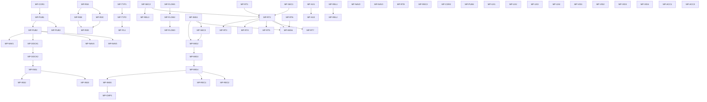

# COS Desktop Implementation Master Plan

Status: **Execution projection of the Desktop Design Canon and canonical component contracts.** Historical freeze-reviewed source: `f3ea37eaba8ed36551b2cfa3d8b370cd01956d70`; this plan update is a documentation-only reconciliation, not covered by that review. The plan owns priority, DAG/milestones, readiness, prerequisites, approval/evidence reporting, and crosswalk—not design contracts. No implementation/UX/Runtime/R0/video approval is granted here.

**Current Caller decision (2026-10-30): IMPLEMENTATION_AUTHORIZED — SCOPED RESUMPTION.** All audited proposals and remaining Caller permissions are adopted under [ADR-0014](../decisions/ADR-0014-YAGNI-SCOPE-AND-RESUMPTION.md); the global pause is released after canonical reconciliation. [Product §68.1](../architecture/COS_DESKTOP_PRODUCT_UX_ARCHITECTURE.md#681-image-first-initial-release) and [DC-MP-IMG2](../architecture/DESKTOP_DESIGN_CONTRACTS.md#dc-mp-img2) own the initial-release profiles. The [current 62-task authority](IMPLEMENTATION_STATUS_AUDIT.md#9-caller-adoption-and-current-authority-2026-10-30) supersedes old PAUSED/approval-pending fields; [§19.70](#1970-caller-adoption-and-scoped-implementation-resumption-2026-10-30) records this decision. Real technical/external prerequisites remain.

It does **not** own and does not restate:

- Desktop architecture, decision ownership and cross-layer invariants → [DESKTOP_DESIGN_CANON.md](../architecture/DESKTOP_DESIGN_CANON.md).
- Task behavior, APIs, failure, rollback and observable acceptance → [DESKTOP_DESIGN_CONTRACTS.md](../architecture/DESKTOP_DESIGN_CONTRACTS.md); each task below links its one canonical contract.

- Product/UX semantics → [COS_DESKTOP_PRODUCT_UX_ARCHITECTURE.md](../architecture/COS_DESKTOP_PRODUCT_UX_ARCHITECTURE.md) (sole product/UX canon; unchanged by this plan).
- Rendering/performance/visual architecture, R0–R10 phases, numeric budgets → [RENDERING_PERFORMANCE_VISUAL_ARCHITECTURE.md](../architecture/RENDERING_PERFORMANCE_VISUAL_ARCHITECTURE.md) + [ADR-0007](../decisions/ADR-0007-RENDERING-PERFORMANCE-VISUAL-ARCHITECTURE.md) (pin KEEP; not reopened here).
- Measured evidence → [historical finalization evidence](ARCHITECTURE_PLAN_FINALIZATION_REPORT.md), [projection baseline](PROJECTION_MEASUREMENT_2026-10-08.md), and historical [TERN_BINARY_RENDERING_ANALYSIS.md](TERN_BINARY_RENDERING_ANALYSIS.md); historical workflow record → [disclosure](evidence/README.md#historical-records).
- Physical ownership/dependency law → [REPOSITORY_ARCHITECTURE.md](../architecture/REPOSITORY_ARCHITECTURE.md), [DEPENDENCY_RULES.md](../architecture/DEPENDENCY_RULES.md).
- Wire contract → [DESKTOP_PROTOCOL.md](../architecture/DESKTOP_PROTOCOL.md), [PROTOCOL_OWNERSHIP.md](../integration/PROTOCOL_OWNERSHIP.md).
- Runtime change requests → [COS_RUNTIME_REQUIRED_CHANGES.md](../integration/COS_RUNTIME_REQUIRED_CHANGES.md) (RC-01–RC-17, still **Proposed** requests, not an approved Runtime plan).

**The document itself grants no implementation authority.** ADR-0014 releases the later pause and restores the existing Desktop execution authority in §19.6/ADR-0009 within adopted scope and real prerequisites. No repeated Caller acceptance wait, resurrection of deferred/stopped work, fabricated evidence, Runtime-repository mutation, main integration or release publication.

Evidence vocabulary (unchanged from repository policy): **Observed** = directly inspected/executed with recorded evidence; **Accepted** = decided policy, not implemented behavior; **Proposed** = candidate needing validation; **Deferred** = triggered re-entry stated.

---

## 1. Scope, authority and planning baseline

**Historical planning baseline (earlier pass):** the table records that pass's branch, observations and docs-only scope. Current finalization from `dev` includes the authorized existing app-core test correction and fresh validation/measurements described in §1.1; it does not reuse the historical scope as a current assertion.

| Item | Value |
|---|---|
| Repository / branch policy | Desktop repository; `feature/*` → `dev` → `main` |
| Planning branch | `feature/implementation-master-plan` created from `main` |
| Baseline SHA (observed) | `aa9a07e41d1ae647ef365ffd67e65cffcf9b8f9e` (`main` = `origin/main` = `dev` = `origin/dev` at planning time) |
| Toolchain (observed) | `rustc 1.98.1 (48a229cea 2026-09-01)`, `cargo 1.98.1 (797e8a9bc 2026-08-05)` via `rust-toolchain.toml` |
| GPUI pin (observed, KEEP) | Zed `395def7a067b32ed598fcb3f048969ada9b54942` (`gpui 0.2.2`) |
| Workspace members (observed) | `apps/desktop`, `crates/desktop-gpui`, `crates/ui-model`, `crates/app-core`, `crates/cos-client`, `crates/desktop-protocol` |
| Runtime checkout (observed, read-only) | `<runtime-root>`, branch `dev`, HEAD `f9867478fdd7080137a9dadabc55c2be2f18adf7`, clean worktree; the 2026-09-21 survey baseline `f94985bd…` is **historical** |
| Document scope | Planning and documentation only: no Rust/test/script/CI/manifest/lockfile/pin change, no Runtime change, no benchmark or feature implementation |

### 1.1 Evidence provenance and this plan update

**Historical planning observations:** the repository/branch, earlier Runtime checkout, fixture COR-01 reproduction and DOC-01 corrections below belong to the earlier planning pass. They are not current Runtime execution or a current worktree assertion.

**Historical 2026-10-08 finalization:** the 62 task cards, hard DAG, readiness distribution and canonical ownership were reconciled against actual Desktop code. Repository provenance, full local quality gates, test-only correction, Windows native smoke and bounded measurements are recorded in [the finalization evidence](ARCHITECTURE_PLAN_FINALIZATION_REPORT.md). Public projection measurements are in [the source-qualified baseline report](PROJECTION_MEASUREMENT_2026-10-08.md).

**Not qualified:** real Runtime integration/task survival, product media/Video, the Golden Workflow, packaging/update, full AX/IME/mixed-DPI matrix, R0 authorization and ratified SLOs. Historical [Tern analysis](TERN_BINARY_RENDERING_ANALYSIS.md) is not same-driver paired evidence. This plan indexes evidence; it does not turn an observation or specification into implementation authorization or product acceptance.

**Current 2026-10-11 workflow reconciliation:** MP-COR1 is `COMPLETED_ACCEPTED` by its recorded Caller decision (§19.1), not by a plan label or Refine success. Standard subsequent work is Taskern planning/context → existing Agent implementation/test → candidate commit → Refine 0.3 independent Gate → Tern review → separate Caller acceptance/integration. The owning [boundary policy](../integration/REFINE_TASKERN_EXECUTION_BOUNDARY.md) and [STEP 1 historical record](evidence/README.md#historical-records) qualify those observations. The subsequent user instruction authorizes STEP 2–5 progression after each clean Tern review; §19.2 records the current packet. This does not authorize acceptance, integration or other product tasks.

**Current 2026-10-17 MP-PUB1 disposition:** The recorded Caller decision is **COMPLETED_ACCEPTED at Desktop fixture/public seam** for product `6b05dcc7df280ab6ef6f50d6a2cad28f90c4abeb` and reviewed docs closure `68524496ba5383a195f151dee303ab5660905714`. Recorded Gate, native run2 and independent Tern review remain distinct historical outcomes. A19 remains NOT_RUN; no next MP, remote push/merge, branch deletion or release follows. Historical raw records are private; see the [disclosure](evidence/README.md#historical-records).

**Historical 2026-10-16 MP-PUB1 correction evidence:** The append-only corrections and STEP2–6 history are retained privately; see the [historical-records disclosure](evidence/README.md#historical-records). The historical missing-native HOLD and provider prerequisite were superseded by the actual run2 and final Tern technical PASS above; failed receipts and partial batches were not rewritten or retroactively passed.

---

## 2. Current implementation baseline

Per-feature classification: `IMPLEMENTED_AND_VERIFIED` (historical checked-in evidence, not re-executed by this docs step), `IMPLEMENTED_BUT_INCOMPLETE`, `IMPLEMENTED_WITH_CORRECTNESS_RISK`, `DESIGN_READY_NOT_IMPLEMENTED`, `REQUIRES_DESIGN_DECISION`, `BLOCKED_BY_RUNTIME`, `BLOCKED_BY_UX`, `DEFERRED`, `NOT_AUTHORIZED`. MP-COR1 completion is updated from its later accepted evidence; other baseline observations retain their original scope.

| # | Area | Class | Evidence (observed source) |
|---|---|---|---|
| 1 | GPUI shell / window / keyboard / focus | IMPLEMENTED_BUT_INCOMPLETE | `crates/desktop-gpui/src/lib.rs:18-155` (surfaces, focus handles, `Ctrl+1/2/3`, `Ctrl+Tab`, Tab/Enter/Space, `Ctrl+D`); placeholder bodies `:128-130`; task rail "not implemented" `:204-215`; stop unavailable `:237-255` |
| 2 | ui-model / presentation-local state | IMPLEMENTED_BUT_INCOMPLETE | `crates/ui-model/src/lib.rs:1-58` viewed/compare/diagnostics; `Workbench::new` one-shot text derivation `:80-166`; unit test asserts viewed≠compare |
| 3 | app-core / command ownership | IMPLEMENTED_BUT_INCOMPLETE | `crates/app-core/src/lib.rs:14-104`: private boxed `DesktopClient`, `snapshot()` on demand, stop route, `disconnect()` drops events; no event subscription/publication; `navigation.rs` 3 surfaces |
| 4 | cos-client / snapshot / delta / recovery | IMPLEMENTED_AND_VERIFIED for MP-COR1's accepted scope; MP-COR2 technically verified and merged to dev, not Caller-accepted | Delta effective-state validation before apply/publish/cursor advance in `client.rs`; snapshot and delta reuse `EffectiveState::validate` in `projection.rs`; public regressions in `tests/effective_state.rs` and `tests/graph_integrity.rs`. [COR1 Caller acceptance](evidence/README.md#historical-records), [COR1 quality evidence](evidence/README.md#historical-records), [COR2 Gate/review closure](evidence/README.md#historical-records), [independent final assessment](evidence/README.md#historical-records), [dev integration](evidence/README.md#historical-records). Real Runtime, R0 ratification and COR2 Caller acceptance remain unqualified. |
| 5 | desktop-protocol / version / identity / revision | IMPLEMENTED_AND_VERIFIED | `src/ids.rs` typed identities (`CandidateRef` 5-tuple, formal selection, `GraphRef` exact version+digest); `src/versions.rs` range negotiation; `src/bounds.rs` limits; tests `serde_policy.rs`, `negotiation.rs` |
| 6 | Runtime transport / authentication / subscription | DESIGN_READY_NOT_IMPLEMENTED + BLOCKED_BY_RUNTIME | `src/transport.rs:1-32` raw byte seam only; `main.rs:28-41` Runtime path always `AppCore::disconnected`; principal-from-transport rule `messages.rs:76-93`; RC-01/02/03 unresolved |
| 7 | Task Rail / navigation | DESIGN_READY_NOT_IMPLEMENTED | shell text `:204-215`; no task list model; `navigation.rs` covers only 3 work surfaces |
| 8 | Creative Brief / Task creation | DESIGN_READY_NOT_IMPLEMENTED + BLOCKED_BY_RUNTIME/UX | `CreateTaskCommand` DTO exists (`messages.rs` ~605-700); fixture capability marks create unsupported (asserted `fixture_observation.rs:116-126`); brief field set/validation not frozen |
| 9 | Candidate Dock / iteration / history | IMPLEMENTED_BUT_INCOMPLETE (dock qualification) / DESIGN_READY_NOT_IMPLEMENTED (history timeline) | implementation at `23a2a5f`; [historical native observations and correction](evidence/README.md#historical-records) show bounded row construction and Viewed retention, but source binding, active/anchor retention, Compare evidence and independent verification remain incomplete; history/unavailable policy is MP-DOCK2 |
| 10 | Artifact / Image / Compare | DESIGN_READY_NOT_IMPLEMENTED | "Media viewer not implemented" `desktop-gpui:128-130`; compare pair model only (`ui-model:20-39`); no decode/upload/cache code anywhere |
| 11 | Evaluation / Evidence / Inspector | IMPLEMENTED_BUT_INCOMPLETE (text) / DESIGN_READY for the surface | evaluation/evidence flattened to strings `ui-model:120-148`; DTOs `projections.rs:241-303`; no inspector surface, no evidence detail fetch |
| 12 | Stop / command reconciliation | IMPLEMENTED_AND_VERIFIED at client level, incomplete in UI | statuses `client.rs:110-147`; `commands.rs:26-78` (accepted ≠ completion), `:213-273` (lost response stays unknown); shell exposes no stop control |
| 13 | Flow / DMLG inspection | DESIGN_READY_NOT_IMPLEMENTED | graph DTO `projections.rs:352-408`; shell prints node labels joined with arrows; no layout, culling, inspection list |
| 14 | Diagnostics / observability | IMPLEMENTED_BUT_INCOMPLETE | `diagnostics_open` toggle; diagnostics string built once in `ui-model:82-107`; no bounded ring buffer, counters, redaction policy implementation |
| 15 | Accessibility / DPI / IME | DESIGN_READY_NOT_IMPLEMENTED | labels/roles/focus in shell; no IME text entry, no screen-reader verification, no DPI matrix, no known-AT matrix |
| 16 | Device loss / reconnect / recovery | IMPLEMENTED_AND_VERIFIED (client staging/recovery) + DESIGN_READY_NOT_IMPLEMENTED (OS/GPU device loss, live session reconnect) | client queue overflow/epoch/session recovery in `tests/recovery.rs`; no device-loss handling; no reconnect because no live session owner exists |
| 17 | Packaging / distribution / update | DEFERRED | no installer/updater/signing code; canon §60–61 remain product requirements |

The table above retains the pre-MP-PUB1 implementation baseline, not a current assertion that observation is absent. MP-PUB1 subsequently introduced observation/publication and live fixture refresh; its current evidence, successful Gate and incomplete native acceptance are indexed in §5.2, its task card and §19.5. Unrelated surface/Runtime/UX completion is not inferred.

Additional confirmed structural facts used by this plan (all observed):

- **Historical pre-MP-PUB1 absence of a live update path:** the fixture client was pumped once before `AppCore` took ownership, and text was derived once with no later subscription. This described the original baseline, not today's implementation. Current observation/live fixture refresh exists; its Gate success and remaining native acceptance gap are recorded in §5.2 and §19.5.
- **Conditional copy-on-write:** `SnapshotHandle = Arc<ProjectionState>`; mutation uses `Arc::make_mut`, so a retained handle forces a full `ProjectionState` clone on the next delta (rendering companion §4). Instrumentation is required before changing this boundary.
- **Candidate element identity** is `("candidate", index)` — enumeration position, not scoped identity (rendering companion §2, §4; violates the stable-identity policy).
- **CI:** gates 1–5 + dependency checker declared in `.github/workflows/ci.yml`; native startup smoke is an explicit **manual** gate; remote execution was never successfully started (BOOTSTRAP_REPORT §6).

---

## 3. Accepted invariants (canon reference)

The [Desktop Design Canon](../architecture/DESKTOP_DESIGN_CANON.md) owns accepted architecture, state/authority boundaries, security and cross-layer invariants. The Product/UX Canon owns product meaning; ADRs and protocol documents own their respective decisions. This plan does not paraphrase those rules. Each task's single linked DC contract is the implementation-facing behavior and acceptance authority. See the owner documents when needed; conflicts or uncovered behavior return to the relevant owner rather than being resolved in this execution index.

---

## 4. Target MVP and deferred scope

The Product/UX Canon §68 owns MVP and deferred scope. The traceability crosswalk in §15.3 retains the mapping to tasks, including Video as an MVP requirement with separate authorization gates. This plan neither changes product scope nor closes an MVP item by relabeling a capability limitation.

---


## 5. Correctness prerequisites (P0)

### 5.1 COR-01 — delta reference integrity: **RESOLVED, MP-COR1 accepted**

Current status: the shared aggregate validator now checks the effective transaction before apply/publish/cursor advance. The historical Caller acceptance, fail-before/after record and quality gates are retained privately; see the [historical-records disclosure](evidence/README.md#historical-records). This does not complete publication, graph scaling or real Runtime integration.

**Historical pre-fix observation and reproduction:** `client.rs:1181-1318` then checked references against the pre-transaction state and applied writes without an aggregate delta check; `validate_integrity` ran only on snapshot construction. The following public-fixture harness output was recorded before MP-COR1, not reproduced against current code:

```text
baseline: tasks=1 candidates=5 artifacts=5 iterations=3
A remove-referenced-artifact: connection=Live delta_applied=true error=false removed=true
  dangling_candidates=["fixture:candidate/a"]  (referenced it before: ["fixture:candidate/a"])
B reciprocal-mismatch upserts: connection=Live delta_applied=true error=false
  iteration_lists_candidate=true
  candidate_iteration_ref=Some("fixture:iteration/Task-184/3")
  iteration_candidate_refs=Some(["fixture:candidate/plan-z"])
cursor_after=Some("fixture:cursor/plan/cor01-b") epoch=Some("fixture:epoch/1")
```

Two distinct defects were demonstrated on that pre-fix revision:

- **A (referenced entity removed):** a single `Remove { Artifact }` mutation that a candidate still references is accepted; the resulting published state violates `validate_integrity`'s artifact-reference rule and the cursor advances.
- **B (delete/update inside one transaction):** two upserts that pass per-mutation checks but break reciprocal iteration↔candidate ownership are accepted and published.

The historical reproduction established delta/snapshot integrity inconsistency. MP-COR1's later acceptance above closes that defect under DC-MP-COR1; the original output is retained as failure provenance, not a current failure claim.

### 5.2 ARC-01 — state publication/observation ownership: **RESOLVED at accepted Desktop fixture/public seam**

Historical pre-MP-PUB1 observation: `AppCore` owned a private `Option<Box<dyn DesktopClient>>` with on-demand `snapshot()` and no subscription, revision or notification (`app-core/src/lib.rs:14-104`); `Workbench::new` derived text once (`ui-model/src/lib.rs:80-166`); the shell's only `cx.notify()` sources were initial load and local UI actions. That baseline identified missing live projection, recovery, receipt and stale-state publication. It is retained as defect provenance, not the current implementation state.

The contract remains [DC-MP-PUB1](../architecture/DESKTOP_DESIGN_CONTRACTS.md#dc-mp-pub1). Historical owner ratification, acceptance, Gate and review records are private; see the [historical-records disclosure](evidence/README.md#historical-records). A19 real authenticated Runtime remains NOT_RUN; ownership/generation/multi-window/read semantics still come from the contract.

### 5.3 PERF-01 — graph validation cost: **confirmed asymptotic**

Observed code scans both edge endpoints through `graph.nodes.iter().any(…)`, giving Θ(E·V) graph membership work in integrity and graph-upsert validation. The [fresh public-API baseline](PROJECTION_MEASUREMENT_2026-10-08.md) measures validation across 1k/10k/50k-edge corpora, legal rewires, retained-handle COW and approximate process memory. It supports COR1 correctness first, then COR2's bounded per-graph membership index inside the same validation owner. Exact allocation counts and an optimized paired A/B result are NOT_MEASURED; no improvement or R0 threshold acceptance is inferred.

---

## 6. Design decision ownership (derived gate index)

The authoritative DD-01–DD-26 registry, decision owners, approval ladder and predicates now live in [Desktop Design Canon §6](../architecture/DESKTOP_DESIGN_CANON.md#6-decision-ownership-and-approval-state). The current plan task cards reference those decisions for **readiness, scheduling and execution**, never for unilateral design approval.

Except the scoped MP-PUB1 owner ratification above, previously pending DD/RC/UX/experiment gates remain pending. SPEC_DRAFTED, plan readiness and review never ratify themselves. Owning design/Protocol/Runtime/ADR approval transitions are recorded first and mirrored here. MP-PUB1's grant authorizes Desktop scope only, not Runtime implementation or a later-step start; no other task approval follows.

---

## 7. Milestones, dependency DAG and task contracts

**Current execution overlay:** goals, sole DCs and hard DAG remain. The adopted audit governs current I/V evidence, ADR-0014 governs permission, and Product §68.1 qualifies full-target milestones. Old preparation/evidence statements are historical, not new approval requests or current measurements. Named deferrals remain later-release obligations, not PASS.

### 7.1 Milestones

| Milestone | Goal | Exit (observable) |
|---|---|---|
| **M1 Correctness foundation** | Delta integrity is trustworthy; graph validation is scalable; publication contract frozen | DC-MP-COR1 integrity regressions PASS; DC-MP-COR2 public behavior/error-order parity and same-condition 10k/50k comparison evidence; internal counters optional diagnostics, not an exit gate |
| **M2 Measurement foundation (R0)** | Repeatable harness, honest NOT_MEASURED reporting, ratified thresholds | rendering §10.1/§11.1/§11.2 executed on the locked shell; ratification record |
| **M3 UX prototype & validation** | Golden-workflow comprehension validated before production surfaces | UX validation record (canon §65) with the 8 comprehension checks |
| **M4 Design system, typography, DPI** | Token/typography system with native evidence | R1 exit: no clipping/missing glyphs/focus/contrast failures in the declared matrix |
| **M5 State publication & live shell** | Live, revisioned, cancellable projection → window updates | ARC-01 contract implemented; no stale overwrite; local state preserved |
| **M6 Navigation & task surfaces** | Task Rail, Brief creation, History | Virtualized rail; create flow behind capability+contract; reopen from history |
| **M7 Candidates, iterations, history detail** | Dock + timeline with stable identity | 10k-item rail-scale behaviour; viewed/compare survive inserts/removals |
| **M8 Artifact/image presentation** | Representations, decode/upload/eviction, full view | R4 Decode→Upload→Eviction gates pass per codec/representation |
| **M9 Evaluation/Evidence/Inspector** | Explainability surfaces | Evaluation→Evidence→Refinement→Outcome navigation from authoritative projections |
| **M10 Compare** | Two-pane compare with resource reuse | R5 exit + UX-01 decisions implemented |
| **M11 Flow/graph** | Read-only Flow + inspection-first graph | R6 simplest passing stage; accessible inspection |
| **M12 Runtime integration** | Real transport, identity, authorization, observation | Contract freeze + real-server acceptance campaign |
| **M13 Security & capability** | Credentials, gating, redaction, untrusted media | Security acceptance scenarios pass |
| **M14 Recovery & device loss** | R8 hardening + crash/restart behaviour | Plateau/release + device recovery evidence |
| **M15 Video** | MVP video path *if and only if* authorized; investigation and authorization are separate milestones of their own | VID1/VID2 complete → a recorded capability/authorization decision; VID3/VID4 complete only if the decision authorizes implementation **and** R7 gates pass. An "unavailable" finding completes VID1/VID2 only — the MVP item stays open (it may not be closed by declaring the capability restricted; that would require a Product-owner scope exception). |
| **M16 Accessibility & polish** | R10 consolidated + R9 polish | R10 matrix; no idle animation/legibility regressions |
| **M17 Packaging & release** | Installer/portable/updater/diagnostics | Signed artifacts + update/rollback procedure |
| **M18 Product acceptance** | Golden Workflow + canon §63–66 evidence | Acceptance report with all NOT_MEASURED items labelled |

### 7.2 Dependency DAG (no cycles)



This graph contains **62 task nodes and 41 hard implementation edges**. An edge means the dependent implementation cannot start without the upstream task result. The forward-ordered edges are acyclic. Decision/authorization, measurement readiness, conditional Runtime functionality and downstream product acceptance are separate gates, not hard task dependencies. MP-IMG1 local/fixture inputs do not depend on MP-IMG6; MP-IMG5 local/fixture full-view feasibility does not depend on MP-IMG6; MP-NAV4 fixture/local axes and native interaction do not depend on MP-RT4. External-media decode requires the MP-IMG6/MP-SEC3 admission and authorization gates; MP-IMG6 also requires MP-RT2 descriptor transport and MP-RT6 authorization. Production full-detail acceptance requires MP-IMG6; NAV4 real receipt reflection and Runtime acceptance require MP-RT4. Desktop-local REC3 restoration is not blocked by RT3/RT8; task-survival/product acceptance remains conditional on real Runtime evidence. VID1→VID2→VID3→VID4 is an authorization/acceptance sequence, not an implementation dependency chain.

**Non-DAG gate crosswalk:** R0A→R0B/R0C→R0D is the evidence sequence, not a new permission wait; ADR-0008 ratifies declared configurable defaults, not attainment. UX details, typography/AX evidence, Brief/command contracts and actual Runtime capabilities remain conditional gates. DD-01 and Desktop PUB1 permission are already approved. IMG6/RT6/RC-13 gate production media; local IMG1–5 work is not inherently Runtime-blocked. Product §68.1 defers video; route/capability evidence remains necessary on re-entry. No hard DAG edge changes.

MP-ACC1 retains the complete real-integrated image workflow and failure evidence, including NAV2, IMG5/6, CMP1, INS1/2, FLOW1, NAV3, RT3/4/5/7, REC3 and REL1; actual DD-25 command semantics remain necessary. MP-ACC2 retains the owning contract's supported-image/AX/security/packaging evidence. Product §68.1 is the explicit exception for VID4, REL2 and named deferred OS subpaths: not initial-release exit prerequisites or PASS. Full-target conditions remain in their sole DCs, not hard DAG ancestors.

### 7.3 Parallel lanes (reconstructed from the corrected DAG)

The table groups related work; it does not add dependencies. Only the §7.2 edges are hard prerequisites. Gates can constrain a declared task slice or its acceptance exit without blocking other explicitly separable work.

| Lane | Members | Gate summary |
|---|---|---|
| **L-Correctness** | MP-COR1, MP-COR2 | Both independently startable; COR2 gates scaled graph ingestion, not the accessible-list skeleton. |
| **L-Publication** | MP-PUB1..4; MP-NAV1..5; MP-DOCK1/2; MP-INS1..3 | PUB1 requires DD-01 `SPEC_APPROVED` and separate implementation authorization; its direct DAG prerequisite is COR1. Surface-specific UX/Runtime gates remain separate. |
| **L-Measurement** | MP-R0A..D | Explicit R0 authorization; the R0 internal sequence is hard, but R0D is only an experiment/adoption gate for other lanes. |
| **L-UX** | MP-UX1..4 | Owner authorization and decisions as specified in the task cards; no generic code dependency. |
| **L-Typography** | MP-TYP1/2, MP-PL1 | DD-04a gates TYP1; R0D gates calibrated R1 evidence/threshold claims; DD-04b adoption gates TYP2/PL1. |
| **L-Media** | MP-IMG1..6, MP-SEC3, MP-CMP1, MP-REC1/2 | Local-input feasibility is independent of Runtime; IMG6/RT6 gates production inputs, IMG6 also gates production full-detail. |
| **L-Graph** | MP-FLOW1..3 | Fixture/list work is independently startable; COR2 gates scaled graph-ingestion claims; R0/experiment gates apply to measured stages. |
| **L-Runtime** | MP-RT1..8, MP-SEC1, MP-INS2 | Runtime-owner contract approvals gate Runtime-dependent slices; MP-RT8 local native single-instance/shutdown work is independently implementable. |
| **L-Release** | MP-SEC2, MP-REL1..3 | Caller permission received; retained diagnostics/signed packages need actual contract details, certificate/operator inputs and evidence. Automatic updater delivery deferred by Product §68.1. |
| **L-Video** | MP-VID1..4 | Existing probe source/evidence retained; video is DEFERRED_INITIAL_RELEASE, not waiting for the same Caller permission or requiring a new image-release probe. |

Integration ownership and file-conflict policy are assigned per shared file by the coordinating Caller/integration owner before merging parallel work; conflicting changes are not silently ordered. Testing ownership and impact routes are defined in [TESTING.md §1](TESTING.md#1-quality-gates-and-impact-routes).

### 7.4 Execution card template and single-owner design rule

The [Desktop Design Canon](../architecture/DESKTOP_DESIGN_CANON.md) owns design authority/decisions; each [canonical component contract](../architecture/DESKTOP_DESIGN_CONTRACTS.md) owns purpose, behavior, scope, non-goals, interface/API semantics, threading, failure/recovery, security, rollback and **observable acceptance**. These clauses are not rewritten or editable in this execution plan.

**Inherited card schema (applies to all 62 cards):** task ID and goal are the heading; owner, status/readiness, direct hard prerequisites, separate gates, one DC contract, and evidence are the required fields. Direct prerequisites are exactly the incoming §7.2 DAG edges (or `none`); a card's **Gate** includes the decision/authorization/readiness needed for the named work, with any conditional product/real-Runtime exit stated separately. Each card's **Contract** is its single DC-MP link; contract scope and acceptance are not duplicated. **Evidence** is the contract's observable acceptance plus the task-specific evidence named in the card or inherited crosswalk below; evidence is future obligation, never a claim that work ran.

Gate labels: **hard** = §7.2 implementation prerequisite; **conditional** = required only for a named Runtime/product exit; **optional** = explicitly optional scope; **advisory** = non-blocking recommendation; **release** = product/release acceptance. A status such as DESIGN_GATE_REQUIRED, EXPERIMENT_READY, RUNTIME_BLOCKED, UX_BLOCKED or NOT_AUTHORIZED is not itself implementation permission.

Plan governance: §7.2 is canonical for hard edges; §6 reflects decision status but cannot approve a gate. Testing routes follow [TESTING.md](TESTING.md). If ambiguity changes design or ownership, stop and amend its design owner before revising this projection.


### 7.5 M1 — Correctness foundation

#### MP-COR1 — Delta effective-state integrity (COR-01)
- **Hard prereqs:** none.
- **Priority:** P0 · **Status:** COMPLETED_ACCEPTED · **Owner:** `crates/cos-client` (`client.rs`, `projection.rs`, `tests/`)
- **Prereqs:** none. **Accepted inputs:** DESKTOP_PROTOCOL.md §2 (atomic transaction, staging, integrity); rendering companion §13 R2 ("no lost required event/receipt, stale overwrite or partial transaction").
- **Evidence:** [Caller acceptance](evidence/README.md#historical-records), [quality gates](evidence/README.md#historical-records), [fail-before/after](evidence/README.md#historical-records), public `effective_state` regressions and §19.1's independent review; historical delegated receipts are not Refine 0.3 Gate evidence.
- **Unresolved decisions:** none. **Stop/escalation:** if an accepted-input-shaped transaction (a legal rewire the protocol permits) fails validation, stop and escalate to the protocol owner instead of relaxing rules ad hoc.
- **Design source / acceptance:** [DC-MP-COR1](../architecture/DESKTOP_DESIGN_CONTRACTS.md#dc-mp-cor1). This task implements that frozen contract; scope, API, failure, rollback, tests and accepted behavior may not be redefined here.

#### MP-COR2 — Graph validation scaling (PERF-01)
- **Hard prereqs:** none.
- **Priority:** P0 · **Status:** COMPLETED_ACCEPTED for recorded client scaling scope (Gate/review and dev integration complete; Caller acceptance ADR-0009/0014) · **Owner:** `crates/cos-client` (`projection.rs`)
- **Prereqs:** none (independent of the delta-integrity task; either may land first). **Inputs:** rendering §10 graph workloads; §4.2 measurement separation (validation vs publication vs layout).
- **Evidence:** [implementation/public regressions, same-session 10k/50k parity/timing/traversal, quality/native startup](evidence/README.md#historical-records), [fixed candidate/Gate/review closure](evidence/README.md#historical-records), [independent assessment](evidence/README.md#historical-records). Product numeric attainment and real Runtime are not established by this client fix. Declared configurable targets are ratified by ADR-0008; zero-intervention delivery was not achieved.
- **Unresolved:** none. **Stop/escalation:** if any pre-existing valid fixture graph is rejected, stop (behavior drift).
- **Consumers:** MP-PUB4, MP-FLOW1/2, R6 experiments.
- **Design source / acceptance:** [DC-MP-COR2](../architecture/DESKTOP_DESIGN_CONTRACTS.md#dc-mp-cor2). This task implements that frozen contract; scope, API, failure, rollback, tests and accepted behavior may not be redefined here.

#### MP-PUB1 — Observation session owner and atomic publication (ARC-01)
- **Hard prereqs:** MP-COR1.
- **Priority:** P0 · **Status:** COMPLETED_ACCEPTED (Desktop fixture/public seam; A19 real Runtime NOT_RUN) · **Owner:** `crates/app-core`, `crates/cos-client`, `crates/desktop-protocol`, `crates/ui-model`, `apps/desktop`, `crates/desktop-gpui`
- **Gate:** DD-01 SPEC_APPROVED and separate Desktop MP-PUB1 IMPLEMENTATION_AUTHORIZED remain recorded by [owner approval](evidence/README.md#historical-records), including the bounded DD-12/13/15/19 amendment. Ordinary STEP transitions and current-task Gate attempts without a numerical ceiling are Caller-approved; each actual dispatch is separately bounded and automatic retry remains 0. R4 is now SUCCEEDED. Real Runtime evidence remains a conditional integration exit, not an added hard edge. **Inputs:** PROCESS_MODEL, DC-MP-PUB1 and DESKTOP_PROTOCOL authorized read handoff.
- **Evidence:** [historical STEP3 source closure](evidence/README.md#historical-records), [R1 implementation](evidence/README.md#historical-records), [R2b native evidence](evidence/README.md#historical-records), [R3 quality](evidence/README.md#historical-records), [immutable R4 timeout](evidence/README.md#historical-records), [successful R4 and earlier HOLD history](evidence/README.md#historical-records), and [actual run2 native evidence](evidence/README.md#historical-records).
- **Unresolved:** none within the accepted Desktop fixture/public seam. [Caller ACCEPT](evidence/README.md#historical-records) binds product `6b05dcc7df280ab6ef6f50d6a2cad28f90c4abeb` and docs closure `68524496ba5383a195f151dee303ab5660905714`; it is not inferred from Gate/review success or prior blanket approval. A19 real authenticated Runtime remains separately owned/NOT_RUN, not an added hard prerequisite. Next MP, integration and release remain outside this decision.
- **Subsequent evidence:** [Correction and native-review addendum](evidence/README.md#historical-records) preserves prior consent/partial evidence and records the caller-authorized run2. No contract, hard edge or Taskern Plan revision changed.
- **Stop/escalation:** if an implementation requirement exceeds the approved contract/API/major transition, adds a dependency or requires Runtime mutation, stop for the relevant owner; do not infer new permission from readiness.
- **Consumers:** MP-PUB2/3, all surface tasks, MP-RT3.
- **Design source / acceptance:** [DC-MP-PUB1](../architecture/DESKTOP_DESIGN_CONTRACTS.md#dc-mp-pub1). This task implements that frozen contract; scope, API, failure, rollback, tests and accepted behavior may not be redefined here.

#### MP-PUB2 — Incremental window refresh and derived-view policy
- **Hard prereqs:** MP-PUB1.
- **Priority:** P0 · **Status:** COMPLETED_ACCEPTED revision-scoped derivation ([technical review](evidence/README.md#historical-records): quality/changed-path Native, Gate R3 and Tern R2 0/0/0; Caller acceptance ADR-0009/0014). Real Runtime/full product acceptance separate · **Owner:** `crates/ui-model`, `crates/desktop-gpui`; app-core exposes only the allowed existing snapshot handle.
- **Evidence:** [direct MP-PUB2/MP-PUB3 Caller authority](evidence/README.md#historical-records), [Taskern revision1 packet](evidence/README.md#historical-records), [quality](evidence/README.md#historical-records), [normal-binary Native evidence](evidence/README.md#historical-records), [observable pixel comparison](evidence/README.md#historical-records). No private-helper count is an acceptance oracle; A19 and full product UX remain outside this slice.
- **Gate history:** [R1](evidence/README.md#historical-records) preserves the no-PATH checker failure; [the corrected existing launcher](evidence/README.md#historical-records) passed. [R2](evidence/README.md#historical-records) preserves seven successful command checks/176 tests, followed by the correctly rejected old HEAD predicate. Both failed Gates retain complete cleanup and separate stored-integrity outcomes. [R3](evidence/README.md#historical-records) SUCCEEDED on `f28a2055f88ae73fe9d9afd9fc56233a45e82293`: all seven commands, HEAD and clean-worktree predicates passed; 176 tests passed, all eight outputs collected, cleanup complete. Static preflight UNKNOWN and later documentation closure are not attributed to that Gate.
- **Unresolved:** cache/reuse representation → MP-PUB4.
- **Consumers:** MP-NAV1, MP-DOCK1/2, MP-INS*, MP-FLOW*.
- **Design source / acceptance:** [DC-MP-PUB2](../architecture/DESKTOP_DESIGN_CONTRACTS.md#dc-mp-pub2). This task implements that frozen contract; scope, API, failure, rollback, tests and accepted behavior may not be redefined here.

#### MP-PUB3 — Multi-window, generation and stale-result conformance tests
- **Hard prereqs:** MP-PUB1.
- **Priority:** P1 · **Status:** COMPLETED_ACCEPTED recorded Desktop multi-consumer invariants ([technical review](evidence/README.md#historical-records): quality/179 historical tests, native startup, Gate R2 and Tern R3 0/0/0; Caller acceptance ADR-0009/0014). Full product windows/Runtime separate · **Owner:** `crates/app-core` tests, `crates/desktop-gpui` tests
- **Authorization:** [2026-10-18 direct Caller instruction](evidence/README.md#historical-records) authorizes this MP after MP-PUB2 completes implementation/verification and clean remote Tern review; [MP-PUB2 remote R2](evidence/README.md#historical-records) is 0/0/0 PASS, so this task proceeded. It grants no unrelated task or integration.
- **Gate history:** [R1](evidence/README.md#historical-records) SUCCEEDED on `60cf860a52090989a28b7bd05b75067d53755ae0`: all seven quality commands plus the HEAD and clean-worktree predicates passed, 179 workspace tests passed across 22 targets, all nine declared outputs were collected, cleanup complete. Static preflight UNKNOWN was not relabelled PASS; no candidate was mutated during checks.
- **Gate history (continued):** [R2](evidence/README.md#historical-records) SUCCEEDED on the repaired candidate `2df45bd337ed65546c8d48074daf2e48cb525126`: all seven quality commands plus the HEAD and clean-worktree predicates passed, 179 workspace tests passed across 22 targets, all ten declared outputs were collected, cleanup complete. R1 remains stored and immutable as superseded evidence.
- **Remote review history:** [R1](evidence/README.md#historical-records) returned 0 BLOCKING / 2 ACTIONABLE NON-BLOCKING / 0 EXCESSIVE (HOLD) on `f1ad65c82d638650a1275b005b4120cf2ad31162`: A-NB-1 required a per-identity re-dispatch oracle instead of a total frame count, A-NB-2 required honest native-evidence run identifiers and span. Both were repaired in this session: the fixture provider records received command dispatches and both reconnect tests compare that ordered record before and after recovery, and the native evidence now states the two recorded identities and the corrected 78.23 s span.
- **Remote review history (continued):** [R2](evidence/README.md#historical-records) confirmed A-NB-1 CLOSED on `483e5d8e17325de0f23ec1834ceac3ab84668f54` and found the one remaining stale native note; [R3](evidence/README.md#historical-records) is 0/0/0 PASS on `ae4bd713884ba941c3b4ba95d8d5f29761af2a3c` with A-NB-2 CLOSED. [Technical completion](evidence/README.md#historical-records) records the closed technical review; the original pending field is historical; Caller acceptance is received under ADR-0009/0014.
- **Evidence:** [Taskern revision 1 packet](evidence/README.md#historical-records), [eight-invariant crosswalk](evidence/README.md#historical-records), [test admission](evidence/README.md#historical-records), [quality](evidence/README.md#historical-records), [invariant-removal probes](evidence/README.md#historical-records), [native startup smoke](evidence/README.md#historical-records).
- **Observed repair:** the inherited DC-MP-PUB1 diagnostic bound (at most 1,024 events with explicit `event_gap`) had no implementation at the owner seam: `ObservationSessionOwner::step` discarded `PumpReport::events`. `crates/app-core/src/diagnostics.rs` now retains category-only events with a monotone non-reusing sequence and an explicit bound/gap; no identity, receipt, grant, cursor or remote text is retained and diagnostics never drive publication or command truth.
- **Consumers:** MP-RT3, MP-ACC1.
- **Design source / acceptance:** [DC-MP-PUB3](../architecture/DESKTOP_DESIGN_CONTRACTS.md#dc-mp-pub3). This task implements that frozen contract; scope, API, failure, rollback, tests and accepted behavior may not be redefined here.

#### MP-PUB4 — R2 representation experiment (COW / index / cache / sharing)
- **Hard prereqs:** none.
- **Priority:** P1 · **Status:** LIMITED_COMPLETE exploratory experiment; production adoption/further variants DEFERRED under ADR-0014 · **Owner:** `crates/cos-client` + `crates/app-core`
- **Prereq/gate:** keep the current Arc baseline and §19.17 experiment. Re-entry requires a concrete real-workload deficit and applicable evidence before DD-02b selection; no compulsory comparison or repeated approval merely to fill UNKNOWN.
- **Consumers:** MP-PUB2, MP-NAV1, MP-DOCK1, R3 workload results.
- **Design source / acceptance:** [DC-MP-PUB4](../architecture/DESKTOP_DESIGN_CONTRACTS.md#dc-mp-pub4). This task implements that frozen contract; scope, API, failure, rollback, tests and accepted behavior may not be redefined here.

---

### 7.6 M2 — Measurement foundation (R0)

R0 Caller authorization is received; ADR-0008 ratifies declared configurable gates, not measured attainment. R0A remains IN_PROGRESS and R0B/C limited evidence does not close full baseline/noise/stall acceptance. Use the existing harness for a concrete retained-path acceptance need; no speculative endpoint framework or repeated approval cycle.

#### MP-R0A — R0 harness implementation
- **Hard prereqs:** none.
- **Priority:** P1 · **Status:** IMPLEMENTATION_AUTHORIZED; S1 A/B TECHNICALLY COMPLETE, S2A LIMITED TECHNICAL COMPLETION (independent 0/0/0), S3 ledger/import and S3-N1 published Native journal replay LIMITED TECHNICAL COMPLETION ([§19.53](#1953-mp-r0a-s3-n1-published-native-journal-replay-2026-10-26), Tern 0/0/0); MP-R0A overall IN_PROGRESS with S2B full-source replay and R0B/C measurements pending · **Owner:** `apps/desktop` dev-only profiling module + a versioned workload manifest set (location decided with R0 authorization; must not become production behaviour)
- **Consumers:** MP-R0B/C, MP-PUB4, MP-TYP1, MP-IMG*, MP-FLOW*, MP-REC2.
- **Design source / acceptance:** [DC-MP-R0A](../architecture/DESKTOP_DESIGN_CONTRACTS.md#dc-mp-r0a). This task implements that frozen contract; scope, API, failure, rollback, tests and accepted behavior may not be redefined here.
- **S1 contract foundation:** `apps/desktop/devtools/r0` (Python stdlib only) defines the versioned manifest and result contracts, a bounded UTF-8 loader with duplicate-key/non-finite rejection, and an offline `manifest|result|pair` validator. [Admission](evidence/README.md#historical-records) and [validation](evidence/README.md#historical-records) retain 25 contract tests (17 categories) and CLI outcomes. [Two-Gate verification](evidence/README.md#historical-records): product `440ea864d6d7e87875d6ccddbc1758b2984b5d2e`, quality Gate `aab9ec8e-1d09-4c74-8de2-9ad15364b310` (9/9, Python 25 tests) and build Gate `7570d1ba-010d-48eb-83be-12804e5c7239` (3/3), candidate digest `sha256:3bae64d6…`, 12 identical artifacts, absent 0, cleanup complete, verify exit 0; a1–a5 Gates remain history. The [S1 bounded technical-completion record](evidence/README.md#historical-records) independently verifies the final docs-only SHA `8ea1ef9` at 0/0/0. At S1 closure, R0A-S2 instrumentation/driver, S3 ledger/aggregation, R0B/R0C/R0D and numeric claims were still NOT_RUN. Current status: S2A LIMITED TECHNICAL COMPLETION; S2B/S3 and R0B/R0C remain NOT_RUN; R0D/numeric SLO remain NOT_RATIFIED; MP-R0A overall remains IN_PROGRESS. S1 completion alone did not constitute R0A completion.
- **S2A process driver — LIMITED TECHNICAL COMPLETION:** [completion record](evidence/README.md#historical-records) binds product `ca9b074b4f99ddc50894a449aef7775615d454c5` and reviewed evidence `087398591b3ac18ee2a5ebed0220858a09394f0e` to [independent R10 PASS 0/0/0](evidence/README.md#historical-records). Approved-only launch, OS-resolved single-use profile identity, pinned paths/fixtures, pre-go JobObject containment, complete unmeasured result semantics and the completion-directory publication point are implemented. 48 Python tests (SKIP 0), 285 Rust tests, 14 dependency tests and two helper tests passed; separate approved normal/timeout/native-driver-kill evidence is retained. Publication visibility is not power-loss durability; per-user claims do not defend against administrator/registry-owner tampering.
- **S2A independent verification:** quality Gate `8b78c094-e476-44ec-a419-fe5ffaeb0ff5` (11/11) and build Gate `eedce38a-c489-4d3d-af64-31bae90160ca` (3/3) succeeded on that exact product: [receipt comparison](evidence/README.md#historical-records) records 12 distinct checks, identical candidate digest and 25 artifact ID/path/size/SHA-256 tuples, absent 0, cleanup complete and integrity success. Preflight UNKNOWN remains UNKNOWN; all historical Gate/review evidence retains its original scope. The docs-only completion record awaits final independent confirmation. R0A overall remains IN_PROGRESS; S2B/S3 and R0B/C are NOT_RUN, R0D/numeric SLO NOT_RATIFIED, visual/Present/displayed NOT_MEASURED, IMG1 M09 closed by [§19.12](#1912-mp-img1-native-m09-source-bound-windows-verification-2026-10-23) (file-reparse `NOT_RUN`) while the IMG2 comparison stays incomplete; no Runtime/Product UX/DD/main/release approval follows.
- **2026-10-23 Caller pause — S2B HOLD:** [The durable stop record](evidence/README.md#historical-records) binds product `6584e7683ae97869aa498526db290c1550bd59db`, reviewed evidence `68e8f36898be0ffc6f92eb33f074b552a3fd75e2`, successful r9 Quality/Build receipts and the latest Tern R5 **3 BLOCKING / 2 ACTIONABLE NON-BLOCKING / 0 EXCESSIVE**. S2B has implementation and limited Native evidence (N06 PARTIAL), not limited technical completion; earlier S2B pending/NOT_RUN wording above is historical to S2A closure. Five R5 consumer/evidence/test findings remain unmodified. The Caller authorized recording, commit and push only, then stopping; explicit resume is required. S3/R0B/C, numeric SLO, IMG2 and Runtime/Product UX/DD/main/release boundaries are unchanged.

#### MP-R0B — Baseline capture, noise and endpoint availability
- **Hard prereqs:** MP-R0A.
- **Priority:** P1 · **Status:** LIMITED_COMPLETE source endpoints; full baseline/noise NOT_MEASURED; permission RECEIVED. ADR-0008 declared thresholds ratified, not attained · **Owner:** R0 harness owner (`apps/desktop`) + rendering evidence owner
- **Consumers:** MP-R0D, MP-PUB4, MP-TYP1, MP-IMG*.
- **Design source / acceptance:** [DC-MP-R0B](../architecture/DESKTOP_DESIGN_CONTRACTS.md#dc-mp-r0b). This task implements that frozen contract; scope, API, failure, rollback, tests and accepted behavior may not be redefined here.

#### MP-R0C — Windows scheduling and stall attribution
- **Hard prereqs:** MP-R0A.
- **Priority:** P1 · **Status:** LIMITED_COMPLETE R15 source qualification; full visible-stall/physical evidence PARTIAL; permission RECEIVED under ADR-0014 · **Owner:** Desktop/Windows performance owner
- **Consumers:** MP-R0D, ADR-0007 pin decision record (only if evidence demands).
- **Design source / acceptance:** [DC-MP-R0C](../architecture/DESKTOP_DESIGN_CONTRACTS.md#dc-mp-r0c). This task implements that frozen contract; scope, API, failure, rollback, tests and accepted behavior may not be redefined here.

#### MP-R0D — R0 ratification record
- **Hard prereqs:** MP-R0B, MP-R0C.
- **Priority:** P1 · **Status:** RATIFIED_DECLARED_BASIS_NOT_MEASURED under ADR-0008; no repeated ratification request; measured replacement requires actual evidence · **Owner:** Desktop architect + rendering owner
- **Consumers:** every experiment/phase exit below.
- **Design source / acceptance:** [DC-MP-R0D](../architecture/DESKTOP_DESIGN_CONTRACTS.md#dc-mp-r0d). This task implements that frozen contract; scope, API, failure, rollback, tests and accepted behavior may not be redefined here.

---

### 7.7 M3 — UX prototype and validation

#### MP-UX1 — Operable prototype of the Golden Workflow surfaces
- **Hard prereqs:** none.
- **Priority:** P1 · **Status:** UX_BLOCKED (needs UX/product authorization to run prototype work; prototype scope must be explicitly authorized before code) · **Owner:** Desktop UI (prototype scope), UX owner (validation)
- **Gate / inputs:** UX-owner authorization to run prototype work; the frozen [compare/viewing question list](../architecture/DESKTOP_DESIGN_CONTRACTS.md#dc-mp-ux2) is the prototype input, not another task-acceptance contract. No code dependency (prototype may use fixture data, explicitly labelled); it runs in parallel with the §7 lanes.
- **Evidence:** prototype build/run log + validation notes; screenshots where safe.
- **Consumers:** MP-UX2/3/4, MP-NAV*, MP-DOCK*, MP-CMP1, MP-INS*.
- **Design source / acceptance:** [DC-MP-UX1](../architecture/DESKTOP_DESIGN_CONTRACTS.md#dc-mp-ux1). This task implements that frozen contract; scope, API, failure, rollback, tests and accepted behavior may not be redefined here.

#### MP-UX2 — UX-01 decision register closure (compare & viewing)
- **Hard prereqs:** none.
- **Priority:** P0 (decision) · **Status:** DESIGN_GATE_REQUIRED · **Owner:** Product/UX owner
- **Consumers:** MP-CMP1, MP-IMG5, MP-DOCK2, MP-INS1.
- **Design source / acceptance:** [DC-MP-UX2](../architecture/DESKTOP_DESIGN_CONTRACTS.md#dc-mp-ux2). This task implements that frozen contract; scope, API, failure, rollback, tests and accepted behavior may not be redefined here.

#### MP-UX3 — Visual direction and token validation plan
- **Hard prereqs:** none.
- **Priority:** P1 · **Status:** DESIGN_GATE_REQUIRED · **Owner:** Product/UX + rendering owner
- **Consumers:** MP-TYP1/2, MP-PL1.
- **Design source / acceptance:** [DC-MP-UX3](../architecture/DESKTOP_DESIGN_CONTRACTS.md#dc-mp-ux3). This task implements that frozen contract; scope, API, failure, rollback, tests and accepted behavior may not be redefined here.

#### MP-UX4 — Keyboard map and Command Palette inventory
- **Hard prereqs:** none.
- **Priority:** P1 · **Status:** DESIGN_GATE_REQUIRED · **Owner:** Product/UX owner
- **Consumers:** MP-NAV1/4, MP-DOCK*, MP-INS*, MP-AX2.
- **Design source / acceptance:** [DC-MP-UX4](../architecture/DESKTOP_DESIGN_CONTRACTS.md#dc-mp-ux4). This task implements that frozen contract; scope, API, failure, rollback, tests and accepted behavior may not be redefined here.

---

### 7.8 M4 — Design system, typography, DPI

#### MP-TYP1 — Token, typography and geometry implementation
- **Hard prereqs:** none.
- **Priority:** P1 · **Status:** DESIGN_GATE_REQUIRED (DD-04a `SPEC_APPROVED` plus separate implementation authorization gate implementation; MP-R0D gates calibrated R1 evidence/threshold claims, and DD-04b governs final adoption) · **Owner:** `crates/desktop-gpui` (tokens/theme), `crates/ui-model` (density-independent semantics)
- **Evidence:** native screenshots + golden/layout expectations stored beside images; recorded DPI matrix runs.
- **Consumers:** every surface; MP-AX1/2.
- **Design source / acceptance:** [DC-MP-TYP1](../architecture/DESKTOP_DESIGN_CONTRACTS.md#dc-mp-typ1). This task implements that frozen contract; scope, API, failure, rollback, tests and accepted behavior may not be redefined here.

#### MP-TYP2 — Colour, motion, icons and depth policy
- **Hard prereqs:** MP-TYP1.
- **Priority:** P2 · **Status:** EXPERIMENT_READY (after MP-TYP1 **and** DD-04b `DESIGN_SELECTED` — unadopted typography may not propagate into visual implementation) · **Owner:** `desktop-gpui`
- **Consumers:** MP-PL1, MP-ACC2.
- **Design source / acceptance:** [DC-MP-TYP2](../architecture/DESKTOP_DESIGN_CONTRACTS.md#dc-mp-typ2). This task implements that frozen contract; scope, API, failure, rollback, tests and accepted behavior may not be redefined here.

---

### 7.9 M5–M7 — Publication, navigation, candidates

#### MP-NAV1 — Task Rail
- **Hard prereqs:** MP-PUB2.
- **Priority:** P1 · **Status:** A/B TECHNICALLY COMPLETE (independent remote review `PASS 0/0/0` on `b5761a6`; [Gate R2](evidence/README.md#historical-records) `SUCCEEDED` on `b5761a6`, [Gate R1](evidence/README.md#historical-records) `SUCCEEDED` on `84169ff`) — fixture/public seam (A) and Windows native reachable range (B) complete; A19 authenticated Runtime `NOT_RUN`, real screen-reader acceptance `NOT_MEASURED` and Product acceptance `NOT_RUN`; product release unapproved · **Owner:** `ui-model` (row derivation) + `desktop-gpui` (virtualized list)
- **Evidence:** [native judgments](evidence/README.md#historical-records), [native manifest](evidence/README.md#historical-records), [round-1 reconciliation](evidence/README.md#historical-records), [quality](evidence/README.md#historical-records), [public smoke](evidence/README.md#historical-records), [test admission](evidence/README.md#historical-records), [Taskern context](evidence/README.md#historical-records), [independent Gate R1](evidence/README.md#historical-records)/[R2](evidence/README.md#historical-records), [remote review R1](evidence/README.md#historical-records)/[R2](evidence/README.md#historical-records), [authorized push](evidence/README.md#historical-records).
- **Consumers:** MP-NAV2, MP-NAV3, MP-NAV5, MP-ACC1.
- **Design source / acceptance:** [DC-MP-NAV1](../architecture/DESKTOP_DESIGN_CONTRACTS.md#dc-mp-nav1). This task implements that frozen contract; scope, API, failure, rollback, tests and accepted behavior may not be redefined here.

#### MP-NAV2 — Task creation (Creative Brief)
- **Hard prereqs:** none.
- **Priority:** P1 · **Status:** UX_BLOCKED + RUNTIME_BLOCKED · **Owner:** `ui-model`/`desktop-gpui` (surface), `app-core` (command route)
- **Prereqs/gates:** DD-06 (brief fields/validation), DD-25 (Start/iteration-advance command semantics — existing Runtime operation or a new one) and RC-01/RC-09 create contract; capability gate must report create availability honestly.
- **Evidence:** tests over the command payload + a manual flow with the real adapter once available.
- **Consumers:** MP-ACC1.
- **Design source / acceptance:** [DC-MP-NAV2](../architecture/DESKTOP_DESIGN_CONTRACTS.md#dc-mp-nav2). This task implements that frozen contract; scope, API, failure, rollback, tests and accepted behavior may not be redefined here.

#### MP-NAV3 — History and reopen
- **Hard prereqs:** none.
- **Priority:** P2 · **Status:** DESIGN_GATE_REQUIRED (DD-07) · **Owner:** `ui-model` + protocol/Runtime contract
- **Consumers:** MP-ACC1.
- **Design source / acceptance:** [DC-MP-NAV3](../architecture/DESKTOP_DESIGN_CONTRACTS.md#dc-mp-nav3). This task implements that frozen contract; scope, API, failure, rollback, tests and accepted behavior may not be redefined here.

#### MP-NAV4 — Shell chrome: independent state axes and Stop
- **Hard prereqs:** MP-PUB2.
- **Priority:** P0 · **Status:** A/B TECHNICALLY COMPLETE (independent remote review `PASS 0/0/0` on `b9136b2`; [Gate R4](evidence/README.md#historical-records) `SUCCEEDED` on `3052525`) — fixture/headless (A) and Windows native reachable range (B) complete; the eight unreachable/unmeasured branches stay `NOT_RUN`/`NOT_MEASURED` with reasons; C authenticated Runtime `NOT_RUN` (RT4/RC-08/10 + real authorization) and D product acceptance `NOT_RUN`; product release and full acceptance unapproved · **Owner:** `desktop-gpui` + `ui-model`
- **Evidence:** [Tern concrete directive](evidence/README.md#historical-records), [Taskern packet](evidence/README.md#historical-records), [public smoke](evidence/README.md#historical-records), [quality](evidence/README.md#historical-records), [independent Gate R3](evidence/README.md#historical-records), [independent tier B Gate R4](evidence/README.md#historical-records), [remote reviews R2](evidence/README.md#historical-records)/[R3](evidence/README.md#historical-records)/[R4](evidence/README.md#historical-records)/[final](evidence/README.md#historical-records), [test admission](evidence/README.md#historical-records), [tier B native evidence](evidence/README.md#historical-records) with the [r2 run index](evidence/README.md#historical-records), the [manifest](evidence/README.md#historical-records) and the [native scenario plan](evidence/README.md#historical-records). A/B technical completion is recorded; C/D acceptance is not claimed.
- **Consumers:** MP-ACC1, MP-INS1, MP-NAV5.
- **Design source / acceptance:** [DC-MP-NAV4](../architecture/DESKTOP_DESIGN_CONTRACTS.md#dc-mp-nav4). This task implements that frozen contract; scope, API, failure, rollback, tests and accepted behavior may not be redefined here.

#### MP-NAV5 — Command Palette (implementation)
- **Hard prereqs:** MP-PUB2.
- **Priority:** P1 (canon §21/§68 MVP) · **Status:** DESIGN_GATE_REQUIRED (needs MP-UX4 inventory/keymap) · **Owner:** `ui-model` (command model) + `desktop-gpui` (palette surface)
- **Prereqs/gates:** MP-UX4 `SPEC_APPROVED` inventory + keymap; MP-PUB2 for live command availability.
- **Evidence:** tests over descriptors/availability + native keyboard run (MP-AX2).
- **Consumers:** MP-AX2, MP-ACC1.
- **Design source / acceptance:** [DC-MP-NAV5](../architecture/DESKTOP_DESIGN_CONTRACTS.md#dc-mp-nav5). This task implements that frozen contract; scope, API, failure, rollback, tests and accepted behavior may not be redefined here.

#### MP-DOCK1 — Candidate Dock
- **Hard prereqs:** MP-PUB2.
- **Priority:** P1 · **Status:** A/B TECHNICALLY COMPLETE ([independent remote R4 PASS 0/0/0](evidence/README.md#historical-records) on evidence `1be9ecd48d84ce49415c7216461b5c2ab675886f`, product `f1d0db1`; C Runtime/A19 and D Product acceptance remain NOT_RUN, applicable DD/UX/R0/release gates unchanged; thumbnails arrive with MP-IMG*) · **Owner:** `ui-model` + `desktop-gpui`
- **Consumers:** MP-DOCK2, MP-CMP1, MP-ACC1.
- **Evidence:** [technical completion](evidence/README.md#historical-records) binds product `f1d0db1406a01725ad4ff4e4ef1bef2e0f7d57e8`, [217-test warning-free quality](evidence/README.md#historical-records), [released independent Gate R2](evidence/README.md#historical-records), [Native crosswalk](evidence/README.md#historical-records), [raw artifact manifest](evidence/README.md#historical-records) and [remote R4](evidence/README.md#historical-records). The actual Native a11y panic was repaired; current N01–N07 evidence and explicit qualifications were independently accepted for A/B technical closure. Earlier r10 source gaps, r11 failure, r12 helper interruption, all control/input errors and both Gate histories remain intact, never relabelled current PASS. [Tern selected MP-IMG1](evidence/README.md#historical-records) under existing full-plan authority; no Runtime/Product/UX acceptance follows.
- **Design source / acceptance:** [DC-MP-DOCK1](../architecture/DESKTOP_DESIGN_CONTRACTS.md#dc-mp-dock1). This task implements that frozen contract; scope, API, failure, rollback, tests and accepted behavior may not be redefined here.

#### MP-DOCK2 — Iteration/history timeline, viewed/compare persistence, unavailable policy
- **Hard prereqs:** MP-DOCK1.
- **Priority:** P1 · **Status:** DESIGN_GATE_REQUIRED (UX-01 subset) · **Owner:** `ui-model`
- **Consumers:** MP-INS1, MP-ACC1.
- **Design source / acceptance:** [DC-MP-DOCK2](../architecture/DESKTOP_DESIGN_CONTRACTS.md#dc-mp-dock2). This task implements that frozen contract; scope, API, failure, rollback, tests and accepted behavior may not be redefined here.

---

### 7.10 M8 — Artifact/image presentation

#### MP-IMG1 — Media representation keys and local-input feasibility (no Runtime)
- **Hard prereqs:** none.
- **Priority:** P1 · **Status:** A/B TECHNICALLY COMPLETE (A: product/quality/remote review 0/0/0 at `9f09235` plus released Refine Gate R4 `1208bf5a-5713-4649-8254-dfecbc4f48d3` SUCCEEDED with `gate verify` exit 0 on candidate `464072dd2b49c79d47f5c89350bcac75cb1f40b6`; B: Native M09 matrix executed on the source-bound probe, with `TooLarge`/`UnsupportedContainer`/`InvalidMetadata`/cancel/error/close results and the file-reparse rejection `NOT_RUN` (source inspection only); C authenticated Runtime and D Product UX `NOT_RUN`) · **Owner:** `crates/media` (typed keys and local acquisition/cache; only `desktop-protocol` as a direct workspace dependency)
- **Prereqs/gates:** none. **Inputs:** rendering §6 (representation separation), §6.1 (gates), ADR-0006 (media boundary), canon §32–35.
- **Consumers:** MP-IMG2, MP-IMG3, MP-IMG4, MP-IMG5, MP-SEC3, MP-IMG6.
- **Design source / acceptance:** [DC-MP-IMG1](../architecture/DESKTOP_DESIGN_CONTRACTS.md#dc-mp-img1). This task implements that frozen contract; scope, API, failure, rollback, tests and accepted behavior may not be redefined here.
- **Current evidence:** [Taskern packet](evidence/README.md#historical-records), [A–H / M01–M09 admission](evidence/README.md#historical-records), [quality R5](evidence/README.md#historical-records): 225 Rust tests and 14 dependency regressions, zero warnings. [Native confirmation attempt](evidence/README.md#historical-records) timed out with `active: false` and M09 was `NOT_RUN` as of that record; that historical HOLD was executed and closed on 2026-10-23 ([§19.12](#1912-mp-img1-native-m09-source-bound-windows-verification-2026-10-23)), and the earlier attempt is not rewritten into a PASS. The remaining explicit `NOT_RUN` is the file-reparse branch, not the whole M09 matrix. Not a unit-test PASS. No Product import/format choice, decode/GPU, external authorization/acquisition, A19 or release acceptance follows.
- **Independent source qualification:** product `3d57212dc807f33f729f9bdc2b43eb2d86e14aa7`, released Refine 0.3.1 [Gate R1](evidence/README.md#historical-records) `e3358e5a-5a1d-4ffe-ae98-03d613635ff8` SUCCEEDED; 9/9 checks, 16 outputs, cleanup complete, integrity rehash success, 225 Rust and 14 dependency tests. [Actual File consumer smoke](evidence/README.md#historical-records) proves acquisition/eviction/last-consumer release/oversize; [fixed-source probe build](evidence/README.md#historical-records) is not Native interaction proof.
- **Remote R1 correction:** [independent review](evidence/README.md#historical-records) on `58f17c5` returned 0 BLOCKING / 1 ACTIONABLE / 0 EXCESSIVE plus Native M09 HOLD at that time (that historical HOLD is closed by [§19.12](#1912-mp-img1-native-m09-source-bound-windows-verification-2026-10-23)). A-NB-01 now validates the actual opened file against a pinned root handle rather than trusting a pre-open path check; [focused admission/dependency review](evidence/README.md#historical-records), four real Windows handle regressions, [229-test quality](evidence/README.md#historical-records) and [actual consumer smoke](evidence/README.md#historical-records) qualify the repair. Repaired product `9f0923500aa3b8df3586a3760a3ddee71fe9bbce` passed [Gate R2](evidence/README.md#historical-records) `88d48aed-aaf4-47a4-8b75-3f3d29ffd62c`: 9/9 checks, 19 outputs, no missing output, cleanup complete and integrity rehash success. [Remote R2](evidence/README.md#historical-records) on evidence `8d7cc2b` returned **0 BLOCKING / 0 ACTIONABLE NON-BLOCKING / 0 EXCESSIVE with A-NB-01 CLOSED**, separating Native M09 and C/D. Original Gate R1 is historical for the superseded source; [the rebuilt probe](evidence/README.md#historical-records) had no Native input at that record. The [same-MP Native resume directive](evidence/README.md#historical-records) was still awaiting live confirmation then, and that work was later executed and closed on 2026-10-23 ([§19.12](#1912-mp-img1-native-m09-source-bound-windows-verification-2026-10-23)); the earlier pending state is kept as history, not as the current disposition.

#### MP-IMG6 — Production media acquisition through authorized descriptors
- **Hard prereqs:** MP-IMG1, MP-RT2, MP-RT6.
- **Priority:** P1 · **Status:** RUNTIME_BLOCKED (RC-13 + RC-03) · **Owner:** `crates/media` (byte acquisition/verification); authorization interaction comes from MP-RT6; descriptor transport from MP-RT2
- **Gate:** Runtime acceptance of RC-13 descriptor identity/expiry/audience and RC-03 read authorization gates production acquisition; MP-RT6 remains a hard implementation prerequisite. Local/fixture input is not a substitute for production media.
- **Consumers:** MP-IMG2–5 (production path), MP-CMP1, MP-ACC1.
- **Design source / acceptance:** [DC-MP-IMG6](../architecture/DESKTOP_DESIGN_CONTRACTS.md#dc-mp-img6). This task implements that frozen contract; scope, API, failure, rollback, tests and accepted behavior may not be redefined here.

#### MP-IMG2 — Decode admission gate (R4 "Decode")
- **Hard prereqs:** MP-IMG1, MP-SEC3.
- **Priority:** P1 · **Status:** W1–W13 LIMITED TECHNICAL COMPLETION; historical full-target Decode HOLD. Initial `BOUNDED_IMAGE_DECODE` and Caller implementation permission adopted under ADR-0014; WIC adoption/configurable ceilings remain ADR-0008 decisions, not a production admitted class · **Owner:** `crates/media` (decode; no GPU handles)
- **Current slice:** MP-IMG2-W13 **LIMITED TECHNICAL COMPLETION** with [Tern Round 2 `PASS 0/0/0`](evidence-published/w13-latest/tern-review-r2.txt) and [bounded disposition](evidence-published/w13-latest/disposition.json) on pushed candidate `23a6dce30ed9a88136379fdbcc762789de20dfef` / evidence `069d66c352199a95fa2f622cf0ed673c6b10c500`; round 1 (HOLD 2/0/0) is historical. MP-IMG2-W12 has under the [verbatim directive](evidence-published/w13-latest/tern-directive.txt) and [Taskern packet](evidence-published/w13-latest/taskern-response.json); see [§19.65](#1965-mp-img2-w13-4k-matched-raster-full-frame-wic-output-verification-2026-10-29). MP-IMG2-W12 has **LIMITED TECHNICAL COMPLETION** with [Tern Round 3 `PASS 0/0/0`](evidence-published/w12-latest/tern-review-r3.txt) and [bounded disposition](evidence-published/w12-latest/disposition.json) on pushed candidate `2eafa7d1ccc428ec6bdf76b643cb4402ffe8677b` / evidence `ded128977c29b4ecb780a9b0796a6fd6356f5ae9`; earlier W12 rounds 1–2 are historical. MP-IMG2-W11 has under the [verbatim directive](evidence-published/w12-latest/tern-directive.txt) and [Taskern packet](evidence-published/w12-latest/taskern-response.json); see [§19.64](#1964-mp-img2-w12-matched-raster-jpegpng-decode-differential-2026-10-29). MP-IMG2-W11 has **LIMITED TECHNICAL COMPLETION** with [Tern Round 1 `PASS 0/0/0`](evidence-published/w11-latest/tern-review-r1.txt) and [bounded disposition](evidence-published/w11-latest/disposition.json) on pushed candidate `d182ee9eeb2d587eb69c28188dc66675c4a9b7dc` / evidence `0937aaa336856e1f9048f07c424ae29de7b2fc6f`; see [§19.63](#1963-mp-img2-w11-4k16k-jpeg-admission-roi-and-memory-boundary-2026-10-28). W10 has [LIMITED TECHNICAL COMPLETION](evidence-published/w10-latest/disposition.json) with external `PASS 0/0/0` in [§19.62](#1962-mp-img2-w10-jpeg-metadata-interpretation-differential-2026-10-28); earlier dispositions remain historical. Historical full-target MP-IMG2/Decode remains HOLD. The current initial profile is governed by DC-MP-IMG2; IMG3 requires actual admitted-class bound/worker/output evidence, not old all-class closure or permission alone. No speculative W14 selected.
- **Evidence:** per-case peak concurrent bytes, cancellation latencies, format admission table.
- **Consumers:** MP-IMG3.
- **Design source / acceptance:** [DC-MP-IMG2](../architecture/DESKTOP_DESIGN_CONTRACTS.md#dc-mp-img2). This task implements that frozen contract; scope, API, failure, rollback, tests and accepted behavior may not be redefined here.
- **Preparation (no implementation):** [eligibility matrix](evidence/README.md#historical-records) records that R0 harness/baselines, decoder comparison/adoption, a new decoder dependency and an unsafe/FFI boundary are all NOT_AUTHORIZED; [admission design draft](evidence/README.md#historical-records) defines the per-codec evidence fields, checked-budget checks and explicit outcomes without selecting a decoder or adding a dependency. Both canonical candidates (WIC/GDI+ worker, FFmpeg 8.0 external harness) remain NOT_RUN with their blockers. No product code, numeric budget, Native decode claim or format support follows.
- **Preflight implementation:** `crates/media::decode` now admits declared dimensions/bit depth/channels/scratch against caller `DecodeLimits` with checked arithmetic, before any allocation; [decode_admission tests](../../crates/media/tests/decode_admission.rs) cover exact budgets, boundary rejection, invalid limits, cancellation and impossible declarations. No decoder, codec support, numeric SLO, GPU object or Native claim is added; R0/selection gates remain open.
- **Independent verification:** [aggregate](evidence/README.md#historical-records) binds `eb4327a` to quality Gate `52bc394d-07e6-4938-9658-6d3d4efe2bf7` (8/8) and build Gate `89d6aead-cbd5-4e49-9b05-479d51248819` (3/3); both SUCCEEDED with identical 13 artifact digests and complete cleanup. Output ids were inherited from the SEC3 request generator and are labelled as such in the aggregate; paths and digests identify the artifacts.
- **Phase 1 comparison harness (2026-10-23):** `apps/desktop/examples/decode_compare.rs` + `decode_compare/harness.rs` implement a decoder-neutral, exploratory comparison driver (std only, no unsafe, no dependency, no shell string, no product behaviour change) with `decode_compare/wic_probe.ps1` as a WIC/WPF operator candidate; `apps/desktop/tests/decode_compare_harness.rs` holds 31 hermetic contract tests (workspace total 316). The emitted record is schema 5 with `exploratory: true`, `numeric_gate: NOT_RATIFIED`, a closed outcome vocabulary, whitelisted candidate reasons, hard per-case deadlines, bounded captures/scratch/observation/record caps, a per-run work directory whose only deletion target is the directory that run created, and `decoded` that requires an observed non-empty output file with `validity: presence_only`. Phase 2 adds a bounded dependency-free PNG/BMP/JPEG inspector, manifest expectations, `content_verified`/`dimension_mismatch` validity, per-candidate output paths with a pre-spawn absence guard and a capability table restricted to verified decodes. One real operator record (sha256 `952ba682…`) covers three candidate legs and records genuine divergence (a CRC-broken PNG decodes under WIC and fails under FFmpeg; a `--max-pixels` bound makes WIC report `oversize`). No decoder adoption, numeric gate, peak-byte admission evidence or MP-IMG2 completion follows; §19.13 records the boundary.
- **Preflight technical completion:** [bounded completion record](evidence/README.md#historical-records) independently verifies source/Gate review 0/0/0 on `cd9e5d37e5af0068652e259496f92faee04a0477` after docs-only `task` correction. Only arithmetic preflight is closed. IMG1 M09 Native was HOLD at that record and is closed by [§19.12](#1912-mp-img1-native-m09-source-bound-windows-verification-2026-10-23); actual decoder comparison, selected codec capability, peak memory, R0 numeric gates, Product/DD/Runtime, main and release remain explicitly not accepted. Earlier [eligibility matrix](evidence/README.md#historical-records) is the historical pre-approval preparation snapshot; current bounded Caller authorization is [2026-10-21](evidence/README.md#historical-records).

#### MP-IMG3 — Upload gate (R4 "Upload")
- **Hard prereqs:** MP-IMG2.
- **Priority:** P1 · **Status:** NOT_STARTED; permission RECEIVED, evidence-blocked until an actual `BOUNDED_IMAGE_DECODE` class satisfies DC-MP-IMG2. MP-R0D declared ceilings are ratified, not Upload attainment · **Owner:** `desktop-gpui` (GPU) + media (CPU)
- **Consumers:** MP-IMG4, MP-CMP1, MP-REC1.
- **Design source / acceptance:** [DC-MP-IMG3](../architecture/DESKTOP_DESIGN_CONTRACTS.md#dc-mp-img3). This task implements that frozen contract; scope, API, failure, rollback, tests and accepted behavior may not be redefined here.

#### MP-IMG4 — Eviction, lifetime and device generation (R4 "Eviction")
- **Hard prereqs:** MP-IMG3.
- **Priority:** P1 · **Status:** EXPERIMENT_READY (after MP-IMG3) · **Owner:** `desktop-gpui` + media cache
- **Consumers:** MP-IMG5, MP-REC1, MP-REC2.
- **Design source / acceptance:** [DC-MP-IMG4](../architecture/DESKTOP_DESIGN_CONTRACTS.md#dc-mp-img4). This task implements that frozen contract; scope, API, failure, rollback, tests and accepted behavior may not be redefined here.

#### MP-IMG5 — Full view, zoom/pan/tiles, physical 1:1
- **Hard prereqs:** MP-IMG4.
- **Priority:** P1 · **Status:** DESIGN_GATE_REQUIRED (UX-01 fit/1:1 subset) + EXPERIMENT for tiling; local/fixture feasibility is not Runtime-blocked; production full-detail acceptance conditionally requires MP-IMG6 and ratified UX-01 decisions · **Owner:** `desktop-gpui` + `media`
- **Consumers:** MP-CMP1, MP-ACC1.
- **Design source / acceptance:** [DC-MP-IMG5](../architecture/DESKTOP_DESIGN_CONTRACTS.md#dc-mp-img5). This task implements that frozen contract; scope, API, failure, rollback, tests and accepted behavior may not be redefined here.

#### MP-CMP1 — Compare (R5)
- **Hard prereqs:** MP-IMG5.
- **Priority:** P1 · **Status:** UX_BLOCKED (DD-03/UX-01 for user-visible Compare semantics) + EXPERIMENT_READY for reuse/fairness · **Owner:** `desktop-gpui` + `ui-model` + media cache
- **Gate:** UX-01 decision for Compare behavior; MP-R0D + experiment authorization for measured R5 reuse/fairness claims. Local/fixture Compare has no Runtime dependency; MP-ACC1 is the conditional product gate.
- **Consumers:** MP-ACC1.
- **Design source / acceptance:** [DC-MP-CMP1](../architecture/DESKTOP_DESIGN_CONTRACTS.md#dc-mp-cmp1). This task implements that frozen contract; scope, API, failure, rollback, tests and accepted behavior may not be redefined here.

---

### 7.11 M9 — Evaluation, Evidence, Inspector

#### MP-INS1 — Inspector (why is this artifact here?)
- **Hard prereqs:** MP-DOCK2.
- **Priority:** P1 · **Status:** IMPLEMENTATION_READY (needs MP-DOCK2) · **Owner:** `ui-model` + `desktop-gpui`
- **Consumers:** MP-INS2/3, MP-ACC1.
- **Design source / acceptance:** [DC-MP-INS1](../architecture/DESKTOP_DESIGN_CONTRACTS.md#dc-mp-ins1). This task implements that frozen contract; scope, API, failure, rollback, tests and accepted behavior may not be redefined here.

#### MP-INS2 — Evidence detail and authorization
- **Hard prereqs:** MP-INS1.
- **Priority:** P2 · **Status:** RUNTIME_BLOCKED (evidence authorization) · **Owner:** `app-core`/`cos-client` + `ui-model`
- **Consumers:** MP-ACC1.
- **Design source / acceptance:** [DC-MP-INS2](../architecture/DESKTOP_DESIGN_CONTRACTS.md#dc-mp-ins2). This task implements that frozen contract; scope, API, failure, rollback, tests and accepted behavior may not be redefined here.

#### MP-INS3 — Intervention strip
- **Hard prereqs:** MP-INS1.
- **Priority:** P2 · **Status:** DESIGN_GATE_REQUIRED (DD-26 = intervention priority policy; the strip may not invent ordering) · **Owner:** `ui-model` + `desktop-gpui`
- **Consumers:** MP-ACC1.
- **Design source / acceptance:** [DC-MP-INS3](../architecture/DESKTOP_DESIGN_CONTRACTS.md#dc-mp-ins3). This task implements that frozen contract; scope, API, failure, rollback, tests and accepted behavior may not be redefined here.

---

### 7.12 M11 — Flow and graph

#### MP-FLOW1 — Graph ingestion and accessible inspection list
- **Hard prereqs:** none.
- **Priority:** P1 · **Status:** A/B TECHNICALLY COMPLETE for fixture graph (R3 0/0/0; RC-12 real Runtime graph `RUNTIME_BLOCKED`; C/D not run) · **Owner:** `ui-model` + `desktop-gpui`
- **Consumers:** MP-FLOW2/3, MP-ACC1.
- **Design source / acceptance:** [DC-MP-FLOW1](../architecture/DESKTOP_DESIGN_CONTRACTS.md#dc-mp-flow1). This task implements that frozen contract; scope, API, failure, rollback, tests and accepted behavior may not be redefined here.
- **Current evidence:** [F01–F10 admission](evidence/README.md#historical-records); [quality](evidence/README.md#historical-records): 252 Rust tests, 14 dependency regressions, zero warnings; [native observation](evidence/README.md#historical-records): exact `fixture:graph/Task-184` version 3/digest header separate from projection revision 2, Nodes (9)/Edges (8), search `outcome` → 1 node/1 edge with exact NodeId/EdgeId, Tab/arrow AX focus, virtualized one-row mount per list, explicit empty/disconnected-withheld states, and a compact 10,000-node Native fixture (filter 271 ms; superseding query ended with zero rows and no stale result). [Independent Gate R3](evidence/README.md#historical-records) `c420427d-1224-4b4e-aa6d-e0deaac34d51` SUCCEEDED on exact `861c616…`: 9/9 checks, 20 outputs, no missing output, cleanup complete, 251 Rust and 14 dependency tests. [Remote review R2](evidence/README.md#historical-records) returned 1 BLOCKING (foreground-executor filtering) and 1 ACTIONABLE NON-BLOCKING (indistinguishable reused Native captures). [Independent Gate R4](evidence/README.md#historical-records) `5f48eb42-5cfe-4102-a1fa-ade4dc97b736` SUCCEEDED on exact `5c61266…`: 9/9 checks, 24 outputs, no missing output, cleanup complete, 252 Rust and 14 dependency tests. [Remote review R3](evidence/README.md#historical-records) returned 0 BLOCKING / 0 ACTIONABLE NON-BLOCKING / 0 EXCESSIVE on exact Gate R4 candidate `5c61266…` and closed the fixture/public-seam technical scope. A later render-timing correction (Flow ListState reset moved from render to admitted-row installation to prevent an empty restored viewport) changed no graph identity/topology semantics and was included in REC3 Gate R4 and its R4 review. RC-12 real Runtime graph remains `RUNTIME_BLOCKED`; 10,000-edge rendering, exact cancellation latency, Native revoke/regrant, screen-reader/IME/DPI, A19, Product/main/release remain NOT_MEASURED/NOT_RUN.

#### MP-FLOW2 — Culling and cached geometry (R6 stages A–C)
- **Hard prereqs:** MP-FLOW1.
- **Priority:** P2 · **Status:** EXPERIMENT_READY (after MP-R0D + MP-FLOW1) · **Owner:** `desktop-gpui`
- **Consumers:** MP-FLOW3, MP-ACC1.
- **Design source / acceptance:** [DC-MP-FLOW2](../architecture/DESKTOP_DESIGN_CONTRACTS.md#dc-mp-flow2). This task implements that frozen contract; scope, API, failure, rollback, tests and accepted behavior may not be redefined here.

#### MP-FLOW3 — LOD/batching and the custom-element decision (R6 stages D–F)
- **Hard prereqs:** MP-FLOW2.
- **Priority:** P2 · **Status:** optional advanced D/E/F stages DEFERRED absent attributable need under ADR-0014; required accessible inspection and simplest passing path retained · **Owner:** `desktop-gpui`
- **Consumers:** MP-ACC2.
- **Design source / acceptance:** [DC-MP-FLOW3](../architecture/DESKTOP_DESIGN_CONTRACTS.md#dc-mp-flow3). This task implements that frozen contract; scope, API, failure, rollback, tests and accepted behavior may not be redefined here.

---

### 7.13 M12–M13 — Runtime integration, security and capability

MP-RT1–7 are **RUNTIME_BLOCKED**: Runtime-dependent work may only begin once the Runtime owner accepts corresponding RC contracts and the contract→server→client→compatibility→migration order is honoured (PROTOCOL_OWNERSHIP §order, LOCAL_DEVELOPMENT_TOPOLOGY §C). Desktop-side stand-ins that do not fake success (fixture mode, explicit unavailable states) remain allowed meanwhile; **no Desktop-side reimplementation of Runtime semantics is permitted**. MP-RT8's local native single-instance and shutdown slice is independently implementable; real service discovery and product lifecycle acceptance remain conditional on RC-16 and Runtime acceptance.

#### MP-RT1 — Contract normalization and freeze (joint)
- **Hard prereqs:** none.
- **Priority:** P0 (integration) · **Status:** RUNTIME_BLOCKED · **Owner:** Desktop `desktop-protocol` (contract source) + Runtime owner
- **Consumers:** all MP-RT*, MP-ACC1.
- **Design source / acceptance:** [DC-MP-RT1](../architecture/DESKTOP_DESIGN_CONTRACTS.md#dc-mp-rt1). This task implements that frozen contract; scope, API, failure, rollback, tests and accepted behavior may not be redefined here.

#### MP-RT2 — Real transport binding
- **Hard prereqs:** MP-RT1, MP-SEC1, MP-SEC2.
- **Priority:** P0 · **Status:** RUNTIME_BLOCKED (RC-01/02/03/16) · **Owner:** `cos-client` (+ `platform` for credential access)
- **Consumers:** MP-RT3/4/5/7, MP-RT6 → MP-IMG6.
- **Design source / acceptance:** [DC-MP-RT2](../architecture/DESKTOP_DESIGN_CONTRACTS.md#dc-mp-rt2). This task implements that frozen contract; scope, API, failure, rollback, tests and accepted behavior may not be redefined here.

#### MP-RT3 — Reconnect/resync/epoch campaign against a real server
- **Hard prereqs:** MP-RT2.
- **Priority:** P0 · **Status:** RUNTIME_BLOCKED · **Owner:** `cos-client` + Runtime owner
- **Consumers:** MP-ACC1, MP-REC3.
- **Design source / acceptance:** [DC-MP-RT3](../architecture/DESKTOP_DESIGN_CONTRACTS.md#dc-mp-rt3). This task implements that frozen contract; scope, API, failure, rollback, tests and accepted behavior may not be redefined here.

#### MP-RT4 — Receipt reconciliation and dedupe retention
- **Hard prereqs:** MP-RT2.
- **Priority:** P1 · **Status:** RUNTIME_BLOCKED (RC-08/10) · **Owner:** `cos-client` + Runtime owner
- **Consumers:** MP-NAV4, MP-ACC1.
- **Design source / acceptance:** [DC-MP-RT4](../architecture/DESKTOP_DESIGN_CONTRACTS.md#dc-mp-rt4). This task implements that frozen contract; scope, API, failure, rollback, tests and accepted behavior may not be redefined here.

#### MP-RT5 — Capability-driven gating with real grants
- **Hard prereqs:** MP-RT2.
- **Priority:** P1 · **Status:** RUNTIME_BLOCKED (RC-11) · **Owner:** `app-core`/`cos-client` + Runtime owner
- **Consumers:** MP-NAV2, MP-IMG*, MP-ACC1.
- **Design source / acceptance:** [DC-MP-RT5](../architecture/DESKTOP_DESIGN_CONTRACTS.md#dc-mp-rt5). This task implements that frozen contract; scope, API, failure, rollback, tests and accepted behavior may not be redefined here.

#### MP-RT6 — Media authorization integration
- **Hard prereqs:** none.
- **Priority:** P1 · **Status:** RUNTIME_BLOCKED (RC-13 + RC-03) · **Owner:** `app-core`/`cos-client` + Runtime owner
- **Consumers:** MP-IMG6 (production fetch), MP-IMG5 (authorized full-detail path), MP-SEC3.
- **Design source / acceptance:** [DC-MP-RT6](../architecture/DESKTOP_DESIGN_CONTRACTS.md#dc-mp-rt6). This task implements that frozen contract; scope, API, failure, rollback, tests and accepted behavior may not be redefined here.

#### MP-RT7 — Version negotiation with the real server
- **Hard prereqs:** MP-RT2.
- **Priority:** P2 · **Status:** RUNTIME_BLOCKED (RC-15) · **Owner:** `desktop-protocol`/`cos-client` + Runtime/protocol owners
- **Consumers:** MP-RT2, MP-ACC1.
- **Design source / acceptance:** [DC-MP-RT7](../architecture/DESKTOP_DESIGN_CONTRACTS.md#dc-mp-rt7). This task implements that frozen contract; scope, API, failure, rollback, tests and accepted behavior may not be redefined here.

#### MP-RT8 — Service lifecycle and discovery
- **Hard prereqs:** none.
- **Priority:** P1 · **Status:** RUNTIME_BLOCKED (RC-16 real service lifecycle); Desktop-local single-instance/bounded-shutdown slice A/B TECHNICALLY COMPLETE within the measured scope ([completion record](evidence/README.md#historical-records)), Tern R2 PASS 0/0/0 · **Owner:** `apps/desktop`/`app-core` + Runtime owner
- **Consumers:** MP-REC3, MP-ACC1.
- **Gate:** RC-16 and Runtime acceptance gate real service discovery/product lifecycle claims; the local single-instance/shutdown slice has no Runtime prerequisite.
- **Design source / acceptance:** [DC-MP-RT8](../architecture/DESKTOP_DESIGN_CONTRACTS.md#dc-mp-rt8). This task implements that frozen contract; the local and Runtime exits remain distinct.
- **Current local evidence:** source `73ecebfe2674a78006072d169274e07cd9d2b0fe`; [Taskern context delivery](evidence/README.md#historical-records) binds the baseline and compiled packet; [L01–L13 admission](evidence/README.md#historical-records); [quality R2](evidence/README.md#historical-records): 268 Rust tests, 14 dependency-checker tests, zero warnings. The missed-deadline regression failed before repair and passes afterward. [Native r2](evidence/README.md#historical-records) records the executable matrix under live control on corrective `32a3af2`: ACTIVE launch, exit-3 collision with a usable incumbent, simultaneous one-owner acquisition, normal close with confirmed observation and confirmed save, restart restoration, exact-PID forced termination with reacquisition, zero-budget unconfirmed observation, and a failed save that preserved the existing entry — with no implicit Stop or command trace. The post-detach binary is separately bound to final code `ddd8d65` in [Native r3](evidence/README.md#historical-records). The earlier [HOLD observation](evidence/README.md#historical-records) stays historical. Crash-before-quit latest-change durability, real Runtime Task survival, DD-23, Compare restore and session-logoff shutdown remain NOT_RUN or RUNTIME_BLOCKED; no Task survival, RC-16, Product/main/release or full local-slice completion follows.

- **Independent verification:** [aggregate and immutable receipts](evidence/README.md#historical-records) bind product/evidence candidate `6d2d88004ce89cb4d4fae9d298ef9063f804b3e0` to two sequential released-Refine 0.3.1 Gates: quality `9f8db312-c4c6-4375-b1d1-93b92f5cced3` (8/8) and build `fee8cfad-b179-4bdb-8393-2c32882ceb87` (3/3). Both SUCCEEDED, share the exact candidate and all 21 artifact digests, have no absent output, cleanup complete and successful native integrity verification. Their union covers all nine distinct required checks; this is not a single 9/9 Gate. The original full Gate `5dce7894-3957-4fa1-8ded-1a84becf937f` remains FAILED on the 600-second total deadline. Native and Product/Runtime acceptance are unchanged.
- **R1 correction / Caller decision:** [source review R1](evidence/README.md#historical-records) is HOLD 2 BLOCKING / 1 ACTIONABLE NON-BLOCKING / 0 EXCESSIVE. The Caller explicitly selected deadline-limited background save with unconfirmed reporting instead of preserving the contradictory save guarantee. [The limited design review](evidence/README.md#historical-records) is PASS 0/0/0; owning DC-MP-RT8/DC-MP-REC3 now require independent observation/save outcomes and callback-origin absolute deadlines, not guaranteed latest-settings persistence. Taskern revision 2 compiled packet `sha256:2f7fe404cae68aadd0f8944532456e40da8b7d49bcc0127af0430e273eaca1ce` with bounded corrective context; failed budget/identity attempts remain separate. Corrective local `quality-r4.txt` passes all seven commands, 272 Rust tests and 14 dependency tests with zero warnings; `quality-r3.txt` retains the resolved Clippy failure. Corrective independent verification: [aggregate](evidence/README.md#historical-records) binds candidate `ddd8d65202ba526e88e04e5f98bf0ee23094709b` (digest `sha256:4bd97e11…`) to released-Refine 0.3.1 quality Gate `51cbcd02-2bbf-4adf-900e-cd37c43d6d40` (8/8) and build Gate `6951ff1d-8da0-49bf-b80d-1dca18659665` (3/3); both SUCCEEDED, share all 21 artifact digests, cleaned up and passed native integrity verification, covering all nine distinct required checks across two Gates. Two earlier failing attempts remain preserved: rustc `STATUS_ACCESS_VIOLATION` in third-party `vswhom` (independent reproduction passed 272 tests) and an invalid prepared `head` binding. Tern R2 follow-up is PASS 0/0/0 on pushed evidence `63e1073`; the R2 identity HOLD, the R1 HOLD and both failed Gates remain preserved. [The completion record](evidence/README.md#historical-records) closes only this Desktop-local slice; RC-16, crash-before-quit durability, DD-23, Compare restore, session logoff, Product/main/release remain open.

#### MP-SEC1 — Credential storage
- **Hard prereqs:** none.
- **Priority:** P0 (integration) · **Status:** RUNTIME_BLOCKED (RC-02) · **Owner:** new `crates/platform` (only when it owns this real responsibility) + `app-core`
- **Consumers:** MP-RT2, MP-SEC2.
- **Design source / acceptance:** [DC-MP-SEC1](../architecture/DESKTOP_DESIGN_CONTRACTS.md#dc-mp-sec1). This task implements that frozen contract; scope, API, failure, rollback, tests and accepted behavior may not be redefined here.

#### MP-SEC2 — Redaction, diagnostics and logging policy
- **Hard prereqs:** none.
- **Priority:** P1 · **Status:** LIMITED_COMPLETE source/public seam through Gate R13/R9; Native row12 HOLD. DD-22 permission RECEIVED; actual report/retention details and physical evidence remain technical obligations · **Owner:** `app-core` + `apps/desktop`
- **Consumers:** MP-RT2, MP-REL3, MP-ACC1.
- **Design source / acceptance:** [DC-MP-SEC2](../architecture/DESKTOP_DESIGN_CONTRACTS.md#dc-mp-sec2). This task implements that frozen contract; scope, API, failure, rollback, tests and accepted behavior may not be redefined here.
- **Current evidence:** [A–H / S01–S08 admission](evidence/README.md#historical-records); [quality](evidence/README.md#historical-records): 241 Rust tests, 14 dependency regressions, zero warnings; [actual startup error capture](evidence/README.md#historical-records) and [repaired-source fixture trace capture](evidence/README.md#historical-records): 15 bounded lines, max 299 bytes including newline, no raw query field, healthy fixture JSONL. [Remote R9](evidence/README.md#historical-records) independently reviewed exact candidate `976d3b7…` and returned 0 BLOCKING / 0 ACTIONABLE / 0 EXCESSIVE; B-06 is CLOSED and the [source closure record](evidence/README.md#historical-records) is preserved. Gate R13 is valid; Windows row12 and DD-22 remain HOLD/PENDING.
- **Independent source qualification:** repaired product/evidence `976d3b79e1ee343f4c72bedc7355334584b529ea` passed constrained-environment [Gate R13](evidence/README.md#historical-records) `f2e220a5-b70b-43e7-9e63-acd86241be4d`: 9/9 checks, 16 outputs, no missing output, cleanup complete, integrity rehash success, 241 Rust and 14 dependency tests. [Remote R9](evidence/README.md#historical-records) then returned 0/0/0 on that exact candidate and CLOSED B-06. Gate R12/R11b/R11's disk-full failure and Gates R10/R9b/R8/R7/R6b/R6/R5/R4/R3/R2/R1 remain historical. Row12 Native crash diagnostics and DD-22 remain HOLD/PENDING; A/B technical completion is not claimed.

#### MP-SEC3 — Untrusted media hardening
- **Hard prereqs:** MP-IMG1.
- **Priority:** P1 · **Status:** Desktop-local encoded admission TECHNICALLY COMPLETE (independent review PASS 0/0/0 on `1884702d`; MP-IMG1 M09 Native HOLD recorded at that time (closed by [§19.12](#1912-mp-img1-native-m09-source-bound-windows-verification-2026-10-23)), IMG2/IMG6/RT6 and Product/Runtime gates unchanged) · **Owner:** media boundary
- **Consumers:** MP-IMG2, MP-ACC1.
- **Design source / acceptance:** [DC-MP-SEC3](../architecture/DESKTOP_DESIGN_CONTRACTS.md#dc-mp-sec3). This task implements that frozen contract; scope, API, failure, rollback, tests and accepted behavior may not be redefined here.
- **Current local evidence:** [A–H admission](evidence/README.md#historical-records) records the narrowed encoded boundary and separates IMG2/IMG6/RT6 ownership. [S01–S09 security tests](../../crates/media/tests/security_contract.rs) cover hostile dimensions rejected after a bounded 33-byte header read with zero reservation, checked pixel arithmetic, type-identity bypass, opaque trailing text bytes, identifier path/URL shapes, oversize/short/malformed lengths, cancellation and bounded errors; IMG1 cache/eviction regressions run on a complete header fixture. No decoder, network, GPU, dependency or unsafe code is added. Native is not applicable to this admission-only slice; the MP-IMG1 M09 HOLD recorded here was closed later by [§19.12](#1912-mp-img1-native-m09-source-bound-windows-verification-2026-10-23) (its file-reparse branch stays `NOT_RUN`).
- **Independent verification:** [aggregate](evidence/README.md#historical-records) binds candidate `89e2bcbde769cf4b27e7c5684df20cd65e7b77b8` (digest `sha256:1501bc2d…`) to released-Refine 0.3.1 quality Gate `b212273b-2b8a-46a5-adfc-3978081b6ff1` (8/8) and build Gate `714139ad-ec10-4413-a5b4-3b4dab5bd13d` (3/3); both SUCCEEDED with identical 12 artifact digests, no absent output, complete cleanup and successful native integrity verification, covering all nine distinct required checks across two Gates. The local quality r1 Clippy failure is preserved. [Desktop-local technical completion](evidence/README.md#historical-records) records the final independent 0/0/0 review at `1884702dc199325eb5184600cf0843ec8dd2a270`; this is not Native, Runtime, Product, DD, main or release acceptance.

---

### 7.14 M14–M16 — Recovery, video, accessibility, polish

#### MP-REC1 — Device-loss integration and recovery verification (R8)
- **Hard prereqs:** MP-IMG4.
- **Priority:** P1 · **Status:** EXPERIMENT_READY (after MP-IMG4; this task owns device-loss integration and verification) · **Owner:** `desktop-gpui`
- **Consumers:** MP-REC2, MP-ACC2.
- **Design source / acceptance:** [DC-MP-REC1](../architecture/DESKTOP_DESIGN_CONTRACTS.md#dc-mp-rec1). This task implements that frozen contract; scope, API, failure, rollback, tests and accepted behavior may not be redefined here.

#### MP-REC2 — Cache plateau and release proofs (R8)
- **Hard prereqs:** MP-IMG4.
- **Priority:** P1 · **Status:** EXPERIMENT_READY (after MP-IMG4) · **Owner:** `desktop-gpui` + media boundary
- **Consumers:** MP-ACC2.
- **Design source / acceptance:** [DC-MP-REC2](../architecture/DESKTOP_DESIGN_CONTRACTS.md#dc-mp-rec2). This task implements that frozen contract; scope, API, failure, rollback, tests and accepted behavior may not be redefined here.

#### MP-REC3 — Crash / restart / reopen recovery behaviour
- **Hard prereqs:** none.
- **Priority:** P1 · **Status:** A/B TECHNICALLY COMPLETE Desktop-local slice (R4 0/0/0); Runtime Task survival RUNTIME_BLOCKED, DD-23 permission RECEIVED but matrix evidence incomplete; C/D not run · **Owner:** `apps/desktop` + `app-core`
- **Consumers:** MP-ACC1.
- **Design source / acceptance:** [DC-MP-REC3](../architecture/DESKTOP_DESIGN_CONTRACTS.md#dc-mp-rec3). This task implements that frozen contract; scope, API, failure, rollback, tests and accepted behavior may not be redefined here.
- **Current evidence:** [REC-01–REC-17 admission](evidence/README.md#historical-records); [native observation](evidence/README.md#historical-records): normal save/restart restored Flow, Task-184 and Viewed B; corrupt file restored defaults with a bounded notice; off-screen geometry clamped to the present display; missing Viewed/Task identities produced explicit unavailable notices. [Preferences snapshot](evidence/README.md#historical-records) contains only the closed fields. [Remote review R1](evidence/README.md#historical-records) returned 2 BLOCKING: actual-I/O bounds and oversized-window dimensions. Both are remediated: load reads through the opened handle at MAX+1, save uses a bounded writer, and saved width/height clamp to the selected present display. [Independent Gate R2](evidence/README.md#historical-records) `fbf7676f-aba4-4e9c-af55-ed2d969e0c3b` SUCCEEDED on exact `2ab589d…` (9/9 checks, 27 outputs, zero absent output, cleanup complete). [Remote review R2](evidence/README.md#historical-records) then returned 1 BLOCKING (clone before borrowed bounds validation) and 1 ACTIONABLE (Native build identity). save_atomic now validates the borrowed schema before cloning; [build identity](evidence/README.md#historical-records) binds source `6ccef79` to executable `2f4420…`, and fresh r4 native save/restore/oversized-file/oversized-window runs used that binary. [Independent Gate R3](evidence/README.md#historical-records) `c5223e39-116d-444e-819a-bee6a6b5ea36` SUCCEEDED on exact `638aa5d…` (9/9 checks, 34 outputs, zero absent output, cleanup complete). [Remote review R3](evidence/README.md#historical-records) then found the complete borrowed document (including fixture IDs) was still cloned before the 64 KiB decision and the quit path cloned first. save_atomic now admits the complete borrowed document through the bounded writer before cloning, and quit saves the locked borrowed value. [Independent Gate R4](evidence/README.md#historical-records) `612a60c0-a35a-4452-a821-f800b4abd184` SUCCEEDED on exact `bc81b33…`: 9/9 checks, 39 outputs, zero absent output, cleanup complete, 262 Rust and 14 dependency tests. [Remote review R4](evidence/README.md#historical-records) returned 0 BLOCKING / 0 ACTIONABLE NON-BLOCKING / 0 EXCESSIVE on exact Gate R4 candidate `bc81b33…`; the [Desktop-local technical completion](evidence/README.md#historical-records) records the closed slice. Runtime Task survival (MP-RT8/RC-16), DD-23 topology/mixed-DPI, crash-before-quit, live revoke/regrant and native Compare restore remain `NOT_MEASURED`/`RUNTIME_BLOCKED`; Product/main/release are unapproved.

#### MP-VID1 — Video capability/interop probe
- **Hard prereqs:** none.
- **Priority:** later release · **Status:** IMPLEMENTED probe / HOLD missing route closure; further investigation DEFERRED_INITIAL_RELEASE under Product §68.1 · **Owner:** rendering owner, `desktop-gpui`
- **Gate:** preserve existing probe/UNEXAMINED evidence. No new VID1 investigation solely for initial images; later video need still requires actual capability/route, not repeated Caller permission.
- **Consumers:** MP-VID2.
- **Design source / acceptance:** [DC-MP-VID1](../architecture/DESKTOP_DESIGN_CONTRACTS.md#dc-mp-vid1). This task implements that frozen contract; scope, API, failure, rollback, tests and accepted behavior may not be redefined here.

#### MP-VID2 — Video authorization decision package
- **Hard prereqs:** none.
- **Priority:** later release · **Status:** DEFERRED_INITIAL_RELEASE; permission received, actual supported-route selection absent · **Owner:** Product/architecture owners (DD-11)
- **Consumers:** MP-VID3/4, MP-ACC2.
- **Design source / acceptance:** [DC-MP-VID2](../architecture/DESKTOP_DESIGN_CONTRACTS.md#dc-mp-vid2). This task implements that frozen contract; scope, API, failure, rollback, tests and accepted behavior may not be redefined here.

#### MP-VID3 — Video implementation
- **Hard prereqs:** none.
- **Priority:** later release · **Status:** DEFERRED_INITIAL_RELEASE; re-entry needs actual VID2 route/capability, not repeated blanket approval · **Owner:** `desktop-gpui` + media
- **Consumers:** MP-VID4, MP-ACC2.
- **Design source / acceptance:** [DC-MP-VID3](../architecture/DESKTOP_DESIGN_CONTRACTS.md#dc-mp-vid3). This task implements that frozen contract; scope, API, failure, rollback, tests and accepted behavior may not be redefined here.

#### MP-VID4 — Video acceptance
- **Hard prereqs:** none.
- **Priority:** later release · **Status:** DEFERRED_INITIAL_RELEASE; Caller permission supplies no video implementation/acceptance evidence · **Owner:** Product + rendering owners
- **Consumers:** MP-ACC2.
- **Design source / acceptance:** [DC-MP-VID4](../architecture/DESKTOP_DESIGN_CONTRACTS.md#dc-mp-vid4). This task implements that frozen contract; scope, API, failure, rollback, tests and accepted behavior may not be redefined here.

#### MP-AX1 — Accessibility, DPI and IME program (R10, continuous)
- **Hard prereqs:** none.
- **Priority:** P0 (continuous) · **Status:** A/B TECHNICALLY COMPLETE (independent remote review `PASS 0/0/0` on the repair SHA `0e59478`, product source `0129d9e`; [Gate R1](evidence/README.md#historical-records) `SUCCEEDED` on `0129d9e`) — the reachable accessibility, keyboard, non-color state, IME-helper and display-migration range is complete; `EntityInputHandler` integration stays UNVERIFIED, native TSF composition, mixed-scale DPI, screen-reader acceptance, High Contrast theme integration and dialog focus restoration stay `NOT_MEASURED`/`NOT_IMPLEMENTED` with reasons, reduced motion is `NOT_APPLICABLE` for application-defined motion by recorded audit; DD-23 pending, A19 Runtime and Product acceptance `NOT_RUN`; release unapproved · **Owner:** `desktop-gpui` + `ui-model`
- **Evidence:** [native r1](evidence/README.md#historical-records) (UIA exposure), [native r2](evidence/README.md#historical-records) (non-color cue), [native r3](evidence/README.md#historical-records) (keyboard and display migration, IME/reduced-motion dispositions), [motion audit](evidence/README.md#historical-records), [test admission](evidence/README.md#historical-records), [quality](evidence/README.md#historical-records), [Taskern delivery](evidence/README.md#historical-records) + [amendment](evidence/README.md#historical-records), [independent Gate R1](evidence/README.md#historical-records), [remote review R1](evidence/README.md#historical-records)/[R2](evidence/README.md#historical-records), [repair record](evidence/README.md#historical-records).
- **Consumers:** MP-AX2, MP-ACC2.
- **Design source / acceptance:** [DC-MP-AX1](../architecture/DESKTOP_DESIGN_CONTRACTS.md#dc-mp-ax1). This task implements that frozen contract; scope, API, failure, rollback, tests and accepted behavior may not be redefined here.

#### MP-AX2 — Usability and keyboard verification runs
- **Hard prereqs:** MP-AX1.
- **Priority:** P2 · **Status:** LIMITED NATIVE VERIFICATION COMPLETE (12-operation keyboard matrix with 11 PASS / 1 PARTIAL; Tern review CLEAN 0/0/0 on `84f842a3`; product acceptance, screen-reader quality, IME, DPI and Runtime evidence remain NOT_RUN) · **Owner:** Product/UX + Desktop
- **Consumers:** MP-ACC2.
- **Design source / acceptance:** [DC-MP-AX2](../architecture/DESKTOP_DESIGN_CONTRACTS.md#dc-mp-ax2). This task implements that frozen contract; scope, API, failure, rollback, tests and accepted behavior may not be redefined here.

#### MP-PL1 — Visual polish (R9)
- **Hard prereqs:** MP-TYP2.
- **Priority:** P2 · **Status:** DESIGN_GATE_REQUIRED (depends on MP-TYP2 and on DD-04b typography adoption) · **Owner:** `desktop-gpui`
- **Consumers:** MP-ACC2.
- **Design source / acceptance:** [DC-MP-PL1](../architecture/DESKTOP_DESIGN_CONTRACTS.md#dc-mp-pl1). This task implements that frozen contract; scope, API, failure, rollback, tests and accepted behavior may not be redefined here.

---

### 7.15 M17–M18 — Packaging and acceptance

#### MP-REL1 — Packaging (installer + portable archive)
- **Hard prereqs:** none.
- **Priority:** P1 · **Status:** AUTHORIZED retained initial-release work; actual DD-21 certificate/publisher/operator inputs and signing/install evidence remain external/technical prerequisites, not permission waits · **Owner:** release owner + `apps/desktop`
- **Consumers:** MP-REL2, MP-ACC2.
- **Design source / acceptance:** [DC-MP-REL1](../architecture/DESKTOP_DESIGN_CONTRACTS.md#dc-mp-rel1). This task implements that frozen contract; scope, API, failure, rollback, tests and accepted behavior may not be redefined here.

#### MP-REL2 — Updater
- **Hard prereqs:** MP-REL1.
- **Priority:** later release · **Status:** DEFERRED_INITIAL_RELEASE under Product §68.1; full-target verified updater/rollback contract retained · **Owner:** release owner + `apps/desktop`
- **Consumers:** MP-ACC2.
- **Design source / acceptance:** [DC-MP-REL2](../architecture/DESKTOP_DESIGN_CONTRACTS.md#dc-mp-rel2). This task implements that frozen contract; scope, API, failure, rollback, tests and accepted behavior may not be redefined here.

#### MP-REL3 — Diagnostics and support report
- **Hard prereqs:** MP-SEC2.
- **Priority:** P2 · **Status:** AUTHORIZED bounded/redacted diagnostics scope; DD-22 exact report/retention details and MP-SEC2 prerequisite evidence still apply, not repeated Caller approval · **Owner:** `app-core` + `apps/desktop`
- **Consumers:** MP-ACC1.
- **Design source / acceptance:** [DC-MP-REL3](../architecture/DESKTOP_DESIGN_CONTRACTS.md#dc-mp-rel3). This task implements that frozen contract; scope, API, failure, rollback, tests and accepted behavior may not be redefined here.

#### MP-ACC1 — Golden Creative Workflow acceptance
- **Hard prereqs:** none.
- **Priority:** P0 (product) · **Status:** RUNTIME_BLOCKED · **Owner:** Desktop + Runtime (joint)
- **Conditional gate:** acceptance requires the contract's real-integrated workflow and failure-injection evidence, including MP-NAV2, MP-IMG5/6, MP-CMP1, MP-INS1/2, MP-FLOW1, MP-NAV3, MP-RT3/4/5/7, MP-REC3 and MP-REL1; DD-25 must record command semantics before Start/Next steps can pass. See §7.2 and DC-MP-ACC1.
- **Evidence:** recorded run with projection-revision trace per step, no secrets.
- **Consumers:** MP-ACC2.
- **Design source / acceptance:** [DC-MP-ACC1](../architecture/DESKTOP_DESIGN_CONTRACTS.md#dc-mp-acc1). This task implements that frozen contract; scope, API, failure, rollback, tests and accepted behavior may not be redefined here.

#### MP-ACC2 — Product acceptance matrix (canon §63–66)
- **Hard prereqs:** none.
- **Priority:** P0 (product) · **Status:** RUNTIME_BLOCKED · **Owner:** Product owner
- **Release gate:** apply DC-MP-ACC2 to Product §68.1: retain ACC1, required Flow inspection, REC2, NAV5, PL1, AX2, PUB3, typography and signed-package evidence. VID4, REL2 and named OS subpaths are DEFERRED_INITIAL_RELEASE, not PASS. Hard DAG unchanged; real Runtime acceptance unmet.
- **Consumers:** release.
- **Design source / acceptance:** [DC-MP-ACC2](../architecture/DESKTOP_DESIGN_CONTRACTS.md#dc-mp-acc2). This task implements that frozen contract; scope, API, failure, rollback, tests and accepted behavior may not be redefined here.

---

## 8. Rendering R0–R10 crosswalk

| Phase | Owning tasks | Product dependency | Evidence gate | Rollback |
|---|---|---|---|---|
| R0 Measurement | MP-R0A/B/C/D | implemented shell only; absent surfaces stay NOT_IMPLEMENTED/NOT_MEASURED | rendering §10.1/§11.1/§11.2, §13 R0 | disable faulty instrumentation; keep honest baseline |
| R1 Tokens/typography | MP-TYP1 → DD-04b adoption (+MP-AX1 start) | surfaces as they appear; image fidelity from MP-IMG5 | §9/§11.3 native matrix | revert token/font without dropping information |
| R2 State/invalidation | MP-PUB1..4, MP-COR1/2 | rail/dock/inspector; PUB4 production adoption deferred | §4.2/§13 R2 applicable evidence; no optional comparison absent need | bounded atomic refresh via MP-PUB1 |
| R3 Virtualization | MP-NAV1, MP-DOCK1, MP-FLOW1, MP-NAV3, MP-INS1, MP-INS2 | task/candidate/history/evaluation/evidence surfaces | §5 tables + §13 R3 | bounded accessible viewport (not eager collection) |
| R4 Image decode/upload/eviction | MP-IMG1..4, MP-IMG5, MP-IMG6, MP-SEC3 | Product §68.1 admitted image paths | DC-MP-IMG2 initial profile → actual Upload → Eviction; full-target HOLD separate | disable failing detail; proven bounded preview/unavailable |
| R5 Compare | MP-CMP1 (+MP-UX2) | compare surface | §4.1/§13 R5 | independent bounded previews; preserve identities |
| R6 Graph | MP-FLOW1..3 | retained accessible inspection; optional advanced stages deferred | §8.1 simplest evidenced path; advanced comparison only for attributable need | last passing bounded stage / inspection list |
| R7 Video | MP-VID1..4 | DEFERRED_INITIAL_RELEASE by Product §68.1 | existing evidence retained; later need/capability gates, no new image-release probe | explicit video-unavailable |
| R8 Hardening | MP-REC1/2, MP-RT3, MP-RT8, MP-REC3, MP-SEC3 | all implemented paths | §13 R8 saturation/pressure/device/reconnect | disable failing path only |
| R9 Polish | MP-PL1, MP-TYP2 | all surfaces | §13 R9 | remove costly nonessential effect |
| R10 AX/DPI/IME/device-loss | MP-AX1/2 (continuous), MP-REC1 | every surface | §11.3 + §13 R10 | block failing surface; honest limitation |
The Windows-specific native acceptance matrix and its MP/DC mappings are owned by the [Desktop Design Contracts Windows native-requirements crosswalk](../architecture/DESKTOP_DESIGN_CONTRACTS.md#windows-native-requirements-crosswalk); this table only indexes the R0–R10 owners.

R0–R10 do **not** replace the milestone order: they run *inside* the milestones above as quality gates for the surfaces they touch.

---

## 9. Runtime RC-01–RC-17 crosswalk

Statuses: `GAP` (no current guarantee), `PRIMITIVE` (reusable current source material), `DECISION` (owner must choose policy/semantics). All are **Proposed requests**; nothing here authorizes Runtime work.

| RC | Historical Runtime survey status (Desktop task mapping reconciled 2026-10-08; no fresh Runtime qualification) | Desktop plan tasks | Gate |
|---|---|---|---|
| RC-01 adapter/cosd | GAP | MP-RT1, MP-RT2 | contract freeze |
| RC-02 principal/credentials | GAP + DECISION | MP-SEC1, MP-RT2 | issuance/scope/revocation |
| RC-03 read authorization/audience | GAP + DECISION | MP-RT2, MP-RT6, MP-RT3 | auth policy; cursor invalidation rule |
| RC-04 epoch/session identity | GAP | MP-RT3 | durable vs process epoch decision |
| RC-05 atomic observation + durable journal | GAP (major) | MP-RT1, MP-RT3 | completeness proof/journal choice |
| RC-06 projection revisions | GAP | MP-RT1, MP-PUB1 consumption | revision scope definition |
| RC-07 structured errors/correlation | GAP + PRIMITIVE (typed codes) | MP-RT1, MP-SEC2 | error mapping freeze |
| RC-08 dedupe retention/expiry | DECISION + GAP | MP-RT4 | advertised retention |
| RC-09 `expected_revision` | GAP + DECISION | MP-NAV2, MP-RT1 | which commands require preconditions |
| RC-10 stop projection/reflection | PRIMITIVE + GAP | MP-NAV4, MP-RT4 | reflection field/query |
| RC-11 capability grants | PRIMITIVE + GAP | MP-RT5 | real grants wired |
| RC-12 graph/plan read surface | PRIMITIVE + GAP | MP-FLOW1 | bounded display projection |
| RC-13 media descriptor/auth | PRIMITIVE + GAP | MP-IMG6, MP-RT6, MP-IMG1 (key contract), MP-SEC3 | descriptor identity/expiry/audience |
| RC-14 phase vocabulary | DECISION | MP-NAV4, MP-RT1 | freeze or open-with-unknown rule |
| RC-15 version negotiation | GAP | MP-RT7 | server advertisement |
| RC-16 lifecycle/discovery | GAP + DECISION | MP-RT8, MP-REC3 | supported service contract |
| RC-17 resumable stream binding | DECISION (after RC-05) | MP-RT2 (transport binding detail) | only after RC-05; never the legacy bus |

### 9.3 Refine / Taskern execution boundary

Current workflow, producer-qualified contract references, Skill usage, actual CLI limits, candidate/Gate/result distinctions and Caller correlation obligations are owned by [REFINE_TASKERN_EXECUTION_BOUNDARY.md](../integration/REFINE_TASKERN_EXECUTION_BOUNDARY.md). This is Desktop development policy, not a COS product feature, Runtime contract or compatibility qualification. The [STEP 1 record](evidence/README.md#historical-records) separates source/binary observations, historical MP-COR1 acceptance and unresolved host/environment qualification.

### 9.4 Packet and request mapping (no invented fields)

Markdown remains the editable planning source; Taskern Plan/TaskPacket/CompiledPacket are **derived, revisioned representations**, not a second canon or permission. Exact fields, Context/Budget rules and supplied-byte/digest validation belong to Taskern's current contracts and Skill. Caller pins the source/DC and preserves complete task acceptance, prerequisites and delivery evidence.

Default existing-agent development does not use `adapt`: Caller separately prepares Refine 0.3 **GateRequest** for the fixed candidate under the boundary policy. The legacy AdapterBinding still translates to delegated **TaskRequest** with an executor; it is not GateRequest and does not start or authorize a Gate. Do not add invented packet/request/metadata fields or drop human criteria to satisfy adaptation.

Packet constraints describe intent, not an OS-enforced filesystem sandbox. Caller owns allowed/forbidden scope, compile and execution budgets, authorization, durable correlation/history and acceptance; compiler accounting does not replace Gate limits. Human/native/product criteria remain with Caller alongside machine VerificationSpec.

### 9.5 Gate, result and history ownership

Hard/conditional/optional/advisory/release gate classes remain those of §7.4; Refine's independent quality Gate is not a DD approval. Taskern prerequisites/eligibility, a committed candidate, Gate SUCCEEDED, receipt integrity, Tern review and explicit Caller acceptance are separate facts. Caller retains source/Plan/context/packet/candidate correlation, approved scope/checks/budgets, attempt and accepted Gate ID, binary/environment identity, raw evidence, reconciliation, review and disposition as defined by the boundary policy.

### 9.6 Bounded execution and correction loop

Standard sequence: Canon → derived Taskern planning/context → authorized existing-Agent implementation/test → candidate commit → native preflight and explicit Caller resolution of FAIL/UNKNOWN → Refine 0.3 independent Gate/integrity → Tern review/corrections in the same conversation → explicit Caller acceptance → separately authorized Git/integration → Caller observations for Taskern next/revise/feedback. Repairs stay in the same Agent session and each changed candidate gets a new commit/Gate; no second implementation agent, dummy executor or automatic redispatch. Use the [bounded correction policy](../integration/REFINE_TASKERN_EXECUTION_BOUNDARY.md#cos-development-task-mapping); a finite prior grant avoids new per-attempt DD approvals but does not silently authorize new candidates. Each user-gated step stops after its required checks and Tern **0 / 0 / 0**; no next step, product acceptance or integration is inferred.

**Current Caller reconciliation:** ADR-0014 releases the global pause within adopted scope. Existing finite candidate-specific execution/evidence grants stay bounded; completed work does not wait for repeated Caller acceptance under ADR-0009. No Runtime-repository mutation, unsafe retry, rejected/deferred addition, main integration or release follows.

The [identified Runtime intervention/attention gap](../integration/COS_RUNTIME_REQUIRED_CHANGES.md#identified-gap--runtime-interventionattention-projection) is owned by the Runtime request register. MP-NAV1/MP-INS3's local scope and blocked Runtime exit are defined by their DC contracts; this plan neither defines a new issue DTO nor treats local attention as product completion.

Desktop work reachable **without Runtime changes** includes local/fixture implementations and experiments, each still subject to its task's non-Runtime gate: MP-COR1/2; MP-PUB1..4; MP-NAV1/3/4/5; MP-DOCK1/2; MP-INS1/INS3 local-only; MP-FLOW1..3 fixture graph; MP-TYP1/2; MP-SEC2/3; MP-RT8 local native single-instance/shutdown; MP-R0A–D (R0 authorization still required); MP-IMG1..5 local/fixture inputs (IMG5 production full-detail conditional on IMG6); MP-REC1/2; MP-REC3 Desktop-local restoration (task-survival exit conditional on RT8); MP-AX1/2; MP-PL1; MP-REL3. Real Runtime transport/auth, production media, real History/Brief/evidence and product acceptance remain gated by their RC/DD requirements; fixture success does not close product acceptance.

---

## 10. UX prototype and decision gates (index)

DD ownership, approval state and lifecycle are defined by the [Desktop Design Canon §6](../architecture/DESKTOP_DESIGN_CANON.md#6-decision-ownership-and-approval-state). This index maps DD gates to execution cards; it cannot authorize decisions or implementation.

| Gate | Execution task |
|---|---|
| DD-03 / UX-01 | MP-UX2 → MP-CMP1, MP-IMG5, MP-DOCK2 |
| DD-05 | MP-UX4 → MP-NAV5 |
| DD-06 / DD-25 | MP-NAV2; Runtime create/advance contracts remain separately gated |
| DD-22 | MP-SEC2 / MP-REL3 |
| DD-23 | MP-AX2 |
| DD-21 | MP-REL1/2 |

---

## 11. Correctness and security prerequisites (owner cross-reference)

Hard implementation dependencies are only §7.2's DAG. Canonical cross-cutting correctness/security requirements live in the [Desktop Design Canon](../architecture/DESKTOP_DESIGN_CANON.md); task-specific failure, security and rollback requirements live in the single linked DC contract. Conditional gates for real transport, external media, Stop receipt reflection and acceptance are listed separately in §7.2/§9. No second ordered prerequisite list is maintained here.

---

## 12. Documentation integrity (DOC-01)

Stale statements found and corrected minimally (historical text preserved, current state added):

| Document | Stale statement (historical) | Correction applied |
|---|---|---|
| [GETTING_STARTED.md](GETTING_STARTED.md) | "Desktop contains Markdown documentation only… No Cargo workspace… exists"; phase table marked Deferred | Added a current-status banner naming the implemented workspace, the gates and this plan; historical observations retained and dated |
| [BUILD_AND_RUN.md](BUILD_AND_RUN.md) | §1 environment and §3 "nothing below exists yet [bootstrap-after]" | Added current-state banner: workspace/pins exist, commands are observed; historical environment table retained |
| [DEPENDENCY_RULES.md](../architecture/DEPENDENCY_RULES.md) | "No workspace exists yet"; "checker… not implemented" | Status line updated to current (workspace + implemented checker + self-test); plan references kept |
| [LOCAL_DEVELOPMENT_TOPOLOGY.md](../integration/LOCAL_DEVELOPMENT_TOPOLOGY.md) | "Intended remote name only; creation, visibility and push await user decisions" | Added remote state as observed at private creation, retaining the dated historical statement |
| [README.md](../../README.md) | Entry order implied pre-code state | "Read first" and Development sections now lead with current status and link this plan; historical documents remain linked |

Rules honoured: Product Canon untouched; ADR-0007 untouched; no numeric SLO duplicated (all numbers stay in rendering §10 / evidence report); historical bootstrap facts preserved; document links verified (§15.3).

---

## 13. Test and acceptance strategy

Test ownership, impact routes, quality gates and native/integration evidence are owned by [TESTING.md §1](TESTING.md#1-quality-gates-and-impact-routes). Each MP task's single linked DC contract defines its observable task acceptance; the testing owner and rendering owner provide the reusable verification routes. This execution index does not duplicate test policy.

---

## 14. Performance and resource gates

Rendering/performance stage definitions, numeric targets, budgets, counters, workload sizes and measurement requirements are owned by [Rendering Performance and Visual Architecture](../architecture/RENDERING_PERFORMANCE_VISUAL_ARCHITECTURE.md) and its ADR. Current observed values and endpoint/statistical limits belong in [finalization evidence](ARCHITECTURE_PLAN_FINALIZATION_REPORT.md) and [projection baseline](PROJECTION_MEASUREMENT_2026-10-08.md); [Tern analysis](TERN_BINARY_RENDERING_ANALYSIS.md) remains historical. MP cards and §8 only cross-reference those owners; no performance threshold or gate is defined here.

## 15. Implementation readiness audit

### 15.1 Method

Each task was judged against: (A) specification sufficiency, (B) no room left for the implementer to decide product/Runtime/architecture, (C) experiment contract defined where measurement is required, (D) observable PASS/FAIL acceptance, (E) no duplicated/missing responsibility, (F) API/DTO/state ownership decided, (G) no over-design.

### 15.2 Readiness distribution (single primary label; not permission)

**Historical distribution, not current readiness or permission:** the table/old borderline notes below retain their planning-time classification. The adopted [62-task audit](IMPLEMENTATION_STATUS_AUDIT.md) owns current achieved scope/verification; its [authority overlay](IMPLEMENTATION_STATUS_AUDIT.md#91-current-authority-applied-to-all-62-rows) records 47 AUTHORIZED / 15 EXTERNAL_DEPENDENCY and zero outstanding Caller permission waits. ADR-0014/Product §68.1 govern scope; old NOT_AUTHORIZED/PENDING cells are not fresh requests and unmeasured endpoints are not PASS.

| Verdict | Tasks |
|---|---|
| **COMPLETED_ACCEPTED** | MP-COR1, MP-PUB1 (2); explicit Caller decisions; PUB1 is accepted at Desktop fixture/public seam with A19 NOT_RUN |
| **IMPLEMENTATION_READY** | MP-INS1, MP-SEC3 (2) |
| **A/B_TECHNICALLY_COMPLETE** | MP-NAV4 (independent remote review `PASS 0/0/0` on `b9136b2` and [Gate R4](evidence/README.md#historical-records) SUCCEEDED on `3052525`; eight unreachable/unmeasured branches kept as `NOT_RUN`/`NOT_MEASURED` with reasons), MP-NAV1 (independent remote review `PASS 0/0/0` on `b5761a6` with [Gate R2](evidence/README.md#historical-records) SUCCEEDED on `b5761a6`), MP-AX1 (independent remote review `PASS 0/0/0` on the repair SHA `0e59478` with [Gate R1](evidence/README.md#historical-records) SUCCEEDED on `0129d9e`; handler integration, native IME, mixed-scale DPI, screen-reader, High Contrast and dialog focus kept `UNVERIFIED`/`NOT_MEASURED`), MP-DOCK1 ([remote R4 PASS 0/0/0](evidence/README.md#historical-records) on `1be9ecd`, product `f1d0db1`, [Gate R2](evidence/README.md#historical-records) SUCCEEDED; Native and model qualifications retained), MP-FLOW1 ([remote R3 PASS 0/0/0](evidence/README.md#historical-records) on Gate R4 product `5c61266`, fixture graph only; RC-12 Runtime graph blocked, 10,000-edge/exact-cancellation/Native-regrant `NOT_MEASURED`), MP-REC3 ([remote R4 PASS 0/0/0](evidence/README.md#historical-records) on Gate R4 product `bc81b33`, Desktop-local restoration only; Runtime Task survival blocked, DD-23/crash-before-quit/Native Compare restore `NOT_MEASURED`), MP-IMG1 (Native M09 executed at `bdf6596` with the reachable branch results recorded and the file-reparse rejection `NOT_RUN`; released Refine Gate R4 `1208bf5a-…` SUCCEEDED on candidate `464072dd` with nine checks and `gate verify` exit 0; earlier Gate R2/remote R2 stay bound to `9f09235`/`8d7cc2b`) (7); C Runtime and D Product acceptance `NOT_RUN` for all |
| **IMPLEMENTED_BUT_INCOMPLETE** | MP-COR2, MP-PUB2, MP-PUB3, MP-SEC2 (4); COR2 technical Gate/review and dev integration complete; PUB2 implementation/quality/changed-path Native and independent Gate R3 complete ([Gate](evidence/README.md#historical-records)); [remote review R2](evidence/README.md#historical-records) is 0/0/0 PASS on `b4c2e8ee81c4f885083bf0bd92cdd556ffb6c342`, A-NB-1 CLOSED; PUB3 implementation, eight-invariant crosswalk, workspace quality and native startup smoke complete ([evidence](evidence/README.md#historical-records)) with [Gate R1](evidence/README.md#historical-records) SUCCEEDED on `60cf860a52090989a28b7bd05b75067d53755ae0`, [remote review R3](evidence/README.md#historical-records) is 0/0/0 PASS on `ae4bd713884ba941c3b4ba95d8d5f29761af2a3c` with both review findings CLOSED and [Gate R2](evidence/README.md#historical-records) SUCCEEDED on `2df45bd337ed65546c8d48074daf2e48cb525126`. MP-IMG1 left this row through its Native M09 record and released Refine Gate R4 ([§19.12](#1912-mp-img1-native-m09-source-bound-windows-verification-2026-10-23)); its earlier R1 correction, Gate R2 and remote R2 remain historical for their own sources. SEC2 source/public-seam qualification is CLOSED at Gate R13 and [remote R9 0/0/0](evidence/README.md#historical-records); row12 Native and DD-22 remain HOLD/PENDING and do not claim A/B technical completion. Historical Caller-acceptance records remain unchanged and do not add a continuation gate under §19.6. |
| **DESIGN_GATE_REQUIRED** | MP-TYP1 (DD-04a), MP-UX2, MP-UX3, MP-UX4, MP-NAV5, MP-DOCK2, MP-INS3 (DD-26), MP-NAV3, MP-IMG5, MP-PL1, MP-REL1, MP-REL2, MP-REL3 (DD-22 for full contents), MP-AX2 (14) |
| **EXPERIMENT_READY** | MP-PUB4, MP-IMG2, MP-IMG3, MP-IMG4, MP-FLOW2, MP-FLOW3, MP-TYP2, MP-REC1, MP-REC2 (9) |
| **RUNTIME_BLOCKED** | MP-IMG6, MP-RT1, MP-RT2, MP-RT3, MP-RT4, MP-RT5, MP-RT6, MP-RT7, MP-RT8, MP-SEC1, MP-INS2, MP-ACC1, MP-ACC2 (13) |
| **UX_BLOCKED** | MP-UX1, MP-CMP1, MP-NAV2 (3) |
| **NOT_AUTHORIZED** | MP-R0A, MP-R0B, MP-R0C, MP-R0D, MP-VID1, MP-VID2, MP-VID3, MP-VID4 (8) |
| Total | 62 task entries (R0 split into four; video into four; media feasibility and production fetch split) |

Notes on borderline verdicts (explicit, not silent):

- MP-NAV2 is counted UX-blocked (Brief field set/validation, DD-06) and additionally runtime-gated (create command contract RC-01/09); MP-REC3 is runtime-gated for acceptance but has an implementable non-faking portion (local restart restoration) — neither may claim completion without its gate.
- MP-CMP1 has an EXPERIMENT-ready reuse/fairness core, but its UX semantics block completion.
- MP-R0A–D and MP-VID1 are technically specified but require explicit authorization; the plan records both facts.
- MP-RT8 is primarily RUNTIME_BLOCKED for the real service-discovery/product-lifecycle exit counted in §15.2; its local native single-instance/shutdown slice is independently implementable.
- MP-FLOW3 stage F stays NOT_AUTHORIZED inside an EXPERIMENT_READY task.

### 15.3 Structural reconciliation and evidence provenance

| Check | Result |
|---|---|
| Traceability: canon §68 MVP items → tasks | Every item mapped (Video → MP-VID1..4 as gated; Command Palette → MP-NAV4/MP-NAV5; Start/Next Iteration → DD-25 + MP-NAV2/MP-ACC1); no item dropped |
| Product Canon requirements → task/contracts | Product goals §2 and UX/surface requirements §§4–21 map to the navigation, image, dock, inspector, compare, flow, palette, accessibility and recovery cards in §7; architectural/security/platform requirements §§22–62 map through the corresponding single DC-MP contracts; quality/golden workflow/UX/performance/MVP §§63–68 map to MP-R0*, MP-UX*, MP-ACC1/2 and MP-VID1..4. ACC1/ACC2 retain every unaccepted or NOT_MEASURED requirement. |
| Traceability: R0–R10 → tasks | Complete (§8) |
| Traceability: RC-01–17 → tasks | Complete (§9) |
| Traceability: baseline code responsibilities 1–17 → tasks | Complete (§2 → §7) |
| DAG nodes/edges and prerequisites | 62 task cards ↔ 62 DAG nodes; 41 hard implementation edges (86 in the prior DAG; 45 ordering/decision/authorization/measurement/conditional Runtime or product-acceptance relations were removed from the hard graph and are now gates or non-blocking consumers). Each card explicitly lists its exact incoming hard-edge prerequisites; the remaining edge list is acyclic by forward task ordering. |
| Readiness vs authorization | 2 completed/accepted + 2 ready + 4 implemented/incomplete + 7 A/B technically complete (C/D NOT_RUN) + 14 design-gated + 9 experiment + 13 Runtime-blocked + 3 UX-blocked + 8 not-authorized = 62 primary labels. Accepted COR1/PUB1 retain explicit Caller receipts; technical review does not grant Runtime, Product UX or release acceptance. Current execution authority is recorded in §19.6. |
| Task/DC cardinality | 62 MP IDs retained; each card links its one `DC-MP-*` contract. No IDs or contracts added/removed in this plan edit. |
| Consumers references | No reference to a non-existent task ID |
| Verdict counts (§15.2) vs per-task Status labels | Current distribution: 2 completed/accepted / 2 ready / 4 implemented-incomplete / 7 A/B technically complete / 14 design-gated / 9 experiment / 13 Runtime-blocked / 3 UX-blocked / 8 not-authorized = 62. Historical distributions are not current task status. |
| Independent plan audit (separate read-only agent) | Verdicts A–G reported; BLOCKING items 1–5 applied in the same correction round as review round 4 (NAV1/INS3/REC3/PUB1 behaviour freezes and the palette contract, media ownership split, required DAG gates, decision-task completion predicates, R0–R10 crosswalk completion); ACTIONABLE items 6–8 applied (experiment/proof label alignment, count correction, task owners/type contracts) |
| Unfinished prerequisites never treated as done | R0/Video marked NOT_AUTHORIZED; Runtime items marked blocked; MP-PUB1 gated on DD-01 |
| Numeric SLO duplication | None (single owner referenced) |
| Protected canon/ADR/pin/dependency scope | This workflow update leaves Product Canon, DC contracts, DD registry, protocol/ADRs, Cargo manifests/lockfile, dependencies and pins unchanged |
| Executable change scope | None in this step; accepted MP-COR1 implementation and earlier app-core test correction retain their own historical evidence |
| Link integrity | Current relative links/anchors, 62 task/DC mappings, hard prerequisites, DAG, decision-gate preservation and updated status counts are checked in [STEP 1 evidence](evidence/README.md#historical-records); earlier audits remain historical |
| External review rounds 1–7 (on the pre-migration plan document) | Applied as recorded below. Each round reviewed the single-file master plan (including its §7 design clauses) before the design-canon migration; the reviewed design text now lives in [Desktop Design Contracts](../architecture/DESKTOP_DESIGN_CONTRACTS.md) and [Desktop Design Canon](../architecture/DESKTOP_DESIGN_CANON.md) with the behavioral wording preserved. The rows below are the historical record of that document, not of the current normalized docs |
| — round 1 | 7 BLOCKING + 3 ACTIONABLE findings applied (DAG/prerequisite integrity, media feasibility split, Command Palette task, approval-state ladder, canonical-event vs display-notification separation, video completion split, COR-01 rollback safety, R0C stress matrix, COR2 acceptance observability, compressed-task clauses) |
| — round 2 | 5 BLOCKING + 3 ACTIONABLE findings applied: stale `RT6 → IMG1` edge removed (production media authority now targets MP-IMG6 only); publication derived state (including the command registry) is now complete in the publication, with the bounded event log demoted to a diagnostics/ordering aid plus `event_gap`; product-acceptance dependencies attached to MP-ACC1/MP-ACC2; MP-REL3 gated on DD-22; PUB1 rollback no longer implies UI-thread pumping or timer polling; lanes aligned to the DAG with the DAG declared canonical; RT2/RT7 completion boundary stated; DD-25 post-decision ownership recorded |
| — round 3 | 3 BLOCKING + 2 ACTIONABLE findings applied: remaining MVP acceptance dependencies connected (IMG6/INS2/RT7/RT5 → ACC1; VID4/NAV5 → ACC2, with VID4 required unless a Product-owner scope exception is recorded); command registry bounded (unresolved always retained, `N` resolved entries, explicit not-retained result, publication also triggered by non-event state changes); DD-04 split into pre-approval (DD-04a) and final adoption (DD-04b) removing the approval/evidence circularity; §15.3 counts corrected; lane table and MP-RT6 consumers aligned with the DAG |
| — round 4 | 3 BLOCKING + 2 ACTIONABLE findings applied: unresolved commands capped with explicit submission backpressure plus a registry/not-retained query contract and a long-run test; security/Stop/multi-window gates connected (SEC2 → RT2, SEC3 → IMG2, RT4 → NAV4, NAV4 → ACC1, PUB3 → ACC2); typography adoption enforced (TYP1 start = MP-R0D; TYP2/PL1 and release acceptance require DD-04b; R1 crosswalk updated); video scope-exception rule stated (contract and DAG updated in one change); MP-COR2 made independent of the unapproved R0 harness |
| — round 5 | 5 BLOCKING + 2 ACTIONABLE findings applied: publication API contradiction removed (object-safe `DesktopClient` members enumerated); unsettled-state definition extended to `ResultUnknown` with all registry insertion paths bounded; Runtime-independent implementation unblocked by moving IMG5-production and NAV4-receipt requirements out of the DAG into documented conditional acceptance gates; MP-RT6 scope narrowed to authorization decisions only; NAV1 attention indicator and INS3 v1 restricted to data that actually exists (Desktop-local, labelled conditions) with the missing Runtime issue projection recorded as a §9 contract gap; Palette wording aligned with substring search; IMG2 decode candidates separated from the upload comparison |
| — round 6 | 1 BLOCKING + 3 ACTIONABLE findings applied: registry capacity overflow no longer clears the registry or forces a resync — an unknown receipt at cap is kept in a bounded tombstone list (or raises `CommandCapacityExceeded`), every unsettled entry is preserved, and the registry survives resync/reconnect; eviction is restricted to zero-reference settled entries and never force-releases a displayed reference; MP-RT6 acceptance narrowed to authorization cases (digest/quarantine moved to MP-IMG6); API wording corrected to 4 groups / 5 methods and the recorded link count updated |
| — round 7 | 0 BLOCKING + 2 ACTIONABLE clarifications applied: tombstone entries are published as `ResultUnknown`-class status, answered by `lookup_command` with an explicit unknown-outcome result (distinct from `NotRetained`), released only on settlement/session end, and `CommandCapacityExceeded` is reported through the existing `last_error` field (no new publication field or public API); the capacity-unsettled predicate is declared separate from the existing `CommandStatus::is_settled()` helper (which counts `Accepted` as settled) with a required unit test. **Historical verdict: design freeze approved by the external reviewer at commit 28aa921; this is not a blanket implementation authorization — DD-01 and the other design gates, R0/video authorizations and Runtime contract approvals remain in force.** |
| External review round 8 (on `f3ea37e`, pre-migration plan) | 1 BLOCKING + 1 ACTIONABLE + 0 EXCESSIVE: B8-01 (ordinary-unsettled and tombstone budgets conflated — contract capped unsettled at 64 while publishing tombstones on top) closed by [DC-MP-PUB1](../architecture/DESKTOP_DESIGN_CONTRACTS.md#dc-mp-pub1) disjoint budgets `max_unresolved = 64` / `max_tombstones = 64` with published combined bound 128 and an observable capacity-boundary test; A8-01 (capacity-error representation/lifetime and session-end definition) closed by the existing `InvalidCommand("CommandCapacityExceeded")` identifier in `last_error`, the documented error lifetime, and session end distinguished from resync/reconnect. This row records the closure; round-8 acceptance was the document freeze, not a code/test result |
| External review, final (on `70df916`, normalized branch) | 0 BLOCKING + 1 ACTIONABLE (A9-01) + 0 EXCESSIVE. B8-01/A8-01 verified PASS; normalization audit items (qualified references, restored common-clause defaults, corrected provenance) verified PASS; structural audit confirmed 62/62 contracts, 62-node 86-edge acyclic DAG, ACC1/ACC2 required ancestors, 13/15/9/14/3/8 readiness and docs-only scope; DD-01/R0/Video/Runtime gates unchanged. A9-01 (contracts status-line provenance wording) applied as docs cleanup at the current HEAD; **Verdict: documentation freeze approved — no new review round required; not an implementation or gate authorization** |
| Design canon normalization (docs-only, post-freeze) | The 62 MP design clauses were transferred into 62 DC sections without changing their behavioral text (round-8 capacity/error amendments then applied canon-side per the rows above); the plan is now a derivative execution index. Structural checks and proof limits are recorded in [DESIGN_CANON_NORMALIZATION_REVIEW.md](DESIGN_CANON_NORMALIZATION_REVIEW.md). The final verdict above covers this refactor as a documentation freeze only |

---

## 16. Risks, blockers and escalation

| Risk | Impact | Mitigation / trigger |
|---|---|---|
| Runtime contract work stalls (RC-01/05/13) | MP-RT*, MP-ACC* remain blocked; MVP cannot close | Desktop-only lanes continue (fixture-mode surfaces, correctness, measurement); escalate to Runtime owner with MP-RT1's frozen field list |
| Video route unavailable at the pin | Full-target video undelivered; initial images do not depend on it | Product §68.1 explicitly defers video; no new VID1 probe solely for initial images; honest unavailable |
| UX detail/evidence absent | Approval received, unspecified behavior/unverified claims cannot be invented | Complete owning-contract details/evidence within approved scope; no identical permission re-request |
| R0 physical evidence absent | Declared budgets ratified, attainment unmeasured | Existing R0 tools only for real retained-path acceptance need; no repeat permission or speculative framework |
| Snapshot-handle retention (COW) unnoticed | O(state) copy per delta under load | MP-PUB4 instrumentation before changing the boundary; MP-PUB2 must drop handles promptly |
| Fixture success mistaken for integration | False product claims | Non-negotiable: fixture mode labelled, unreachable commands explicit, MP-ACC1 requires real projections |
| Graph scale cost | Ingestion/validation dominates | MP-COR2 index + R6 staged choice |
| Windows CI qualification (historical remote-runner failure) | Current remote execution not established by this documentation step | Preserve that the earlier run failed before execution; qualify current Windows CI through actual results in the separately authorized environment step, never infer PASS from a workflow file or another product's CI |
| Pin/upstream churn | Regression risk on update | Pin KEEP; any update follows ADR-0001 policy with a concrete capability/fix need |

Escalation rules: an implementer stops and escalates (rather than deciding) if a task requires (a) a new public API, (b) a change of state ownership, (c) a UX default the canon leaves open, (d) a Runtime semantic, (e) a dependency/pin change, (f) an unsafe-code exception, (g) a persistence change.

---

## 17. Historical next-task assessment (superseded by §19.6 authority)

1. **MP-COR2 — separate Caller consideration, not another implementation dispatch.** MP-COR1 is already accepted; COR2's product candidate `73d53d04b1beda143fd6f3f8af00b234401d8800` passed independent Gate and STEP 4 review, was fast-forwarded to dev and pushed under the explicit 2026-10-11 integration instructions. §19.2 and the final assessment distinguish technical GO from the interrupted zero-intervention demonstration. Caller acceptance, release and main merge remain separate decisions.
2. **MP-PUB1 — COMPLETED_ACCEPTED at Desktop fixture/public seam.** [Explicit Caller acceptance](evidence/README.md#historical-records) follows actual native proof and independent technical/docs/Skill0/0/0. No remaining same-scope implementation or verification task. A19 stays NOT_RUN; next MP, push/merge, branch deletion and release are outside the decision.
3. **MP-R0 authorization request** (MP-R0A) — needed before any numeric gate may be called a gate.
4. **MP-UX2 question submission** to the UX owner — unblocks Compare and Dock behaviour decisions.

This assessment records the earlier authority boundary, not a current request to repeat start approval. [§19.6](#196-current-user-authority-and-continuous-execution) now records the user's full-plan execution and explicit dev-integration/task-branch-cleanup instructions. Historical Gate failures, review decisions and acceptances retain their original source and scope; A19 remains NOT_RUN.

---

## 18. Reference index

| Document | Role for this plan |
|---|---|
| [COS_DESKTOP_PRODUCT_UX_ARCHITECTURE.md](../architecture/COS_DESKTOP_PRODUCT_UX_ARCHITECTURE.md) | Sole product/UX canon (unchanged) |
| [RENDERING_PERFORMANCE_VISUAL_ARCHITECTURE.md](../architecture/RENDERING_PERFORMANCE_VISUAL_ARCHITECTURE.md) | Rendering/performance/visual architecture, R0–R10, numeric ownership |
| [ADR-0007](../decisions/ADR-0007-RENDERING-PERFORMANCE-VISUAL-ARCHITECTURE.md) | Accepted rendering direction, pin KEEP |
| [ADR-0001](../decisions/ADR-0001-GPUI.md)–[ADR-0006](../decisions/ADR-0006-MEDIA-BOUNDARY.md) | Accepted boundary decisions |
| [REPOSITORY_ARCHITECTURE.md](../architecture/REPOSITORY_ARCHITECTURE.md), [DEPENDENCY_RULES.md](../architecture/DEPENDENCY_RULES.md) | Physical ownership and allowed edges |
| [DESKTOP_PROTOCOL.md](../architecture/DESKTOP_PROTOCOL.md) | Wire contract draft (atomicity, commands, media) |
| [PROCESS_MODEL.md](../architecture/PROCESS_MODEL.md) | Process/thread/security/diagnostics model |
| [COS_RUNTIME_REQUIRED_CHANGES.md](../integration/COS_RUNTIME_REQUIRED_CHANGES.md), [CURRENT_COS_RUNTIME_SURVEY.md](../integration/CURRENT_COS_RUNTIME_SURVEY.md), [PROTOCOL_OWNERSHIP.md](../integration/PROTOCOL_OWNERSHIP.md), [LOCAL_DEVELOPMENT_TOPOLOGY.md](../integration/LOCAL_DEVELOPMENT_TOPOLOGY.md) | Runtime requests, survey (historical), contract ownership, cross-repo workflow |
| [BOOTSTRAP_REPORT.md](BOOTSTRAP_REPORT.md), [BOOTSTRAP_PLAN.md](BOOTSTRAP_PLAN.md) | Historical bootstrap evidence and stage order |
| [TESTING.md](TESTING.md) | Quality gates and validation ownership |
| [TERN_BINARY_RENDERING_ANALYSIS.md](TERN_BINARY_RENDERING_ANALYSIS.md) | Measured evidence and limitations |
| [GETTING_STARTED.md](GETTING_STARTED.md), [BUILD_AND_RUN.md](BUILD_AND_RUN.md) | Onboarding and commands (current status banner added) |

---

## 19. Slice and packetization plan (recorded after the MP-COR1 E2E)

**Status:** planning record only. This section grants no implementation authorization, adds no behavioural
requirement and does not replace any design contract. It records how the 62 stable tasks are sliced for
formal Taskern packetization after the first end-to-end slice completed.

### 19.1 Completed slice (accepted)

| Item | Value |
|---|---|
| Slice | **MP-COR1 — delta effective-state integrity** (DC-MP-COR1) |
| Historical execution shape | three delegated Refine 0.2 executions (validator, wiring, regression), each with its own Taskern Plan revision, task identity, packet digest, binding and ExecutionReceipt; not the default subsequent Gate workflow |
| Taskern tasks | `cor1-validator-v6`, `cor1-wiring-v7`, `cor1-tests-v8` (plan `cos-cor1-e2e`, revisions 6–8) |
| Refine executions | `184f7a0a-…`, `02f96751-…`, `ca321824-…` — all SUCCEEDED with their checks passing |
| Caller acceptance | [acceptance-mp-cor1.json](evidence/README.md#historical-records); accepted product candidate `a5b318d7d474e032393b6c17660b8d845e393b64`, reviewed evidence head `c39e6eaa2ee6b592e566f6c2ca8f3076fe7e3d5a` |
| Independent review | round 1: BLOCKING 1 / ACTIONABLE 3 / EXCESSIVE 0; round 2: **0 / 0 / 0 — REVIEW PASS** |
| Evidence | `docs/development/evidence/cor1/` (packets, bindings, receipts, hand-offs, gates, fail-before/after, review records) |

### 19.2 Current MP-COR2 packet and historical boundary

| Item | Value |
|---|---|
| Slice | **MP-COR2 — graph validation scaling** (DC-MP-COR2), P0, hard prereqs none |
| Why this one | remaining independent P0 graph-scaling task in the same shared validator; no hard COR1 dependency is added |
| Historical formalization | Taskern plan `cos-cor2-slice`, revision 1, task `cor2-index-v1`; old `check`, `compile`, `adapt` evidence in `docs/development/evidence/cor2-slice/` targets delegated TaskRequest, not GateRequest |
| Current formalization | [STEP 2 plan](evidence/README.md#historical-records) `cos-cor2-gate-e2e`, revision 1, task `MP-COR2`; [check](evidence/README.md#historical-records) `plan_valid`; [compile](evidence/README.md#historical-records) `packet_compiled`; no `adapt` |
| Source binding | latest observed dev `ec5772920711cd63b64c6254a9ba068bd96a875b`; separate STEP 1 workflow overlay `aca168dd8b970f2d15bfe7ff82259821273d320d`; [exact context provenance](evidence/README.md#historical-records), [consistency](evidence/README.md#historical-records) |
| Current state | **IMPLEMENTED / GATE_SUCCEEDED / STEP4_REVIEW_CLEAN / MERGED_TO_DEV / NOT_CALLER_ACCEPTED**; candidate `951dfd493ddba019ee730b420148ffe4ce1f82bb`, Gate `8f0b985a-bc2d-42e7-bc80-46a0ddcaa042`; [closure](evidence/README.md#historical-records). STEP 2's no-dispatch statement remains historical; the old delegated request remains unused, never a GateRequest |
| Next prerequisite | Separate explicit Caller acceptance/rejection decision on the dev-integrated candidate. No additional implementation/Gate allowance follows from the observer timeout; main merge, release and next MP remain unauthorized |
| STEP 2 review | [Completion](evidence/README.md#historical-records): reviewed `5fd580f80d11003496ec63d488f8f169638730f7`, Tern 0 / 0 / 0; evidence-only later commits are not silently substituted as the reviewed candidate |
| STEP 3 qualification | [Environment/Skill report](evidence/README.md#historical-records), [completion](evidence/README.md#historical-records): reviewed `6a2e82b37d7ebb4905380d1bf3ca425d8f5673f0`, Tern 0 / 0 / 0; selected packaged Refine 0.3 and [qualified request](evidence/README.md#historical-records); actual no-PATH Windows quality route, native preflight **UNKNOWN** preserved. No product implementation or Gate yet |
| STEP 4 allowance | [Finite execution allowance](evidence/README.md#historical-records) and [exact minimal prompt](evidence/README.md#historical-records); candidate-bound checks/evidence, not product acceptance or an expanded implementation procedure |
| STEP 5 assessment | [Independent DC/performance/regression/correlation/autonomy assessment](evidence/README.md#historical-records); technical recommendation and zero-intervention HOLD are separate. Final review/evidence SHA is recorded separately after review, never substituted for the product candidate |
| Integration | [Dev fast-forward and remote cleanup receipt](evidence/README.md#historical-records): `ec57729` → `c82dbd5` (11 commits, no merge commit) fast-forwarded locally and pushed; `feature/cor2-workflow-step1` and the already-merged `feature/architecture-plan-quality-finalization` deleted locally, the latter also deleted remotely (no associated pull request). Main merge not performed |

### 19.3 Slice boundaries and packetization triggers for the remaining tasks

Each slice is one task (or a small group whose hard prerequisites are already accepted) formalized as its own
Taskern Plan revision. The plan's `dependencies` are closed within a revision; ordering between slices is
Caller-managed, as demonstrated by the MP-COR1 slices, whose revisions carried `dependencies: []` and whose
sequence was fixed by the Caller ledger rather than by Taskern.

The §19.3 group counts below preserve a historical packetization snapshot; they are **not a refreshed current status census**. For current disposition and authorization use each MP's §7 card, its fixed-SHA completion record and §19.6. In particular MP-SEC3 is now Desktop-local technically complete and MP-IMG1 M09 Native HOLD was closed by [§19.12](#1912-mp-img1-native-m09-source-bound-windows-verification-2026-10-23) (its file-reparse branch stays `NOT_RUN`), while MP-IMG2 retains experiment/R0 gates.

| Group | Count | Tasks | Packetization trigger |
|---|---|---|---|
| Ready, no hard prereqs | 2 | MP-IMG1, MP-SEC2 | current implementation authority under §19.6; packetize one eligible slice at a time |
| Implemented, incomplete qualification | 3 | MP-COR2, MP-PUB2, MP-PUB3 | Preserve each card's evidence and historical disposition. |
| A/B technically complete, C/D not run | 5 | MP-NAV4, MP-NAV1, MP-AX1, MP-FLOW1, MP-REC3 | MP-NAV4: independent remote review `PASS 0/0/0` on `b9136b2`; C needs RT4/RC-08/10 and real authorization, D needs C plus Product UX acceptance. MP-NAV1: independent remote review `PASS 0/0/0` on `b5761a6` with Gate R2 on `b5761a6`. MP-AX1: independent remote review `PASS 0/0/0` on the repair SHA `0e59478` with Gate R1 on `0129d9e`; handler integration, native IME, mixed-scale DPI, screen-reader acceptance, High Contrast theme integration and dialog focus stay `UNVERIFIED`/`NOT_MEASURED`. MP-FLOW1: R3 `PASS 0/0/0` on Gate R4 product `5c61266` for fixture graph only; RC-12, 10,000 edge/exact-cancellation/Native-regrant remain blocked or `NOT_MEASURED`. MP-REC3: R4 `PASS 0/0/0` on Gate R4 product `bc81b33` for the Desktop-local slice; Runtime Task survival, DD-23 and crash-before-quit remain blocked/`NOT_MEASURED`. Release remains unapproved for all five. |
| Ready after a prerequisite | 2 | MP-INS1, MP-SEC3 | the named hard prerequisite result and current implementation authority under §19.6 |
| Implemented, incomplete dock qualification | 1 | MP-DOCK1 | [historical observations and correction](evidence/README.md#historical-records); source-bound native evidence, retention, independent Gate and remote review remain open |
| Design-gate required | 14 | MP-UX2, MP-UX3, MP-UX4, MP-TYP1, MP-NAV3, MP-NAV5, MP-DOCK2, MP-IMG5, MP-INS3, MP-AX2, MP-PL1, MP-REL1, MP-REL2, MP-REL3 | the named DD gate (`SPEC_APPROVED`) plus a separate `IMPLEMENTATION_AUTHORIZED` decision |
| Experiment-ready | 9 | MP-PUB4, MP-TYP2, MP-IMG2, MP-IMG3, MP-IMG4, MP-FLOW2, MP-FLOW3, MP-REC1, MP-REC2 | R0 harness authorization and the task's own experiment/design-selection gate |
| R0 measurement, not authorized | 4 | MP-R0A, MP-R0B, MP-R0C, MP-R0D | an explicit R0 implementation authorization (ADR-0007 §15, rendering §13) |
| UX-blocked | 3 | MP-UX1, MP-NAV2, MP-CMP1 | UX/product authorization for prototype work, with prototype scope stated before code |
| Runtime-blocked | 14 | MP-IMG6, MP-INS2, MP-RT1–MP-RT8, MP-SEC1, MP-REC3, MP-ACC1, MP-ACC2 | the named Runtime change (RC-*) plus Runtime-side approval; no fixture result substitutes for it |
| Video, not authorized | 4 | MP-VID1–MP-VID4 | MP-VID1 probe authorization first; later stages require the preceding capability evidence and separate owner decisions |

Note: the two ready rows cover the five pending `IMPLEMENTATION_READY` tasks (3 + 2 = 5). MP-DOCK1 remains
`IMPLEMENTED_BUT_INCOMPLETE`, not technically closed. MP-COR1 and MP-PUB1 remain `COMPLETED_ACCEPTED` (2),
with PUB1's boundary at the Desktop fixture/public seam and A19 NOT_RUN. The split follows each card's
**Hard prereqs** line.

### 19.4 Rules this record keeps

1. Packetize one eligible task at a time; current implementation authority is the direct-user grant in §19.6, not this document or a Taskern output.
2. Select and bound each task from its DC and observed prerequisites before execution. Do not ask again for the already-granted plan-internal start authorization.
3. Machine/reviewer success is not a fabricated user acceptance or Domain truth. A historical pending-acceptance field alone does not create an additional stop gate for the continuation the user has expressly authorized.
4. Cross-revision dependency satisfaction is Caller-managed evidence, never assumed to be tracked by Taskern.
5. Every behavioural requirement stays in its owning design contract; this section only records execution order.

### 19.5 MP-PUB1 current execution disposition (2026-10-17)

| Item | Observed disposition |
|---|---|
| Fixed product candidate | `6b05dcc7df280ab6ef6f50d6a2cad28f90c4abeb`; subsequent documentation commits are not new product Gate candidates |
| Implementation/review | R1 source, R2/R2b native and R3 source/workspace reviews retain their original candidate qualifications; R5 maps all A01–A20 and seven Taskern acceptance groups |
| Current independent Gate | `c6e0e9e3-5591-4905-885a-9d3ad7232a9f`, released Refine 0.3.1, **SUCCEEDED**, 508446ms; [binding, qualification and HOLD](evidence/README.md#historical-records) |
| Gate evidence | 9/9 PASS; tests 172/0/0; 7/7 outputs rehashed against the fixed Git blobs; 7 terminal-bound command logs / 14 private streams; cleanup complete, owner dead, no recovery required; integrity verify exit 0 |
| Authority and timing | Caller removed the Gate-attempt count ceiling; each accepted batch remained max 1 / retry 0 with 600000ms overall and 300000ms per command. Cold estimate 485874ms exceeded the old 480000ms procedural goal; explicit Tern GO preserved that fact. No universal product-performance rationale for 600 seconds is claimed. |
| History and boundaries | Failed Gates/partial native batches and pre-acceptance reviews remain immutable. Run2 plus final Tern0/0/0 qualify Desktop fixture/public seam; [explicit Caller ACCEPT](evidence/README.md#historical-records) completes that scope. A19 NOT_RUN; no new push/merge/branch deletion/release |
| Current remaining work | None within the accepted scope. Caller chose ACCEPT for the fixed product and docs closure `68524496ba5383a195f151dee303ab5660905714`. Actual native proof and independent technical/docs/Skill0/0/0 are complete; next-MP/integration/real Runtime decisions remain separate. |


### 19.6 Current user authority and continuous execution

**Authority:** direct user instructions in this interactive session, recorded after the technical closures of MP-PUB2 and MP-PUB3. The user clarified **「すでに実装計画の全てを承認している」** and then instructed:

> 計画に記録しdevへプッシュ、不要ブランチ削除、次タスクへ移行。実装 → 検証 → push → 評価時点のTernブラウザターゲット確認 → リモート固定SHAの評価 → 指摘解消 → 次タスク実装のループを回し、人間の明示的承認が必要となるまで継続すること。次タスク指示はTernより具体的指示を受けること。

- **Execution:** the complete canonical implementation plan is already implementation-authorized. After each technically complete slice and clean remote review, continue with the next eligible task; do not repeat per-MP start approvals or invent a final-acceptance-wait stop. Earlier task-scoped prohibitions remain historical and are superseded to this extent.
- **Current integration:** fast-forward `dev` from observed `31b9c7e477b84fdea5409443971999e42408c037` to the completed PUB2/PUB3 history at `003d6c3d7e857fbd59c720f932f190302db41a1b` plus this authority record, then push `dev`. No product code changes or redundant product Gate are required by this documentation/integration step.
- **Cleanup:** delete local and remote `feature/mp-pub2-incremental-refresh` and `feature/mp-pub3-publication-conformance` only after their exact tips are ancestors of the pushed `dev` and no other worktree uses them. Keep all commits, immutable Gate/review evidence and `main`; do not force-delete, rewrite history or delete unrelated branches.
- **Next instruction:** immediately before each request, inspect the current Tern browser tab, live CDP target and authenticated idle composer. Use the actually confirmed target, never navigate to a stale stored conversation merely to satisfy a pin. Obtain the next task's concrete, copy-ready directive from Tern; inspect its exact remote-source basis and reconcile it with the single owning DC, DAG and current decision gates before acting. A Tern response is guidance, not new authority.
- **Per-task loop:** bounded Taskern context/packet → existing coding-agent implementation and affected-path smoke → required repository quality → fixed candidate and independent Refine Gate/integrity → feature-branch push → live-target confirmation → actual remote fixed-SHA Tern review → repair/reverify/re-pin/review until 0 BLOCKING / 0 ACTIONABLE NON-BLOCKING / 0 EXCESSIVE → next eligible task. Preserve all failed/unknown attempts and source/Gate/review correlations; no blind retry or per-task orchestration framework.
- **Human boundary:** stop the affected operation only for an actual unresolved decision assigned to a human/other authority, absent real prerequisite, exhausted explicit execution bounds, or ungranted consequential action. Full-plan execution approval is not a ratified DD/UX/performance/video result, authenticated Runtime evidence, approval to mutate `<runtime-root>`, release/main integration, security/credential change or persistent ComputerUse grant. Provider live confirmation remains separate; other independently eligible plan work should not be abandoned merely because one slice is blocked.
- **Truthful disposition:** PUB2 and PUB3 implementation, quality, independent Gates and remote reviews are technically complete ([PUB2](evidence/README.md#historical-records), [PUB3](evidence/README.md#historical-records)). Their recorded historical acceptance fields are not silently rewritten or used to demand a new start approval. A19 remains NOT_RUN; no product-UX or real-Runtime success follows from dev integration.

This section records execution authority only. It adds no MP, hard dependency, product behavior, acceptance criterion or waiver of the owning canonical contracts.
- **2026-10-21 blanket approval (scoped):** the Caller replied 「すべて許可・承認する」 to the MP-wide owner-gate report. [[Caller approval](evidence/README.md#historical-records)](evidence/README.md#historical-records) records the grant: MP-R0A harness implementation, R0B/C measurement runs, R0D evidence production, the MP-IMG2 decoder comparison, experiment-only FFmpeg 8.0 harness use, WIC/GDI+ boundary evaluation under the unsafe policy, and Native verification sessions. It does not fabricate DD/UX design content, does not pre-ratify numeric thresholds or decoder adoption, does not accept unmeasured Product UX, and does not authorize main/release, Runtime mutation or credentials changes. R0D ratification, IMG2 decoder selection and every DD/UX decision still require their own recorded decision.


### 19.7 MP-NAV4 implementation and actual native-confirmation boundary

- **Selection:** Tern remotely read dev at `f2b93921402cabe774b261f9ecbcdc249525ba19`, returned authority review `0/0/0 PASS`, and selected P0 MP-NAV4 from the existing DAG; [the exact directive](evidence/README.md#historical-records) preserves all DC-MP-NAV4 A/B requirements and conditional C/D.
- **Plan/context:** Taskern `prepare` compiled `cos-desktop-mp-nav4` revision 1 / `mp-nav4-ab-r1`; [context delivery](evidence/README.md#historical-records) records the packet, five required sources and actual budget diagnostics. No Taskern execution/adaptation or fabricated acceptance occurred.
- **Implementation:** typed independent chrome axes and owner-routed, nonblocking single-flight Stop / explicit receipt check; no direct UI Runtime calls, canonical state mutation, implicit resend or second registry. [Public-seam smoke](evidence/README.md#historical-records) exercises actual owner/model behavior and real capacity refusals.
- **Independent code verification:** [Gate R3](evidence/README.md#historical-records) `efed41d7-36de-4c53-8b29-4007ba5c7672` is `SUCCEEDED` on the repaired product `2f89b178dcdfdcf6e44ef0746ff34f8190ea8733`: 9 checks PASS, 189 tests/22 targets, zero warnings, 9 outputs, cleanup complete, native `gate verify` successful. [Gate R2](evidence/README.md#historical-records) `ecf8e4db-…` is `SUCCEEDED` on the superseded `5b39581…`, and [R1](evidence/README.md#historical-records) on `a53253b…`; both remain immutable and are not evidence for the repaired source. No automatic replay occurred. Code Gate success is not the missing native interaction proof.
- **Remote review closure:** re-review of `2f89b178dcdfdcf6e44ef0746ff34f8190ea8733` ([verbatim](evidence/README.md#historical-records)) returned **0 BLOCKING / 0 ACTIONABLE NON-BLOCKING / 0 EXCESSIVE** with B-01 and B-02 **CLOSED**, and confirmed that no app-core API addition or Desktop-architect decision is required: the local failure classification is displayed only as a previous explicit attempt, and all current state still comes from the current authorized publication. It recorded that `stop.rs` unit tests prove only the transition logic; the actual GPUI retain/drop race and keyboard paths remain tier B evidence.
- **Remote fixed-source review R1:** Tern read pushed `c074482d0bdd2e29a5a5f5373d1232373b14eacf` on GitHub and returned **2 BLOCKING / 0 ACTIONABLE NON-BLOCKING / 0 EXCESSIVE** ([verbatim review](evidence/README.md#historical-records)): (B-01) an old window Stop intent kept blocking a new one after the task or observation generation changed, and (B-02) a safe receipt-read refusal could be discarded merely because its own diagnostic advanced the publication version. It confirmed 6-axis independence, outcome ownership, accepted-vs-completed distinction, no auto-settlement, app-core-only dispatch, no untrusted receipt text, counted retain/release, withholding, and no new dependency or excess test burden.
- **Same-session repair:** the window-local intent now has an explicit task/generation lifetime with per-intent completion matching (late completions of another intent cannot authorize or confirm the current one), one counted release of a real credit, and the receipt check is a single-flight explicit read whose outcome is stored as **local attempt history** (`Checked`, `Capacity`, `Denied`, `Unavailable`, `Superseded`) instead of being compared against a publication notice; a `Found`/`NotRetained` value is still only usable while its own exact-tag read is current. The local record never becomes receipt truth, never exposes receipt content, and is retired on task/generation change or window close. No new public API, dependency, protocol or design decision was required; the alternative opaque authorization-continuity guard was not adopted and no owner amendment is requested.

- **Actual boundary (resolved):** [B native verification](evidence/README.md#historical-records) records 23 runs ([index](evidence/README.md#historical-records), [manifest](evidence/README.md#historical-records)). The provider live confirmation that held the work is resolved: attempts 1–2/5–6 timed out after 120000 ms with `active: false` (kept as history) and attempts 7–8 succeeded, so the input-dependent matrix ran inside checked active grants and the grant was released after it. Measured with input: [N02 first native Stop](evidence/README.md#historical-records) (one `event=command`, `STOP_TASK`, one distinct id with occurrence 1, Task Status stays ACTIVE), [N03a](evidence/README.md#historical-records)/[N03b](evidence/README.md#historical-records) single-flight bursts, [N04d](evidence/README.md#historical-records)/[N04e](evidence/README.md#historical-records)/[N04f](evidence/README.md#historical-records) accepted/rejected/canonical-reflected, [N05](evidence/README.md#historical-records) 65 s unknown, [N07a](evidence/README.md#historical-records)/[N08d](evidence/README.md#historical-records) explicit read across revocation, [N08c](evidence/README.md#historical-records) OBSERVED, [N10a](evidence/README.md#historical-records) A→B→A, [N13a](evidence/README.md#historical-records)/[N13b](evidence/README.md#historical-records) close races, [N14](evidence/README.md#historical-records) keyboard/AX, [N15b](evidence/README.md#historical-records) inert disabled Stop, [N06b/N09b](evidence/README.md#historical-records) 64 admitted Stops with the 65th refused before dispatch and no re-send on retire/release. Measured without input: N01a/N01b/N01e, N01c, the N10a display-switch mechanism and N15. Unmeasured branches stay explicit: `NOT_RUN` N07b/N08a/N09a/N10b and `NOT_MEASURED` N04a/N11/N13c/N08c-NotRetained (the public seam proves the NotRetained branch in `app-core`'s `a16b_reads_report_exact_found_not_retained_and_denied`). No OS, security or persistent-permission change was made.
- **Independent tier B Gate:** [Gate R4](evidence/README.md#historical-records) `5a196893-66e8-4d7e-ac82-e9d210d05192` is `SUCCEEDED` on the tier B candidate `3052525396608b4d8c93b7d08d35cce287c8c9d4` (nine checks pass, ten outputs, cleanup complete, `refine gate verify` successful). An earlier request on the same SHA (`3cb220e1-…`) failed only its `head` check because that request carried the previous round's head commit; the terminal state was known and the corrected request was re-run rather than resubmitting an unknown state.
- **Remote review chain:** [R3](evidence/README.md#historical-records) on `3052525` returned `HOLD 0/3/0`; A-NB-1..3 were closed in `a08005e` and the follow-up A-NB-4 in `5fa85b3`, with the [final confirmation](evidence/README.md#historical-records) on `5fa85b3` at `PASS 0/0/0`. The tier B matrix review on `fc3976c` returned `HOLD 0 BLOCKING / 2 ACTIONABLE NON-BLOCKING / 0 EXCESSIVE` and confirmed that the provider external HOLD is resolved and that the reachable A/B acceptance path is sufficiently verified; both remaining findings are documentation updates (the stale HOLD text and the N08c NotRetained expectation) and are closed in this candidate. The reviewer's rule stands: `NOT_RUN`/`NOT_MEASURED` branches are never converted into a PASS, and C/D stay `NOT_RUN`.
- **A/B technical completion (recorded):** the final independent review on `b9136b2` returned `PASS 0 BLOCKING / 0 ACTIONABLE NON-BLOCKING / 0 EXCESSIVE` ([verbatim](evidence/README.md#historical-records)), closing A-NB-3 and approving **MP-NAV4 A/B TECHNICALLY COMPLETE**. A (fixture/headless) and B (Windows native, reachable range) are complete; the eight unreachable/unmeasured branches stay `NOT_RUN`/`NOT_MEASURED` with their reasons and are never converted into a PASS.
- **C/D unchanged:** C authenticated Runtime is `NOT_RUN` and requires RT4/RC-08/10 plus real authorization; D product acceptance is `NOT_RUN` and requires C plus applicable Product UX approval. Product release and full acceptance remain unapproved, and fixture/Gate/review success never implies C/D. The A/B completion transition therefore unlocks the next independently implementable MP under §19.6 and the existing DAG, not Runtime or product work.

### 19.8 MP-NAV1 implementation and actual native-confirmation boundary

- **Selection:** the Tern directive issued after MP-NAV4's A/B completion ordered the safe dev integration of the NAV4 completion SHA and then MP-NAV1 implementation, with DD-23, UX4 and the Runtime RC conditions explicitly not treated as approved. The fixture/public seam and the actual Windows GPUI Task Rail were both in scope.
- **Plan/context:** Taskern `prepare` compiled the MP-NAV1 plan revision 3 packet; [context delivery](evidence/README.md#historical-records) records the packet, required sources and actual budget diagnostics, and [test admission](evidence/README.md#historical-records) records the admitted T01–T09 regressions plus the two defect regressions.
- **Implementation:** authorized row derivation with stable identity and Desktop-local attention, variable-height virtualization with bounded overscan and stable scroll anchors, Unicode simple-case-folded substring search with query supersession, keyboard traversal with active-descendant semantics, and distinct empty/withheld/disconnected rail states. No Task Status, evaluation truth, best/winner, formal outcome, plan or artifact identity is derived locally.
- **Defects found by actual native verification and repaired in this session:** (D1) the first native keyboard traversal aborted with `set_active_descendant called on the focused node` because the active row and the list container shared one focus handle — repaired in `dc87454` by keeping keyboard focus on the list and claiming only the active descendant; (D2) a 10,000-row transcript stalled with an empty rail because the owner driver parked after a saturated 64-frame pump step while the transport reported no deadline — repaired in `6306ff3`, with the permanent regression `crates/app-core/tests/observation_publication.rs::a_transcript_longer_than_one_pump_budget_completes_without_an_external_wake` (stalls at `pump frame 055` without the repair, reaches `pump frame 119` with it).
- **Native scenarios:** [native judgments](evidence/README.md#historical-records) and [manifest](evidence/README.md#historical-records) record N01–N08 plus the fix-verification runs with per-file digests: 10,000 authorized logical rows with at most five mounted row callbacks per frame, keyboard and wheel traversal beyond the viewport with one stable active identity, the four Unicode simple-fold vectors with no diacritic expansion, anchor and selection preservation across insert/remove/state update, an eight-second one-shot revocation with a captured withholding frame and a fresh post-regrant publication, and distinct empty/withheld/disconnected states. Real screen-reader support and A19 authenticated Runtime remain `NOT_MEASURED`/`NOT_RUN`.
- **Independent code verification:** [Gate R1](evidence/README.md#historical-records) `6fb8cf79-ff2d-4fd8-a9d0-1158dde75223` is `SUCCEEDED` on `84169ff` (9 checks, 203 tests/22 targets, ten outputs, cleanup complete, `gate verify` successful); after the review-driven Context Bar constraint, [Gate R2](evidence/README.md#historical-records) `0f2655f0-106d-48e6-b37e-462810bc9660` is `SUCCEEDED` on `b5761a6` with twelve outputs. Both receipts and every failed or mistimed native attempt remain immutable.
- **Remote review chain:** [R1](evidence/README.md#historical-records) returned `HOLD 1 BLOCKING / 2 ACTIONABLE NON-BLOCKING / 0 EXCESSIVE` (B-01 the candidate was not remotely reachable, A-NB-1 the insert-anchor capture condition, A-NB-2 the long-title Context Bar overlap). B-01 closed through the caller-authorized push ([push record](evidence/README.md#historical-records); `origin/feature/mp-nav1-task-rail` = `b5761a6`), A-NB-1 through the isolated insert run and the stated measurement point ([reconciliation](evidence/README.md#historical-records)), and A-NB-2 through `f102972` with its native verification. [R2](evidence/README.md#historical-records) returned `PASS 0 BLOCKING / 0 ACTIONABLE NON-BLOCKING / 0 EXCESSIVE` on the pushed `b5761a6` and recorded **MP-NAV1 A/B TECHNICALLY COMPLETE**.
- **C/D unchanged:** A19 authenticated Runtime, real assistive-technology acceptance, Product UX acceptance and R0 numeric gates remain `NOT_RUN`/`NOT_MEASURED`; no release, main merge or Runtime change follows. The A/B completion unlocks the next independently implementable MP under §19.6 and the existing DAG.

### 19.9 MP-AX1 implementation and reachable accessibility boundary

- **Selection:** the Tern directive issued after MP-NAV1's A/B completion ordered MP-AX1 (Accessibility, DPI and IME) from the existing DAG with DD-23, UX4 and the Runtime RC conditions explicitly not treated as approved.
- **Plan/context:** Taskern `prepare` compiled `cos-desktop-mp-ax1` revision 1 / `mp-ax1-r1`; [context delivery](evidence/README.md#historical-records) records the six required context refs with their exact digests and budget, and the [amendment](evidence/README.md#historical-records) corrects the acceptance wording after review without rewriting the immutable packet.
- **Implementation:** the shell's static status text (six state axes, selected task identity, data-source marker, Stop status/detail, dock ownership, formal-outcome line) now carries accessibility roles and values so the platform tree exposes it; Task Rail rows mark selection and the keyboard cursor with explicit text; the composition path shares one range-translation and splice implementation with five permanent tests.
- **Native evidence:** [r1](evidence/README.md#historical-records) records the independent UIA enumeration (36 nodes, no unnamed text nodes) and the pin behaviour that `Role::Label` needs a value for a UIA name; [r2](evidence/README.md#historical-records) records the non-color cue with its AX exposure; [r3](evidence/README.md#historical-records) records keyboard-only traversal to row 32 of 10,000 with a single focused row, Enter-installed selection, and a window move to the second display preserving selection, anchor, focus and both markers.
- **Independent code verification:** [Gate R1](evidence/README.md#historical-records) `75d74bd8-dded-45b7-acf2-fc67e356370f` is `SUCCEEDED` on `0129d9e` (nine checks, 208 tests, nine outputs, cleanup complete, `gate verify` successful); the product source is unchanged since.
- **Remote review chain:** [R1](evidence/README.md#historical-records) returned `HOLD 0 BLOCKING / 2 ACTIONABLE NON-BLOCKING / 0 EXCESSIVE`; A-NB-1 was closed by narrowing the AX05 claim to the pure range/splice guarantees with handler integration recorded as UNVERIFIED, and A-NB-2 by auditing application motion and recording Reduced Motion as `NOT_APPLICABLE` with the audit preserved. [R2](evidence/README.md#historical-records) returned `PASS 0/0/0` on the repair SHA `0e59478` and recorded **MP-AX1 A/B TECHNICALLY COMPLETE**.
- **Unchanged boundaries:** `EntityInputHandler` integration stays UNVERIFIED, native TSF composition, mixed-scale DPI migration, screen-reader acceptance, High Contrast theme integration and dialog focus restoration stay `NOT_MEASURED`/`NOT_IMPLEMENTED` with their reasons, DD-23 stays pending, and A19 Runtime, R0 and Product acceptance remain `NOT_RUN`.

### 19.10 MP-DOCK1 continuation and remote delivery (2026-10-19)

- **Renewed direct-user authority:** the Caller again instructed: 「計画に記録しdevへプッシュ、不要ブランチ削除、次タスクへ移行。実装 → 検証 → push → 評価時点のTernブラウザターゲット確認 → リモート固定SHAの評価 → 指摘解消 → 次タスク実装のループを回し、人間の明示的承認が必要となるまで継続すること。次タスク指示はTernより具体的指示を受けること」. This renews §19.6 execution and dev-delivery authority, not Product acceptance or an unresolved owner decision.
- **Observed starting state:** `dev` at `b231c4c84f4a1042ac1249d1c4b4bbd81a6d2928` already contains product `23a2a5fd7fc0a73c6a71d1b61184653af2d074d0`; fetched `origin/dev` is `c4b4b7699657dbce53dc743cee950c9bfd1c3f32`. The five local commits are not a new acceptance decision.
- **Qualification correction:** [the mutable evidence summary](evidence/README.md#historical-records) now distinguishes historical observations from source-bound proof. Raw run files remain unchanged; the mismatched launch SHA, active/anchor loss, unexercised Compare retention and unestablished zero-count-frame cause are not PASS.
- **Delivery order:** push this explicit incomplete disposition and fixed source to `dev`, then evaluate that actual remote SHA in the currently confirmed Tern conversation. Resolve findings and preserve each new candidate/Gate/review binding before requesting the next concrete task directive.
- **Observed delivery/cleanup:** pushed `5a9de06dfb7db8e4760234b0e1e5c19d2cf3c80c` to `origin/dev` before R1 review. Deleted local and remote `feature/mp-nav4-shell-state-stop` at `3bd401f779181d431e17d46b2c7f1e2769197f7a` only after proving ancestry in pushed dev, no other worktree and no open PR. Kept `dev`, `main`, all commits and immutable evidence; no forced deletion or history rewrite.
- **R1 remote finding:** [the fixed-`5a9de06` review](evidence/README.md#historical-records) returned **HOLD 3 BLOCKING / 2 ACTIONABLE NON-BLOCKING / 0 EXCESSIVE**. The same task remains active: authoritative task/iteration membership, native negative-offset geometry, cancellable indexed derivation and publication-placeholder retention must be corrected before another MP starts.
- **Corrective preparation:** [Taskern attempt 3](evidence/README.md#historical-records) compiled the full-contract corrective packet; earlier budget failures remain recorded. Regressions observed failing before repair cover cross-task membership, iteration-only ordering, cancellation and incremental/fresh ordering parity. [Clean local quality](evidence/README.md#historical-records) passes all seven commands with 217 Rust tests and 13 dependency-checker tests, without warnings after process-local removal of the inherited invalid linker argument. No global configuration changed.
- **Independent source qualification:** released Refine 0.3.1 Gate `91a476d2-cb97-4e42-83f4-6fc4d620d085` is **SUCCEEDED** on corrective product `5de68b60ed3f841e07275f89b16d89ceb49dfdbf`: nine checks PASS, 217 Rust tests, zero warnings, ten outputs, complete cleanup, owner dead/no recovery and `gate verify` exit 0 ([receipt summary](evidence/README.md#historical-records)). Static preflight UNKNOWN remains UNKNOWN; later evidence/stimuli-only changes are not relabelled as this Gate's candidate.
- **Actual human boundary:** live Native control confirmation timed out after 120000ms and the follow-up state is `active: false` ([record](evidence/README.md#historical-records)); no task UI input was performed or bypassed. N01–N07 are NOT_RUN, not PASS. [Viewed/Compare model smoke](evidence/README.md#historical-records) passes but is not native active/anchor or visible-geometry evidence. The same task remains HOLD; next-MP implementation must wait for its clean technical closure.
- **Workload correction:** public fixture smoke rejected the single large membership frame, a shared membership chunk and then an overlong receive queue. Rejected inputs/logs remain separate. [R4 large input](evidence/README.md#historical-records) supplies all 10,000 explicit members across 157 authoritative iterations and 64 entities/chunk; [actual client smoke](evidence/README.md#historical-records) admits it under unchanged frame/bundle/queue ceilings. Small atomic insert/removal passed in [the preceding smoke](evidence/README.md#historical-records); iteration-only delta, multi-task, revoke-initial and empty inputs are also admitted. This is not Native or regrant success.
- **Remote R2 disposition:** [independent review of actual pushed `31f49dd131fae121b4f2b951a74d606ec8df7c6a`](evidence/README.md#historical-records) returns **source PASS 0 BLOCKING / 0 ACTIONABLE NON-BLOCKING / 0 EXCESSIVE**, no additional repository correction, but **MP-DOCK1 overall HOLD** for unperformed Native Tier B. [The verbatim next-action directive](evidence/README.md#historical-records) requires actual live provider confirmation, renewed source/binary binding, N01–N07 in new immutable runs, then evidence push/current-target confirmation/fixed-SHA review. Preserve the successful Gate while product source is unchanged; do not start MP-IMG1 or infer A/B completion from source-only 0/0/0.
- **Caller-approved Native retry:** after the direct message 「承認」, a new ordinary `computer.control.acquire` attempt timed out after 120000ms; the follow-up state was again `active: false` and control was released ([attempt 2](evidence/README.md#historical-records)). Caller approval is present; this is not a missing implementation/start authorization. The provider reports capture/input/AX permissions granted and the screen unlocked, but task-scoped control did not become active ([capabilities](evidence/README.md#historical-records)). No evidence establishes whether a confirmation dialog was displayed or denied. Resume prerequisites passed at `faa8603`: clean dev equals origin/dev, one worktree, unchanged fixed Cargo/product source, and the actual executable digest still matches the detached Gate record. No Native launch/input, new Gate, product rebuild, permission change or bypass occurred; N01–N07 remain NOT_RUN/HOLD.
- **Approved-boundary remote R3:** [independent evidence review](evidence/README.md#historical-records) of actual remote `241386a435f2ec90a57a93a4c96b84aaad355205` returns **0 BLOCKING / 0 ACTIONABLE NON-BLOCKING / 0 EXCESSIVE**, no repository correction, and confirms Native HOLD. The missing prerequisite is successful ordinary `computer.control.acquire` followed by measured `active: true` in the same task scope—not another generic chat/start approval. Its failure cause remains unknown. Preserve [the existing Native directive](evidence/README.md#historical-records), product/Gate bindings and N01–N07 NOT_RUN; no next-MP transition or unchanged-source test/Gate replay.
- **Unchanged human boundaries:** no release/main integration, Runtime-owner mutation, credential/security change, fabricated Product/UX approval, or persistent ComputerUse permission change. Native interaction still requires provider live confirmation. Tern selects the next concrete task only within the canonical contract, prerequisites and current authority.

### 19.11 MP-DOCK1 source-bound Native qualification and accessibility repair

- **Observed Native defect:** the first source-bound run on `5de68b6` terminated with GPUI's `active descendant claimed by multiple nodes in one frame` ([raw failure](evidence/README.md#historical-records)). The Task Rail and Candidate Dock each marked their local cursor as the active descendant. Product `f1d0db1406a01725ad4ff4e4ef1bef2e0f7d57e8` keeps those independent local cursors but allows only the keyboard-focused collection to claim accessible active descent. This is the existing focus invariant, not a design change or a second focus registry.
- **New fixed-source verification:** [quality](evidence/README.md#historical-records) passes all seven commands, 217 Rust tests and 13 dependency-checker tests without warnings. Released Refine 0.3.1 [Gate R2](evidence/README.md#historical-records) `0a48ea6d-4090-48db-928a-e0eee5a2809a` is SUCCEEDED on `f1d0db1`: nine checks, thirteen outputs, complete cleanup, owner dead/no recovery and native stored-integrity verification. The earlier Gate stays bound to its old product; preflight UNKNOWN is not PASS.
- **Actual Native evidence:** the [crosswalk](evidence/README.md#historical-records) and [manifest](evidence/README.md#historical-records) retain N01 insertion/removal identity/Viewed/Active/anchor retention; N02 10,000 explicit candidates, Tab, focused C00024 after 24 Right keys, horizontal/vertical wheel and native maximize resize; N03 multi-task equal-number iteration membership; N04 iteration-only reorder; N05 sampled withholding in pixels/AX, guarded input, regrant and later revised content; N06 authorized empty versus unadmitted/disconnected data; N07 actual provider/source boundary audit. Seven task windows exited zero, shutdown was confirmed, provider sequence/clocks were ordered, no command events were emitted, no task window remains and live control was released.
- **Preserved qualifications:** an absent referenced iteration is rejected by current client integrity, so that Native branch is not injected; public derivation covers its explicit-unattributed fallback. Compare remains separately verified through the existing model seam, not a fabricated Compare UX. No scrollbar is exposed; the attempted free-edge drag had no effect, while native maximize did resize. Raw geometry retains a one-pixel outer-edge discrepancy, not a perfect-border claim. N05 legitimately re-admits unchanged canonical revision 1 under a fresh grant before the later delta supplies revision 2; no earlier advance is claimed. These boundaries remain visible for independent review, not silently converted to extra Native PASS.
- **Control and preparation history:** live confirmation eventually reported `active: true`. Failed r11 and the r12 helper-context interruption remain immutable; the verification helper was corrected to receive each current `computer.run` context rather than retaining an ended facade. Foreground-change safety stops were reconciled without blind input retry; the Caller explicitly selected an uninterrupted foreground interval. A normal-close destruction race reported an input safety error after actual exit zero and was reconciled, not retried. No OS permission, credential, Runtime or unrelated application change occurred.
- **Final independent technical disposition:** [remote R4](evidence/README.md#historical-records) independently read pushed evidence `1be9ecd48d84ce49415c7216461b5c2ab675886f`, product `f1d0db1`, source/Gate/Native evidence and actual images, returning **PASS 0 BLOCKING / 0 ACTIONABLE NON-BLOCKING / 0 EXCESSIVE** and **MP-DOCK1 A/B TECHNICALLY COMPLETE**. It explicitly accepted the recorded qualifications without waiving the owning scope. [The completion record](evidence/README.md#historical-records) closes the technical HOLD; C/A19 authenticated Runtime and D/Product UX remain NOT_RUN and DD/R0/release unapproved as applicable. This docs-only disposition does not rerun unchanged product tests/Native/Gate. Tern's [exact next directive](evidence/README.md#historical-records) selects MP-IMG1 after this closure is pushed; the resulting full dev SHA becomes its fixed baseline.

### 19.12 MP-IMG1 Native M09 source-bound Windows verification (2026-10-23)

- **Selection and directive:** the §19.11 closure named MP-IMG1 as the next task. Tern then read pushed `dev` `bdf6596bc4cf7aae3394042d4a2058a8a28b8f5b` through GitHub, reconciled §7.2/§7.10/§15.2/§19.6 and issued the MP-IMG1 Native M09 completion directive ([directive](evidence/README.md#historical-records)). Its closing `PASS 0 / 0 / 0` judges the directive's consistency with the plan; it is not a Native PASS and no new authority is created.
- **Source and binary identity:** `dev` = `origin/dev` = `bdf6596` with a clean worktree; `cargo build --locked -p cos-desktop --example media_picker` finished exit 0 and the produced probe binary is sha256 `854111b353ab2f7f1bf85fccc91793522836dff1923cc680584a7e6db3e0e078`. The fixture root is an operator directory outside the repository (`<fixture-root>`); it holds `admit.png` (280 B, sha256 `ba9f252e8ca9546ce9c5c355403b1d8bdaf175c209948b31b3d588a18428dc16`), `locked.png`, `oversize.png` (1 052 701 B) and `unsupported.txt`, and a deliberately outside file (`<outside-file>`) reuses the admitted bytes.
- **Provider and control path:** Orca `1.4.222` with provider `orca-computer-use-windows 1.0.0` (win32, protocol 1) reports `screenshots`, `click`, `typeText`, `pressKey`, `hotkey` supported; `computer permissions` lists `accessibility` and `screenshots` as `unsupported`, i.e. no per-application gate on win32. This CLI version exposes no `computer.control.acquire`; the ordinary live confirmation is therefore the capability read plus the actually executed and state-verified input. Every action was followed by a fresh accessibility snapshot, stale tooltip shadow windows were avoided by parking the pointer, and no permission, ACL, security setting or synthetic bypass was used.
- **Reachable M09 matrix (each case keeps its AX tree, screenshot, stdout/stderr and timings privately):** N01 `admit.png` — `encoded header admitted; 280 bytes; Unverified; sha256:ba9f252e…`, the reported digest equals the file digest, `event=encoded-release bytes=0 entries=0` follows, and the line ends `NO decode / NO Runtime`; N02 cancel — `Cancelled; no file opened, no accepted bytes`; N03 `oversize.png` — `unavailable TooLarge; no accepted bytes`; N04 `unsupported.txt` — `unavailable UnsupportedContainer; no accepted bytes`; N05 the outside file — `unavailable InvalidMetadata; no accepted bytes`; N05a a dialog-level failure — `unavailable native picker error`; N06 the owner-held `--lock-file locked.png` (`share_mode(0)`) — the common dialog itself reports the file is in use and returns no path, so the application `Io` branch is not reachable through the picker and stays unit-test evidence; N07 re-operation after each refusal re-enabled the button, opened a fresh dialog and never showed a success string; N08 window close — `event=probe-drop local-resources-released`, `event=probe-exit Runtime-not-started`, process exit code 0, and the fixture lock was re-acquirable by a later instance.
- **`NOT_RUN` and its reason:** filesystem-reparse rejection could not be exercised natively. `New-Item -ItemType SymbolicLink` fails with "Administrator privilege required", the account is unelevated and Developer Mode is absent, so no file reparse fixture could exist inside the root. The rejection is therefore **source-inspection only** (the opened object is checked with `FILE_FLAG_OPEN_REPARSE_POINT` and the reparse attribute before any read), the Native case is `NOT_RUN`, and **no direct regression test covers reparse**: the four Windows handle regressions cover an ordinary file, an outside opened object, an outside selected path and rejected-handle release, not reparse. None of these is converted into a Native PASS.
- **Test-fixture repair, no product change:** workspace quality on this source exposed `apps/desktop/tests/media_picker_boundary.rs` failing 4/4 in a shell whose temporary directory is addressed with the 8.3 short spelling (`<user-home>`-derived short name). `FixtureRoot::open` compares the handle-derived long path with the caller's expected path, so the short expectation produced `InvalidMetadata` for a directory that was correct; the probe itself is unaffected because `main` canonicalizes its root before opening. The regression fixture now canonicalizes its temporary root, with that caller contract recorded in a comment, and `crates/media` plus the probe stay unchanged. Re-verified in the same short-name shell: the four regressions pass; a long-form temporary-directory run passed before the repair. `cargo fmt --all -- --check` exit 0, dependency self-test 14/14 and allowlist check OK, `cargo clippy --locked --workspace --all-targets -- -D warnings` exit 0, and the workspace test/build results are kept in the private quality log. Gate R4 above covers this repaired candidate.
- **Independent Gate (released Refine 0.3.1):** Gate R4 `1208bf5a-5713-4649-8254-dfecbc4f48d3` is **SUCCEEDED** on the fixed candidate `464072dd2b49c79d47f5c89350bcac75cb1f40b6`: nine checks pass (`fmt`, `metadata`, `dependency-self-test`, `dependency-rules`, `clippy`, `build`, `tests`, `head`, `git-clean`) with observed exit 0, `candidate_sha256` `sha256:a2cbed3150ccc31da3b4493a6f960be1aaa54c3bc0313b8b5bd6be9003ef0356`, `request_sha256` `sha256:d37e2fd74e87c42b5eface2dd990115cf6084a499f3fd5771def239564e491f7`, cleanup complete, owner dead, no recovery required, and `gate verify` exit 0 with observations `sha256:64c92d9a9a904d49f35c0e58fbd38edf68ba0b3b5d327c5ada3b5120c6f0a245`. An earlier accepted Gate R3 `370de487-e573-4824-852a-4db5e3fed715` covers the same candidate with eight checks and no `build`; it stays immutable, is not rewritten, and does not replace R4. Gate R2 `88d48aed-…` and its remote R2 remain bound to the earlier product `9f0923500aa3b8df3586a3760a3ddee71fe9bbce` and evidence `8d7cc2b`. Request, operator configuration, raw logs and artifact copies stay in the private archive (`<evidence-root>`); the sanitized receipt summary stays with that private record and is referenced here as [historical records](evidence/README.md#historical-records), because `docs/development/evidence/*` is a deliberately untracked private area.
- **Disposition:** A is closed by the earlier product review plus Gate R4 on this candidate, and B is closed by the executed Native M09 matrix, so MP-IMG1 is **A/B TECHNICALLY COMPLETE** with the file-reparse branch explicitly `NOT_RUN` and the N06 application `Io` branch still unit-test-only. `crates/media` and the probe were not changed by this task; the difference between `464072dd` and the Gate R2 candidate `9f09235` is earlier task work with its own recorded qualification. C authenticated Runtime (A19), D Product UX, decoder/format adoption, R0 numeric gates, release and main integration remain `NOT_RUN`; the next eligible MP follows §7.2, §15 readiness and the decision gates under the existing §19.6 authority.

### 19.13 MP-IMG2 Phase 1 decoder-comparison harness (2026-10-23)

- **Directive and non-claims:** Tern read pushed `dev` and selected MP-IMG2 Phase 1 after MP-IMG1's A/B completion, explicitly excluding R0A-S2B resumption, decoder adoption, numeric thresholds and any MP-IMG2 completion claim ([directive](evidence/README.md#historical-records)). R0A-S2B stays HOLD and R0D stays NOT_RATIFIED.
- **Implementation (four new files, no product change):** `apps/desktop/examples/decode_compare.rs` (18 lines, `#[path]` module + `run_from_args`), `apps/desktop/examples/decode_compare/harness.rs` (contract driver: argv transports, manifest, deadline supervision, file capture, classification, deterministic JSON), `apps/desktop/examples/decode_compare/wic_probe.ps1` (PowerShell 7 + WIC/WPF operator candidate; explicitly not GDI+), and `apps/desktop/tests/decode_compare_harness.rs` (31 hermetic tests using a self-reexec helper). Nothing under `crates/**`, `Cargo.toml` or `Cargo.lock` changed; the only interpreter use is an argv launch of `pwsh` with no command string.
- **Record contract:** schema 5 carries `exploratory: true` and `numeric_gate: "NOT_RATIFIED"`, the closed vocabulary `decoded | unsupported | corrupt | oversize | cancelled | error | not_run | not_measured`, whitelisted `reason_code` values only (unknown tokens become `not_measured`), candidate `launcher` and verbatim identity with the probe that produced it (`--version` → `-version` → `-Version`), observed `scratch_bytes`, and explicit `observations_truncated`. Bounds: 64 KiB manifest read through `take`, hard per-case deadline with kill/reap and file capture (no pipe joins), read cap plus a scratch cap at `max_output_bytes × 8`, `--max-observations` ≤ 4096, 512 KiB record cap enforced at write time, and a fresh per-run directory created exclusively for that invocation and removed at the end; pre-existing work-root contents are never deleted or reused.
- **Verification:** `cargo fmt --all -- --check`, `cargo metadata --locked --no-deps`, dependency checker self-test 14/14 plus the allowlist check, `cargo clippy --locked --workspace --all-targets -- -D warnings`, `cargo test --locked --workspace` (29 suites, 316 passed, 0 failed), `cargo build --locked --workspace` and the new example build all exited 0; the new test target alone is 31/31. Read-only git scope confirms exactly the four new paths and no manifest/lock/crate change.
- **Exploratory operator run (not calibrated):** one record with both legs — `ffmpeg8` (identity via `-version`, exit codes `[-1414549496, 0]`) and `wic` (`pwsh-script`, identity via `-Version`) over eight cases; `ok.jpg` and `ok.png` decode under both, `big.png` becomes `oversize` for WIC under an operator `--max-pixels`, `bad-idat.png` decodes under WIC but fails under FFmpeg, and `fake.bmp` maps to `corrupt` for WIC. Record sha256 `6814759f44b8a8088c5f1ec1eb0a604f17deb2e737aac3833779aa87f440eae7`, 16 observations, no truncation, captures empty afterwards.
- **Review-driven hardening:** three independent review rounds drove the design to where it is now. Tern returned HOLD 3/1/0 (an existing work directory deleted without an ownership proof, `decoded` from exit code alone, a fast scratch flood escaping the cap) and the internal reviews then found name-pattern ownership was not proof (a foreign `123_operator_notes.txt` would have matched). The final design creates a fresh `run-<pid>-<nanos>-<seq>` directory per invocation (a taken token refuses `work_dir_exists`), keeps every output and capture inside it, and removes only that directory at the end; `remove_dir_all` has exactly one live call and a pre-existing `decode_compare_outputs` is left byte-identical. `decoded` requires exit 0 **and** a non-empty regular output with `output_present`/`output_bytes`/`validity: presence_only` (presence is never content validation); the post-exit re-check covers fast floods plus an `--max-output-file-bytes` bound, documented as observation rather than an enforced quota; kill/reap is documented as covering the direct child only. Tests: 31 in the target, 316 workspace-wide at Phase 1; 55 and 340 after the JPEG framing follow-up.
- **Independent Gates (released Refine 0.3.1):** the qualifying Gate is `6a315c20-6883-4fe5-90dc-cfa7fd477216`, **SUCCEEDED** on the per-run-directory candidate `f78de112e08b10c39132438998d7638c10eb2f79` with nine checks (`fmt`, `metadata`, `dependency-self-test`, `dependency-rules`, `clippy`, `build`, `tests`, `head`, `git-clean`) all observed exit 0, five declared artifacts, `candidate_sha256` `sha256:47df50055209d9e7170c85414cebe76e52e3e514a81ef047c711d00f8c94c18d`, `request_sha256` `sha256:7fe04539076e7c99297a8b01203debc98bea67de293a33cb3e0b0c8c5edaa701`, cleanup complete and `gate verify` exit 0 with observations `sha256:f2264eca7f78e0843b7c1c4493e2fb262deb6cf91564f760a1d7c1f223d646a8`. Two earlier Gates stay recorded for their own candidates and are not relabelled: `4d94b74a-c1a3-4ac4-a52c-4982598d7fbd` on `4769479` (first harness) and `d3c289ae-55f8-412d-8de2-f3ff7b3fbc51` on `68038665` (hardened work-directory proof). Request, operator configuration, logs and artifact copies stay in the private evidence area (`<evidence-root>`).
- **Phase 2 verified evidence (2026-10-23):** `apps/desktop/examples/decode_compare/inspect.rs` adds a bounded, dependency-free PNG/BMP/JPEG reader (64 KiB read cap, 4096 walk steps, IHDR/BITMAPINFOHEADER/SOF validation, IEND with length 0, payload and segment bounds). The manifest gains `name[|expected:WxH][|declared-class]` with unknown-name and legacy-TAB refusals; `content_verified` requires a complete parse plus a matching expectation, a mismatch demotes to `error` with `dimension_mismatch`, and unparsable or incomplete outputs demote to `error` with `output_unparsable`/`output_incomplete`. Output paths carry the candidate id and must be absent before spawn (`output_stale_present`), so a silent candidate cannot inherit another candidate's file, and capability rows are built after truncation from `decoded`, complete observations only, with empty sets named `not_measured`. Record schema 6; tests 46 in the target and 331 workspace-wide; three-leg operator record sha256 `952ba682b802d458bdb590cbe11b151ff68b519e6ece90556701dda6d8d661c6` (30 observations) shows the traps excluded and a real capability divergence (WIC rejects an illegal-bit-depth input that FFmpeg normalises).
- **Phase 2 completeness (external review follow-up):** the first Phase 2 Gate did not settle the "verified" claim; Tern found that header plus dimensions still passed while incomplete containers were accepted. The inspector now requires a whole container before any content claim — PNG needs a non-empty `IDAT` before a zero-length `IEND`, JPEG needs `SOS` after the SOF and a real `EOI`, BMP needs `data_offset + row_bytes*height` inside the file with checked arithmetic. Incomplete outputs become `error` + `output_incomplete` with `validity: not_measured` and never produce a capability row, and the module doc states that verification is structural only and never pixel-level. Tests: 50 in the target, 335 workspace-wide.
- **Phase 2 guarantee rename and CRC/SOS hardening:** the second review kept B-R1-01 partly open (a PNG chunk counted without its CRC; a `0xDA` marker counted without a segment length) and asked for a name that does not imply pixel verification. A chunk now exists only when its payload and 4-byte CRC are inside the file, `IEND` needs length 0 and CRC `AE426082`, and a JPEG scan starts only with a length field >= 2 fully inside the file. Because pixel content is never validated, the machine-readable validity `content_verified` is renamed `structure_verified` and the record schema becomes 7. Tests: 52 in the target, 337 workspace-wide.
- **Phase 2 SOS framing:** the third review kept the JPEG leg open (a `0xDA` marker with a bogus length still completed). The SOS segment now requires `Ls >= 6`, `Ns` in 1..=4, `Ls == 6 + 2*Ns`, non-zero component ids, the `Ss`/`Se`/`AhAl` bytes and a segment end inside the file before the trailing `EOI` may complete it. A non-decoder `fixture_probe.ps1` is added under the same example directory as an operator-only candidate so the malformed bytes can be exercised end to end; it is not referenced by any cargo target or test. Tests: 53 in the target, 338 workspace-wide.
- **Phase 2 JPEG framing follow-up:** the fourth review found two adjacent holes — a terminator that lived inside the SOS payload and a frame header declaring components without descriptors. The `EOI` must now begin at or after the validated scan segment, and the SOF must carry `6 + 3*Ns` bytes with `Ns` in 1..=4. Both remain `error`/`output_incomplete` with no capability row. Tests: 55 in the target, 340 workspace-wide.
- **Phase 2 Gate:** released Refine Gate `4860e7f7-fdaf-44da-8cef-bb806d3d9f0a` is **SUCCEEDED** on candidate `be222b3da81093f9560cfdac504a7733ebaf7cde` with nine checks, six declared artifacts, `candidate_sha256` `sha256:e4ad89ede1dd8ed6093b6552b0415b2ad4a0bb2fb0140b0376b2e343c662d665`, `request_sha256` `sha256:7d058278b2b6facffae86eced4b8be26565c16c8a1f8ca3f79944a8bd52375f2`, cleanup complete and `gate verify` exit 0 with observations `sha256:62391c3649ec3bb5be173145780f22b25227110d6a55d6f757896655285b2502`. Earlier Phase 2 Gates `52a8a9f9-…`, `61d19207-…`, `dbd87eca-…` and `4e63227b-…` stay recorded for their own candidates and are not relabelled.
- **Boundaries:** this is exploratory functional/safety evidence. The record holds no decoded dimensions, peak decoded/scratch bytes or cancellation latency, so it is not DC-MP-IMG2 admission-table evidence; only WIC/WPF ran, so no GDI+ or unsafe-boundary conclusion follows; FFmpeg remains an external experiment-only harness and is not a product dependency. Decoder selection, numeric SLO judgement, MP-IMG2 technical completion, GPU upload (MP-IMG3) and all Runtime/Product gates remain open. Raw records and operator scripts stay in the private evidence area (`<evidence-root>`).


### 19.14 Caller blanket approval and hold release (2026-10-23)

- **Direct instruction:** the Caller wrote 「後続計画をすべて承認、ホールド解除」 and instructed that the agent team be used with the maximum safe parallelism to accelerate implementation. This is the explicit resume that §19.6 and the [S2B pause record](#7-milestones-dependency-dag-and-task-contracts) required; those historical records are left intact and are not rewritten.
- **Scope of the grant:** all remaining canonical plan work may proceed in DAG/prerequisite order — MP-IMG2's remaining phases (pixel-content verification, then resource/cancellation measurement), MP-R0A-S2B resume with its dependent S3 and R0B/C work, R0D preparation (the ratification decision itself remains an owner decision), MP-INS1 and the other design-gated cards executed strictly against their existing DC/DD provisions, and the video tasks from their probe authorization point onward. No MP is added, removed or redefined; each card's DC stays the behavioral authority, and this section grants no new product behavior.
- **Boundaries that stay explicit:** numeric SLO thresholds, decoder adoption and DD/UX/Product acceptance remain deliberate decisions that this grant does not fabricate; Runtime work still needs an operative Runtime authority and real evidence; credentials, OS permission changes, main/release integration, cross-repository mutation and private-history publication remain separate. A `NOT_RUN`/`NOT_MEASURED` branch is never converted into a PASS by this approval.
- **Execution method:** parallel streams are split by write scope (disjoint paths), each lasting stream gets an implementer that did not author the others' code, an independent verifier for the deterministic gates and a reviewer that did not write the change; independent Refine Gates stay bound per fixed candidate and are never shared across candidates; Tern remains the external evaluator for each fixed SHA.


### 19.15 Parallel resume: MP-IMG2 Phase 3 and MP-R0A-S2B R5 closure (2026-10-24)

- **Execution mode:** after the §19.14 grant the work ran as two parallel streams with disjoint write scopes — MP-IMG2 Phase 3 (`apps/desktop/examples/decode_compare/**`, `apps/desktop/tests/decode_compare_harness.rs`) and MP-R0A-S2B (`apps/desktop/devtools/r0/**`) — each with its own implementer, an independent verifier for the deterministic gates and a reviewer that did not author the change. Gates stayed per fixed candidate.
- **MP-IMG2 Phase 3 implementation:** `apps/desktop/examples/decode_compare/pixels.rs` adds a bounded, std-only decoded-pixel oracle (8-bit non-interlaced PNG colour types 0/2/4/6, in-repo zlib/DEFLATE inflate with a hard output cap, all five scanline filters, own SHA-256; 16 MiB RGBA cap, 8 MiB IDAT cap, chunk cap). Cases may declare `pixels:<sha256 of RGBA>`; the precedence is pixel > dimension > structure, `pixels_verified` and `pixel_mismatch` are the new validity tokens, a mismatch is `error` with `pixel_mismatch` and contributes no capability row, an undecodable output is `error`/`pixel_unavailable` with a null digest, and capability rows carry `pixels_verified` as a separate count from structure evidence. Record schema 8. Tests: 72 in the target, 357 workspace-wide.
- **Phase 3 verification:** independent verifier 8/8 gates plus seven adversarial pixel checks (matching digest, one-pixel mismatch, RGB-vs-RGBA alpha, corrupt IDAT, 100000x100000 claimed dimension refused before allocation, inflate bomb stopped at the cap, null digest when undecodable) all behaved as required; the reviewer cross-checked 60 Python-zlib-authored PNGs (60/60 digest match), 13 hostile inputs with stable errors, and found only two ACTIONABLE items (missing precedence regression, reason-token mismatch), both closed in candidate `003ec8004ff2583c272364ba776b5080a27b1ced`; released Refine Gate `97cb050c-8e7a-4786-b6b5-01e927d138f1` is **SUCCEEDED** on that candidate with nine checks and `gate verify` exit 0. An earlier Gate `e3668a59-12e5-4440-a9e0-1ddfeb140533` on `055040d6` stays recorded for its own candidate.
- **MP-R0A-S2B resume:** the five 2026-10-23 R5 findings are repaired: member paths are validated before normalisation (empty interior element, leading slash, dot/dot-dot, colon, NUL, trailing dot/space, symlink attribute → `ZIP_MEMBER`, no partial expansion and no overwrite), directory members must be zero-size with an empty stream and caps are enforced on expanded bytes (`ZIP_SIZE`), every ZIP failure maps to the single closed code `ZIP_INVALID` with no traceback, no path leak and cleanup preserved, the replay test reclaims only the directory it owns, and A-R5-01 is closed by an **append-only** correction record (the original `identity-n07.json` is byte-identical). R0 suite: 72 tests. Released Refine Gate `b9849af2-aa0c-44f8-9f17-5fe0dd5f9f8d` is **SUCCEEDED** on candidate `0633d922df059c60a05145159f746c66c2cc94ba`; the independent review confirmed all five findings CLOSED with 14 crafted-archive attacks and reproduced the old code accepting or escaping each one.
- **Identity metadata split (review ANB-1):** `s2b-build.json` and the live manifests pair a regenerated live `observer_source_sha256`/`driver_hash` with historical `source_commit`/`repository.sha`/`executable_sha256` values. The historical fields describe the Native-time bundle and are not current; replay binds the recorded bundle identity (`expected_driver_hash`), not the live one, and `validate_build_record(live=True)` enforces only the observer hash. This is recorded rather than silently rewritten.
- **Carried qualifications:** S2B extraction is not atomic (a later bad member leaves earlier members in the caller's target; the CLI cleanup still removes it), `--bundle-zip` must be absolute, and Phase 3 verifies structure and pixel values only — chunk CRCs and the zlib Adler-32 are not recomputed. No Native remeasurement, no S3/R0B/C, no numeric SLO, no decoder adoption and no MP-IMG2-wide completion follows.
- **External closure (2026-10-24):** Tern reviewed both candidates and returned **PASS 0 / 0 / 0** for MP-R0A-S2B's five-finding repair and, after three docs-only follow-ups in the harness header, **PASS 0 / 0 / 0** for MP-IMG2 Phase 3's limited technical completion. The follow-ups were comment-only: the header now states what `structure_verified` versus `pixels_verified` actually assert, that `pixels_verified` compares decoded RGBA sample bytes through a SHA-256 digest, that no path performs colour management/profile conversion/colourimetric interpretation, that pixel verification covers 8-bit non-interlaced PNG only, and that capability rows accept `presence_only`, `structure_verified` or `pixels_verified`. Gate `97cb050c-…` remains the evidence for candidate `003ec80` and is not re-executed for comment-only commits. Next priorities: MP-IMG2 decode-resource/cancellation measurement and the remaining S2B Native verification; MP-IMG2-wide A/B completion, decoder adoption, S2B Native completion and R0D ratification remain unapproved.


### 19.16 Parallel round 2: S2B Native verification and MP-IMG2 resource measurement (2026-10-24)

- **S2B Native verification (candidate `e3bf8e4c`):** the N01–N07 scenarios were recovered from the private evidence and written down before any run. N01–N06 are **NOT_RUN** on this host because the approved A0/A1 executables and a helper whose digest matches the approved one are absent (the helper changed from `fa04da89…`/670720 B to `ac50eab7…`/616960 B); N07 binds **16 PASS / 2 NOT_MEASURED** (sanitized ancestry). The recorded captures replay byte-identically (n02d retained 256/dropped 131; n04b 34), nine malformed-archive CLI cases and a real Windows exclusive-lock interaction behave as documented, and the run exposed one genuine defect: a ZIP member named `NUL` (and the other reserved device names) was accepted while Win32 silently discarded the write, a fail-open; the validator now refuses device-name components before any write. Gate `6391f7fa-d282-4318-b9a4-3d6841f92d46` is **SUCCEEDED** on `e3bf8e4c`; independent review 0/0/0 and Tern **PASS 0 / 0 / 0**.
- **MP-IMG2 resource and cancellation measurement (candidate `dd2973f3`, schema 9):** the record now carries sampled working-set facts, cancellation requested/observed latency, the observed scratch peak, a per-candidate `resources` section and a capability `working_set_max_bytes`. Sampling is **explicit opt-in** — `--sample-tool <absolute local disk path>` is the only way to spawn a sampler; without it the fields read `not_measured`/`sampling_disabled` with zero attempts, and neither `SystemRoot` nor any environment value is consulted. A sample is harvested only when the sampler **exited with code 0 and its capture was not truncated**; `sample_tool_failed` and `sample_output_truncated` record the attempt without a value. The digest of the operator-named file is re-verified before every spawn and after each sample, and a change discards the value as `sample_tool_changed`. The value is a `sampled_lower_bound`, never a peak-RSS claim.
- **Review history that produced that design:** three internal/external rounds found and closed a fabricated row parse, an attempts cap that counted only successes, a status/reason contradiction, a bare-name spawn that application-directory search could hijack, an environment seam the operator binary still honoured, a substituted `SystemRoot` that produced fabricated values, a digest TOCTOU, a header that contradicted the code, and finally a harvest that accepted failed or truncated sampler output. The Caller decided the trust question: sampling must not trust the environment at all, which is why it is opt-in.
- **Gates:** `e4ad6b11-…` (267e41b8), `988293f4-…` (60c0da50), `a6fcaa62-…` (e260332d), `77dac8b3-…` (8fc7f6b9), `31d3db11-706c-4ccd-8e09-089a815f49a4` (45918fed) and `1b121cdc-65da-4920-9b70-3d93bb5b1cbc` (`dd2973f3`) are each **SUCCEEDED** with `gate verify` exit 0 and stay bound to their own candidate. Tests: 112 in the target, 397 workspace-wide, R0 suite 73.
- **Still unapproved:** N01–N06 Native execution, S2B-wide Native completion, R0D numeric ratification, decoder adoption, MP-IMG2-wide A/B technical completion and any SLO judgement. The working-set number is an opt-in sampled lower bound with a documented pre-spawn verification window, not a precise peak.
- **Post-review closure (candidate `784004a7`):** the harvest rule was tightened again after an internal ACTIONABLE — a failure that arrives after an earlier successful sample now takes the discard path (like `sample_tool_changed`), so one row never carries both `sampled_lower_bound` and a failure token; `sample_timeout`/`sample_parse_failed` still retain an earlier validated value by design. Two-sample tests prove both branches and fail when the discard is reverted. Gate `efeb43d0-8ea6-4c6b-930b-93d3ca29d732` is **SUCCEEDED** on `784004a7`, independent review 0/0/0 with two documentation-only NITs (a later spawn failure retains an earlier value; the "failure accounting is exact" sentence needs the retention qualifier), and Tern returned **PASS 0 / 0 / 0**. Tests: 116 in the target, 401 workspace-wide, R0 suite 73.


### 19.17 Parallel round 3: R0A-S3 ledger, MP-PUB4 R2 experiment, sampler proofs (2026-10-24)

- **MP-R0A-S3 (candidate `d615bbc9`, Gate `517fb747-…` SUCCEEDED):** `apps/desktop/devtools/r0/s3_ledger.py` adds an append-only, versioned run ledger for S3 measurements — JSON Lines with a header, one run per line, 4 MiB / 1024 entries / 64 KiB caps, closed outcome/counter/exclusion vocabularies, and a **chain** in which every entry commits to its predecessor and the first entry commits to the header. A deleted interior line, a reordered pair or an edited header fails with `LEDGER_CHAIN_BROKEN`/`LEDGER_HEADER_INVALID` and a line number; `verify`/`summary` report the chain head as `ledger_digest` so tail truncation is detectable out of band. The format spec states the exact non-adversarial guarantee (unkeyed SHA-256 detects accidental or non-recomputed edits), append writes a separator when the file lacks a trailing newline, and the single-writer/no-lock limitation is documented. Aggregation reports contributing and excluded runs with reasons and uses `NOT_MEASURED` with a reason instead of zeros. R0 suite 89 tests.
- **MP-PUB4 R2 representation experiment (candidate `bed82085`, Gate `04ed418c-…` SUCCEEDED):** `cos-client::representation` (doc-hidden, off by default, no product path references it) compares the product whole-state `Arc::make_mut` baseline against family-scoped arcs, a task index and a revision cache, plus a test-only unbounded strategy that must fail the bound. A deterministic synthetic workload (fixed LCG, updates, candidate/iteration insertion pairs, unreferenced-outcome removal, bursts, hold/release, held insertion) drives explicit logical-byte counters; the deterministic summary carries `status: EXPLORATORY_NO_NUMERIC_GATE`, per-strategy facts and `accounting_limitations`. Review found and fixed a real divergence: the revision cache did not invalidate on child removal, so a candidate or iteration removal returned a stale derivation; owners are now resolved before removal and the stride-1 child-removal workload proves full equality. Index maintenance scans and cache-miss scans are now counted honestly, which changed the recorded numbers without changing the direction. Tests: 16 representation tests, workspace 417.
- **Sampler proofs (candidate `bed82085`/`a7a543e2`):** the two flaky sampler tests were fixed by bounding the sampling window with the harness clock and a long-lived candidate instead of raising timeouts, and the pre-spawn digest comparison regained a distinct proof — the sampler is rewritten after the hash and restored later, so only `working_set_attempts == 0` distinguishes the pre-spawn refusal from a post-spawn discard. Verified under 4-way and 8-way CPU load.
- **External review:** Tern returned **PASS 0 / 0 / 0** for all three artifacts. Residual NITs recorded: above 2000 entities only every fourth transaction is compared (documented in `observation_policy`); the traversal counters are model-based charging conventions, so the cache-versus-family traversal gap is partly convention (its real measured advantage is the derivation count); the workload generates only Tasks/Candidates/Iterations/Outcomes/Capabilities payloads, not Artifact/Evaluation/Graph.
- **Still unapproved:** MP-R0A as a whole, formal MP-PUB4 design selection, R0D numeric ratification, unexecuted Native items, UX/Product acceptance.


### 19.18 MP-R0A-S3 operational replay, Native residual recovery, R0B/C readiness (2026-10-24)

- **S3 operational replay (candidates `a63e050f` → `a68b1e66`, Gate `fbc6474f-…` SUCCEEDED):** `apps/desktop/devtools/r0/s3_import.py` imports canonical S2 results into the append-only S3 ledger. The reconciliation is explicit data — `frames_observed` ← `frames.processed` and `present_calls` ← `frames.present` are matched, `dirty_frames` and `scope_ns` are UNMATCHED and recorded as null (never 0, never borrowed), and the mapping that has no definition in the repository is recorded as a declared but unproven equivalence. Identity binds to the retained record: `--bundle` derives source and program digests from the recorded build-record/source-identity, compares the tag's own result by canonical digest, and refuses a mismatch before any write; explicit values require `--allow-caller-identity`, which is visible in the ledger (candidate id `s2-candidate-caller`). Bundle reads are bounded (16 MiB / 1 MiB / 256 members) and corrupt, truncated or CRC-mismatched members fail closed as `IMPORT_BUNDLE_UNREADABLE`. Multi-run imports validate the whole batch (integer bounds, duplicates, entry count, byte total) before the single append, so a later failure cannot leave earlier runs in the ledger. The retained n02d bundle replays to `ledger_digest sha256:606ac5cd…` with an identical aggregate from an independent ledger; because the recorded run is NOT_MEASURED the reproduced aggregate is honestly empty. R0 suite 126 tests.
- **Native residual recovery (report only, no execution):** the approved identities were reconciled against this host — helper `fa04da89…`/670,720 B approved versus `126bb3ed…`/616,960 B observed, A0 `fe4787b5…` and A1 `a86f3758…`/36,070,912 B absent, fixture and bundle matching. The manifests and build record were restored byte-identically from the bundle into scratch (verified with two tools); the executables could not be restored and rebuilding one to look like the old evidence is prohibited. Consequently N01–N06 remain **NOT_RUN** with their exact missing prerequisites, no Native PASS is claimed, and no retained evidence was modified.
- **R0B/C readiness (BUILD_AND_RUN §4.12):** preparation only, every item labelled OBSERVED / PROPOSED / NOT_MEASURED with its precondition — R0B (startup/idle/present, noise floor, instrumentation overhead, warm/cold with true cold reset NOT_MEASURED, repetitions, run order, exclusion, clock/correlation, stall-detector exploration) and R0C (stress matrix, saturation, requested-versus-achieved cadence, demand-to-present, stall/restoration). It states that R0B/C formal completion cannot precede the R0A preconditions and that a missing endpoint is NOT_MEASURED rather than substituted from an internal counter. Four source conflicts are recorded unresolved rather than resolved by invention.
- **Sampler test hardening (`7cedf22`):** the Refine Gate failed two sampler tests with `no_sample` because it runs all workspace test binaries concurrently; the sampling tests now end the run from a candidate-side sentinel (the requested sample count also selects the candidate mode, so they cannot drift), the 60 s deadline is only a safety bound, and the cancellation/timeout tests keep their deadlines because the deadline is the property they assert.
- **External review:** Tern returned **PASS 0 / 0 / 0** for this limited S3 technical completion, **PASS 0 / 0 / 0** for the Native residual recovery and the R0B/C readiness, and PASS for the sampler hardening. Still unapproved: MP-R0A as a whole, N01–N06 Native execution, R0B/C measurement, R0D ratification, PUB4 design selection and UX/Product acceptance.


### 19.19 Status reconciliation (2026-10-24)

This section states the current reading where earlier text is stale. It **supersedes** those labels from this date forward; the historical sentences are left untouched and are not rewritten.

| Stale text | Current reading (superseding record) |
|---|---|
| MP-R0A card still says "S2B/S3 instrumentation/ledger/aggregation and R0B/C measurements pending" | S2B's five R5 findings are closed (§19.15), S3 ledger/import landed with batch validation and bundle binding (§19.17, §19.18), S3 limited technical completion is Tern PASS 0/0/0 (§19.18). R0B/C measurement is still pending and still requires the R0A preconditions. |
| MP-R0A card and `evidence/README.md` still say the last S2B disposition is HOLD | The Caller released the hold in §19.14; §19.15 records the repair and its Gates; §19.18 records the operational replay. The HOLD text stays as history. |
| The card says the helper mismatch blocked N01–N06 | Still true and now quantified: approved helper `fa04da89…`/670,720 B versus `126bb3ed…`/616,960 B on this host, approved A0 `fe4787b5…` and A1 `a86f3758…`/36,070,912 B absent (§19.18, BUILD_AND_RUN §4.13). |
| The card records N06 as PARTIAL | The 2026-10-24 verification records N06 as NOT_RUN/NOT_MEASURED on this host; the two dates describe different states and are not merged (§19.18). |
| The S2A card says independent confirmation is awaited | R10 returned PASS 0/0/0 and the quality Gate `8b78c094-…` succeeded on that product; S2A is a LIMITED TECHNICAL COMPLETION, not a full completion. |
| `identity-n07.json` and the recordings disagree on `source_identity_sha256` | Recorded as drift: `0c19d36e…` has no matching evidence file; the bundle member `0ac33d87…` and the internal observer `44719e63…` still agree. A-R5-01's append-only correction record covers the historical-head question; the drift itself remains unresolved and is not silently repaired. |
| BUILD_AND_RUN §4.12 links a local evidence path | `docs/development/evidence/**` is git-ignored and only its README is tracked, so those links are not resolvable from the public checkout; §4.13 states the convention explicitly and this table records it. |
| §19.24 "N06 … remain NOT_MEASURED (no probe exists)" | Superseded: [§19.26](#1926-n06-attribution-probe-and-the-measured-a0a1-comparison-2026-10-24) adds the N06 attribution probe and records the A0/A1 runs. `frames.app_displayed_frames` and the per-frame CPU attribution remain `NOT_MEASURED` with closed reasons, and no settled-cost conclusion exists. |
| BUILD_AND_RUN §4.13 N06 row "NOT_RUN / NOT_MEASURED; independent CPU-time/frame-count attribution stays NOT_MEASURED" | Current reading: N06 now has two repetitions per binary with independent CPU and GPU attribution and a sampled-content lower bound, recorded in [§19.26](#1926-n06-attribution-probe-and-the-measured-a0a1-comparison-2026-10-24); a per-app displayed-frame counter still does not exist, so the historical row stays as the 2026-10-24 inventory and §4.15 carries the current reading. |


### 19.20 New approved Native baseline and the first Native runs (2026-10-25)

- **Authority and identity:** the Caller authorized a **new approved baseline** instead of reusing the historical A0/A1/helper identities. The record `docs/development/evidence/r0a-s2b/native-baseline-2026-10-25/record.json` states that it **supersedes nothing**, names the Caller decision, and binds: A0 (default) `sha256:e98814d8…`/31,729,664 B, A1 (`r0-s2b-instrumentation`) `sha256:6b989485…`/32,068,096 B, helper `sha256:126bb3ed…`/616,960 B, helper source `sha256:5b585f8e…`, protocol 2, source identity and the build commands. The historical evidence, manifests and Gate records were not modified.
- **Tooling change (`fd2f765`):** one product-source commit may now carry both the default and the feature build (they stay distinguished by executable digest and identical binaries are still refused), the approval lookup selects by commit **and** executable digest, and the live build record describes the new baseline. The observer digest legitimately moved with that devtools change; retained bundle copies are untouched and both replays still produce byte-identical stdout (n02d 256/131, n04b 34).
- **N01 — PASS:** a real window (`COS Desktop`) was driven with keyboard input and closed; the driver exited 0 and published `ledger.json` (exit_code 0, timed_out false, approved true, child_reaped true, termination_status `not-requested`, cleanup complete, publication driver-owned, executable `e98814d8…`, fixture `2e33ed06…`), `result.json` (run-n01 `NOT_MEASURED`, reason "process exited 0; visual/frame endpoints were not measured"), `endpoint-availability.json`, `completion.json` with the three artifact digests and a committed marker. Visual/frame endpoints stay NOT_MEASURED by design.
- **N02/N04/N05 capture attempts:** each produced a published capture (`SOURCE_BOUND_REPLAY`, retained 7, retention_dropped 0) with `input-dispatch`, `gpui-dirty` and `gpui-cpu-draw` **OBSERVED** from retained source records and everything else `NOT_MEASURED` / `NOT_EXPOSED_BY_SELECTED_PROBE` (`full_coverage: false`). N05's pressure run did not induce retention pressure (still 7 records), and N04's early close was published as an observed run rather than a cancelled classification — both stay **NOT_RUN** as admission cases.
- **Still NOT_RUN / NOT_MEASURED:** N03 (navigation/focus with independent AX/screenshot), N05 pressure, N06 settled A0-vs-A1 comparison with independent frame count and CPU attribution, and the `gpui-platform-submission`/`local-surface-mutation`/`local-notify` endpoints that have no retained valid record. MP-R0A technical completion, R0B/C measurement, R0D ratification, PUB4 design selection and UX/Product acceptance remain unapproved.


### 19.21 Native admission results on the new baseline (2026-10-25, continued)

The new baseline's capture path was exercised with a real mouse click into the window followed by input, which changed two previously unmet admission cases:

- **N05 — PASS (retention pressure with truthful accounting):** `{DOWN 300}` then `{UP 300}` with the window focused produced `retained: 256`, `retention_dropped: 33`, disposition `OBSERVED`, and `gpui-platform-submission` became OBSERVED alongside `input-dispatch`, `gpui-dirty` and `gpui-cpu-draw`. The 256-record ceiling and the truncation count are the property this case exists to demonstrate; `full_coverage` is still `false`.
- **N02 — PASS (feature capture):** the same capture shape (click plus bounded input) publishes `SOURCE_BOUND_REPLAY` with the three source-backed endpoints OBSERVED; the earlier attempts without a click retained only 7 records because the input never reached the window, which is now understood and not a harness defect.
- **N04 — NOT_RUN (still):** an early close is published as an observed run rather than a cancelled classification, so the cancel/bounded-completion property is not demonstrated.
- **N03 / N06 — NOT_RUN:** both still need independent AX/screenshot evidence and, for N06, settled A0-versus-A1 runs with independent frame count and CPU attribution.
- **Endpoints still absent:** `local-surface-mutation` and `local-notify` report `NO_RETAINED_VALID_RECORD`; `gpui-platform-submission` now reports OBSERVED. The remaining `NOT_EXPOSED_BY_SELECTED_PROBE` endpoints (frame request/start, present family, displayed, scanout, input-to-photon) have no probe in this build.

**Boundaries:** these are Native admissions on a **new** baseline; they do not complete MP-R0A as a whole, do not measure R0B/C, do not ratify R0D, do not select a PUB4 design and do not grant UX/Product acceptance.


### 19.22 Native admissions reached on the new baseline (2026-10-25, final)

With the new baseline's capture path, a real click-driven interaction and the independent observation tool, five of the seven admission cases now have real evidence:

| Case | Result | Evidence |
|---|---|---|
| N01 start + clean shutdown | **PASS** | ledger exit_code 0 / timed_out false / approved / child_reaped / cleanup complete; run-n01 NOT_MEASURED with the documented reason |
| N02 feature capture | **PASS** | published capture, source-backed endpoints retained |
| N03 navigation/focus/input with independent AX/screenshot | **PASS** | surface-switcher clicks produced `local-surface-mutation` and `local-notify` **OBSERVED** alongside `input-dispatch`, `gpui-dirty`, `gpui-cpu-draw` and `gpui-platform-submission` (six endpoints), while the independent tool recorded the window identity, a screenshot digest that changed with the interaction and a UI Automation tree (35 → 42 elements) captured outside the app |
| N04 early close / cancelled | **PASS** | real early close published as `CANCELLED` / `CLOSED_BEFORE_DECLARED_DURATION` with retained 65 and complete cleanup; the historical replay keeps its own recorded disposition |
| N05 retention pressure | **PASS** | retained 256 with `retention_dropped` 33 under real key pressure |
| N06 settled A0-versus-A1 cost | **NOT_RUN / NOT_MEASURED** | needs independent frame count and CPU attribution, which this build does not expose |
| N07 identity relation for the new baseline | **NOT_RUN** | the historical N07 binds the old identities; a new-baseline N07 has not been produced |

- **Independent observation tool:** `apps/desktop/devtools/r0/native_observe.py` records a window's identity and rectangle, a screenshot with its digest and IHDR dimensions, and a bounded UI Automation tree, with explicit NOT_MEASURED fields for whatever the OS refuses; the app never supplies this evidence.
- **Residual gap recorded, not hidden:** the `Ctrl+Tab` surface shortcut calls `next()` plus `notify()` directly instead of `navigate`, so that one path emits no local event; fixing it changes the feature-on binary and would require rebuilding and re-approving A1. Every other navigation path (the surface switcher buttons) does emit.
- **Boundaries unchanged:** this is five admission cases on a **new** baseline. MP-R0A is still incomplete (N06/N07), R0B/C measurement, R0D ratification, PUB4 design selection and UX/Product acceptance remain unapproved, and the endpoints without a probe stay NOT_MEASURED.


### 19.23 External review of the Native base and the N03 observer (2026-10-25)

Tern reviewed the new baseline's execution base, the independent observation tool and the N03/N04 results and returned **PASS 0 / 0 / 0** for the source review, after two correction rounds:

- **Round 1** accepted the new-baseline identity and the N04 cancelled classification and held the observation tool with one BLOCKING and one ACTIONABLE: the probe's exit code was ignored (valid `ok:true` output from a process that then exits non-zero became evidence) and an unregistered probe error code reached an assert instead of a closed code; the screenshot cap was only enforced on the PowerShell side of the boundary. Both are fixed: exit 0 is a precondition, unknown codes map to a documented `PROBE_FAILED`, and the file is stat-ed plus read with a bound and refused as `SCREENSHOT_TOO_LARGE` on either check.
- **Round 2** closed both and left one ACTIONABLE on the tests only: the CLI fail-closed cases monkeypatched `subprocess.run`, so the CLI itself never ran. A documented test-only `--probe` seam (production default unchanged) now lets the real CLI run against a fake probe that prints valid JSON then exits non-zero, and one that prints an unregistered code; both must produce exactly one closed `PROBE_FAILED` object, no traceback and no record.
- Gates on the reviewed candidates: `8080afc4-…` (ea0fc8c), `0bef0ace-db36-49f8-821e-777d7eaf51ec` (a6f8630) and `c342b2a4-7d4d-40cc-8db6-342b9caf13b5` (0bf9b1d), all SUCCEEDED with verify exit 0 and clean HEAD binding.
- Tern also noted that the independent Gate receipts, the approved binary hashes and the private Native evidence were not re-verified from its side, so the N01–N05 admissions remain reported results rather than externally re-derived ones. N06 (independent frame count and CPU attribution) and N07 (new-baseline identity verification) are still NOT_RUN, so MP-R0A technical completion is not claimed; R0B/C measurement, R0D ratification, PUB4 design selection and UX/Product acceptance remain unapproved.


### 19.24 N06 attribution and N07 identity verification (2026-10-25)

- **N06 (attribution):** no Rust change was needed — what is obtainable is already in the records the observer receives. The tool classifies the six countable journal kinds, counts bounded per-kind and per-window events labelled `journal_events` (never displayed frames), and measures process CPU time over a wall-clock window labelled `process_over_window` with per-frame attribution `NOT_MEASURED`. The feasibility table is data and pins `app_reported_stand_in: false`: an app-reported number is never substituted for an endpoint that needs an OS, DWM, GPU or end-to-end probe (`present`/`displayed`, `scanout`, `gpu-submission`, `input-to-photon`, and the app-side-only frame/present timings). A capture is accepted only after `s2b_contracts.validate_capture`; because it binds the executable and the gpui pin but no source identity, the counts carry `source_bound: false` and are not claimed as source-bound Native evidence.
- **N07 (identity):** a deterministic verifier recomputes every identity item from bytes and emits a new-baseline record that supersedes nothing. Success requires every item MATCH; the record carries a top-level verdict (VERIFIED / UNVERIFIED / MISMATCH) and the CLI exits 0 only for VERIFIED. A missing delivery point is NOT_MEASURED with `DELIVERY_POINT_MISSING` and yields UNVERIFIED rather than a hash mismatch. The launcher and the verifier share one `approved_helper_path` resolution and the canonical root is the launcher's module-derived root: `--repo-root` is only an assertion that must match it, otherwise the run fails closed with `REPO_ROOT_NOT_CANONICAL`. The final record is VERIFIED, 36/36 MATCH, byte-identical on repeat, with `inputs.repo_root` pinned to the canonical checkout.
- **Review:** Tern returned **PASS 0 / 0 / 0** for the N07 identity verification base after four correction rounds (validated capture contract, NOT_MEASURED must not read as verified, the approved delivery point rather than a scratch copy, one shared delivery-point definition, and a canonical root the caller cannot choose). The N06 attribution was accepted after the capture-contract fix.
- **Gates:** `4893f23f-…` (6f2e898), `a60a6acb-…` (93de9d3), `5b0f9f95-…` (b70be16), `4d756970-…` (d958aa9) and `503907bc-def0-4251-a07d-dc6688eb34e7` (7d9e5d1) all SUCCEEDED with verify exit 0.
- **Still open:** N06's independent frame count and per-frame CPU attribution remain NOT_MEASURED (no probe exists), so the settled A0-versus-A1 cost comparison is not measurable here; MP-R0A as a whole, R0B/C measurement, R0D ratification, PUB4 design selection and UX/Product acceptance remain unapproved.


### 19.25 GDI+ decode candidate and fail-closed quality gates (2026-10-24)

This record covers one externally selected task and one measured gate-integrity defect. Repository date is `2026-10-24` (observed by `date -u`); the `2026-10-25` labels above are the earlier session's recorded dates and are not rewritten.

- **Selection:** Tern read `e6c704fb251107add50a7c298121d5a7e68d9777` on GitHub (reported `identical` to `dev`) and selected **MP-IMG2 — GDI+ decoder comparison probe** as the next task, holding MP-R0A (N06 unmeasured), MP-R0B/C (R0A preconditions), MP-IMG3 (needs IMG2) and MP-INS1 (DOCK2 design gate), and recording MP-SEC3 as already Desktop-local complete. Its directive, scope and A–F acceptance are the basis of this record; a Tern response is guidance, not new authority, and the DC-MP-IMG2 contract remains the behavioural owner.
- **GDI+ candidate:** one new file `apps/desktop/examples/decode_compare/gdiplus_probe.ps1` (sha256 `10a10309…`, final revision after review fixes; 355 lines) drives managed `System.Drawing` only — no WIC/WPF dependency, no libgdiplus, no own P/Invoke, no C# compilation step, no shell, no GPU object. **No harness change was needed**: the schema-9 candidate protocol already supports N `pwsh:` script candidates with per-candidate identity probes, per-candidate output paths, `-MaxPixels` forwarding and the closed `reason_code` set, so `harness.rs`, `inspect.rs`, `pixels.rs`, `decode_compare.rs` and the 117-test harness suite are unchanged and the schema stays 9.
- **Three GDI+ capability limits measured and recorded rather than papered over:** (1) GDI+ makes no unsupported-versus-invalid distinction — the load path this probe uses (`Image.FromStream` on a `FileShare.Read` stream) reports an unrecognized container as `ArgumentException`/`E_INVALIDARG` `0x80070057`, while `Image.FromFile` reports the same condition as `E_UNEXPECTED` `0x8000FFFF`; the probe does not use the latter and therefore never emits `unsupported`/`corrupt` for input, only `error` + `probe_error` with the observed HRESULT. (2) GDI+ has no header-only load: a 65-byte PNG claiming 20000×20000 raised the process working set 91.3 → 1243.2 MiB *before any pixel access*, so `-MaxPixels` refusal is a **post-allocation** refusal that bounds the second (`Bitmap`) copy and the encode, not the first allocation. (3) GDI+ does not reject a corrupt zlib payload at load: `corrupt.png` (invalid `IDAT`) loads, materializes to zero pixels and re-encodes successfully, and only the harness's independent pixel oracle catches it.
- **Comparison record (A–F all PASS on the observed cases):** one manifest, 8 cases × 3 candidates = 24 observation rows, `records/compare-main.json` sha256 `bc712f98…`, with `exploratory: true`, `numeric_gate: NOT_RATIFIED`, `schema_version: 9`, no winner/decision/product-format field. Normal input: `ok.png` and `crc-broken.png` are `pixels_verified` on the **same** RGBA digest `ac3a2640…` for WIC, GDI+ and FFmpeg (three independent decoders, byte-identical decode); `ok.jpg`/`ok.bmp`/`large.png` are `structure_verified` only. Invalid input: `corrupt.png` is `error` + `pixel_mismatch` for WIC and GDI+ (both claim a decode the digest contradicts) and a non-zero exit for FFmpeg; `oversize.png` is `oversize` for WIC/GDI+ and a classed error for FFmpeg; `not-an-image.txt` is `unsupported` for WIC, `error` for GDI+, an error for FFmpeg — no invalid input became success. Isolation: per-candidate output paths, a fresh run directory per run, `decode_compare_outputs` empty after four runs, and a ghost candidate reported `not_run` while the real legs decoded the same cases. Interruption: `records/compare-deadline.json` (`2a22b0bf…`, 1500 ms deadline) and `records/compare-cancel.json` (`f5fa4510…`, `--cancel-after-ms 1500`) show all legs `cancelled` with observed kill→exit 21/45/32 ms and 21/44/32 ms respectively, wall ≤ 1550 ms, and no descendant-termination claim. Comparison: `records/compare-notrun.json` (`0b26ac9d…`) records the absent candidate as `not_run` with `candidate_not_found`.
- **Resources, labelled exactly:** `working_set_max_bytes` is an opt-in **`sampled_lower_bound`** (50 ms cadence, bounded `tasklist` sampler whose absolute path and digest the operator names, re-verified before every spawn and after each sample) — WIC 180,772,864 B, GDI+ 271,474,688 B, FFmpeg 108,212,224 B for `large.png`; it is **not** peak RSS and **not** peak scratch. `scratch_max_bytes` is the observed peak of the two **capture files only** (237 / 311 / 3,671 B), which is not the decoder scratch budget DC-MP-IMG2 requires. Output bytes are recorded but are not admission facts.
- **NOT_MEASURED (each with a reason):** peak scratch / peak RSS of any decoder; FFmpeg working set on the short cases (`no_sample`, 0 attempts); in-decoder cancellation granularity (`cancelled_at_reason` null for all legs; only harness kill→exit measured); JPEG/BMP decoded pixel content (the script transport always re-encodes to PNG while FFmpeg keeps the input suffix, so one per-case `pixels:` cannot apply to both containers); colour management/profile conversion; EXIF orientation (`exif_orientation_not_parsed`); region/partial decode; sequential/tiled capability; GDI+ unsupported-versus-corrupt class; descendant-process termination.
- **Review fixes that shaped the final file:** an internal ACTIONABLE corrected a comment that attributed `E_UNEXPECTED 0x8000FFFF` to the load path actually used (`Image.FromStream` yields `0x80070057`), and another changed the "System.Drawing unavailable" path from exit 2 to exit 1 with `imaging_unavailable`, because exit 2 is the harness's `unsupported` class and an environment failure must never be recorded as a codec-capability claim. That branch is **NOT_REPRODUCIBLE on this host** (`System.Drawing.Common 10.0.0.0` always loads); what was proven is the mapping on both sides (exit 1 → `error` on the real not-an-image case; exit 2 reachable only through `-OutputPath out.gif` → `unsupported_output_extension`, exactly one call site). The four records were produced by an earlier probe revision (`a89d4d46…`, recorded by the generation-time environment capture) whose file was not retained; the delta to the tracked file is comments plus that branch that this host cannot reach, the identity line is unchanged and no measured path changed, and the records were deliberately not regenerated so the reviewed digests stay valid. The exact per-revision re-verification of the record-to-code delta is therefore a review-time observation, not something a later reader can recompute from the private evidence.
- **Gate-integrity defect found and fixed (`scripts/quality.ps1`):** the independent verifier measured that `pwsh scripts/quality.ps1` exited 0 while the two dependency-rules gates produced **no output at all**. Cause: `Get-Command python` resolved to an extensionless bash shim that PowerShell cannot execute (silent no-op, `$?` True, `$Error.Count` 0, `$LASTEXITCODE` inherited), so `if ($LASTEXITCODE -ne 0)` could never fail. The fix proves a concrete interpreter (`python.exe` → `python.cmd` → `python.bat` → `py.exe` → `py.cmd` → `py.bat`, extensionless never a candidate, each candidate answering a bounded `-c` probe with exit 0 and a `Python <major>.<minor>` line) and a concrete `cargo` from the repository root as working directory (so the proven toolchain is the one `rust-toolchain.toml` pins, not the caller's cwd-derived toolchain). For `cargo` only a real `cargo.exe` is accepted: a shell launcher on PATH is refused outright, because a batch wrapper can answer `--version` correctly and still no-op every subcommand. Resolution also requires `cargo fmt --version` to print a version line, and every cargo gate is then held to an output signature that a silent success cannot produce (`metadata` must return a JSON document containing `packages`, `clippy`/`check` and `build` must print `Checking`/`Compiling`/`Finished`, `tests` must print `test result:`), while the two dependency-rules gates keep their own success lines. Absolute proven paths, a per-gate `$LASTEXITCODE` reset and fail-closed messages complete the mechanism. Measured after the fix: shim-first PATH still exits 0 with `Ran 14 tests` and `allowlist edges verified for 7 workspace member(s)`; no interpreter, a broken `.cmd`, a probe-passing but no-op `.cmd`, a no-op `cargo.bat`, and a missing `cargo` all exit 1 with an explicit message; the full route still exits 0. This is a **workflow-integrity fix, not a new gate**: gate order, `-CheckOnly` semantics and what each gate checks are unchanged.
- **Provenance and limits of this record:** the comparison records live in `C:\tmp\img2-gdiplus-2026-10-24\records\` and a private copy (README, COMMANDS, environment, corpus, probe captures, load-time-allocation script) under `docs/development/evidence/img2/gdiplus/2026-10-24/`, which is git-ignored, so the public checkout cannot re-verify them. `refine` is not installed on this host, so no Refine Gate was dispatched for this candidate; the deterministic gates are `pwsh scripts/quality.ps1` and `python -B -m unittest discover -s apps/desktop/devtools/r0/tests -p "test_*.py"`, with independent review and the fixed-SHA Tern review as the external step. **Not established:** decoder adoption, any numeric SLO or gate, MP-IMG2-wide A/B completion, peak scratch/RSS, in-decoder cancellation granularity, colour/orientation/region/sequential capability, JPEG/BMP pixel content, product format support, and (for the script fix) any host where the only Python or cargo is an extensionless launcher.


### 19.26 N06 attribution probe and the measured A0/A1 comparison (2026-10-24)

R0 implementation/measurement authority is the [§19.14](#1914-caller-blanket-approval-and-hold-release-2026-10-23) grant and the [§19.21](#1921-native-admission-results-on-the-new-baseline-2026-10-25-continued) baseline; [DC-MP-R0A](../architecture/DESKTOP_DESIGN_CONTRACTS.md#dc-mp-r0a) owns the exit ("missing probes block their own claim only") and DC-MP-R0B the baseline scope. Tern held MP-R0A on 2026-10-24 for exactly this gap. The slice supplies N06's **CPU/GPU attribution and an observed captured-content difference count**, and after external review it withdrew the claim that the capture is a presented-frame signal; an independent frame count remains `NOT_MEASURED`. It therefore narrows N06's gap without closing the frame criterion, and it does not complete MP-R0A.

- **Implementation (three files, `apps/desktop/devtools/r0/**`):** `n06_probe.ps1` (new, 713 lines, sha256 `11c81411…`) is an OS-observation probe; `n06_attribution.py` (changed, sha256 `a7df4ddf…`) adds the `attribute`/`compare` subcommands, strict closed-schema validation, bounded execution and the record/compare formats; `tests/test_n06_probe.py` (new, sha256 `5ba7aeed…`) holds the hermetic tests. std-only Python, no new dependency, no `unsafe`, no product-binary change, no Rust behaviour change; the R0 suite went **169 → 208 tests** with no existing test removed or relaxed.
- **What each endpoint actually observes (exact labels):** `frames.window_content_changes` with unit `sampled_window_content_changes` — the number of times the sampled **capture of the window content** differed between samples at a declared cadence, obtained with `PrintWindow(PW_RENDERFULLCONTENT)`. That API asks the **owning application** to render into a device context; it is not an independent presentation observation, so the counts are labelled as observed capture differences with an **unknown relationship to presented frames** — not a frame count, not a compositor-frame lower bound, not scanout. One blue-channel byte per sampled pixel group at stride 64/128/256 B is read, so un-sampled pixels are invisible and the caveat says so. The corresponding N06 criterion — an independent frame count — therefore stays **`NOT_MEASURED`** in this record, and `cpu_ms / sampled_window_content_changes` is a per-observed-content-change ratio, never a per-frame cost. `cpu` is `GetProcessTimes` with `attribution: process_over_window`, quantised in 15.625 ms ticks, and `per_frame_cpu` is `DERIVED` descriptive ratio over the declared window, never a per-frame measurement, and `NOT_MEASURED / CPU_BELOW_CLOCK_RESOLUTION` when the numerator is zero. `gpu` is PDH GPU Engine utilisation summed over the target pid's engine instances at ~1 Hz (a utilisation figure, not a frame or energy measure). `compositor_desktop_wide` is `DwmGetCompositionTimingInfo` deltas with `per_app: false`, and its fields are read only from a validated second call because `cFramesDisplayed`/`cFramesDropped` are documented as valid only after one. `frames.app_displayed_frames` is **always** `NOT_MEASURED / NO_PER_WINDOW_DISPLAY_COUNTER`, and `app_reported_stand_in` is `false` in the record, the feasibility table and the comparison.
- **Identity is not a measurement:** each record carries `target.executable` with `status: ASSERTED`, `identity_source: calling_runner_prelaunch_digest_verification` and an observation stating it is not a probe measurement. `OBSERVED` remains accepted for that one field **only** as a documented legacy tolerance so the retained pre-review records still replay unchanged. `compare` inputs are named `executable_sha256`, `input_record_sha256`, `probe_sha256`, `pid`, `window_ms` — no unqualified digest sits next to an executable.
- **Input validation is semantic, not presence-only:** `validate_record()` enforces each endpoint's closed status/value/reason/unit and their cross-field consistency — `frames.app_displayed_frames` must be `NOT_MEASURED / NO_PER_WINDOW_DISPLAY_COUNTER`, `frames.compositor_desktop_wide.per_app` must be `false`, an `OBSERVED` endpoint must carry a value and no reason while a `NOT_MEASURED` one must carry a closed reason and no value (new records use `null`, and the explicit numeric zero is accepted as an absent value only when the record's `probe.sha256` is one of the two documented pre-null probe digests (`faaa3b12…`, `45433d6d…`), the endpoint status is `NOT_MEASURED` and the value is exactly zero; any other record with an explicit zero, and any non-zero value on `NOT_MEASURED`, is refused. A `DERIVED` ratio must additionally carry `numerator_ms` equal to the measured `cpu.cpu_ms` as stored, so a self-consistent fabricated numerator/value pair is refused too), a `DERIVED` ratio must recompute from its declared numerator, denominator and window with `cpu > 0` and the denominator equal to the observed changes, and `app_reported_stand_in` must be `false`. 29 tamper cases — including the two mutations that external review reproduced (`app_displayed_frames` set `OBSERVED`; `compositor_desktop_wide.per_app` set `true`) — are refused as `COMPARE_INPUT` by both the validator and `compare_records`.
- **Native runs (approved baseline, digests verified before launch):** A0 `sha256:e98814d8…` through `driver.py` with `s2b-default-a0-nb1.json`, A1 `sha256:6b989485…` through `s2b_capture.py` with `s2b-feature-a1-nb1.json`, helper `126bb3ed…`, fixture `2e33ed06…`; **two repetitions per binary** (4 runs, sequential A0 r1/r2 then A1 r1/r2). All four ledgers: exit_code 0, timed_out false, cleanup complete, publication driver-owned. Both A1 captures are **OBSERVED / RETAINED_SOURCE_OBSERVATION** with a 30.000 s scope and 62 / 34 retained records (the earlier round's CANCELLED capture was superseded by holding the window open 10 s after both probe windows; no probe sample was taken during that hold). All eight new attribution records bind `probe.sha256 = 45433d6d…`, the revision that produced them (not the committed probe, which is `11c81411…`).
- **Measured numbers (declared window; CPU in ticks):** A0 idle CPU 125.0 / 156.25 ms, driven 343.75 / 531.25 ms; A1 idle 171.875 / 250.0 ms, driven 421.875 / 328.125 ms. Sampled window-content changes: A0 idle 0 / 0, driven 3 / 3; A1 idle 0 / 1, driven 3 / 16. GPU mean utilisation: A0 driven 0.00294 / 0.004796 %, A1 driven 0.00284 / 0.002314 % (maxima 0.013821 / 0.020995 / 0.012526 / 0.011247 %). Deltas (rep-1 primary, rep-2 reported beside it): idle CPU **+46.875 / +93.75 ms**, driven CPU **+78.125 / −203.125 ms**, driven sampled changes **0 / +13**, derived ratio **114.583 vs 140.625** and **177.083 vs 20.508 ms per sampled change**.
- **No cost conclusion may be drawn, and the record says why:** the driven CPU delta reverses sign between the two repetitions (+78.125 ms, then −203.125 ms) and the driven sampled-change denominator swings 3 → 16, which moves the derived ratio from 140.625 to 20.508 ms per sampled change; the idle deltas (+46.875 and +93.75 ms) are of the same order as the within-binary spread (A0 125–156.25 ms, A1 171.875–250 ms); and each pair is one declared window per binary with no noise floor and no randomised order. The comparison is a `descriptive_paired_run`, not a settled-cost measurement; the primary reasons are two repetitions per binary in a fixed order, no noise floor, and no evaluation of the sampling observer's own effect on the measured window. N06's structural qualification stands: a per-app displayed-frame counter does not exist in this build, so the frame side of N06 stays `NOT_MEASURED / NO_PER_WINDOW_DISPLAY_COUNTER`. What the probe supplies for that side is the count of observed sampled-capture differences plus independent CPU and GPU attribution; the capture is app-mediated, so that count is not a frame count, not a lower bound on presented frames, and does not satisfy a frame-count criterion.
- **NOT_MEASURED, each with a closed reason:** `frames.app_displayed_frames` (`NO_PER_WINDOW_DISPLAY_COUNTER`); `compositor_desktop_wide` (this host refuses `DwmGetCompositionTimingInfo` with `hr=0x88980090` → `DWM_TIMING_UNAVAILABLE`, and the endpoint is desktop-wide even when available, so its success branch is **unexercised, not claimed tested**); the derived ratio wherever that window observed zero changes (`NO_FRAME_CHANGES`; A1's rep-2 idle window observed one change, so that record carries a `DERIVED` ratio of 250.0 ms while the A0/A1 delta stays `NOT_MEASURED` because the A0 side saw none); zero-CPU ratio (`CPU_BELOW_CLOCK_RESOLUTION`); scanout and input-to-photon (no independent endpoint); occlusion (focus is confirmed and recorded immediately before each window, but occlusion is not independently measured); executable identity when no digest is supplied (`EXECUTABLE_IDENTITY_NOT_SUPPLIED`).
- **Review history:** internal review returned **NEEDS WORK 0 BLOCKING / 5 ACTIONABLE NON-BLOCKING / 5 NIT** and all five ACTIONABLEs are closed: a zero CPU numerator no longer yields a `DERIVED` 0.0 ratio (`CPU_BELOW_CLOCK_RESOLUTION`, plus a tampered-record refusal); the DWM baseline is a validated second call; the legacy `cpu` path resolves an absolute PowerShell instead of a bare name (a `powershell.bat` shim first on PATH is proven not to run); the caller-supplied digest is `ASSERTED` rather than `OBSERVED`; and the A1 capture disposition plus its scope completed inside the record. In the earlier round the A1 capture closed early; the reviewer had described the gap from the probe window to the close (about 16 s), while the measured shortfall against the declared 30 s workload was 7.751 s (scope 1.409–23.659 s, ledger 24.133 s) — those are two different intervals and the record keeps only the measured one. In this round the capture completes, so the qualification states the OBSERVED disposition and the post-probe hold instead. NITs closed: subsampling disclosure, a truncated comment, and stating that the 1 MiB cap is a read cap rather than an enforced write quota. External review returned **HOLD — 3 BLOCKING / 1 ACTIONABLE** on fixed SHA `6e2ad7e` and the same session repaired all four: (B1) `scripts/quality.ps1` accepted only that a `cargo` could report `--version`, so a launcher could answer that and no-op every gate; it now accepts only a real `cargo.exe` (a shell launcher on PATH is refused outright), requires `cargo fmt --version`, and holds every cargo gate to an output signature a silent success cannot produce (`metadata` JSON with `packages`, `Checking`/`Compiling`/`Finished`, `test result:`), proven by a purpose-built fake `cargo.exe` that answers both version probes and no-ops the rest and is caught at `metadata`; (B2) the composed-frame framing was **withdrawn** rather than softened, because `PrintWindow` asks the owning application to render and is not a presentation observation; (B3) the semantic validation above; (A1) the spread-versus-delta justification was replaced with the reversal and denominator reasoning above. Three re-review rounds then closed the chain: (i) `e251e6d` returned HOLD 1 BLOCKING / 1 ACTIONABLE — a `DERIVED` numerator could be tampered independently of the measured CPU (fixed by requiring `numerator_ms == cpu.cpu_ms`) and the legacy-zero tolerance was not verifiable (fixed by restricting it to the two documented pre-null probe digests with `NOT_MEASURED` and an exact zero); (ii) `55cf0ab` returned **PASS 0 / 0 / 0**. The verdict binds `55cf0ab`; the documentation commit that records it is documentation-only and carries no code change. The reviewer also stated the boundary this record keeps: the probe digests inside the retained records are identification, not independent proof of authenticity, and MP-IMG2-wide, MP-R0A-wide, R0B/C, numeric SLO, Product/UX, video and release remain unapproved.
- **Records and provenance:** `C:\tmp\n06-attribution-2026-10-24\rerun-2\` holds the four runs, eight attribution records, four comparisons (`c601bf0a…`, `42a6a91a…`, `40030e2a…`, `e8bcdce1…`) and `run-notes.json` (`e8f87aa3…`); after the `note` wording change the four comparison files were regenerated with only `note` differing, and the pre-regeneration copies are retained beside them as `comparison-*.pre-renote.json` (`d9697ecc…`, `06566584…`, `61951848…`, `8a262dc7…`); the previous round (`run-6`/`run-7`, comparisons `a7fe7aa7…`/`d796fc6d…`) is retained untouched and binds the pre-fix probe. The retained records were produced by the pre-review probe `45433d6d…` while the committed probe is `11c81411…`; the difference is header/comment wording plus validation, the probe's JSON output is unchanged, no Native case was re-run after the wording change, and the retained record **text** still carries the withdrawn frame framing and the explicit-zero `NOT_MEASURED` form, which the validator accepts only through the documented replay tolerance. They were deliberately not edited, and because the BLOCKING-2 reword changed the `DERIVED` ratio label text, regenerating a driven comparison now differs from the retained file in that label only — every number, input and qualification is identical (the settled-idle comparison reproduces byte-identically because its ratio is `NOT_MEASURED`, so no label is emitted). Scratch is outside the repository, so the public checkout cannot re-verify it; the reproducible part is the code plus the exact commands in the run notes.
- **Not established:** MP-R0A as a whole (N06 is one admission case), R0B/R0C measurement, any numeric SLO or ratified gate, R0D ratification, a settled A0-versus-A1 cost comparison, a per-app displayed-frame count, scanout/input-to-photon, occlusion, and any Product/UX acceptance. R0B/C still require an endpoint availability table with present/displayed resolved or explicitly `NOT_MEASURED`, and R0D remains an owner decision.

### 19.27 Candidate-to-candidate pixel verification for PNG, BMP and JPEG (2026-10-24)

Tern's directive after §19.25/§19.26 limited the work to one MP-IMG2 item: make the comparison's pixel-verification path work across candidates, then confirm the remaining resource/adoption gates before any MP-IMG3 move. DC-MP-IMG2 remains the contract.

- **The gap:** only a case whose legs both wrote PNG could carry a `pixels:` expectation. The script transport always wrote `<stem>.<candidate>.wic.png` while the executable leg kept the input suffix, so a BMP or JPEG input produced a container the std-only 8-bit PNG oracle cannot decode. Pixel verification therefore applied to one leg and the comparison could not show that two candidates decoded the same raster.
- **Selection is explicit, the default is unchanged (external BLOCKING 1):** a new `OutputPolicy` (`--output-policy native|canonical-png`, case-insensitive, unknown token refused rather than defaulted) defaults to `native`, which keeps the exact previous `{stem}.{candidate}.{suffix}` naming and its previous `presence_only`/`structure_verified`/`pixel_unavailable` semantics. `canonical-png` asks every executable leg for `{stem}.{candidate}.png`; the script transport is `.<candidate>.wic.png` in both modes because it already writes PNG. The chosen policy is recorded as `output_policy`, so a reader can tell which mode produced a record.
- **What `pixels_verified` means:** in `canonical-png` mode the oracle expands the leg's PNG to row-major 8-bit RGBA and compares a SHA-256 of that raster with the operator's independently computed expectation; PNG is lossless, so the raster survives the candidate's own decode plus re-encode. That establishes that every verifying leg decoded the same pixels, container-independently. It does **not** establish anything about the container a candidate would have written for the case suffix (the record's `inspected_format` and capability `format` describe the transport container, and that limitation lives in the harness header and [BUILD_AND_RUN §4.16](BUILD_AND_RUN.md#416-output-policy-and-canonical-pixel-transport-for-the-decode-comparison-2026-10-24) rather than in a record field), nor colour management/profile conversion, bit depth above 8, or alpha beyond 8-bit straight.
- **Failed normalisation is a closed refusal (external BLOCKING 2):** in `canonical-png` mode an executable leg whose complete output container is not PNG is `error` with `output_container_not_canonical`, `pixel_digest: null` and `pixel_reason: output_container_not_canonical`, contributes no capability or resource row, and is refused **regardless of whether the case declares no expectation, only `expected:WxH`, or `pixels:`**. `native` mode keeps the old acceptance (`presence_only` without an expectation, `structure_verified` with dimensions, `pixel_unavailable`/`not_png` when a raster was declared), so the two modes are distinguishable in one run pair (`compare-canonical-refusal.json` `163de525…` vs `compare-native-refusal.json` `26b55959…`).
- **Every absent digest now has a reason (internal ACTIONABLE):** `pixel_reason` is populated for every outcome and expectation shape — `no_pixel_expectation` for a decoded raster with nothing declared, an oracle token (`not_png`, `too_large`, …) for a complete container the oracle cannot read, the existing closed `output_incomplete`/`output_unparsable` for an output that exists but is not a complete container (including a cancelled leg that left a partial file), `no_output` for no file at all (no longer gated on having an expectation, and also used by the no-suffix/stale-path/spawn-failure early returns), and `output_container_not_canonical` in canonical mode. A mechanical check over the five records reports 75 observations with zero rows carrying both `pixel_digest: null` and `pixel_reason: null`.
- **Measured results, both modes, same corpus (3 legs × 8 cases unless stated):** `compare-native-main.json` (`ce4ce23d…`) — `png-ok` 3/3 `pixels_verified`; `bmp-ok` WIC+GDI+ `pixels_verified`, FFmpeg `error`/`pixel_unavailable`/`not_png` because it wrote BMP (exactly the old behaviour); `bmp-mismatch` WIC+GDI+ `pixel_mismatch`, FFmpeg `pixel_unavailable`; `jpeg-ok` FFmpeg `structure_verified` with a null digest and `not_png`, WIC+GDI+ `7bb9268f…`. `compare-canonical-main.json` (`4d70f545…`) — `png-ok` **3/3 `pixels_verified` on `ac3a2640…`**, `bmp-ok` **3/3 `pixels_verified` on the same `ac3a2640…`** (the gap-closing proof), `bmp-mismatch` **3/3 `pixel_mismatch` on `b8f3bc…`**, `jpeg-ok` 3/3 `structure_verified` with per-leg digests (`7bb9268f…` WIC/GDI+, `543d4765…` FFmpeg) and `no_pixel_expectation`, `jpeg-broken` no decode on any leg. `compare-canonical-cancel.json` (`2d930139…`) shows the cancellation shape live with no null reasons.
- **Schema 11:** the record gains an `output_policy` field, a closed refusal token and a changed `pixel_reason` population, so the version is bumped with a header changelog entry. The field set is otherwise unchanged and every prior nullability rule is intact. A schema-10 reader would not know the new field or token, which is why the bump is carried explicitly rather than implicitly.
- **Tests:** the focused harness suite is **117 → 121 passed**; `cargo fmt` and `clippy -D warnings` are clean and the `cos-desktop` crate suite is green (9 + 121 + 4). Failing-first proofs: making the `Native` arm return `"png"` fails `output_policy_defaults_to_native_and_canonical_mode_is_explicit` with the exact old name (`003_photo.jpg.ffmpeg8.jpg`); disabling the canonical refusal fails the non-PNG test with `Decoded` where `Error` is required; re-gating `no_output` on having an expectation fails the nullability test with `None` where `no_output` is required.
- **Not established:** decoder adoption, any numeric SLO or budget, MP-IMG2-wide A/B completion, an MP-IMG3 move, peak scratch/RSS, in-decoder cancellation granularity, colour management/orientation/region/sequential capability, and the container a candidate would write natively.
- **NOT_MEASURED (each with a reason):** BMP/JPEG decoded-raster verification for **a leg that output a non-PNG container** in `native` mode — only an executable leg that wrote the case's own container is affected, while the WIC/GDI+ script legs write PNG and therefore stay `pixels_verified` on a BMP input in both modes (measured: `compare-native-main.json`); absolute JPEG rasters in either mode (lossy source, `no_pixel_expectation`, per-leg digests recorded); peak scratch/RSS (only the opt-in `sampled_lower_bound`: WIC 111,079,424 B, GDI+ 94,347,264 B, largest per-observation sample 111,439,872 B, FFmpeg `no_sample`); FFmpeg working set on 16×16 cases (`no_sample`, legs of 39–44 ms); in-decoder cancellation granularity (`cancelled_at_reason` null; only kill→exit latency, observed 21/47/31 ms against a 1500 ms request); colour/profile conversion; EXIF orientation; region/sequential capability; descendant termination; argv/fixture digests inside the record (transport argv is pinned by tests, fixture hashes are in the corpus digest list).
- **Known residual, deliberately out of scope:** the capability table is keyed by transport container, so in `canonical-png` mode it is uniformly `png` for every leg; input-codec evidence lives in `observations[].case_id`/`suffix`. Re-keying it to the input codec is another record-contract change and would be its own slice.
- **Review chain and gate:** external review held the first candidate twice — (i) the canonical PNG change had been applied to every executable leg instead of an explicitly selected comparison path (fixed by the default-preserving `OutputPolicy`), and (ii) a non-PNG output still passed as `presence_only`/`structure_verified` in canonical mode (fixed by the closed `output_container_not_canonical` refusal for all three expectation shapes) — plus one internal ACTIONABLE on unexplained null `pixel_reason`s (fixed) and one documentation correction of the `native`-mode NOT_MEASURED scope. The final verdict is **PASS 0 / 0 / 0**, given for `c6d4e57` (code) with the documentation-only follow-up `4e352fa`, and it explicitly does not mean MP-IMG2-wide completion, decoder adoption, numeric ratification, an MP-IMG3 start, Runtime/Product acceptance or release approval. The independent verifier ran the unchanged full route twice on `c6d4e57`: exit 0 both times, cold run included, `421 passed / 0 failed / 1 ignored` across 29 test binaries, the dependency gates executing, and a clean tree; the `decode_compare_harness` target is 121 passed and the R0 Python suite is 208 tests with one pre-existing skip.
- **Boundaries:** no new decoder dependency, no decoder or codec adoption, no memory SLO or scratch-peak invention, no MP-IMG2-wide completion, no MP-IMG3 move, and no Runtime/UX/video/GPUI-pin/main-release change. `refine` is still absent on this host, so the independent Gate for this candidate is `NOT_RUN` and is not simulated.

### 19.28 Owner ratification of the pending gates (2026-10-24)

The Caller wrote 「全て採用。予算は適切な値を仮定し実装。可変可能なこと＝ハードコードしない。数値批准。設計ゲート承認。」 after the MP-IMG2 pixel-verification report. [ADR-0008](../decisions/ADR-0008-OWNER-RATIFICATION.md) records that decision as the owner document; this section is its derived execution note and changes no behavioural requirement.

- **What closed:** decoder adoption (WIC/WPF is the product decode path; GDI+ is not adopted as the product decoder on the measured grounds recorded in §19.25; FFmpeg stays an external experiment harness with no product dependency), the fourteen design gates, R0D ratification on a declared basis, and the video probe authorisation. The owning documents were updated first: the rendering architecture status now carries the ratification and its declared-not-measured basis, and the design-contract header records that the DD/RC/R0/UX gates were approved by ADR-0008 without changing any contract text.
- **Budgets:** the ratified defaults are the decode ceilings (16,384 px dimension, 268,435,456 pixels, 16-bit depth, 256 MiB decoded bytes, 256 MiB scratch), the render budgets (256 MiB CPU decoded-image cache, 512 MiB GPU image/graph cache, 64 MiB upload staging, 64 MiB in-flight payload, 4 MiB per frame at 60 Hz and 2 MiB at 120 Hz), the scheduling defaults (2 thumbnail/preview + 1 full/tile decode, 16 queued visible requests, 1 active graph layout + 1 pending revision, 2 background search/index jobs), and the rendering §10 targets that downstream cards may now cite. Every one is `RATIFIED_DECLARED_BASIS_NOT_MEASURED`: an assumed appropriate value, not attainment, and **every one must be reachable through configuration** — a budget literal at a use site is a review finding, not an implementation choice.
- **Implementation started under this decision:** the decode-side budgets became a configurable type with a field-wise override in `crates/media` (`DecodeBudget` + `DecodeLimitsOverride`), and the render-side budgets the same in `crates/desktop-gpui` (`RenderBudgets` + `RenderBudgetsOverride`, 12 declared values, an explicit `FrameRate` choice for the upload cap and a closed error type); both carry the declared basis in their own docs and refuse invalid overrides instead of clamping. The three arithmetic literals inside decode admission became named structural constants with identical values, so no bound changed and `decode_admission` is byte-unchanged. Existing literals routed through the budgets: none — the gpui crate has no runtime consumer for these numbers yet, so all twelve are declared rather than hardcoded, and a future consumer reads them from the single module.
- **Review and gate:** external review held the first candidate twice — the design-contract header had widened the owner ratification to every gate (corrected: DD design gates, the declared-basis R0D numbers and the VID1 probe only, with RC-* Runtime acceptance and VID2–VID4 explicitly unchanged), and `RenderBudgets` accepted a staging/in-flight/GPU budget that could not hold the declared indivisible upload unit (fixed with three closed errors and boundary tests at exactly the unit and one byte below). The verdict is **PASS 0 / 0 / 0** for `9941559`, which approves the source-review technical completion of this declaration-and-configurability slice only and explicitly excludes connecting the budgets to a Runtime consumer, measuring the GPU-upload forward-progress guarantee, SLO attainment, MP-IMG2-wide completion and Product/release approval. Independent verification on the same commit: the unchanged full route twice (exit 0 both, no flake), media 26 passed, desktop-gpui 31 passed, workspace **434 passed / 0 failed / 1 ignored** across 30 test binaries, clean tree, and the ADR linked and resolvable from all three owning documents.
- **What this did not do:** it did not measure anything, did not convert a `NOT_MEASURED` into a PASS, and did not grant Runtime acceptance, Product/UX validation, release or `main` integration, credentials/permissions, or a GPUI pin change. N06's independent frame count stays `NOT_MEASURED`; `refine` remains absent on this host so Refine Gates stay `NOT_RUN`; MP-IMG2's remaining resource/cancellation/codec-capability items stay open with the ratified ceilings as their bounds.
- **Eligibility effect:** the design-gated cards (MP-TYP1/TYP2, MP-PL1, MP-AX2, MP-UX2/UX3/UX4, MP-NAV3/NAV5, MP-DOCK2, MP-INS1/INS3, MP-IMG5, MP-CMP1, MP-REL1–REL3) and the experiment-gated cards whose prerequisite was R0D (MP-FLOW2/FLOW3, MP-IMG3/IMG4, MP-REC1/REC2, MP-PUB4) become implementation-eligible in DAG order; being eligible is not being complete, and each still needs its own implementation, gates and review. Runtime-blocked and UX-validated acceptance conditions are unchanged.

### 19.29 Refine installed and independent Gates restored (2026-10-24)

The Caller instructed that Refine be installed from `https://github.com/dio16/refine` so Gates are approvable again, and that the implement → Gate → fixed-SHA review loop continue slice by slice without stopping.

- **Installation:** Refine 0.3.1 was built from that source with the repository's pinned toolchain and installed at `C:/Users/<user>/.dsh/tools/refine/bin/refine.exe`, with the matching Agent Skill at `~/.agents/skills/refine`. `refine --version` reports `0.3.1` and `describe capabilities` lists the six Gate operations; [BUILD_AND_RUN §4.17](BUILD_AND_RUN.md#417-refine-gate-operations-on-this-workstation-2026-10-24) records the operator-config/request recipe and the two-Gate split used here.
- **Measured blocker and fix:** the first quality Gate (`bc223df1-b646-4908-9bd1-d47fa1b7d04f` on `5316c5e`) FAILED at `dep-rules` with `WinError 2`, because Refine starts every check with an EMPTY PATH and `scripts/check_dependency_rules.py` invoked a bare `cargo`. The checker now honours the `CARGO` program (cargo's own convention) with the previous fallback, and an unlaunchable program keeps the closed input-error path; the rules, violation exit code and self-test are unchanged. The FAILED Gate stays recorded and is not relabelled.
- **Accepted Gates on the repaired candidate `358843b`:** quality `26ff48f8-9451-4bb1-9830-096a0bfc934c` **SUCCEEDED** with 6/6 checks (`fmt`, `metadata`, dependency self-test, dependency rules, `clippy -D warnings`, `cargo test --locked --workspace`, 453,910 ms) and build `360f1f8d-5d13-473b-a620-fa621cbd0d0e` **SUCCEEDED** with 1/1 (`cargo build --locked --workspace`, 37,144 ms); both have `cleanup: complete` and were accepted on that exact pinned commit. A build Gate on the previous commit `77740749-4ada-43ef-999f-1ae3b3db87a4` also succeeded and stays bound to its own candidate.
- **Review round on the enablement itself:** external review accepted the installation and returned one ACTIONABLE NON-BLOCKING — the executable-resolution path added to the dependency checker had no regression test. Four hermetic self-tests now pin it (explicit `CARGO` yields exactly that program in the argv without launching anything, unset or empty falls back to the previous bare `cargo`, an unlaunchable program takes the closed input-error path with exit 2 and the resolved program named, and the resolution rule cannot influence rule outcomes or exit codes); the self-test suite went 14 → 18 and still passes with an empty PATH. The repaired candidate `dc9e5b8` carries quality Gate `83aa9806-63d1-4342-9a40-64205826feee` (6/6, 110,499 ms) and build Gate `f95770e9-3de0-4e7e-9205-4a346cdadbc3` (1/1, 27,410 ms).
- **Boundary:** a Gate receipt is independent verification of one pinned commit; it is not product or Caller acceptance, not merge or release permission, and not domain truth. Repairing a failed Gate requires a new candidate commit and an explicitly authorized new Gate; a request is never mutated or silently redispatched. Native startup smoke remains a separate manual gate, and the Gates above do not claim it.

### 19.30 MP-VID1 capability and interop probe (2026-10-24)

Tern's directive after §19.29 confined the next slice to MP-VID1's technical completion plus the material a VID2 decision needs, with VID2–VID4 explicitly not implemented. [DC-MP-VID1](../architecture/DESKTOP_DESIGN_CONTRACTS.md#dc-mp-vid1) remains the contract and [ADR-0008](../decisions/ADR-0008-OWNER-RATIFICATION.md) §6 is the authority for the probe.

- **Deliverables (new `apps/desktop/devtools/video/`, no product code, no dependency, no `unsafe`, `crates/**` and `Cargo.toml` untouched):** `vid1_probe.ps1` emits one bounded capability/interop JSON document; `vid1_capability.py` runs it, validates a closed schema and builds the record behind a `--probe` seam; `tests/test_vid1_capability.py` is the hermetic suite (22 collected, 21 OK plus one opt-in real-host test; the opt-in run is 22/22). The directory is separate from `devtools/r0/` because an R0 record and a probe investigation must never be mistaken for one another.
- **What this host establishes (12 OBSERVED interop rows, 3 fixtures, 8 NOT_MEASURED endpoints):** Media Foundation starts (`MFStartup = 0x00000000`) with its component versions recorded; `MFTEnumEx` reports 17 video-decoder MFTs (0 flagged hardware), 10 encoders (1 hardware), 1 video processor and 22 audio decoders; D3D11 hardware and WARP devices are both creatable at feature level `0xB000`; FFmpeg 8.0 produces **real hardware frames** for H.264 8-bit and HEVC 10-bit through both D3D11VA (`pix_fmt: d3d11`, 16 DXVA GUIDs) and DXVA2 (`dxva2_vld`), and a single `hwdownload` yields exactly 345,600 B NV12 and 172,800 B P010; software NV12/P010 output is byte-exact.
- **The negative control that makes the table honest:** a VP8 hardware request exits 0 while the decoder falls back to software, so the row is `UNSUPPORTED / HWACCEL_SOFTWARE_FALLBACK`. The probe only reports OBSERVED hardware when the decoder log shows hardware frames or reported DXVA GUIDs **and** at least one decoded frame, and the validator refuses an OBSERVED hardware row without that evidence — an exit code is not capability evidence.
- **NOT_MEASURED, each with a closed reason:** GPU surface import (`GPU_SURFACE_IMPORT_UNVERIFIED`), the presentation route (`PRESENTATION_PATH_UNMEASURED`), copy count, synchronisation stalls, colour metadata, device loss, DXVA profile names (raw GUIDs are recorded and never mapped to guessed names) and product playback latency (`PRODUCT_PATH_NOT_IMPLEMENTED`); tool/scratch/fixture/timeout/cap/hwdownload conditions have their own closed refusals.
- **VID2 material, no route chosen:** the record carries 12 observed paths, every unavailable row, and seven factual tradeoffs — hardware decode is observed but GPUI import is unverified; copy/download/synchronisation costs into a presentation path are uninstrumented so no zero-copy claim follows; colour metadata, HDR, device loss and reset were not exercised; exactly one hardware download per codec was observed; tool-side wall times include process startup and are neither product playback nor presentation latency; and at least one hardware path fell back to software. No field selects, recommends or implies a video route.
- **Gates:** quality Gate `d7cb1ec4-9fe5-48d4-baa4-8efbe564f87d` **SUCCEEDED 6/6** (111,157 ms) and build Gate `0ad7d5cf-ad38-4b62-ae43-1a52bcd0e76f` **SUCCEEDED 1/1** (34,046 ms) on the pinned candidate, both with complete cleanup; the record from the real run is retained privately at `C:/tmp/vid1-recon/record.json` (sha256 `3e1ce141…`, 24,636 B).
- **Review repair round (external HOLD — 4 BLOCKING / 2 ACTIONABLE):** (B1) the enumeration used `0x2` (ASYNCMFT) and reported it as hardware; the flags are now the named SDK constants and re-measuring with `0x4` gives **17 decoders = 16 sync + 0 async + 1 hardware** (encoders 6+1+2, processor 1, audio 22), with the old number preserved as a `corrections` entry stating it was never a hardware count and a validator that refuses a document claiming `0x2` is hardware. (B2) a DXVA GUID list is no longer evidence: an OBSERVED hardware row requires a hardware `pix_fmt` in the decoder log plus at least one decoded frame (`hardware_frame_evidence: PIX_FMT_OBSERVED`), GUIDs are informational only, and a "GUIDs present but `yuv420p` only" row is refused. (B3) child capture is a real memory bound — both streams are read incrementally, the child tree is killed at the cap and the refusal is recorded (`PROCESS_OUTPUT_CAPPED` / `PROBE_OUTPUT_OVERSIZED` / new `PROBE_STDERR_OVERSIZED`), with just-below, exactly-at-cap, one-byte-over and flooding-child-killed tests. (B4) the DC exit is the documented (b) form: the examined route `mf-d3d11va-decode:d3d11-texture:gpui-surface-presentation` is **`CONFIRMED_LIMITATION`** on four named grounds (decode-side capability OBSERVED; a bounded read-only scan of **80 product `.rs` files / 2,073,428 bytes with 0 matches** for surface-presentation call sites; DC-MP-VID1's no-op surface path recorded as DOCUMENTED; copy/sync/colour/device-loss uninstrumented) with `missing_evidence` naming PIN_SURFACE_API, COPY_COUNT, SYNC_STALLS, COLOR_METADATA, DEVICE_LOSS and PLAYBACK_LATENCY; without `--source-root` the route is `UNEXAMINED / SOURCE_SCAN_NOT_RUN`. (A2) fixtures now carry `sha256` and their generator argv, verified against retained bytes (h264 `0f6f437a…` 475,403 B, hevc10 `20258180…` 31,437 B, vp8 `a0a01660…` 27,681 B). The A1 documentation defect (a control-character path and a whole-file line-ending churn in §19.30) was repaired in place. Probe record format is now schema 2 (`C:/tmp/vid1-recon/final/record-v2.json`, 30,675 B, sha256 `708dd11a…`); tests are 36 (35 hermetic + one opt-in real-host; 36/36 with the opt-in enabled). Gates on the combined candidate `5e3ec04`: quality `df3f25b8-1d52-4da4-8668-69693ca2345f` **6/6** (117,672 ms) and build `34dba0c2-6a2f-4f04-bdf4-067f5b2efc8c` **1/1** (34,343 ms).
- **Second repair round (external HOLD — 1 BLOCKING):** the reviewer held the DC exit again, because an identifier scan of the current sources cannot establish that the pinned GPUI presentation route is unusable. The scan is now recorded as a **bound, partial signal** (`git_head_sha`, `git_tree_clean` only when git is operator-supplied, file and size caps, skipped files, cap hit, a closed verdict `COMPLETE_BOUND`/`SHA_BOUND_TREE_STATE_UNKNOWN`/`TRUNCATED`/`UNBOUND`/`NOT_RUN`) and the validator enforces that the verdict matches the data, so a truncated or unbound scan cannot look complete. The route is now **`UNEXAMINED / PIN_API_NOT_INSPECTED`** with a `pin_api_inspection` section stating that the pinned API was not inspected; `CONFIRMED_LIMITATION` remains in the vocabulary but requires a named pin, an inspected API surface and findings, which this probe never produces, and the scan-only conclusion is withdrawn in `corrections`. Missing evidence is named: `PIN_API_INSPECTION`, `PIN_SURFACE_API`, `COPY_COUNT`, `SYNC_STALLS`, `COLOR_METADATA`, `DEVICE_LOSS`, `PLAYBACK_LATENCY`. Fixture generation became byte-reproducible through bitexact flags (two consecutive runs now agree), and the capture bound is unchanged. Record schema 3: `C:/tmp/vid1-recon/final4/record-v3.json` (32,741 B, sha256 `6ee987d8…`); tests 40 (39 hermetic plus one opt-in; 40/40 with the opt-in). Gates on `046b1f8`: quality `3886205c-f623-4261-b323-e83d7d497fe3` **6/6** (115,177 ms) and build `b66392ed-462e-43e7-a849-580bfcb24397` **1/1** (28,447 ms). VID1's DC exit is therefore the **`UNEXAMINED` form with named missing evidence** — an honest boundary, not a completion claim.
- **Not established:** any presentation route into the pinned GPUI revision, an SLO, a codec commitment, a product video capability or a route choice. **MP-VID2 remains an owner decision**, and VID3/VID4 stay unauthorised; this record does not authorise them and does not start MP-IMG3 or any Runtime work.

### 19.31 Caller blanket acceptance (2026-10-24)

The Caller wrote 「残Caller acceptanceはなくすべて承認」. [ADR-0009](../decisions/ADR-0009-CALLER-BLANKET-ACCEPTANCE.md) records the decision: every technically completed slice (§19.14 onward and the later slices recorded in the same pattern) is accepted, and the loop no longer pauses for a per-slice acceptance step between a clean fixed-SHA review and the next slice.

- **Unchanged by the acceptance:** a `NOT_MEASURED`/`NOT_RUN`/FAILED result is never converted into a PASS, an outstanding external finding is still repaired and re-reviewed on a new fixed SHA, and Runtime evidence plus the native evidence this environment cannot produce keep their own `NOT_MEASURED` status. The gate order (deterministic gates → independent Refine Gate → fixed-SHA review → record → `dev`) is unchanged.
- **Publication is separate:** accepting completed plan work does not merge to `main`, publish a release, or change visibility/credentials; those remain their own action.
- **Effect on the loop:** the remaining work is bounded only by real prerequisites — Runtime-side acceptance, measurable native evidence the host cannot produce, and the owner decision that MP-VID2 needs — not by an acceptance gate.

### 19.32 MP-TYP1-A typography and geometry token foundation (2026-10-24)

Tern's selected next slice, derived from the MP-TYP1 card and the DD-04a/DD-04b approval in [ADR-0008](../decisions/ADR-0008-OWNER-RATIFICATION.md).

- **Deliverable:** one new module `crates/desktop-gpui/src/tokens.rs` (plus a single `pub mod tokens;` line) owns the rendering architecture's accepted §9.1/§9.2 values as **64 named constants**: the font stack (`Segoe UI Variable` → `Segoe UI`, Japanese `Yu Gothic UI` → `Meiryo`, monospace `Cascadia Mono` → `Consolas`, tabular numerals on), the type scale (12/13/14/14-strong/16/20/24 DIP with weights and line heights and the Japanese fallback line heights), the 4-DIP spacing scale, dense/comfortable row heights, title bar, rail 240, inspector 320, thumbnail 72 / preview 96, minimum control target 24, radii 0/4/8, a **physical-pixel separator declaration** and an independent 2-DIP focus outline.
- **Configurability:** `DesignTokens::accepted()` plus a 64-field `DesignTokensOverride::resolve` (pure, base-preserving) and a closed 14-variant `TokenError`; invalid values are refused rather than clamped, including the documented floors (focus outline below 2 DIP, control target below 24 DIP, collapsed scale, inverted weight range, non-ascending spacing, preview smaller than thumbnail).
- **Physical pixels, not DIPs:** `Geometry::separator_dip(scale_factor)` computes `physical_pixels / scale_factor`, so at 100/125/150/175/200 % the separator is 1.000/0.800/0.667/0.571/0.500 DIP — never a 1-DIP line — and the focus outline stays 2 DIP independently of the hairline.
- **Tests:** the `desktop-gpui` suite went **31 → 38 passed** with seven new tests (exact accepted values, all 64 leaves overridden individually with exactly-one-leaf-change proof, 21 rejection cases plus floor acceptance, the reciprocal separator at five scales, invalid scale factors refused, focus/hairline independence, and a pure golden layout expectation of 104.0 DIP for three dense rows with 4-DIP gaps and 144.0 DIP for a comfortable row with 12-DIP gap). `clippy -D warnings` and `fmt --check` are clean.
- **Deliberate non-wiring:** existing shell literals stay untouched because the current rail (210) and inspector (310) widths **differ** from the accepted 240/320 and applying only the type size without the ratified line height/weight/font would be a partial typography behaviour change; wiring needs an injection point in `apps/desktop`, which is outside this slice. This is recorded rather than silently changed.
- **NOT_MEASURED (this slice is a token foundation, not MP-TYP1-wide completion):** the native DPI matrix at 100/125/150/175/200 % (this environment has no interactive display control or screenshot path; the human command is `cargo run --locked -p cos-desktop -- --fixture` once per scale plus a cross-monitor move), mixed-script shaping and Japanese glyph coverage goldens, sub-pixel divider blur and pixel snapping, High-Contrast focus rendering, text/layout frame cost, focus/selection/scroll retention across a DPI change, and kerning/letter-spacing/baseline/wrapping values (the architecture does not propose numbers for them, so under ADR-0008 §5 they stay open rather than invented).
- **Repair round:** external review found the six font-family fields unvalidated, so `japanese_ui: ""` validated. A family must now be non-empty after trimming, unpadded and free of control characters, with three closed `TokenError` variants and per-field coverage across all six tokens; families stay declarations only (an uninstalled name is accepted, proving the module neither loads nor resolves fonts). The suite went **38 → 39**.
- **Gates on the combined candidate `5e3ec04`:** quality `df3f25b8-1d52-4da4-8668-69693ca2345f` **SUCCEEDED 6/6** (117,672 ms) and build `34dba0c2-6a2f-4f04-bdf4-067f5b2efc8c` **SUCCEEDED 1/1** (34,343 ms), both with complete cleanup. **Not established:** MP-TYP1-wide completion, native/DPI PASS, TYP2/PL1 behaviour, or any Runtime/Product acceptance.
### 19.33 MP-TYP1-B single resolution point and shell wiring (2026-10-24)

- **Single configuration path:** `app.rs` owns the only resolution (`resolve_tokens_with(overrides)` / `resolve_tokens()`, pure); `main.rs` calls it once and moves the resolved `DesignTokens` into `Shell::new` as a required argument (no `Default`, no token-less constructor, failure exits 2 with the closed `TokenError`). `render` derives the adapter once and every wired surface reads it; new `shell_style.rs` is a one-directional token → GPUI adapter.
- **Applied and visible:** task rail **210 → 240 DIP**, inspector **310 → 320 DIP**, body text **15 → 14 DIP** with explicit 20-DIP line height and the ratified family stack (`Segoe UI Variable` with `[Segoe UI, Yu Gothic UI, Meiryo]` declared fallbacks), seven type-xs runs at 12 DIP with a 16-DIP line height, the dock state label **10 → 12 DIP**, the structural hairline as **one physical pixel** (`1/scale_factor`; 0.8/0.667/0.571/0.5 DIP at 125/150/175/200 %), and the surface-switcher focus ring sourced from the 2-DIP token.
- **Deliberately not wired, with reasons:** fixed 32/40 row heights would clip the current 84/48/52-DIP multi-line cards and single-line rows would need a canon/UX decision; the shell has no title bar; radii, thumbnails and the monospace family have no consumer; the spacing scale is still expressed through GPUI padding helpers; and nine focus/selection borders still share one 1-DIP border, whose split into hairline plus 2-DIP focus needs a visual decision and native evidence. A partially applied value is never presented as complete.
- **Tests:** `desktop-gpui` **39 → 43** and `cos-desktop` **134 → 137** passed, including propagation from the single resolution point into every wired layout input, an override reaching the inputs with no second source, and exact text specs (size, weight, line height, family and fallback order). `clippy -D warnings` and `fmt --check` are clean; the `r0-s2b-instrumentation` feature checks pass too.
- **NOT_MEASURED — wiring technically complete, native rendering NOT accepted:** mixed Japanese/Latin runs and glyph coverage, which face a run resolves to, focus-ring rendering and High Contrast, hairline blur/pixel snapping at fractional DPI, text/layout frame cost, and focus/selection/scroll retention across a DPI change. The human command is `cargo run --locked -p cos-desktop -- --fixture` once per 100/125/150/175/200 % scale plus a cross-monitor move; this environment has no interactive display control or screenshot path, and the fallback wiring itself is observed in the pinned `gpui_windows` source (`generate_font_fallbacks` builds the DirectWrite mapping in declared order).
- **Gates on `4af526b`:** quality `0006a71a-667f-4209-9391-0ba1e6379fe8` **SUCCEEDED 6/6** (118,508 ms) and build `99dad2cf-ab72-43d9-a8d3-744a78c51c60` **SUCCEEDED 1/1** (27,410 ms). Not established: native rendering acceptance, MP-TYP1-wide completion, TYP2/PL1 behaviour, or any Runtime/Product change.
- **Repair round (external HOLD — 0 BLOCKING / 2 ACTIONABLE):** the tabular-numerals token never reached rendering, because the adapter used `FontFeatures::default()`; the pinned `gpui` revision exposes only a `(tag, value)` list and its `gpui_windows` layer converts each entry through `IDWriteTypography::AddFontFeature`, so the adapter now writes the OpenType `tnum` tag at value 1 when the token is set and an empty list when it is cleared, carried on the root style and all seven explicit styles, with a propagation test over `TextStyle::ALL`. The Japanese fallback line height is documented as **not applied** and outside drawing acceptance until mixed-script line height and clipping are verified natively. An invalid scale factor previously fell back to a substituted separator width; the adapter now returns the closed `TokenError` and the single render call site skips the border instead of inventing a width, with a test over `0.0`, `-1.0`, `NaN` and infinity. `desktop-gpui` is **45 passed**, `cos-desktop` **137 passed**.
- **Gates on `7dbf34c`:** quality `e2a01963-ea0a-49e7-a684-229e2adfaaeb` **SUCCEEDED 6/6** (107,691 ms) and build `da37385d-065e-4b0d-9707-cf93490844d4` **SUCCEEDED 1/1** (27,361 ms).
- **Second repair (external HOLD — 0 BLOCKING / 1 ACTIONABLE):** the disabled direction emitted an empty feature list, which means *unspecified* rather than disabled, while the test claimed an explicit off. The pinned DirectWrite path passes every `(tag, value)` pair straight into `IDWriteTypography::AddFontFeature` and `tnum` is not one of the backend's default-on ligature tags, so the token now emits `tnum = 1` when enabled and `tnum = 0` when disabled and never leaves the feature unspecified; the doc, the test name and the assertion state the same thing, and the false case additionally asserts the value differs from `FontFeatures::default()`.
- **Gates on `e74ab4a`:** quality `987017e6-f56a-4c61-a1c9-12434c9671f0` **SUCCEEDED 6/6** (117,450 ms) and build `d7e7fd46-9e33-47f2-a3bc-db3b7d7739ba` **SUCCEEDED 1/1** (27,312 ms), both with complete cleanup.
### 19.34 MP-TYP1-C DPI matrix and host-scale observation (2026-10-24)

- **Deterministic ladder (always measurable):** a new `apps/desktop/devtools/typography/` harness reads the accepted token constants and computes the physical-pixel matrix at scale 1.00/1.25/1.50/1.75/2.00. The separator is **exactly one physical pixel at every step** (1.000 DIP at 100 %, 0.800/0.667/0.571/0.500 DIP above it), the focus outline stays 2 DIP and never falls below the hairline, rail/inspector scale monotonically (240/320 → 480/640 physical), and the Latin line heights scale as declared. The **Japanese fallback line height is reported as a gap** for every style (recorded `japanese_used_by_adapter: false` with the DIP deltas) rather than being counted as applied. Token drift, a missing constant or a non-finite value is refused with a closed code. Five invariants pass; the record is `records/20261024T160705Z/dpi_matrix.json` (sha256 `8f0911…`).
- **Host-scale native observation:** the fixture binary was launched and observed with the existing **independent** probe (`devtools/r0/native_observe.py` → `n03_probe.ps1`), not by the app: window `COS Desktop` 1296×839 at (1072,277), a real screenshot whose IHDR (1296×839), byte count and sha256 were independently recomputed and matched the window rect, and a 35-element UI Automation tree containing the Latin surface labels and the Japanese fixture title, with two elements carrying both scripts. The observed scale is the **host's 1.00** (`GetDpiForWindow`) and is recorded explicitly as not a ladder step (record `.../host/observation.json` sha256 `e04afb…`, screenshot sha256 `6711…`).
- **NOT_MEASURED with reasons and a human procedure:** the display-scale ladder and the cross-monitor move need interactive display control; mixed-script visual quality (tofu, clipping, baseline jitter), the resolved face per run, hairline blur and physical-pixel snapping, High Contrast focus, text/layout frame cost, and focus/selection/scroll retention across a DPI change cannot be established here. The recorded procedure is Settings → System → Display → Scale at 100/125/150/175/200 % with `cargo run --locked -p cos-desktop -- --fixture` once per step plus a cross-monitor drag.
- **Tests and gates:** the harness suite is 26 tests OK; `clippy -D warnings` and `fmt --check` are clean. Gates on `85c1edb`: quality `36df3713-7665-48ca-8c9a-5ef660d821d0` **SUCCEEDED 6/6** (114,518 ms) and build `f3bf5e72-0a86-4f40-a2c8-d3669e3f7c47` **SUCCEEDED 1/1** (27,313 ms).
- **Not declared:** MP-TYP1 completion. One ladder matrix and one host-scale native observation do not establish the DPI ladder, visual quality, face resolution, crispness, High Contrast or frame cost; the Japanese fallback line height also remains unwired. TYP2/PL1 behaviour, VID1's pin API inspection and VID2+ stay out of this slice.
- **Evidence-integrity repair (external HOLD — 1 BLOCKING / 2 ACTIONABLE):** the reviewer opened the stored screenshot and found a **foreign Chinese video page**, not COS Desktop — the hash matched the record while the content did not, because the probe captured the rectangle with `CopyFromScreen` (not bound to a window) and the harness only compared dimensions. Capture is now `PrintWindow(PW_RENDERFULLCONTENT)` against the target HWND with **no screen-copy fallback**, and identity is proved by a second signal rather than the rectangle: the harness re-queries `IsWindow`/`GetWindowThreadProcessId`/`GetWindowTextW`/`GetWindowRect` after the run and additionally compares a 7x7 sample of the bound capture against the window's visible area (49/49 within tolerance, plus a non-blank check), temporarily raising the target with `SWP_NOACTIVATE` only for that comparison and restoring it. Every expected UIA label must be present for a pass. Two live runs before that binding landed were refused as `NOT_MEASURED: WINDOW_CAPTURE_UNVERIFIED`, which is the fail-closed path working. The new record is `records/20261024T162816Z/host/observation.json` (sha256 `a8d95dda…`) with screenshot `f4dd5e17…` (1296×839, 57,243 B) verified by eye as the shell; the old capture is **preserved** with `CORRECTION.json` (sha256 `d9101cef…`) naming it as evidence of whatever occupied that rectangle, not of COS Desktop, and stating the cause and the replacement. Nine negative tests cover unbound capture, identity mismatch, content mismatch, partial labels and an unavailable target; the harness suite is 35 tests.
- **Known pre-existing failure, not introduced here:** the R0 Python suite has 5 failures plus one skip from manifest observer/executable hash drift; the same count appears with the probe reverted to HEAD, so this slice adds no regression, and renewing that evidence is separate work.
- **Gates on `be13b4d`:** quality `e26f4562-16fa-42cb-b9f5-7f924f9e88f1` **SUCCEEDED 6/6** (110,082 ms) and build `a935b9cf-e7aa-48bb-a1a2-644b1b2fa82c` **SUCCEEDED 1/1** (27,978 ms). A Gate receipt never guaranteed image-content identity — that is now proved inside the record instead.
- **Second repair (external HOLD — 1 BLOCKING / 2 ACTIONABLE):** the repair had raised the target window to topmost for the content comparison and restored it only on the success path, so a failure could leave it raised, and the prior Z-order was never saved. The raise is **removed**: the probe now performs no z-order, focus or show operation (a source test asserts `SetWindowPos`, `SetForegroundWindow`, `BringWindowToTop`, `ShowWindow`, `SetActiveWindow`, `SetFocus` and `MoveWindow` are absent) and an occluded target is refused as `WINDOW_OCCLUDED`, so the observation never mutates the desktop; the meaningless raise/restore receipt fields are gone. PNG verification became real: every chunk is walked to IEND with CRC and length checks, the image is inflated within a hard cap with scanline and filter-byte validation (interlaced/palette/low-bit-depth refused), truncated or undecodable input fails, and the decoded dimensions must equal both the capture rectangle and the target window rectangle. The expected title is pinned and a mismatch is refused. Six new negative tests bring the harness suite to **41 tests OK**. On this host the target rectangle is covered by another window, so the screenshot is honestly **`NOT_MEASURED / WINDOW_OCCLUDED`** while the DPI matrix and the UIA evidence (35 elements, Latin 4/4, Japanese 1/1, mixed-script 2) stand, and the earlier capture stays as history. `desktop_state_changed: false` is recorded.
- **Gates on `63bc37d`:** quality `eca0143f-88da-473b-bdf8-c6ca48d8548e` **SUCCEEDED 6/6** (105,316 ms) and build `2c156a5d-73ae-4cea-a0a4-a6ca80c6bdcf` **SUCCEEDED 1/1** (27,532 ms).
- **Third repair (external HOLD — 0 BLOCKING / 2 ACTIONABLE):** PNG verification was still weak in two ways. A zlib stream with its trailing Adler-32 removed expands every scanline, so the length comparison alone accepted it; the inflate now also requires `eof` and empty `unused_data`/`unconsumed_tail`, which refuses a truncated tail as `PNG_UNDECODABLE` and surplus compressed bytes as the new closed `PNG_TRAILING_DATA`. And the byte cap was applied after a full read: both the file and stream paths now read at most `cap + 1` bytes, refuse a file larger than the cap before opening it and bound the cumulative IDAT size during the chunk walk, all as the closed `PNG_TOO_LARGE`, with a counting reader proving the refusal happens before the full read. Five negative tests bring the harness suite to **46 tests OK**. The record (`records/20261024T164925Z/`, observation `5f17ab5b…`, probe `a77d6715…`, matrix `d0d4431e…`, five invariants PASS) keeps the screenshot at **`NOT_MEASURED / WINDOW_OCCLUDED`** with the UIA evidence (35 elements, Latin 4/4, Japanese 1/1, mixed-script 2) and the DPI matrix standing.
- **Gates on `ac201f9`:** quality `8ca4d843-ab14-4e33-9c00-5a8ad8d327f9` **SUCCEEDED 6/6** (118,678 ms) and build `21d4a875-690f-4981-bd8a-197be6d565c9` **SUCCEEDED 1/1** (28,678 ms).
- **Acceptance observation on the real display (no new machinery):** the fixture binary was launched as documented and created its own window; the probe performed no raise, focus, move or z-order operation (`probe_state_change: none`, `desktop_state_changed: false`), an `AllowSetForegroundWindow(ASFW_ANY)` attempt was **refused** because the harness is not the foreground process, and the content cross-check matched only **13/49** against a full-screen foreground window that overlaps the shell rectangle completely. The run therefore reached the honest **`NOT_MEASURED / WINDOW_OCCLUDED`** outcome and **no screenshot was written** — the screenshot sha256 is absent by construction, not by omission (`records/20261024T165754Z/host/observation.json` `a64e8d06…`, probe `4281845f…`, matrix `665c581a…` with five invariants PASS).
- **What that run still establishes from the AX tree at the host scale 1.00 (dpi 96, `GetDpiForWindow`, not a ladder step):** 35 elements with no truncation, the four Latin surface labels and the Japanese fixture title present, two mixed-script elements, and the wired geometry reaching the real layout — **Task Rail 240x334** and **Inspector 320x334**, Candidate Dock 1248x56 and the Context Bar/Workbench at 1280. That is native AX geometry evidence that the accepted rail and inspector tokens take effect, and it is deliberately not a pixel claim.
- **Still NOT_MEASURED:** pixel-level typography (body size/weight/line height), that the structural hairline is drawn, mixed-script clipping/baseline/quality, the resolved face, High Contrast, rendering cost, and the 1.25/1.50/1.75/2.00 ladder steps (human procedure retained: Settings → System → Display → Scale, then `cargo run --locked -p cos-desktop -- --fixture` per step). The R1 capture with the raised window stays history and is **not** used as this round's side-effect-free evidence. **MP-TYP1 is not declared complete.**
- **Gates on `9f7f3c2`:** quality `04edeeac-803c-41ca-8702-bb5a6ba1c15e` **SUCCEEDED 6/6** (114,074 ms) and build `69079888-138d-4066-b272-1e4c5bc95b10` **SUCCEEDED 1/1** (27,809 ms).
- **Foregrounding boundary closed (external ACTIONABLE):** the observation path no longer calls `AllowSetForegroundWindow` or any equivalent; the record states `launch.foreground_grant: none` with foregrounding named as the user's action, and a test asserts that neither the probe nor the harness contains `AllowSetForegroundWindow`, `SetWindowPos`, `SetForegroundWindow`, `BringWindowToTop`, `ShowWindow`, `SetActiveWindow`, `SetFocus` or `MoveWindow`. A second test pins that no foreground grant is claimed and that an occluded run stays `NOT_MEASURED` with `declares_mptyp1_complete: false`. The human-driven procedure is recorded with `scale_order` 100 → 125 → 150 → 175 → 200 % and "100 % first".
- **Outcome of this round:** the 100 % capture is honestly **`NOT_MEASURED / WINDOW_OCCLUDED`** (content match 9/49, no screenshot written) because this session cannot perform the user's foregrounding, and the higher scales cannot be set; both are recorded `NOT_MEASURED` with the procedure. `pixel_evidence_for_wired_typography` and `structural_hairline_drawn` were added as explicit `NOT_MEASURED` items. What remains **OBSERVED** is the AX evidence (35 elements, Latin 4/4, Japanese 1/1, mixed-script 2, Task Rail 240x334, Inspector 320x334, host scale 1.00) plus the deterministic DPI matrix (five invariants PASS). Record `records/20261024T170516Z/` (observation `2002e71f…`, probe `a96ffc41…`, matrix `7c85176d…`); harness suite **47 tests OK**.
- **Gates on `a532da0`:** quality `6e85e11f-d43d-43de-a04e-54d853af6e9c` **SUCCEEDED 6/6** (111,078 ms) and build `7e63b8e8-9f0d-4c89-abab-df6e16f898cc` **SUCCEEDED 1/1** (27,354 ms).
- **Human-driven synchronisation (external ACTIONABLE, next slice D-R2):** a bounded read-only foreground wait (`--wait-for-foreground`, 0..120 s, 250 ms polls) lets the observation capture the target once the **user** brings it forward, without any raise, focus, move, z-order or foreground grant — it reads `GetForegroundWindow` and re-verifies the bound HWND, pid and pinned title each poll, and the eight forbidden window APIs stay absent. A transition to the target captures immediately and records the elapsed wait and poll count; expiry records the closed `FOREGROUND_WAIT_EXPIRED` with the elapsed time and the last foreground, and writes **no screenshot**. The real 100 % attempt waited 30 s, saw the user's foreground window unchanged across 121 polls and therefore recorded `NOT_MEASURED / FOREGROUND_WAIT_EXPIRED` (`records/20261024T171329Z/`, observation `62251373…`, probe `a3debc55…`, matrix `507b0fbb…`, five invariants PASS) with the AX evidence and DPI matrix standing. Seven new tests (54 total) pin read-only behaviour, the target/different-window distinction, the closed expiry reason with no digest or path, capture precedence and the wait bounds. The 125–200 % steps stay `NOT_MEASURED` with the 100 %-first human procedure, and MP-TYP1 remains undeclared.
- **Gates on `ea9c676`:** quality `30122064-a9ff-4857-81b8-2d1d052392ec` **SUCCEEDED 6/6** (111,846 ms) and build `edc98f1d-ee4e-4027-8ce6-5796dde260d5` **SUCCEEDED 1/1** (27,645 ms).
- **Evidence privacy and handle binding (external HOLD — 1 BLOCKING / 2 ACTIONABLE):** an expired wait had recorded the **user's foreground window identity** (`last_foreground` with a foreign pid/title). That field is gone — an expiry now records only the closed token `FOREGROUND_IS_NOT_THE_TARGET` with the poll count and elapsed time, and a test proves a sentinel foreign pid/title cannot reach a record; the earlier record is corrected as history (`records/20261024T171329Z/host/CORRECTION.json` `b6524ae8…`) without repeating the leaked values. A `FOREGROUNDED` wait must now capture the **identical handle** or the observation is refused with `FOREGROUND_HANDLE_MISMATCH` (recorded as `foreground_binding`), and expiry **structurally cannot** produce an image: the expiry decision is taken first and the probe's file is discarded, both pinned by negative tests. Three new tests bring the harness suite to **57 tests OK**. The real 100 % run again reached `NOT_MEASURED / FOREGROUND_WAIT_EXPIRED` (30.045 s, 121 polls, no image) with the AX evidence and DPI matrix standing; record `records/20261024T172324Z/` (observation `244c058d…`, probe `6c957c18…`, matrix `22beabcc…`).
- **Gates on `d7d655b`:** quality `072f5fb9-893c-4db8-bbf4-434621b4ef59` **SUCCEEDED 6/6** (110,088 ms) and build `eb41ecb3-e4e1-4df6-b9be-21f60e94b2d1` **SUCCEEDED 1/1** (28,148 ms).
- **Second privacy round (external HOLD — 2 BLOCKING / 1 ACTIONABLE):** the probe document still persisted `uia.focused`, a **session-global** focused element that on this host was another application's hyperlink. It is now stripped from a deep copy before `probe.json` is written, so no file the harness writes can carry a foreign element, and a sentinel sweep proves the marker reaches neither probe.json, observation.json, app.log nor the matrix; historical evidence stays untouched (no history rewrite without separate approval). The OBSERVED branch could bypass the expiry decision, so a single `finalise_screenshot` now evaluates expiry first — `wait expired + probe OBSERVED` still records `NOT_MEASURED / FOREGROUND_WAIT_EXPIRED` with no digest and no path, and the file is discarded, pinned by an integrated negative test. A capture refused for handle mismatch, identity mismatch or a PNG fault is deleted from scratch and recorded without a path or digest, with `capture_refusal` named and `result: FAIL`. Four new tests bring the harness suite to **61 tests OK**; the real run again reached `NOT_MEASURED / FOREGROUND_WAIT_EXPIRED` (30.049 s, 121 polls, no image) with record `records/20261024T173304Z/` (observation `91214eea…`, probe `4498e05e…`, matrix `229a323b…`).
- **Gates on `c53e57d`:** quality `3780b427-6b8b-4c95-a147-7c0847bcf319` **SUCCEEDED 6/6** (119,573 ms) and build `99ca74cd-27bf-49fa-8dbc-e6875cf857de` **SUCCEEDED 1/1** (28,475 ms).
- **Rejection integration and capture lifetime (external HOLD — 0 BLOCKING / 2 ACTIONABLE):** rejection handling had been spread across branches. A single `dispose_capture` now owns reject → delete → record: every capture fault (`PNG_INVALID`, `PNG_TRUNCATED`, `PNG_UNDECODABLE`, `PNG_TRAILING_DATA`, `PNG_TOO_LARGE`, digest or geometry mismatch), a HWND mismatch and an identity mismatch delete the file and return a closed `NOT_MEASURED` record with **no path or digest**, the result is `FAIL` with `capture_refusal` named, and exception classification is otherwise untouched. The capture boundary also owns the file's lifetime: `accepted_capture` is true only for an OBSERVED screenshot with a digest, and the existing `finally` removes any unaccepted image, so a fault after the probe wrote the PNG or an early return leaves nothing behind. Five new tests (a real PNG followed by a raised failure, an accepted capture that survives, and the refusal set) bring the harness suite to **66 tests OK**. The real run again reached `NOT_MEASURED / FOREGROUND_WAIT_EXPIRED` (30.046 s, 121 polls, no image, `capture_refusal: null` for an honest expiry) with record `records/20261024T174121Z/` (observation `6d9af258…`, probe `09efe943…`, matrix `a54e8d43…`).
- **Gates on `ce24d64`:** quality `f54b8663-82f7-4b61-bd8a-4a57c068ea61` **SUCCEEDED 6/6** (114,263 ms) and build `b62424a1-4810-4748-ad28-aaf83696e2fe` **SUCCEEDED 1/1** (28,302 ms).
- **Cleanup failure is now fail-closed (external ACTIONABLE, final harness item):** a failed deletion of an unaccepted capture used to be silent. `cleanup_unaccepted_capture` now raises the closed `CAPTURE_CLEANUP_FAILED` instead of swallowing the error (a missing file still counts as success), and a terminal `exit_after_cleanup` gate reports that code and exits 1 from the `finally` block, so a cleanup failure cannot produce a normal completion; accepted evidence is never touched. Two negative tests pin both directions — a `PermissionError` from `unlink` yields the closed code with exit 1 and the code in the JSON, and an accepted capture survives with exit 0 and no error output — bringing the harness suite to **68 tests OK**. The real run again reached `NOT_MEASURED / FOREGROUND_WAIT_EXPIRED` (30.044 s, 121 polls, no image, `capture_refusal: null`) with record `records/20261024T174818Z/` (observation `f8d0d7c5…`, probe `61540b7f…`, matrix `385728a0…`).
- **Harness work stops here by directive.** Native pixel acceptance and the 125/150/175/200 % ladder are a **separate human-foregrounded Windows step** and stay `NOT_MEASURED`; the OBSERVED set remains the AX evidence (35 elements, Latin 4/4, Japanese 1/1, mixed-script 2, Task Rail 240x334, Inspector 320x334, host scale 1.00) and the deterministic DPI matrix (five invariants PASS). **MP-TYP1 is not declared complete.**
- **Gates on `fcd6286`:** quality `410ec51d-7302-4708-8384-7b45d0fb30e8` **SUCCEEDED 6/6** (116,972 ms) and build `f40e55c8-a1b7-47d0-9b59-3e027dfb7960` **SUCCEEDED 1/1** (28,580 ms).
- **Unique terminal result (external ACTIONABLE, closing item):** success could be printed before the cleanup outcome was known. A `terminal_outcome` now decides the single document — one success document only after cleanup succeeds, or one failure document with the closed code and exit 1 — and on a cleanup failure the written record is rewritten to `FAIL` with `cleanup_failure`/`capture_refusal` recorded and the screenshot reduced to `NOT_MEASURED / CAPTURE_CLEANUP_FAILED` **without a digest or path**, so the record and the exit status cannot contradict each other. Three new tests bring the harness suite to **71 tests OK**; the real run again reached `NOT_MEASURED / FOREGROUND_WAIT_EXPIRED` (30.045 s, 121 polls, no image, one stdout document) with record `records/20261024T175555Z/` (observation `e0c04211…`, probe `e9866204…`, matrix `26f2e0bc…`). **The typography harness source work closes here**, with native pixel acceptance and the 125–200 % ladder remaining `NOT_MEASURED` for a human-foregrounded Windows step, and MP-TYP1 undeclared.
- **Gates on `83d2c32`:** quality `6b4134a4-f387-4515-b54f-b279f7ebe4eb` **SUCCEEDED 6/6** (111,535 ms) and build `0ce1f9cd-b3ae-491f-adea-576c3a57ae20` **SUCCEEDED 1/1** (28,743 ms).
### 19.35 MP-TYP1-E native acceptance is a human-driven step (2026-10-24)

Tern's final directive after the harness closed: the remaining typography acceptance is **not new implementation**. It is the measurement of what the unattended session cannot produce, in this order — 100 % at first, then 125/150/175/200 % — with the user foregrounding COS Desktop and the existing HWND-bound observer capturing it.

- **Runbook:** [BUILD_AND_RUN §4.18](BUILD_AND_RUN.md#418-mp-typ1-e-native-typography-acceptance-runbook-human-driven) gives the exact command (`host_observe.py --out … --wait-for-foreground 120`, which launches its own fixture process, so the window to foreground is the one it starts), the 100 %-first scale order, the cross-monitor repeat and the checklist (body size/line height, mixed-run glyph coverage and clipping, the drawn hairline whose **DIP width `1 / scale_factor` resolves to exactly one physical pixel** at every scale, the independent focus outline, resolved face, High Contrast, text/layout frame cost).
- **State:** every item in that checklist is `NOT_MEASURED` for now. The observer refuses an occluded target (`WINDOW_OCCLUDED`), writes no file and no digest on refusal, waits read-only for the user's foregrounding and never raises, focuses, moves or reorders windows, so a same-occlusion automated retry adds nothing and is not repeated. The OBSERVED typography results remain the deterministic DPI matrix (five invariants PASS) and the AX evidence (35 elements, Latin 4/4, Japanese 1/1, mixed-script 2, Task Rail 240x334, Inspector 320x334 at host scale 1.00); none of them is a pixel claim.
- **Boundary:** **MP-TYP1 is not complete** until the runbook produces evidence for the checklist. A genuine rendering defect found there opens its own repair slice; this step changes no product code, the GPUI pin or the harness.
- **Gates of the record:** the last harness candidate `83d2c32` carries quality `6b4134a4-f387-4515-b54f-b279f7ebe4eb` (6/6) and build `0ce1f9cd-b3ae-491f-adea-576c3a57ae20` (1/1); the harness suite is 71 tests.
- **100 % native acceptance obtained (2026-10-25):** the runbook step ran for real and produced an **OBSERVED-with-identity** capture. `host_observe.py --out C:/tmp/typ1-e/100-run2 --wait-for-foreground 120` reported `result: PASS`, the user foregrounded the launched window after **0.752 s**, the observation recorded `scale = 1.00` via `GetDpiForWindow`, a 35-element AX tree with **no missing labels** and two mixed-script elements, and the screenshot `sha256:b0243bde6fa370878971ec0493e9c8c5ca1cd09ffd9ab58c9a107855812c8ab9` (1296×839, 59,663 B) with record `sha256:40c48863…1637`. Two earlier attempts were refused by closed checks rather than silently repeated (`ARGS` for a wait above the 120 s bound, `OUT_EXISTS` for an existing output directory), which is the fail-closed behaviour working.
- **What the 100 % image shows on inspection** (Lead's read of the captured file, not a substitute for Caller acceptance): the Japanese and Latin runs render together with no missing glyphs (`COS  Task-184  新製品キービジュアル`, `ACTIVE · REFINE · iteration 3`), the small and body text sizes wrap without clipping (the inspector's two-line `Decision: FAIL (observation data, not evaluator output)` fits), the task rail and inspector occupy the accepted 240/320 DIP, and the structural hairline is drawn between the dock's candidate cells. The focus outline is **not judgeable** in this capture because no control held focus; High Contrast and text/layout frame cost remain unmeasured.
- **Ladder status:** 125/150/175/200 % and the cross-monitor repeat still require the operator to change the Windows display scale (system DPI measured at 96 at the time of writing), so they stay `NOT_MEASURED` with the recorded procedure. **MP-TYP1 remains incomplete**; this step changed no code.
### 19.36 MP-DOCK2 UX-01 gate determined (2026-10-25)

Tern's directive was to determine the UX-01 gate for the dock **before** any MP-DOCK2 product implementation, and to keep Formal Selected out of local reach.

- **Analysis:** a read-only pass enumerated DC-MP-DOCK2's required behaviours and quoted what the canon already fixes for each — linked transforms and per-pane clamping (rendering §4.1), "viewed is local" and "two candidates select Compare" (Product §8/§16), the REC3 schema and identity rule, and the unavailable principle. It then isolated only the behaviours the documents leave **silent**, consistent with ADR-0008 §5's own proviso that unspecified behaviour stays open and blocks only itself.
- **Determination:** [ADR-0010](../decisions/ADR-0010-UX01-DOCK-CLOSURE.md) records thirteen dock behaviours (D-1…D-13) — explicit-empty initial view, cardinality handling with a stated reason instead of a hidden control, two-explicit-selection pair creation with change-side afterwards, kept references with explicit unavailable states for a lost viewed candidate and a lost compare side, close returning to the viewed candidate, REC3-owned persistence, one reference set per window, authoritative-order timeline without synthesised nodes, per-task timeline as the meaning of "history", focus independent of selection, and a display-only formal marker. **Nothing Runtime-owned is decided or touched**: Formal Selected, Best-of, Iteration and real history stay Runtime-side, and DD-07 stays Runtime-contract-gated.
- **Contract:** DC-MP-DOCK2 in [DESKTOP_DESIGN_CONTRACTS](../architecture/DESKTOP_DESIGN_CONTRACTS.md) now carries those thirteen lines below its acceptance text, with each line individually rejectable and its existing non-goals and acceptance checks unchanged.
- **Gate statement:** with D-1…D-13 accepted, MP-DOCK2's **fixture/local implementation is unblocked** (its prerequisite MP-DOCK1 is technically complete, no Runtime work and no new dependency are needed). Still blocked and not claimed: Runtime projections and real history, real media and thumbnails, the compare display defaults (fit/1:1, swap — DC-MP-CMP1/DC-MP-IMG5), UX validation evidence, Refine Gate and product acceptance.
- **Correction recorded:** the analysis initially attributed the existing restore-if-present-else-notice behaviour to the compare-close path; it belongs to the REC3 restart path. The compare-close behaviour (D-7) has **no** existing implementation and is new work inside MP-DOCK2.
- **Review outcome on that determination (external HOLD — 1 BLOCKING / 2 ACTIONABLE):** the reviewer held the *authority*, not the content. ADR-0009 accepts completed work and cannot ratify a newly proposed UX behaviour, so the thirteen items are now recorded as **Proposed, awaiting explicit owner ratification**, with a ratification record section that stays empty until an owner entry exists; DC-MP-DOCK2 labels them the same way. Two content gaps were closed in the same pass: **D-3** now spells out every selection transition (viewed follows the click, first selection fills A, second fills B and switches to Compare, later plain selections move viewed only, a change-side action never moves viewed) and **D-9** now separates a **task switch** (references discarded, new task starts explicitly empty) from an **identity disappearing inside the same task** (reference kept and shown explicitly unavailable, D-4/D-5), so the two events cannot be conflated. Implementation of MP-DOCK2 stays gated until the owner rules.
- **Owner ratification (2026-10-25):** the Product/UX owner was asked directly and answered **「全 13 項を批准する」**, so D-1…D-13 are now approved design values rather than proposals, the ratification record names that statement as the basis, and DC-MP-DOCK2 labels the block as approved behaviour. This is a direct owner ruling, not a derivation from ADR-0009 or ADR-0008 §5. **MP-DOCK2's fixture/local implementation is unblocked**; the items this ADR leaves open (fit/1:1, swap, per-side link state on replacement, application-level history) stay open or Runtime-gated, and no Runtime-owned state, Formal Selected in particular, becomes locally writable.
### 19.37 MP-DOCK2 fixture/local implementation (2026-10-25)

Implemented against the owner-ratified [ADR-0010](../decisions/ADR-0010-UX01-DOCK-CLOSURE.md) determinations and DC-MP-DOCK2. Three files: `crates/ui-model/src/lib.rs` (a window-local `presentation` model), `crates/desktop-gpui/src/lib.rs` (surface wiring) and `crates/desktop-gpui/src/dock.rs` (focus reconciliation, compare-unavailable reason). No media, no Runtime integration, no new dependency, no GPUI pin change, no docs edited by the implementer.

- **Model:** `viewed`, the compare pair, a pending side A, the armed change side and the task scope, with `select` (A → B+Compare → viewed-only, and a change-side action that never moves viewed), `arm_change`, `close_compare`, `reset_for_task`/`adopt_task`, `restore` (applies only references present in the projection, pair all-or-nothing) and availability predicates for the explicit-unavailable states.
- **Formal selection stays Runtime-owned:** the display joins `FormalSelectionRef` to candidates by exact `(run, iteration, evaluation)` and renders a **non-interactive** marker; a test walks `CommandPayload` exhaustively to prove the protocol offers **no** formal-selection command, and another asserts the presentation module has no command or projection surface at all.
- **Behaviours covered by tests:** explicit-empty initial view; the compare affordance stating *why* it is unavailable instead of hiding (0/1 candidates); the three selection transitions; kept references for a disappearing viewed identity and a disappearing compare side with availability returning when the identity reappears; close keeping viewed and restarting pair creation; restore present-only and all-or-nothing; a task switch clearing references while a projection update inside a task does not; the timeline showing only authoritative iterations that carry rows with no synthesised node; focus reconciling to the nearest valid row without touching selection.
- **Counts:** `ui-model` **51 passed** (25 → 51), `desktop-gpui` **47 passed**, `cos-desktop` **137 passed**; `clippy -D warnings` and `fmt --check` clean; a fixture launch creates the window with no panic (not a pixel claim).
- **Conservative choices where the contract was silent (recorded, not hidden):** no forced active-surface change outside Compare; "Compare active" means the pair is held, so leaving the Compare surface does not release it; a task switch resets the dock cursor to the first row while selection stays empty; the formal marker is non-interactive text inside the row; change-side is a two-step arm-then-select action with no new picker; an unavailable viewed reference is still what REC3 stores and is re-applied only if present at restore; and per-candidate zoom/pan is not wired in the shell yet, so D-7's transform discard is currently a no-op rather than new state.
- **Gates on `024f7bb`:** quality `de1f51fb-e38a-4cfb-ab19-f24c44d1c72a` **SUCCEEDED 6/6** (136,490 ms) and build `d310c581-d2d4-4766-8d5e-a710c8d35514` **SUCCEEDED 1/1** (36,824 ms).
- **Not claimed:** native pixel acceptance (the dock's rendering is unmeasured), the DPI ladder, UX validation, Runtime-owned behaviour, or product acceptance.
- **Repair round (external HOLD — 1 BLOCKING / 2 ACTIONABLE):** the model could pair a candidate **with itself**, which D-2 forbids for a single candidate and which could have survived into REC3. The invariant is now in the model rather than only in the shell: a repeated A returns `DuplicateSelection` without forming a pair (viewed still moves), a change-side aimed at the other side's identity returns `DuplicateSide` and touches neither pair nor view, the pair setter refuses an identical-identity pair, and `restore` treats such a pair as `pair_missing` through the existing unavailable notice instead of fixing it up. Selecting while Flow was shown also stranded the new view, so the surface decision is now pure in `dock::select` and returns the destination deterministically (Compare when the second selection completes a pair, Artifact otherwise, Compare preserved while active, unchanged for change-side, Artifact after close and task switch) and the shell only navigates there. The dock decisions moved into pure functions — `select`, `change_side`, `close`, `switch_task`, `restore_notice` — so nine new tests drive the **same functions the UI calls** and assert surface, viewed/compare state and notice text without a GPU. `ui-model` is **54** and `desktop-gpui` **56** passed; `cos-desktop` **137**; clippy and fmt clean; a fixture launch still creates the window without panic.
- **One-line invariant:** `ui-model::presentation` never forms or applies a compare pair whose two sides share an identity — a repeated A leaves the pair incomplete and a restored identical-identity pair becomes unavailable with a notice.
- **Gates on `ac52971`:** quality `450e611f-295a-464b-98ea-4701520aa4ef` **SUCCEEDED 6/6** (105,374 ms) and build `62e20832-35e9-4a9e-921e-c4a4f8d73e6e` **SUCCEEDED 1/1** (27,125 ms).
- **Second repair (external HOLD — 0 BLOCKING / 1 ACTIONABLE):** `Ctrl+Tab` could reach Compare without the admission check the dock and switcher already applied. Now `dock::admit` is the single Compare admission (returning the stated reason and leaving navigation untouched when it refuses), `Shell::navigate` uses it instead of its own copy, `dock::next_surface` reproduces the canonical cycle, and `dock::advance` computes, admits and reports — with the `NextSurface` listener reduced to a one-line forward, so the direct `navigation.next()` bypass is gone and is now a regression guard. Tests cover 0/1/2/3 candidates through the decision function the closure reaches, that `next_surface` matches `Navigation::next()` for every surface, and that the handler contains no direct `next()` call. **Stated limitation:** the GPUI action closure itself cannot be driven without the pin's `test-support` feature, which would change the dependency configuration, so the wiring is pinned by a source test instead of a fired action.
- **Gates on `6bef9b6`:** quality `61662d4c-686b-450c-ba57-5399039ca4da` **SUCCEEDED 6/6** (112,702 ms) and build `d9fc39d3-91e6-4243-9638-edcbb1fd5715` **SUCCEEDED 1/1** (29,210 ms). `desktop-gpui` is **59 passed**, `ui-model` **54**, `cos-desktop` **137**.
### 19.38 MP-INS1 fixture/local implementation (2026-10-25)

Implemented against `DC-MP-INS1`; four files — a new `crates/ui-model/src/inspector.rs` (GPUI-free read-only projection), `crates/ui-model/src/lib.rs`, a new `crates/desktop-gpui/src/inspector.rs` (rendering, focus and actions) and `crates/desktop-gpui/src/lib.rs`. No media, no Runtime, no REC3 schema, no dependency, no GPUI pin change.

- **Progressive disclosure:** five sections (goal, evaluation, evidence, refinement, outcome) render as collapsed disclosures, each header carrying an available/absent state and a summary, with the detailed entries inside. Disclosure state is keyed by section plus revision: an update does not reuse the previous revision's open set, a different identity clears it, and a returning identity starts collapsed rather than resurrecting stale state.
- **Runtime values are shown as projected:** decision and authority render as given; an unreported axis value becomes `not reported` (carrying the projected unit, e.g. `not reported (unit score_0_100)`), an absent confidence becomes `not reported`, an absent evidence summary becomes `not projected` while its projected status still renders, a refinement reason is stated as *not projected* because the protocol projects only refinement references, and an absent outcome is an explicit unavailable section, never a failure. A test walks **every field** to prove no path turns a gap into `0` or `FAIL`; local scoring, best-candidate inference, evidence body retrieval and any new Runtime command were not added.
- **Identity binding:** the index is keyed by the complete `CandidateRef` (task, run, iteration, candidate, artifact) and each evaluation's own candidate reference is re-verified, so reordering, inserting or removing candidates cannot show another candidate's evaluation — a test actually reverses the dock row order and proves the inspector's decision does not migrate; a mismatch is displayed as `Evaluation identity mismatch … not displayed` instead of substituted.
- **Accessibility uses only the pin's boundary:** tracked tab stops ordered after the surface, the existing FocusNext/FocusPrevious bindings for Tab navigation, `Role::Button` with aria label/value/expanded per header, and the same key-context action pattern the dock uses for enter/space. Absent sections are focusable so their reason is reachable by keyboard.
- **Conservative choices where the contract was silent (recorded):** all five sections start collapsed (the canon shows expandable structure but no initial state); refinement reason, evidence detail and brief content are not projected, so they are stated as such rather than inferred or fetched; evaluation selection follows the candidate's `evaluation_refs` as authoritative and ignores anything outside it; internal ids and digests are not displayed; the outcome is task-scoped with no inference from evaluations.
- **Counts and gates:** `ui-model` **64 passed** (54 → 64), `desktop-gpui` **60 passed**, `cos-desktop` **137 passed**; `clippy -D warnings` and `fmt --check` clean; a fixture launch creates the window without panic. Gates on `8c0f410`: quality `8a36e6d3-37d1-4c13-a4a2-8c141777cfde` **SUCCEEDED 6/6** (118,721 ms) and build `81839237-fa84-4882-964b-97144af83f7c` **SUCCEEDED 1/1** (29,435 ms).
- **Not claimed:** native pixel acceptance, keyboard/screen-reader behaviour on a real desktop, UX validation, anything MP-INS2 covers, or product acceptance.
- **Repair round (external HOLD — 0 BLOCKING / 2 ACTIONABLE):** disclosure state could outlive an observation gap — the panel returned early while observation was blocked, before syncing or dropping state, so a de-authorize/re-authorize cycle with the same identity and revision revived the previous open set. `Disclosure::invalidate` now drops the bound identity, presence and open set, and the blocked branch calls it **before** returning, so re-observation always starts collapsed whatever identity or revision it carries. Separately, the evaluation and evidence section keys were built from record revision numbers alone, so a different evaluation identity with the same number inherited the open state; the key now carries each referenced evaluation's **complete reference together with its projection revision** (evidence uses the same list with an evidence prefix, and goal/outcome/refinement use their own projection revision), pinned by a test whose identities differ while the revision number matches.
- **Key rule:** a section's revision key is the ordered concatenation of the referenced evaluations' `evaluation_ref@projection_revision`, with the evidence section derived from the same list under an evidence prefix.
- **Counts and Gates on `b7a6fb3`:** `ui-model` **67 passed**, `desktop-gpui` **61 passed**, `cos-desktop` **137 passed**; clippy and fmt clean; a fixture launch still creates the window without panic. Quality `3e948491-53b6-4c90-9b69-a25b1be30a79` **SUCCEEDED 6/6** (115,591 ms) and build `8f9b7b9a-e212-4bd9-967b-a8092a3021fa` **SUCCEEDED 1/1** (30,057 ms).
### 19.39 DD-26 intervention priority gate closed (2026-10-25)

Tern's directive was to determine DD-26 before any MP-INS3 product implementation, without preempting MP-INS2's Runtime authorisation or changing the existing inspector, Formal-Selected and Runtime-projection boundaries.

- **Decision basis:** a read-only analysis first established what DC-MP-INS3 already freezes (scope, the v1 Desktop-local-only input set because the protocol has no canonical issue collection, the non-goal against inventing issues from connection errors, the acceptance checks and the conditional native-notification wording), then listed only the genuinely open points — ranking across tiers, terminal ordering, tie rules, the empty and resolved rules, provenance labelling, action policy, notification deferral and the notification permissions boundary.
- **Owner ratification:** asked directly, the Product/UX owner answered **「推奨案で全項目を批准」**, so [ADR-0011](../decisions/ADR-0011-DD26-INTERVENTION-PRIORITY.md) records the gate as **`SPEC_APPROVED` (2026-10-25)**: tier 1 Runtime severity (empty in v1) → task-status order → typed identity, dedupe with an opaque-id tie-break and no display text as a key, empty on zero conditions or a resolved cause with exactly one row when observation is blocked, provenance prefixes that cannot be confused (`Runtime issue` verbatim versus `Desktop-local` state words), **no action ever started automatically**, read-only actions only, **no destructive operation in v1 and no Stop in the strip**, task status only from the snapshot, and native notifications deferred to in-app only.
- **Record correction:** ADR-0008's row *"DD-26 (inspector)"* was not the DD-26 registry entry; the registry is the single owner of DD descriptions, so the gate stayed open until ADR-0011. ADR-0008 now carries that correction and the registry row points at ADR-0011.
- **Boundary:** `SPEC_APPROVED` does **not** authorise implementation — MP-INS3 still needs `IMPLEMENTATION_AUTHORIZED`. Still blocked and unchanged: Runtime-issued interventions (the Runtime contract gap), OS notification delivery (crosswalk row 8), destructive automation, MP-INS2's Runtime authorisation, and every Runtime-owned projection.
- **Implementation authorisation (2026-10-25):** the Caller answered 「承認する。ほかの承認事項に関しても承認する。」 and named the exclusions itself — "Runtime-issued interventions・OS 通知・MP-INS2 の Evidence 認可・Stop 発行・新 canonical command". ADR-0011 §4 records that as `IMPLEMENTATION_AUTHORIZED` for the **fixture/local** strip only, so MP-INS3 may now be implemented inside those determinations while everything the Caller excluded stays blocked.
### 19.40 MP-INS3 fixture/local intervention strip (2026-10-25)

Implemented inside the `IMPLEMENTATION_AUTHORIZED (fixture/local)` scope of [ADR-0011](../decisions/ADR-0011-DD26-INTERVENTION-PRIORITY.md) §4. Four files: a new `crates/ui-model/src/intervention.rs` (derivation, ordering, dedupe, provenance), `crates/ui-model/src/lib.rs`, a new `crates/desktop-gpui/src/intervention.rs` (strip rendering, focus, actions) and `crates/desktop-gpui/src/lib.rs`. No Runtime integration, no OS notification call, no MP-INS2 evidence authority, no Stop issuance and no new canonical command.

- **Derivation:** typed Desktop-local conditions only — connection freshness (stale taking precedence over the connection state), the Stop presentation states that need attention (awaiting response, accepted, unknown, unavailable; settled states are not rows) and unavailable or missing references, where a **listed-but-absent evaluation counts and a merely unrequested one does not**. Ordering is exactly as ratified: tier 1 has no Runtime-severity variant to synthesise, tier 2 is ACTIVE < ASSIGNED < COMPLETED < CANCELLED < unknown last, tier 3 is the typed opaque identity; identical identities dedupe into one row plus a remaining count.
- **Guarantees proven by tests:** the same projection always renders the same order, dedupe holds, a resolved cause disappears, a healthy observation gives an empty strip, a blocked one gives exactly one local row, rows carry `Desktop-local` wording with no Runtime vocabulary, v1 offers read-only actions only (inspect navigation, details showing the existing read-only stop presentation, reconnect as a local re-read with no canonical mutation), nothing is started automatically and the strip sends no command, Stop states report without claiming completion, and details dismissal returns focus to the originating row.
- **Conservative choices where the contract was silent (recorded):** which Stop states count as rows; non-task rows use the selected task's status rank with unknown-last when no task is selected; different identities of the same kind are **not** merged (only identical identities dedupe, so the ordering key and the list stay intact); reconnect uses the existing current-observation re-read because no dedicated API exists; inspect navigates to the artifact surface and focuses the matching inspector section; details shows only the existing read-only receipt presentation; blocked means the source is unavailable, the snapshot is missing or the text is withheld.
- **Counts and gates:** `ui-model` **80 passed** (67 → 80), `desktop-gpui` **63 passed**, `cos-desktop` **137 passed**; workspace tests and build green; `clippy -D warnings` and `fmt --check` clean; a fixture launch creates the window without panic with an empty strip (healthy fixture), so **the strip with active conditions has no native visual acceptance** and stays `NOT_MEASURED`. Gates on `babc351`: quality `584746b5-7f7d-496b-9830-98f57a2ecd60` **SUCCEEDED 6/6** (171,593 ms) and build `16a84ca7-ffe0-4524-a587-9e544f823f0c` **SUCCEEDED 1/1** (39,569 ms).
- **Not claimed and still blocked:** Runtime-issued interventions, OS notification delivery, MP-INS2 evidence authority, Stop issuance, any new canonical command, native visual acceptance of a populated strip, UX validation and product acceptance.
- **Repair round (external HOLD — 1 BLOCKING / 2 ACTIONABLE):** three findings. **Grouping** now matches ADR-0011 §2: the model keeps every typed identity and its priority position untouched, while the strip folds rows of one kind into a single visible group whose **head is that group's highest-priority member**, with a grouped-away count and an expandable list in which every individual condition is its own focusable, actionable row (so three Stop conditions are one row reading "3 conditions" that expands to three, not three rows). **Reconnect** now re-arms the same app-core `subscribe` path the shell establishes at startup and then re-runs the derivations, instead of re-reading a cached observation; no API was added, because ADR-0011 defines the action as local re-subscription and transport reconnection is owned by app-core and cos-client. **Shell-local strip state** (`expanded`, open details, dismissal origin, focus handles) is now one identity-keyed selection **reconciled at the start of every render** against the currently displayed rows, so a blocked observation, a task switch or a disappearing row drops it, a reappearing identity starts clean, and a dismissal never restores focus to a row that is not displayed.
- **Counts and Gates on `9aa5ab6`:** `ui-model` **83 passed** (80 → 83), `desktop-gpui` **69 passed** (63 → 69, one source-level test replaced by a behavioural one), `cos-desktop` **137 passed**; clippy and fmt clean. Quality `358d2f94-7879-44ac-b8e4-756109ac9468` **SUCCEEDED 6/6** (126,239 ms) and build `1d7837c6-a0fe-4e36-b382-d256e3a20101` **SUCCEEDED 1/1** (44,996 ms).
- **Unchanged by the repair:** the ratified priority order, the Desktop-local provenance wording, the display-only Stop boundary, Runtime ownership, and every exclusion the Caller named — Runtime-issued interventions, OS notifications, MP-INS2 evidence authority, Stop issuance and new canonical commands.
- **Second repair (external HOLD — 0 BLOCKING / 1 ACTIONABLE):** after an A→B task switch the previous task's interventions could still be shown, operated or focused — right after the switch and, worse, during the window in which B's derivation was still running while A's text remained cached. Invalidation is now two-staged: at the **switch boundary** (both the explicit rail switch and the remembered-task restore) a scope change drops expanded state, open details, the dismissal origin and every focus handle, and at the **start of every render** a scope mismatch is treated as an empty active set so everything is dropped again; rendering is gated by the same scope check so an out-of-scope strip draws no rows, and activating a row re-verifies the scope so a stale identity cannot run an action. The four reviewer cases are pinned individually — immediately after the switch, while the derivation is in flight, after it completes, and A→B→A — with the honest note that returning to A may re-display rows from a cache that still holds A, but **never** its expanded/details/focus state.
- **Counts and Gates on `65ee502`:** `ui-model` **83 passed**, `desktop-gpui` **74 passed** (69 → 74), `cos-desktop` **137 passed**; clippy and fmt clean. Quality `d5647660-8383-48c3-b1d1-8b3b0002c8a7` **SUCCEEDED 6/6** (112,923 ms) and build `36cc5c97-2040-413a-be10-65073e250977` **SUCCEEDED 1/1** (28,740 ms).
- **Third repair (external HOLD — 1 BLOCKING):** a stop row could be attributed to the wrong task, because the derivation turned every command status into a stop display and then carried the selected task's status onto every command without checking what the command was or which task it targeted. A stop row now requires **three proven facts**: the receipt's operation is `StopTask`, the receipt's task id equals the selected task, and the receipt's command id matches the map key; an unknown operation, a different task, a missing receipt or a mismatched identity produces **no row**. Receipts are the only authorised source of operation and target, so a stop still awaiting its receipt is deliberately not shown — reporting it under the wrong task would be worse than omitting it.
- **Data gap, stated rather than worked around:** `CommandReadView` cannot express either the operation or the target task, and adding them would be an app-core/protocol projection change outside this slice. The gap is recorded so a future slice can close it deliberately.
- **Counts and Gates on `5653dc3`:** `ui-model` **87 passed** (83 → 87), `desktop-gpui` **75 passed**, `cos-desktop` **137 passed**; clippy and fmt clean. Quality `be9aaf85-7a76-44fb-a78c-be3a38509318` **SUCCEEDED 6/6** (116,486 ms) and build `dcd2d17d-6a5d-45e7-ad95-7a3bd0f201bf` **SUCCEEDED 1/1** (28,680 ms).
### 19.41 MP-FLOW2 experiment authorisation — owner chose the ratified-gate path (2026-10-25)

Tern's directive was a docs-only authorisation package for R6 stages A–C (baseline full path, viewport culling, cached geometry plus spatial index) with the same GraphRevision and camera trace, and the seven phases — layout, query, geometry, paint, submit, GPU, Present — measured separately.

- **Analysis finding that decided the path:** the FLOW2 card's prerequisites are MP-R0D *and* MP-FLOW1. MP-FLOW1 is technically complete **for the fixture scope** (RC-12's real Runtime graph stays `RUNTIME_BLOCKED`), but **MP-R0D is `NOT_AUTHORIZED`/`NOT_RATIFIED`**, and §13 R6's exit gate is "the simplest stage meeting **ratified** §10 gates". An `EXPERIMENT_AUTHORIZED` that claimed its prerequisites were satisfied would therefore be false.
- **Owner decision:** asked to choose, the Caller selected **P1 — complete MP-R0B/C and ratify MP-R0D first, then authorise the experiment**. The alternative (P2, a narrow exception recording stages as `OBSERVED` evidence only, with no stage `PASS`, no `DESIGN_SELECTED` and the frame portion `NOT_MEASURED`) was **not** taken.
- **Consequences for ordering:** MP-FLOW2 stays `EXPERIMENT_READY` and unauthorised; the next measurable work is MP-R0B/MP-R0C evidence under their own contracts, then MP-R0D's ratification of which §10 hypotheses become gates, and only then the FLOW2 experiment. The authorisation record, when it exists, must still name the seven phases' per-phase status on that date, the closed invalidation reasons, the bounded record shape, the pinned `GraphRef`/trace/fixture proofs and the non-grants.
- **Still true and unchanged:** S2B's journal remains on Caller HOLD, so any phase whose endpoint depends on it stays `NOT_MEASURED` rather than being approximated; GPU, Present/displayed/scanout, input-to-photon and the paint sub-split have no endpoint on this host and stay `NOT_MEASURED`; stage F's custom renderer, any GPUI pin change, any independent DirectX renderer and every Runtime-side change stay out of scope, as does MP-INS3's native populated-strip acceptance.
### 19.42 MP-R0B measurement attempt — honest refusal, no numbers (2026-10-25)

Following the P1 ordering (§19.41), MP-R0B was attempted under its `AUTHORIZED` card. **MP-R0C was not run** (its card is `NOT_AUTHORIZED`), and MP-R0D was not started.

- **The run was refused before launch:** the approved-launcher path exited 1 with the closed message `product source is not approved`. Every entry in `apps/desktop/devtools/r0/approved-executables.json` names an older commit (newest `28a68e6c…`), so the current pinned candidate and its local executable are unapproved and their provenance is unrecorded. **No output file, no child process, no ledger sample** was produced — the refusal happens before the pinned launch, which is the gate working as designed.
- **What was actually measured, and nothing more:** the fixture digest was re-hashed from disk and matched the existing manifest (`sha256:2e33ed06…`); the reference machine, toolchain, GPUI pin and display facts were recorded; and the clock domain was probed (QPC 10 MHz, resolution 1e-7 s, minimum non-zero delta 100 ns over 10,000 back-to-back reads, zero-delta 0). Bounded records were produced and validated against the R0 conventions (`validate.py manifest|result|pair` all `ok`, every embedded evidence hash re-verified, manifest 7,059 B and result 22,866 B inside the limits).
- **Result: one run, `OBSERVED` samples 0, status `NOT_MEASURED`** with the closed code `IDENTITY_MISMATCH`, and all twelve endpoints `NOT_MEASURED` with a reason each — the S2B-journal endpoints (`S2B_HOLD`), frame request/started/present/displayed, GPU submission, input-to-photon and scanout (no endpoint on this host), and process launch (no approved executable). The result schema has no `NOT_APPLICABLE` status, so structurally inapplicable items carry `NOT_MEASURED` plus a `NO_ENDPOINT`/`NOT_APPLICABLE` reason; **no zero was written anywhere**. Graph identity and the camera trace are inapplicable to R0B's shell-baseline workload, and that is stated in the evidence rather than fabricated.
- **What MP-R0D could ratify today:** the §11.1/§11.2 endpoint-availability declaration, the clock domain and resolution, the reference machine/toolchain/pin/fixture identity, the honest cold/warm definition (true cold stays `NOT_MEASURED` without an authorised reset), and the current state of the approved-executable gate. **What it cannot:** every §10 numeric gate, the present-interval distribution, GPU execution, input-to-photon, the baseline-versus-baseline noise floor and the instrumentation on/off overhead — so `DC-MP-R0B`'s exit is only partly met and `DC-MP-R0C` is unauthorised, which leaves **R0D's own hard prerequisite unmet**.
- **Exactly what is missing:** (1) an **approved executable entry for the pinned commit** with recorded provenance — a Caller-authorised change to `approved-executables.json`; (2) release of the S2B journal from its Caller HOLD (the three open findings) plus the S3 ledger/aggregation that is `NOT_RUN`; (3) either a present/displayed endpoint or an explicit owner decision that frame-derived claims stay `NOT_MEASURED`; (4) **MP-R0C authorisation**; (5) the repetition volume §10 requires (≥30 interactions, ≥5 × 60 s runs) with a same-machine paired baseline; (6) an authorised OS cache reset for true-cold claims.
- **Retention:** the records live in temporary external scratch (`C:	mp\mp-r0b-g1\`), not in the repository; promoting them to durable evidence is an owner decision, and nothing was committed.
### 19.43 MP-R0B-U1 provenance record — proposed entry, not applied (2026-10-25)

The launcher's approval gate blocks R0B because no entry matches the pinned commit, so a provenance record was produced for `bcce816` (tree `0bb63dd`, tracked tree clean, `Cargo.lock` `60d328dd…`) using the repository's normal build route twice — once in a **clean detached worktree** and once from the repo root, both with fresh target directories — building the candidate binary and the R0 helper.

- **Determinism finding, stated as it is:** the build is **not bit-for-bit reproducible**. Link-time `TimeDateStamp` in the PE header and absolute source paths embedded in debug information change the digest on every relink (the helper differs by five bytes between relinks), and the clean-worktree binary carries its own checkout path and a 512-byte size difference. Identical digests appeared only when cargo restored a cached artifact, which is not evidence of determinism. The record therefore binds **one retained artifact** and says "built once, not reproducible" rather than implying reproducibility.
- **Artifacts recorded:** candidate `sha256:ec3a0ad9…` (32,257,024 B) and helper `sha256:4d64f7c3…` (616,960 B) from the repo-root build, with the clean-checkout pair (`5f3435da…`, `648253ea…`) as independent evidence; the helper's **source digest `5b585f8e…` matches the existing approved entry**, so only the built digests need approval, not the helper's source set.
- **Proposed entry (NOT applied):** `product_commit bcce816…`, the two digests above, the unchanged helper source digest, helper protocol 2 and the helper's relative path. A read-only check against the driver's own `validate_approval` accepted all nine existing entries plus the proposal (10 entries, unique `(product_commit, executable_sha256)`), and a temp-copy launch-gate lookup produced exactly one match.
- **Approval is a provenance decision reserved to the Caller**, and applying the entry is a separate step; nothing was applied or committed, and the proposed diff lives only in the report.
- **What approval would unblock — and nothing more:** MP-R0B's startup/idle measurement run. It would not unblock MP-R0C (still `NOT_AUTHORIZED`), MP-R0D ratification, any §10 numeric gate, the MP-FLOW2 experiment, or any SLO or product claim.
- **Scratch:** provenance record and proposed entry in `C:	mp\mp-r0b-u1\`; the clean worktree and both large target directories were reclaimed after their digests were recorded.
- **Owner approval and application (2026-10-25):** asked whether to approve the provenance record, the Caller answered **「提案 entry を承認・適用する」**. The entry for `bcce816` with the digests recorded above is now in `apps/desktop/devtools/r0/approved-executables.json` (ten entries), so the launcher's approval gate accepts the pinned candidate and **MP-R0B's startup/idle measurement can run**. The approval is explicitly about this provenance claim only: the build is **not** bit-for-bit reproducible (link timestamps and embedded source paths change the digest), so the entry binds one retained artifact, and the approval unblocks **nothing else** — MP-R0C stays `NOT_AUTHORIZED`, MP-R0D is unratified, and no §10 numeric gate, SLO, experiment or product claim follows.
### 19.44 MP-R0B executed through the approved launcher — infrastructure verified, no timing (2026-10-25)

With the approved entry in place the run finally launched: **3/3 executions, exit 0, no refusal and no timeout**, each producing a manifest, a result, a ledger, a completion record bound to the artifact digests and an endpoint-availability sidecar.

- **Identity proved at run time, not assumed:** the ledger re-verified the approved `executable_sha256` and byte count (32,257,024), the fixture digest and size (`2e33ed06…`, 28,696 B) and the cleanup/reap/publication state, and the completion record bound the ledger, result and availability digests; the candidate build commit is `bcce816` and the only difference to HEAD is the approval file and the plan (harness code unchanged).
- **Every timing endpoint is `NOT_MEASURED`.** The result contract forbids a `NOT_MEASURED` run from carrying `OBSERVED` timing endpoints, so the only observed facts live in the availability sidecar: **`process-launch` OBSERVED** (pid, exit 0, approved digests, reaped, cleanup complete) across three launches; fifteen further endpoints plus the paint sub-split, VRAM high-water and scanout carry closed reasons (no GPUI/Windows probe in S2A, no GPU tool, no display-driver probe, and everything S2B-journal-dependent held by the Caller pause). **No zero was written anywhere.**
- **Observed, derived, not measured:** the driver detected the top-level window titled `COS Desktop` by 250 ms polling after start (6.03/3.76/3.72 s), but that is an **operation timestamp including driver bootstrap, not startup latency**, and the child's lifetime ended by the operator's declared `WM_CLOSE`, so lifetimes (2737/1096/1083 ms) are not startup times either. Warm-up is zero and the cache state is `NOT_MEASURED` (no authorised reset), so true cold stays unmeasured rather than being approximated.
- **What the numbers show, in one honest sentence:** that the Caller-approved launcher starts the pinned candidate with verified digest binding, that a shell window exists and that it exits cleanly — and **nothing about startup latency, idle cost, frame or present behaviour, or noise**, so they neither support nor refute any §10 hypothesis.
- **Volume:** three executions against §10's requirement of ≥30 interaction repeats and ≥5 × 60 s runs, and each ended by operator close rather than an automated workload trace, so this is one observation, not a distribution.
- **What MP-R0D still cannot ratify, and why:** no numeric §10 gate, no distribution, no noise floor. Missing exactly: rendition of the S2B journal from its HOLD with S3 aggregation/estimators, an independent present/displayed/scanout endpoint, a process CPU and working-set sampler, a repeatable self-terminating workload driver with the required volume, subsystems for paint sub-split/GPU/VRAM, and **MP-R0C authorisation** — without R0C, R0D's own hard prerequisite stays unmet.
- **State of the lane:** R0B's infrastructure is verified and its measurement scope is exhausted for now; the ordering chosen in §19.41 (R0B/C → R0D → FLOW2) therefore **stops here as an honest blocker**, awaiting owner decisions (journal release, present endpoint policy, R0C authorisation) rather than any further implementation. Records live in temporary scratch (`C:	mp\mp-r0b-g2\`) and were not committed.
### 19.45 All holds released (2026-10-25)

The Caller wrote 「全てのホールド解除。GPT実装・評価ループを使い、実装計画の全てを完了させて」. [ADR-0012](../decisions/ADR-0012-HOLD-RELEASE.md) records the release: the **S2B journal pause is lifted** (its three findings become ordinary repair work), **MP-R0C is authorised**, MP-R0B stays authorised and can now measure its CPU-side endpoints, MP-R0D may proceed once R0B and R0C produce evidence (ratification itself remains the owner's decision), the FLOW2 experiment may be authorised once R0D is ratified, and the deferred native steps (populated intervention strip, DPI ladder) are no longer held by permission.

- **What did not change:** no measurement becomes a PASS by decree — the absent present/displayed/scanout endpoint, the missing GPU timestamp query, the absent authorised cache reset and the one-run-is-not-a-distribution rule all stand; Runtime-owned semantics stay Runtime-side and the Runtime-bound cards stay blocked on their contracts rather than on permission; the GPUI pin, `unsafe_code = "forbid"` and the dependency allowlist are untouched, and a Gate receipt, a review verdict and Caller acceptance remain three distinct things.
- **Queue from here:** R0B CPU-side endpoints → R0C → R0D ratification → FLOW2 stages A–C, then the remaining plan cards in DAG order as their prerequisites clear, each landing only with its own gates and fixed-SHA review.
### 19.46 S2B capture through the approved path and R0B journal endpoints (2026-10-25)

With the instrumented executable approved (plan §19.45's release), the S2B capture ran **through `s2b_capture.py`** rather than a direct launch.

- **Capture:** `s2b-capture.json` `sha256:2d8e3a6b…` (63,678 B), disposition `OBSERVED / RETAINED_SOURCE_OBSERVATION`, scope 30 s, `cancelled=false`, ledger exit 0 with the child reaped and cleanup complete, executed digest `850b73a0…` bound to the approved entry, source `bcce816`, pin `395def7a`, feature `r0-s2b-instrumentation`. Retention: seen 516, eligible 428, **retained 256**, dropped 172, excluded 62, pre-scope 26, unassociated 143, **`journal_lost` 0**; kind counts input-dispatch 85, gpui-dirty 51, gpui-cpu-draw 69, gpui-platform-submission 51, the two surface kinds 0 because no navigation occurred. Input was **90 synthetic PostMessage events**, and the record says so.
- **R0B now has five OBSERVED endpoints:** process-launch, input-dispatch, gpui-dirty, gpui-cpu-draw and gpui-platform-submission, with eight metrics carrying observed counts; result `sha256:544655cf…` validated as `OBSERVED`. The two surface kinds are `NOT_MEASURED` with `NO_RETAINED_VALID_RECORD`, and frame-requested/started/present-call, GPU submission, presented frame, input-to-photon, scanout, the paint sub-split and VRAM keep their closed reasons — **no zero was written**. `frames.processed=69` and `frames.submitted=51` are labelled **journal event counts, not presented frames**.
- **Volume, stated honestly:** one clean approved capture (plus a cancelled attempt and an earlier unapproved smoke) against §10's ≥30 interaction repeats and ≥5 × 60 s runs — **one observation, not a distribution**, and no §10 hypothesis is ratified by it. A repeatable self-terminating workload driver would need a scripted per-scenario action trace with achieved cadence, a deterministic in-process close instead of an operator WM_CLOSE, start/stop endpoints aligned to the capture scope, a repetition harness with recorded order, and S3 aggregation/estimators.
- **Defect found and flagged rather than hidden:** an earlier approved attempt had a **27.489 s scope with `cancelled=true`** yet the wrapper reported `OBSERVED`, because the disposition gates cancellation on `ledger.elapsed_ms` instead of the **capture scope**. That heuristic is a real bug to fix in the S3/R0B slice; the clean re-run's capture is the one recorded here.
- **n07 verification corrected without rewriting history:** the four checks that compared a historical record against the live tree now assert the record's own claims against its archived bundle and manifests, and assert that the only mismatches are exactly the documented live-drift set, with "is the live tree the baseline?" as an explicit `expectedFailure` that must be removed if the tree returns to the baseline. R0 suite: **209 tests OK** (1 skipped, 1 expected failure); S2B suite 29 OK; n07 11 OK.
- **Gates on `e8e6c10`:** quality `c79535c8-b06e-4717-9e04-7c010040d55d` **SUCCEEDED 6/6** (170,043 ms) and build `49b6eb1f-e8f8-4d2a-93a3-9023f41bf358` **SUCCEEDED 1/1** (39,863 ms).
- **Repair round (external HOLD — 1 BLOCKING / 1 ACTIONABLE):** the cancellation defect the previous round flagged was confirmed in source and fixed. `disposition_detail()` decided cancellation from `ledger.elapsed_ms` against the declared duration, so a **27.489 s scope with `cancelled=true` and a 30,325 ms ledger** was reported `OBSERVED`. Cancellation is now taken from the **capture's own scope span and its `cancelled` flag**, with the ledger deciding only `FAILED`; the closed code stays `CANCELLED / CLOSED_BEFORE_DECLARED_DURATION`. Regression tests reproduce that exact case and its inverse, and the retained clean capture (30 s scope, uncancelled, 37,472 ms ledger) was **re-verified rather than edited** and stays `OBSERVED`.
- **Historical discrepancies recorded, evidence untouched:** the first approved attempt (27.489 s, cancelled, bytes already overwritten in scratch) and the archived **`n02d`** capture (28.9961 s, cancelled, historically reported as observed) are both reported `CANCELLED` by the corrected classifier; the bundle bytes stay as they are and the replay test records the corrected classification with a comment.
- **Raw evidence is now retrievable without publication:** the ignored evidence area (`docs/development/evidence/s2b-r0b-2026-10-25/`, 19 files, 226 KB) holds the capture, the R0B manifest and result, the run-time consumer copies, a README with provenance, execution identity, the synthetic-input statement, replay instructions and the local-only rule, plus `SHA256SUMS` (17/17 verified). Because `s2b_contracts.py` feeds `source_digest()`, the consumer digest and the manifests' `driver_hash` were refreshed, so the pre-fix capture is deliberately not replayable from the live manifests.
- **Suites:** S2B **31 OK**, n07 **11 OK** (1 expected failure), full R0 **211 OK** (1 skipped, 1 expected failure); Rust unchanged.
- **Gates on `3542b00`:** quality `8b5f078c-18cd-480a-bc3d-04d213b0c03e` **SUCCEEDED 6/6** and build `b91214bf-528e-4a2e-86eb-0a48a6f0f5ce` **SUCCEEDED 1/1**.
- **Published evidence, and the line-ending lesson (2026-10-25):** the retained records lived only in a git-ignored area, so no reviewer could verify them. A **sanitised, tracked** set now lives in `docs/development/evidence-published/s2b-r0b-2026-10-25/` — 19 files, 226 KB — with a README carrying provenance (commit `bcce816`, instrumented executable `850b73a0`, helper `4d64f7c3`, fixture `2e33ed06`, pin `395def7a`), the execution identity, the synthetic-input statement, the disposition and retention figures, both recorded discrepancies, replay steps and the redaction list, plus `SHA256SUMS` over the published bytes. Seventeen records are byte-identical to the retained originals; only the runner transcript was redacted (eight absolute paths became `<REDACTED-LOCAL-PATH>`, its digest change is recorded), and the README states that the one embedded pointer to that withheld original cannot be checked from the published set while the other six do.
- **The attribute attempts and their honest outcome:** a bare `-text` rule and a `binary` marker are both outside the Refine Gate's Safe Git Attributes grammar (`* text eol=lf` only), and adding `* text eol=lf` made the pinned commit materialize as a changed checkout, which the Gate refused with `materialization_not_canonical`. The attributes file was therefore **removed**; the published set is stored as LF with checksums derived from those bytes, and the README records that re-normalising a published file to CRLF reproduces the original digest exactly (checked for the capture, the R0B manifest and the R0B result).
- **Gates on `6fb591a`:** quality **SUCCEEDED 6/6** and build **SUCCEEDED 1/1**.
### 19.47 Published-evidence correspondence, stated precisely (2026-10-25)

The earlier wording in §19.46 said "17 files byte-identical", which was true of the retained set but **not** of the published bytes after the line-ending normalisation. The canonical statement now lives in the published README and is repeated here: **7 records are identical as published** (already LF), **3 records — `build-record.json`, the R0B manifest and the R0B result — are identical after restoring CRLF** (the form in which the originals were stored), **1 record is the redacted transcript** whose original digest `76b1ee27…` is not published, **`README.md` itself changed** because this documentation was appended, and the **6 `consumer/` copies are identical as published**. `SHA256SUMS` is derived from the published bytes, so it verifies the set against itself; the three CRLF-restored matches are the bridge back to the recorded digests `bd23fd30…`, `eb51b2ef…` and `544655cf…`. No evidence byte, no original digest and no measurement result was changed to make this statement true.
- **Canonical evidence correspondence, single source (2026-10-25):** the published README carried two tables — an earlier claim that everything but the transcript was byte-identical, and the corrected per-file correspondence — so the document contradicted itself and the README's own `SHA256SUMS` entry was stale. The stale table is deleted, the per-file table (published LF digest, CRLF-restored digest, retained original digest, relation) is the only one, the wording now says the transcript's **bytes** are unpublished while its **digest** is published, and `SHA256SUMS` was rebuilt so all 18 entries verify. No evidence byte, recorded digest or measurement changed.
### 19.48 S2B/R0B CPU-side closure approved; MP-R0C opened (2026-10-25)

External review returned **PASS 0 / 0 / 0** on the evidence chain and approved a **limited SOURCE closure of the five CPU-side endpoints** — `process-launch`, `input-dispatch`, `gpui-dirty`, `gpui-cpu-draw` and `gpui-platform-submission` — measured on the approved instrumented candidate through the approved capture path, with the sanitised published evidence, the canonical per-file correspondence table and 18/18 verified checksums.

- **What the closure covers, and only that:** those five endpoints are observable on this host and their records are reproducible from the published set. **R0B's performance baseline, the noise distribution, GPU execution, Present/displayed/scanout and every §10 numeric hypothesis stay `NOT_MEASURED`** and are explicitly outside the closure.
- **Evidence state:** the published README now carries one canonical correspondence table (7 files match as published, 3 match after CRLF restoration — `bd23fd30…`, `eb51b2ef…`, `544655cf…` — one transcript is redacted with its digest published and its bytes withheld, this README was edited, and the six consumer copies match as published); `SHA256SUMS` verifies all 18 entries against the fixed blobs.
- **Next slice per the reviewer:** `DC-MP-R0C` — Windows native stress measurement, establishing the execution and verification boundary first: individual and combined load for keyboard/held-key, pointer, scroll, popup and entity-update bursts; requested versus achieved cadence; queue/cancel/restoration behaviour; and attribution of where a stall occurs. **Where Present or composition cannot be observed, the cause must not be inferred — it is recorded `NOT_MEASURED`, and a visible-frame stall gate must never be treated as PASS.**
- **Authority note:** the MP-R0C card's `NOT_AUTHORIZED` is historical; [ADR-0012](../decisions/ADR-0012-HOLD-RELEASE.md) §1 is the current authorisation. R0D ratification and the FLOW2 experiment remain separate decisions.
### 19.49 MP-R0C Windows native stress measurement (2026-10-25)

Six scenarios ran through the approved capture path on the approved instrumented candidate, each with a **30 s uncancelled scope** and synthetic PostMessage input; one earlier pointer run was discarded because its declared cadence did not match the driver schedule, and that is recorded. The published set is `docs/development/evidence-published/r0c-2026-10-25/` (38 files, ~678 KB, tracked) with a README and checksums; all six manifest/result pairs validate, 37/37 checksums pass, the sensitive-content scan is clean and **30/30 embedded evidence digests resolve**.

| scenario | requested → achieved | retained | coalesced | internal draw gap |
|---|---|---|---|---|
| keyboard | 20 Hz → 20.039 | 256 | 0/102 | max 27.0 ms |
| held-key | 30 Hz → 30.043 | 256 | 0/128 | max 14.5 ms |
| pointer | 30 Hz move → 30.037, 1.5 Hz click → 1.541 | 256 | **123/123 (max 6)** | max 18.8 ms |
| scroll | 10 Hz → 10.039 | 256 | none retained | no draw intervals |
| navigation | 2 Hz → 2.041 | 240 | 0/96 | max 474.9 ms, matching its 500 ms spacing |
| combined | 55 Hz → key 20.04 / move 30.04 / wheel 5.04 | 256 | **42/85 (max 5)** | max 2.2 ms |

- **Coalescing is real and measured:** under pointer and combined load, retained draw/submission records carry more than one invalidation (up to six), which is direct evidence that newer dirty notifications supersede older ones; keyboard, held-key and navigation show no coalescing in the retained records.
- **What could not be produced, honestly:** **popup** (the fixture shell exposes no popup or menu surface) and **canonical projection-update bursts** (no live projection-update source exists in fixture mode; the Ctrl+Tab attempt retained no `local-surface-mutation` or `local-notify` record, so surface navigation is unconfirmed) are `NOT_MEASURED` with those reasons — nothing was substituted.
- **Stall attribution is bounded by the evidence:** gaps between retained draw intervals are internal journal timing, and with **no present/displayed/scanout endpoint on this host the §11.1 visible-frame stall gate is `UNVERIFIED` for every scenario**. A journal gap is not a visible-frame stall, and no cause is attributed to message servicing, frame processing, submission, Present or composition.
- **Instrumentation limits stated, not hidden:** the journal's 256-record retention cap was hit in four scenarios, so retained counts are **not** event totals; queue depth, cancellation, settle, UI-state restoration, paint sub-split, VRAM and per-process resources have no instrumentation and stay `NOT_MEASURED`. Settle in particular cannot be computed because input retention is incomplete.
- **Volume:** six runs, **one observation per scenario** against §10's ≥30 interaction repeats and ≥5 × 60 s runs; a repeatable self-terminating driver would need scripted per-scenario traces with achieved-cadence recording, a deterministic in-process close, longer scopes, an ordered repetition harness and aggregation/estimators.
- **What this establishes:** the approved instrumented build survives six synthetic native stress classes, the journal records input/invalidation/draw/submission counts with measurable coalescing, and internal gaps under these loads stayed in the 2–27 ms range (navigation's 475 ms is its own cadence) — **not** visible-frame behaviour, Present timing, causal attribution, queue bounds, idle cost, state restoration or any distribution.
### 19.50 Review channel change and the partial-answer defect (2026-10-25)

- **Review URL changed** by the Caller to `https://chatgpt.com/g/<gizmo>/c/local-chatgpt%3A3896f7de-b72c-49d2-84b5-6fd9a21d3e1a`; every later submission uses it, and the previous conversation is history only.
- **Defect confirmed by evidence, not suspicion:** several rounds acted on an answer that was still streaming. The symptoms were concrete — verdict counts arrived without the finding bodies, and in one round the reviewer had to **restate all four findings** because only the verdict table and a closing remark had been received. `gpt-review.cjs ask --wait` can return before the reply finishes, and `read --last 1` prints whatever text exists at that moment, so a partial answer looks like a short one.
- **Process fix, now binding:** a submission is complete only when the stored state reports a parsed verdict, the message is not flagged incomplete, the text **ends with the reviewer's verdict line**, and its length is stable across two polls. `/c/tmp/ask-complete.sh` implements that test and exits non-zero rather than printing a partial answer; no repair may be dispatched until it exits zero. This record exists so the same mistake is not repeated silently.
### 19.51 Evidence-loss incident: the archived N07 baseline binaries are gone (2026-10-25)

While preparing the MP-R0C-S1-R15 candidate the R0 suite reported **12 skipped tests instead of 1**. The cause is not a code change: `test_n07_verify` is guarded by the presence of its inputs, and two of them no longer exist.

- **Missing:** `docs/development/evidence/r0a-s2b/native-baseline-2026-10-25/a0/cos-desktop.exe` and `.../a1/cos-desktop.exe`, whose recorded digests are `sha256:e98814d8…` (baseline) and `sha256:6b989485…` (instrumented). Every other required input is present — `record.json`, `source-identity.json`, both `-nb1` manifests, the bundle and the helper.
- **Not restorable by rebuilding:** the build is not bit-for-bit reproducible (recorded in §19.43), and no copy on this machine matches either digest — the candidates under `C:	mp\gate-b1`, `C:	mp\gate-q1` and the R0B artifact set hash to different values. The bytes are therefore **unrecovered**, not merely moved.
- **Consequence, stated honestly:** the eleven N07 assertions that verify the historical record against its archived binaries are `NOT_RUN` rather than passing. The suite's `OK (skipped=12)` must be read as *fewer tests executed*, never as success, and no gate or review may cite it as evidence for those assertions.
- **What was not done:** nothing was deleted to cause this, no record was rewritten, and the retention policy file (`ARTIFACT_RETENTION.json`) was not edited. The plan records the incident so the loss is visible instead of being absorbed into a skip count.
- **Owner decision needed:** either restore the two binaries from a backup this checkout cannot see, or accept the loss and mark those eleven assertions permanently `NOT_RUN` with this record as the reason. Until that decision, R0C-S1 closure claims must not rely on the N07 suite.
- **Resolved by policy, not by restoration (2026-10-25):** the Caller stated that temporary directories never hold evidence — 「そもそも一時ファイルには証拠など存在しないはず。証拠は常にリポジトリに最新のみ保存すること」 — and deleted the scratch trees. [ADR-0013](../decisions/ADR-0013-EVIDENCE-RETENTION.md) makes that binding: the repository is the only evidence store, it keeps **only the latest** evidence per area with a one-line supersession record, bulky artifacts are cited by digest rather than committed, and a claim may not rest on bytes that exist only in a scratch path. The two N07 baseline binaries were referenced from a record whose artifact paths pointed into `C:	mp`, so they were never under repository control; their loss is the **expected consequence of the rule**, and the eleven N07 assertions stay `NOT_RUN` with that reason rather than being turned into passes. Measured at the time of the decision: `docs/development/evidence` is **119 MB and untracked**, while the tracked, citable store `docs/development/evidence-published` is **912 KB** — the imbalance the new rule removes.
- **First prune under ADR-0013 (2026-10-25):** the bulky untracked evidence was **119 MB**; the owner chose to remove only large artifacts rather than the whole area. Measured before touching anything, then split by whether a document actually cites the file: **three uncited 7.2 MB stimulus files** under `dock1/native/stimuli/` (`r1-`, `r2-`, `r3-large-explicit.json`) were pruned — **21.5 MiB** — and their paths, byte sizes and digests are recorded in `evidence-published/PRUNE_RECORD_2026-10-25.json`. Five other large files are **kept because documentation cites them** (`candidates-large.json`, `r13-revoke-large.json`, `r4-large-explicit.json`, `ten-thousand.json`, a candidate patch); retiring those requires the citing documents to stop referencing them, which is a separate deliberate change and was not done here. The area is now **97 MB**, still untracked, and the tracked citable store remains `evidence-published` (912 KB plus this record).

### 19.52 MP-R0C-S1 R15 source qualification (2026-10-26)

- **Current directive:** the restored existing Tern conversation selected R15 verification, independent Quality/Build Gates and fixed-source re-review before another slice. [The complete directive](evidence-published/r0c-s1-latest/tern-directive.txt) was captured only after generation ended, its final `DIRECTIVE COMPLETE` marker was present and two complete reads matched. This is guidance within the existing Caller grant, not a new design or Runtime approval.
- **Source binding:** initial `dev`, `origin/dev` and the actual remote `dev` point to `d74699a3d92a44bc4bee7f32754e9fd3b2a0a4c4`; the initial tree was clean. Its Git blobs already contain R15's primary-failure precedence, complete failure set and delivery-attribution fields, so that implementation was not duplicated. The independent Gate subsequently required the narrowly scoped N06 validation repair below.
- **Taskern:** the installed 0.2.0 CLI compiled the [bounded request](evidence-published/r0c-s1-latest/taskern-request.json) into [packet `022709af…`](evidence-published/r0c-s1-latest/taskern-response.json). The MCP `prepare` route rejected unresolved schema references before execution, so the actual CLI was used; neither the rejected route nor Skill loading is claimed as successful execution.
- **Behavior actually exercised:** [the qualification record](evidence-published/r0c-s1-latest/behavior.json) records 129 affected tests passing, seven actual `finalize_result` save/reload cases (binding alone and binding combined with PID, generation, launcher, title, trace or classification failure), and the public plan command producing 460 ordered actions. The saved primary reasons retain each higher-priority mismatch instead of hiding it behind binding loss; self-reported deliveries remain separate from accepted counts. Synthetic probe values establish serialization/attribution behavior only, not OS input delivery.
- **Local quality:** [the exact counts](evidence-published/r0c-s1-latest/quality.json) record the unchanged standard quality route passing with 532 Rust tests passed / 1 ignored, plus feature clippy, 536 feature tests passed / 1 ignored and feature build. The full R0 suite ran 340 cases: 328 executed and passed, 12 skipped, zero expected failures, unexpected successes, failures or errors. The 12 skips are one Native-window observation and the eleven historical N07 binary-dependent assertions; none is counted as PASS.
- **Meaning of the record:** [BUILD_AND_RUN §4.19](BUILD_AND_RUN.md#419-mp-r0c-s1-failed-result-attribution-2026-10-26) documents failure precedence and confirmed-versus-self-reported delivery without introducing a new product requirement. Original S2B evidence is unchanged. N07's lost original bytes are not replaced by a rebuild; Present/displayed/scanout/input-to-photon/GPU, visible-frame stall acceptance and full R0C completion remain unproven.
- **Independent Gate found a real environment-sensitive error:** Quality Gate `9a8bcaf5-6acd-4ebb-b01f-45f75be3915e` is **FAILED**, not reused as success. Its first six checks passed, but the full Python check returned `PROBE_MISSING` instead of `ARGS_IDENTITY` for a malformed executable digest when PowerShell was absent from the minimized PATH. [The sanitized native status/receipt/integrity export](evidence-published/r0c-s1-latest/failed-gate.json) preserves the terminal failure and complete cleanup; integrity verification succeeded without changing the FAILED outcome. Its isolated suite ran 340 cases: 303 passed, 1 failed and 36 skipped; unavailable cases are not passing.
- **Same-session minimal repair:** N06 now validates the caller's executable identity before resolving external shell/probe prerequisites, consistent with its existing PID/cap validation. The existing CLI regression explicitly supplies missing dependencies, so the precedence no longer depends on host PATH. Actual empty-PATH CLI runs return `ARGS_IDENTITY` for a malformed digest and `PROBE_MISSING` for a well-formed digest with missing dependencies. A separate observed `ResourceWarning` came from the windowless-process test killing without reaping its child; cleanup now waits after killing. All 39 N06 cases and the full local R0 suite pass after repair, with no `ResourceWarning`; no R15 success condition or S2B source observation changed.
- **Second independent failure preserved:** Quality Gate `2f363c99-ce0a-40b8-bb75-64c1af39a34e` on repaired `c9b6dcfda38e423a3e8bb39160ffca8c63f41640` is **FAILED** with a 300-second command timeout, complete cleanup and successful stored-integrity verification. Its actual test output also contains two decoder-harness failures, so this is not described as a timeout-only event: a fixed 2,600-byte fixture budget left no capability row under the longer isolated path, and a finite flood could finish writing before the supervisor sampled it. Python verification was NOT_RUN in this attempt.
- **Decoder-harness repair, not a waived test:** a strengthened budget regression first reproduced a genuine consistency error locally: the returned report retained two observations while its final serialization retained one. Collection now includes capability/resource headers when shrinking the observation prefix and recomputes both summaries until the evidence populations agree. The fixture calibrates its budget from its actual serialized metadata instead of a fixed path-length assumption. The quota helper writes one bounded chunk, flushes, then parks until killed; it proves live-child cancellation without a scheduler-speed byte ceiling. The independent finite-burst/post-exit test remains unchanged.
- **Real affected-path smoke:** [the tracked decoder record](evidence-published/r0c-s1-latest/decoder-budget-smoke.json) uses the installed FFmpeg and three generated 16×16 PNG inputs through the actual harness API. Baseline: three decoded observations. Under the calibrated 3,939-byte budget, actual serialized evidence is 3,022 bytes, with one observation and one capability observation; writing succeeds. All 121 decoder-harness tests and the full default/feature quality routes pass after repair. This is exploratory serialization/decode correctness, not a performance distribution, decoder adoption, Native UI or visible-frame claim.
- **Final independent Gates:** [the latest native exports](evidence-published/r0c-s1-latest/gates.json) bind product `40c21e5cf07fb83fbf97cd53949eefcf1e52535d` to Quality `ac0372f6-0c5f-40f1-a6f7-e5906061284a` (**SUCCEEDED 7/7**) and Build `d6135dfa-590e-4c44-a749-9c87d482fc3b` (**SUCCEEDED 1/1**). Both have complete cleanup, dead owners, no recovery requirement, successful native integrity verification, the same candidate digest and ten identical artifact tuples. Preflight UNKNOWN is preserved. Cold-build concurrency is bounded at four jobs; the 600-second Gate / 300-second check limits were not increased.
- **Isolated test availability is separate:** the successful Quality Gate ran 532 Rust tests passed / 1 ignored and 340 Python cases with **304 passed / 36 skipped / 0 failed / 0 expected failures**. Its exact skip list is retained: 15 interpreter-dependent cases, two retained-S2B-bundle cases, eight retained-S2-bundle cases and eleven N07 cases. These are not replaced by fake replay or counted as PASS; the ordinary local suite separately records 328 passed / 12 skipped.
- **Storage closed without rewriting Gate authority:** [the disposal record](evidence-published/r0c-s1-latest/storage.json) retains the candidate through `dev` and the tracked evidence commit, removes only the two newly successful workspaces and their owned rebuildable targets/toolchain scratch (**4,882,454,603 logical bytes**, not a filesystem-allocation measurement), and proves native integrity reports are unchanged after removal. Authority, captured artifacts/logs, the ordinary target and both FAILED workspaces remain. The disposable real-decoder smoke program/inputs were also removed after their sanitized result was committed.
- **Additional Native confirmation remains NOT_RUN:** [the provider result](evidence-published/r0c-s1-latest/native-control.json) is `active=false / unanswered`; control release was requested and no app launch, input or bypass occurred. Actual changed-path proof is the public CLI/save-reload and real-decoder smoke, not a fabricated Native UI check.
- **Independent review closure:** [the complete Tern response](evidence-published/r0c-s1-latest/review-response.txt) and [correlated completion record](evidence-published/r0c-s1-latest/review.json) bind product `40c21e5cf07fb83fbf97cd53949eefcf1e52535d` and reviewed evidence `c247d979c11bb52bf17fe70f8dccb388cde87776` to **PASS 0 BLOCKING / 0 ACTIONABLE NON-BLOCKING / 0 EXCESSIVE**. R14's two findings are CLOSED; the N06 and decoder corrections, Gate correlation and storage handling are accepted as technically sound. The response was adopted only after a fresh assistant identity linked to the submitted request, no streaming, the terminal verdict line, two identical complete reads 30 seconds apart, a parsed non-incomplete verdict and completion-verification exit 0.
- **Disposition:** **MP-R0C-S1 R15 LIMITED SOURCE / DEVELOPMENT-CLI / EVIDENCE TECHNICALLY COMPLETE**, accepted under ADR-0009 within that scope. This is not the full DC-MP-R0C exit: actual Native stress, popup/entity-update/saturation/queue/cancel/restoration, demand-to-present attribution and the unavailable frame/GPU endpoints retain their own NOT_RUN/NOT_MEASURED/UNVERIFIED states. R0D ratification, FLOW2 and Runtime/main/release boundaries are unchanged. Request the next concrete Tern directive under the existing continuous-execution grant; do not restart this unchanged product Gate or fabricate the missing Native confirmation.

### 19.53 MP-R0A-S3-N1 published Native journal replay (2026-10-26)

- **Directive and owner:** Tern selected [S3-N1](evidence-published/r0c-s1-latest/next-directive.txt), with [complete-response correlation](evidence-published/r0c-s1-latest/next-directive.json), from fixed `f15253b95d2f92812c72a3449337e414affa2a33`. Its sole owning contract is [DC-MP-R0A](../architecture/DESKTOP_DESIGN_CONTRACTS.md#dc-mp-r0a); MP-R0A has no hard prerequisite. The existing continuation grant covers this bounded replay slice, not a changed measurement contract, Runtime work, R0D ratification or release.
- **Taskern:** actual installed 0.2.0 CLI compiled the [bounded request](evidence-published/r0a-s3-native-latest/taskern-request.json) into [packet `5bb4de98…`](evidence-published/r0a-s3-native-latest/taskern-response.json). Initial `dev`, `origin/dev` and HEAD agreed; only the received directive receipts were untracked before task preparation.
- **Actual input qualification:** [37 of 37 published byte digests](evidence-published/r0a-s3-native-latest/input-qualification.json) passed. All six real keyboard/held-key/pointer/scroll/navigation/combined captures pass strict S2B schema, sequence, time/scope and accounting checks; available execution/PID/executable/fixture/source/GPUI bindings agree across capture, observation, launch ledger and derived old S1 manifest/result. Their native clock scopes are each 30 seconds. The original evidence files are unchanged.
- **Implementation and actual smoke:** the narrow `s3_native_replay.py` reuses S1 validation, strict S2B validation/pinned reads and S3 canonical bytes; the existing S3 ledger/counter schema is unchanged. [Public CLI execution](evidence-published/r0a-s3-native-latest/behavior.json) loaded the six actual captures twice with byte-identical 90,000-byte [canonical output](evidence-published/r0a-s3-native-latest/replay.json), output digest `497140c7…` and report digest `2d0762c7…`. It creates no child, temporary file or output directory; bounded refusals publish no partial report.
- **Independent oracle and boundaries:** [independent direct-record calculations](evidence-published/r0a-s3-native-latest/independent-oracle.json) agree on counts, accounting, durations, adjacent start/end gaps, dirty-to-draw, invalidations and input categories. Twelve new regressions pass, including corruption/hash/identity/sequence/time/count refusals, missing/duplicate/path rejection, window/lifetime/loss/power boundaries, signed overlapping gaps, unknown endpoint preservation and output-cap/no-new-files behavior. A copied oracle had one extra trailing zero in scroll's nested kind-count array; the first regression exposed it, and only that transcription error was corrected against the unchanged capture and independently counted ten-element array. Additional boundary proof exposed an unclosed float-conversion overflow for a 500-digit cadence integer and an unclosed formatting error for one draw without an adjacent pair; both now produce closed contract errors without changing the six real aggregates.
- **README correspondence, not silent repair:** maxima agree after rounding, but its “interval” denominator names draw records rather than adjacent pairs. Navigation has 48 retained draws, **47** adjacent end-to-start gaps and maximum **474,866,700 ns**; no scope-initial gap is inferred. Its approximately 500 ms synthetic action cadence is not a native clock mapping or visible-stall claim. Scroll has zero observed retained draws and `NOT_MEASURED` draw performance. The stale README self-digest row and its “428 eligible” backlog prose are historical ambiguities; current `SHA256SUMS` and validated per-capture accounting govern this replay without editing the original files.
- **Local quality:** [Python results](evidence-published/r0a-s3-native-latest/python-quality.json) record **352 total / 340 passed / 12 skipped / 0 failures / 0 errors / 0 expected failures**. The twelve skips remain one absent live-window observation and eleven missing historical N07 binary-dependent assertions, never PASS. [Default/feature quality](evidence-published/r0a-s3-native-latest/quality.json) passes the unchanged full quality script (532 Rust passed / 1 ignored), plus feature clippy, 536 feature tests passed / 1 ignored and feature build. The subsequent repair changes Python only; Rust sources are unchanged. The ignored exploratory 100k curve is not an acceptance claim.
- **Verification limits:** original feature manifest/build/source-identity files, original S2A result/completion/commit markers, binary/helper/fixture bytes and original launcher timeout declaration are absent from the published input. Their unavailable checks remain explicit; this is not full source-bound bundle replay or independent binary/source verification. Retained events are not complete populations; draw/submission are not displayed frames/Present. Queue depth, cancellation, restoration, visible-frame attribution, GPU/input-to-photon and performance distributions remain unmeasured.
- **Pinned independent Gates:** product `f1e12dd59d96f4c9de89a4c0886bb92ce8715751` has [Quality `805e3f56-23aa-4819-b718-fa7e0ff9e97f`](evidence-published/r0a-s3-native-latest/quality-gate.json) **SUCCEEDED 8/8** and [Build `782459d0-6ea0-4acc-9d5f-184fd8937faa`](evidence-published/r0a-s3-native-latest/build-gate.json) **SUCCEEDED 1/1**. Native status/inspect/verify prove complete cleanup, dead owners and no recovery requirement. Candidate digest and all ten captured artifact tuples agree; the independent CLI stdout is exactly the retained 90,000-byte replay digest. Preflight's three external UNKNOWN categories remain UNKNOWN.
- **Isolated availability:** [complete Gate log counts](evidence-published/r0a-s3-native-latest/gate-test-counts.json) record 532 Rust passed / 1 ignored and **352 Python total / 316 passed / 36 skipped / 0 failed / 0 errors / 0 expected failures**. All actual published replay cases run in this checkout. The 36 skips preserve unavailable PowerShell/absolute-shell checks, retained historical S2/S2B bundles and eleven N07 assertions; they are not relabelled passing. The earlier [Quality `d92180a1-6334-4292-bc93-0bb68ef582f7`](evidence-published/r0a-s3-native-latest/superseded-gate.json) succeeded on `aa8c4207…` but is explicitly superseded, not proof for the repaired product.
- **Storage closed:** [the exact-path disposal and before/after integrity records](evidence-published/r0a-s3-native-latest/storage.json) cover the three newly successful Gate workspaces and their owned targets/redundant toolchain scratch: ten directories, **8,163,789,652 logical bytes**, not allocated disk space. Each candidate remains reachable from `dev`; receipts/artifacts/logs were preserved before disposal, and native integrity reports remain identical afterward. Ordinary development and all unrelated/failed workspaces are untouched. The fresh Build executable's digest/size is retained; it is not a historical N07 replacement or Native UI measurement.
- **Independent review closure:** [the complete response](evidence-published/r0a-s3-native-latest/review-response.txt) and [correlated two-round record](evidence-published/r0a-s3-native-latest/review.json) bind product `f1e12dd59d96f4c9de89a4c0886bb92ce8715751` and final evidence `bd493a3cdffeb5d60994d1c8825b974ffedbdba1` to **PASS 0 BLOCKING / 0 ACTIONABLE NON-BLOCKING / 0 EXCESSIVE**. Round 1 returned HOLD 0/1/0: the sole ACTIONABLE finding was that `storage.json`'s top-level `candidate`/`evidence_commit` still named the superseded pre-repair candidate. That was repaired docs-only (`initial_*` history names, `gates[].candidate` as canonical authority, `verified_candidates` limited to the current product) with no Gate rerun and no changed Gate result, artifact, digest, cleanup or deleted-path record. Round 2 closed it as **A-NB-S3N1-01 CLOSED**. The response was adopted only after a fresh assistant identity linked to the submitted request, no streaming, two identical complete reads 30 seconds apart, a parsed non-incomplete verdict and parser/completion exit 0. An earlier round-1 reply carried the same HOLD 0/1/0 combined counts but no separate terminal line, so the parser marked it `parsed=false / incomplete=true`; it is retained verbatim as [round 1](evidence-published/r0a-s3-native-latest/review-response-round1.txt) and no repair started until a structured restatement parsed. Neither the parser nor the reviewer's counts were edited, and HOLD was never relabelled PASS.
- **Disposition:** **MP-R0A-S3-N1 LIMITED SOURCE / RETAINED-JOURNAL / EVIDENCE TECHNICALLY COMPLETE**, accepted under ADR-0009 only within that scope. This does not close DC-MP-R0A's missing-source limits: full `SOURCE_BOUND_REPLAY`, independent binary/source verification, Present/displayed/scanout/GPU/input-to-photon, visible-stall attribution, queue/cancellation/restoration and performance distributions retain their `NOT_MEASURED`/`NOT_VERIFIED` states, as do full MP-R0A, MP-R0C, R0D ratification, FLOW2, Runtime and main/release. Request the next concrete Tern directive under the existing continuous-execution grant; do not restart this unchanged product Gate or invent the missing source-bound inputs. [BUILD_AND_RUN §4.20](BUILD_AND_RUN.md#420-mp-r0a-s3-n1-published-native-journal-replay-2026-10-26) records the actual CLI and its limits.

### 19.54 MP-IMG2-W1 WIC decode admission before materialization (2026-10-26)

- **Directive and owner:** Tern selected W1 from fixed `2824e1b53070fd0140eaf45a661ecd9919dc6db3`, captured verbatim with [complete-response correlation](evidence-published/img2-w1-latest/tern-directive.json). The sole owning contract is [DC-MP-IMG2](../architecture/DESKTOP_DESIGN_CONTRACTS.md#dc-mp-img2); its hard prerequisites MP-IMG1 and MP-SEC3 are already technically complete. Canon already required pre-allocation validation ([media admission](../architecture/DESKTOP_DESIGN_CONTRACTS.md), rendering §6/§6.1); W1's new work is enforcing the full `DecodeLimits` in the existing WIC probe and proving the refusal point.
- **Single budget source:** `crates/media` stays unchanged and remains the only budget authority. The harness resolves `DecodeBudget::ratified_default()` plus per-field `DecodeLimitsOverride` values and forwards all five limits as argv; the probe holds no budget constant (`source-order.json` records the literal check). Budget mode is opt-in: the four new flags, when absent, leave the legacy argv and every existing record's meaning unchanged.
- **Pre-materialization enforcement:** the probe validates declared width/height, a closed pixel-format/depth mapping, `max_dimension`, `max_pixels`, source decoded bytes, the BGRA32 conversion destination plus declared scratch against the scratch ceiling, and budget validity with exact integer arithmetic before `BitmapCacheOption::OnLoad` / `FormatConvertedBitmap` / `CopyPixels` / `encoder.Save`. [source-order.json](evidence-published/img2-w1-latest/source-order.json) records the anchors (`admission` before `OnLoad`) and the absence of probe-local budget literals. Refusals write no output and report `admission_status=refused` / `materialization=not_requested`.
- **Actual Windows WIC matrix:** [matrix.json](evidence-published/img2-w1-latest/matrix.json) records the real probe identity (PowerShell 7.6.7 / .NET 10.0.13, Windows build 26300) and nine bounded fixtures with generation method, byte length and SHA-256. Valid PNG and BMP decode and match the independently generated RGBA digest (`pixels_verified`); JPEG is `structure_verified` only. `huge.png` (declared 100000×100000) is refused as `max_dimension_exceeded` with no output; `junk.bin` is unsupported; a file cut inside IDAT is `win_unknown_image_format`; a zero-width IHDR is WIC `BADHEADER`. Two harness runs produced identical observations, and two direct probe runs were byte-identical.
- **Exact boundaries and edges:** at-limit `max_pixels=256`, `max_dimension=16`, `max_decoded_bytes=768`, `max_scratch_bytes=1024` and `max_bit_depth=8` admit; each one-unit-smaller value refuses with its own closed code. Partial and negative budgets return `invalid_limits`; a declared one-byte scratch request over the ceiling returns `max_scratch_bytes_exceeded`; missing input returns `input_missing`. A harness cancellation run observed eight cancelled legs with the requested/observed cancellation timestamps and no decoded claim.
- **Measured WIC tolerance, not assumed fail-closed:** a self-consistent PNG whose IDAT decompresses to a truncated zlib stream was accepted by this WIC and produced a deterministic raster; a bad Adler checksum was likewise accepted. Those are recorded as measured decoder tolerance, and the corrupt class is represented by the zero-dimension header. No CRC or IDAT damage is claimed as a refused case.
- **Accounting limits:** the BGRA32 conversion charge to `max_scratch_bytes` is a W1 interpretation. WIC-internal scratch/peak, concurrent resident memory, in-decoder cancellation granularity, region/sequential/tiled capability, colour management, orientation and JPEG absolute rasters remain `NOT_MEASURED`; `scratch_max_bytes` still means only the two capture files' peak and `working_set_max_bytes` stays a sampled lower bound.
- **Independent review round 1 (HOLD) and repairs:** the fixed-SHA review returned **HOLD 4 BLOCKING / 1 ACTIONABLE NON-BLOCKING / 0 EXCESSIVE** on candidate `90a756d`. All five findings were accepted and repaired: explicit `-Max* 0` is now detected through `$PSBoundParameters` (never treated as an absent flag); `Bgr565` reports its widest channel depth 6; decoded bytes are summed per row (`height * ceil(width * bpp / 8)`), so packed 1-bit rows are not undercounted, with WIC stride alignment still `NOT_MEASURED`; `run_matrix.py` refuses an existing work root instead of deleting files it did not create, and now fails when a recorded outcome contradicts its expectation; the runner also separates record generation from verification status. The pure arithmetic lives in `wic_admission.ps1` with a 19-check selftest executed by a workspace regression. [The superseded round-1 Gates](evidence-published/img2-w1-latest/superseded-gate.json) are preserved as history, not reused.
- **Independent review round 2 and repair:** round 2 confirmed all five round-1 findings CLOSED and returned **HOLD 0 / 1 / 0** with one new ACTIONABLE: the cancellation verifier accepted a missing record or empty observation list because `all([])` is true. The verifier now requires a zero exit, a present record, the exact generated case set with no duplicates, and every row `cancelled`; `--selftest` exercises missing-record, empty, non-zero-exit, missing-case, duplicate and not-cancelled negatives. No WIC admission source, budget authority or contract changed in this repair.
- **Independent review rounds:** round 1 returned **HOLD 4 BLOCKING / 1 ACTIONABLE / 0 EXCESSIVE** (explicit-zero budget, `Bgr565` depth, packed-row sizing, runner deletion, runner verification); round 2 confirmed all five CLOSED and returned **HOLD 0 / 1 / 0** for a cancellation-verifier false-green (`all([])`); round 3 confirmed that repair and returned **PASS 0 BLOCKING / 0 ACTIONABLE NON-BLOCKING / 0 EXCESSIVE**. Each round's repairs are recorded above. Candidate `e78f32a`'s Gates are preserved as [superseded round 2](evidence-published/img2-w1-latest/superseded-gate-round2.json), never reused.
- **Independent review closure:** [the complete response](evidence-published/img2-w1-latest/review-response.txt) and [three-round correlation record](evidence-published/img2-w1-latest/review.json) bind product `faa3a7e91c3987c14cc053dad03456980827c810` and evidence `cc7651549bcd435a39dbbf38d1ab2e43b848aea9` to **PASS 0/0/0**, with a fresh assistant identity linked to the submitted request, no streaming, two identical complete reads 30 seconds apart, a parsed non-incomplete verdict and completion/parser exit 0. The review is explicitly attachment-bound: the candidate is unpushed, so no GitHub visibility of the commit is claimed.
- **Pinned independent Gates (final repaired candidate):** product `faa3a7e91c3987c14cc053dad03456980827c810` has [Quality `814469df-ee8d-4f87-842f-806bd136bf47`](evidence-published/img2-w1-latest/quality-gate.json) **SUCCEEDED 7/7** and [Build `87d18235-e8aa-4e49-9f65-7c263e9f4b59`](evidence-published/img2-w1-latest/build-gate.json) **SUCCEEDED 1/1**, with complete cleanup, dead owners, no recovery requirement, identical candidate digest and the same thirteen artifact tuples. Isolated counts are 535 Rust passed / 1 ignored and 352 Python total / 316 passed / 36 skipped / 0 failed. Preflight's external UNKNOWN categories stay UNKNOWN. [Storage](evidence-published/img2-w1-latest/storage.json) removed only the six owned workspace/target/redundant-toolchain directories (**4,884,733,988 logical bytes**) after preserving receipts and with identical integrity reports before and after; the two earlier successful rounds are recorded as superseded with their own totals.
- **Directive-scoped integration boundary:** this directive excluded remote push from automatic execution. The fixed-SHA review was therefore attachment-bound and claimed no GitHub visibility of the unpushed commit. After the clean PASS, the Caller separately confirmed the `dev` push; `origin/dev` now contains the candidate, Gates, review and evidence history, while `main`, release and publication remain untouched.
- **Disposition:** **MP-IMG2-W1 LIMITED TECHNICAL COMPLETION** for real-WIC pre-materialization admission, its exact budget boundaries and its evidence, accepted only within that scope under the attachment-bound PASS. This does not close DC-MP-IMG2's Decode exit or make any memory-safety, SLO, MP-IMG2-wide completion, R0A/R0C/R0D, FLOW2, Runtime, `main`/release claim. Bgr565 has source-level depth/arithmetic proof only (no real WIC fixture: `NOT_RUN`). The separate Caller confirmation covered only the `dev` push recorded above.

### 19.55 MP-IMG2-W2 bounded real-WIC resource and cancellation observations (2026-10-26)

- **Directive and single owner:** [the complete W2 directive](evidence-published/img2-w2-latest/tern-directive.txt) starts from `4349ff2063a7bdbe9bd275d250fde5bfeb586ffd` under [DC-MP-IMG2](../architecture/DESKTOP_DESIGN_CONTRACTS.md#dc-mp-img2). Its opt-in observation boundary, including the stop-evidence rule, was recorded in that owning contract before implementation. The hard prerequisites, per-codec adoption rule, full Decode exit and sole `crates/media` budget authority are unchanged.
- **Actual Taskern handoffs:** installed 0.2.0 compiled [initial prepare](evidence-published/img2-w2-latest/taskern-response.json), [revision 2](evidence-published/img2-w2-latest/taskern-revision-response.json) for the observed mandatory R0 prerequisite repair, and [revision 3](evidence-published/img2-w2-latest/taskern-cancellation-revision-response.json) for the review finding below; the current packet is `sha256:2be98d3011956be7d3cf6ce2ea05ebe13476b88efc15c74c861cb89520b054fc`. Two rejected inputs remain recorded and are not claimed as compiled handoffs.
- **Implementation and actual consumer:** the product adds bounded opt-in WIC stage traces, explicitly labelled boundary holds and exclusive staged output publication, plus the narrow development matrix/verifier. [Two actual Windows runs](evidence-published/img2-w2-latest/behavior.json) each contain twenty workers: ten decoded, seven cancelled, one oversized refusal, one timeout and one unsupported input. The separate actual `decode_compare` consumer proves PNG/BMP pixels and JPEG structure. All owned direct children were reaped, with no cancelled final output left.
- **Cancellation repair (A-W2-01):** the first fixed-source review returned **HOLD 0 / 1 / 0** because `Worker.stop()` recorded a cancellation request before checking whether the child had already completed, and the verifier accepted such a record. [The repair record](evidence-published/img2-w2-latest/cancellation-repair.json) documents the closed stop state machine now implemented: `alive_at_request`/`exit_before_request`, `kill_issued`/`kill_error`, `reap_confirmed` and `exit_after_request`; only `stop_confirmed` yields `cancelled`/`timeout` and may discard that worker's pending output, a child that finished first keeps its real outcome, and an unprovable kill/natural-exit race stays `not_verified`. The verifier rejects every fabricated shape (missing request observation, unissued kill, zero exit, race claimed as cancelled) and `cancel`/`timeout` scenarios require a confirmed stop. Eight new worker-level regressions exercise the real `stop`/`finish` code against a fake process, including exit 0, exit 1, confirmed kill, race, idempotence and both cleanup paths. Actual runs show 12 never-stopped workers (including two OnLoad attempts that completed first) and 8 confirmed stops; the earlier records were replaced, not rewritten into success, and the earlier Gate IDs remain bound only to product `7f236426`.
- **Independent raster proof:** [the independent stdlib oracle](evidence-published/img2-w2-latest/independent-oracle.json) reconstructs PNG CRC/inflate/filter output and matches known RGBA for nine non-JPEG decoded worker rasters per run. It now reads the tracked [generated fixture/output archive](evidence-published/img2-w2-latest/native-rasters.zip) instead of a scratch work root, so the pixel proof no longer depends on a temporary path; the archive holds thirty-six fixture/output byte sequences with their digest/size manifest and no user image or executable. Structural repeat equality excludes process identity, time, OS counters and OnLoad attempt races.
- **Memory and stage meanings:** run 1's same-collection-window three-worker totals are working set **345,309,184 B** and private bytes **126,382,080 B** (repeat: 344,977,408 B and 126,115,840 B). They are **derived, non-atomic window sums**, not instantaneous peaks or rigorous simultaneous lower bounds. Logical known requirements are **8,263,233 B**, not allocator reservations. Individual samples are sampled lower bounds. Actual reservations, WIC-internal scratch and true concurrent allocation peaks remain null/`NOT_MEASURED`. Same-child QPC brackets include trace/dispatch overhead, exclude explicit boundary holds from paired stages, and are not pure WIC timings or an SLO.
- **Cancellation boundary:** four controlled stage boundaries and two repeated pre-OnLoad cancellations reached their declared holds and stopped only after the child was observed alive; the single in-OnLoad stop stays `reachability NOT_MEASURED` and never claims the request happened inside WIC. The separate operator timeout is not admission refusal or cooperative cancellation. [Codec observations](evidence-published/img2-w2-latest/codec-observations.json) preserve these limits.
- **Compatibility and local quality:** [the actual W1 regression](evidence-published/img2-w2-latest/w1-regression.json) was re-run against the unchanged probe and still passes nine fixtures, twelve boundaries, eleven edge cases and nine cancellation legs; arithmetic/runner self-tests pass nineteen/seven checks. W2 explicitly uses PowerShell 7.6.7/.NET 10.0.13; the bare-PATH W1 regression uses 7.6.9/10.0.14. [Local quality](evidence-published/img2-w2-latest/quality.json) passes unchanged `quality.ps1`, default 535 Rust tests passed/one ignored, feature clippy/539 tests passed/one ignored/build, **forty** W2 Python tests, the real WIC probe self-test and the independent oracle. Full local R0 is 352 total/340 passed/twelve skipped/zero failures or errors.
- **Observed prerequisite repair, not a waiver:** the full R0 suite exposed `tasklist` CP932 output being decoded as UTF-8. The existing windowless-process test now compares the same ASCII native-availability predicate against bytes; no skip/availability condition changed. The initial failure and successful full-suite result are retained. The intentional duplicate-ZIP negative fixture's `UserWarning` remains distinct from a failure.
- **Pinned independent Gates:** each round's receipts are read from [quality-gate.json](evidence-published/img2-w2-latest/quality-gate.json) and [build-gate.json](evidence-published/img2-w2-latest/build-gate.json), not restated here, so the plan text a Gate captures matches the plan text that is reviewed. Both authoritative receipts bind the same full candidate digest and the same declared artifact tuples with native `SUCCEEDED`, complete cleanup, dead owners, no recovery requirement and exit-zero status/inspect/verify. [Isolated counts](evidence-published/img2-w2-latest/gate-test-counts.json) and [dispatch history](evidence-published/img2-w2-latest/gate-dispatch.json) keep the separate availability results, the earlier rounds, two owner interruptions caused by a local kernel restart (natively recovered as FAILED, retained and never disposed or relabelled) and one `REPOSITORY_ERROR`/`git_command_failed` preparation while two Gate checks shared the source repository. Preflight's three external UNKNOWN categories stay UNKNOWN. [Artifact correspondence](evidence-published/img2-w2-latest/gate-artifact-correspondence.json) records every captured artifact's path, size and digest so a reviewer can check the captured bytes instead of inferring them, and it states the LF/CRLF relationship between the committed plan blob and the archive form.
- **Storage and retention:** [the caller-side disposal record](evidence-published/img2-w2-latest/storage.json) proves candidate retention under `dev`, tracked Gate evidence first, no active process or reparse redirection, and deletion of exactly the newly successful `work/repo` directories plus their owned targets; it states the logical byte and file counts, not allocated storage. Native integrity reports are recorded before and after deletion and must be identical. Authority/artifacts/private logs and interrupted workspaces remain untouched, and no private rustup copy is made.
- **Review closure:** round 1 returned HOLD 0/1/0, round 2 HOLD 0/2/0 and round 3 **PASS 0 BLOCKING / 0 ACTIONABLE NON-BLOCKING / 0 EXCESSIVE** on candidate `e4ef83a1` with evidence `13cf2d67`, each retained as its own complete response and correlation record. Stop evidence requires an operator hold marker, so an unattributable kill is `unverified_race`/`not_verified` rather than cancellation; the second round's Gate-artifact finding is closed by tracked byte correspondence. [disposition.json](evidence-published/img2-w2-latest/disposition.json) records the accepted limited scope and notes that a later docs-only commit repaired this section after an over-broad anchor replacement had truncated sections 19.54-19.55; that repair changed no product code, Gate receipt or evidence byte.
- **Remaining full exit:** internal scratch/true concurrent peaks/actual reservations, cooperative in-decoder cancellation, 16K full decode, real Bgr565, region/sequential/tiled behaviour, ICC/orientation and JPEG absolute rasters remain unproven. W2 does not close full MP-IMG2, Upload, full R0A/R0C, measured R0D, FLOW2, Runtime RC-* or `main`/release.

### 19.56 MP-IMG2-W3 real-WIC Bgr565 format admission (2026-10-27)

- **Directive, authority and owner:** the [complete existing-conversation directive](evidence-published/img2-w3-latest/tern-directive.txt) and [two-read correlation](evidence-published/img2-w3-latest/directive-receipt.json) select W3 from `16ce231c452e97b3ca15695c5f326c45f8851067`, solely under [DC-MP-IMG2](../architecture/DESKTOP_DESIGN_CONTRACTS.md#dc-mp-img2). The Caller explicitly instructs continuous execution of the approved plan; Tern's phase-stop wording does not supersede that instruction. Remote push, Runtime mutation, main/release and security changes are not inferred.
- **Taskern actually executed:** installed 0.2.0 compiled the [new W3 request](evidence-published/img2-w3-latest/taskern-request.json) into [packet `467be024…`](evidence-published/img2-w3-latest/taskern-response.json), revision 1 / task `img2-w3`. No W2 packet or old PASS is reused as W3 verification.
- **Observed defect and bounded repair:** [before-repair.json](evidence-published/img2-w3-latest/before-repair.json) records WIC accepting a 16-bit bitfield BMP with `planes=0` and producing a valid PNG. The owning contract was updated first; budget-enabled probing now checks a fixed 66-byte header, plane/dimensions, disjoint contiguous masks and the encoded row extent before WIC materialization. The actual repaired case returns `corrupt / invalid_metadata`, `materialization=not_requested`, with no output. This is container admission, not a replacement decoder or a suffix-derived format claim; legacy non-budget behavior is retained.
- **Actual bounded consumer and Native proof:** [real-native-matrix.json](evidence-published/img2-w3-latest/real-native-matrix.json) retains twelve small generated BMP inputs and raw PNG/trace bytes. The separately built and executed `decode_compare` consumer verifies all five positive rasters. Twenty-four direct workers include five positive formats, a real `Bgr555` non-certification control, five exact/one-unit-over budget pairs, malformed declarations and held cancellation/timeout. Only actual WIC `Bgr565`, maximum channel depth 6, 16 bpp and independently reconstructed matching RGBA may enter W3's limited capability table.
- **Accounting and proof boundaries:** encoded BMP rows use four-byte alignment; logical source rows use `ceil(width * 16 / 8)` independently per row. Top-down/bottom-up and nonzero padding are exercised. The independent oracle reads original masks/payload and fixed bit replication, then reconstructs PNG CRC/inflate/filters; it does not obtain expectations from WIC output. Consumer outputs are removed by its existing lifecycle; retained raw PNG bytes come from the separately instrumented workers and are not described as consumer-output copies.
- **Pre-Tern false-green repair:** [four new negative cases](evidence-published/img2-w3-latest/verifier-repair.json) reproduced acceptance of a substituted bottom-up case, the wrong budget-refusal reason, a missing OnLoad-return trace row and an inconsistent reported source width. The verifier now requires fixed coverage, complete stage populations, source/admission dimensions and budget-specific reasons. All seventy-two combined W2/W3 Python cases pass and a fresh real-WIC matrix passes the repaired verifier. Initial candidate `a6488236`'s [Quality Gate](evidence-published/img2-w3-latest/superseded-initial-quality.json) succeeded 13/13 but is explicitly superseded; it is not transferred to the changed source, and no obsolete Build Gate is dispatched.
- **Tern round 1 and targeted repair:** [the complete review](evidence-published/img2-w3-latest/review-round1-response.txt) returned HOLD 0/1/0 on `7786f9fd`, with independent 72-test, fixture/raster and Gate-artifact checks recorded in [its receipt](evidence-published/img2-w3-latest/review-round1.json). A-W3-01 identified a verifier accepting forged header-refusal reasons/states. [The repair record](evidence-published/img2-w3-latest/awn-repair.json) records failing-before negative cases, exact `corrupt / invalid_metadata / refused` for the five known header refusals, and terminal `probe_exit` agreement with the worker result. This changes the verifier and its negative tests, not WIC decoding, budget definitions or the Taskern contract. [Review history](evidence-published/img2-w3-latest/review-history.json) preserves the superseded candidate's receipts without transferring its success to changed source.
- **Tern round 2 and refusal-trace repair:** [the complete second review](evidence-published/img2-w3-latest/review-round2-response.txt) confirmed A-W3-01 closed but returned HOLD 0/1/0 for A-W3-R2-01: malformed/unsupported traces could drop the observed `refused` stage and still verify. [The receipt](evidence-published/img2-w3-latest/review-round2.json) preserves request/assistant correlation and the parser result. [The repair record](evidence-published/img2-w3-latest/awn-repair2.json) shows six failing-before negatives (one per actual case), the exact required stage population in the owning contract, seventy-nine passing image tests, and a fresh real-WIC record whose 24 workers, ten Bgr565 rasters and five consumer pixels were re-derived rather than edited. Product/WIC/budget/consumer/Runtime code is unchanged; its own pinned Gate pair and Tern re-review are separate receipts, not transferred.
- **Tern round 3 and package correspondence:** [the complete third review](evidence-published/img2-w3-latest/review-round3-response.txt) closed A-W3-R2-01 after independent six-case refusal-stage negatives, and returned HOLD 0/1/0 only for A-W3-R3-01: the evidence package named more than one evidence commit, the Gate-captured documentation differed from the submitted copies, and the round's SOURCE entry manifest was absent. [Its receipt](evidence-published/img2-w3-latest/review-round3.json) preserves correlation and parser output; [the reconciliation](evidence-published/img2-w3-latest/review-round3-package-reconciliation.json) names the fixed source, every docs-only descendant, the exact 53-file capture comparison (51 identical, two documented documentation deltas), and the included SOURCE manifest. No product source, Native record, Gate authority or Taskern packet changed, so the successful Gate pair is retained rather than rerun; a clean round-four review is still required.
- **Tern round 4 and updated-document bundle:** [the fourth review](evidence-published/img2-w3-latest/review-round4-response.txt) confirmed the unique evidence head and the included SOURCE manifest, and kept A-W3-R2-01 closed, but returned HOLD 0/1/0 for A-W3-R4-01: the evidence ZIP did not contain the post-Gate plan bytes, so the third documentation delta could not be independently checked. [Its receipt](evidence-published/img2-w3-latest/review-round4.json) preserves full correlation. The docs-only [round-four bundle](evidence-published/img2-w3-latest/review-round4/changed-documents.json) now carries the exact plan/history/validation bytes at the new evidence head, the capture-to-head diff, changed-path scope and preserved-section checks. No product source, Native record, Gate authority or Taskern packet changes; a clean review remains required.
- **Tern round 5 and disposition:** [the fifth review](evidence-published/img2-w3-latest/review-round5-response.txt) independently verified the bundled plan bytes, capture-to-head diff, preserved sections, 50/50 unchanged artifacts, three documentation deltas, 44 SOURCE entries, 53 tuples and 16 Native bindings, and returned **PASS 0 BLOCKING / 0 ACTIONABLE NON-BLOCKING / 0 EXCESSIVE**. [Its receipt](evidence-published/img2-w3-latest/review-round5.json) preserves correlation and parser output. [The disposition](evidence-published/img2-w3-latest/disposition.json) records the accepted W3 limited scope, the unchanged Gate pair and storage facts, and every remaining unmeasured boundary. W3 limited technical completion does not close full MP-IMG2, Upload, Runtime, measured R0 or product UX.
- **Remaining full exit:** [BUILD_AND_RUN §4.23](BUILD_AND_RUN.md#423-mp-img2-w3-real-bgr565-admission-and-raster-proof-2026-10-27) documents replay and bounds. WIC internal stride/scratch, true concurrent allocation peak/reservations, cooperative decoder cancellation, 16K, region/sequential/tiled/profile/orientation, JPEG absolute raster, full Decode/Upload, Runtime and measured R0 remain unproven; the current receipts are read from [quality-gate.json](evidence-published/img2-w3-latest/quality-gate.json), [build-gate.json](evidence-published/img2-w3-latest/build-gate.json) and [review-history.json](evidence-published/img2-w3-latest/review-history.json).


### 19.57 MP-IMG2-W4 rectangle output and partial-decode classification (2026-10-27)

- **Directive, authority and owner:** the [complete continuous directive](evidence-published/img2-w3-latest/tern-next-directive.txt) selects W4 from `0ce5651f862ea6ce48c666a7088bc9a250c17784`, solely under [DC-MP-IMG2](../architecture/DESKTOP_DESIGN_CONTRACTS.md#dc-mp-img2). The Caller's standing instruction continues implement → independent Gate → Tern review → next slice; remote push, Runtime, main/release and security changes remain excluded.
- **Taskern and bounded scope:** installed Taskern 0.2.0 compiled the [new W4 request](evidence-published/img2-w4-latest/taskern-request.json) into [packet `90344f49…`](evidence-published/img2-w4-latest/taskern-response.json), revision 1 / task `img2-w4`. W3's packet and Gate results are not reused.
- **Rectangle output, not region decode:** the existing managed WIC probe gained opt-in strict `-Roi x,y,width,height` with checked bounds and `-MaxRoiOutputBytes`. It copies the rectangle from the existing `OnLoad` Bgra32 conversion. [The native matrix](evidence-published/img2-w4-latest/real-native-matrix.json) therefore records `roi_output=verified` only from independent all-pixel equality, while `true_partial_decode`, `sequential_decode` and `tiled_decode` remain `NOT_VERIFIED` and `internal_decoder_scratch` remains `NOT_MEASURED`.
- **Full-frame budget invariant:** [the budget boundary](evidence-published/img2-w4-latest/budget-boundary.json) records a 64×64 source needing 12,288 decoded bytes and a 1×1 ROI needing 4 output bytes; the 1,024-byte full-frame decoded bound refuses `max_decoded_bytes_exceeded` before OnLoad. A small rectangle never reduces the full-frame requirement.
- **Observed matrix:** twelve positive/control and twelve refusal/stop cases cover PNG RGB/RGBA, 24-bit BMP, Bgr565 and a Bgr555 control; full, centre, both 1×1 corners, one-pixel-wide/high, odd and boundary rectangles; negative/zero/outside/overflowing rectangles; ROI output cap; full-frame cap; malformed/unsupported source; cancellation and timeout. [The verifier](evidence-published/img2-w4-latest/verifier-results.json) and twenty-two portable tests fail closed on the documented sixteen mutations.
- **Observed quality and Tern repair loop:** [the quality record](evidence-published/img2-w4-latest/quality.json) retains 535 default Rust passes/1 ignored, 539 feature passes/1 ignored, 112 image Python tests, 33 portable W4 tests, R0 340/12 skipped, WIC admission 28 checks and W1/W2/W3 regressions; W3 is replayed against its historical `f8dfc30` source. [BUILD_AND_RUN §4.24](BUILD_AND_RUN.md#424-mp-img2-w4-rectangle-output-and-partial-decode-classification-2026-10-27) documents replay and bounds. [Round 1](evidence-published/img2-w4-latest/review-round1-response.txt) returned HOLD 0/2/0 (format attribution and stop contract) and [round 2](evidence-published/img2-w4-latest/review-round2-response.txt) returned HOLD 0/2/0 (stop preconditions and missing Gate-captured quality bytes); both are repaired in [repair-round1](evidence-published/img2-w4-latest/repair-round1.json) and [repair-round2](evidence-published/img2-w4-latest/repair-round2.json), with the Gate-captured quality supplied as exact bytes. [Round 3](evidence-published/img2-w4-latest/review-round3-response.txt) returned **PASS 0 BLOCKING / 0 ACTIONABLE NON-BLOCKING / 0 EXCESSIVE** on `e357888e` with the third Gate pair, and [the disposition](evidence-published/img2-w4-latest/disposition.json) records W4 limited technical completion. WIC internals, true region/sequential/tiled decode, cooperative cancellation, 16K, ICC/orientation, JPEG absolute raster, full Decode/Upload, Runtime and measured R0 remain unproven; W4 does not close full MP-IMG2 or MP-IMG3 prerequisites.

### 19.58 MP-IMG2-W5 orientation and ICC metadata classification (2026-10-27)

- **Directive, authority and owner:** the [complete continuous directive](evidence-published/img2-w5-latest/tern-directive.txt) selects W5 from `37d4643c128598352c7052b859b2b4a74b25c4fa`, solely under [DC-MP-IMG2](../architecture/DESKTOP_DESIGN_CONTRACTS.md#dc-mp-img2). The Caller's standing instruction continues implement → independent Gate → Tern review → next slice; product colour/orientation policy, Runtime, push and release remain excluded.
- **Taskern and bounded scope:** installed Taskern 0.2.0 compiled the [W5 request](evidence-published/img2-w5-latest/taskern-request.json) into [packet `42c979d2…`](evidence-published/img2-w5-latest/taskern-response.json), revision 1 / task `img2-w5`. W4's packet is not reused.
- **Metadata is not transform:** the probe gained opt-in `-Metadata -MaxMetadataBytes` and `-ApplyOrientation`. Orientation presence/raw/interpretation, WIC automatic application and explicit probe rotation are separate fields; missing tags are `absent`, never a default identity. [The orientation oracle](evidence-published/img2-w5-latest/orientation-oracle.json) reconstructs stored PNG/BMP24/TIFF rasters and defines rotations independently. WIC did not auto-rotate the measured TIFFs; the explicit probe rotation produced the expected 90° raster.
- **ICC presence is not colour conversion:** [the colour observations](evidence-published/img2-w5-latest/colour-profile-observations.json) record presence/readability/length/digest independently from application and fidelity. The generated valid profile is byte-verified; `profile_applied` and `colour_transform_fidelity` remain `NOT_VERIFIED`. BGRA32 conversion is not claimed as ICC conversion.
- **Admission and refusal:** metadata is read after full-frame admission and before OnLoad. [The admission boundary](evidence-published/img2-w5-latest/admission-boundary.json) records a profile above the 64 KiB capture cap refusing `metadata_cap_exceeded` with no OnLoad and no output. Truncated ICC is ignored by WIC and recorded as invalid-tag/absent, not as a valid profile.
- **Capability and remaining work:** [the capability table](evidence-published/img2-w5-latest/capability-table.json) separates per-container orientation and ICC statuses; unsupported containers are not promoted. [BUILD_AND_RUN §4.25](BUILD_AND_RUN.md#425-mp-img2-w5-orientation-and-icc-metadata-classification-2026-10-27) documents replay and bounds. [Tern round 1](evidence-published/img2-w5-latest/review-round1-response.txt) returned HOLD 0/5/0 for stop-state, metadata-consistency, admission-requirement, W4-replay and historical-artifact evidence gaps; [the repair record](evidence-published/img2-w5-latest/repair-round1.json) adds those checks, the captured W4 replay and six historical Gate artifacts. [Round 6](evidence-published/img2-w5-latest/review-round6-response.txt) returned **PASS 0/0/0** on `d75df9d0` with complete Gate receipts, and [the disposition](evidence-published/img2-w5-latest/disposition.json) records W5 limited technical completion. Product ICC/orientation policy, all-codec support, JPEG absolute raster, true region/sequential/tiled decode, 16K, internal scratch/reservations, full Decode Exit, MP-IMG3, Runtime and measured R0 remain unproven.

### 19.59 MP-IMG2-W6 bounded process-memory scaling (2026-10-28)

- **Directive and owner:** the [verbatim W6 directive](evidence-published/img2-w5-latest/tern-next-directive.txt), with [two-read correlation](evidence-published/img2-w5-latest/tern-next-directive.json), starts from `57c330ab28c8777ba5aa004e14540279b28c6dfd` under [DC-MP-IMG2](../architecture/DESKTOP_DESIGN_CONTRACTS.md#dc-mp-img2). MP-IMG1 local A/B and MP-SEC3 encoded admission are the applicable completed hard prerequisites; no Runtime, Upload, product budget, dependency or decoder-adoption authority is added.
- **Taskern:** installed 0.2.0 compiled the [new request](evidence-published/img2-w6-latest/taskern-request.json), revision 1 / task `img2-w6`, into [packet `fe95b368…`](evidence-published/img2-w6-latest/taskern-response.json). The first request exceeded the acceptance-array bound; [its actual diagnostic](evidence-published/img2-w6-latest/taskern-rejected-1-response.json) is retained. The replacement combines Gate and review acceptance in one entry without dropping either condition.
- **Implementation scope:** six non-uniform deterministic PNG RGB8/BMP24/Bgr565 fixtures at 256² and 1024²; existing W2 workers and unmodified opt-in holds; repeated identity-verified `Process` counter collection. Six singles plus six three-worker groups make 24 instrumented worker cases. Each single schedules two windows and each three-worker group three, for 30 within the inherited 32-window cap. The single-worker target shortfall is explicit; multiworker pre-OnLoad groups separately exercise controlled cancellation and timeout.
- **Measurement meanings:** per-process counters, same-window non-atomic sums and maximum observed window sums stay distinct. Before/after comparisons use matched runs, not an instantaneous same-process allocation delta. Internal scratch, actual reservations, true concurrent allocation peak and WIC-only decoder latency remain unmeasured. Existing W1–W5 source and accepted evidence are not rewritten.
- **Observed Native and local quality:** experimental SOURCE `2142ebae822e509c63c4877dd3a81415d4923f3f` precedes [the Native record](evidence-published/img2-w6-latest/native-memory-matrix.json): 12 groups, exactly 24 total decode cases, 30 complete windows, 18/18 independent all-RGBA output matches and six confirmed pre-OnLoad stops. `decode_compare` is separately built and its executable identity is bound before/after the matrix, but no additional consumer decode phase runs. [The comparison](evidence-published/img2-w6-latest/cohort-comparison.json), [24 rejected mutation classes](evidence-published/img2-w6-latest/negative-tests.json) and [local quality](evidence-published/img2-w6-latest/quality.json) retain actual scopes: 156 IMG2 tests, 535 default Rust passes/1 ignored, 539 feature passes/1 ignored, and R0 340 passed/12 skipped. [W1–W5 replays](evidence-published/img2-w6-latest/historical-regressions.json) preserve historical source identities. [The earlier fixed-object repair](evidence-published/img2-w6-latest/verification-repair.json) rejects an old-source commit substitution and contradictory group failure; structural-only replay cannot claim verified source or closure.
- **Superseded attempts:** the [first successful Quality Gate](evidence-published/img2-w6-latest/superseded-quality-gate.json) is not transferred: its candidate added six unrequired decode cases outside the total bound. [The replacement dispatch](evidence-published/img2-w6-latest/superseded-r2-gates.json) records a pre-acceptance Quality repository error with no Gate ID and a successful Build, both superseded after the verifier repair; it is not a successful pair or an automatic retry. [First Quality storage](evidence-published/img2-w6-latest/superseded-storage.json) and [second Build storage](evidence-published/img2-w6-latest/superseded-r2-storage.json) record exact caller-side scratch disposal with unchanged native integrity and retained pinned sources. The final pair must be dispatched sequentially on its new full candidate.
- **Independent pair and remaining review:** round-1 candidate `73d53d04b1beda143fd6f3f8af00b234401d8800` passed [Quality Gate `e3ca75cd…`](evidence-published/img2-w6-latest/review-round1-quality-gate.json) **16/16** and [Build Gate `683f4a31…`](evidence-published/img2-w6-latest/review-round1-build-gate.json) **1/1**, with one candidate digest and [60/60 identical capture tuples and actual bytes](evidence-published/img2-w6-latest/review-round1-gate-artifact-correspondence.json). Both native status/inspect/verify exits were 0, cleanup complete, no owner/recovery, and preflight UNKNOWN rather than PASS. [Isolated counts](evidence-published/img2-w6-latest/review-round1-gate-test-counts.json) keep Gate R0 316 passed/36 skipped separate from local R0 340/12, and [exact scratch disposal](evidence-published/img2-w6-latest/review-round1-storage.json) keeps byte-identical native integrity before/after. Those receipts stay bound to `76d8998…`; no success transfers to the repaired candidate.
- **Repaired independent pair:** candidate `73d53d04b1beda143fd6f3f8af00b234401d8800` passed [Quality Gate `fdfdb7a2…`](evidence-published/img2-w6-latest/quality-gate.json) **16/16** and [Build Gate `683f4a31…`](evidence-published/img2-w6-latest/build-gate.json) **1/1** with one candidate digest `sha256:e29012dc…` and [60/60 identical capture tuples, receipt bytes and candidate Git blobs](evidence-published/img2-w6-latest/gate-artifact-correspondence.json). Status, inspect and verify exit 0 for both; cleanup is complete, no owner or recovery remains, and [preflight](evidence-published/img2-w6-latest/gate-preflight.json) stayed `unknown` on its four external slots rather than becoming a PASS. [Isolated counts](evidence-published/img2-w6-latest/gate-test-counts.json) keep Gate R0 316 passed/36 skipped apart from local 340/12, and IMG2 runs 156 in both. [The real build output](evidence-published/img2-w6-latest/build-product.json) is 32,275,456 bytes / `sha256:c06bbcb9…`, measured before [the exact five-path disposal](evidence-published/img2-w6-latest/storage.json) of 10,398 files / 4,139,248,461 logical bytes, after which both Gates still verify byte-identically. Review of this pair is the next required step.
- **Review round 2 and the manifest correction:** [Tern round 2](evidence-published/img2-w6-latest/review-round2-response.txt) closed both round-1 findings independently and returned HOLD 0/1/0 for one documentation-only defect: the attached manifest named a source manifest inside the evidence archive, which has 65 files and no such member. [The repair record](evidence-published/img2-w6-latest/repair-round2.json) replaces the claim with the real provision, keeps both attached ZIP hashes unchanged, and requires no product, Native or Gate change. A short round-3 confirmation is the next required step. [Round 3](evidence-published/img2-w6-latest/review-round3-response.txt), with [two-read correlation](evidence-published/img2-w6-latest/review-round3.json), returned **PASS 0 / 0 / 0** and approved MP-IMG2-W6 LIMITED TECHNICAL COMPLETION for Windows WIC codec/dimension/worker bounded process-memory scaling. The approval keeps product numeric memory SLO, decoder adoption, all-codec and 16K coverage, true partial/region/sequential/tiled decode, internal scratch, actual reservations, true concurrent allocation peak, cooperative cancellation, ICC fidelity, full MP-IMG2 Decode Exit, MP-IMG3's prerequisite, GPUI Upload, Runtime, measured R0 and UX/video unmeasured and unapproved, and grants no product-policy, `main`/release or Runtime change.
- **Review round 1 and bounded repair:** [Tern round 1](evidence-published/img2-w6-latest/review-round1-response.txt), with [two-read correlation](evidence-published/img2-w6-latest/review-round1.json), returned HOLD 0/2/0: the verifier accepted contradictory `identity_verified`/`boundary_hold_is_instrumentation` flags and a `decoded` trace with an unparsed tail. [The repair record](evidence-published/img2-w6-latest/repair-round1.json) adds those requirements plus zero partial bytes and a terminal newline for successful decodes only; four new regressions failed before the change (seven failed subtests) and pass after it, and stopped-worker partial tails stay accepted. The WIC probe, sampler, Rust, Budget and Runtime are unchanged, so the experimental SOURCE becomes `f99bf25b5d61152e3bb22a88e2e8efccc823b9ad`: [the new Native record](evidence-published/img2-w6-latest/native-memory-matrix.json) has 24 cases, 30 complete windows and 18/18 pixel matches, with 156 IMG2 tests, 24 rejected mutations, R0 340/12, full local quality and [W1–W5 replays](evidence-published/img2-w6-latest/historical-regressions.json) retained. [BUILD_AND_RUN §4.26](BUILD_AND_RUN.md#426-mp-img2-w6-bounded-process-memory-scaling-2026-10-28) owns reproduction. A new independent Gate pair and a new review round are still required on the repaired candidate; this slice cannot close full Decode Exit, satisfy MP-IMG3's prerequisite, ratify measured R0 or approve product UX.

### 19.60 MP-IMG2-W7 large-dimension admission and bounded materialization (2026-10-28)

- **Directive and owner:** the [verbatim W7 directive](evidence-published/img2-w6-latest/tern-next-directive.txt), with [two-read correlation](evidence-published/img2-w6-latest/tern-next-directive.json), starts from `daddc4ac82f2432e18e7545e1d37045240650e64` under [DC-MP-IMG2](../architecture/DESKTOP_DESIGN_CONTRACTS.md#dc-mp-img2). It is the next bounded slice inside MP-IMG2, not a step to MP-IMG3; no Runtime, Upload, product budget, decoder-adoption, dependency or publication authority is added.
- **Taskern:** installed 0.2.0 compiled the new request `cos-desktop-img2-w7` / task `img2-w7` into [packet `sha256:abbb99e7…`](evidence-published/img2-w7-latest/taskern-response.json); the request and response are retained and the W6 packet is not reused.
- **Implementation scope:** [the fixture module](evidence-published/img2-w7-latest/fixture-manifest.json) defines twelve fixed cases with an independent [streaming oracle](evidence-published/img2-w7-latest/independent-raster-oracle.json): six 2K/4K materialization candidates (PNG RGB8, BMP24, real Bgr565 BI_BITFIELDS at 2048² and 4096²), four admission refusals (8192²/16384² with and without a 1×1 ROI request) and two damaged containers. W7 limits stay experimental: dimension 4096, 16,777,216 pixels, 64 MiB decoded, 64 MiB scratch with zero declared scratch, 96 MiB output, 512 MiB work root, one worker, 12 cases.
- **Observed Native:** experimental SOURCE `2142ebae822e509c63c4877dd3a81415d4923f3f` precedes [the Native record](evidence-published/img2-w7-latest/native-large-matrix.json): 6/6 decoded outputs match the independent RGBA oracle on every pixel, 4/4 large sources are refused as `max_dimension_exceeded` before OnLoad with no output and no published success, and both damaged 4096 inputs are recorded `TAMPER_NOT_VERIFIED` because WIC silently decoded them while the independent oracle rejected their content. The run took 115.7 s with a 115,416,045-byte work root; [admission](evidence-published/img2-w7-latest/admission-boundary.json), [ROI](evidence-published/img2-w7-latest/roi-nonbypass.json), [compression ratio](evidence-published/img2-w7-latest/compression-ratio-observations.json) and [memory](evidence-published/img2-w7-latest/memory-observations.json) are recorded separately.
- **Measurement meaning:** 2K observed maxima stay around 57.4 MB private / 129.5 MB working set and 4K around 108.4 MB / 181.1 MB, but these are whole-process counters taken during an artificial hold. Internal scratch, actual reservations, true concurrent allocation peak, WIC-only deltas, partial residency, 16K decode capability and preview fallback remain `NOT_MEASURED`/`NOT_PROVEN`; a refused 16K source proves refusal, never decode support.
- **Verification:** [32 mutation classes](evidence-published/img2-w7-latest/negative-tests.json) — the 24 required plus eight for probe-result and corrupt-worker consistency — are rejected by the real verifier, structural replay keeps `source_identity_verified=false` and `closure_eligible=false`, and [local quality](evidence-published/img2-w7-latest/quality.json) records 180 IMG2 tests, 535 default Rust passes/1 ignored, 539 feature passes/1 ignored, R0 340 passed/12 skipped plus [W1–W6 replays](evidence-published/img2-w7-latest/historical-regressions.json). [BUILD_AND_RUN §4.27](BUILD_AND_RUN.md#427-mp-img2-w7-large-dimension-admission-and-bounded-materialization-2026-10-28) owns reproduction.
### 19.61 MP-IMG2-W9 progressive JPEG decode differential (2026-10-28)

- **Directive and scope:** the [next directive](evidence-published/img2-w9-latest/next-directive-request.txt) continued the slice from `86cc666b…` under DC-MP-IMG2; the in-repo SOF2 encoder, independent multi-scan parser, canonical pixel differential and malformed fail-closed classification stayed inside the W9 area.
- **Independent Gates:** candidate `86cc666b2debc95cb470c456b0b24a986bb9b702` passed [workspace Gate `ee2acb40…`](evidence-published/img2-w9-latest/quality-workspace-gate.json) **7/7**, [image replay Gate `d98dfeaf…`](evidence-published/img2-w9-latest/quality-img2-gate.json) **9/9**, [JPEG replay Gate `4046304f…`](evidence-published/img2-w9-latest/quality-jpeg-gate.json) **2/2**, [W9 Quality Gate `8a35342a…`](evidence-published/img2-w9-latest/quality-w9-gate.json) **1/1** and [Build Gate `7b129b5e…`](evidence-published/img2-w9-latest/build-gate.json) **1/1**, all declaring the identical candidate digest `sha256:e8676e2d064ce54ccbc7a6e28666e314b26d1859021799f5b8aebcda4e1fd846` with [33/33 capture tuples, receipt bytes and candidate Git blobs identical](evidence-published/img2-w9-latest/gate-artifact-correspondence.json). Refine's `candidate_sha256` covers the declared request composition; the superseded r1 set (`a7a5a749…`, `783fcc13…`, `083d08bf…`, `dca1dc7e…`, `3c603a91…` on `a8423ab…`) and r2 set (`c7902882…`, `3b45567c…`, `0a832afc…`, `92789622…`, `1e4c7407…` on `5988272…`) used differing output identifiers and therefore differing digests; both stay as history and are never claimed as one candidate. The combined image Gate `f992c83b…` remains recorded FAILED for a missing oracle output directory. Preflight stays `unknown`. [The exact eight-path disposals](evidence-published/img2-w9-latest/storage.json) removed 13,145 / 4,239,033,046, then 13,230 / 4,241,515,029, then 13,240 files / 4,243,075,863 bytes; every Gate still verifies byte-identically; [the isolated build output is `NOT_CAPTURED`](evidence-published/img2-w9-latest/build-product.json).
- **External review:** Tern round 3 returned `PASS 0 / 0 / 0` and approved **MP-IMG2-W9 LIMITED TECHNICAL COMPLETION** for limited progressive fixtures (WIC/GDI+ decode, multi-scan structure from encoded bytes, canonical differential, malformed fail-closed classification, bounded execution evidence); see [verdict](evidence-published/img2-w9-latest/review-verdict.json) and the [full review](evidence-published/img2-w9-latest/review-verdict-r3.md). The reviewer did not re-run private Git ancestry, Windows decoders, Refine or the GUI.
- **Remaining work:** full MP-IMG2 Decode Exit is still open, so MP-IMG3 keeps its prerequisite. Product decoder adoption/tolerance, ICC/EXIF policy, 16K, true partial/sequential/tiled decode, scan-level partial materialization, WIC internal scratch, reservations, concurrent peak, cooperative cancellation, memory SLO, Runtime, measured R0, UX/video and main/release stay unapproved. Caller acceptance and any push or merge are separate decisions.

### 19.62 MP-IMG2-W10 JPEG metadata interpretation differential (2026-10-28)

- **Directive and scope:** the [verbatim Tern directive](evidence-published/w10-latest/tern-directive.txt) selected W10 from `d2e4be8db0eb6c9133c17561dc4ae26579d7a1e0` under [DC-MP-IMG2](../architecture/DESKTOP_DESIGN_CONTRACTS.md#dc-mp-img2). Taskern 0.2.0 compiled the [new contract](evidence-published/w10-latest/taskern-request.json) into [packet `4d4581a1…`](evidence-published/w10-latest/taskern-response.json). It grants no colour-management policy, product decoder adoption, Runtime, push or release authority.
- **Implementation:** [twelve fixed fixtures](evidence-published/w10-latest/fixture-manifest.json) share a real baseline 4:2:0 256×192 JPEG payload: metadata-absent control, EXIF orientations 1/3/6/8, valid ICC, truncated and invalid EXIF, truncated ICC, invalid ICC size/signature and EXIF+ICC combined. The independent bounded parser validates complete JPEG framing, EXIF IFD0 values/offsets, and ICC header/tag-table bounds and overlap from encoded bytes.
- **Probe capability:** W10 uses its own `gdiplus_metadata_probe.ps1` with managed System.Drawing and explicit metadata-error fields. The legacy GDI+ probe and W8/W9 verifiers are restored to their W10-start bytes; earlier live-probe verification relaxations are not retained. WIC keeps its unchanged metadata mode; only an explicit transform leg requests rotation. File spools, output sizes and deadlines are monitored while each serial worker runs; every child is terminated/reaped on failure.
- **Observed Native:** experimental SOURCE `95b9048` precedes [the Native record](evidence-published/w10-latest/native-metadata-matrix.json) and [independent repeat](evidence-published/w10-latest/native-repeat-matrix.json): 12 sources / 29 legs per run, including 5 malformed sources. [Deterministic observations match](evidence-published/w10-latest/repeat-comparison.json). Retained PNG bytes are independently reconstructed to RGBA; all five explicit rotations match the independent index rotation on every pixel, including 192×256 outputs for orientations 6/8. These are differential/metamorphic relations, not an absolute JPEG correctness claim.
- **Acceptance is not validity:** ICC-valid and combined inputs produce different WIC/GDI+ pixels; [the complete pixel relations](evidence-published/w10-latest/differential-summary.json) preserve those differences without choosing a decoder or tolerance. ICC recognition/readability is distinct from colour conversion, which stays `NOT_MEASURED`. Invalid/truncated metadata accepted by a decoder remains `DECODED_TAMPER_NOT_VERIFIED`; refusals and unreadable metadata remain explicit.
- **Verification:** [40 semantic mutation classes](evidence-published/w10-latest/negative-tests.json) exercise metadata, input/probe identity, output PNG/RGBA integrity, independently recomputed comparisons, classification, bounds, child cleanup and case completeness. Captured JSON copies are kept coherent during mutation so rejection cannot rely solely on a copy mismatch. [The verifier result](evidence-published/w10-latest/verifier-results.json) separates repository-bound closure from portable structural replay.
- **Independent Gates:** product candidate `f4564d146999c5a8732247b5ca9262334f89a571` passed the [workspace](evidence-published/w10-latest/gate-workspace-receipts.json), [W1–W7 images](evidence-published/w10-latest/gate-images-receipts.json), [unchanged W8/W9](evidence-published/w10-latest/gate-jpeg-receipts.json), [W10](evidence-published/w10-latest/gate-w10-receipts.json) and [fresh build](evidence-published/w10-latest/gate-build-receipts.json) Gates. [All 220 captured tuples agree](evidence-published/w10-latest/gate-artifact-correspondence.json), with 44/44 raw Git-blob matches per Gate and one common candidate digest. Native preflight aggregate remains UNKNOWN, not static PASS. The first JPEG Gate lost its owner and was recovered as FAILED with incomplete cleanup; [its record and workspace remain retained](evidence-published/w10-latest/jpeg-interruption.json), and only a separately authorized replacement supplies JPEG success.
- **Quality and retention:** fresh workspace results are [535 Rust passes / 1 ignored and R0 316 passes / 36 skips](evidence-published/w10-latest/gate-test-counts.json), not measured R0 or a transferred feature-route result. [Caller-side storage disposal](evidence-published/w10-latest/storage.json) removed only five successful checkouts and three approved targets: 13,394 files / 4,222,509,209 logical bytes; all five native integrity results stayed identical afterward. The [actual Gate-built executable](evidence-published/w10-latest/build-product.json) is retained once outside those targets with its observed digest. Application-window startup remains NOT_RUN because live desktop confirmation was unanswered; decoder-process evidence is not application startup.
- **Review and publication boundary:** [Tern Round 1](evidence-published/w10-latest/tern-review-r1.txt) returned `PASS 0 / 0 / 0` and `REVIEW COMPLETE`, recognizing **LIMITED TECHNICAL COMPLETION** only. The source/Gate candidate and evidence commit were both pushed before submission; remote dev was observed at `ddf2d30503b152d81c848ebd7ce9e6913c3ea563`. The [review package manifest](evidence-published/w10-latest/review-package-r1.json) separates exact source/evidence archives and pins. The reviewer reports independent PNG/RGBA reconstruction and mutation checks; fresh Windows decoder, Refine and GUI execution in its sandbox remain NOT_RUN.
- **Portable-smoke attribution correction at W11 start:** the [historical local smoke record](evidence-published/w10-latest/portable-review-smoke.json) incorrectly attributed a repository test run to the extracted archives: its helper hardcoded the child working directory. That attribution is withdrawn; the original record is retained unchanged. [The corrected actual archive-only run](evidence-published/w11-latest/w10-portable-smoke-correction.json) used an explicitly recorded fresh extraction cwd, with no Git objects, and passed all seven W10 tests. Neither run establishes source-bound closure or a fresh decoder/Gate execution; W10 Native/Gate and reviewer-reported evidence are unchanged.
- **Disposition and remaining work:** [The bounded disposition](evidence-published/w10-latest/disposition.json) applies the existing Caller-adopted acceptance rule to this technically completed slice, not a new acceptance grant from Tern. Native application-window startup remains NOT_RUN pending live human control approval; the review does not waive that separate repository route. Full MP-IMG2 Decode Exit, MP-IMG3, product decoder adoption, orientation/ICC policy, Runtime, measured R0, UX/video and main/release stay open. The next directive must preserve these boundaries; dev push and exact remote-SHA confirmation are required before every further evaluation.

### 19.63 MP-IMG2-W11 4K/16K JPEG admission, ROI and memory boundary (2026-10-28)

- **Directive and owner:** [the exact W11 directive](evidence-published/w11-latest/tern-directive.txt) continues from pushed W10 disposition `133903874ddef3704417e1b0159ad445f7e7392f` under the single owning [DC-MP-IMG2](../architecture/DESKTOP_DESIGN_CONTRACTS.md#dc-mp-img2). Installed Taskern 0.2.0 compiled [packet `99951d53…`](evidence-published/w11-latest/taskern-response.json). This is a bounded existing-WIC experiment, not 16K materialization, a new API/COM boundary, product policy or a new dependency.
- **Inputs and implementation:** two chunk-generated DC-only grayscale JPEGs declare 4096² and 16384² at eight bits. [The fixed fixture identities](evidence-published/w11-latest/fixture-manifest.json) are 589,275 and 9,424,021 encoded bytes. No full-frame RGBA/coefficient plane is built by the producer. An independent parser checks framing, tables, every DC/EOB, padding and EOI; ROI pixels derive from absolute block coordinates. PNG framing and actual inflation are bounded before RGBA reconstruction.
- **Actual Windows observation:** fixed Native SOURCE `a99620d6e1b4101d0cdb009293d8cb4c783b2c05` precedes [the first complete retained matrix](evidence-published/w11-latest/native-jpeg-matrix.json) and [independent repeat](evidence-published/w11-latest/native-repeat-matrix.json). Each contains five scenarios / nine serial workers: S01 4K 1×1 ROI and S02 4K 256² ROI each have three separately held lifetimes; S03/S04 refuse 16K with/without 1×1 ROI, and S05 refuses a 4K source at dimension 4095. All six decoded ROI outputs match every independently expected pixel; all three refusals precede OnLoad and publish no output. [Deterministic fixture/result/output relations agree](evidence-published/w11-latest/repeat-comparison.json).
- **Observation limits:** [nine process-counter windows](evidence-published/w11-latest/memory-observations.json) bind before_onload / after_onload / before_publish to distinct worker lifetimes, not a same-process allocation delta. Existing full-frame admission limits remain 4096 / 16,777,216 pixels / eight bits / 64 MiB decoded and conversion charge, regardless of ROI. The 768 MiB observed-private ceiling is an experimental sampled bound, not an OS quota or product SLO. Internal scratch, reservations, true concurrent peak, cooperative cancellation and 16K full-decode memory stay NOT_MEASURED; true partial decode stays NOT_VERIFIED, GDI+ 16K NOT_RUN.
- **Corrections and regression:** [lost report roots](evidence-published/w11-latest/capture-artifact-correction.json) from the helper's former metadata-name collision are excluded, not reconstructed as successful Native records. A later interrupted publication exposed a [reproduced live-monitor race](evidence-published/w11-latest/monitor-race-reproduction.json); [the repair](evidence-published/w11-latest/monitor-race-repair.json) conservatively charges only an exact owned pending-to-final transition, while missing immutable/foreign files still fail. The W10 archive-cwd attribution correction is recorded separately above without rewriting its original evidence. New W11 tests cover fixed inputs, bounded PNG inflation, coordinate pixels, publication races and semantic evidence contradictions; missing Native control is an error, never a skip.
- **Independent Gates on the full candidate:** commit `d182ee9eeb2d587eb69c28188dc66675c4a9b7dc` (candidate digest `sha256:a458a64b…`) passed six finite Refine Gates: [workspace](evidence-published/w11-latest/gate-workspace-receipt.json) 7/7, [W1–W7 images](evidence-published/w11-latest/gate-images-receipt.json) 9/9, [unchanged W8/W9 JPEG](evidence-published/w11-latest/gate-jpeg-receipt.json) 2/2, [W10 JPEG regression](evidence-published/w11-latest/gate-w10jpeg-receipt.json) 1/1, [W11](evidence-published/w11-latest/gate-w11-receipt.json) 2/2 and [fresh build](evidence-published/w11-latest/gate-build-receipt.json) 2/2. [All 336 captured artifacts agree](evidence-published/w11-latest/gate-artifact-correspondence.json) with their receipts and with the raw Git blobs; every Gate reports the same candidate digest. G3 ran as two Gates because the installed producer rejects any operator ceiling above 600 s, and the unchanged JPEG definition plus the now-prior W10 suite cannot share that ceiling; no check was removed or weakened. Two earlier attempts failed and are retained rather than reused: a missing caller scratch directory and a request-composition timeout. Native preflight aggregate stays UNKNOWN, not static PASS.
- **Quality and retention:** the fresh workspace run reports [535 Rust passes / 1 ignored and R0 316 passes / 36 skipped](evidence-published/w11-latest/gate-test-counts.json); skipped R0 cases are not promoted and no measured-R0 claim follows. [Caller-side disposal](evidence-published/w11-latest/storage.json) removed only the six successful checkouts and one approved target root: 13,333 files / 3,905,290,539 logical bytes, with all six native integrity results unchanged afterward. The two failed/interrupted Gate workspaces stay retained. The [actual Gate-built executable](evidence-published/w11-latest/build-product.json) was moved once out of the disposable target with its observed digest. Application-window startup remains NOT_RUN.
- **Review and disposition:** [Tern Round 1](evidence-published/w11-latest/tern-review-r1.txt) returned `PASS 0 / 0 / 0` with `REVIEW COMPLETE`, accepting **LIMITED TECHNICAL COMPLETION** only. It judged the six-Gate split, the two retained failed Gates, the lost Native report roots plus race repair, the W10 attribution correction, the successful-only disposal and the capability boundaries all correct, and explicitly did not waive GUI startup or any open scope. The reviewer's own checks (archive/manifest, GitHub SHAs, 9/9 tests, 36/36 mutation rejection, both Native records, Pillow RGBA reconstruction) remain reviewer-reported, not a fresh Windows/Refine/GUI execution by this agent. [The bounded disposition](evidence-published/w11-latest/disposition.json) applies the existing Caller-adopted acceptance rule, not a new grant from the reviewer.
- **Boundaries that stay open:** full MP-IMG2 Decode Exit and MP-IMG3's prerequisite, product decoder adoption/tolerance, ICC/EXIF policy, 16K adoption, WIC internal scratch/reservations/true concurrent peak, cooperative cancellation, product memory SLO, Runtime, measured R0, UX/video and main/release. Application-window startup stays NOT_RUN pending live human approval; decoder-process evidence is not application startup. Every future evaluation again requires commit, normal explicit dev:dev push and exact remote-SHA confirmation first.

### 19.64 MP-IMG2-W12 matched-raster JPEG/PNG decode differential (2026-10-29)

- **Directive and owner:** [the exact W12 directive](evidence-published/w12-latest/tern-directive.txt) continues from pushed W11 disposition `8cc44ad9a2bb1d6da260cc42c900e2287f5eed07` under the single owning [DC-MP-IMG2](../architecture/DESKTOP_DESIGN_CONTRACTS.md#dc-mp-img2). Installed Taskern 0.2.0 compiled [packet `8d10df06…`](evidence-published/w12-latest/taskern-response.json). This is a bounded existing-WIC observation, not decoder adoption or a memory rating.
- **Inputs:** the W11 4K DC-only grayscale JPEG is reused byte-for-byte, and a new [streamed 8-bit grayscale PNG](evidence-published/w12-latest/fixture-manifest.json) carries the identical raster in 259,602 bytes. Both producers build rows, never a full-frame raster. Independent JPEG and PNG parsers prove all 16,777,216 input pixels equal the fixed DC/block-coordinate formula; a producer hash alone never qualifies a fixture.
- **Actual Windows observation:** Native SOURCE `2f20080e843bc02d356e14b9bf99218cb48dfd71` (the A-R1-01 repaired pin) precedes [the retained matrix](evidence-published/w12-latest/native-matched-matrix.json) and [independent repeat](evidence-published/w12-latest/native-repeat-matrix.json). Each is six scenarios / six serial worker lifetimes: S01/S02 decode 1×1 ROI from JPEG and PNG, S03/S04 decode 256² ROI, and S05/S06 refuse the 4095 dimension bound before OnLoad. [Every declared relation is recomputed](evidence-published/w12-latest/independent-oracle-results.json): four ROI outputs match all expected pixels, and both JPEG/PNG pairs are byte-identical. Decoder names and pixel formats are the observed `JpegBitmapDecoder`/`PngBitmapDecoder` and `Gray8`, never assumed.
- **Memory meaning:** [six whole-process windows](evidence-published/w12-latest/process-memory-observations.json) are sampled at after_onload for decodes and before_admission for refusals. Each worker is an independent lifetime, so the comparison is `OBSERVED_WHOLE_PROCESS_DIFFERENTIAL`; repeat differences are retained, and no same-process delta, WIC-internal scratch, reservation, concurrent peak, codec advantage or product SLO is claimed. The 768 MiB ceiling is an experimental sampled bound, not an OS quota.
- **Verification:** the 22-test suite covers fixed fixture structure, all-pixel equality, bounded PNG inflation, real ROI decoding, publication/monitor invariants and 39 semantic mutations. Review finding A-R1-01 showed the mutation test could pass merely because a repository without the pinned Git objects failed every source-bound check; the repair now requires the unmodified control to pass source-bound verification first and asserts portable and source-bound mutation modes separately. Earlier Native pins are recorded as failed/superseded rather than reused: one aborted on a caller-side decoder-observation read, and four complete runs became non-closable after source repairs changed the source set — the source-bound replay refused them with `source_lf_mismatch` instead of claiming closure.
- **Independent Gates on the final candidate:** after the A-R1-01 and A-R2-01 repairs, commit `2eafa7d1ccc428ec6bdf76b643cb4402ffe8677b` (candidate digest `sha256:0a472db1…`) passed all eight directed Refine Gates: [workspace](evidence-published/w12-latest/gate-workspace-receipt.json) 7/7, [W1–W7 images](evidence-published/w12-latest/gate-images-receipt.json) 9/9, [W8](evidence-published/w12-latest/gate-w8-receipt.json) 1/1, [W9](evidence-published/w12-latest/gate-w9-receipt.json) 1/1, [W10](evidence-published/w12-latest/gate-w10-receipt.json) 1/1, [W11](evidence-published/w12-latest/gate-w11-receipt.json) 2/2, [W12](evidence-published/w12-latest/gate-w12-receipt.json) 2/2 and [fresh build](evidence-published/w12-latest/gate-build-receipt.json) 2/2. [All 560 captured artifacts agree](evidence-published/w12-latest/gate-artifact-correspondence.json) with their receipts and the raw Git blobs, and every Gate reports the same candidate digest. Earlier eight-Gate sets on `018b574` and `9b60d16` remain historical and are not reused. G3/G4 run the unchanged W8 and W9 checks separately because the installed producer caps every Gate at 600 s; no check was removed, relaxed or retried. Native preflight aggregate stays UNKNOWN.
- **Quality and retention:** the fresh workspace run reports [535 Rust passes / 1 ignored and R0 316 passes / 36 skipped](evidence-published/w12-latest/gate-test-counts.json); skipped R0 cases are not promoted. [Caller-side disposal](evidence-published/w12-latest/storage.json) removed only the eight successful final-candidate checkouts and one approved target root — 15,637 files / 3,981,447,033 logical bytes — with all eight native integrity results unchanged afterwards; both earlier state roots stay retained and untouched. The [actual Gate-built executable](evidence-published/w12-latest/build-product.json) was moved once out of the disposable target with its observed digest. No W12 Gate failed or was replaced.
- **Review round 1 and repair:** [Tern Round 1](evidence-published/w12-latest/tern-review-r1.txt) returned `HOLD 0 / 1 / 0` with `REVIEW COMPLETE`, confirming the decode results, 33/33 source blobs, 37/37 evidence blobs, all-pixel verification, the two Native records, the eight Gates and the disposal, while raising one ACTIONABLE NON-BLOCKING finding (A-R1-01) about the mutation suite's premise. That finding was repaired, the candidate re-pinned, all eight Gates re-run and the evidence regenerated. [Round 2](evidence-published/w12-latest/tern-review-r2.txt) then closed A-R1-01 but raised A-R2-01, an aggregate-count inconsistency in gate-test-counts.json (21 versus the repaired suite's 22). That file was corrected and given an explicit per-run basis, the candidate re-pinned again and all eight Gates re-run. [Round 3](evidence-published/w12-latest/tern-review-r3.txt) returned `PASS 0 / 0 / 0` with `REVIEW COMPLETE`, confirming A-R1-01 and A-R2-01 CLOSED and raising no new finding; [the bounded disposition](evidence-published/w12-latest/disposition.json) records that limited completion under the existing Caller-adopted acceptance rule. Full MP-IMG2/MP-IMG3, decoder adoption/tolerance, ICC/EXIF policy, 16K, true partial decode, internal memory facts, Runtime, measured R0, UX/video, main/release and application-window startup stay outside this limited slice.

### 19.65 MP-IMG2-W13 4K matched-raster full-frame WIC output verification (2026-10-29)

- **Directive and owner:** [the exact W13 directive](evidence-published/w13-latest/tern-directive.txt) continues from pushed W12 disposition `1b0af00e0805ccac7c8077d412cdbf69a7831f08` under the single owning [DC-MP-IMG2](../architecture/DESKTOP_DESIGN_CONTRACTS.md#dc-mp-img2). Installed Taskern 0.2.0 compiled [packet `7b90618c…`](evidence-published/w13-latest/taskern-response.json). W13 observes existing full-frame output; it does not select, rank or adopt a decoder.
- **Inputs:** the unchanged W11 4K DC-only JPEG and W12 streamed 4K grayscale PNG are reused byte-for-byte. [Both fixtures](evidence-published/w13-latest/fixture-manifest.json) are re-verified, and all 16,777,216 pixels of each independently equal the fixed coordinate formula; no decoder output is used as an expectation.
- **Actual Windows observation:** Native SOURCE `f76c811c3cf709821381eaf1c2966e5bf6b2c5a7` precedes [the retained matrix](evidence-published/w13-latest/native-full-matrix.json) and [independent repeat](evidence-published/w13-latest/native-repeat-matrix.json). Each is four scenarios / four serial lifetimes with no ROI request: S01 JPEG and S02 PNG decode and publish a complete 4096² frame, while S03/S04 refuse the 4095 dimension bound before OnLoad. [Every output pixel is recomputed](evidence-published/w13-latest/independent-oracle-results.json) row by row: 33,554,432 output pixels verified, both canonical RGBA digests identical (`63145a22…`), and decoder/format recorded as observed rather than assumed.
- **Verification:** the 16-test suite covers all-pixel input identity, the row formula, retained-output replay, corrupt/truncated outputs, the source-bound control premise, 40 semantic mutations and repeat disagreement. Three earlier Native pins and two earlier suite runs are recorded as failed/superseded rather than reused: an aborted run that read ROI-only fields, and two complete runs made non-closable by a later test repair — the source-bound replay refused them with `source_lf_mismatch`, and the corrected suite refused to claim mutations while its control was unverifiable.
- **Memory meaning:** four whole-process windows are sampled at after_onload (or before_admission for refusals). Each worker is an independent lifetime, so no same-process delta, WIC-internal scratch, reservation, concurrent peak, codec advantage, latency benchmark or product SLO is claimed.
- **Independent Gates on the repaired candidate:** after the B-R1-01/B-R1-02 stream repairs, commit `23a6dce30ed9a88136379fdbcc762789de20dfef` (candidate digest `sha256:d9726be1…`) passed all nine directed Gates with 27 checks, [all 621 captured artifacts agree](evidence-published/w13-latest/gate-artifact-correspondence.json) with their receipts and the raw blobs, and the earlier nine-Gate set on `2b08132` is historical. The first build Gate is [retained as FAILED](evidence-published/w13-latest/gate-build-failure.json) because the reused request still pointed its digest check at the W12 target; only that path was corrected and one explicit replacement Gate ran. Native preflight aggregate stays UNKNOWN.
- **Superseded Gate set (historical):** commit `2b08132b662b3f8660a84084b7666c6b9a61108f` (candidate digest `sha256:7556e3f8…`) passed the nine directed Refine Gates with 27 checks: [workspace](evidence-published/w13-latest/gate-workspace-receipt.json) 7/7, [W1–W7 images](evidence-published/w13-latest/gate-images-receipt.json) 9/9, [W8](evidence-published/w13-latest/gate-w8-receipt.json) 1/1, [W9](evidence-published/w13-latest/gate-w9-receipt.json) 1/1, [W10](evidence-published/w13-latest/gate-w10-receipt.json) 1/1, [W11](evidence-published/w13-latest/gate-w11-receipt.json) 2/2, [W12](evidence-published/w13-latest/gate-w12-receipt.json) 2/2, [W13](evidence-published/w13-latest/gate-w13-receipt.json) 2/2 and [fresh build](evidence-published/w13-latest/gate-build-receipt.json) 2/2. [All 477 captured artifacts agree](evidence-published/w13-latest/gate-artifact-correspondence.json) with their receipts and the raw Git blobs on one shared digest. The first build Gate is [retained as FAILED](evidence-published/w13-latest/gate-build-failure.json) because the reused request still pointed its digest check at the W12 target; only that path was corrected and one explicit replacement Gate ran. Native preflight aggregate stays UNKNOWN.
- **Quality and retention:** the fresh workspace run reports [535 Rust passes / 1 ignored and R0 316 passes / 36 skipped](evidence-published/w13-latest/gate-test-counts.json). [Caller-side disposal](evidence-published/w13-latest/storage.json) removed only the nine successful repair-candidate checkouts plus one approved target root — 17,026 files / 4,049,790,033 logical bytes — with all nine native integrity results unchanged afterwards; the FAILED build workspace under the original state root and the earlier W11/W12 state roots were kept. The [actual Gate-built executable](evidence-published/w13-latest/build-product.json) was moved once out of the disposable target with its observed digest.
- **Review and disposition:** [Round 1](evidence-published/w13-latest/tern-review-r1.txt) returned `HOLD 2 / 0 / 0`: the output reader did not verify the zlib end marker/Adler-32 and did not bound inflation, so a stream with stripped trailer or extra inflated data passed. Both were repaired inside W13 only, with new adversarial tests that rebuild each defect on the real output with correct chunk lengths and CRCs. [Round 2](evidence-published/w13-latest/tern-review-r2.txt) returned `PASS 0 / 0 / 0` with both findings CLOSED and no new finding, confirming the repair by re-running the corruption experiments. [The bounded disposition](evidence-published/w13-latest/disposition.json) records only 4K JPEG/PNG full-frame output fidelity plus its bounded verification; the reviewer's checks stay reviewer-reported.
- **Decode-exit judgement (HOLD):** after the W13 PASS, the reviewer judged from the whole W1–W13 scope that the remaining [MP-IMG2 Decode Exit](evidence-published/w13-latest/decode-exit-judgement.txt) requirements cannot be closed with the current machinery, and named each missing prerequisite and its owner in [the requirement record](evidence-published/w13-latest/decode-exit-requirements.json). W14 was not started, MP-IMG3 remains blocked by its hard prerequisite, and the W1–W13 limited completions stand unchanged. The eleven opening requirements are WIC internal scratch, allocator reservations, true concurrent allocation peak, cooperative in-decoder cancellation, true partial/region/sequential/tiled decode, 16K full-decode memory, decoder ranking/tolerance, FFmpeg adoption, ICC/EXIF product policy, product memory SLO plus cancellation latency, and the final admission/fallback table; each needs a Caller design or measurement decision, and some a dependency/licence or product-acceptance decision, before a minimal evidence task can be selected. Separately blocked: application-window GUI startup (human approval unanswered), the MP-IMG6/Runtime production path and full R4 acceptance.
- **Remaining work:** no further slice is authorised. The next action is the Caller decode capability, measurement and product-acceptance decision; MP-IMG2 full Decode Exit and MP-IMG3, adoption/tolerance, ICC/EXIF policy, 16K, true partial decode, internal memory facts, Runtime, measured R0, UX/video, main/release and application-window startup stay outside this limited slice.

### 19.66 Caller-approved native startup and Runtime-readiness qualification (2026-10-29)

- **Authorization and scope:** the Caller wrote `人間承認・Runtime認可` after the W13 Decode Exit HOLD. This follow-up executes native startup verification and qualifies existing-contract real Runtime integration. It does not select a decoder, change a product requirement, issue credentials, or define a separate Runtime-repository mutation task. [The native session record](evidence-published/w13-native-latest/session.json) distinguishes this later approval from the historical unanswered confirmations; the W13 Gate receipts and decoder records are not rewritten.
- **Exact binary and source:** the retained 32,275,456-byte executable matches `sha256:cf6f1705c733d515268fc3460725ae4a2c94d14f3a32993aab386f4aac7c6b9d`, built by Gate `7d0b2747-308d-4d86-9699-0114a73dc4d9` on candidate `23a6dce30ed9a88136379fdbcc762789de20dfef`. Native `gate status`/`inspect`/`verify` again observed SUCCEEDED, complete cleanup and the same candidate digest. No new Gate/build/test run is claimed; product source and lockfile match that candidate.
- **Observed native startup scope:** live computer control was acquired, and the real application was launched with an isolated child-only LOCALAPPDATA profile. [Fixture startup](evidence-published/w13-native-latest/fixture-startup.png) displayed its explicit simulated-data label. Accessible candidate B activation and [Flow inspection](evidence-published/w13-native-latest/fixture-flow.png) preserved Viewed independently of Formal Outcome. A second process exited 3 while the incumbent survived. Native close exited 0 with [observation shutdown and preference-save confirmation](evidence-published/w13-native-latest/fixture-exit.stderr). Both [ordinary disconnected startup](evidence-published/w13-native-latest/disconnected-startup.png) and [endpoint-configured startup](evidence-published/w13-native-latest/endpoint-configured.png) visibly withheld data, disabled Stop and never fell back to Fixture; both closed normally with no observation driver. All four owned processes exited, their windows disappeared, the isolated profile was removed, and control was released.
- **Not broader native acceptance:** a background Ctrl+3 call did not visibly switch surfaces; accessible Flow activation did. An attempted search text entry was not visually/accessibly confirmed. Neither is a keyboard PASS or proof of an implementation defect. Popup, IME, DPI and multi-monitor certification, live publication mutation scenarios and Golden Workflow were not exercised. The new proof closes only the unanswered-permission/application-startup portion; it does not retroactively certify W1–W12 binaries or close full native/product acceptance.
- **Runtime permission received, implementation prerequisites remain:** [current-source and readiness evidence](evidence-published/w13-native-latest/runtime-readiness.json) pins the separately inspected Runtime at clean `dev` commit `f9867478fdd7080137a9dadabc55c2be2f18adf7`, unchanged at the end. The documented loopback `/api/ready` returned ECONNREFUSED; no claim covers other endpoints/releases. Desktop Runtime mode still constructs a disconnected core even with an endpoint. The inspected Runtime media descriptor exposes legacy URLs but lacks the Desktop descriptor identity/audience/expiry contract. [DC-MP-RT2](../architecture/DESKTOP_DESIGN_CONTRACTS.md#dc-mp-rt2), [DC-MP-RT6](../architecture/DESKTOP_DESIGN_CONTRACTS.md#dc-mp-rt6) and [DC-MP-IMG6](../architecture/DESKTOP_DESIGN_CONTRACTS.md#dc-mp-img6) therefore remain capability/implementation-blocked, not Caller-permission-blocked. No Runtime launcher, Task command, credential issuance, DB/config access or source mutation was performed; the normal launcher may bootstrap state and automatically dispatch ASSIGNED tasks, which this message did not authorize.
- **Remaining gate:** the W1–W13 limited completions and full MP-IMG2 Decode Exit HOLD stand. MP-IMG3 remains unstarted. The next decisions are still the decode capability/measurement/product-acceptance design and a separately bounded Runtime-owner producer/authorization implementation task, not another speculative W14 or an assertion that permission alone supplied the missing service.

- **External review:** [Tern Round 1](evidence-published/w13-native-latest/tern-review-r1.txt) returned `SCOPED PASS 0 / 0 / 0` and `REVIEW COMPLETE` on pushed evidence commit `4be9b5720ebe43d409b8e0dd4b01b8255a4eee34`. [The scoped disposition](evidence-published/w13-native-latest/review.json) records only this executable's later startup proof and permission-received/implementation-blocked distinction. The reviewer inspected the supplied Git/package/image/AX/exit evidence and Desktop source; it did not directly rehash the executable, inspect Runtime source, rerun a Windows/Gate process or test live authorization. Keyboard/IME/DPI/multi-monitor and real Runtime acceptance are not promoted.

- **Next-task decision after the new approval:** [the exact Tern decision](evidence-published/w13-native-latest/next-decision.txt) on pushed disposition `c05fff720f19af1e35ce6e19d8e37067dbf818e8` retains `HOLD — MP-IMG2 FULL DECODE EXIT`. [The owner-decision record](evidence-published/w13-native-latest/next-decision.json) explicitly preserves human control and Runtime-verification permission as RECEIVED; the same approvals must not be requested again. The remaining prerequisite is the Caller-owned decode capability/measurement/acceptance contract, plus separately scoped Runtime producer/authorization/trusted-transport implementation. No W14, new Gate, Runtime launch or MP-IMG3 was started.

### 19.67 Implementation paused: full status and YAGNI audit (2026-10-29)

- **Direct Caller authority:** the full-plan inventory/YAGNI instruction pauses new features, new MP slices, experiments, Gates, Runtime implementation and automatic next-task selection. This current instruction overrides the continuous-execution portion of §19.6 and ADR-0009; it does not revoke historical technical completion, prior acceptance or owner-ratified design decisions. No existing §19 history, receipt, review or approval is rewritten.
- **Fixed investigation baseline:** initial local `dev` HEAD and live `origin/dev` both `82b46e580e505f310a6e8b6b596ad611bd148e75`, clean worktree. The change after the Caller reference `c05fff720f19af1e35ce6e19d8e37067dbf818e8` is docs-only approval/blocker clarification, not product implementation.
- **Current status owner:** [the audit](IMPLEMENTATION_STATUS_AUDIT.md) records all 62 MPs against all 62 sole DCs with separate Implementation, Verification, Authority and recommended disposition, individual quality/Native/review/Caller evidence, exact hard prerequisites and minimum residuals. Its fresh counts supersede the use of §2, static §15.2 and historical §19.3 counts as a current census; those earlier texts remain historical.
- **Preserved results:** MP-IMG2 W1–W13 LIMITED TECHNICAL COMPLETION, full Decode Exit HOLD, MP-IMG3 NOT_STARTED, the later scoped native-startup PASS, and human-control/Runtime-verification permission RECEIVED all stand. Missing Runtime producer/issuer/descriptor/trusted-transport work is not missing permission. General WIC adoption and declared configurable budgets remain ADR-0008 decisions, not measured per-class attainment.
- **Overimplementation policy:** YAGNI/KISS, actual consumers and realistic independently detected harm govern future proposals. No new API/framework, speculative W14, unconditional representation/adaptive/custom-renderer adoption or test/mutation quota. Keep required authorization, atomicity, integrity, ownership/lifetime and resource bounds; the audit proposes exact overlap consolidation rather than blanket regression deletion.
- **Stop/defer/simplify proposals:** stop automatic implementation and duplicate workflow/framework additions; defer optional PUB4 adoption, advanced graph/adaptive work and all prerequisite-blocked features. Use the existing docs-only verification route and one current census; avoid new persistent source/report mirrors. One concrete cleanup-test overlap is a future proposal only: no test is removed. Frozen Decode/MVP/API/configuration changes are separated as Caller/sole-owner decisions, not adopted de-scope.
- **Verification/review boundary:** this task changes only the audit and this plan. Document coverage/counts/links/DAG/scope are checked; product tests, Cargo builds, Native/Runtime execution and new Refine Gates are NOT_RUN. The audit records the actual fixed-SHA Tern/Astra review, or HOLD; investigation-model self-review cannot supply independent approval. Every Tern evaluation requires an explicit normal `dev:dev` push and live remote-SHA equality first, with at most three evaluation rounds.
- **Actual Round 1 disposition:** candidate `237989e189069be85bad872f421b22460f7619b9` was normally pushed to `dev` and live remote equality was confirmed before the verified existing-conversation submission. The returned evaluation is **HOLD — REQUIRED ASTRA EVALUATION NOT VERIFIED / REVIEW COMPLETE — document inspection only**: GPT-6/high UI selection did not establish Astra identity. Its source-inspection 0/0/0 is explicitly not an Astra PASS. [Audit §8.2](IMPLEMENTATION_STATUS_AUDIT.md#82-independent-gpt-6-astra-review--hold) retains request/response identity, exact source-package binding and the complete losslessly encoded response. One of three rounds was used; no blind replacement-model or second submission was made. Only this HOLD record is subsequently published; no census/product behavior is changed and no next directive is requested.
- **Terminal state: IMPLEMENTATION_PAUSED.** Even a clean audit review does not adopt de-scope, grant Caller product acceptance, reopen the loop, start the next MP, mutate Runtime, integrate main or publish a release. Caller separately chooses plan adoption, individual stop/defer proposals and any bounded resumption.

### 19.68 Caller review-route correction: OMP slow (2026-10-29)

- **Latest direct instruction:** after requesting the reviewer inside OMP, the Caller corrected the model role to **slow** with 「Slowモデルでした」. Read-only discovery resolves that role to `openai-codex/gpt-6-astra:high`. No model configuration is changed; actual execution/model identity must still be verified.
- **New review, preserved history:** [audit §8.3](IMPLEMENTATION_STATUS_AUDIT.md#83-omp-slow-review--current-caller-authority-2026-10-29) owns the current audit review record. The earlier Tern-only route is superseded for this audit; §19.67 and the original Tern HOLD/response remain historical and are not rewritten as a PASS. One prior round has been used; OMP review starts round 2 within the existing maximum of three.
- **Unchanged boundaries:** docs-only corrections and independent audit review, no code/test/DC/ADR change, no new product verification/Gate/Runtime work, no main/release mutation and no automatic next task. Plan adoption and any de-scope/resumption remain Caller decisions. **IMPLEMENTATION_PAUSED remains effective even after a clean review.**

### 19.69 OMP slow Round 2 review result (2026-10-29)

- **Outcome:** [audit §8.4](IMPLEMENTATION_STATUS_AUDIT.md#84-omp-slow-round-2-independent-review-result-2026-10-29) records **SCOPED PASS 0 BLOCKING / 0 ACTIONABLE NON-BLOCKING / 0 EXCESSIVE, REVIEW COMPLETE** on docs-only candidate `084f62d8a9ac06afb75df8b6119b70ea6f0f753f`. Two independent read-only slices covered all 62 task rows and Y01–Y12; their union covers the full acceptance surface.
- **Identity evidence:** reviewer subagent session metadata records `openai-codex/gpt-6-astra`, `high`, `resolvedModelIsFallback = false`; no configuration or credential changed. This is execution-metadata evidence for the §19.68 route, not a promotion of the §8.2 Tern HOLD.
- **What was not done:** no product test, Cargo build, Native/Runtime run, decoder execution, Refine Gate, code/test/DC/ADR/dependency edit, test deletion, main integration or release. Ignored historical originals were inspected only through published pins; unmeasured limits stay UNKNOWN.
- **Terminal state: IMPLEMENTATION_PAUSED.** Two of three review rounds are used with no finding requiring a new candidate. Adoption of this status projection, the individual stop/defer/decision proposals, product acceptance and any bounded resumption remain Caller decisions; no next MP or experiment is selected.


### 19.70 Caller adoption and scoped implementation resumption (2026-10-30)

- **Direct authority:** 「すべての提案を承認し、コーラー承認待ちも承認する。そのうえで実装停止を解除」. [ADR-0014](../decisions/ADR-0014-YAGNI-SCOPE-AND-RESUMPTION.md) adopts Y01–Y12 and the audit, records remaining Caller permissions RECEIVED, and supersedes the global pause after canonical reconciliation. No repeated per-slice acceptance wait under ADR-0009; historical §19.1–§19.69, failed/HOLD results and reviews remain unchanged.
- **Owners amended first:** [Product §68.1](../architecture/COS_DESKTOP_PRODUCT_UX_ARCHITECTURE.md#681-image-first-initial-release) selects initial release; [DC-MP-IMG2/IMG3](../architecture/DESKTOP_DESIGN_CONTRACTS.md#dc-mp-img2) own admitted Decode and profile-specific Upload prerequisites. Design Canon owns permission/technical separation and consumer-driven API consolidation; rendering keeps fixed bounds and need-driven optional stages. This plan derives, not invents, scope.
- **Actual plan changes:** COR2/PUB2/PUB3 accepted technical work is not reimplemented; PUB4 production adoption and optional graph/adaptive work deferred; full-target Decode HOLD preserved, not substituted for the actual initial-profile gate; IMG3 remains NOT_STARTED pending admitted-class evidence; video/updater/named OS subpaths deferred from initial acceptance. Real Task/History/Evidence/Compare, image workflow, native quality, signed package and security remain required.
- **Permission versus delivery:** [current audit authority](IMPLEMENTATION_STATUS_AUDIT.md#9-caller-adoption-and-current-authority-2026-10-30) has zero outstanding Caller permission waits, 47 AUTHORIZED task authorities and 15 EXTERNAL_DEPENDENCY authorities, not 47 runnable tasks. I/V counts unchanged; Runtime producer/issuer/transport, UX details, certificate/operator inputs and physical evidence are not manufactured or renamed as approval waits.
- **Execution state: IMPLEMENTATION_AUTHORIZED — SCOPED RESUMPTION.** Existing Desktop continuation authority applies only to adopted prerequisite-ready bounded work; stopped/deferred additions cannot be automatically selected. This docs-only update dispatches no new Gate or Runtime process and grants no Runtime-repository mutation, main/release publication, credential/dependency/pin change.
- **Observed docs-only smoke at adoption candidate `f2d5a7f`:** 62 cards = 62 sole DCs = 62 audit rows, exact hard prerequisites, 62 nodes / 41 edges acyclic; 1,144 relative Markdown/source-line links resolve; twelve decisions covered; original Product headings retained without duplicates/patch markers. I/V evidence, §19.1–§19.69 and audit §8 review records unchanged from `e50325f` after LF normalization. The preceding OMP slow PASS stays bound to `084f62d`, not these amendments; no product tests/builds/Native/Runtime/Refine Gate claimed.
- **Final Round 3:** [actual review and repairs](IMPLEMENTATION_STATUS_AUDIT.md#10-final-round-3-review-and-documentation-corrections) records OMP slow/Astra-high/no-fallback review of pushed `f2d5a7f`: authority B0/A2/E0 and technical B0/A1/E1, HOLD on two unique inconsistencies. Fixed-path eviction evidence is mandatory again; advanced FLOW3 acceptance is conditional on justified implemented stages, while actual accessible Flow evidence remains mandatory. Both minimal corrections are applied. No fourth review is run, so the independent verdict stays HOLD, not PASS; the direct Caller permission and global pause release remain effective and no repeated authorization is requested.


### 19.71 Evaluation-budget ceiling removed

- **Direct Caller amendment:** 「評価予算上限を解除。」 [ADR-0014 §6](../decisions/ADR-0014-YAGNI-SCOPE-AND-RESUMPTION.md#6-evaluation-budget-amendment) removes the former maximum-three-round/audit evaluation-budget ceiling. [Audit §11](IMPLEMENTATION_STATUS_AUDIT.md#11-evaluation-limit-removal-and-renewed-review) owns renewed OMP slow evaluation and candidate-bound correction results.
- **Preserved boundaries:** §19.70's scope adoption, Caller permissions and implementation-pause release remain effective. Round 3's HOLD and applied repairs remain historical; only the review-budget blocker is removed. This docs-only review authorization grants no new product experiment/Gate, Runtime mutation, main/release, credentials/configuration/dependency/pin change or deferred-feature resumption.
- **Actual Round 4 outcome: SCOPED PASS 0 / 0 / 0, REVIEW COMPLETE** on pushed candidate `07f6078`; actual reviewer execution was OMP Astra high with no fallback. [Both prior findings are independently closed](IMPLEMENTATION_STATUS_AUDIT.md#11-evaluation-limit-removal-and-renewed-review) and no BLOCKING/ACTIONABLE/EXCESSIVE finding remained. This clears the documentation/scope review for the adopted audit; it is not a product/Runtime/release PASS or a new implementation dispatch, and it does not transfer the earlier candidate-bound verdicts.

### 19.72 MP-NAV5 command palette implementation (2026-10-30)

- **Authority and selection:** the direct Caller resumption instruction (implement → review → next task → implement) under [ADR-0014](../decisions/ADR-0014-YAGNI-SCOPE-AND-RESUMPTION.md) and §19.70. MP-NAV5 is P1, retained by [Product §68.1](../architecture/COS_DESKTOP_PRODUCT_UX_ARCHITECTURE.md#681-image-first-initial-release), and its hard prerequisite MP-PUB2 is complete. The palette lists only commands that an existing approved surface already implements: no new command, no palette-only capability and no UI Runtime call. MP-UX4/DD-05's drag/drop and clipboard payload semantics remain open and are not implemented here.
- **Implementation (repaired product source `f1de4f364827b9a1dcfc7f8f95401de487d48245`; the first candidate `9211b34d0bad3acfa85714c36c41c40fa9195ec4` remains the round-1 history):** `ui-model::palette` owns the closed eleven-command inventory, simple-case-folded substring matching over stable id/title/category in the frozen rank order (exact id, title prefix, title/id substring, category; ties keep inventory order), a 64-result bound and distinct `NoMatch`/`NoAvailable` states. `desktop-gpui::palette` owns the surface: Ctrl+K toggle, query editing including IME composition, arrows/tab/Enter/Escape, outside-click dismissal, focus restoration, AX roles/value/disabled names with the honest reason, and dispatch through the existing `navigate`, rail selection, dock activation, inspector section disclosure, `start_stop`, `start_receipt_check` and diagnostics paths. One Stop/receipt availability predicate set now feeds both the visible controls and the palette, so the two cannot drift.
- **Local verification:** `cargo fmt --all -- --check`, `cargo metadata --locked --no-deps`, dependency self-test and allowlist check, `cargo clippy --locked --workspace --all-targets -- -D warnings`, `cargo test --locked --workspace` and `cargo build --locked --workspace` all pass; new tests cover rank order, folding, distinct empty states, the unavailable-reason mapping and cursor clamping.
- **Independent Gates:** Gate `74c2928c-cd8b-42fa-b0b0-c03a0df79595` (`cos-desktop-nav5-quality-9211b34d`) is **SUCCEEDED** on the first candidate with six checks PASS (fmt, metadata, dependency self-test, dependency rules, clippy, tests), observed candidate digest `sha256:43fc1b69…`, cleanup complete. After the round-1 repairs, Gate `5e116b30-972d-4ea1-a4ce-b10465eafb29` (`cos-desktop-nav5-quality-repair2-f1de4f36`) is **SUCCEEDED** on the repaired candidate with the same six checks, observed candidate digest `sha256:b82d4134…`, request digest `sha256:d1b7c20c…`, terminal-state digest `sha256:9a3958f9…`, cleanup complete. A successful Gate is not acceptance, merge or release permission.
- **Tern review round 1 (HOLD 2 / 0 / 0, unparsed footer reconciled manually):** (1) the palette's `ToggleInspector` performed a new bulk open/close that no existing surface operation has, so it was a palette-only capability; it is removed, leaving eleven commands and only the existing per-section disclosure path for Show Evaluation/Show Evidence. (2) `Open Active Task` was enabled from the retained local selection even when the Task was absent from the current rail results, so dispatch could silently no-op; availability now uses the exact rail Enter admission (`TaskRailState::selectable`, requiring current results plus collection membership) with the honest reason, and is re-derived at invocation. The repaired candidate is re-pinned and re-gated; the round-1 verdict is bound to the previous commit and is not transferred.
- **Observed native smoke (candidate binary `sha256:57be43f3…`, pre-repair):** the explicit fixture application opened the palette with Ctrl+K, filtered by exact query, moved the cursor and invoked Show Flow and Open Active Task, refused the unavailable Check Stop Receipt with its honest reason and no action, and dismissed by Escape and by an outside click. Background key events do not reach GPUI on this host (the §19.66 limitation), so the key steps used takeover input. IME/DPI/multi-monitor/screen-reader certification and product acceptance are **NOT_CLAIMED**.
- **Evidence:** [nav5-palette-latest](evidence-published/nav5-palette-latest/session.json) records the binding, screenshots and the AX excerpt. Still open: real-Runtime availability, the AX2 full matrix, the DC-MP-NAV5 crosswalk rows 1–2, and any product/UX acceptance. The palette recents preference stays bounded but unused because the frozen rank order forbids recency reordering.

### 19.73 MP-AX2 limited keyboard and accessibility verification (2026-10-30)

- **Authority and baseline:** the Tern next-task directive after the clean MP-NAV5 review, executed on `feature/mp-ax2-keyboard-verification` from the reviewed commit `1b97fd39f7b4c796fcbc20c7e56e7838215d12de`. DC-MP-AX2's sole hard prerequisite MP-AX1 keeps its recorded limited A/B completion; the old card label is not a fresh Caller wait. This slice verifies the currently implemented keyboard paths only and changes no product source.
- **Exact bindings:** Windows `10.0.26300.0`, system DPI 96, executable `target/debug/cos-desktop.exe` `sha256:b3e5fcee…`, fixture `crates/cos-client/fixtures/task-184.json` `sha256:2e33ed06…`, explicit `--fixture --fixture-file` mode. Background key events do not reach GPUI on this host, so every keystroke used the approved takeover route; the input path is recorded per observation.
- **Observed matrix (11 PASS, 1 PARTIAL):** Ctrl+K open/close/reopen, keyboard query entry, Up/Down/Tab/Shift+Tab movement (the highlight moved Show Flow → Next Surface and back), Enter on an enabled command, disabled-command reason with non-execution, Escape dismissal, behavioural focus restoration (text typed after Escape appended to the previously focused rail query `q` → `qabc`), Task Rail Tab/Enter selection, Candidate Dock Right/Enter Viewed, Inspector Evaluation/Evidence by Tab+Enter and by Show Evaluation, Compare reach and a full pair selection with Viewed=C, and Flow search + node-list navigation **PASS**. The Compare insufficient-capability refusal is **PARTIAL/NOT_REPRODUCIBLE** in this five-candidate fixture.
- **Honest gaps:** the Compare insufficient-capability refusal branch is `NOT_REPRODUCIBLE` in a five-candidate fixture (the shared predicate is unit-tested); screen-reader quality, IME, mixed-DPI/multi-monitor and High Contrast remain `NOT_MEASURED`. This build's AX output does contain statictext nodes for Task Status, Inner Phase and Formal Outcome, unlike the older MP-AX1 observation; announcement quality is still unmeasured. Focus handles are not exposed through the native focused-element query, so restoration is behavioural.
- **Evidence provenance correction:** three images copied from the earlier NAV5 evidence are byte-identical duplicates of old-candidate captures, so they were moved to `reference/` and are not used as proof for the current executable; current-exe proof uses the newly captured images and AX excerpts recorded in the evidence file.
- **Identity:** Task-184 stayed selected across paths; Viewed A→B→C is local presentation only; Formal Outcome remained Unknown and no canonical projection changed.
- **Review closure:** after the round-2 repair, round 3 returned **PASS 0 / 0 / 0, VERDICT CLEAN** on pushed `84f842a3…`; the limited Native keyboard verification is independently reviewed, while MP-AX2 product acceptance, screen-reader quality, IME, DPI and Runtime evidence remain open.
- **Tern review round 2:** `0 BLOCKING / 1 ACTIONABLE / 0 EXCESSIVE`: two new captures were pixel-identical to the startup screen and could not prove the search or Diagnostics operation attached to them. Both moved to `reference/indistinguishable/`; matrix item 2 is bound to the `flow` search AX record and item 4 to the Show Flow AX record, and the Diagnostics claim is dropped.
- **Tern review round 1:** `0 BLOCKING / 3 ACTIONABLE / 0 EXCESSIVE`. The three docs/evidence findings were repaired: the three byte-identical old-candidate images moved to `reference/` and are excluded from current-exe proof; the plan now states 11 PASS / 1 PARTIAL and records the Tab/Shift+Tab movement captures; the AX wording now matches this run's statictext output. The repaired evidence is re-pinned and re-reviewed; the round-1 verdict is bound to the previous commit.
- **No product change:** no defect requiring a code fix was reproduced, so this branch adds only the evidence record and this plan entry; no new Refine Gate is run for unchanged product bytes (Y04). Evidence: [ax2-keyboard-latest](evidence-published/ax2-keyboard-latest/session.json).
