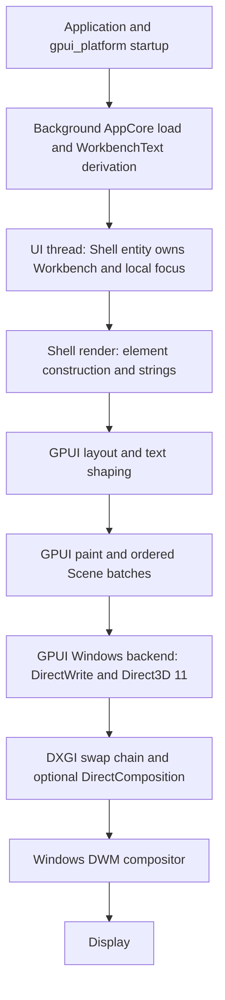

# Tern binary rendering analysis and COS baseline

Status: **Observed** source, binary, native-window, counter, Release-build, presented-frame and same-pin probe evidence; **Inferred** explanations explicitly identified below; **Proposed** experiments/targets; **Deferred** unperformed platform/media validation. Inspection: 2026-10-08, Windows local time. This is a measurement evidence document, not a Product/UX canon or an implementation authorization. Follow-up measurements that close part of the original gap list are in [§10](#10-follow-up-measurements-and-ratification); the remaining gaps are re-stated in §10.8. The [Product/UX canon](../architecture/COS_DESKTOP_PRODUCT_UX_ARCHITECTURE.md) remains authoritative; the accepted architecture direction is [ADR-0007](../decisions/ADR-0007-RENDERING-PERFORMANCE-VISUAL-ARCHITECTURE.md) with proposed implementation design in the [rendering companion](../architecture/RENDERING_PERFORMANCE_VISUAL_ARCHITECTURE.md).

## 1. Reproducible baseline

| Field | Observed value |
|---|---|
| Repository | `<desktop-root>`; `https://github.com/dio16/cos-desktop.git` |
| Baseline branch / SHA | `dev`; `7cbeda0e2aed7486958b1a23c4ef9cf254436d8e` |
| Initial worktree / tracking | Clean; upstream `origin/dev`; local-vs-tracking ahead/behind `0 / 0`. This compares local remote-tracking refs, not a newly fetched remote. |
| Work branch | `feature/rendering-performance-architecture`, created from baseline in accordance with feature → dev → main policy; no push. |
| Toolchain | `rustc 1.98.1 (48a229cea 2026-09-01)`, `x86_64-pc-windows-msvc`, LLVM 22.1.8; `cargo 1.98.1 (797e8a9bc 2026-08-05)` |
| GPUI source | Zed `395def7a067b32ed598fcb3f048969ada9b54942`; GPUI 0.2.2, gpui_platform / gpui_windows 0.1.0. Manifest and lock agree. |
| Cargo.lock | SHA-256 `F8AC088CC2F3CF75C8F9B5225298D3E245CA2BB4C48E63060B189D67218962E2`; dependency/lock changes prohibited in this task. |
| OS / CPU / RAM | Windows 11 Pro 10.0.26300; Ryzen 7 3700X, 8 cores / 16 logical CPUs; approximately 34.27 GB physical RAM reported. |
| GPU / driver | NVIDIA GeForce RTX 2080 SUPER, 8 GB; NVIDIA driver 610.88. |
| Displays | MSI MAG341CQ, 3440×1440, Windows mode approximately 99 Hz; RDT272WX, 1920×1080. Desktop API reports scale factor 1 for both (100%, nominal 96 DPI). |
| DPI coverage | Only current 100% scale observed. 125/150/175/200%, monitor migration and actual 120 Hz: **NOT_MEASURED**. System scale was not changed. |
| COS executable | Existing `target\debug\cos-desktop.exe`, 31,971,840 bytes; SHA-256 `5037EA9DC3E0BBA794CFF1FA2EEE51405337EA40A6C7AF969236E7D6AF480921`; launched with `--fixture`. |
| Build conditions | COS cached Debug build, not rebuilt; exact source/build provenance of that executable is not independently established. No Release COS executable was present at this point; §10.1 records the locked Release build later produced for follow-up measurement. Tern installed vendor binary: optimization/compiler flags unknown. No debug-vs-release equivalence claimed. |
| Contention | Initial system GPU utilization was approximately 98%, with other browser/video/desktop applications running. Measurements below are per-process, not attribution of the whole GPU to Tern. Power mode, thermal state and frequency locking were not controlled. |

Commands used for identity included `git status --porcelain`, branch/HEAD/upstream queries, `git rev-list --left-right --count HEAD...@{upstream}`, Rust version queries, PowerShell file/hash/signature/CIM queries and native desktop display/window inspection. No product source or Runtime repository mutation was authorized or performed.

## 2. Exact installed Tern

| Field | Observed value |
|---|---|
| Executable | `<user-home>\AppData\Local\Programs\Tern\tern.exe` |
| CLI companion | Same directory, `tern.com`; CLI reports **`tern 0.6.0 (0e39682)`**. No older version assumed. |
| SHA-256 | **`7DC1ABE4DBE933E92043271FB1AE5C2E739197D9A3F1544B20EB5043C2D29DC8`** |
| File size / modification time | 150,096,384 bytes; 2026-10-07T07:25:46+09:00. Time is filesystem metadata, not release provenance. |
| Windows VersionInfo | No useful FileVersion/ProductVersion fields; version comes from the installed CLI, not guessed PE metadata. |
| Signature | `Get-AuthenticodeSignature`: **NotSigned**. No certificate table observed. This does not establish provenance or maliciousness. |
| PE | AMD64 (`0x8664`), PE32+; sections `.text`, `.rdata`, `.data`, `.pdata`, `.gfids`, `.tls`, `_RDATA`, `.rsrc`, `.reloc`. Export directory present; symbols were not fully enumerated. |
| Bundled files | `dxcompiler.dll`, `dxil.dll`, `OpenConsole.exe`, `conpty.dll`; backup `.old*` files also present. |
| Bundled font assets | Geist variable, Berkeley Mono Nerd Font regular/medium, Excalifont. File presence is not proof of active font choice on every surface. No fonts/assets copied into COS. |

### 2.1 Static observations and strength

A bounded read-only PE import/resource/string inspection used existing PowerShell/JavaScript facilities. `dumpbin`, `llvm-objdump`, `sigcheck`, `strings`, PresentMon and WPA were not found; no large toolchain was installed.

| Evidence | Observation | Permitted conclusion / limit |
|---|---|---|
| PE imports | `D3D11CreateDevice`, DXGI factory creation; Win32 window/DPI and named-pipe APIs, GDI; OpenGL/WGL imports also present. | Graphics/window/IPC capabilities linked into this binary. Does **not** select its principal renderer. |
| Strings | References to wgpu, naga, Skia and Direct3D-related names. | Weak evidence of included libraries/paths. Not evidence that all paths execute or that Tern uses GPUI. |
| Text stack | GDI/text shaping related dependencies; bundled fonts. DirectWrite was not positively established by the bounded static search. | **NOT_ESTABLISHED** for Tern's primary shaping/rasterization implementation. Absence of a matched string is not proof of absence. |
| Image/media | WindowsCodecs and graphics libraries observed dynamically. | Image capability also verified on a native file surface below. Video hardware decoder, zero-copy, color management and HDR: **NOT_MEASURED**. |
| WebView | WebView2-related module and child processes in the user's original browser-containing session. | Tern can host a web surface; not proof that its terminal/chrome/image UI is WebView-rendered. |

No disassembly of proprietary logic, bypass, authentication/license manipulation, secret extraction, private configuration reading or redistribution was performed.

### 2.2 Dynamic structure

The original running Tern window process was PID 19336; a second Tern process, PID 32496, served the session daemon. ConPTY/OpenConsole shell children and WebView2 browser children were observed. Main-window loaded modules included D3D11, DXGI, D3D12/D3D12Core, DWM, TextShaping, GDI, WindowsCodecs and EmbeddedBrowserWebView. **Loaded** is stronger than imported, but still does not establish which library rendered a particular frame.

The initial user's session was unsuitable for attribution: multiple terminal/browser/agent surfaces and ongoing work were already present. It was not used for final comparative timings. A new temporary controlled window titled `COS-rendering-measurement` was launched with the installed binary, a temporary directory and loopback control endpoint `45187`; its actual window process was **PID 51572**. Its pane runtime used the existing daemon; daemon statistics therefore include unrelated sessions and cannot be charged entirely to the test window. The application was not instrumented by patching its code.

CLI/control IPC was observed over our explicitly requested loopback endpoint; `<local-tern-pipe>` named-pipe evidence was also present. Packet contents and private session files were not inspected. Host/daemon versus window ownership below is corroborated by official documentation, not reverse-engineered solely from PID counts.

## 3. Current COS rendering path

Source inspected: [binary startup](../../apps/desktop/src/main.rs), [window composition](../../apps/desktop/src/window.rs), [Shell](../../crates/desktop-gpui/src/lib.rs), [ui-model](../../crates/ui-model/src/lib.rs), app-core navigation/preferences, and current client snapshot/mutation sites. The current shell was evaluated from actual code and native output, not assumed from its filename.

Source proves the backend path; this task did not obtain a per-frame ETW trace proving every stage's duration.

| Concern | Observed current behavior | Bottleneck candidate, not measured cost |
|---|---|---|
| UI ownership | `Shell` owns `Workbench`, error/mode and GPUI focus handles; `Workbench` owns AppCore, local presentation and prederived text. Runtime projection authority remains in client/protocol. | Root entity combines conventional surfaces; localization possible without merging crates. |
| Notify/repaint | Startup completion, surface navigation, diagnostics and candidate-view changes call `cx.notify()` on `Shell`. Focus has its own GPUI state. | Application invalidation is root-entity coarse. Notify is not proof every pixel or every layout node is recalculated. |
| Layout invalidation | Root render constructs fresh element hierarchy. Actual GPUI cache reuse, relayout extent and dirty-region GPU behavior were **NOT_MEASURED**. | Count layout nodes and cache reuse before asserting full relayout. Backend render clears a target and submits scene batches; no application dirty-rectangle guarantee. |
| Allocation / clones | Each root render clones title/status/summary/diagnostic strings and entire evaluation/graph/artifact vectors; formats labels, selected content and accessibility names; graph view joins strings. | Collection-size-dependent copying/materialization is visible in source; no allocation profile collected. |
| SharedString | Imported and used for generated work-surface/candidate accessibility names. Most `WorkbenchText` data remains owned `String`/`Vec`; SharedString usage does not erase upstream copies. | Retain shared immutable display strings only where actual reuse justifies it. |
| Stable identity | Candidate GPUI IDs use enumeration index; canonical references are preserved for local viewed state. | Reorder/insert-safe widget identity must use scoped stable references in future collections. |
| Virtualization | No virtualized current collection. Evaluation uses eager `children`; candidates use eager enumerate/map. Task Rail is one static Task. | None of the future large Task/Candidate/history/Evidence/search/graph surfaces are implemented. Not a 10k-item performance result. |
| Background | Startup fixture file load/negotiation/pump and WorkbenchText preparation are scheduled on background executor. | No ongoing live projection-to-WorkbenchText update loop implemented. |
| UI thread | Small local state changes, event/focus handling, element construction, layout/paint. | Future search/layout/decode must not migrate here. |
| Snapshots | `SnapshotHandle = Arc<ProjectionState>`: accessor clones a handle. Mutation uses `Arc::make_mut`; retained readers trigger cloning of state/BTreeMaps. | Conditional O(state-size) copy-on-write, not a full snapshot clone on every layer crossing. Instrument retention/copy cost. |
| Texture lifetime | No application media texture/cache/decode lifecycle. GPUI owns glyph/image atlases and backend resources. | Resource/device-generation integration is future work, not an existing COS leak. |
| Missing renderers | Artifact, Compare and Flow explicitly display unimplemented-renderer text; no image/video/graph renderer. | Media presentation is the largest capability gap, not proof GPUI is the bottleneck. |
| Visual system | Fixed Yu Gothic UI 15-DIP shell, local RGB values, fixed rail/inspector widths; no validated typography/token/DPI system. | Native fixture screenshot has mixed Japanese/Latin and inspector content extending beyond the allocated viewport. Overflow/accessibility needs a real surface design. |

Native smoke used the existing Debug executable with explicit fixture mode: first useful shell visible, fixture banner visible, candidate B activated via AX, work surface changed to B and `B · Viewed` appeared. No Runtime success or complete product UX claimed. Window closed normally, exit code 0. Startup latency, allocation hot-path costs and presented frame timing remain unmeasured.

## 4. Measurement method and limitations

- Tern controls: `tern.com ctl --control 45187 perf reset`, `perf`, `stats`, `ready`, resize/split/tab/palette/peek/file/scroll commands. Native screenshots and AX verified actual surfaces; no inference from a successful command alone.
- Process samples: `Get-Process` CPU-time deltas, working set/private bytes/threads; GPU engine and process-memory CIM performance counters. CPU percentage is normalized by **16 logical CPUs** (100% means the whole machine), not one core. Multiply by 16 for percent of one logical CPU. Counter acquisition adds roughly 0.5 s to the nominal 1 s sampling interval; measured wall duration is reported.
- `perf` returns Tern's own CPU, GPU, gap and phase timing summaries, plus `over8ms`/`gpuOver8ms`. Timing values below are its millisecond fields, not percent GPU utilization. Frame counts/dropped/gap are **Tern-reported**, not independently reconciled with scanout/DWM. `input=0` is not zero interaction latency; control actions bypass normal input timing. No p99 field was returned.
- Transition scenarios have one short run (~10 s); feeding ran ~20 s and timed out. They include construction/animation and are **exploratory observations**, not qualified p95 SLOs. Persistent palette/close intervals below settle 30 s then sample over 60 s, but only one run each.
- The primary display is ~99 Hz, not a controlled 60/120 Hz reference. Existing system contention remains. Window approximately 1280×800 at scale 1; COS approximately 1280×832. No equal-workload Release COS comparison exists **in this section**; the locked Release baseline and same-method comparisons were added in §10.
- `wpr -start GPU -start DesktopComposition -filemode` failed with **0xc5585011**, “Failed to enable the policy to profile system performance.” No elevation/security-policy changes were made. GPUView/WPA, DWM redraw regions, independent scanout pacing, input-to-photon and per-phase allocation attribution: **NOT_MEASURED**. PresentMon 2.6.0 was not available for this section; §10.4 later captured presented frames with it non-elevated on processes started by the harness.
- Formatted thread counters in one quiet snapshot reported context switches/sec: COS 317, Tern window 123, shared daemon 33. A snapshot is not a distribution; context switches are not thread wakeups.
- Screenshots, raw in-memory counter samples, generated 20,000-line mixed-script text and 2560×1440 PNG were temporary research artifacts outside the repository. Numeric summaries are preserved here; screenshots containing application/user chrome are not redistributed. This is not a durable raw ETW trace dataset.

## 5. Scenario observations (current installed 0.6.0)

Tern profiler values: **CPU / GPU p50–p95 in ms**, gap p95 in ms; no p99. `Dropped` is its internal counter and is not a validated monitor frame-drop rate. Every row is one run.

| Scenario | Actual workload / proof | Seconds / drawn frames | CPU p50 / p95 | GPU p50 / p95 | Gap p95 / dropped |
|---|---|---:|---:|---:|---:|
| A. Quiet terminal | Empty terminal, smooth-blink caret visible in `stats`; not animation-free idle | 11.078 / 365 | 0.971 / 1.240 | 0.092 / 0.107 | 11.307 / 1 |
| B. Bulk output | 20k-line synthetic feed; CLI timed out after 20 s; scrollback visibly contained ~19,978 lines. Partial/completion timing not established. | 20.562 / 771 | 1.070 / 1.402 | 0.256 / 0.864 | 11.481 / 4 |
| C. Rapid resize | 12 alternating 1000×700 / 1280×800 requests | 10.141 / 357 | 1.050 / 1.418 | 0.256 / 0.275 | 11.268 / 8 |
| D/J. Split / dense UI | Three terminal panes, native split verified; modest density, not a large-list test | 10.088 / 404 | 1.219 / 2.026 | 0.097 / 1.624 | 11.370 / 5 |
| D. Pane close | Close the two created test splits | 9.973 / 353 | 1.075 / 1.428 | 0.255 / 4.022 | 11.565 / 2 |
| E. Tab switching | New test tab; 12 previous/next switches between test tabs | 9.684 / 834 | 1.104 / 1.510 | 0.209 / 0.398 | 11.479 / 6 |
| F. Palette | Actual command-palette popup opened and screenshot-verified | 10.045 / 56 | 1.892 / 4.574 | 3.744 / 8.452 | 11.954 / 0 |
| H. Palette close | Escape; actual underlying terminal restored | 10.048 / 328 | 0.998 / 1.321 | 0.092 / 0.109 | 11.565 / 2 |
| G. Overlay | Mission Control/session-tab overview via `peek mission`, screenshot verified; not Agent Hub specifically | 9.991 / 11 | 1.311 / 3.995 | 0.428 / 4.411 | 10.815 / 0 |
| H. Overlay close | `peek close`; terminal restored | 9.953 / 333 | 1.013 / 1.324 | 0.092 / 0.108 | 11.427 / 2 |
| I. Long scrollback | 12 alternating scroll requests against bulk-output terminal | 9.625 / 324 | 1.068 / 1.362 | 0.256 / 0.273 | 11.435 / 0 |
| K. Native image | 2560×1440 generated RGBA PNG; viewer confirmed 44% fit and image dimensions | 10.103 / 72 | 1.107 / 1.752 | 0.457 / 0.678 | 11.040 / 0 |
| L. Text/code | 20k-line mixed Japanese/Latin text file, jump to line 10,000, line-number/native text surface screenshot | 10.068 / 142 | 1.163 / 1.590 | 0.427 / 0.692 | 11.326 / 0 |
| N. Maximize | Native titlebar maximize on image surface; AX changes to Restore | 10.391 / 14 | 0.997 / 3.317 | 0.137 / 32.737 | 10.806 / 0 |
| N. Restore | Native Restore; original-size screenshot | 10.052 / 12 | 1.086 / 3.375 | 0.031 / 9.603 | NOT_MEASURED / 0 |

Max GPU timing during maximize was **34.051 ms**, and resize gap max was **98.277 ms**. These observed outliers must not be hidden behind percentile values; contention/swap-chain recreation/internal accounting were not separated. Pane-split gap max 430.972 ms, tab-switch gap max 180.027 ms and popup-close gap max 459.090 ms are also reported by the tool; sparse/paused rendering makes gap interpretation ambiguous. Do not label these input latency or actual display frame drops.

| Required scenario not fully established | Disposition |
|---|---|
| Agent Hub specifically / separate modal | The 0.6.0 build has no "Agent Hub" surface; its inbox overlay is the agent/notification surface. Inbox open/close slices and AX/screenshot proof are in §10.7 (overlay GPU p50 4.06 ms returning to 0.03 ms closed). Mission Control and palette remain the §5 substitutes. `carly`/agent blocks were not exercised. |
| M. Focus/unfocus transition | Both native focus states observed: Tern focused during popup runs, unfocused behind launched COS during quiet-image interval, focused again after COS close. Exact transition/input latency: **NOT_MEASURED**; foreground control approval timed out, so focus was not forcibly cycled. The §10.3 Tern sample was taken while unfocused; that is a state, not a transition measurement. |
| O. DPI/scale change | **NOT_MEASURED**; current scale 1 observed. System display settings were intentionally not changed; no per-window DPI harness available, and live foreground-control confirmation for a scale change was not granted. |
| Thousands of densely interactive widgets | **NOT_MEASURED for COS**. Three panes, tab overview and 20k-line text remain limited density evidence. §10.5 separately measures external same-pin 10,000-row and 50,000-edge mechanisms, which is mechanism evidence at the accepted pin, not a COS surface result. |
| 8K/16K, dual-image compare, ICC/HDR, 4K video | **Partially measured externally**: §10.5 records whole-image residency/dual-pane upload counts for 7,680×4,320, 8,192² and 16,384² on the accepted pin, and §10.6 records a 4 K decode capability matrix. ICC/HDR, tiling/upload pipeline behavior, video display/PTS and any COS renderer: **NOT_MEASURED / NOT_IMPLEMENTED**. |

### 5.1 Persistent popup cost and return to quiet state

Same isolated window, native image underneath, 30 s settling then >60 s per-process samples. These runs directly recheck the previous popup-load concern against **this exact binary**, without reusing historic figures.

| Quiet interval | Wall sample / profiler window | UI CPU mean (machine %) | CPU/GPU p95 (ms) | Drawn frames / animations | 3D engine counter |
|---|---|---:|---:|---:|---|
| Palette held open | 62.751 s / 63.472 s | 0.2100 | 3.292 / 3.972 | 193 / 0 | Mean 0.548%, max1%, integer-granularity counter |
| Palette closed, same image | 62.836 s / 62.903 s | 0.0312 | 1.286 / 0.032 | 66 / 0 | No positive engine sample observed; not proof of zero GPU work |
| Image unfocused behind COS | 64.239 s sample; 95.083 s profiler including settle | 0.0179 | 1.342 / 0.032 | 99 / 0 | No positive engine sample observed |

**Observed:** palette increases the cost of drawn frames, CPU consumption and sampled 3D activity; closing returns GPU timing to ~0.032 ms p95. **Not observed:** permanent 60/120fps animation after settling or continuously high total GPU utilization. Palette `why.anim=0`, ~3 profiler frames/sec; closed image ~1/sec with ~64 reported wakes per 63 s. Frame/wake counters expose some periodic activity even without animation. This is not proof its compositor is completely idle.

**Inference:** additional overlay paint/composition/targets probably contributes, because opening had 15 targets created and higher paint/GPU timing. Blur/backdrop/shader cost or exact redraw rectangles were not traced; no causal renderer claim is warranted. COS should prefer bounded one-shot popup motion, opaque/simple depth and observable stop-of-animation, then verify actual GPU cost rather than copy the popup appearance.

### 5.2 Memory and CPU quiet comparison

| Metric | COS cached Debug fixture, focused | Tern native image after scenario suite, focused |
|---|---:|---:|
| Settled sample length | 64.239 s | 62.836 s |
| CPU mean, whole-machine % | 0.1323 | 0.0312 |
| Equivalent % of one logical CPU | 2.12 | 0.50 |
| Working set, final MiB | 73.52 | 403.83 |
| Private bytes, final MiB | 85.73 | 792.27 |
| GPU dedicated / shared, MiB | 17.30 / 1.50 | 465.82 / 175.07 |
| GPU TotalCommitted counter, MiB | 49.15 | 640.89 |
| Threads at final sample | 32 | 31 |

These are **not equal-feature or equal-build rankings**. COS has no real artifact renderer; Tern includes session/chrome/native file capabilities and post-scenario caches. Working set, private bytes, GPU committed/dedicated/shared are distinct measures and must not be added as if disjoint physical memory. Initial isolated Tern quiet sample was approximately 329 MiB working set / 714 MiB private; later resident growth is observed, but cannot be called a leak without repeated close/eviction/lifetime analysis. The shared daemon used approximately 70 MiB working set / 68 MiB private after the tests; its CPU includes existing user sessions.

### 5.3 Startup evidence, not a startup benchmark

Tern `perf.launch` recorded one process-relative launch timeline: daemon 200.87 ms, boot289.62, GPU409.11, attached13605.97, first frame23082.62, interactive23103.21. This controlled launch involved existing daemon/session attachment and is neither a cold cache launch nor a repeated warm launch. Its ~23 s interactive milestone is preserved rather than hidden; §10.2 repeats this 30 times with the same external method and reports the distribution (p50 18,915.9 ms window appearance, first frame p50 18,862 ms), so treat this single run as one sample of that distribution. Causal delay and external process-start-to-visible timing are **NOT_MEASURED** for COS; §10.2 measures COS Release window appearance but not first useful frame. Cold/warm distributions remain unavailable for both.

## 6. Official Tern design versus observed binary

Official sources below are rolling documentation inspected 2026-10-08, not tied to commit `0e39682`. **Observed (documentation)** is a documented assertion, not source verification or independent performance evidence.

| Official mechanism | What is documented | COS applicability / caution |
|---|---|---|
| Native / Rust | Product describes Rust-native; SDK supports Rust, Python, Go, TypeScript. | Does not prove renderer API or language of every component. |
| Daemon/window | Daemon owns panes/screen state; windows attach/mirror; per-window focus/scroll remains local. Host plugins worker/VM, window plugins UI thread/VM. | Preserve COS Runtime/desktop ownership, not Tern pane semantics. Isolation can avoid blocking UI but is not a measured speed gain here. |
| Surface Protocol | Stable-ID semantic tree; atomic operation frames; add/set/text append/splice/move/delete/settle and local view state. | Incremental presentation updates are transferable; do not copy TSP transport or treat its ack as COS command completion. |
| Diff/backpressure | Default two outstanding frames; coalesce repeated sets/appends while waiting for render ack. Detached sessions may not ack. | Bound presentation queues; preserve COS canonical observations, ordering, atomic snapshot/subscription and gap/resync. |
| Virtualization | Long main/list/code/ANSI/Markdown and data table/tree/key-value elements use visible+overscan; incremental tail work. | Strong documented design mechanism, not measured O(visible) behavior from screenshots alone. Scope stable IDs and accessible virtual focus. |
| Work budgets | Host callback2 s, window50 ms, chrome/availability4 ms. | Plugin safety budgets, not renderer SLOs. Do not give COS UI thread a50 ms work allowance. |
| Blobs/images | SHA-addressed blobs, chunking/presence queries, shared disk/cache, documented caps. | Transfer bounded cache/deduplicated presentation ideas only. Runtime remains canonical artifact/CAS owner; no control-plane images. |
| Headless tests | `tern shot` emits deterministic offscreen PNG/layout; fixtures/clocks/defaults controlled. Commands may skip/stop on unsupported/precondition states. | Useful visual scenarios plus real native/DPI/device/Runtime validation. Headless success is not display/GPU or remote-session success. |
| Remote/local | Host panes/plugins can be remote; window view state remains local; PTY/SSH protocol. | COS protocol-first reconnect semantics remain authoritative. No terminal-specific runtime model transplantation. |

What can explain perceived responsiveness is **Inferred**: stable-ID updates, bounded producer work, virtualized visible content and worker ownership reduce unnecessary derivation/layout/blocking. The study does not isolate renderer throughput versus state propagation, atlas/font caching, batching or daemon effects. Tern's font atlas strategy, exact batching implementation, video path and redraw-region policy remain **NOT_ESTABLISHED**.

Do borrow: stable identities, visible-window work, cancellation/backpressure for presentation, shared representation cache, deterministic visual scenarios. Do not borrow: proprietary code/assets/fonts, PTY transport, terminal pane UX/lifetimes, plugin architecture, callback budgets, blob caps or screenshot aesthetics as COS design authority. Tern's observed palette and maximize costs, periodic quiet wakes, relatively large post-suite private/GPU allocations and startup outlier are investigation targets, not proof of universally superior implementation.

## 7. GPUI pin and current upstream

Observed official main at inspection: **`46b11cc550d5bb0585fa912dfaa1218cf52e5025`**, commit2026-10-07T15:00:11Z. [Immutable compare](https://github.com/zed-industries/zed/compare/395def7a067b32ed598fcb3f048969ada9b54942...46b11cc550d5bb0585fa912dfaa1218cf52e5025): 284 commits ahead,0 behind. Matching local Cargo checkout of the pin inspected. No dependency updated.

| Area | Pinned-source observation / upstream finding |
|---|---|
| Windows renderer | Direct3D11/DXGI; optional DirectComposition; ordered scene batches for quads, shadows, paths, underlines, mono/subpixel/polychrome sprites. Paths use4×MSAA intermediate/resolve. |
| Present / vsync | DXGI `Present(0,0)` plus platform DwmFlush-based waiting and fallback sleep. Present interval0 alone is not absence of pacing. Actual latency/occlusion/power behavior unmeasured. |
| Text | DirectWrite system/custom fonts, fallback/metrics; mono/subpixel/polychrome raster paths. Clean Windows Japanese fallback/hinting/IME needs validation. |
| Atlas / upload | Separate mono/poly/subpixel bucketed atlases; default1024-square, max16384-square; D3D11 UpdateSubresource. Max texture size is not a16K-image memory policy. |
| Images / resources | GPUI image/cache/custom-element APIs exist; backend device-loss recreation resets atlases/pipelines. API presence is not a production COS decoder/tiler or recovery proof. |
| Low-level drawing | Custom Element/Scene APIs permit narrow drawing; **Windows `draw_surfaces` is a no-op at the pin**. Direct video surface import must not be assumed. |
| Layout / scrolling | Core layout/element/scene and list APIs provide implementation mechanisms; COS currently uses eager collections. Framework mechanisms do not automatically virtualize consumers. |
| Effects / animation | Clipping, opacity, shadows, rounded rectangles and animation APIs are available. Cost depends on workload/targets/passes; no beauty-vs-throughput comparison measured. |
| DPI | `GetDpiForWindow` conversion and per-window scale in source; monitor migration, pixel snapping and100–200% typography are not validated by that fact. |
| Atlas fix after pin | [96e95ed / #64623](https://github.com/zed-industries/zed/commit/96e95edac45b0e0696179b8139aa521cf48db392): stale paint/removed image atlas lookup becomes bounds-safe and missing sprites skipped. Upstream explicitly says DirectX arm **not compiled** in that change. Source fix, not validated Windows result. |
| Element hashing | [1dd9bbf / #64209](https://github.com/zed-industries/zed/commit/1dd9bbfd71cdb1eed32e3451d661de48a68493fd): caches global/prefix hashes. Author-reported macOS nested-item median improvements ~5–24%; **not Windows/COS measurements**. |
| Frame diagnostics | [#64958](https://github.com/zed-industries/zed/commit/cd4fc8de4ca8548cca2567352b87bcaaec13328f) captures request/skip timing; [#65057](https://github.com/zed-industries/zed/commit/36b6d0951fdee409f0957294a69360ba2e8e980e) avoids empty idle profiler intervals. No measured COS throughput gain. |

| GPUI option | Disposition | Evidence and cost |
|---|---|---|
| KEEP | **RECOMMENDED now** | No measured Windows A/B speed/quality gain; accepted pin has native shell smoke. Does retain the identified stale-atlas risk and missing video surface capability; review before heavy image use. |
| UPDATE | **ALTERNATIVE / Proposed** | Evaluate a selected immutable revision for concrete atlas safety/core-hashing benefit. Windows compile, cached-image-drop lifecycle, DPI/input/device-loss and equivalent Release workloads required. Audit284-commit API/dependency/toolchain/license churn and compile cost; not measured here. |
| FORK/PATCH | **REJECTED as default; conditional alternative** | Surgical patch only for reproduced relevant defect when bounded update is unsuitable. No independent fork or performance patch justified; assumes ongoing Windows CI/rebase/provenance responsibility. |
| OTHER / REPLACE | **REJECTED now** | No comparative proof full stack replacement solves a demonstrated bottleneck. Compare complete text/IME/AX/DPI/media/interop/present paths, including WebView/other native alternatives where genuinely applicable; do not dismiss by technology label. |

## 8. Tern versus COS benchmark inventory

This table records **measurements and missing results only**. Numeric targets, counter definitions, workload sizes, repeats and the calibration protocol are owned solely by [companion §10](../architecture/RENDERING_PERFORMANCE_VISUAL_ARCHITECTURE.md#10-proposed-performance-budget-and-calibration-plan); nothing here redefines a target, and future target changes must not require editing this document.

| Metric | COS current | Tern exact0.6.0 | Target owner / calibration status | Evidence |
|---|---|---|---|---|
| Cold startup | NOT_MEASURED | NOT_MEASURED | Companion §10 owns the target; cold-cache status NOT_MEASURED for both | §10.2 is warm-cache only |
| Warm startup | Window appearance p50 981 ms / p95 1,336 ms / max 2,608 ms (Release, n=30; §10.2) | Window appearance p50 18,916 ms (n=30); own first-frame mark p50 18,862 ms | Companion §10: warm window p95 ≤1.5 s candidate; the 500 ms value remains a stretch investigation, not an approved gate | §10.2; endpoints differ (window existence vs Tern's frame mark) |
| First window/useful frame | Window p95 measured; useful-shell/observation NOT_MEASURED | Window verified; useful-frame milestone p50 18,862 ms (Tern instrumentation) | Companion §10 owns milestones; useful-shell/useful-observation NOT_MEASURED for COS | §10.2/§10.4; useful-shell milestone undefined for COS |
| Idle CPU |0.1087–0.1185% whole-machine (Release 60 s, §10.3) |0.0162–0.0413% whole-machine (scoped window, §10.3) | Companion §10 owns the idle target; calibration pending | §10.3; not equal-feature; sampling perturbs tail |
| Idle GPU | No positive engine samples (two 60 s runs); presents observed only sparsely and only around externally caused changes, with no continuous stream during settled idle (§10.4; 1:1 activation-to-present mapping not established) | Inbox overlay GPU p50 4.06 ms → 0.03 ms closed (§10.7) | Companion §10 owns target and measurement-floor language | CIM counters + PresentMon; overlay is Tern's own profiler |
| RAM | WS 59.1 / private 85.2 MiB (Release fixture, §10.3) | WS 263.3 / private 657.5 MiB (scoped window, §10.3) | Companion §10 owns shell/media memory hypotheses | §10.3; no equivalent feature set |
| VRAM | dedicated 17.3 / shared 0.36 MiB (§10.3) | dedicated 465.5 / shared 105.1 MiB (§10.3) | Companion §10 owns GPU residency ceilings | Process GPU-memory counters; a single whole-image 16K source reached 1,043 MiB dedicated (§10.5) |
| Resize | NOT_MEASURED | CPU p95 1.418 ms; internal drops8 | Companion §10 owns interaction budgets and continuous frame-pacing criteria | §5, not independent scanout timing |
| Scroll | NOT_MEASURED | CPU p95 1.362 ms, gap p95 11.435 ms | Companion §10/§13 owns scroll budgets and frame pacing | Long-scrollback single run |
| Popup | NOT_MEASURED | Palette opening GPU p95 8.452 ms; settled3.972 ms; inbox overlay GPU p50 4.055 ms → 0.030 ms closed (§10.7) | Companion §10 owns popup/idle-animation targets | Native palette/inbox intervals, Tern profiler fields |
| Large list | §10.5 external same-pin probe: 10k rows → 50 mounted (visible 23), private flat ≈82 MiB; eager 10k mounts 2×10k rows, ≈204 MiB | NOT_MEASURED;20k-line text is not a widget-list benchmark | Companion §10/§13 own list workloads and virtualization gates | Mechanism evidence at the accepted pin, not a COS surface |
| Text rendering | Mixed-script shell visually confirmed; fidelity/timing NOT_MEASURED |20k-line mixed-script file visually confirmed; CPU p95 1.590 ms | Companion §9.1/§10 own typography criteria and budgets | Native screenshots, no quality goldens |
| Image rendering | §10.5 external probe: generic `img()` GPU dedicated 146.7 / 274.9 / 1,043.0 MiB and private 462.4 / 851.0 / 3,159.6 MiB at 8K UHD / 8,192² / 16,384² |2560×1440 PNG; GPU p95 0.678 ms | Companion §6/§10 own representation and residency policy | Probe measures a whole-image element; no COS renderer and no color-accuracy claim |
| Frame p50 | Sparse presents consistent with demand-driven updates: 3 presents across 5 native activations in 40 s (not a 1:1 mapping), GPUTime 0.26–0.37 ms (§10.4) | CPU0.971 ms quiet terminal; presented p50 only for external probe workloads | Companion §10 owns frame-work/interval targets | PresentMon for COS/probe; Tern column is its profiler |
| Frame p95 | No continuous COS presents to percentile; probe `uniform_list` 10k interval p95 11.51 ms (§10.4) | CPU1.240 ms quiet terminal; gap11.307 ms; **presented p95 NOT_MEASURED** | Companion §10 owns separate UI/GPU/scanout distributions | Internal field definitions, no ETW for Tern |
| Frame p99 | NOT_MEASURED; n=30 startup tail is a single maximum, not a p99 gate | NOT_MEASURED | Companion §10 owns tail-target policy (including any minimum run count) | Require companion-ratified run counts before quoting p99 |
|8K / dual8K compare /4K video | Probe: dual-pane 8,192² same source 274.9 MiB dedicated (one upload) vs two distinct sources 533.9 MiB (§10.5) | NOT_MEASURED; a 4 K decode capability matrix is in §10.6 | Companion §10 owns workload caps; video capability conditional (R7) | No production COS media renderer; no display/import/PTS evidence |

**Verdict (updated with §10):** current COS is a real native technical shell, not a scalable workbench renderer. Its eager root rendering and missing media/collection paths, not a measured GPUI GPU limit, dominate the redesign case. The §10 evidence sharpens this: the locked Release shell starts as a native window in ~1 s (p50 warm), presented sparsely rather than continuously (presents observed around externally caused changes; no continuous present stream during settled idle, and no activation-to-present 1:1 mapping established), and holds ~0.1% whole-machine CPU at idle; at the same accepted pin and on the same machine, a fixed-height virtualized 10,000-row list keeps mounted rows and memory flat and presents at 10.09 ms p50 intervals, while the eager equivalent drops to 83.8 ms intervals with the UI thread saturated; viewport culling removes ~81% of painted edges at 10k/50k; and a generic whole-image `img()` uploads a full-resolution texture (1,043 MiB dedicated / 3,160 MiB private at 16,384²). Tern supports a useful reference architecture and real rich/text surfaces, but this investigation does not establish end-to-end performance superiority; its fresh-process window appearance here is ~19 s (p50). The rational places to aim beyond Tern are bounded 8K/16K artifact presentation via thumbnail/preview/tiled representations, shared compare decode/upload keyed by representation, virtualization with stable identity, noise-free truthful information hierarchy and stop-of-idle-animation—now backed by mechanism measurements at the accepted pin, still not achieved COS features.

## 9. Remaining uncertainty and next evidence

Implementation-ready for the entire renderer/media redesign: **NO**. R0 measurement and scoped prototypes are specifiable; budgets, typography/icon rendering, per-entity GPUI invalidation/cache behavior, ICC output policy, video surface interop, native accessible virtual focus, device loss and supported lower-end hardware still require evidence. No accepted pin/renderer decision follows from this task.

Required next measurements — **updated after §10**, which delivered the locked Release baseline, non-elevated presented-frame capture, repeated warm starts, 60 s quiet samples, same-pin 100/1k/10k collection and 10k/50k-edge graph mechanisms, 8K/8192²/16K² whole-image residency, dual-pane upload counts, a 4 K decode capability matrix and Tern overlay slices: true **cold-cache** startup; first-useful-shell/observation and input-to-photon; immutable-pin A/B; fractional DPI (125–200 %)/IME/AX/native focus; variable-height rows with scroll-anchor and focus retention; a real tile/partial-upload path and its byte caps; ICC/HDR color; video surface import, displayed playback, seek/frame-step UX and compare PTS synchronization; device-loss recovery; and any production COS artifact/graph surface. No Runtime mutation is implied.

## 10. Follow-up measurements and ratification

Status: **Observed** on 2026-10-08 (Windows local), all temporary artifacts outside the repository under `<user-home>/AppData/Local/Temp/cos-render-probes-20261008/` (raw CSVs/JSON, scripts, generated media). No product source, Cargo manifest/lock, or Runtime repository was modified. These runs were made to close the specific gaps §9 listed; remaining gaps are re-listed in §10.8. Physical conditions are unchanged from §1 (Ryzen 7 3700X, RTX 2080 SUPER 8 GB, driver 610.88, Windows build 26300, 3440×1440 at ~99 Hz, 100% scale); background contention, power and thermal state remain uncontrolled, and every number below is a single-workstation observation.

### 10.1 Release COS build identity

| Field | Observed value |
|---|---|
| Command | `cargo build --locked --release -p cos-desktop` (MSVC vcvars64, project-target dir), no manifest/lock change |
| Binary | `target/release/cos-desktop.exe`, 12,840,448 bytes |
| SHA-256 | `846EE350F3C249B7ADFC020D16B00F5AA56563A4CE2CC9E492D6DAE280C145BC` |
| Run mode | `--fixture`; window closed normally after every measured run |

The §1 cached Debug executable was **not** used for the measurements below. GPUI source remains the accepted pin `395def7a…`; the temporary probe crate (§10.5) pins the same revision and builds Release with the same toolchain.

### 10.2 Startup and window appearance (not first useful frame)

Method: fresh process via `Start-Process`, poll `Process.MainWindowHandle ≠ 0` at 5 ms; endpoint is **native window existence**, not first presented frame, first useful shell or first useful observation. OS file cache warm for both; no cold-cache control (no reboot/cache purge). All runs closed normally (exit 0).

| Series | n | p50 | p95 | max |
|---|---:|---:|---:|---:|
| COS Release `--fixture` window appearance | 30 | 981.3 ms | 1,336.0 ms | 2,608.2 ms (single outlier run) |
| Tern 0.6.0 window appearance, same external method | 30 | 18,915.9 ms | 21,906.7 ms | 22,026.7 ms |

Tern's own `perf.launch` marks (ms since main, median across the same 30 runs): GPU init p50 353; session **attach** p50 9,780 (p95 11,351); first frame p50 18,862 (p95 21,848); interactive p50 18,873. The §5.3 single ~23 s timeline sits inside this distribution. Caveats: Tern runs here attached to the user's already-running session daemon with `--control`/`--dir`; its marks are its own instrumentation; COS's ~1 s is a window-existence endpoint, so the two columns are **not** the same milestone. With n=30 the COS 2,608 ms tail is a single observed maximum rather than a stable percentile; whether any tail beyond p95 may be used as a gate — and the minimum run count for it — is policy owned by the [companion §10](../architecture/RENDERING_PERFORMANCE_VISUAL_ARCHITECTURE.md#10-proposed-performance-budget-and-calibration-plan), not by this evidence document.

### 10.3 Quiet-state counters

One scoped window each, 60 s samples after settling: COS Release fixture (focused, visible) and the Tern 0.6.0 measurement window (mixed-script file open, unfocused). CPU is normalized to **16 logical CPUs** (100% = whole machine); the light sampler reads `Get-Process` once per second, the heavy sampler adds per-thread context-switch/GPU CIM queries (≈20 s per tick on this machine, so its rows are spot values, not distributions).

| Metric | COS Release | Tern 0.6.0 scoped window |
|---|---:|---:|
| CPU mean (whole-machine %) | 0.1087–0.1185 | 0.0162–0.0413 |
| CPU mean (% of one logical CPU) | 1.7–1.9 | 0.26–0.66 |
| CPU p95 (whole-machine %, light sampler) | 0.382 | 0.097 |
| Working set, final (MiB) | 59.1 | 263.3 |
| Private bytes, final (MiB) | 85.2 | 657.5 |
| Threads, final | 40 | 32 |
| Context switches/s (spot values) | 339–346 (one 4,945 sample) | 0 / 119 / 119 |
| 3D engine counter | no positive sample | no positive sample |
| GPU dedicated / shared / committed (MiB) | 17.30 / 0.36 / 49.15 | 465.55 / 105.07 / 570.61 |

These are **not** equal-feature or equal-build rankings: COS has no artifact renderer, Tern carries session/file/graphics blocks and a much larger resident footprint. Both show no sustained animation. COS's per-vsync wake loop (source-observed, §7 of the companion) is one candidate explanation for its higher, burstier context-switch spot rate; that attribution is **Inferred**, not traced.

### 10.4 Independent presented-frame capture (PresentMon 2.6.0, non-elevated)

PresentMon 2.6.0 was used successfully **without elevation** on processes started by this session (`--process_id`, v2 metrics, `Composed: Flip` swapchains). Elevated-only limits remain for short-running or other-account processes. For sparse-present applications PresentMon's `CPUBusy` converges to the whole inter-present interval, so it is **not** UI-thread work here; only present counts/intervals and `GPUTime` are used.

| Capture | Presents / duration | Present interval | GPU time |
|---|---|---:|---:|
| COS Release, idle | 2 / 45 s | ≈1.08–1.14 s apart | 0.32–1.14 ms |
| COS Release, 5 native candidate/surface activations | 3 / 40 s | ≈3.75–3.80 s | 0.26–0.37 ms |
| Probe `uniform_list` 10 000 rows, continuous | 446 / 5 s (≈89/s) | p50 10.09 ms, p95 11.51, p99 12.04 | p50 0.24 ms, p95 9.54 |
| Probe eager 10 000 rows, continuous | 46 / 5 s | p50 83.78 ms, p95 95.36 | p50 0.34 ms |
| Probe synthetic graph 50 000 edges, full repaint | 60 / 5 s | p50 62.77 ms, p95 97.51 | p50 1.90 ms, p95 3.19 |
| Probe same graph with viewport culling | 188 / 5 s | p50 22.07 ms, p95 30.27 | p50 1.78 ms, p95 2.68 |

**Observed present behavior:** COS showed sparse, demand-driven presents rather than a continuous repaint stream. In settled idle, no continuous present stream was observed (2 presents / 45 s); during five native candidate/surface activations, 3 presents were captured over 40 s, i.e. presents were associated with user-visible state changes but a 1:1 activation-to-present mapping was **not** established, and this is consistent with the source-observed demand-driven frame request. Compositor suppression, occlusion, frame batching and swap-chain reuse were not separated; **no present does not mean no CPU work** (the process still shows small CPU use and per-vsync wake activity, §10.3). The probe rows are worst-case continuous full-window repaint of a temporary external workload at the accepted pin, not production COS surfaces and not input-to-photon latency.

### 10.5 Same-pin GPUI workload probe (temporary, external)

A temporary external crate (`gpui-probe`) pinned to the same Zed revision `395def7a…` built Release through vcvars64 + Cargo (offline), three runs per fixed case, 6 s window each, `--animate` runs captured with PresentMon. It reports only UI-side counters (render calls, mounted rows, painted paths) plus process/GPU counters sampled at 50 ms/5 s. 39/39 runs exited 0.

| Case (3 runs unless noted) | Mounted work | Process private peak | Window appearance |
|---|---|---:|---:|
| `eager` 100 / 1 000 / 10 000 rows | 2 × N rows constructed per 2 renders | 82.4 / 92.9 / 203.8 MiB | 0.94–1.01 s |
| `uniform_list` 100 / 1 000 / 10 000 | 50 rows (visible 23), independent of N | 82.0 / 81.5 / 81.9 MiB | 0.97–1.03 s |
| Synthetic graph 10 000 edges, full / culled | 10 000 / 1 864 paths painted | 91.2 / 91.3 MiB | ≈0.9–1.0 s |
| Synthetic graph 50 000 edges, full / culled | 50 000 / 9 317 paths painted | 120.2 / 119.9 MiB | 0.87–0.98 s |
| Generic `img()` 7 680×4 320 / 8 192² / 16 384² (1 run each) | one whole-image upload | 462.4 / 851.0 / 3 159.6 MiB (GPU dedicated 146.7 / 274.9 / 1 043.0 MiB) | 0.97–0.99 s |
| Two-pane `img()`, same 8 192² source / two distinct sources | 1 / 2 whole-image uploads | 851.8 / 1 361.3 MiB (GPU dedicated 274.9 / 533.9 MiB) | 0.91–0.97 s |

Observed implications: fixed-height virtualization keeps mounted rows and memory flat from 100 to 10 000 items; eager construction scales with N (2 × 10 000 rows materialized per two renders and ~205 MiB private); viewport culling removes ~81 % of painted edges at 10 k and 50 k; the generic image element uploads a **full-resolution** texture whose dedicated memory matches `width × height × 4` (8 192² ≈ 256 MiB, 16 384² ≈ 1 024 MiB) and drives process private size past 3 GiB at 16 K. The pinned image cache does share an identical source key between two panes (measured: one upload), but distinct sources are two uploads. Confirmed conclusion: a thumbnail/preview/tile pipeline with bounded decode scratch is required before 8 K-class artifacts are displayed; a whole-image element cannot satisfy the proposed 512-MiB residency hypothesis. (Arithmetic cross-check: 16 384² × 4 B = 1 073 741 824 B = 1 GiB.)

### 10.6 Decoder capability matrix (temporary FFmpeg 8.0 probes)

Input: `moving4k30_h264_5s.mp4`, 3 840×2 160, 30 fps, H.264 Constrained Baseline, yuv420p, 5 s, SHA-256 `5a8540dc…`; five repeats per case; measurement uses FFmpeg's own final elapsed status; per-run `nvidia-smi` samples saved alongside.

| Path | Command shape | Frames | p50 / p95 (ms) |
|---|---|---:|---:|
| Software (`h264` native) full decode | `-f null NUL` | 150/150 | 290 / 300 |
| Software seek → one frame @1.0 / 2.5 / 4.0 s | `-ss … -frames:v 1` | 1 | 130 / 100 / 70 |
| Software frame-select after decode-through @30 / 75 / 149 | `-vf select` | 1 | 120 / 190 / 290 |
| D3D11VA + `hwaccel_output_format d3d11` + `hwdownload,format=nv12` | readback to CPU | 150/150 | 800 / 850 |
| DXVA2 (`-hwaccel dxva2`) | `-f null NUL` | 150/150 | 840 / 850 |
| CUVID (`-c:v h264_cuvid`) | `-f null NUL` | 150/150 | 750 / 780 |
| QSV (`-c:v h264_qsv`) | failed: MFX session −9, exit 69 | 0 | — |
| AMF (`-c:v h264_amf`) | failed: `amfrt64.dll` absent, exit −1 313 558 101 | 0 | — |

Verbose logs confirm the hardware paths were actually selected (`Selecting decoder 'h264' because of requested hwaccel method d3d11va`, output `pix_fmt d3d11`; DXVA2 `Using D3D9Ex device`, `pix_fmt dxva2_vld`; `h264_cuvid`). These are **decode (+readback where configured)** costs, not display: nothing here proves GPUI/Media Foundation import, zero-copy, color conversion, PTS synchronization or displayed playback (the pinned Windows `draw_surfaces` remains a no-op). Separately, this FFmpeg build **rejects the exact 16 384² PNG decode** (`Picture size 16384x16384 is invalid`, exit 69), which is why the 16 K image rows in §10.5 used GDI+ and a generic GPUI decode: a per-format admission plan must classify such dimensions instead of assuming any decoder accepts them.

Image decode in the same harness (five repeats per case; measurement uses the decoder worker's own elapsed timer; FFmpeg-native PNG decoder unless noted):

| Input | Full decode p50 (ms) | Decode + scale to 320² p50 (ms) | Nominal RGB24 size |
|---|---:|---:|---:|
| 7 680×4 320 PNG | 120–130 | 210–220 | 99 532 800 B |
| 8 192² PNG | 240–260 | 370–390 | 201 326 592 B |
| 16 384² PNG (GDI+ worker, every pixel row read) | 614–648 | 1 103–1 104 | 805 306 368 B |

These are full decodes; a 320-pixel thumbnail is *smaller*, not cheaper, and the per-run worker CPU time (1.5–7.9 s summed across the worker processes) shows the scratch cost is real. The harness did not capture per-process peak working sets for these runs.

### 10.7 Tern scoped-window overlay (modal) behavior

The 0.6.0 build has no surface named "Agent Hub"; its agent/notification surface is the **inbox** overlay, so that plus the palette counts as modal evidence here. Scoped measurement window (`--control`, temp directory), `perf reset` slices:

| Slice | Window | Frames | CPU p50 / p95 (ms) | GPU p50 / p95 / max (ms) | `why` | passes p50 |
|---|---|---:|---|---|---|---:|
| Inbox overlay open | 21.0 s | 47 (≈2.2/s) | 1.413 / 1.744 | 4.055 / 5.732 / 6.031 | anim 25, paint 22, wakes 22 | 9 |
| Closed, settled | 15.0 s | 16 (≈1.1/s) | 1.059 / 1.157 | 0.030 / 0.031 / 0.032 | anim 0, wakes 15 | 1 |

The overlay was proven on screen by AX text ("Bells, long commands, failed exits and agents waiting on you land here.") and a screenshot. Closing returns GPU timing to ~0.03 ms and clears the animation reason — the same shape as the §5.1 palette result, now reproduced on this exact scoped window. Tern's own `perf` fields are its instrumentation; these are short single runs, and `carly`/agent blocks were not exercised.

### 10.8 What this establishes, and what stays unmeasured

**Now Observed:** a locked Release shell builds and appears as a native window in ~1 s (p50) with a 1.3 s p95 on this workstation; it presented sparsely rather than continuously (no continuous present stream in settled idle; presents observed around externally caused changes), with no positive 3D-engine samples at idle and ~0.1 % whole-machine CPU; the accepted pin's `uniform_list` keeps mounted rows and memory flat at 10 k items; culling removes most painted edges; whole-image `img()` and naive decoders scale with source resolution and exceed the proposed residency bound at 8 K²/16 K²; three hardware H.264 decode paths work for 4 K on this GPU, and two more fail for concrete reasons.

**Still NOT_MEASURED / NOT_ESTABLISHED:** true cold-cache/cold-boot startup; first-useful-shell/observation milestones and input-to-photon; a controlled 60 Hz/120 Hz display; fractional DPI (125–200 %), IME, screen-reader/accessible virtual focus; variable-height rows, scroll-anchor and focus retention under virtualization; any tile/partial-upload API at this pin; ICC/HDR color handling; video surface import, displayed playback, seek/frame-step UX and compare PTS synchronization; GPU device-loss recovery; alternative-pin or alternative-renderer A/B; and any production COS artifact/graph surface (none exists yet). Anything absent here must keep its prior `NOT_MEASURED` label; these runs qualify the architectural decision only and do not certify implementation-ready SLOs.

## Primary sources

- [Tern official product](https://stencil.so/tern), [official SDK](https://github.com/stencil-hq/tern-sdk), [architecture](https://docs.stencil.so/tern/concepts/architecture.html).
- [Surface Protocol overview](https://docs.stencil.so/tern/protocol/index.html), [transport](https://docs.stencil.so/tern/protocol/transport.html), [surface lifetime](https://docs.stencil.so/tern/protocol/surfaces.html), [documents/frames](https://docs.stencil.so/tern/protocol/documents.html), [flow control/limits](https://docs.stencil.so/tern/protocol/operations.html).
- [Text/code](https://docs.stencil.so/tern/elements/text.html), [virtualized data/image elements](https://docs.stencil.so/tern/elements/data.html), [runtime/worker budgets](https://docs.stencil.so/tern/concepts/runtime.html), [headless scripts](https://docs.stencil.so/tern/scripts/index.html), [remote scripts](https://docs.stencil.so/tern/scripts/remote.html).
- Immutable pinned GPUI [DirectX renderer](https://github.com/zed-industries/zed/blob/395def7a067b32ed598fcb3f048969ada9b54942/crates/gpui_windows/src/directx_renderer.rs), [DirectWrite](https://github.com/zed-industries/zed/blob/395def7a067b32ed598fcb3f048969ada9b54942/crates/gpui_windows/src/direct_write.rs), [atlas](https://github.com/zed-industries/zed/blob/395def7a067b32ed598fcb3f048969ada9b54942/crates/gpui_windows/src/directx_atlas.rs), [vsync](https://github.com/zed-industries/zed/blob/395def7a067b32ed598fcb3f048969ada9b54942/crates/gpui_windows/src/vsync.rs), [window/DPI](https://github.com/zed-industries/zed/blob/395def7a067b32ed598fcb3f048969ada9b54942/crates/gpui_windows/src/window.rs).
- [ADR-0001 GPUI](../decisions/ADR-0001-GPUI.md), [bootstrap evidence](BOOTSTRAP_REPORT.md), [dependency boundaries](../architecture/DEPENDENCY_RULES.md), [process model](../architecture/PROCESS_MODEL.md).
